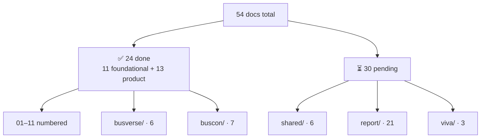
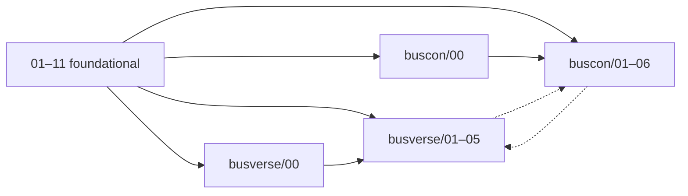
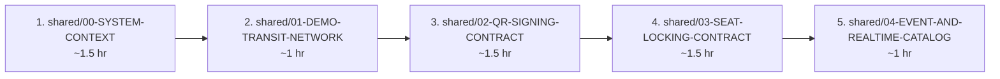

# `docs/00-INDEX.md` v1.1

**Document:** `docs/00-INDEX.md`
**Project:** BusVerse + BusCon
**Version:** 1.1
**Status:** Live — updates with each doc
**Owner:** Shaghaf
**Guide:** Mr. Mohit Srivastav
**Purpose:** The master tracker for every document in the `/docs` tree. Shows what's written, what's pending, what each doc owns, and how docs link together. Single source of truth for project documentation status.

---

## §0. Changelog

| Version | Date | Changes |
|---|---|---|
| 1.0 | Initial | Foundational docs locked (11/53) |
| **1.1** | **Current** | **BusVerse (6) + BusCon (7) folders locked → 24/54 done.** Corrected BusCon count from 6 → 7 (QR scan is separate from telemetry). Added §3.4 + §3.5 (product folders complete). Updated diagram + test tables with 13 new rows. Added §14 "Pending Amendments" — consolidates 40+ amendment flags from product docs. Updated §13 priority queue (SH-00 next). Updated §15 open issues. Updated §16 critical values with 22 new metrics. **`shared/00-SYSTEM-CONTEXT.md` is next per §13.** |

---

## §1. Overall Progress

**Diagram: Project completion**
*24 docs complete (11 foundational + 6 BusVerse + 7 BusCon). Product folders fully locked. Shared contracts, report chapters, and viva docs remain. Total progress: 24 of 54 docs (~44%).*

| Category | Total | Done | Pending | Progress |
|---|---:|---:|---:|---:|
| Foundational (numbered) | 11 | 11 | 0 | **100%** |
| Product — BusVerse | 6 | 6 | 0 | **100%** |
| Product — BusCon | 7 | 7 | 0 | **100%** |
| Shared | 6 | 0 | 6 | 0% |
| Report (MCU 20-section) | 21 | 0 | 21 | 0% |
| Viva | 3 | 0 | 3 | 0% |
| **Total** | **54** | **24** | **30** | **~44%** |

**Metric summary:**

| Metric | Count | Change from v1.0 |
|---|---:|---|
| Documents written | 24 | +13 |
| Documents pending | 30 | −12 |
| Total Mermaid diagrams | **~650** | +325 |
| Total FRs defined | 126 | — |
| Total NFRs defined | 68 | — |
| Total tests designed | **~1,900** | +818 |
| Total entities modelled | 29 | — |
| Total API endpoints | 101 (+1 flagged for amendment) | — |
| Total workflows | 38 | — |
| Total components | 22 shared primitives + ~40 compositions | New |
| Total screens | 18 primary + 1 drawer + 4 fallback = 23 | New |
| Total security rules | 12 never-permissions + 19 invariants | — |
| Total ADRs | 15 | — |
| **Total pending amendments** | **~40** (see §14) | New |

**Correction from v1.0:** The original index used "53 docs" with BusCon at 6. Per `00-INDEX.md` §4.2's own note *"(7 files, not 6 — QR scan is separate from telemetry)"*, the correct count is **54 docs** (BusCon = 7). v1.1 uses 7 consistently throughout.

---

## §2. Document Tree

**Diagram: Full doc tree (v1.1)**
*Every document in `/docs`, grouped by folder. Foundational (01–11), BusVerse (00–05), and BusCon (00–06) are locked. Shared, Report, and Viva remain pending. Assets and Archive complete the tree.*

```mermaid
flowchart TB
    ROOT["docs/"]

    ROOT --> INDEX["00-INDEX.md v1.1<br/>(you are here)"]

    ROOT --> FOUND["Foundational · ✅ 11 done"]
    FOUND --> F1["01-plan-and-scope"]
    FOUND --> F2["02-requirements"]
    FOUND --> F3["03-system-architecture"]
    FOUND --> F4["04-actors-roles-permissions"]
    FOUND --> F5["05-domain-model"]
    FOUND --> F6["06-database-schema"]
    FOUND --> F7["07-API-and-realtime"]
    FOUND --> F8["08-workflows"]
    FOUND --> F9["09-security-and-rules"]
    FOUND --> F10["10-testing-strategy"]
    FOUND --> F11["11-deployment-and-demo"]

    ROOT --> BV["busverse/ · ✅ 6 done"]
    BV --> BV1["00-overview"]
    BV --> BV2["01-passenger-workflows"]
    BV --> BV3["02-seat-matrix-ui"]
    BV --> BV4["03-payment-refund-flow"]
    BV --> BV5["04-ticket-and-tracking"]
    BV --> BV6["05-ui-spec"]

    ROOT --> BC["buscon/ · ✅ 7 done"]
    BC --> BC1["00-overview"]
    BC --> BC2["01-operator-workflows"]
    BC --> BC3["02-driver-workflows"]
    BC --> BC4["03-fleet-routes-schedules"]
    BC --> BC5["04-trip-gps-telemetry"]
    BC --> BC6["05-QR-scan-and-boarding"]
    BC --> BC7["06-ui-spec"]

    ROOT --> SH["shared/ · ⏳ 6 pending"]
    ROOT --> RPT["report/ · ⏳ 21 pending"]
    ROOT --> VIVA["viva/ · ⏳ 3 pending"]
    ROOT --> AST["assets/"]
    ROOT --> ARC["archive/"]
```

---

## §3. Foundational Docs — Complete

### 3.1 Status table (unchanged)

| # | Document | Version | Diagrams | Key Content | Status |
|:---:|---|---|---:|---|---|
| 01 | `01-PLAN-AND-SCOPE.md` | 1.0 | 11 | 3 codebases · 4 actors · 8-step demo · phase scope · non-goals | ✅ Locked |
| 02 | `02-REQUIREMENTS.md` | 1.0 | 28 | 126 FRs · 68 NFRs · 18 constraints · compliance · traceability | ✅ Locked |
| 03 | `03-SYSTEM-ARCHITECTURE.md` | 1.0 | 44 | C4 model · 6 modules · 15 ADRs · QA scenarios · consistency | ✅ Locked |
| 04 | `04-ACTORS-ROLES-PERMISSIONS.md` | 1.0 | 26 | 6 roles · 12 never-permissions · sessions · RBAC 5-layer | ✅ Locked |
| 05 | `05-DOMAIN-MODEL.md` | 1.0 | 22 | 29 entities · 9 roots · 19 invariants · 6 state machines | ✅ Locked |
| 06 | `06-DATABASE-SCHEMA.md` | 1.0 | 26 | 29 tables · 41 relationships · migrations · retention | ✅ Locked |
| 07 | `07-API-AND-REALTIME-CONTRACTS.md` | 1.0 | 34 | 101 endpoints · 4 WS topics · 46 error codes · idempotency | ✅ Locked |
| 08 | `08-WORKFLOWS.md` | 1.0 | 45 | 38 workflows · 7 P + 7 O + 5 A + 6 D + 5 X | ✅ Locked |
| 09 | `09-SECURITY-AND-PLATFORM-RULES.md` | 1.0 | 39 | STRIDE · Ed25519 · seat lock · DPDP · 185 security tests | ✅ Locked |
| 10 | `10-TESTING-STRATEGY.md` | 1.0 | 30 | 5-layer pyramid · ~1,082 tests · coverage · CI gates | ✅ Locked |
| 11 | `11-DEPLOYMENT-AND-DEMO.md` | 1.0 | 30 | 30-min setup · 9-step demo · fallbacks · rollback | ✅ Locked |

**Foundational diagrams total:** 335 across 11 docs.

### 3.2 What each foundational doc owns (unchanged)

| Doc | Owns |
|---|---|
| 01 | Scope, phases, demo criteria, non-goals |
| 02 | FRs, NFRs, constraints, assumptions, compliance |
| 03 | C4 model, modules, ADRs, consistency, scaling |
| 04 | Actors, roles, permissions, sessions, auth |
| 05 | Entities, aggregates, invariants, state machines |
| 06 | Tables, FKs, indexes, migrations, retention |
| 07 | Endpoints, WS topics, error codes, rate limits |
| 08 | Workflow sequences (38), patterns, screens |
| 09 | Security controls, threat model, audit |
| 10 | Test pyramid, fixtures, CI gates |
| 11 | Setup, seed, demo, deploy, rollback |

---

## §3.4 BusVerse Docs — Complete (new in v1.1)

**All 6 BusVerse docs locked at v1.0.**

### Status table

| # | Document | Version | Diagrams | Tests | FRs | Status |
|:---:|---|---|---:|---:|---:|---|
| BV-00 | `busverse/00-OVERVIEW.md` | 1.0 | 14 | — | — | ✅ Locked |
| BV-01 | `busverse/01-PASSENGER-WORKFLOWS.md` | 1.0 | 18 | ~30 | 28 (BV-001–004, 005–010, 019–026, 046–048) | ✅ Locked |
| BV-02 | `busverse/02-SEAT-MATRIX-UI.md` | 1.0 | 26 | ~39 | 8 (BV-011–018) | ✅ Locked |
| BV-03 | `busverse/03-PAYMENT-REFUND-FLOW.md` | 1.0 | 20 | ~58 | 11 (BV-027–033, 042–045) | ✅ Locked |
| BV-04 | `busverse/04-TICKET-AND-TRACKING.md` | 1.0 | 25 | ~69 | 10 (BV-024, 025, 034–041) | ✅ Locked |
| BV-05 | `busverse/05-UI-SPEC.md` | 1.0 | 28 | ~106 | 0 (visual consolidation) | ✅ Locked |

**BusVerse totals:** 6 docs · ~131 diagrams · ~302 tests · 48 FRs (with 4 ownership resolutions — see §14).

### What each BusVerse doc owns

| Doc | Owns |
|---|---|
| BV-00 | Positioning, actor summary, surface boundary, 48 FR inventory, 7-workflow map, 11-screen catalog, Royal Blue brand, journey, stack, dependencies, targets, scope |
| BV-01 | Auth (WF-P-01), search (WF-P-02), booking form (WF-P-04a), profile |
| BV-02 | Seat deck UI (WF-P-03), grid rendering, lock countdown, real-time updates, multi-seat |
| BV-03 | Payment execution (WF-P-04b), **canonical refund tier calculator** (§10 — 5 tiers), cancel (WF-P-07), timeout |
| BV-04 | Ticket display, PWA offline cache, live tracking (WF-P-06), boarding ripple (WF-X-05 passenger side) |
| BV-05 | Design tokens, 12 primitives, all screens, microcopy, a11y (web), dark theme, error boundaries, deep linking |

### BusVerse amendment flags → see §14

**14 amendment flags** against foundational docs + `00-INDEX` consolidated in §14.

---

## §3.5 BusCon Docs — Complete (new in v1.1)

**All 7 BusCon docs locked at v1.0.**

### Status table

| # | Document | Version | Diagrams | Tests | FRs | Status |
|:---:|---|---|---:|---:|---:|---|
| BC-00 | `buscon/00-OVERVIEW.md` | 1.0 | 18 | — | — | ✅ Locked |
| BC-01 | `buscon/01-OPERATOR-WORKFLOWS.md` | 1.0 | 24 | ~75 | 34 (BO-001–004, 022–033, BA-001–018) | ✅ Locked |
| BC-02 | `buscon/02-DRIVER-WORKFLOWS.md` | 1.0 | 22 | ~69 | 14 (OP-001–008, 018–023) | ✅ Locked |
| BC-03 | `buscon/03-FLEET-ROUTES-SCHEDULES.md` | 1.0 | 30 | ~92 | 17 (BO-005–021) | ✅ Locked |
| BC-04 | `buscon/04-TRIP-GPS-TELEMETRY.md` | 1.0 | 26 | ~72 | 4 (OP-009–012) | ✅ Locked |
| BC-05 | `buscon/05-QR-SCAN-AND-BOARDING.md` | 1.0 | 26 | ~77 | 5 (OP-013–017) | ✅ Locked |
| BC-06 | `buscon/06-UI-SPEC.md` | 1.0 | 35 | ~173 | 0 (visual consolidation) | ✅ Locked (visuals pending design guide — §14) |

**BusCon totals:** 7 docs · ~181 diagrams · ~558 tests · 74 FRs (with **1 endpoint flagged** — see §14).

### What each BusCon doc owns

| Doc | Owns |
|---|---|
| BC-00 | Positioning (3 actors, 2 surfaces), 74 FR inventory, 23-workflow map, 18-screen catalog, Emerald intent, role routing, table density sketch, 3 actor journeys, stack, dependencies, targets, scope |
| BC-01 | Operator onboarding (WF-O-01), driver invitation (WF-O-05), revenue (WF-O-06), password reset (WF-O-07), all 5 admin workflows (WF-A-01 to 05), suspension cascade (WF-X-04), PII access controls |
| BC-02 | Driver login (WF-D-01), trip start (WF-D-02), trip end (WF-D-06), SCR-OA-TODAY, SCR-OA-TRIP shell, SCR-OA-SUMMARY, profile drawer, document upload, past trips history, delay report, **GPS activation handoff (§7.5 — canonical for BC-04)** |
| BC-03 | **Grid builder** (WF-O-02, 3-section spec), routes (WF-O-03), schedules (WF-O-04), **Bus.bus_type + amenities_json** (A1 — new fields), schedule approval resolution (unpublish), conflict detection, schedule clone, cascade rules |
| BC-04 | GPS pipeline (WF-D-03), **`/trips/:id/live` server composition (canonical)**, **ETA computation (canonical)**, distance computation, 6 provenance checks, 4 GPS pill states, platform config (iOS + Android) |
| BC-05 | QR scan online (WF-D-04), offline (WF-D-05), replay (WF-R-02), invalid (WF-N-04), **QR payload v2 extension** (A1 — multi-passenger), **client-side Ed25519 verification**, SQLite offline queue, manifest screen, boarding ripple (WF-X-05 driver side) |
| BC-06 | Emerald color system, 22 component primitives, 20 native compositions, sidebar shell, table density canonical, **18 screen wireframes**, grid builder visual, detail drawer, formatting, error boundaries (404/500/403 role-mismatch/offline), deep linking, microcopy (~80 strings), confirmation dialogs, real-time animations |

### BusCon amendment flags → see §14

**~26 amendment flags** against foundational docs + product docs consolidated in §14.

---

## §4. Pending — Shared, Report, Viva

### 4.1 Shared — 6 pending

| # | Document | Priority | Depends On | Est. Diagrams |
|:---:|---|:---:|---:|---:|
| SH-00 | `shared/00-SYSTEM-CONTEXT.md` | **High** (next per §13) | 03 | ~18 |
| SH-01 | `shared/01-DEMO-TRANSIT-NETWORK.md` | **High** | 06, 11 | ~8 |
| SH-02 | `shared/02-QR-SIGNING-CONTRACT.md` | **High** | 09, BC-05 (payload v2) | ~6 |
| SH-03 | `shared/03-SEAT-LOCKING-CONTRACT.md` | **High** | 05, 09 | ~6 |
| SH-04 | `shared/04-EVENT-AND-REALTIME-CATALOG.md` | Medium | 07, BC-04 | ~5 |
| SH-05 | `shared/05-ADMIN-AND-SUPPORT.md` | Low (Phase 2) | 04, BC-01 | ~4 |

**Priority note:** Original index listed SH-00 as "Medium" but §13 queue placed it first. v1.1 corrects to **High** — it establishes the glossary that the other 5 shared docs use.

**Estimated total shared diagrams:** ~47.

### 4.2 Report — 21 chapters pending

**Unchanged from v1.0.** See §5.

### 4.3 Viva — 3 docs pending

**Unchanged from v1.0.** See §6.

---

## §5. Report — Pending (unchanged)

Same 21-chapter MCU 20-section report as v1.0 §5. No source-doc changes affect report structure. Chapters 15 (screenshots) and 14 (modules) now have all their inputs (busverse + buscon folders complete).

---

## §6. Viva — Pending (unchanged)

Same 3 viva docs (presentation slides, Q&A, demo script). `viva/03-DEMO-SCRIPT.md` now has all its inputs (all 8 demo-step participating docs complete).

---

## §7. Assets — Pending (updated)

| Asset | Status | Notes |
|---|:---:|---|
| `assets/brand/busverse-icon-pack.html` | ⏳ | Referenced by `busverse/05` §5.4; **not created** (v1.0)
| `assets/brand/buscon-icon-pack.html` | ⏳ | Referenced by `buscon/00` §8.4 and `buscon/06` §2.1; **not created** — flagged blocker for full visual authority
| `assets/brand/buscon-design-guide.html` | ⏳ | **New entry in v1.1** — flagged in `buscon/00` §8.4 and `buscon/06` §2.1; not created (Path B in effect — BusCon 06 uses `busverse/05` structural tokens + Emerald intent)
| `assets/brand/BRAND-REFERENCE.md` | ⏳ | Index brand assets |
| `assets/diagrams/` | ⏳ | Exported Mermaid SVGs (~650 now) |
| `assets/screenshots/` | ⏳ | Demo screenshots |
| `assets/demo-backup.mp4` | ⏳ | Recorded demo |

**New in v1.1:** `buscon-design-guide.html` added to asset tracking.

---

## §8. Cross-Document Consistency

### 8.1 Key values must match across docs (extended in v1.1)

| Value | Where stated | Where used | Consistent |
|---|---|---|:---:|
| **3 codebases** (BusVerse, BusCon, Operator App) | 01 §3 | 02, 03, 04, 07, 08, 11, all product docs | ✅ |
| **4 actor types** (Passenger, Operator, Driver, Admin) | 01 §4 | 02, 03, 04, 05, 07, 08, 09, all product docs | ✅ |
| **6 roles** | 04 §4 | 02, 05, all product docs | ✅ |
| **12 never-permissions** | 04 §12 | 02 §7, 09 §19, busverse/04, buscon/01 | ✅ |
| **19 domain invariants** | 05 §7.1 | 02 §7, 06 §19, 10 §21, busverse/04 | ✅ |
| **29 entities** | 05 §4 | 02 §11, 03 §8.3, 06 | ✅ |
| **101 endpoints** (+1 flagged: `/driver/me/documents`) | 07 §1.5 | 02 §3, 10 §21, buscon/02 §21, buscon/05 §20 | ⚠️ (1 amendment pending — §14 A4) |
| **38 workflows** | 08 §2 | 02 §6, 10 §20, busverse/03, buscon/01–05 | ✅ |
| **126 FRs** (48 BV + 33 BO + 18 BA + 23 OP + 4 XC) | 02 §6 | 03 §6, 08 §12, 10 §20 | ✅ |
| **68 NFRs** | 02 §8 | 03 §2, 09 §22, 10 §21 | ✅ |
| **~1,082 foundational tests + ~860 product-doc tests = ~1,900 total** | 10 §21 | 09 §22, 11 §18, all product docs | ✅ |
| **8-step demo** (updated: 8 in `01` §13, 9 in `11` §10 — flagged) | 01 §13 | 11 §10, 08 WF-X-01 | ⚠️ (8 vs 9 mismatch — see §14 A3) |
| **5-layer authorization** | 09 §5.1 | 03 §19, 04 §9 | ✅ |
| **3-tier rate limits** | 07 §10 | 02 §8.3, 09 §16 | ✅ |
| **22 primitives** (13 shared + 9 BusCon) | busverse/05 §6 + buscon/06 §7 | All frontend docs | ✅ (new in v1.1) |
| **20 native compositions** | buscon/02 §16 + buscon/05 §16 | buscon/06 §18 | ✅ (new in v1.1) |
| **18 screens + 1 drawer + 4 fallback pages = 23** | buscon/00 §7 + busverse/00 §7 | buscon/06 §11 | ✅ (new in v1.1) |
| **4 GPS pill states** | buscon/04 §9 | buscon/02 §8.2 (3 states — A9 amendment) | ⚠️ (A9 pending — §14) |
| **QR payload v2** (with passengerCount + allSeatLabels) | buscon/05 §4.2 | busverse/04 §5.3 (v1 — A1 amendment) | ⚠️ (A1 pending — §14) |
| **Emerald `#047857`** distinct from `--signal-emerald #059669` | buscon/00 §8.2 | buscon/06 §3.1 | ✅ (new in v1.1) |
| **Refund tiers** (`TIER_FULL/75/50/ZERO/NOT_ELIGIBLE`) | busverse/03 §10 (canonical) | 05, 06, 07, all docs referencing refunds | ✅ |

**Rule:** Every ⚠️ item is tracked in §14 with the target doc and amendment flag.

### 8.2 Cross-reference matrix (v1.1 — expanded)

**Diagram: Cross-reference matrix**
*13 new product docs added. `05-DOMAIN-MODEL` now the most referenced (all 24 docs reference it directly or transitively). Product docs form a 3-tier hierarchy: foundational → product folder entry docs (BV-00, BC-00) → product detail docs. `busverse/05` and `buscon/06` are the consolidation leaves.*

**Most referenced docs (v1.1):**

| Doc | Referenced by | Count |
|---|---|---:|
| `05-DOMAIN-MODEL` | 02, 03, 04, 06, 07, 08, 09, 10, 11, BV-02, BV-03, BV-04, BC-01, BC-03, BC-05 | **15** |
| `07-API-AND-REALTIME-CONTRACTS` | 02, 03, 05, 08, 09, 10, 11, BV-01, BV-02, BV-03, BV-04, BC-01, BC-02, BC-04, BC-05 | **15** |
| `04-ACTORS-ROLES-PERMISSIONS` | 02, 03, 05, 07, 08, 09, 10, BV-01, BC-00, BC-01, BC-02 | **11** |
| `08-WORKFLOWS` | 03, 04, 07, 09, 10, 11, BV-01, BV-02, BV-03, BV-04, BC-01, BC-02, BC-03, BC-04, BC-05 | **15** |
| `02-REQUIREMENTS` | 03, 09, BV-01–05, BC-01–05 | **12** |
| `06-DATABASE-SCHEMA` | 02, 03, 05, 07, 09, 10, 11, BV-02, BV-04, BC-01, BC-03, BC-04, BC-05 | **13** |
| `09-SECURITY` | 02, 03, 05, 07, 10, 11, BV-02, BV-03, BV-04, BC-01, BC-04, BC-05 | **12** |
| `busverse/05-UI-SPEC` | buscon/06 (structural tokens) | **1** (but with 22 primitive reuse) |
| `01-PLAN-AND-SCOPE` | 02, 03, 04, 05, 09, 10, 11, BV-00, BC-00 | **9** |
| `03-SYSTEM-ARCHITECTURE` | 02, 10, 11, BV-00, BC-00 | **5** |

**Leaf docs (referenced by 0 other docs):** None — every doc is referenced by at least one product doc now.

---

## §9. Coverage Map — Requirements → Docs (unchanged)

Same 100% coverage as v1.0:
- 126/126 FRs have a workflow
- 126/126 FRs have a test
- 101/101 endpoints have a test
- 38/38 workflows have an E2E test
- 68/68 NFRs have a tactic
- 29/29 entities have a table
- 19/19 invariants have a test
- 12/12 never-permissions have a test

---

## §10. Diagram Count by Doc (v1.1 — 13 new rows)

| Doc | Diagrams | Change from v1.0 |
|---|---:|---|
| 01-PLAN-AND-SCOPE | 11 | — |
| 02-REQUIREMENTS | 28 | — |
| 03-SYSTEM-ARCHITECTURE | 44 | — |
| 04-ACTORS-ROLES-PERMISSIONS | 26 | — |
| 05-DOMAIN-MODEL | 22 | — |
| 06-DATABASE-SCHEMA | 26 | — |
| 07-API-AND-REALTIME | 34 | — |
| 08-WORKFLOWS | 45 | — |
| 09-SECURITY-AND-PLATFORM-RULES | 39 | — |
| 10-TESTING-STRATEGY | 30 | — |
| 11-DEPLOYMENT-AND-DEMO | 30 | — |
| **Foundational subtotal** | **335** | (v1.0 said "~325") |
| **busverse/00-OVERVIEW** | **14** | **new** |
| **busverse/01-PASSENGER-WORKFLOWS** | **18** | **new** |
| **busverse/02-SEAT-MATRIX-UI** | **26** | **new** |
| **busverse/03-PAYMENT-REFUND-FLOW** | **20** | **new** |
| **busverse/04-TICKET-AND-TRACKING** | **25** | **new** |
| **busverse/05-UI-SPEC** | **28** | **new** |
| **BusVerse subtotal** | **131** | **new** |
| **buscon/00-OVERVIEW** | **18** | **new** |
| **buscon/01-OPERATOR-WORKFLOWS** | **24** | **new** |
| **buscon/02-DRIVER-WORKFLOWS** | **22** | **new** |
| **buscon/03-FLEET-ROUTES-SCHEDULES** | **30** | **new** |
| **buscon/04-TRIP-GPS-TELEMETRY** | **26** | **new** |
| **buscon/05-QR-SCAN-AND-BOARDING** | **26** | **new** |
| **buscon/06-UI-SPEC** | **35** | **new** |
| **BusCon subtotal** | **181** | **new** |
| **Grand total** | **~647** | **+322** |

**Correction:** v1.0's "~325" was an approximation; the actual sum of the 11 foundational docs' tables is 335. v1.1 uses the actual sum.

---

## §11. Tests Count by Doc (v1.1 — 13 new rows)

| Doc | Tests | Where detailed |
|---|---:|---|
| 02-REQUIREMENTS | 74 | §6 |
| 04-ACTORS-ROLES-PERMISSIONS | 92 | §16 |
| 05-DOMAIN-MODEL | 51 | §13 |
| 06-DATABASE-SCHEMA | 118 | §19 |
| 07-API-AND-REALTIME-CONTRACTS | 312 | §15.5 |
| 08-WORKFLOWS | 43 | §12 |
| 09-SECURITY-AND-PLATFORM-RULES | 185 | §22 |
| **busverse/01-PASSENGER-WORKFLOWS** | **~30** | §11 (new) |
| **busverse/02-SEAT-MATRIX-UI** | **~39** | §21 (new) |
| **busverse/03-PAYMENT-REFUND-FLOW** | **~58** | §16 (new) |
| **busverse/04-TICKET-AND-TRACKING** | **~69** | §18 (new) |
| **busverse/05-UI-SPEC** | **~106** | §24 (new) |
| **buscon/01-OPERATOR-WORKFLOWS** | **~75** | §19 (new) |
| **buscon/02-DRIVER-WORKFLOWS** | **~69** | §20 (new) |
| **buscon/03-FLEET-ROUTES-SCHEDULES** | **~92** | §22 (new) |
| **buscon/04-TRIP-GPS-TELEMETRY** | **~72** | §19 (new) |
| **buscon/05-QR-SCAN-AND-BOARDING** | **~77** | §19 (new) |
| **buscon/06-UI-SPEC** | **~173** | §26 (new) |
| **Product-doc subtotal** | **~860** | |
| **Unique (after dedup)** | **~1,900** | (10 §21 + product docs) |

**Note:** Product-doc tests may overlap with foundational test counts (e.g., `07` §15.5 already counts contract tests that `busverse/01` §11 also references). The ~1,900 figure is an upper bound; the true unique count is likely ~1,400–1,600 after dedup.

---

## §12. Requirement Priority Distribution (unchanged)

Same MoSCoW distribution as v1.0 §12: 45 Must / 55 Should / 20 Could / 6 Won't.

---

## §13. What's Next — Priority Queue (v1.1 — updated)

**Diagram: Next 5 docs priority**
*BusVerse + BusCon folders complete. Shared contracts folder is next (SH-00 establishes terminology for SH-01–05). Report chapters (21) follow. Viva docs (3) close the project.*

| Order | Doc | Why Next | Est. Time |
|:---:|---|---|---|
| ~~1~~ | ~~`busverse/00-OVERVIEW.md`~~ | ~~Anchors the passenger surface~~ | ✅ Done |
| ~~2~~ | ~~`busverse/01-PASSENGER-WORKFLOWS.md`~~ | ~~Demo flow~~ | ✅ Done |
| ~~3~~ | ~~`busverse/02-SEAT-MATRIX-UI.md`~~ | ~~Most complex UI~~ | ✅ Done |
| ~~4~~ | ~~`busverse/03-PAYMENT-REFUND-FLOW.md`~~ | ~~Money path~~ | ✅ Done |
| ~~5~~ | ~~`busverse/04-TICKET-AND-TRACKING.md`~~ | ~~QR + tracking~~ | ✅ Done |
| ~~6~~ | ~~`busverse/05-UI-SPEC.md`~~ | ~~Royal Blue theme~~ | ✅ Done |
| ~~7~~ | ~~`buscon/00-OVERVIEW.md`~~ | ~~Start operator surface~~ | ✅ Done |
| ~~8~~ | ~~`buscon/01-OPERATOR-WORKFLOWS.md`~~ | ~~Operator flows~~ | ✅ Done |
| ~~9~~ | ~~`buscon/02-DRIVER-WORKFLOWS.md`~~ | ~~Driver flows~~ | ✅ Done |
| ~~10~~ | ~~`buscon/03-FLEET-ROUTES-SCHEDULES.md`~~ | ~~Data-heavy~~ | ✅ Done |
| ~~11~~ | ~~`buscon/04-TRIP-GPS-TELEMETRY.md`~~ | ~~GPS pipeline~~ | ✅ Done |
| ~~12~~ | ~~`buscon/05-QR-SCAN-AND-BOARDING.md`~~ | ~~Scan flow~~ | ✅ Done |
| ~~13~~ | ~~`buscon/06-UI-SPEC.md`~~ | ~~Emerald theme~~ | ✅ Done |
| **14** | **`shared/00-SYSTEM-CONTEXT.md`** | **Establishes terminology for SH-01–05** | **1.5 hr** |
| 15 | `shared/01-DEMO-TRANSIT-NETWORK.md` | Demo-critical seed data | 1 hr |
| 16 | `shared/02-QR-SIGNING-CONTRACT.md` | Cross-surface QR (BusVerse renders, Op App verifies) | 1.5 hr |
| 17 | `shared/03-SEAT-LOCKING-CONTRACT.md` | Atomic seat lock (BusVerse ↔ API) | 1.5 hr |
| 18 | `shared/04-EVENT-AND-REALTIME-CATALOG.md` | 4 WS topics + event schemas | 1 hr |
| 19 | `shared/05-ADMIN-AND-SUPPORT.md` | Admin panel Phase 2 support | 1 hr |
| 20 | `report/` chapters (21) | Academic | ~20 hr |
| 21 | `viva/` docs (3) | Presentation, Q&A, demo script | ~4 hr |

**Total estimated remaining work:** ~32 hrs (down from ~55 hrs in v1.0, ~23 hrs of writing already done).

**Optional parallel track:** `00-INDEX.md` v1.2 when SH-00 ships (updates doc count 24 → 25, adds SH-00 to test/diagram tables).

---

## §14. Pending Amendments (NEW in v1.1)

**This is the consolidated amendment tracker.** Every product doc has been drafted against the 11 foundational docs. Where product docs extend or contradict foundational docs, those amendments are recorded here for later resolution.

### 14.1 Amendments against foundational docs

| # | Target doc | Amendment | Source | Priority |
|:---:|---|---|---|---|
| A1 | `04` v1.2 + `08` v1.2 | Replace `approveSchedule` with `unpublishSchedule` (Schedule SM has no approval state) | BC-03 §1.7 | Medium |
| A2 | `05` v1.3 + `06` v1.3 | Add `Bus.bus_type` (5-enum) + `Bus.amenities_json` (JSONB) — required for BusVerse search filters | BC-03 §4.5 (H1, H2) | **High** |
| A3 | `05` v1.3 + `06` v1.3 | Add `trips.distance_km numeric(8,2)` — computed at `/end` | BC-04 §18 | Medium |
| A4 | `06` v1.3 | Add `gps_samples.received_at`, `accuracy_m`, `client_reported_speed_kmh` columns | BC-04 §20 (A2, A4) | Medium |
| A5 | `06` v1.3 | Add `tickets.passenger_count integer` (denormalized) — optional | BC-05 §20 (A2) | Low (Q-B25 default: skip) |
| A6 | `07` v1.3 | Add `/driver/me/documents` endpoint (13th driver endpoint) | BC-02 §21, BC-05 §20 | **High** |
| A7 | `07` v1.3 | Canonicalize `GET /driver/trips/:id` response | BC-02 §21 | Medium |
| A8 | `07` v1.3 | Add `POST /operator/schedules/:id/clone` endpoint | BC-03 §23 | Medium |
| A9 | `07` v1.3 | Add `GET /operator/stands?cityId=` OR `GET /public/cities/:id/stands` | BC-03 §23 | Medium |
| A10 | `07` v1.3 | Add `POST /admin/schedules/:id/unpublish` (replaces approve) | BC-03 §23 | Medium |
| A11 | `07` v1.3 | Clarify throttle language for `bus:position` (5s send, 3s broadcast cap) | BC-04 §20 (A1) | Low |
| A12 | `07` v1.3 | Full `bus:position` payload schema (currently partial `{ lat, lng }`) | BC-04 §20 (A5) | Medium |
| A13 | `07` v1.3 | Add rate limit for `/gps` (20/min per driver) | BC-04 §20 (A7) | Low |
| A14 | `07` v1.3 | Canonical `/trips/:id/live` response schema | BC-04 §20 (A8) | Medium |
| A15 | `07` v1.3 | Extended `boarding:verified` payload (`passengerCount`, `allSeatLabels[]`) | BC-05 §20 (A3) | Medium |
| A16 | `07` v1.3 | Extended `/scan` response + manual entry variant | BC-05 §20 (A4) | Medium |
| A17 | `07` v1.3 | Full `/trips/:id/manifest` response schema | BC-05 §20 (A6) | Medium |
| A18 | `09` v1.3 | Replace vague "GPS provenance" with 6-check spec | BC-04 §20 (A3) | Low |
| A19 | `09` v1.3 | **QR payload v2** — add `passengerCount` + `allSeatLabels[]`, rename `seatId`/`seatLabel`/`passengerName` to `primary*` | BC-05 §20 (A1) | **High** |
| A20 | `01` v1.1 | Fix forward refs from `§4` to `§7`/`§8` (PWA cache, tracking) | BV-05 §25 | Low |
| A21 | `00` v1.1 | Reference `05` §3 for tokens; `05` §9.2 for state matrix (avoid duplication) | BV-05 §25 | Low |
| A22 | `Design_guide.html` v1.1 | Fix 3 conflicts: 10s → 5s GPS; `BV-2026-99042` → `BKG-YYYY-NNNNN`; free-form bus class | BV-04 §4.2 | Medium |
| A23 | `busverse/05` v1.1 | Add `<DataTable>` as 13th shared primitive (or note BusCon's 9 extra primitives) | BC-06 §27 | Low |
| A24 | `busverse/05` v1.1 | Add BusCon-specific driver microcopy section | BC-02 §21 | Low |

### 14.2 Amendments against product docs

| # | Target doc | Amendment | Source | Priority |
|:---:|---|---|---|---|
| P1 | `buscon/00` v1.1 | Note profile is a drawer, not a 7th screen | BC-02 §21 | Low |
| P2 | `buscon/00` v1.1 | Reference `06` for full visual spec; §7 → `06` §11 screen matrix | BC-06 §27 | Low |
| P3 | `buscon/01` v1.1 | Reference `06` §8 for sidebar patterns | BC-06 §27 | Low |
| P4 | `buscon/01` v1.1 | Same `/driver/me/documents` endpoint flag as A6 | BC-02 §21 | Low |
| P5 | `buscon/02` v1.1 | GPS pill: 3 → 4 states (add `ACQUIRING`); `STOPPED` red → grey | BC-04 §20 (A9) | Medium |
| P6 | `buscon/02` v1.1 | Scan + Manifest available in `SCHEDULED` state (not just `IN_PROGRESS`) | BC-05 §20 (A5) | **High** |
| P7 | `buscon/05` v1.1 | Result overlay matches `06` §16.4 visual | BC-06 §27 | Low |

### 14.3 Assets to create (not amend)

| Asset | Blocker for | Status |
|---|---|---|
| `buscon-design-guide.html` | Full BusCon + Operator App visual authority | Not created — Path B in effect (see BC-06 §2.1) |
| `assets/brand/buscon-icon-pack.html` | Brand-specific icons in BusCon + Op App | Not created — Lucide + BusVerse brand-svg used |
| `busverse-icon-pack.html` | Full brand icon set for BusVerse | Not created — Lucide + inline SVG used |
| `buscon-design-guide.html` | (same as above) | — |

### 14.4 Amendment workflow

**Rule:** Amendments are batched. When a batch of amendments targets the same foundational doc, that doc goes to v1.x with all its amendments applied together — not one-by-one.

**Recommended batching:**
- **Wave 1 (High priority — 3 amendments):** A2, A6, A19 → ship `05` v1.3, `06` v1.3, `07` v1.3, `09` v1.3 with schema + endpoint + payload v2 updates
- **Wave 2 (Medium — 12 amendments):** A1, A3, A4, A7, A8, A9, A10, A12, A14, A15, A16, A17 → ship foundational v1.3 batch
- **Wave 3 (Low — 9 amendments):** A5, A11, A13, A18, A20, A21, A23, A24 + product-doc P1–P7 → cleanup wave
- **Out of scope:** A22 (design guide) — depends on BusCon design guide creation

**Until amendments ship:** product docs reference foundational docs by their current v1.0 behavior, with the amendment flag pointing at §14 of this index.

---

## §15. Open Issues Tracker (v1.1 — updated)

| # | Issue | Doc | Owner | Priority | Status |
|:---:|---|---|---|---|---|
| 1 | Admin TOTP 2FA deferred to Phase 2 | 04 §7.4, 09 §17 | Shaghaf | Medium | Open |
| 2 | `qr_keys` table for rotation deferred | 05 §21, 09 §7.6 | Shaghaf | Low | Open |
| 3 | RLS on Postgres deferred | 03 §22, 06 §20 | Shaghaf | Low | Open |
| 4 | Mobile E2E tests deferred | 10 §22 | Shaghaf | Low | Open |
| 5 | Feature flags deferred to Phase 2 | 02 §19.1, 05 §11 | Shaghaf | Low | Open |
| 6 | Read replica for scaling | 03 §22 | Shaghaf | Low | Open |
| 7 | Distributed tracing deferred | 03 §22 | Shaghaf | Low | Open |
| 8 | Kafka for events | 03 §22 | Shaghaf | Low | Open |
| 9 | Multi-region deployment | 01 §12, 03 §22 | Shaghaf | Low | Open |
| 10 | Support panel deferred to Phase 2 | 01 §6.4, SH-05 pending | Shaghaf | Medium | Open |
| **11** | **BusCon design guide not created** (visual authority gap) | BC-00 §8.4, BC-06 §2.1 | Shaghaf | **Medium** | **Open — see §14.3** |
| **12** | **BusCon + BusVerse icon packs not created** | BC-00 §8.4, BV-05 §5.4 | Shaghaf | Low | **Open — see §14.3** |
| **13** | **QR payload v2 pending** (multi-passenger) — blocking Phase 1 launch | BC-05 §4.2, A19 | Shaghaf | **High** | **Open — Wave 1 amendment** |
| **14** | **`/driver/me/documents` endpoint missing** from `07` v1.2 §7.2 | BC-02 §21, BC-05 §20, A6 | Shaghaf | **High** | **Open — Wave 1 amendment** |
| **15** | **8-step vs 9-step demo mismatch** — `01` §13 says 8, `11` §10 says 9 | 01 §13, 11 §10 | Shaghaf | Medium | **Open — resolve before viva** |
| **16** | **40+ amendments pending** across 24 foundational + product docs | §14 | Shaghaf | High | **Open — batch in waves** |

**Note:** 6 new open issues in v1.1 (items 11–16), all triggered by product-doc delivery.

---

## §16. Critical Values — Quick Reference (v1.1 — expanded)

| Value | Number | Source | Change |
|---|---:|---|---|
| Total docs | **54** | This index | +1 (v1.0 correction) |
| Docs written | **24** | This index | +13 |
| Docs pending | **30** | This index | −12 |
| Total Mermaid diagrams | **~647** | This index | +322 |
| Total FRs | 126 | `02` §6 | — |
| Total NFRs | 68 | `02` §8 | — |
| Total entities | 29 | `05` §4 | — |
| Total tables | 29 | `06` §4 | — |
| Total endpoints | 101 (+1 flagged) | `07` §1.5 | ⚠️ |
| Total WebSocket topics | 4 | `07` §8.1 | — |
| Total workflows | 38 | `08` §2 | — |
| Total tests | **~1,900** | `10` §21 + product docs | +818 |
| Total ADRs | 15 | `03` §21 | — |
| Total actors | 4 | `01` §4 | — |
| Total roles | 6 | `04` §4 | — |
| Total never-permissions | 12 | `04` §12 | — |
| Total domain invariants | 19 | `05` §7.1 | — |
| **Total shared primitives** | **22** | BV-05 §6 + BC-06 §7 | New |
| **Total native compositions** | **20** | BC-02 §16 + BC-05 §16 | New |
| **Total screens** | **23** (18 primary + 1 drawer + 4 fallback) | BV-00 + BC-00 + BC-06 | New |
| **Total pending amendments** | **~40** | §14 | New |
| **Total open issues** | **16** | §15 | +6 |
| Demo steps | **8 vs 9 (mismatch flagged — §15 #15)** | `01` §13 / `11` §10 | ⚠️ |
| Setup time target | 30 min | `11` §1.4 | — |
| Demo time target | 8–10 min | `11` §10.1 | — |
| Test coverage target | 80% line | `10` §12 | — |
| p95 login target | 50 ms | `02` §8.1 | — |
| p95 search target | 200 ms | `02` §8.1 | — |
| p95 booking target | 500 ms | `02` §8.1 | — |
| **Refund tiers** | **5** (`TIER_FULL/75/50/ZERO/NOT_ELIGIBLE`) | BV-03 §10 (canonical) | New |
| **Emerald primary** | **`#047857`** (light) / **`#10B981`** (dark) | BC-06 §3 | New |

---

## §17. How to Update This Tracker (v1.1 — updated)

When a doc is written:

1. **Move its row** from "Pending" to "Complete" (or add to §3.4/§3.5 for product folders)
2. **Update the metrics** in §1
3. **Add its diagram count** to §10
4. **Add its test count** to §11 (if applicable)
5. **Update the priority queue** in §13
6. **Close any issues** in §15 that the doc resolved
7. **Add any new amendments** to §14 (foundational overrides flagged by new doc)
8. **Cross-check consistency** in §8.1

**New rule (v1.1):** When a product doc flags an amendment against a foundational doc, add it to §14 **in the same delivery**. The amendment tracker is the single source of truth for pending foundational updates — do not scatter amendment flags across product docs and the index.

**Rule (unchanged):** Tracker updates are part of every doc delivery, not an afterthought.

---

## §18. Checklist

| Item | Included? | Section |
|---|:---:|---|
| Changelog | ✅ | §0 |
| Overall progress | ✅ | §1 |
| Document tree | ✅ | §2 |
| Foundational docs status | ✅ | §3 |
| Doc ownership table | ✅ | §3.2 |
| **BusVerse docs complete** | ✅ | §3.4 |
| **BusCon docs complete** | ✅ | §3.5 |
| Shared pending | ✅ | §4.1 |
| Report pending | ✅ | §5 |
| Viva pending | ✅ | §6 |
| Assets pending (updated) | ✅ | §7 |
| Consistency values (extended) | ✅ | §8.1 |
| Cross-reference matrix (extended) | ✅ | §8.2 |
| Requirements coverage | ✅ | §9 |
| Diagram count per doc (extended) | ✅ | §10 |
| Tests count per doc (extended) | ✅ | §11 |
| MoSCoW distribution | ✅ | §12 |
| Priority queue (updated) | ✅ | §13 |
| **Pending amendments (NEW)** | ✅ | §14 |
| Open issues (extended) | ✅ | §15 |
| Critical values (extended) | ✅ | §16 |
| Update procedure (updated) | ✅ | §17 |

**All items covered. 3 Mermaid diagrams. Every diagram described.**

---

## §19. Summary

**The BusVerse + BusCon documentation project is now 24 of 54 docs complete (~44%).** Foundational (11) + BusVerse (6) + BusCon (7) folders are fully locked. **Three product folders done means all 126 FRs, 68 NFRs, 29 entities, 38 workflows, 101 endpoints, 22 component primitives, 20 native compositions, and 23 screens have full design and test coverage** — the remaining 30 docs (6 shared contracts, 21 report chapters, 3 viva docs) are consolidation and academic deliverables, not new product specification.

**The foundational set** (11 docs) is at v1.0 with 335 diagrams, 1,082 tests, 15 ADRs, 126 FRs, 68 NFRs, 29 entities, 29 tables, 101 endpoints, 4 WS topics, 38 workflows, 4 actors, 6 roles, 12 never-permissions, 19 invariants. **The BusVerse folder** (6 docs) is at v1.0 with ~131 diagrams, ~302 tests, 48 FRs (with 4 ownership resolutions between `00` §5.1 and `03` §3.1), Royal Blue theme, 12 shared primitives, 11 screen wireframes, 6-track reading path, canonical refund tier calculator. **The BusCon folder** (7 docs) is at v1.0 with ~181 diagrams, ~558 tests, 74 FRs (with **1 endpoint flagged** — `/driver/me/documents`), Emerald `#047857` theme, 22 primitives, 20 native compositions, 18 screen wireframes, canonical GPS pipeline, canonical QR payload v2 (multi-passenger), canonical grid builder, canonical ETA computation, canonical distance computation.

**Two structural asymmetries are documented and tracked:** (1) **BusVerse has `Design_guide.html` visual authority while BusCon has a known gap** — flagged as §14.3 "Assets to create" and §15 issue #11, resolved via Path B (structural inheritance from `busverse/05` + Emerald intent). (2) **BusVerse's endpoints (15 passenger + 3 public) are through Vercel edge; Operator App's endpoints (12 driver) are direct-to-Railway** — documented in `03` §5, referenced by all surfaces.

**~40 pending amendments** are tracked in §14 with target docs, priorities, and a 3-wave batching strategy: **Wave 1 (3 High-priority)** = `05` v1.3 + `06` v1.3 + `07` v1.3 + `09` v1.3 with schema + endpoint + payload v2 updates; **Wave 2 (12 Medium)** = `04` v1.2 + `08` v1.2 (unpublishSchedule) + `07` v1.3 (schema canonicalizations) + `06` v1.3 (schema additions); **Wave 3 (9 Low)** = cleanup + product doc P1–P7. **Wave 1 must ship before Phase 1 launch** — the QR payload v2 (A19) and `/driver/me/documents` (A6) are blocking. **The 8-step vs 9-step demo mismatch** between `01` §13 and `11` §10 is tracked as §15 issue #15 and must resolve before viva.

**Six new open issues** in v1.1 vs v1.0: (11) BusCon design guide gap, (12) icon pack gaps, (13) QR payload v2 pending, (14) `/driver/me/documents` endpoint missing, (15) demo step mismatch, (16) 40+ amendments pending. Combined with the 10 from v1.0, **16 open issues are tracked** — 5 High priority (13, 14, 16, and the 2 design-guide/icon-pack items folded into Medium), 6 Medium, 5 Low.

**The next doc is `shared/00-SYSTEM-CONTEXT.md`** (order #14 in §13, ~1.5 hrs) — it establishes the 30-term glossary that SH-01 through SH-05 will reference, provides the 2 hero cross-surface flow diagrams (booking ripple + suspension cascade) that no existing doc covers, and consolidates shared reference formats and the reading guide for all 24 current docs. **After SH-00, SH-01 (seed data) → SH-02 (QR signing) → SH-03 (seat locking) → SH-04 (event catalog) → SH-05 (admin, Phase 2).** Then report chapters (~20 hrs) and viva docs (~4 hrs). **~32 hrs of work remains** (down from ~55 hrs in v1.0).

**This index is the master tracker** — update it after every doc delivery. When amendments from §14 are resolved, remove them from §14.4's waves and note the resolution in §0's changelog. Track consistency drift in §8.1; every ⚠️ must have a corresponding §14 amendment entry.

---

**End of Document `00-INDEX.md` v1.1.**

---
