# `docs/01-PLAN-AND-SCOPE.md`

**Document:** `docs/01-PLAN-AND-SCOPE.md`
**Project:** BusVerse + BusCon
**Version:** 1.0
**Status:** Locked — Foundational Document
**Owner:** Mohammed Shaghaf Ansari
**Guide:** Mr. Mohit Srivastav
**Purpose:** Single source of truth for what BusVerse + BusCon is, what ships in Phase 1, and what never ships. Every other doc in `/docs` references this one. If a feature, screen, endpoint, or table contradicts this document, the document wins.

> **Derives from:** None — this is the root document for the current project scope.
>
> **Referenced by:** `02-REQUIREMENTS.md`, `03-SYSTEM-ARCHITECTURE.md`, `04-ACTORS-ROLES-PERMISSIONS.md`, `05-DOMAIN-MODEL.md`, `06-DATABASE-SCHEMA.md`, `07-API-AND-REALTIME-CONTRACTS.md`, `08-WORKFLOWS.md`, `09-SECURITY-AND-PLATFORM-RULES.md`, `10-TESTING-STRATEGY.md`, `11-DEPLOYMENT-AND-DEMO.md`, all three product folders (`busverse/`, `buscon/`, `shared/`), and the academic report chapters `report/06`, `report/07`, `report/08`, `report/14`, `report/17`, `report/19`.

---

## 1. Purpose of This Document

This is the root of the doc tree. It answers:

- What products exist
- Who uses each product
- Which surfaces exist and why
- What ships in Phase 1 (MVP)
- What is deferred to Phase 2 and 3
- What is never built
- How the MVP is demonstrated live

It is intentionally high-level. It does not define tables, endpoints, permissions, or flows — those live downstream. Its only job is to define **scope** and lock it so every downstream doc has one answer.

### 1.1 Document hierarchy

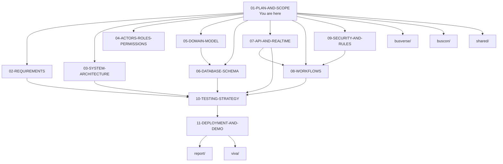

### 1.2 What each downstream doc owns

| Document | Single source of truth for |
| :--- | :--- |
| `02-REQUIREMENTS.md` | Functional and non-functional requirements per surface |
| `03-SYSTEM-ARCHITECTURE.md` | Component diagram, deployments, data flow, tech stack |
| `04-ACTORS-ROLES-PERMISSIONS.md` | Full role taxonomy, per-surface permissions |
| `05-DOMAIN-MODEL.md` | Entities, aggregates, invariants |
| `06-DATABASE-SCHEMA.md` | Tables, FKs, indexes, migrations |
| `07-API-AND-REALTIME-CONTRACTS.md` | REST endpoints, WebSocket events, payload shapes |
| `08-WORKFLOWS.md` | End-to-end flows per actor |
| `09-SECURITY-AND-PLATFORM-RULES.md` | Invariants, auth, QR signing, seat locks |
| `10-TESTING-STRATEGY.md` | Test layers, matrices, concurrency race tests |
| `11-DEPLOYMENT-AND-DEMO.md` | Local setup, seed, live demo runbook |

---

## 2. The Product in One Page

**BusVerse + BusCon** is a two-sided bus booking platform for Indian intercity travel.

- **BusVerse** is the passenger side: search, book, pay, ticket, track.
- **BusCon** is the operations side: operator web panel and admin web panel, role-routed in one web app.
- **Operator App** is the field side: a native mobile app used by drivers to start/end trips, stream GPS, and scan QR tickets.
- **One shared backend** powers all three: one database, one API, one real-time layer, one authentication system, one audit trail.

### 2.1 The whole system at a glance

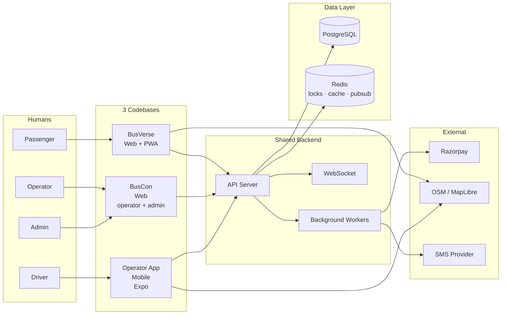

BusVerse, BusCon, and Operator App are not three products. They are **three faces of one system**. A passenger booking a seat appears instantly in the operator's panel, on the driver's phone, and in the admin's audit log.

---

## 3. Why Three Surfaces

This project has exactly **3 codebases**. That is a deliberate architectural decision.

### 3.1 The surface matrix

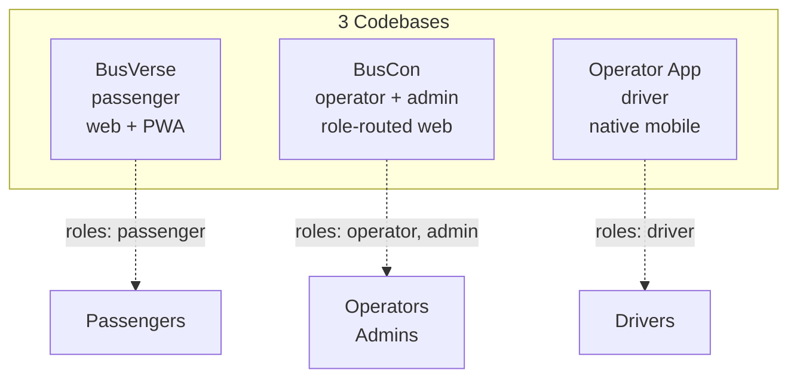

### 3.2 Rationale per merge

| Merge | Why |
| :--- | :--- |
| Operator Panel + Admin Panel → BusCon (web) | Both are web dashboards. Both share auth shell, layout, and UI kit. Role routing decides what you see. One deploy, one URL, one auth. Splitting adds zero demo value. |
| Driver App → Operator App (mobile) | Same actor, same device, same field context. Field staff (if any) log into the same app; the operator decides who scans. |
| Support Panel → deferred to Phase 2 | Solo founder. Support is a Phase 2 concern. Phase 1 escalations route through Admin action. |
| Corporate portal → deferred to Phase 2 | Not required by demo criteria. |
| Agent portal → deferred to Phase 2 | Not required by demo criteria. |

### 3.3 Why Operator App is native (Expo React Native)

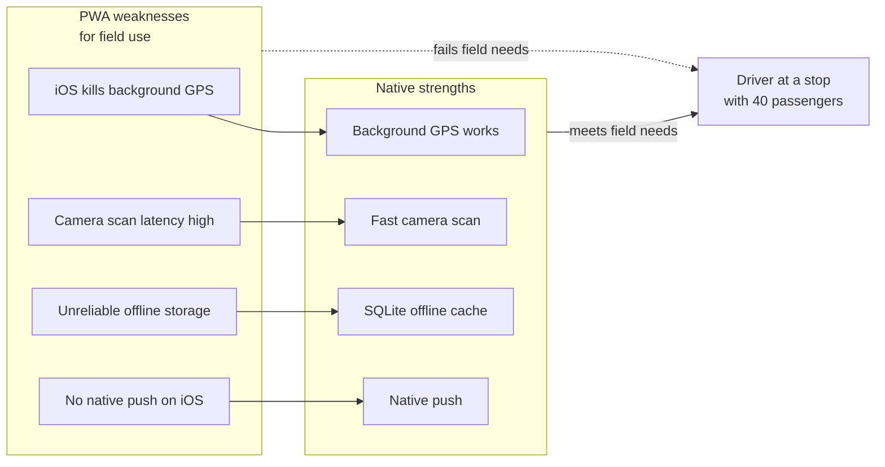

A driver with a phone in a mount needs background GPS that streams without the app open; fast camera scan at a stop with dozens of passengers boarding; offline cache when the bus is in a tunnel; and push notifications when a delay or schedule change arrives. Every real Indian field app (Ola, Uber, Rapido driver apps) is native for this reason. The Operator App is the field tool.

---

## 4. The Four Actors

Four top-level human actor types across all surfaces.

| Actor | Surface | Primary actions |
| :--- | :--- | :--- |
| **Passenger** | BusVerse | Search, book, pay, receive ticket, view trip, track, cancel |
| **Operator** | BusCon (web) | Onboard, register buses, create routes, create schedules, invite drivers, view bookings, view revenue |
| **Driver** | Operator App (mobile) | Login, view assigned trips, start/end trip, stream GPS, scan QR, report delay |
| **Admin** | BusCon (web, admin role) | Approve operator, approve bus, view all bookings, trigger refund, view audit log |

### 4.1 Actor → surface map

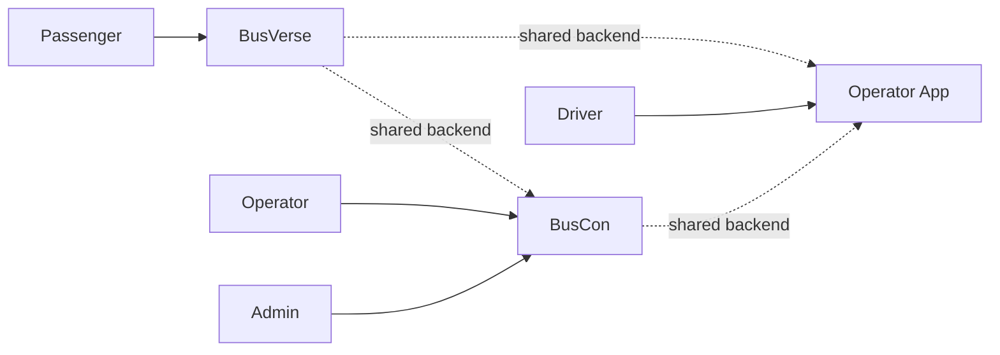

### 4.2 Actor lifecycle summary

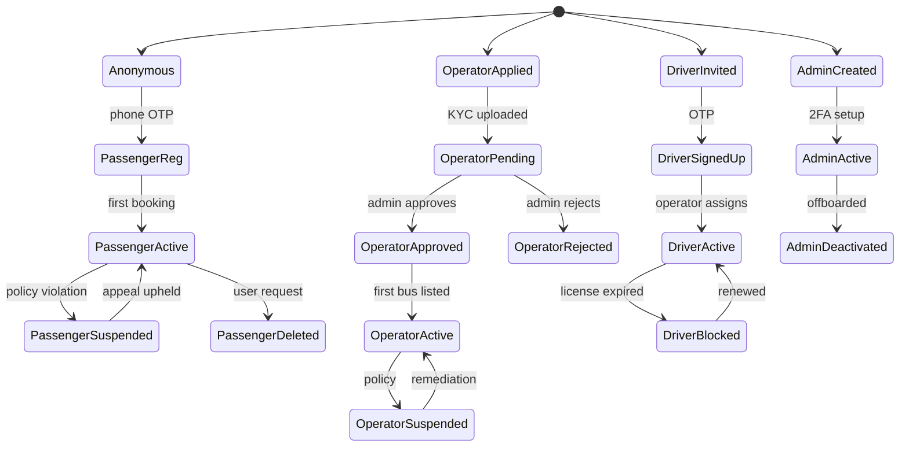

### 4.3 Field Staff is not a separate actor

Field Staff is a **Driver role** within the Operator App, not a new actor type. Any operator-assigned staff member can scan tickets with the same app. The operator decides who scans. This mirrors real operations where driver, conductor, or operations staff may scan. It keeps the actor count at 4 and the permission grid small.

Full detail: `04-ACTORS-ROLES-PERMISSIONS.md`.

---

## 5. Phase Definitions

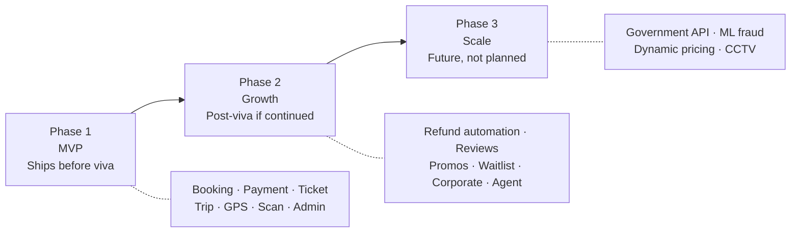

| Phase | Goal | When | Scope |
| :--- | :--- | :--- | :--- |
| **Phase 1 (MVP)** | Working end-to-end booking + trip + scan on one corridor | Pre-viva | Full booking, payment, ticketing, trip start, QR scan, live tracking, admin oversight |
| **Phase 2** | Refund automation, reviews, promos, waitlist, corporate, agent | Post-viva if continued | Refund-to-gateway, ratings, coupon engine, waitlist, Corporate portal, Agent portal |
| **Phase 3** | Government integration, ML, dynamic pricing, CCTV | Future | State transport API, ML, real-time video |

**Only Phase 1 must work.** Phase 2 and Phase 3 are roadmap. If asked in viva "what comes next?", answer from `report/19-FUTURE_SCOPE.md`.

---

## 6. Phase 1 Scope

### 6.1 Scope map

```mermaid
flowchart TB
    P1["Phase 1 MVP"]

    P1 --> BV["BusVerse<br/>Passenger"]
    P1 --> BC["BusCon<br/>Operator + Admin"]
    P1 --> OA["Operator App<br/>Driver"]

    BV --> BV1["Search"]
    BV --> BV2["Seat deck"]
    BV --> BV3["Seat lock"]
    BV --> BV4["Checkout"]
    BV --> BV5["QR ticket"]
    BV --> BV6["My trips"]
    BV --> BV7["Live tracking"]
    BV --> BV8["Cancel"]

    BC --> BC1["Operator KYC"]
    BC --> BC2["Bus registration"]
    BC --> BC3["Route + schedule"]
    BC --> BC4["Driver invite"]
    BC --> BC5["View bookings"]
    BC --> BC6["View revenue"]
    BC --> BC7["Admin approvals"]
    BC --> BC8["Admin refunds"]
    BC --> BC9["Audit log"]

    OA --> OA1["Login"]
    OA --> OA2["My trips"]
    OA --> OA3["Start/end trip"]
    OA --> OA4["GPS stream"]
    OA --> OA5["Scan QR"]
    OA --> OA6["Manifest"]
    OA --> OA7["Report delay"]
```

### 6.2 BusVerse (Passenger) — In / Out

| IN | OUT (Phase 2+) |
| :--- | :--- |
| Search by source → destination → date | Reviews and ratings |
| Results with fare, time, bus type, operator, amenities | Coupons and promo codes |
| 2D seat deck (seater + sleeper layouts) | Waitlist |
| Seat lock with countdown | Loyalty / rewards |
| Passenger details form (one passenger per seat) | Saved passengers |
| Checkout via Razorpay (GPay, Paytm, PhonePe, cards, netbanking) | Female-only seat filter |
| Payment confirmed by Razorpay webhook | Share-trip link |
| Booking confirmation with signed QR ticket | SOS button |
| "My Trips" with QR view | Multi-language (only EN in P1) |
| Live tracking (map, position, ETA) | Automated gateway refunds (P1 = refund record + admin-triggered) |
| Cancel booking (creates refund record) | |
| Login via phone OTP or email | |

### 6.3 BusCon — Operator Panel In / Out

| IN | OUT (Phase 2+) |
| :--- | :--- |
| Operator signup + KYC upload (GSTIN, PAN, company registration, bank) | Multi-user operator roles (Owner / Manager / Finance / Fleet) |
| Admin approval gate before any bus goes live | Commission management |
| Bus registration (registration number, model, capacity, seat layout, insurance) | Quality score |
| Route creation (origin, destination, ordered stops) | Promotions and featured listings |
| Schedule creation (bus + route + departure time + fare) | CCTV feeds |
| Driver invitation + assignment to trips | Settlement automation |
| View bookings on my fleet (masked PII) | Chat with support |
| View revenue read-only (per trip, per schedule, per day) | |
| View completed trips and settlement view | |

### 6.4 BusCon — Admin Panel In / Out

| IN | OUT (Phase 2+) |
| :--- | :--- |
| Approve / reject operator KYC | Support ticket panel |
| Approve / reject bus registration | Chat with passengers |
| View all bookings across operators | Escalation paths |
| View all payments and refund status | Advanced RBAC beyond role routing |
| Manually trigger refund (with reason, logged) | |
| View audit log (append-only) | |
| Basic feature flags (boolean per flag) | |

### 6.5 Operator App (Mobile) In / Out

| IN | OUT (Phase 2+) |
| :--- | :--- |
| Phone OTP login | Break logging |
| Today's assigned trips | Announcements to passengers |
| Start trip (GPS streaming begins) | SOS escalation workflow |
| End trip (GPS streaming stops) | Offline trip start |
| GPS stream every 5 seconds while trip is active | Push notification campaigns |
| Scan QR ticket (camera) — verifies signature offline, marks boarded | |
| View live manifest per boarding stand | |
| Report delay with reason | |
| View past trip history | |
| Scan works offline (public key embedded) | |

---

## 7. The Seat Lock Invariant

Every booking depends on one rule: **no seat can be locked twice, and no seat can be booked twice**. This rule is enforced at the database level and is carried into every downstream doc.

### 7.1 Seat locking sequence

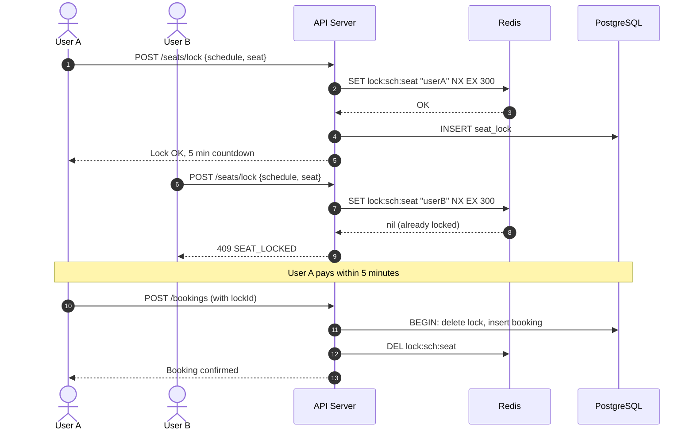

### 7.2 Invariants

| Rule | Enforcement |
| :--- | :--- |
| Never two locks on the same seat | Redis `SET NX` + DB unique constraint on `(schedule_id, seat_id)` in `seat_locks` |
| Never two bookings on the same seat | DB unique constraint on `(schedule_id, seat_id)` in `booking_passengers` |
| Lock converts to booking or expires — never both | Lock delete and booking insert in one transaction |
| Payment is never partial | Booking is either fully paid or not created |

Full detail: `shared/03-SEAT-LOCKING-CONTRACT.md`.

---

## 8. The Payment Flow

### 8.1 Payment sequence

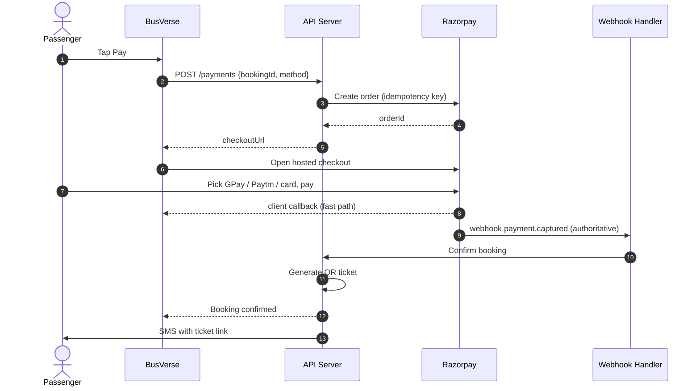

### 8.2 The two-path convergence rule

**Two paths converge.** The client-side callback is a fast-path UX confirmation. The Razorpay webhook is authoritative. Whichever arrives first, the second is idempotently ignored. No booking is ever confirmed twice.

| Path | What it does | Authority |
| :--- | :--- | :--- |
| Client callback | Redirects user to "success" screen | Low — UX only |
| Razorpay webhook | Marks booking confirmed in DB | High — authoritative |
| Idempotency | Same event processed twice = same result | Enforced at DB level |

Full detail: `busverse/03-PAYMENT-REFUND-FLOW.md`.

---

## 9. The QR Ticket

Tickets are **not public URLs**. The QR contains a signed payload. It can only be verified by the Operator App, which has the public key embedded.

### 9.1 Sign and verify

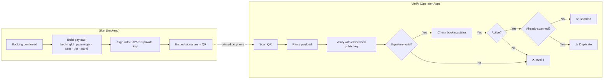

### 9.2 Offline verification

The Operator App holds the public key. A scan works with no network — signature is verified locally, then boarding is queued for sync when the network returns.

### 9.3 Privacy

The QR does not encode a URL. Opening it in a browser shows nothing. Only the Operator App can decode it. Tickets are only viewable by the logged-in passenger inside BusVerse.

Full detail: `shared/02-QR-SIGNING-CONTRACT.md`.

---

## 10. Demo Corridor

**Delhi → Kanpur → Lucknow**, one corridor, 3 cities.

### 10.1 Corridor map

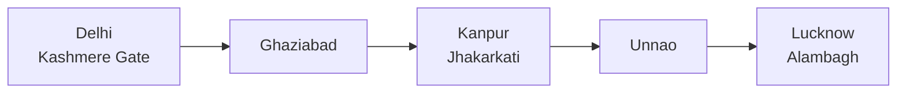

### 10.2 Seed counts

| Element | Count | Example |
| :--- | :--- | :--- |
| Cities | 3 | Delhi, Kanpur, Lucknow |
| Stops per route | 4–6 | Delhi Kashmere Gate → Ghaziabad → Kanpur → Unnao → Lucknow Alambagh |
| Operators | 2–3 | Sharma Travels, Rajdhani Express, UP Roadways |
| Buses | 6–8 | Standard 40-seat, Sleeper 30-seat |
| Schedules | 10–15 across a day | Morning, afternoon, evening, night |
| Seat layouts | 2 | One seater 40, one sleeper 30 |
| Drivers | 4–6 | Realistic Indian names |
| Passengers seeded | 0 | Real signup in demo |

Fare range ₹450–₹1,800. Bus types: AC Seater, AC Sleeper, Non-AC Seater. Realistic operator names (not test data) create demo credibility.

Full seed spec: `shared/01-DEMO-TRANSIT-NETWORK.md`.

---

## 11. Payment Model

**Aggregator:** Razorpay (test mode).

### 11.1 Why Razorpay, not raw GPay or Paytm

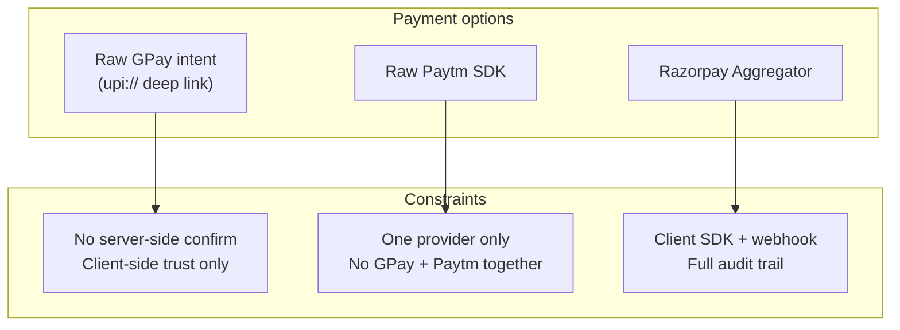

Google Pay does not offer a direct merchant checkout to small businesses. GPay and Paytm are reachable only through a Payment Aggregator (Razorpay, PhonePe PG, Paytm PG, Cashfree) or a raw UPI deep-link. A raw deep-link has no server-side webhook — you cannot confirm payment safely. Razorpay offers **both GPay and Paytm in one checkout** with a clean webhook model.

### 11.2 What the passenger sees

A Razorpay hosted checkout listing all enabled methods (GPay, Paytm, PhonePe, cards, netbanking, wallets). They pick one.

### 11.3 What confirms the booking

The Razorpay `payment.captured` webhook. Not the client callback. The client callback is a UX nicety; the webhook is authoritative.

### 11.4 Idempotency

Every payment carries a unique idempotency key. Retries never double-charge.

### 11.5 Refunds (Phase 1)

Cancellation triggers a refund record. Backend calls Razorpay refund API with idempotency. Status tracked via webhook. If Razorpay test mode rejects, the refund is logged `pending_manual` and Admin can retry from BusCon.

### 11.6 Not built

Wallet, prepaid balance, Payment Aggregator license, storing raw card data or UPI PINs.

### 11.7 Money flow

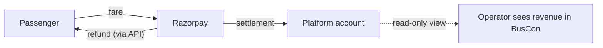

Operator bank payout is **out of scope for Phase 1**. Operator sees a read-only revenue view (per trip, per schedule, per day). Real NEFT settlement is a Phase 2 concern.

---

## 12. Explicit Non-Goals

These are **permanent**. They are not in Phase 1, Phase 2, or Phase 3.

| Not built | Reason |
| :--- | :--- |
| Owning buses | BusVerse is a marketplace |
| Employing drivers | Operators employ |
| Setting fares | Operators set |
| Payment Aggregator license | Uses Razorpay |
| Insurance underwriting | Not in scope |
| Air, train, cab bookings | Bus-only product |
| Hotel or food bookings | Not the product |
| Wallet / prepaid balance | RBI overhead |
| Cryptocurrency | Irrelevant |
| Selling user data | Immutable rule |
| Storing raw card data or PINs | Immutable rule |
| Passenger → driver direct contact | Safety and liability |
| International bus travel | India-only |
| Multi-region deployment | Single region |
| Microservices / Kubernetes / Kafka | Single-service backend |
| Custom APM / search / queue / CMS | Buy, don't build |
| Friday deploys | Burnout prevention |
| 24/7 support in Phase 1 | Solo founder |
| In-app calls between passenger and driver | Support-mediated only |
| Live chat between passengers | Privacy risk |
| Physical ticket kiosks | Digital-first |
| Operator exclusivity contracts | Operator-first principle |

---

## 13. Demo Success Criteria

By viva day, the following **eight steps** must work live on the demo laptop with internet available for Razorpay test, OTP SMS, and map tiles.

### 13.1 The eight-step demo flow

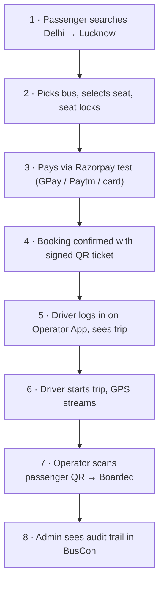

### 13.2 Acceptance checklist per step

| # | Step | Passes when |
| :---: | :--- | :--- |
| 1 | Search | Delhi → Lucknow returns at least 3 buses |
| 2 | Seat lock | Seat shows "locked by you" with countdown; second browser sees "locked" |
| 3 | Payment | Razorpay test checkout opens, test payment succeeds |
| 4 | Ticket | Booking shows QR in My Trips; QR can be scanned by Operator App |
| 5 | Driver login | OTP works; today's trip appears |
| 6 | Trip start | GPS begins; passenger sees bus on map |
| 7 | Scan | Operator App scans → "✅ Valid — Boarded" within 2 seconds |
| 8 | Audit | Admin sees booking, payment, scan, each with timestamp and actor |

If any one of these eight fails on demo day, **scope is cut until all eight pass**. This is the MVP definition.

---

## 14. Scope Change Process

If a new feature or scope change is proposed, it is evaluated against this document.

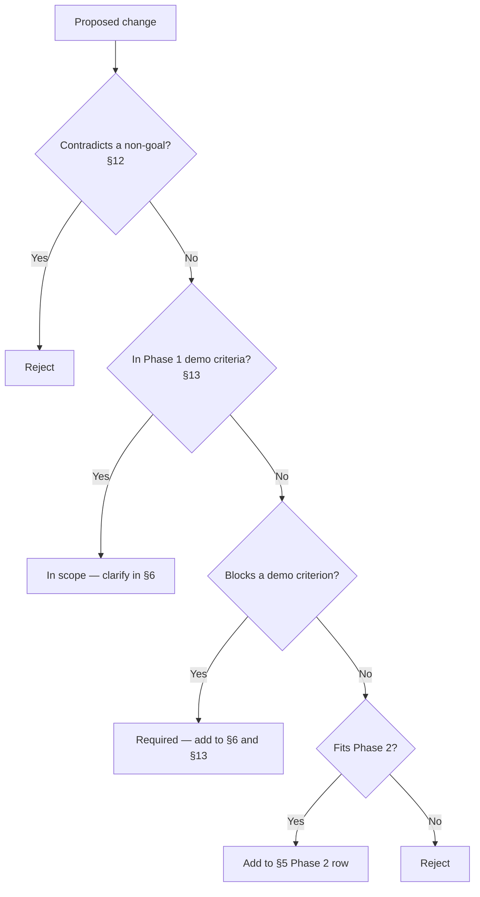

**Rule:** Any change to scope is written in this doc **before** it is written anywhere else. No feature enters `/docs` without a corresponding entry here.

---

## 15. Open Questions

The following are still open. Each must be closed before the doc leaves Draft.

| # | Question | Owner | Default if unanswered |
| :---: | :--- | :--- | :--- |
| 1 | Which Razorpay test account will be used? | Owner | Create one during setup (see `11-DEPLOYMENT-AND-DEMO.md`) |
| 2 | SMS provider for OTP — MSG91, Twilio, or Firebase Auth? | Owner | Firebase Auth (free, no SMS gateway needed) |
| 3 | Map tile source — OSM public tiles or self-hosted? | Owner | OSM public tiles (no API key, no cost) |
| 4 | Hosting — local only or deployed? | Owner | Local first, deploy to Railway/Vercel if time allows |
| 5 | Real operator name to use in seed data? | Owner | Fictional realistic name (Sharma Travels, etc.) |
| 6 | Guide review date — is it before 1 Oct 2026? | Owner | Assume 1 Oct 2026 |

---

## 16. Cross-References

| Doc | What it constrains |
| :--- | :--- |
| `02-REQUIREMENTS.md` | Functional requirements per surface, non-functional requirements |
| `03-SYSTEM-ARCHITECTURE.md` | 3 codebases + backend; no other surfaces |
| `04-ACTORS-ROLES-PERMISSIONS.md` | 4 actor types, not 5 |
| `05-DOMAIN-MODEL.md` | Entities required by Phase 1 only |
| `06-DATABASE-SCHEMA.md` | Tables for Phase 1 only |
| `07-API-AND-REALTIME-CONTRACTS.md` | Endpoints for Phase 1 only |
| `08-WORKFLOWS.md` | Flows in §13 walkthrough |
| `09-SECURITY-AND-PLATFORM-RULES.md` | Invariants from §7, §8, §9 |
| `10-TESTING-STRATEGY.md` | Tests around §13 demo criteria |
| `11-DEPLOYMENT-AND-DEMO.md` | Setup + seed + demo runbook |

This doc also feeds the academic report:

| Chapter | Uses this doc |
| :--- | :--- |
| `report/06-INTRODUCTION.md` | §2 product overview |
| `report/07-PROBLEM_STATEMENT.md` | §2 + §3 merges |
| `report/08-OBJECTIVES.md` | §5 phase definitions |
| `report/14-MODULE_DESCRIPTION.md` | §6 scope per surface |
| `report/17-RESULTS_OUTPUT.md` | §13 demo criteria |
| `report/19-FUTURE_SCOPE.md` | §5 Phase 2 + 3 |

---

## 17. Checklist Against Master List

| Item | Included? | Section |
| :--- | :---: | :--- |
| Document hierarchy | ✅ | §1.1 |
| Downstream doc ownership | ✅ | §1.2 |
| Product in one page | ✅ | §2 |
| System diagram | ✅ | §2.1 |
| Surface merge rationale | ✅ | §3 |
| Native app rationale | ✅ | §3.3 |
| Four actor types | ✅ | §4 |
| Actor → surface map | ✅ | §4.1 |
| Actor lifecycle | ✅ | §4.2 |
| Field staff clarification | ✅ | §4.3 |
| Phase definitions | ✅ | §5 |
| Phase map | ✅ | §5 |
| Scope map per surface | ✅ | §6.1 |
| BusVerse in/out | ✅ | §6.2 |
| BusCon operator in/out | ✅ | §6.3 |
| BusCon admin in/out | ✅ | §6.4 |
| Operator App in/out | ✅ | §6.5 |
| Seat lock invariant + diagram | ✅ | §7 |
| Payment flow + diagram | ✅ | §8 |
| QR sign/verify + diagram | ✅ | §9 |
| Demo corridor + diagram | ✅ | §10 |
| Payment model + rationale | ✅ | §11 |
| Money flow diagram | ✅ | §11.7 |
| Explicit non-goals | ✅ | §12 |
| Demo success criteria | ✅ | §13 |
| Scope change process | ✅ | §14 |
| Open questions | ✅ | §15 |
| Cross-references | ✅ | §16 |

**All items covered. 11 Mermaid diagrams.**

---

## 18. One-Paragraph Summary

**BusVerse + BusCon is a two-sided bus booking platform for Indian intercity travel, built as three codebases — BusVerse (passenger web + PWA), BusCon (operator + admin web, role-routed), and Operator App (native mobile for drivers) — powered by one shared backend. It serves four top-level human actor types: Passenger, Operator, Driver, Admin. Phase 1 (the MVP) delivers a working end-to-end booking lifecycle on the Delhi–Kanpur–Lucknow corridor: search, seat selection, atomic seat lock, Razorpay payment (GPay, Paytm, PhonePe, cards in one checkout), signed Ed25519 QR ticket, driver trip start, GPS streaming, QR scan verification, live passenger tracking, and admin oversight with a full audit trail. The MVP is defined operationally by eight demo success criteria; if any one fails on viva day, scope is cut until all eight pass. Phase 2 adds refund automation, reviews, promos, waitlist, corporate, and agent portals. Phase 3 adds government API integration, ML fraud, dynamic pricing, and CCTV. The project never builds: bus ownership, driver employment, fare-setting, a Payment Aggregator license, insurance underwriting, air/train/cab/hotel bookings, wallets, cryptocurrency, microservices, Kubernetes, Kafka, or custom infrastructure. Every downstream doc derives from this one, and any change to scope is written here before it is written anywhere else.**

---

**End of Document `01-PLAN-AND-SCOPE.md` v1.0.**