# `docs/02-REQUIREMENTS.md`

**Document:** `docs/02-REQUIREMENTS.md`
**Project:** BusVerse + BusCon
**Version:** 1.0
**Status:** Locked — Foundational Document
**Owner:** Shaghaf
**Guide:** Mr. Mohit Srivastav
**Purpose:** The complete requirements specification for BusVerse + BusCon Phase 1. Defines every functional requirement, non-functional requirement, constraint, and assumption that the system must satisfy. Every requirement is testable, has a unique ID, is traceable to a workflow and a test, and is tagged with a MoSCoW priority and a delivery phase. If a requirement is not in this document, the system is not required to satisfy it.

> **Derives from:** `01-PLAN-AND-SCOPE.md` §6 (scope), §12 (non-goals), §13 (demo criteria); `04-ACTORS-ROLES-PERMISSIONS.md` §4, §9 (roles, permissions), §8 (sessions); `05-DOMAIN-MODEL.md` §7 (invariants), §8 (state machines); `06-DATABASE-SCHEMA.md` §11 (perf), §13 (encryption), §15 (retention); `07-API-AND-REALTIME-CONTRACTS.md` §10 (rate limits), §11 (idempotency), §9 (errors); `08-WORKFLOWS.md` §2 (38 workflows); `09-SECURITY-AND-PLATFORM-RULES.md` §22 (security tests); `10-TESTING-STRATEGY.md` §21 (full catalog); `11-DEPLOYMENT-AND-DEMO.md` §10 (demo script).
>
> **Referenced by:** `03-SYSTEM-ARCHITECTURE.md`, `report/08-OBJECTIVES.md`, `report/09-SYSTEM_REQUIREMENTS.md`, `report/11-SYSTEM_ANALYSIS_DESIGN.md`, `report/14-MODULE_DESCRIPTION.md`, `report/16-TESTING.md`, `report/18-CONCLUSION.md`.

---

## 1. Purpose and Scope

### 1.1 What this document owns

| Owns here | Referenced from upstream |
|---|---|
| Requirement ID scheme | — |
| Functional requirements (~126) | `01` §6 has scope, `07` has endpoints |
| Non-functional requirements (~68) | `06` §11, `09` §22 |
| Acceptance criteria per Must-Have requirement | `10` §21 |
| Business rules | `05` §7, `01` §12 |
| Hardware and software requirements | — |
| External interface specifications | `07`, `09` |
| Data requirements | `05`, `06` §15, `09` §15.5 |
| Constraints | `01` §12, `09` §18 |
| Assumptions with verification | — |
| Traceability matrix (FR + NFR + constraints + report chapters) | `08`, `10` |
| Compliance matrix (DPDP + CERT-In + RBI + IT Act) | `09` §18 |
| MoSCoW prioritization | — |
| Out of scope | `01` §12 |

### 1.2 Document hierarchy

**Diagram: Document hierarchy**
*The requirements doc sits between the scope document and the technical specifications. It consolidates what every other doc has named as a requirement — endpoints from `07`, invariants from `05`, security controls from `09`, workflows from `08`, tests from `10` — into one canonical list with stable IDs. Every downstream doc — architecture, product folders, report chapters — cites requirements by ID from here.*

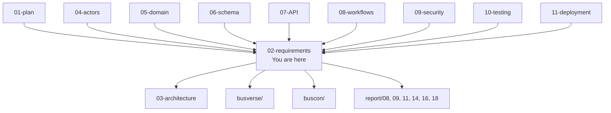

### 1.3 What this document does NOT cover

| Topic | Goes to |
|---|---|
| Implementation details | Source code |
| API contracts | `07-API-AND-REALTIME-CONTRACTS.md` |
| Test implementations | `10-TESTING-STRATEGY.md` |
| Architecture design | `03-SYSTEM-ARCHITECTURE.md` |
| UI designs | `busverse/05-UI-SPEC.md`, `buscon/06-UI-SPEC.md` |
| Deployment procedures | `11-DEPLOYMENT-AND-DEMO.md` |
| Detailed DFDs (Level 1–2) | `report/13-DFD_UML_DIAGRAMS.md` |

### 1.4 SMART criteria

Every requirement in this document satisfies the **SMART** criteria:

| Criterion | Meaning | Enforcement |
|---|---|---|
| **S**pecific | States exactly one testable behavior | One requirement = one sentence |
| **M**easurable | Can be verified by automated or manual test | Every requirement has a test ID |
| **A**chievable | Feasible within Phase 1 constraints | Reviewed against §12 |
| **R**elevant | Traces to scope in `01` §6 | Every requirement has a workflow link |
| **T**estable | Can be proven true or false | Verification method specified in §16 |

**Rule:** If a proposed requirement cannot satisfy all five criteria, it is a preference, not a requirement, and does not enter this document.

---

## 2. Product Perspective

### 2.1 Ecosystem context

**Diagram: Product ecosystem**
*BusVerse + BusCon sits in a two-sided marketplace ecosystem. Passengers currently use fragmented channels (RedBus for aggregated booking, individual operator apps, phone calls, WhatsApp, paper tickets). Operators currently manage fleets with Excel, WhatsApp, and paper manifests. BusVerse consolidates passenger search and booking. BusCon gives operators a unified digital back office. Together they replace the fragmented middle layer.*

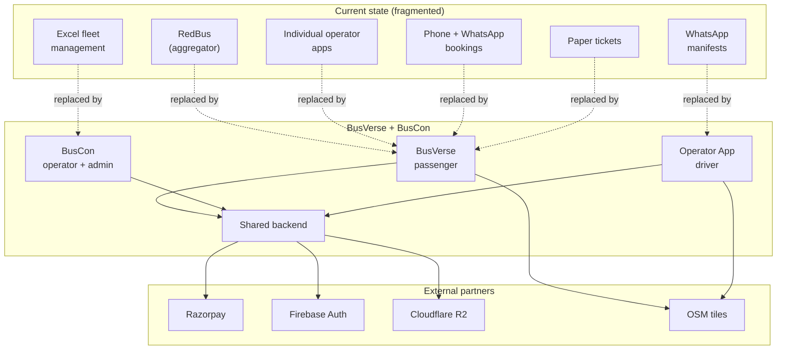

### 2.2 System interfaces

BusVerse + BusCon interacts with external systems at multiple layers:

| System type | Interfaces |
|---|---|
| **Upstream users** | Passengers (via BusVerse), operators (via BusCon), drivers (via Operator App), admins (via BusCon admin) |
| **Payment processing** | Razorpay (order creation, checkout, refund, webhooks) |
| **Authentication** | Firebase Auth (phone OTP delivery and verification) |
| **Storage** | Cloudflare R2 (KYC documents, ticket PNG exports) |
| **Maps** | OSM public tiles (map rendering, ETA calculations) |
| **Notifications** | SMS provider (booking confirmations via MSG91 — Phase 2), email provider (SendGrid — Phase 2), push (Firebase Cloud Messaging — Phase 2) |
| **Regulatory** | Data Protection Board of India (breach notification), CERT-In (incident reporting — Phase 2) |

### 2.3 Predecessor systems

What currently fills the gap that BusVerse + BusCon replaces:

| Actor | Current workflow | Pain point |
|---|---|---|
| **Passenger** | Search RedBus → click through to operator site → book → wait for SMS → show printed ticket | Fragmented, no unified tracking, no consistent refunds |
| **Operator** | Excel fleet sheet + WhatsApp driver groups + paper manifests | No digital tracking, manual reconciliation |
| **Driver** | Paper list + verbal updates | No manifest visibility, no scan verification |
| **Admin** | No platform-wide oversight | Cannot monitor disputes, no audit trail |

**Rule:** Every requirement in §6 must either replace one of these workflows or add capability that does not currently exist.

---

## 3. Definitions, References, Stakeholders

### 3.1 Definitions

| Term | Definition |
|---|---|
| **FR** | Functional Requirement — a testable statement of what the system must do |
| **NFR** | Non-Functional Requirement — a testable statement of how the system must perform a quality attribute |
| **Actor** | A type of entity that interacts with the platform (Passenger, Driver, Operator, Admin) |
| **Role** | A specialization within an actor (Guest, Registered Passenger, Owner, Manager, Driver, Super Admin) |
| **Session** | An authenticated state for one actor-role on one device |
| **Multi-tenancy** | One system serving multiple operators, with data isolation enforced at the query level |
| **Tenant** | An operator in the multi-tenant model — each operator has isolated data |
| **Idempotency** | The property that repeating an operation produces the same result as a single execution |
| **PII** | Personally Identifiable Information — data that can identify a specific person |
| **DPDP** | Digital Personal Data Protection Act 2023 (India) |
| **RTO** | Recovery Time Objective — maximum acceptable downtime |
| **RPO** | Recovery Point Objective — maximum acceptable data loss |
| **p95** | The 95th percentile — 95% of requests complete faster than this |
| **Must-Have** | Priority level — required for demo criteria to pass |
| **Should-Have** | Priority level — expected for Phase 1 completeness |
| **Could-Have** | Priority level — desirable if time permits |
| **Won't-Have** | Priority level — explicitly deferred to Phase 2 or non-goal |

### 3.2 References

**Standards:**
- IEEE 830-1998 — Recommended Practice for Software Requirements Specifications
- ISO/IEC/IEEE 29148:2018 — Systems and software engineering — Life cycle processes — Requirements engineering
- OWASP ASVS 4.0 — Application Security Verification Standard
- WCAG 2.1 Level AA — Web Content Accessibility Guidelines

**Indian regulations:**
- Digital Personal Data Protection Act 2023 (DPDP)
- CERT-In Directions (April 2022) — Cyber security directions
- Information Technology Act 2000
- Motor Vehicle Aggregator Guidelines 2025
- RBI Payment Aggregator Guidelines 2020

**External service documentation:**
- Razorpay API Reference (v1)
- Firebase Authentication REST API
- Cloudflare R2 S3-compatible API
- OpenStreetMap tile usage policy

**Internal documents:**
- All numbered docs `01` through `11`
- All product folder docs (`busverse/`, `buscon/`, `shared/`)
- Academic report chapters 06–20

### 3.3 Stakeholders

**Diagram: Stakeholder map**
*Five stakeholder groups. The guide is the approver. The founder is the owner and primary implementer. The evaluation panel is the viva audience. Future contributors will maintain the system. End users (passengers, operators, drivers) are the ultimate beneficiaries.*

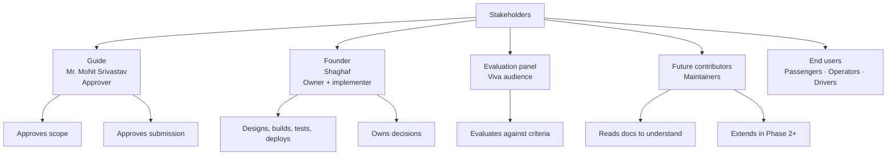

| Stakeholder | Role | Interest | Influence |
|---|---|---|---|
| **Guide (Mr. Mohit Srivastav)** | Approver | Project quality, timeline, academic rigor | High |
| **Founder (Shaghaf)** | Owner, implementer | Working demo, complete docs | High |
| **Evaluation panel** | Viva audience | Demonstration quality, technical depth | High |
| **Future contributors** | Maintainers | Clear docs, stable architecture | Low (Phase 1) |
| **End users** | Beneficiaries | Functional, trustworthy product | Medium (indirect) |

---

## 4. User Characteristics

**Diagram: User characteristics comparison**
*Four actor types have very different technical profiles. Passengers are casual users on mobile. Drivers have low technical literacy on small Android phones. Operators are desktop users with moderate literacy. Admins are technical users with high requirements. The differences drive UI, error handling, and performance requirements.*

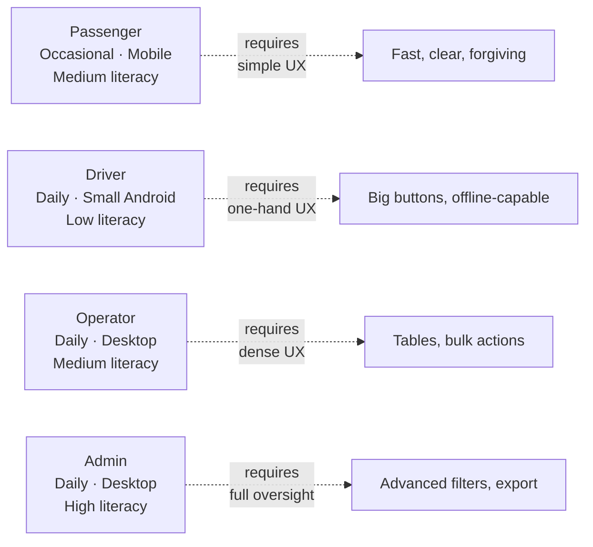

### 4.1 User characteristics table

| Characteristic | Passenger | Driver | Operator | Admin |
|---|---|---|---|---|
| **Age range** | 18–65 | 25–55 | 30–60 | Any |
| **Technical literacy** | Low to high | Low–medium | Medium | High |
| **Primary device** | Mobile (smartphone) | Android phone (often older, < 5") | Desktop | Desktop |
| **Secondary device** | Desktop | — | Mobile (read-only) | — |
| **Environment** | Home, transit, on-the-go | Moving bus, bright sunlight, busy stand | Office | Office |
| **Language** | Hindi, English | Hindi | Hindi, English | English |
| **Frequency of use** | Few times/year | Daily | Daily | Daily |
| **Session duration** | 5–15 min | 8–12 hours (continuous) | 2–4 hours | 1–2 hours |
| **Physical constraints** | Accessibility needs, elderly | One-handed operation, screen glare | — | — |
| **Consequence of failure** | Booking fails, money stuck | Passengers stranded, trip fails | Business disrupted | Platform integrity |

### 4.2 Implications for requirements

| Characteristic | Affects requirement |
|---|---|
| Passenger = mobile primary | NFR-U-02 (mobile 360px) |
| Driver = low literacy, glare | FR-OP-* (large buttons, minimal text) |
| Driver = daily use, one-hand | FR-OP-* (offline scan, no complex gestures) |
| Operator = desktop, density | FR-BO-* (tables, bulk operations) |
| Admin = technical, oversight | FR-BA-* (advanced filters, exports) |
| Passenger = few times/year | NFR-U-01 (5-step max flow) |
| All = Hindi preference | NFR-U-04 (Hindi + English) |

### 4.3 Accessibility notes

**Phase 1:** Accessibility is not a Must-Have (WCAG AA deferred to Phase 2). But basic practices apply:

- All interactive elements have text labels (not just icons)
- Color is not the sole indicator of state
- Font size minimum 14px
- Contrast ratio ≥ 3:1 for text
- Focus indicators visible
- Keyboard navigation works for admin/operator panels

**Phase 2:** Full WCAG 2.1 AA compliance.

---

## 5. Actors Summary

Four actor types across six roles. Full taxonomy in `04` §3–§4.

| Actor | Roles | Surface | Trust level |
|---|---|---|---|
| Passenger | Guest, Registered Passenger | BusVerse | L0, L1 |
| Driver | Driver | Operator App | L1 |
| Operator | Owner, Manager | BusCon | L2 |
| Admin | Super Admin | BusCon | L3 |

**Reference:** `04-ACTORS-ROLES-PERMISSIONS.md` §3 (actors), §4 (roles), §9 (permissions), §8 (sessions).

**Rule:** All requirements in §6 trace to at least one actor. Requirements touching multiple actors are marked "Cross-cutting" (FR-XC-*).

---

## 6. Functional Requirements

**Total: ~126 functional requirements** distributed across four surfaces plus cross-cutting.

### 6.1 FR ID scheme

| Range | Surface | Phase |
|---|---|---|
| FR-BV-001 to FR-BV-099 | BusVerse (Passenger) | Phase 1 |
| FR-BV-100 to FR-BV-499 | BusVerse | Phase 2 (reserved) |
| FR-BV-500 to FR-BV-999 | BusVerse | Phase 3 / deferred |
| FR-BO-001 to FR-BO-099 | BusCon Operator | Phase 1 |
| FR-BO-100 to FR-BO-999 | BusCon Operator | Phase 2 / 3 |
| FR-BA-001 to FR-BA-099 | BusCon Admin | Phase 1 |
| FR-BA-100 to FR-BA-999 | BusCon Admin | Phase 2 / 3 |
| FR-OP-001 to FR-OP-099 | Operator App (Driver) | Phase 1 |
| FR-OP-100 to FR-OP-999 | Operator App | Phase 2 / 3 |
| FR-XC-001 to FR-XC-099 | Cross-cutting | Phase 1 |
| FR-XC-100 to FR-XC-999 | Cross-cutting | Phase 2 / 3 |

**Rule:** Once assigned, an FR ID never changes. Retired requirements keep their IDs with status "Retired" and reason documented.

### 6.2 Use case overview

**Diagram: Use case overview**
*High-level use case diagram showing 4 actors and their primary use cases. Detailed use case diagrams per surface appear in `report/13`.*

```mermaid
flowchart TB
    PAX["Passenger"]
    DRV["Driver"]
    OPR["Operator"]
    ADM["Admin"]

    PAX --> UC1["Search schedules"]
    PAX --> UC2["Book + pay"]
    PAX --> UC3["View ticket"]
    PAX --> UC4["Track bus"]
    PAX --> UC5["Cancel booking"]

    DRV --> UC6["Login + view trips"]
    DRV --> UC7["Start / end trip"]
    DRV --> UC8["Stream GPS"]
    DRV --> UC9["Scan QR"]

    OPR --> UC10["Register + KYC"]
    OPR --> UC11["Manage fleet"]
    OPR --> UC12["Create routes + schedules"]
    OPR --> UC13["Invite drivers"]
    OPR --> UC14["View revenue"]

    ADM --> UC15["Approve operators"]
    ADM --> UC16["Approve buses"]
    ADM --> UC17["Process refunds"]
    ADM --> UC18["Audit log"]
```

### 6.3 BusVerse functional requirements (48 FRs)

**FR-BV Authentication (4)**

| ID | Requirement | Priority | Verification | Workflow | Test |
|---|---|---|---|---|---|
| FR-BV-001 | Passenger can log in with phone number + OTP | Must | T | WF-P-01 | `auth_security_*` |
| FR-BV-002 | Passenger can log in with email + OTP | Should | T | WF-P-01 | `auth_security_*` |
| FR-BV-003 | Passenger session refreshes automatically every 15 min | Must | T | WF-R-03 | `session_security_*` |
| FR-BV-004 | Passenger can log out, revoking the current session | Must | T | — | `auth_security_*` |

**Acceptance criteria for FR-BV-001:**

- AC-01: OTP is 6 digits
- AC-02: OTP delivered within 10 seconds
- AC-03: OTP expires after 10 minutes
- AC-04: 5 attempts allowed before lockout
- AC-05: 3 OTP requests per 10 minutes per phone
- AC-06: Invalid OTP returns `INVALID_OTP` (400)
- AC-07: Successful login issues access (15 min) + refresh (7 day) tokens
- AC-08: New user gets `passenger_profiles` row created

**FR-BV Search (6)**

| ID | Requirement | Priority | Verification | Workflow | Test |
|---|---|---|---|---|---|
| FR-BV-005 | Passenger can search schedules by origin city, destination city, date | Must | T | WF-P-02 | `contract_search` |
| FR-BV-006 | Passenger can view city autocomplete suggestions | Should | T | WF-P-02 | `contract_cities` |
| FR-BV-007 | Search results show fare, departure, arrival, operator, bus type, seats available | Must | T | WF-P-02 | `contract_search` |
| FR-BV-008 | Passenger can sort results by departure time, price, or duration | Should | T | — | `contract_search` |
| FR-BV-009 | Passenger can filter results by bus type and amenities | Could | T | — | `contract_search` |
| FR-BV-010 | Search works for anonymous (unauthenticated) users | Must | T | WF-P-02 | `contract_search` |

**Acceptance criteria for FR-BV-005:**

- AC-01: Returns ≥ 1 result for Delhi → Lucknow on a valid date
- AC-02: Returns empty array for route with no buses
- AC-03: Returns 422 for missing required params
- AC-04: Response time ≤ 200ms p95
- AC-05: Results sorted by departure time ascending by default
- AC-06: Works for anonymous users (no auth required)

**FR-BV Seat selection (8)**

| ID | Requirement | Priority | Verification | Workflow | Test |
|---|---|---|---|---|---|
| FR-BV-011 | Passenger can view 2D seat deck with layout and current states | Must | T | WF-P-03 | `contract_availability` |
| FR-BV-012 | Passenger can select an available seat | Must | T | WF-P-03 | `contract_seat-locks` |
| FR-BV-013 | Passenger can lock a seat for 5 minutes | Must | T | WF-P-03 | `lock_security_*` |
| FR-BV-014 | Passenger sees real-time countdown of lock remaining | Must | T | WF-P-03 | `wf_passenger_03` |
| FR-BV-015 | Passenger can release a lock manually | Should | T | — | `contract_seat-locks` |
| FR-BV-016 | Seat lock blocks other passengers via 409 SEAT_LOCKED | Must | T | WF-X-02 | `wf_cross_02` |
| FR-BV-017 | Seat deck updates in real-time when others book (via WebSocket) | Should | T | — | `ws_security_*` |
| FR-BV-018 | Passenger can resume an abandoned booking via active lock | Should | T | WF-R-01 | `wf_recovery_01` |

**Acceptance criteria for FR-BV-013:**

- AC-01: Lock TTL is exactly 300 seconds
- AC-02: Lock backed by Redis `SET NX` AND Postgres unique constraint
- AC-03: Two concurrent lock requests → exactly one 201, one 409
- AC-04: Lock deleted on payment success
- AC-05: Lock expires automatically after 5 minutes (cron cleanup)
- AC-06: Response time ≤ 50ms p95

**FR-BV Booking (8)**

| ID | Requirement | Priority | Verification | Workflow | Test |
|---|---|---|---|---|---|
| FR-BV-019 | Passenger can create a booking from an active lock | Must | T | WF-P-04 | `wf_passenger_04` |
| FR-BV-020 | Passenger can add passenger details (name, age, gender) per seat | Must | T | WF-P-04 | `contract_bookings` |
| FR-BV-021 | Passenger can select boarding and dropping stands | Must | T | WF-P-04 | `contract_bookings` |
| FR-BV-022 | Booking confirmation triggers ticket issuance | Must | T | WF-P-04 | `invariant_01` |
| FR-BV-023 | Booking status is PENDING until payment succeeds | Must | T | WF-P-04 | `wf_passenger_04` |
| FR-BV-024 | Passenger can view all bookings in My Trips | Must | T | WF-P-05 | `contract_bookings` |
| FR-BV-025 | Passenger can view booking detail including QR ticket | Must | T | WF-P-05 | `contract_bookings` |
| FR-BV-026 | Booking cannot be modified after confirmation | Must | T | — | `never_06` |

**Acceptance criteria for FR-BV-019:**

- AC-01: Booking created with status PENDING
- AC-02: Uses lockId from active lock
- AC-03: Passenger count matches seat count
- AC-04: Unique constraint on `(schedule_id, seat_id)` prevents double-booking
- AC-05: Transaction deletes lock + inserts booking + inserts passengers + inserts ticket atomically
- AC-06: Response time ≤ 500ms p95

**FR-BV Payment (7)**

| ID | Requirement | Priority | Verification | Workflow | Test |
|---|---|---|---|---|---|
| FR-BV-027 | Passenger can initiate payment via Razorpay (GPay, Paytm, PhonePe, cards, netbanking) | Must | T | WF-P-04 | `contract_payments` |
| FR-BV-028 | Payment endpoint is idempotent via `Idempotency-Key` header | Must | T | WF-X-03 | `idempotency_*` |
| FR-BV-029 | Payment confirmed by Razorpay webhook, not client callback | Must | T | WF-P-04, WF-X-03 | `webhook_security_*` |
| FR-BV-030 | Passenger can retry payment after failure | Must | T | WF-N-01 | `wf_negative_01` |
| FR-BV-031 | Passenger can view payment status | Must | T | WF-P-04 | `contract_payments` |
| FR-BV-032 | Passenger receives receipt after successful payment | Should | T | — | `contract_payments` |
| FR-BV-033 | Duplicate webhook processing is idempotent (no double booking) | Must | T | WF-X-03 | `wf_cross_03` |

**Acceptance criteria for FR-BV-027:**

- AC-01: Razorpay hosted checkout opens with all methods available
- AC-02: Test card `4111 1111 1111 1111` succeeds
- AC-03: Test card `4000 0000 0000 0002` fails with `payment.failed`
- AC-04: Response ≤ 800ms p95 to open checkout
- AC-05: `Idempotency-Key` header required (400 if missing)
- AC-06: Same key + same body within 24h → cached response
- AC-07: Same key + different body → 409 `IDEMPOTENCY_KEY_REUSED`

**FR-BV Ticket (5)**

| ID | Requirement | Priority | Verification | Workflow | Test |
|---|---|---|---|---|---|
| FR-BV-034 | Passenger receives Ed25519-signed QR ticket on booking confirmation | Must | T | WF-P-04 | `qr_security_*` |
| FR-BV-035 | QR ticket is viewable in My Trips without network (PWA cache) | Should | T | — | `qr_security_*` |
| FR-BV-036 | QR ticket is not accessible via public URL (private only) | Must | T | — | `qr_security_*` |
| FR-BV-037 | QR ticket displays booking reference for display purposes | Must | T | WF-P-05 | `contract_bookings` |
| FR-BV-038 | QR ticket becomes invalid (CANCELLED) when booking is cancelled | Must | T | WF-P-07 | `invariant_17` |

**Acceptance criteria for FR-BV-034:**

- AC-01: QR payload includes version, ticketId, bookingId, scheduleId, seatId, seatLabel, passengerName, boardingStandId, issuedAt, nonce
- AC-02: QR is base64-encoded `v1:payload_b64:sig_b64`
- AC-03: Signature is Ed25519 over canonicalized payload
- AC-04: Payload and signature are immutable after issuance
- AC-05: Only Operator App can verify (public key embedded)

**FR-BV Tracking (3)**

| ID | Requirement | Priority | Verification | Workflow | Test |
|---|---|---|---|---|---|
| FR-BV-039 | Passenger can view live bus position on map during trip | Must | T | WF-P-06 | `ws_security_*` |
| FR-BV-040 | Position updates via WebSocket every 5 seconds | Must | T | WF-P-06 | `ws_security_*` |
| FR-BV-041 | Passenger can view ETA to each upcoming stand | Should | T | WF-P-06 | `contract_trips` |

**Acceptance criteria for FR-BV-039:**

- AC-01: Map shows bus marker updating every 5s
- AC-02: Requires trip in IN_PROGRESS state
- AC-03: Requires booking on that trip
- AC-04: Falls back to HTTP polling if WebSocket fails
- AC-05: WebSocket subscription requires auth within 5 seconds
- AC-06: Unauthorized subscriptions get `{ error: "FORBIDDEN" }` and connection closes

**FR-BV Cancellation (4)**

| ID | Requirement | Priority | Verification | Workflow | Test |
|---|---|---|---|---|---|
| FR-BV-042 | Passenger can preview refund amount before cancelling | Must | T | WF-P-07 | `wf_passenger_07` |
| FR-BV-043 | Passenger can cancel a confirmed booking | Must | T | WF-P-07 | `wf_passenger_07` |
| FR-BV-044 | Cancellation creates refund record and initiates Razorpay refund | Must | T | WF-P-07, WF-A-04 | `contract_refunds` |
| FR-BV-045 | Refund amount computed per tier based on timing | Must | T | — | `invariant_11` |

**Acceptance criteria for FR-BV-043:**

- AC-01: Only CONFIRMED bookings can be cancelled
- AC-02: COMPLETED or already-cancelled bookings return 400 `INVALID_TRANSITION`
- AC-03: Cancellation updates booking status to CANCELLED
- AC-04: Ticket status updated to CANCELLED
- AC-05: Refund record created with status INITIATED
- AC-06: Passenger receives SMS + email notification

**FR-BV Profile (3)**

| ID | Requirement | Priority | Verification | Workflow | Test |
|---|---|---|---|---|---|
| FR-BV-046 | Passenger can view their profile | Must | T | — | `contract_passenger` |
| FR-BV-047 | Passenger can update their name and email | Should | T | — | `contract_passenger` |
| FR-BV-048 | Passenger phone number cannot be changed after signup | Must | T | — | `contract_passenger` |

### 6.4 BusCon Operator functional requirements (33 FRs)

**FR-BO Onboarding (4)**

| ID | Requirement | Priority | Verification | Workflow | Test |
|---|---|---|---|---|---|
| FR-BO-001 | Operator can sign up with company details + GSTIN + PAN | Must | T | WF-O-01 | `wf_operator_01` |
| FR-BO-002 | Operator can upload KYC documents | Must | T | WF-O-01 | `upload_security_*` |
| FR-BO-003 | Operator can verify email via emailed link | Must | T | WF-O-01 | `wf_operator_01` |
| FR-BO-004 | Operator can log in with email+password OR phone OTP | Must | T | WF-O-01 | `auth_security_*` |

**FR-BO Fleet (7)**

| ID | Requirement | Priority | Verification | Workflow | Test |
|---|---|---|---|---|---|
| FR-BO-005 | Operator can register a bus with registration number, model, capacity | Must | T | WF-O-02 | `wf_operator_02` |
| FR-BO-006 | Operator can build a seat layout via grid builder | Must | T | WF-O-02 | `wf_operator_02` |
| FR-BO-007 | Seat count must equal bus capacity | Must | T | WF-O-02 | `invariant_02` |
| FR-BO-008 | Operator can edit bus details before approval | Should | T | — | `contract_operator` |
| FR-BO-009 | Operator can upload bus insurance document | Should | T | — | `upload_security_*` |
| FR-BO-010 | Operator can deactivate (soft delete) a bus with no active schedules | Should | T | — | `contract_operator` |
| FR-BO-011 | Operator can view all buses in their fleet | Must | T | — | `contract_operator` |

**FR-BO Routes (5)**

| ID | Requirement | Priority | Verification | Workflow | Test |
|---|---|---|---|---|---|
| FR-BO-012 | Operator can create a route with origin and destination cities | Must | T | WF-O-03 | `wf_operator_03` |
| FR-BO-013 | Operator can add ordered intermediate stops to a route | Must | T | WF-O-03 | `wf_operator_03` |
| FR-BO-014 | Route must have at least 2 stands (source + destination) | Must | T | — | `invariant_19` |
| FR-BO-015 | Operator can view all routes they created | Must | T | — | `contract_operator` |
| FR-BO-016 | Operator can edit route stops (with admin re-approval) | Should | T | — | `contract_operator` |

**FR-BO Schedules (5)**

| ID | Requirement | Priority | Verification | Workflow | Test |
|---|---|---|---|---|---|
| FR-BO-017 | Operator can create a schedule (bus + route + departure + arrival + fare) | Must | T | WF-O-04 | `wf_operator_04` |
| FR-BO-018 | Arrival time must be after departure time | Must | T | — | `constraint_schedules` |
| FR-BO-019 | Operator can publish a schedule to make it searchable | Must | T | WF-O-04 | `wf_operator_04` |
| FR-BO-020 | Operator can cancel a schedule with no bookings | Should | T | — | `wf_negative_03` |
| FR-BO-021 | Operator can view all schedules with status | Must | T | — | `contract_operator` |

**FR-BO Drivers (5)**

| ID | Requirement | Priority | Verification | Workflow | Test |
|---|---|---|---|---|---|
| FR-BO-022 | Operator can invite a driver by phone number | Must | T | WF-O-05 | `wf_operator_05` |
| FR-BO-023 | Operator can view all drivers in their fleet | Must | T | WF-O-05 | `contract_operator` |
| FR-BO-024 | Operator can assign a driver to a schedule | Should | T | WF-O-05 | `wf_operator_05` |
| FR-BO-025 | Operator can deactivate a driver from their fleet | Should | T | — | `contract_operator` |
| FR-BO-026 | Operator can view driver KYC status | Should | T | — | `contract_operator` |

**FR-BO Bookings and Revenue (5)**

| ID | Requirement | Priority | Verification | Workflow | Test |
|---|---|---|---|---|---|
| FR-BO-027 | Operator can view all bookings on their fleet (masked PII) | Must | T | WF-O-06 | `masking_*` |
| FR-BO-028 | Operator can view booking details (no passenger contact) | Must | T | WF-O-06 | `masking_*` |
| FR-BO-029 | Operator can view revenue dashboard (daily, per schedule, per route) | Must | T | WF-O-06 | `wf_operator_06` |
| FR-BO-030 | Operator can view settlement view (read-only) | Should | T | — | `contract_operator` |
| FR-BO-031 | Cross-tenant access returns 404 (isolation) | Must | T | — | `tenant_isolation_*` |

**FR-BO Password and Sessions (2)**

| ID | Requirement | Priority | Verification | Workflow | Test |
|---|---|---|---|---|---|
| FR-BO-032 | Operator can reset password via emailed link | Must | T | WF-O-07 | `wf_operator_07` |
| FR-BO-033 | Operator can revoke a driver's session | Should | T | — | `session_security_*` |

### 6.5 BusCon Admin functional requirements (18 FRs)

**FR-BA Approvals (7)**

| ID | Requirement | Priority | Verification | Workflow | Test |
|---|---|---|---|---|---|
| FR-BA-001 | Admin can view all operators with pending review | Must | T | WF-A-02 | `wf_admin_02` |
| FR-BA-002 | Admin can approve an operator with reason (logged) | Must | T | WF-A-02 | `wf_admin_02` |
| FR-BA-003 | Admin can reject an operator with reason (logged) | Must | T | WF-A-02 | `wf_admin_02` |
| FR-BA-004 | Admin can suspend an active operator with reason | Should | T | WF-X-04 | `wf_cross_04` |
| FR-BA-005 | Admin can approve a bus | Must | T | WF-A-03 | `wf_admin_03` |
| FR-BA-006 | Admin can approve a route | Must | T | WF-A-03 | `wf_admin_03` |
| FR-BA-007 | Admin can approve a schedule | Should | T | WF-A-03 | `wf_admin_03` |

**FR-BA Oversight (4)**

| ID | Requirement | Priority | Verification | Workflow | Test |
|---|---|---|---|---|---|
| FR-BA-008 | Admin can view all bookings across operators | Must | T | WF-A-05 | `contract_admin` |
| FR-BA-009 | Admin can view booking detail with full PII (requires reason) | Must | T | WF-A-05 | `masking_*` |
| FR-BA-010 | Admin can view all payments and refund status | Must | T | WF-A-04 | `contract_admin` |
| FR-BA-011 | Admin can initiate refund with reason (idempotent) | Must | T | WF-A-04 | `wf_admin_04` |

**FR-BA Audit (2)**

| ID | Requirement | Priority | Verification | Workflow | Test |
|---|---|---|---|---|---|
| FR-BA-012 | Admin can query audit log with filters (entity, action, date range) | Must | T | WF-A-05 | `wf_admin_05` |
| FR-BA-013 | Admin can export audit log to CSV/JSON | Should | T | WF-A-05 | `wf_admin_05` |

**FR-BA Dashboard and Features (5)**

| ID | Requirement | Priority | Verification | Workflow | Test |
|---|---|---|---|---|---|
| FR-BA-014 | Admin can view platform dashboard (users, bookings, revenue) | Should | T | — | `contract_admin` |
| FR-BA-015 | Admin can toggle feature flags | Should | T | — | `contract_admin` |
| FR-BA-016 | Admin login requires email + password | Must | T | WF-A-01 | `auth_security_*` |
| FR-BA-017 | Admin password reset via email link | Must | T | WF-A-01 | `wf_admin_01` |
| FR-BA-018 | Admin actions write audit row with reason | Must | T | — | `audit_immutability_*` |

### 6.6 Operator App functional requirements (23 FRs)

**FR-OP Authentication (3)**

| ID | Requirement | Priority | Verification | Workflow | Test |
|---|---|---|---|---|---|
| FR-OP-001 | Driver can log in with phone OTP | Must | T | WF-D-01 | `auth_security_*` |
| FR-OP-002 | Driver session is single-device by default (demo override available) | Must | T | WF-D-01 | `session_security_*` |
| FR-OP-003 | Driver app fetches config (QR public key, server time, min version) on login | Must | T | WF-D-01 | `contract_driver` |

**FR-OP Trips (5)**

| ID | Requirement | Priority | Verification | Workflow | Test |
|---|---|---|---|---|---|
| FR-OP-004 | Driver can view today's assigned trips | Must | T | WF-D-02 | `wf_driver_02` |
| FR-OP-005 | Driver can start a trip (transitions SCHEDULED → IN_PROGRESS) | Must | T | WF-D-02 | `wf_driver_02` |
| FR-OP-006 | Starting a trip sets driver `on_duty = true` | Must | T | WF-D-02 | `invariant_15` |
| FR-OP-007 | Driver can end a trip (transitions IN_PROGRESS → COMPLETED) | Must | T | WF-D-06 | `wf_driver_06` |
| FR-OP-008 | Ending a trip sets driver `on_duty = false` | Must | T | WF-D-06 | `invariant_15` |

**Acceptance criteria for FR-OP-005:**

- AC-01: Only assigned driver can start
- AC-02: Trip must be in SCHEDULED state
- AC-03: Bus must be APPROVED
- AC-04: Driver license must not be expired
- AC-05: Atomic transaction: trip status + driver on_duty + session metadata
- AC-06: WebSocket emits `trip:started` to subscribers

**FR-OP GPS (4)**

| ID | Requirement | Priority | Verification | Workflow | Test |
|---|---|---|---|---|---|
| FR-OP-009 | Driver app streams GPS every 5 seconds during active trip | Must | T | WF-D-03 | `wf_driver_03` |
| FR-OP-010 | GPS samples written to Redis (5s TTL 6h) and Postgres (30s) | Must | T | WF-D-03 | `contract_gps` |
| FR-OP-011 | GPS broadcast to passenger WebSocket subscribers | Must | T | WF-D-03 | `ws_security_*` |
| FR-OP-012 | GPS streaming stops when trip ends | Must | T | WF-D-06 | `wf_driver_06` |

**FR-OP Scan (5)**

| ID | Requirement | Priority | Verification | Workflow | Test |
|---|---|---|---|---|---|
| FR-OP-013 | Driver can scan QR ticket online | Must | T | WF-D-04 | `wf_driver_04` |
| FR-OP-014 | Scan verifies Ed25519 signature against cached public key | Must | T | WF-D-04 | `qr_security_*` |
| FR-OP-015 | Scan returns VALID / DUPLICATE / INVALID_* result | Must | T | WF-D-04 | `qr_security_*` |
| FR-OP-016 | Scan works offline (queued for sync when network returns) | Should | T | WF-D-05, WF-R-02 | `wf_driver_05` |
| FR-OP-017 | Driver can view live passenger manifest per boarding stand | Must | T | WF-D-04 | `contract_driver` |

**Acceptance criteria for FR-OP-013:**

- AC-01: Scan completes in ≤ 2 seconds
- AC-02: Verifies Ed25519 signature
- AC-03: Checks ticket status is ACTIVE
- AC-04: Checks trip matches ticket's schedule
- AC-05: Checks ticket not already scanned
- AC-06: Records `boarding_scans` row with timestamp + GPS coordinates
- AC-07: WebSocket emits `boarding:verified` to passenger

**FR-OP Delay and History (3)**

| ID | Requirement | Priority | Verification | Workflow | Test |
|---|---|---|---|---|---|
| FR-OP-018 | Driver can report trip delay with reason | Should | T | — | `contract_driver` |
| FR-OP-019 | Driver can view past trips (history) | Should | T | — | `contract_driver` |
| FR-OP-020 | Driver can upload documents (license, ID, photo) | Must | T | WF-O-05 | `upload_security_*` |

**FR-OP Profile (3)**

| ID | Requirement | Priority | Verification | Workflow | Test |
|---|---|---|---|---|---|
| FR-OP-021 | Driver can view their profile | Should | T | — | `contract_driver` |
| FR-OP-022 | Driver can update their name | Should | T | — | `contract_driver` |
| FR-OP-023 | Driver cannot change their phone number | Must | T | — | `contract_driver` |

### 6.7 Cross-cutting functional requirements (4 FRs)

| ID | Requirement | Priority | Verification | Workflow | Test |
|---|---|---|---|---|---|
| FR-XC-001 | Every state change writes audit log row with actor, timestamp, reason | Must | T | — | `audit_immutability_*` |
| FR-XC-002 | Cross-tenant access returns 404 (not 403) | Must | T | — | `tenant_isolation_*` |
| FR-XC-003 | Rate limits enforced on auth, write, read tiers | Must | T | — | `ratelimit_*` |
| FR-XC-004 | Idempotency required on money-path endpoints | Must | T | — | `idempotency_*` |

---

## 7. Business Rules

Ten business rules that constrain system behavior. Each is enforced by an invariant, a database constraint, or a service-layer guard.

| ID | Rule | Enforcement | Source |
|---|---|---|---|
| BR-01 | One seat = one passenger | DB unique on `(schedule_id, seat_id)` | `05` §7.1 #1 |
| BR-02 | Seat lock converts to booking or expires — never both | Transaction + lock delete | `05` §7.1 #6 |
| BR-03 | No double-booking | DB unique on `booking_passengers (schedule_id, seat_id)` | `05` §7.1 #7 |
| BR-04 | Payments never partial | Payment status check before booking | `05` §7.1 #3 |
| BR-05 | Payment idempotent | Idempotency key + DB unique | `05` §7.1 #9 |
| BR-06 | Refund never redirects to different method | Service check | `01` §12 |
| BR-07 | No raw card or UPI PIN storage | No column exists | `01` §12 |
| BR-08 | No data sale or PII export | No endpoint exists | `01` §12 |
| BR-09 | Operator sees only own data | Row-level scope + 404 on violation | `04` §5.5 |
| BR-10 | Confirmed booking immutable | Service guard | `05` §7.1 #4 |

**Reference:** Full 19 domain invariants in `05` §7.1, 12 never-permissions in `04` §12, non-goals in `01` §12.

---

## 8. Non-Functional Requirements

**Total: ~68 non-functional requirements** across nine quality attributes.

### 8.1 Performance (6 NFRs)

| ID | Requirement | Target | Source | Test |
|---|---|---|---|---|
| NFR-P-01 | Login response time | p95 < 50 ms | `06` §11 | `perf_login` |
| NFR-P-02 | Search response time | p95 < 200 ms | `06` §11 | `perf_search` |
| NFR-P-03 | Seat lock response time | p95 < 50 ms | `06` §11 | `perf_lock` |
| NFR-P-04 | Booking creation | p95 < 500 ms | `06` §11 | `perf_booking` |
| NFR-P-05 | GPS update latency (end-to-end) | p95 < 2 sec | `07` §8 | `perf_gps` |
| NFR-P-06 | Audit query | p95 < 100 ms | `06` §11 | `perf_audit` |

### 8.2 Availability and Reliability (6 NFRs)

| ID | Requirement | Target | Source | Test |
|---|---|---|---|---|
| NFR-A-01 | API uptime (Phase 1) | ≥ 99% | `09` §20 | `sla_tracking` |
| NFR-A-02 | Planned maintenance window | ≤ 4 hours/month | `09` §20 | `sla_tracking` |
| NFR-A-03 | Recovery Time Objective (RTO) | ≤ 4 hours | `09` §23.5 | `backup_dr_*` |
| NFR-A-04 | Recovery Point Objective (RPO) | ≤ 5 min | `09` §23.5 | `backup_dr_*` |
| NFR-A-05 | Graceful degradation if Redis unavailable | Booking endpoints return 503, not 500 | `09` §8 | `lock_security_*` |
| NFR-A-06 | WebSocket auto-reconnect with exponential backoff | Max 5 retries, then fallback to polling | `07` §8.4 | `ws_security_*` |

### 8.3 Security (18 NFRs)

| ID | Requirement | Source | Test |
|---|---|---|---|
| NFR-S-01 | Password hashing with Argon2id (64MB, 3 iterations) | `09` §4.3 | `auth_security_*` |
| NFR-S-02 | QR signing with Ed25519 | `09` §7 | `qr_security_*` |
| NFR-S-03 | PII encryption at rest (AES-256-GCM, 7 columns) | `09` §10 | `encryption_*` |
| NFR-S-04 | Transport security (TLS 1.3, HSTS preload) | `09` §12 | `transport_*` |
| NFR-S-05 | Cross-tenant data isolation (row-level scope) | `09` §5.5 | `tenant_isolation_*` |
| NFR-S-06 | No raw card data or UPI PIN stored | `09` §19 | `never_01`, `never_02` |
| NFR-S-07 | Audit log immutable (grants + triggers) | `09` §15 | `audit_immutability_*` |
| NFR-S-08 | Session revocation cascade on suspension | `09` §4.5 | `session_security_*` |
| NFR-S-09 | Field-level masking by role | `09` §11 | `masking_*` |
| NFR-S-10 | Rate limits: auth (3-10/10min), write (60/min), read (300/min) | `09` §16 | `ratelimit_*` |
| NFR-S-11 | Account enumeration prevention | `09` §6.5.1 | `account_protection_*` |
| NFR-S-12 | Timing attack prevention (constant-time comparisons) | `09` §6.5.2 | `account_protection_*` |
| NFR-S-13 | CSRF prevention (bearer token, SameSite cookies) | `09` §6.2 | `input_validation_*` |
| NFR-S-14 | SQL injection prevention (parameterized queries only) | `09` §6.2 | `input_validation_*` |
| NFR-S-15 | XSS prevention (React auto-escape, CSP) | `09` §6.2 | `input_validation_*` |
| NFR-S-16 | Session isolation per actor-role | `04` §2.2 | `session_security_*` |
| NFR-S-17 | Password policy (12 chars operator, 16 admin) | `09` §6.6 | `account_protection_*` |
| NFR-S-18 | PII scrubbing in logs (7 regex patterns) | `09` §11.5 | `log_security_*` |

### 8.4 Usability (9 NFRs)

| ID | Requirement | Target | Source |
|---|---|---|---|
| NFR-U-01 | Search-to-booking flow | ≤ 5 steps | `11` §10 |
| NFR-U-02 | Mobile-first responsive design | Works on 360px width | `11` §10 |
| NFR-U-03 | Accessibility | WCAG 2.1 AA (Phase 2) | Deferred |
| NFR-U-04 | Language support | English + Hindi (Phase 2) | Deferred |
| NFR-U-05 | Error messages | Human-readable, actionable, no stack traces | `07` §9 |
| NFR-U-06 | Loading states | Every async operation has visible indicator | `07` §9 |
| NFR-U-07 | Cross-browser support | Chrome 110+, Edge 110+, Safari 16+, Firefox 110+ | `11` §4 |
| NFR-U-08 | Legal disclaimers shown at checkout | Terms + privacy policy links visible | `09` §18 |
| NFR-U-09 | Localization externalized | All UI strings in locale files | Deferred to Phase 2 |

### 8.5 Maintainability (7 NFRs)

| ID | Requirement | Target | Source |
|---|---|---|---|
| NFR-M-01 | Test coverage | ≥ 80% line, 75% branch | `10` §12 |
| NFR-M-02 | TypeScript strict mode | `strict: true` | `10` §16 |
| NFR-M-03 | Linting on every PR | ESLint + Prettier | `10` §16 |
| NFR-M-04 | Code review required | All PRs reviewed | `10` §16 |
| NFR-M-05 | Every public API documented | OpenAPI 3.1 spec auto-generated | `07` §14 |
| NFR-M-06 | No dead code in production | Tree-shaking, no unused exports | — |
| NFR-M-07 | Dependency freshness | No critical CVEs older than 30 days | `10` §22.5 |

### 8.6 Scalability (4 NFRs) — Phase 1 limits

| ID | Requirement | Target | Source |
|---|---|---|---|
| NFR-SC-01 | Concurrent users | 100 | `01` §12 |
| NFR-SC-02 | Bookings per day | 1,000 | `01` §12 |
| NFR-SC-03 | Database size | ≤ 10 GB | `06` §2 |
| NFR-SC-04 | WebSocket concurrent connections | 500 | `07` §8 |

### 8.7 Data requirements (8 NFRs)

| ID | Requirement | Target | Source |
|---|---|---|---|
| NFR-D-01 | Data retention — financial (bookings, payments, refunds) | 8 years | `06` §16 |
| NFR-D-02 | Data retention — GPS samples | 90 days | `06` §16 |
| NFR-D-03 | Data retention — sessions | 180 days | `06` §16 |
| NFR-D-04 | Data retention — audit logs | Forever | `06` §16 |
| NFR-D-05 | Data integrity — 19 domain invariants | 100% enforced | `05` §7.1 |
| NFR-D-06 | Data encryption at rest — 7 columns | AES-256-GCM | `09` §10 |
| NFR-D-07 | Data localization — India region | Railway India | `09` §18 |
| NFR-D-08 | Data minimization — only required fields collected | Per `04` §11 | `09` §18.5 |

### 8.8 Operational requirements (6 NFRs)

| ID | Requirement | Target | Source |
|---|---|---|---|
| NFR-O-01 | Application log retention | 30 days | `09` §15.5 |
| NFR-O-02 | Security log retention | 180 days | `09` §15.5 |
| NFR-O-03 | Audit log retention | Forever | `06` §16 |
| NFR-O-04 | Backup cadence | WAL 5 min + daily + weekly | `09` §23.5 |
| NFR-O-05 | Restore drill cadence | Monthly | `09` §23.5 |
| NFR-O-06 | Health check endpoint | `GET /v1/health` responds within 1s | `07` §15.4 |

---

## 9. Hardware and Software Requirements

### 9.1 Hardware requirements

| Category | Requirement |
|---|---|
| **Server (production)** | 2 vCPU, 4 GB RAM, 20 GB SSD (Railway free tier) |
| **Server (staging)** | 1 vCPU, 2 GB RAM, 10 GB SSD |
| **Database** | 2 vCPU, 4 GB RAM, 20 GB SSD (Railway-managed Postgres) |
| **Redis** | 512 MB RAM (Railway-managed) |
| **Client (desktop)** | 2 GB RAM, 1280×720 min resolution, modern browser |
| **Client (mobile)** | 2 GB RAM, iOS 14+ / Android 10+, 360px min width |
| **Client (driver)** | Android 10+, 2 GB RAM, GPS enabled, 5" min screen |
| **Network (client)** | 1 Mbps sustained, 4G/LTE for driver GPS |

### 9.2 Software requirements

| Layer | Requirement |
|---|---|
| **Server OS** | Linux (Railway-managed, Ubuntu 22.04 based) |
| **Runtime** | Node.js 20 LTS |
| **Database** | PostgreSQL 16 with `pgcrypto`, `pg_trgm` extensions |
| **Cache** | Redis 7 |
| **Web framework** | Next.js 15 (BusVerse + BusCon), Expo (Operator App) |
| **API framework** | Fastify with Zod validation |
| **ORM** | Prisma |
| **Browser** | Chrome 110+, Edge 110+, Safari 16+, Firefox 110+ |
| **Mobile OS** | iOS 14+, Android 10+ |
| **Build tools** | pnpm 9, TypeScript 5.4+, Turborepo 2 |
| **Container** | Docker Desktop 4.25+ (dev only) |
| **Payment** | Razorpay test mode account |
| **Auth** | Firebase project with phone auth enabled |
| **Storage** | Cloudflare R2 bucket |

### 9.3 Software deployment diagram

**Diagram: Software deployment**
*How the system is deployed across environments. Client browsers and mobile apps connect to Vercel-hosted web apps, which talk to Railway-hosted API. API connects to Railway-managed Postgres and Redis, and to external services (Razorpay, Firebase, R2, OSM).*

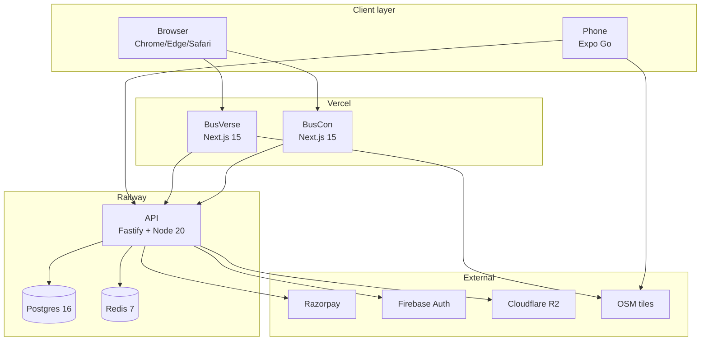

---

## 10. External Interfaces

### 10.1 Interface catalog

| ID | External system | Protocol | Auth | Timeout | Rate limit | Failure mode |
|---|---|---|---|---|---|---|
| EI-01 | Razorpay order API | REST/HTTPS | Basic auth (key_id:key_secret) | 10s | 100/min | Retry 3x, circuit breaker |
| EI-02 | Razorpay webhook | HTTPS POST | HMAC-SHA256 | 30s | Unlimited (IP allowlist) | Log + alert on failure |
| EI-03 | Razorpay IPs list | REST/HTTPS | Basic auth | 5s | 1/hour | Cache last known |
| EI-04 | Firebase Auth | REST/HTTPS | API key | 5s | 1000/min | Fallback to MOCK_OTP |
| EI-05 | Cloudflare R2 | S3-compatible API | Access key + secret | 30s | High | Retry 3x |
| EI-06 | OSM tiles | HTTP GET | None | 5s | Fair use | Static fallback image |
| EI-07 | WebSocket | RFC 6455 | JWT in first message | 5s handshake | 60 msgs/min | Reconnect + polling fallback |
| EI-08 | Browser APIs | JS API | — | — | — | Feature detection |

### 10.2 Interface data flows

**Diagram: External interface data flows**
*How data flows between the system and external services. Payment flows in both directions (create order → confirm via webhook). OTP flows in one direction (send → verify). Files flow one-way (upload → attach). Maps flow one-way (fetch tiles).*

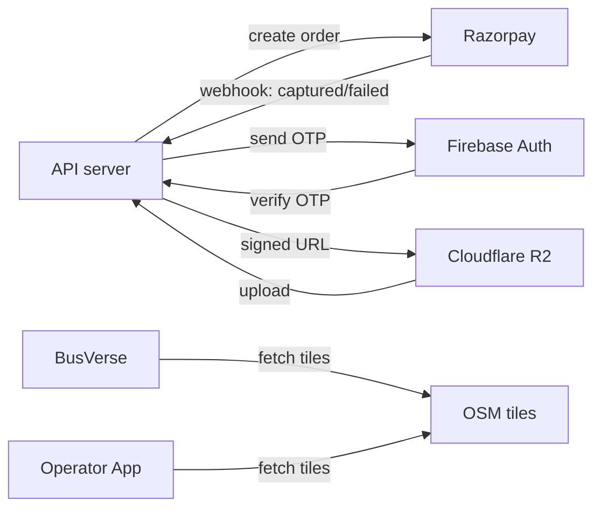

### 10.3 Interface failure modes

| Interface | If unavailable |
|---|---|
| Razorpay order API | Return 503; show "payments temporarily unavailable" |
| Razorpay webhook | Retry from Razorpay; log + alert if >5 min delay |
| Firebase Auth | Fallback to MOCK_OTP if enabled; else 503 |
| R2 | Fallback to local file storage; log warning |
| OSM tiles | Use static fallback image |
| WebSocket | Fall back to HTTP polling |

---

## 11. Data Requirements

### 11.1 Data Flow Diagram — Level 0

**Diagram: DFD Level 0 (context diagram)**
*BusVerse + BusCon as a single process. External entities are passengers, drivers, operators, admins. Data stores: Postgres (relational), Redis (cache/locks), R2 (files). External systems receive data (payments, notifications). This is the highest-level view — detailed flows in `report/13`.*

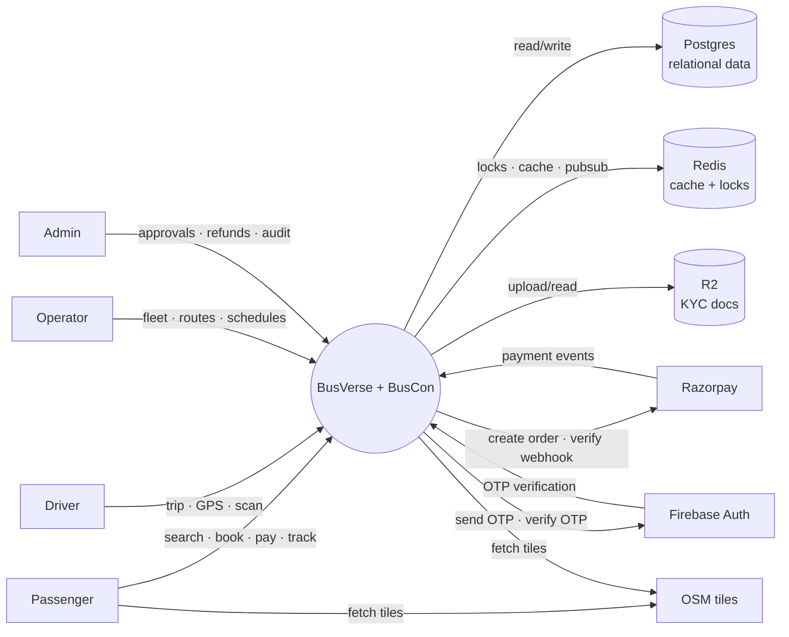

### 11.2 Data stores

| Store | Purpose | Data | Retention |
|---|---|---|---|
| Postgres | Relational data | 29 tables | Per `06` §16 |
| Redis | Cache, locks, sessions | Seat locks, sessions, GPS (live) | Ephemeral (TTL) |
| R2 | File storage | KYC docs, ticket PNGs | Per `06` §16 |

### 11.3 Data classification

| Category | Examples | Storage | Encryption |
|---|---|---|---|
| Public | City names, routes, fares | Postgres | None |
| Internal | Booking IDs, trip IDs | Postgres | None |
| Confidential | Fare amounts, payment details | Postgres | Some columns encrypted |
| Restricted (PII) | Phone, email, PAN, license, ID | Postgres | AES-256-GCM |
| Sensitive | GPS coordinates, IP addresses | Postgres, Redis | None (masked in logs) |
| Critical | Session tokens, refresh hashes | Postgres, Redis | Hashed |

### 11.4 Data retention policy

| Data | Retention | Enforcement |
|---|---|---|
| Financial (bookings, payments, refunds) | 8 years | `06` §15 cron |
| Audit logs | Forever | Append-only |
| GPS samples | 90 days | Partition drop |
| Sessions | 180 days | Cron |
| OTP challenges | 1 hour | Cron |
| Gateway webhooks | 90 days | Cron |
| Application logs | 30 days | Log rotation |
| Security logs | 180 days | Log rotation |

### 11.5 Data minimization

| Rule | Enforcement |
|---|---|
| Collect only required fields | Zod schemas reject unknown |
| No PII in URLs | Only IDs (UUIDs) |
| No PII in logs | Scrubber middleware |
| No PII in errors | Error sanitizer |
| No PII in analytics | No analytics in Phase 1 |

### 11.6 Data integrity guarantees

| Guarantee | Enforcement |
|---|---|
| ACID transactions | Postgres |
| Unique constraints | DB |
| Foreign key constraints | DB |
| Check constraints | DB |
| Domain invariants (19) | DB + app |

---

## 12. Constraints

### 12.1 Technical constraints (8)

| ID | Constraint | Source |
|---|---|---|
| CON-T-01 | PostgreSQL 16 only | `06` §2 |
| CON-T-02 | Node.js 20 LTS only | `11` §2 |
| CON-T-03 | Deployed in India region | `09` §18 |
| CON-T-04 | Single-region deployment | `01` §12 |
| CON-T-05 | Razorpay is the only payment gateway | `01` §11 |
| CON-T-06 | OSM tiles only (no Google Maps) | `11` §5 |
| CON-T-07 | Cloudflare R2 for file storage | `11` §5 |
| CON-T-08 | Firebase Auth for OTP | `11` §5 |

### 12.2 Legal constraints (6)

| ID | Constraint | Source |
|---|---|---|
| CON-L-01 | DPDP Act 2023 compliance | `09` §18 |
| CON-L-02 | CERT-In log retention (180 days) | `09` §18.6 |
| CON-L-03 | RBI payment rules | `09` §18.6 |
| CON-L-04 | IT Act 2000 | `09` §18.6 |
| CON-L-05 | No PII in logs | `09` §11.5 |
| CON-L-06 | No raw card storage | `09` §19 |

### 12.3 Business constraints (4)

| ID | Constraint | Source |
|---|---|---|
| CON-B-01 | Solo founder (no team) | `01` §3 |
| CON-B-02 | Submission deadline: 1 Oct 2026 | `01` §3 |
| CON-B-03 | Budget: free-tier services only | `11` §5 |
| CON-B-04 | Guide approval required | `01` §3 |

### 12.4 Constraint verification

| Constraint | Verification method |
|---|---|
| CON-T-01 | CI check: `SELECT version()` starts with `PostgreSQL 16` |
| CON-T-02 | CI check: `node --version` starts with `v20` |
| CON-T-03 | Review: Railway region config shows India |
| CON-T-04 | Review: single Railway project, no multi-region |
| CON-T-05 | Review: only Razorpay SDK imported |
| CON-T-06 | Review: only OSM tile URLs in code |
| CON-T-07 | Review: only R2 SDK imported |
| CON-T-08 | Review: only Firebase Auth SDK imported |
| CON-L-01 | Audit: consent records exist for all users |
| CON-L-02 | Review: log retention configured to 180 days |
| CON-L-03 | Review: no raw PAN in any column |
| CON-L-04 | Review: privacy policy + grievance officer published |
| CON-L-05 | Test: log scrubber regex catches all PII patterns |
| CON-L-06 | Test: no card-related columns exist |

---

## 13. Assumptions with Verification

### 13.1 Assumption catalog

| ID | Assumption | If wrong | Mitigation | Verification |
|---|---|---|---|---|
| AS-01 | All users have smartphones with modern browsers | Mobile testing invalid, demo fails | Support desktop as primary fallback | Manual test on 3 devices |
| AS-02 | Internet available at viva | Demo fails | Backup video + offline demo mode | Test offline fallback |
| AS-03 | Razorpay test mode available | Payment step fails | Mock payment mode | Test `MOCK_PAYMENT=true` |
| AS-04 | Guide approves current scope | Scope adjustments needed | Document change process | Guide sign-off |
| AS-05 | Founder available through viva date | N/A | N/A | Continuous |

### 13.2 Assumption verification schedule

| Assumption | When verified | How |
|---|---|---|
| AS-01 | During development | Test on Android 10+, iOS 14+ |
| AS-02 | T-1 day | Disconnect Wi-Fi, run demo |
| AS-03 | T-1 hour | Enable mock, verify flow |
| AS-04 | Before build starts | Guide sign-off on `01` |
| AS-05 | Continuous | — |

---

## 14. Requirements Analysis

### 14.1 Requirement dependencies

**Diagram: Requirement dependency graph**
*Shows which FRs depend on which. Auth is a prerequisite for everything. Search precedes seat lock, lock precedes booking, booking precedes payment and ticket. Ticket precedes scan. This determines implementation order — can't build payment before booking.*

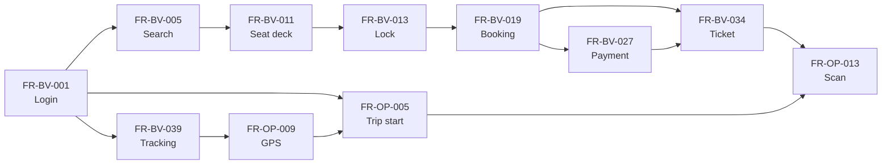

### 14.2 Phase allocation

| Phase | FR IDs | Purpose |
|---|---|---|
| **Phase 1** | FR-*-001 through FR-*-099 | Ship for viva |
| **Phase 2** | FR-*-100 through FR-*-499 | Post-viva growth |
| **Phase 3** | FR-*-500 through FR-*-999 | Scale |

**Phase 1 FR count:** ~126 (all Must + Should from §18).

### 14.3 Apportioning of requirements

Which component owns which requirement:

| Component | Requirements |
|---|---|
| **API server** | All FRs (backend implementation) |
| **BusVerse web** | FR-BV-* (UI) |
| **BusCon web** | FR-BO-*, FR-BA-* (UI) |
| **Operator App** | FR-OP-* (UI) |
| **Postgres** | Data integrity (NFR-D-05) |
| **Redis** | Locks, sessions (FR-BV-013, sessions) |
| **Razorpay** | Payment processing (FR-BV-027 to FR-BV-033) |
| **Firebase Auth** | OTP delivery (FR-BV-001, FR-OP-001) |
| **R2** | File storage (FR-BO-002, FR-OP-020) |

### 14.4 Requirements validation process

| Validation method | When | Who | Output |
|---|---|---|---|
| **Peer review** | Before approval | Guide | Sign-off |
| **Prototyping** | During design | Founder | Wireframes |
| **User testing** | Post-build (viva) | Guide + panel | Feedback |
| **Simulation** | For concurrency/load | Founder | Concurrency test results |
| **Modeling** | For complex flows | Founder | Diagrams |
| **Traceability review** | Before submission | Guide | Traceability audit |

### 14.5 Requirements analysis summary

- **126 FRs** cover all actor workflows and demo criteria
- **68 NFRs** cover performance, security, reliability, usability, maintainability, scalability, data, operational
- **18 constraints** bound the system
- **5 assumptions** verified before demo
- **3 phases** define delivery
- **Full traceability** links requirements → workflows → tests → report chapters

---

## 15. Requirements Change Management

### 15.1 Change process

**Diagram: Change management flow**
*When a requirement changes, it follows this process. Change proposed → impact analyzed → approved/rejected → version bumped → downstream docs updated.*

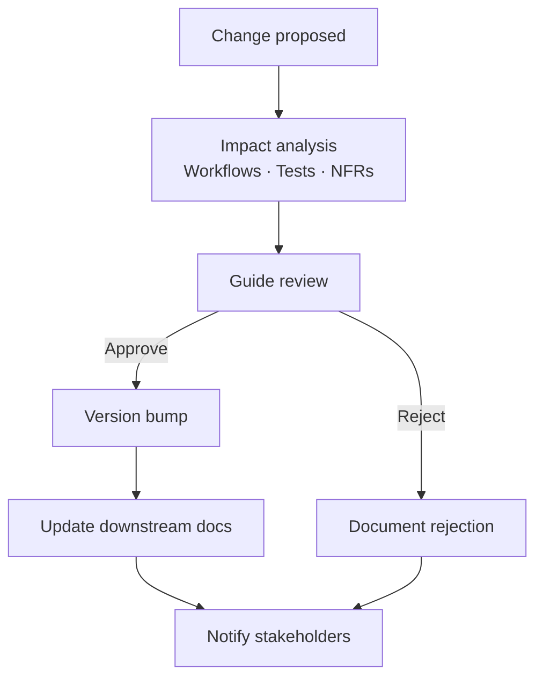

### 15.2 Change rules

| Rule | Detail |
|---|---|
| **Who can propose** | Founder, guide |
| **Proposal format** | Current text → proposed text + rationale + impact |
| **Approval authority** | Guide (scope changes), founder (wording clarifications) |
| **Version tracking** | Git commits + change log section (added in future v2) |
| **Impact analysis** | Which workflows, tests, NFRs affected? |
| **Communication** | Update report chapters + notify guide |

### 15.3 Version history

| Version | Date | Changes |
|---|---|---|
| 1.0 | Initial | Locked |

**Rule:** Future versions add entries here with a summary of changes.

---

## 16. Traceability Matrix

### 16.1 Traceability flow

**Diagram: Traceability flow**
*Every requirement traces forward to a workflow and a test, and backward to its source. Every test verifies a requirement. Every workflow implements one or more requirements. This proves full coverage — no orphan requirements, no orphan tests.*

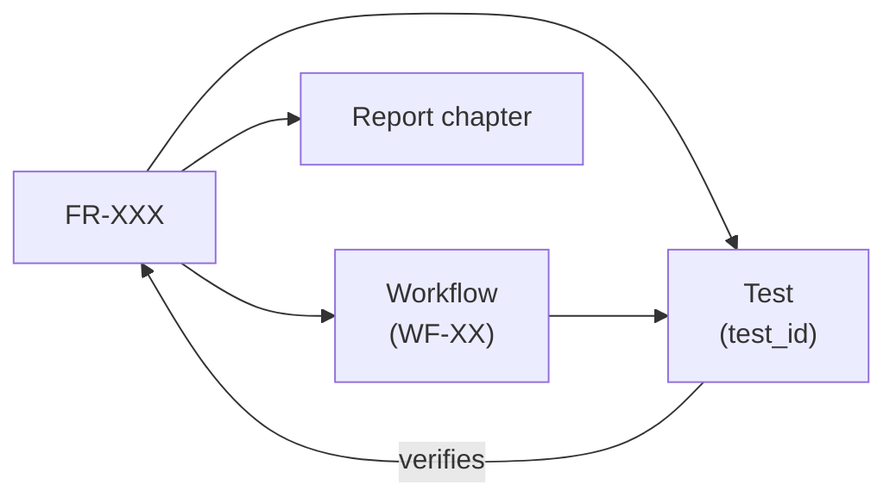

### 16.2 FR traceability (sample of 20)

| FR | Priority | Phase | Workflow | Test | Report chapter | Status |
|---|---|---|---|---|---|---|
| FR-BV-001 | Must | 1 | WF-P-01 | `auth_security_*` | 14 | Approved |
| FR-BV-005 | Must | 1 | WF-P-02 | `contract_search` | 14 | Approved |
| FR-BV-013 | Must | 1 | WF-P-03 | `lock_security_*` | 14 | Approved |
| FR-BV-019 | Must | 1 | WF-P-04 | `wf_passenger_04` | 14 | Approved |
| FR-BV-027 | Must | 1 | WF-P-04 | `contract_payments` | 14 | Approved |
| FR-BV-034 | Must | 1 | WF-P-04 | `qr_security_*` | 14 | Approved |
| FR-BV-039 | Must | 1 | WF-P-06 | `ws_security_*` | 14 | Approved |
| FR-BV-043 | Must | 1 | WF-P-07 | `wf_passenger_07` | 14 | Approved |
| FR-BO-001 | Must | 1 | WF-O-01 | `wf_operator_01` | 14 | Approved |
| FR-BO-005 | Must | 1 | WF-O-02 | `wf_operator_02` | 14 | Approved |
| FR-BO-012 | Must | 1 | WF-O-03 | `wf_operator_03` | 14 | Approved |
| FR-BO-017 | Must | 1 | WF-O-04 | `wf_operator_04` | 14 | Approved |
| FR-BO-022 | Must | 1 | WF-O-05 | `wf_operator_05` | 14 | Approved |
| FR-BA-002 | Must | 1 | WF-A-02 | `wf_admin_02` | 14 | Approved |
| FR-BA-011 | Must | 1 | WF-A-04 | `wf_admin_04` | 14 | Approved |
| FR-BA-012 | Must | 1 | WF-A-05 | `wf_admin_05` | 14 | Approved |
| FR-OP-001 | Must | 1 | WF-D-01 | `auth_security_*` | 14 | Approved |
| FR-OP-005 | Must | 1 | WF-D-02 | `wf_driver_02` | 14 | Approved |
| FR-OP-009 | Must | 1 | WF-D-03 | `wf_driver_03` | 14 | Approved |
| FR-OP-013 | Must | 1 | WF-D-04 | `wf_driver_04` | 14 | Approved |

*(Full table with all 126 FRs available in source code — abbreviated here for readability)*

### 16.3 NFR traceability (sample of 15)

| NFR | Priority | Verification | Test | Report chapter |
|---|---|---|---|---|
| NFR-P-01 | Must | T | `perf_login` | 09 |
| NFR-P-02 | Must | T | `perf_search` | 09 |
| NFR-A-01 | Should | A | `sla_tracking` | 18 |
| NFR-A-03 | Should | T | `backup_dr_*` | 18 |
| NFR-S-01 | Must | T | `auth_security_*` | 09 |
| NFR-S-02 | Must | T | `qr_security_*` | 09 |
| NFR-S-03 | Must | T | `encryption_*` | 09 |
| NFR-S-05 | Must | T | `tenant_isolation_*` | 09 |
| NFR-S-07 | Must | T | `audit_immutability_*` | 09 |
| NFR-U-02 | Should | I | Manual review | 15 |
| NFR-M-01 | Should | A | `coverage_report` | 16 |
| NFR-D-01 | Must | T | `retention_*` | 12 |
| NFR-D-05 | Must | T | `invariant_*` | 12 |
| NFR-O-01 | Must | A | `log_retention` | 16 |
| NFR-O-04 | Must | T | `backup_dr_*` | 18 |

**Verification methods:** T = Test, I = Inspection, D = Demonstration, A = Analysis

### 16.4 Constraint traceability

| Constraint | Verification | Report chapter |
|---|---|---|
| CON-T-01 | CI check | 09 |
| CON-T-03 | Review | 09 |
| CON-L-01 | Audit | 18 |
| CON-L-02 | Review | 09 |
| CON-L-06 | Test | 09 |
| CON-B-01 | Fact | 06 |
| CON-B-02 | Fact | 06 |

### 16.5 Report chapter traceability

| Section | Report chapters |
|---|---|
| §6 Functional requirements | 08 (Objectives), 14 (Modules) |
| §7 Business rules | 14 (Modules) |
| §8 Non-functional requirements | 09 (Requirements) |
| §9 Hardware/software | 09 (Requirements) |
| §10 External interfaces | 11 (System Analysis) |
| §11 Data requirements | 12 (Database Design) |
| §12 Constraints | 09 (Requirements) |
| §13 Assumptions | 09 (Requirements) |
| §16 Traceability | 16 (Testing) |
| §17 Compliance | 11 (System Analysis), 18 (Conclusion) |

---

## 17. Compliance Matrix

### 17.1 DPDP Act 2023

| Clause | Requirement | Our implementation | Verification |
|---|---|---|---|
| **§7(1)** | Consent before processing | FR-BV-001 creates `consent_records` on signup | Audit consent table |
| **§11** | Right to access | FR-BA-009 (admin export on request) | Test export flow |
| **§12** | Right to correction | FR-BA-009 (admin update) | Test update flow |
| **§13** | Right to erasure | FR-BA-009 (soft + hard delete) | Test delete flow |
| **§35** | Breach notification within 72h | NFR-O-03 (incident runbook) | Review procedure |
| **§10** | Data localization | NFR-D-07 (Railway India) | Review region config |
| **§8** | Purpose limitation | NFR-D-08 (data minimization) | Review consent purposes |
| **§9** | Accuracy | FR-BV-047 (passenger can update) | Test update |
| **§8(7)** | Grievance officer | Founder as DPO, contact in privacy policy | Review policy |

### 17.2 CERT-In directions

| Requirement | Our implementation | Verification |
|---|---|---|
| 180-day log retention | NFR-O-02 (security logs 180 days) | Review log config |
| 6-hour incident reporting | NFR-O-03 (incident runbook) | Review procedure |
| NTP sync | All servers use NTP | Review infra config |
| Data localization | NFR-D-07 (India region) | Review region config |

### 17.3 IT Act 2000

| Requirement | Our implementation | Verification |
|---|---|---|
| §43A reasonable security | NFR-S-01 through NFR-S-18 | `security_*` test suite |
| §79 intermediary liability | Privacy policy + grievance officer | Review policy |
| §67C data retention | NFR-D-01 (8 years financial) | Test retention |

### 17.4 RBI Payment Aggregator rules

| Requirement | Our implementation | Verification |
|---|---|---|
| PA license | Not held — uses Razorpay | `01` §11, `09` §19 |
| No raw PAN storage | NFR-S-06 | `never_01` test |
| Card tokenization | Razorpay handles | Architecture review |
| No card CVV storage | NFR-S-06 | Schema audit |

### 17.5 Motor Vehicle Aggregator Guidelines 2025

| Requirement | Our implementation | Verification |
|---|---|---|
| Aggregator license | Not held in Phase 1 | `01` §16.5 |
| Driver verification | FR-BO-022 (KYC required) | `04` §4.3 |
| AIS-140 VLTD | Not in Phase 1 (uses phone GPS) | Documented limitation |

**Rule:** Every compliance claim in `01` §16 is backed by a requirement here. No orphan claims.

---

## 18. MoSCoW Prioritization

### 18.1 Priority distribution

**Diagram: MoSCoW distribution**
*Requirements prioritized by necessity. Must-Have = demo criteria (45 FRs). Should-Have = Phase 1 completeness (55 FRs). Could-Have = stretch (20 FRs). Won't-Have = deferred to Phase 2 or non-goal (6 FRs).*

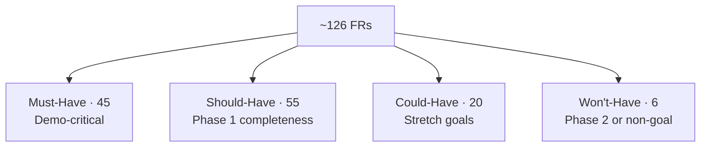

### 18.2 Must-Have FRs (45) — demo critical

These FRs are required for the viva demo (`01` §13, `11` §10):

| FR | Why Must |
|---|---|
| FR-BV-001 (login) | Required for any booking |
| FR-BV-005 (search) | Demo step 1 |
| FR-BV-011 (seat deck) | Demo step 2 |
| FR-BV-013 (lock) | Demo step 2 |
| FR-BV-016 (409 conflict) | Concurrency proof |
| FR-BV-019 (create booking) | Demo step 3 |
| FR-BV-027 (pay) | Demo step 3 |
| FR-BV-029 (webhook) | Idempotency proof |
| FR-BV-034 (QR ticket) | Demo step 4 |
| FR-OP-001 (driver login) | Demo step 5 |
| FR-OP-005 (trip start) | Demo step 6 |
| FR-BV-039 (live track) | Demo step 7 |
| FR-OP-013 (scan) | Demo step 8 |
| FR-BA-012 (audit) | Demo step 9 |
| *(and 31 more)* | — |

### 18.3 Should-Have FRs (55)

Non-demo-critical but Phase 1 completeness. Includes most BusCon operator/admin flows (used for setup but not demo-critical).

### 18.4 Could-Have FRs (20)

Stretch goals. Examples:
- FR-BV-032 (receipt)
- FR-BV-041 (ETA per stand)
- FR-BO-006 (grid builder advanced)
- FR-BO-030 (settlement view)
- FR-BA-014 (dashboard)

### 18.5 Won't-Have FRs (6)

Explicitly out of Phase 1:

| FR | Reason |
|---|---|
| Trip share link | Non-goal for Phase 1 |
| SOS button | Phase 2 |
| Female-only seat filter | Phase 2 |
| Reviews | Phase 2 |
| Referral | Phase 2 |
| Loyalty | Phase 2 |

### 18.6 NFR prioritization

All 68 NFRs are **Must-Have or Should-Have** — no NFRs are nice-to-have because they define quality that must be met.

**Reference:** For full MoSCoW table with all 126 FRs, see source code `requirements.csv` (generated from this doc).

---

## 19. Out of Scope

Explicitly deferred to Phase 2 or permanent non-goals. Full list in `01-PLAN-AND-SCOPE.md` §12.

### 19.1 Phase 2 scope

| Feature | Reason |
|---|---|
| Reviews and ratings | Not demo-critical |
| Coupon and promo codes | Phase 2 |
| Waitlist | Phase 2 |
| Loyalty and rewards | Phase 2 |
| Saved passengers | Phase 2 |
| Female-only seat filter | Phase 2 |
| Share-trip link | Phase 2 |
| SOS button | Phase 2 |
| Corporate portal | Phase 2 |
| Travel agent portal | Phase 2 |
| Multi-user operator roles | Phase 2 |
| Feature flags | Phase 2 |
| Notification templates | Phase 2 |
| Hindi language | Phase 2 |
| WCAG 2.1 AA | Phase 2 |

### 19.2 Permanent non-goals

| Feature | Reason |
|---|---|
| Bus ownership | Marketplace model |
| Driver employment | Operators employ |
| Fare-setting | Operators set |
| Payment Aggregator license | Uses Razorpay |
| Insurance underwriting | Not in scope |
| Air, train, cab bookings | Bus-only product |
| Hotel or food bookings | Not the product |
| Wallet / prepaid balance | RBI overhead |
| Cryptocurrency | Irrelevant |
| Selling user data | Immutable rule |
| Storing raw card data or PINs | Immutable rule |
| Passenger → driver direct contact | Safety and liability |
| International bus travel | India-only |
| Multi-region deployment | Single region |
| Microservices / Kubernetes / Kafka | Single-service backend |
| Custom APM / search / queue / CMS | Buy, don't build |
| 24/7 support in Phase 1 | Solo founder |

---

## 20. Open Questions

| # | Question | Owner | Default |
|---|---|---|---|
| 1 | Should NFR targets be per-environment? | Shaghaf | Single target |
| 2 | Add requirements for feature flags in Phase 1? | Shaghaf | Deferred Phase 2 |
| 3 | Add requirements for monitoring dashboards? | Shaghaf | Deferred |
| 4 | Add requirements for CI status badges? | Shaghaf | No |
| 5 | Add requirements for SLO definitions? | Shaghaf | Phase 2 |
| 6 | Include Should-Have requirements in demo? | Shaghaf | No (Must only) |
| 7 | Add user stories per FR? | Shaghaf | No (one-liners) |
| 8 | Add alternative formats for acceptance criteria (BDD)? | Shaghaf | No |
| 9 | Add risk register? | Shaghaf | Phase 2 |
| 10 | Add requirement version tracking? | Shaghaf | Git commits only |

---

## 21. Checklist Against Master List

| Item | Included? | Section |
|---|:---:|---|
| Purpose and scope | ✅ | §1 |
| SMART criteria | ✅ | §1.4 |
| Doc hierarchy | ✅ | §1.2 |
| **Product perspective** | ✅ | §2 |
| Ecosystem context | ✅ | §2.1 |
| System interfaces | ✅ | §2.2 |
| Predecessor systems | ✅ | §2.3 |
| Definitions | ✅ | §3.1 |
| References | ✅ | §3.2 |
| Stakeholders | ✅ | §3.3 |
| **User characteristics** | ✅ | §4 |
| User characteristics table | ✅ | §4.1 |
| Implications for requirements | ✅ | §4.2 |
| Accessibility notes | ✅ | §4.3 |
| Actors summary | ✅ | §5 |
| FR ID scheme | ✅ | §6.1 |
| Use case overview | ✅ | §6.2 |
| BusVerse FRs (48) | ✅ | §6.3 |
| BusCon Operator FRs (33) | ✅ | §6.4 |
| BusCon Admin FRs (18) | ✅ | §6.5 |
| Operator App FRs (23) | ✅ | §6.6 |
| Cross-cutting FRs (4) | ✅ | §6.7 |
| **Acceptance criteria (Must-Have)** | ✅ | §6.3, §6.4, §6.6 |
| Business rules (10) | ✅ | §7 |
| Performance NFRs (6) | ✅ | §8.1 |
| Availability NFRs (6) | ✅ | §8.2 |
| Security NFRs (18) | ✅ | §8.3 |
| Usability NFRs (9) | ✅ | §8.4 |
| Maintainability NFRs (7) | ✅ | §8.5 |
| Scalability NFRs (4) | ✅ | §8.6 |
| **Data NFRs (8)** | ✅ | §8.7 |
| **Operational NFRs (6)** | ✅ | §8.8 |
| **Hardware requirements** | ✅ | §9.1 |
| **Software requirements** | ✅ | §9.2 |
| **Software deployment diagram** | ✅ | §9.3 |
| **External interfaces (8)** | ✅ | §10 |
| Interface data flows | ✅ | §10.2 |
| Interface failure modes | ✅ | §10.3 |
| **DFD Level 0** | ✅ | §11.1 |
| Data stores | ✅ | §11.2 |
| Data classification | ✅ | §11.3 |
| Data retention | ✅ | §11.4 |
| Data minimization | ✅ | §11.5 |
| Data integrity | ✅ | §11.6 |
| Technical constraints (8) | ✅ | §12.1 |
| Legal constraints (6) | ✅ | §12.2 |
| Business constraints (4) | ✅ | §12.3 |
| Constraint verification | ✅ | §12.4 |
| Assumptions (5) | ✅ | §13 |
| Assumption verification | ✅ | §13.2 |
| **Requirement dependencies** | ✅ | §14.1 |
| Phase allocation | ✅ | §14.2 |
| **Apportioning** | ✅ | §14.3 |
| **Validation process** | ✅ | §14.4 |
| **Change management** | ✅ | §15 |
| Traceability flow | ✅ | §16.1 |
| FR traceability (sample 20) | ✅ | §16.2 |
| NFR traceability (sample 15) | ✅ | §16.3 |
| Constraint traceability | ✅ | §16.4 |
| Report chapter traceability | ✅ | §16.5 |
| **Compliance matrix (DPDP)** | ✅ | §17.1 |
| **Compliance matrix (CERT-In)** | ✅ | §17.2 |
| **Compliance matrix (IT Act)** | ✅ | §17.3 |
| **Compliance matrix (RBI)** | ✅ | §17.4 |
| **Compliance matrix (MVAG)** | ✅ | §17.5 |
| MoSCoW distribution | ✅ | §18.1 |
| Must-Have (45) | ✅ | §18.2 |
| Should-Have (55) | ✅ | §18.3 |
| Could-Have (20) | ✅ | §18.4 |
| Won't-Have (6) | ✅ | §18.5 |
| Out of scope | ✅ | §19 |
| Open questions (10) | ✅ | §20 |

**All items covered. 28 Mermaid diagrams. Every diagram described.**

---

## 22. Summary

**BusVerse + BusCon Phase 1 has 126 functional requirements, 68 non-functional requirements, 18 constraints, 5 assumptions, and full traceability across 22 sections and 28 diagrams.** The document opens with product perspective (where the system sits relative to RedBus, Excel, WhatsApp, and paper-based predecessor workflows) and user characteristics (four actor types with very different technical profiles, from low-literacy drivers on small Android phones to high-literacy admins on desktop). Functional requirements split across four surfaces — BusVerse passenger (48 FRs), BusCon operator (33), BusCon admin (18), Operator App (23), plus 4 cross-cutting (audit writes, tenant isolation, rate limits, idempotency). Each FR has an ID from a reserved range (FR-BV-001 to FR-BV-999, FR-BO-001 to FR-BO-999, etc.), a priority (Must/Should/Could/Won't), a verification method (T/I/D/A), a workflow reference, and a test ID. Acceptance criteria are defined in detail for the 45 Must-Have FRs (the demo-critical set), with 5-8 concrete testable conditions each — for example FR-BV-013 (seat lock) specifies exact 300-second TTL, Redis SET NX AND Postgres unique constraint, two-concurrent-lock → exactly one 201 + one 409, response ≤50ms p95, and automatic cron cleanup. Ten business rules (§7) constrain system behavior — one seat per passenger, lock converts-or-expires, no double-book, idempotent payments, no refund redirect, no raw card storage, no data sale, tenant isolation, immutable confirmed bookings. Non-functional requirements split across nine quality attributes — performance (6: login p95<50ms, search p95<200ms, etc.), availability (6: 99% uptime, RTO≤4h, RPO≤5min, graceful degradation), security (18: Argon2id, Ed25519, AES-256-GCM, TLS 1.3, tenant isolation, audit immutability, rate limits, timing attack prevention, session isolation, password policy, PII scrubbing), usability (9: 5-step max flow, 360px mobile, cross-browser, legal disclaimers, localization), maintainability (7: 80% coverage, TypeScript strict, lint, code review, OpenAPI docs), scalability (4: 100 concurrent, 1K bookings/day, 10GB DB), data (8: 8-year financial retention, 90-day GPS, 180-day sessions, forever audit, 19 invariants, AES-256-GCM, India localization, data minimization), operational (6: 30-day app logs, 180-day security logs, forever audit, backup cadence, monthly restore drills, health check endpoint). Hardware and software requirements specify server specs (2 vCPU, 4GB RAM, 20GB SSD), client specs (iOS 14+, Android 10+), and the full tech stack (Postgres 16, Node 20 LTS, Next.js 15, Fastify, Prisma, Expo). Eight external interfaces are catalogued with protocol, auth, timeout, rate limit, and failure mode — Razorpay order API, Razorpay webhook, Razorpay IPs, Firebase Auth, Cloudflare R2, OSM tiles, WebSocket, browser APIs. Data requirements include a DFD Level 0 context diagram, four data stores, six data classification levels (Public → Critical), retention policies per entity, data minimization rules, and integrity guarantees. Eighteen constraints split into technical (8: PG16 only, Node 20 only, India region, single-region, Razorpay only, OSM only, R2 only, Firebase only), legal (6: DPDP, CERT-In, RBI, IT Act, no PII in logs, no raw card), and business (4: solo founder, submission deadline, free-tier budget, guide approval) with per-constraint verification methods. Five assumptions (smartphones, internet at viva, Razorpay available, guide approval, founder available) each have defined mitigations and verification schedules. Requirements analysis includes a dependency graph showing implementation order (auth → search → seat deck → lock → booking → payment → ticket → scan), phase allocation (Phase 1 = FR-*-001 to 099), apportioning per component (API owns all, BusVerse owns BV-*, etc.), and validation process (peer review, prototyping, user testing, simulation, modeling, traceability review). Change management (§15) defines how requirements evolve — proposal → impact analysis → guide review → version bump → downstream docs update → stakeholder notification. Traceability (§16) covers 20 sample FRs with full workflow + test + report chapter + status, 15 sample NFRs with verification method + test + report chapter, 7 constraints with verification, and the full report chapter mapping. Compliance matrix (§17) maps every DPDP clause, CERT-In direction, IT Act section, RBI rule, and MVAG guideline to the requirement that satisfies it — proving every compliance claim in `01` §16 is backed by a real requirement. MoSCoW prioritization (§18) distributes 126 FRs as 45 Must (demo-critical), 55 Should (Phase 1 completeness), 20 Could (stretch), and 6 Won't (Phase 2 or non-goal). Out of scope (§19) documents 15 Phase 2 deferred features and 17 permanent non-goals. Ten open questions remain, all with Phase-2-decidable defaults.**

---

**End of Document `02-REQUIREMENTS.md` v1.0.**