# `docs/03-SYSTEM-ARCHITECTURE.md`

**Document:** `docs/03-SYSTEM-ARCHITECTURE.md`
**Project:** BusVerse + BusCon
**Version:** 1.0
**Status:** Locked — Foundational Document
**Owner:** Shaghaf
**Guide:** Mr. Mohit Srivastav
**Purpose:** The complete architecture description for BusVerse + BusCon Phase 1. Uses the C4 model (Context, Container, Component) to show how the system is structured, how requests flow, how modules interact, how data is stored, how the system fails and recovers, and what architectural decisions were made. Every module, every boundary, every integration traces back to this document. If a component is not in this document, it does not exist.

> **Derives from:** `01-PLAN-AND-SCOPE.md` (scope), `02-REQUIREMENTS.md` (requirements, quality attributes), `04-ACTORS-ROLES-PERMISSIONS.md` (authz), `05-DOMAIN-MODEL.md` (bounded contexts, events), `06-DATABASE-SCHEMA.md` (data stores), `07-API-AND-REALTIME-CONTRACTS.md` (endpoints, WebSocket), `09-SECURITY-AND-PLATFORM-RULES.md` (security architecture), `11-DEPLOYMENT-AND-DEMO.md` (deployment).
>
> **Referenced by:** `busverse/`, `buscon/`, `shared/`, `report/11-SYSTEM_ANALYSIS_DESIGN.md`, `report/13-DFD_UML_DIAGRAMS.md`, and every future architectural change.

---

## 1. Purpose and Scope

### 1.1 What this document owns

| Owns here | Referenced from upstream |
|---|---|
| C4 model diagrams (levels 1–3) | — |
| Architecture principles | — |
| Quality attribute scenarios (ATAM) | `02` §8 (NFRs) |
| Architectural tactics | — |
| Module boundaries | `05` §3 (bounded contexts) |
| Data ownership matrix | `06` §4–§9 (tables) |
| Cross-module call matrix | — |
| Request lifecycle | `07` §2–§8 |
| Consistency model | — |
| Caching strategy | `09` §16 |
| Async job topology | — |
| Event architecture + guarantees | `05` §10.4, `08` §11 |
| Real-time architecture | `07` §8, `09` §12.5 |
| Deployment topology | `11` §13 |
| Build pipeline | — |
| Scaling approach | — |
| Module extraction criteria | — |
| Failure modes + timeouts + circuit breakers | `09` §17 |
| Observability | `09` §15.5 |
| Security architecture view | `09` §5 |
| Cross-cutting concerns | — |
| 15 ADRs | — |

### 1.2 Document hierarchy

**Diagram: Document hierarchy**
*The architecture doc synthesizes ten upstream docs into one system view. It feeds the three product folders (which describe each surface), the report chapter on system analysis, and every future change request. Nothing implements without a corresponding architecture entry here.*

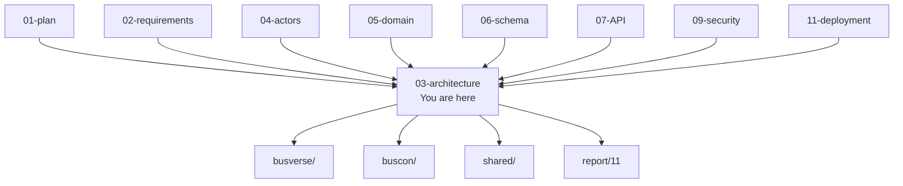

### 1.3 What this document does NOT cover

| Topic | Goes to |
|---|---|
| Requirements | `02-REQUIREMENTS.md` |
| Domain entities | `05-DOMAIN-MODEL.md` |
| Database DDL | `06-DATABASE-SCHEMA.md` |
| API contracts | `07-API-AND-REALTIME-CONTRACTS.md` |
| Workflow sequences | `08-WORKFLOWS.md` |
| Security controls | `09-SECURITY-AND-PLATFORM-RULES.md` |
| Test strategy | `10-TESTING-STRATEGY.md` |
| Deployment procedures | `11-DEPLOYMENT-AND-DEMO.md` |
| UI designs | `busverse/05-UI-SPEC.md`, `buscon/06-UI-SPEC.md` |

---

## 2. Architecture Principles

Seven principles. Every architectural decision in §21 satisfies at least one.

**Diagram: Architecture principles**
*Seven principles split into structural (how the system is shaped) and behavioral (how it responds under pressure). Structural choices are locked; behavioral choices are hardened through tests.*

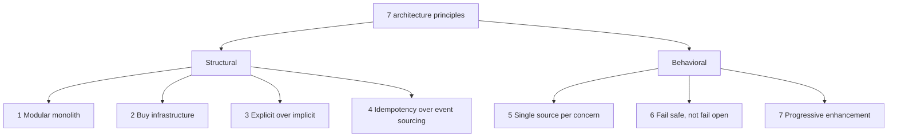

| # | Principle | Meaning | Enforcement |
|:---:|---|---|---|
| 1 | **Modular monolith** | One deployable API with 6 internal modules. Avoids distributed complexity in Phase 1. | Lint rule prevents cross-module direct access |
| 2 | **Buy infrastructure** | Use Razorpay, MSG91, R2, Sentry. Don't build payments, SMS delivery, storage, or observability. | ADRs 010–015 |
| 3 | **Explicit over implicit** | No globals, no implicit side effects. Dependency injection everywhere. | ESLint `no-restricted-globals` |
| 4 | **Idempotency over event sourcing** | Payments, refunds, webhooks idempotent. No replay. | Idempotency key on every money path |
| 5 | **Single source per concern** | Roles in `04`, entities in `05`, schema in `06`, endpoints in `07`, workflows in `08`, security in `09`, tests in `10`. | Cross-reference enforcement |
| 6 | **Fail safe, not fail open** | Seat lock, tenant isolation, audit write — deny on failure. | Fail-safe tests in `09` §22 |
| 7 | **Progressive enhancement** | WebSocket → polling. Push → SMS. Real-time degrades gracefully. | Fallback tests in `10` |

---

## 3. C4 Model, Quality Attribute Scenarios, Tactics

### 3.1 C4 model overview

**Diagram: C4 model levels**
*Four levels of abstraction. Level 1 (context) shows actors and external systems. Level 2 (container) shows deployable units. Level 3 (component) shows internal modules. Level 4 (code) is skipped — source code is its own view.*

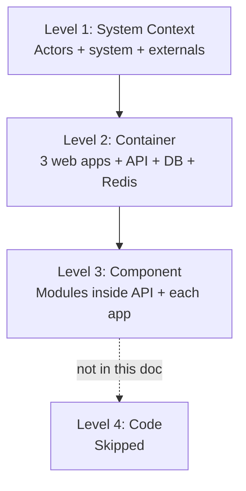

| Level | Purpose | Audience | Section |
|---|---|---|---|
| **L1 Context** | Who uses it, what it connects to | Everyone | §4 |
| **L2 Container** | Deployable units | Technical | §5 |
| **L3 Component** | Modules within containers | Developers | §6–§7 |
| **L4 Code** | Class diagrams | (skipped) | — |

### 3.2 Quality attribute scenarios (ATAM)

Six quality attribute scenarios using SEI ATAM format — Source / Stimulus / Artifact / Environment / Response / Measure. Each scenario is the reason an architectural decision in §21 exists.

**Diagram: Quality attribute scenarios**
*Six scenarios across the quality attributes from `02` §8. Each scenario is a concrete operational story that the architecture must satisfy.*

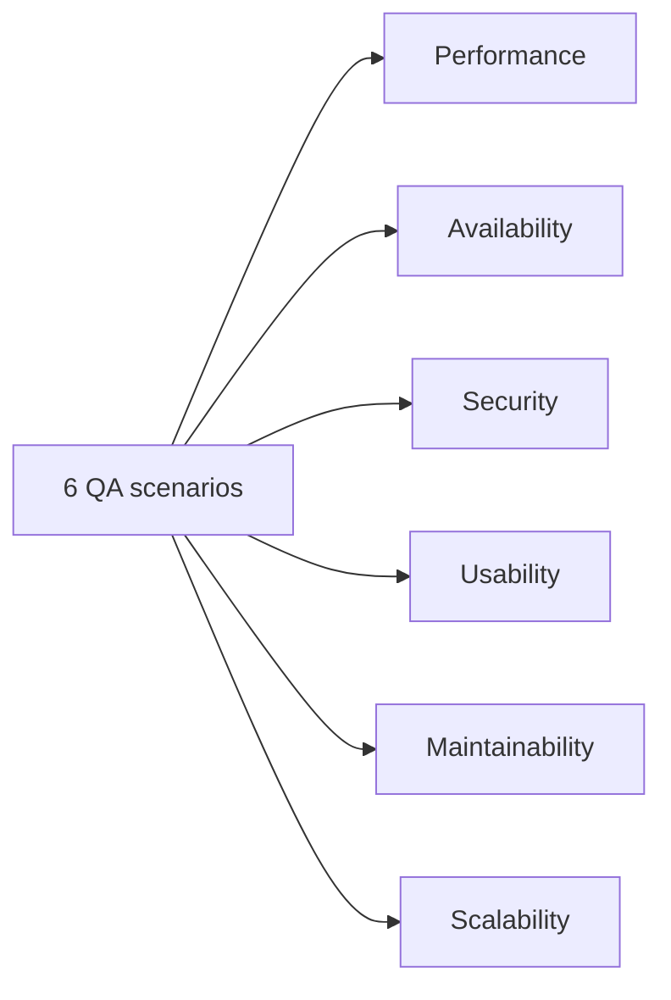

**QA-01 — Performance (booking path):**

| Part | Value |
|---|---|
| Source | Passenger |
| Stimulus | Submits book + pay request |
| Artifact | Booking + Payment modules |
| Environment | Normal load (100 concurrent users) |
| Response | Booking confirmed, ticket issued |
| Measure | p95 ≤ 500ms for booking creation, p95 ≤ 800ms for payment initiation |

**QA-02 — Availability (external service failure):**

| Part | Value |
|---|---|
| Source | Razorpay outage |
| Stimulus | Order creation API returns 503 |
| Artifact | Payment module |
| Environment | Mid-load (10 bookings/minute) |
| Response | Circuit breaker opens, passengers see "payments unavailable", seat locks held |
| Measure | No data loss, no orphan bookings, circuit reopens within 60s of recovery |

**QA-03 — Security (cross-tenant probe):**

| Part | Value |
|---|---|
| Source | Malicious Operator A |
| Stimulus | Requests Operator B's bus by ID |
| Artifact | Network module, row-scope middleware |
| Environment | Any |
| Response | Returns 404 (not 403 — does not reveal existence), audit log written |
| Measure | 100% of cross-tenant requests rejected at query level |

**QA-04 — Usability (mobile booking):**

| Part | Value |
|---|---|
| Source | Passenger on mobile (360px) |
| Stimulus | Attempts full booking flow |
| Artifact | BusVerse web + PWA |
| Environment | 4G, ~1 Mbps, mid-range phone |
| Response | All screens render, all interactions respond |
| Measure | Complete flow ≤ 5 steps, all tap targets ≥ 44px, no horizontal scroll |

**QA-05 — Maintainability (change isolation):**

| Part | Value |
|---|---|
| Source | Founder |
| Stimulus | Changes booking refund calculation |
| Artifact | Booking module |
| Environment | Development |
| Response | Only Booking module tests fail; Payment, Trip unaffected |
| Measure | Blast radius ≤ 1 module; test suite for booking runs in isolation |

**QA-06 — Scalability (peak load):**

| Part | Value |
|---|---|
| Source | Passenger |
| Stimulus | Peak load — 100 concurrent users, 10 bookings/second |
| Artifact | Full API |
| Environment | Peak |
| Response | All endpoints respond under p95 targets |
| Measure | p95 ≤ 200ms read, p95 ≤ 500ms write, zero 5xx errors |

### 3.3 Architectural tactics

Each NFR from `02` §8 achieved via a documented architectural tactic. This is what ATAM analysis looks for.

**Diagram: Tactics map**
*Fifteen tactics grouped by quality attribute. Each NFR has at least one tactic achieving it.*

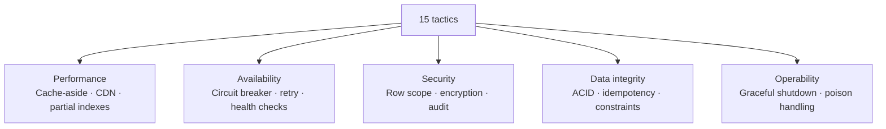

| Tactic | NFR achieved | Implementation | Where |
|---|---|---|---|
| **Cache-aside** | NFR-P-01 (login p95<50ms) | Redis caches session lookups | §11 |
| **CDN caching** | NFR-P-02 (search p95<200ms) | Vercel edge cache for public endpoints | §15 |
| **Partial indexes** | NFR-P-06 (audit p95<100ms) | `WHERE deleted_at IS NULL` on indexed columns | `06` §11 |
| **Circuit breaker** | NFR-A-05 (graceful degradation) | Razorpay/MSG91 breakers per §17.5 | §17.5 |
| **Retry with backoff** | NFR-A-06 (WS reconnection) | Exponential backoff per `07` §8.4 | §12 |
| **Health checks** | NFR-A-01 (uptime) | `/v1/health` + `/v1/status` | §20 |
| **Row-scoped queries** | NFR-S-05 (tenant isolation) | Prisma middleware appends WHERE | §8.5 |
| **Encryption at rest** | NFR-S-03 (PII encryption) | AES-256-GCM per `09` §10 | §19 |
| **Append-only audit** | NFR-S-07 (audit immutability) | DB grants + triggers per `09` §15 | §19 |
| **ACID transactions** | NFR-D-05 (21 invariants) | Postgres `BEGIN/COMMIT` | §10 |
| **Idempotency keys** | NFR-S-17 (payment idempotency) | `Idempotency-Key` header + DB unique | §12 |
| **DB constraints** | NFR-D-05 (invariants) | CHECK, UNIQUE, FK per `06` | `06` §10 |
| **Graceful shutdown** | NFR-A-01 (uptime during deploy) | SIGTERM → drain → exit per §20 | §20 |
| **Poison message handling** | NFR-A-05 (graceful degradation) | DLQ + alerting per §12 | §12 |
| **Progressive fallback** | NFR-A-06 (WS reconnection) | WebSocket → polling → manual refresh | §14 |

### 3.4 Quality attribute trade-offs

Every architecture makes trade-offs. These are the ones consciously accepted:

| Trade-off | Choice made | Alternative rejected | Why |
|---|---|---|---|
| Simplicity vs. isolation | Modular monolith | Microservices | Solo founder can't operate 6 services |
| Consistency vs. availability | Strong consistency on money path | Eventual everywhere | Users can't tolerate double-booking |
| Speed vs. security | Argon2id (slow) for passwords | Fast SHA-256 | Correct trade for security |
| Flexibility vs. operational simplicity | Managed services (Railway) | Self-hosted | No ops burden in Phase 1 |
| Latency vs. accuracy | 5s GPS in Redis, 30s in Postgres | 5s in Postgres | DB size explosion |
| Read scale vs. write scale | Single Postgres | Read replica | No scaling pressure in Phase 1 |

---

## 4. System Context (C4 Level 1)

**Diagram: C4 Level 1 — System context**
*BusVerse + BusCon is one software system serving four actors (Passenger, Driver, Operator, Admin) and integrating with four external systems (Razorpay, MSG91, Cloudflare R2, OSM tiles). No other systems. Every interaction here is an interface documented in `02` §10. OTP generation, verification, and rate-limiting are handled internally (`06` §4.8 `otp_challenges`); MSG91 is delivery-only.*

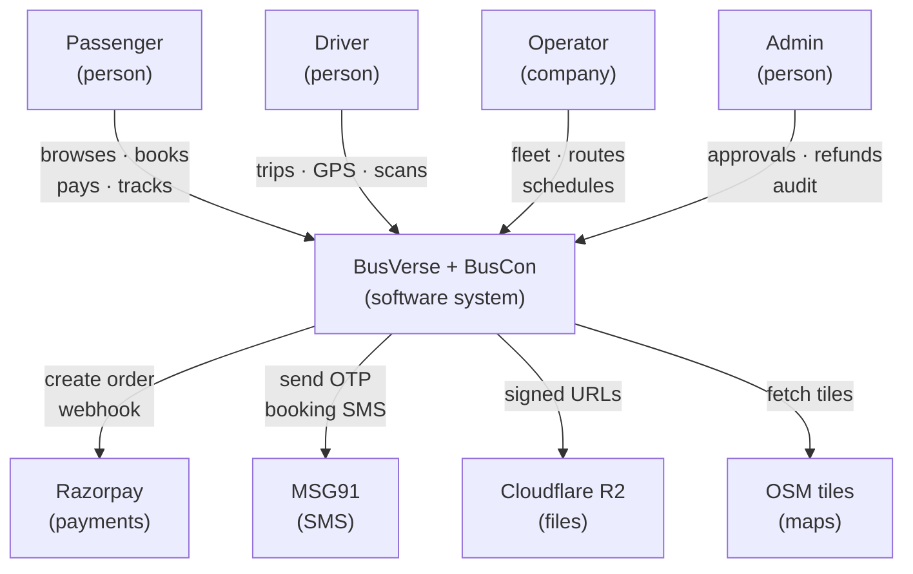

**Context summary:**

| Interaction | Direction | Data |
|---|---|---|
| Passenger → System | Inbound | Search, booking, payment, tracking |
| Driver → System | Inbound | Trip, GPS, scan |
| Operator → System | Inbound | Fleet, route, schedule |
| Admin → System | Inbound | Approvals, refunds, audit |
| System → Razorpay | Outbound | Orders, refunds |
| Razorpay → System | Inbound | Webhooks (signed) |
| System → MSG91 | Outbound | OTP SMS, booking SMS |
| System → R2 | Outbound | Signed URLs |
| System → OSM | Outbound | Tile fetch |

---

## 5. Container (C4 Level 2)

**Diagram: C4 Level 2 — Container view**
*Six containers. Three frontends (BusVerse Next.js, BusCon Next.js, Operator App Expo) on Vercel. One API (Fastify + Node 20) on Railway — this is the modular monolith. Postgres 16 and Redis 7 on Railway. Frontends call the API over HTTPS and receive WebSocket events. API calls Postgres, Redis, and external services. External services are never called directly by frontends except OSM tiles.*

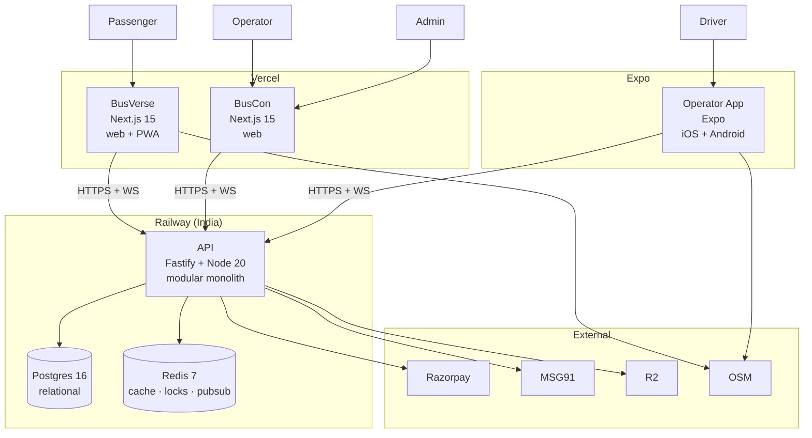

**Container responsibilities:**

| Container | Tech | Responsibility | Deploy target |
|---|---|---|---|
| **BusVerse** | Next.js 15 (App Router) | Passenger UI + PWA | Vercel |
| **BusCon** | Next.js 15 (App Router) | Operator + Admin UI | Vercel |
| **Operator App** | Expo (React Native) | Driver field app | iOS App Store + Play Store (Phase 2); Expo Go in Phase 1 |
| **API** | Fastify + Node 20 | Business logic + auth + realtime + integrations | Railway |
| **Postgres** | PG 16 | Relational data (source of truth) | Railway managed |
| **Redis** | Redis 7 | Cache, locks, sessions, pub/sub | Railway managed |

**Container communication:**

| From | To | Protocol | Data format |
|---|---|---|---|
| BusVerse | API | HTTPS REST | JSON |
| BusVerse | API | WSS | Socket.io |
| BusCon | API | HTTPS REST | JSON |
| BusCon | API | WSS | Socket.io |
| Operator App | API | HTTPS REST | JSON |
| Operator App | API | WSS | Socket.io |
| BusVerse | OSM | HTTP | PNG tiles |
| Operator App | OSM | HTTP | PNG tiles |
| API | Postgres | TCP + TLS | Prisma protocol |
| API | Redis | TCP + TLS | RESP |
| API | Razorpay | HTTPS | JSON |
| API | MSG91 | HTTPS | JSON |
| API | R2 | HTTPS | S3-compatible |

### 5.1 Monorepo structure

**Diagram: Monorepo structure**
*Turborepo monorepo with 4 apps and 5 packages. Each app is independently deployable. Packages are shared code (design tokens, brand SVG, UI components, types, config).*

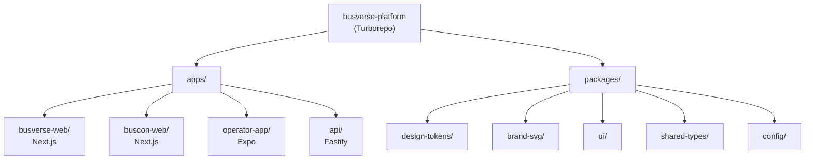

**Package dependencies:**

| Package | Depends on | Used by |
|---|---|---|
| `design-tokens` | — | All frontends |
| `brand-svg` | React | All frontends |
| `ui` | design-tokens, React | BusVerse, BusCon |
| `shared-types` | — | All apps |
| `config` | — | All apps |

---

## 6. Component (C4 Level 3) — API

The API is a modular monolith. Inside it, there are six business modules plus middleware, workers, integrations, and real-time layer.

**Diagram: C4 Level 3 — API components**
*The API has 5 layers: middleware (auth, rate limit, validation, audit), business modules (6, matching bounded contexts), workers (5 BullMQ queues), integrations (4 external adapters — Razorpay, SMS via MSG91, Email via SendGrid, R2), real-time layer (WebSocket + in-process event bus). Every request passes through middleware, reaches a module, may enqueue workers, may emit events, may call integrations. Modules communicate with each other only via in-process calls or event bus — never HTTP.*

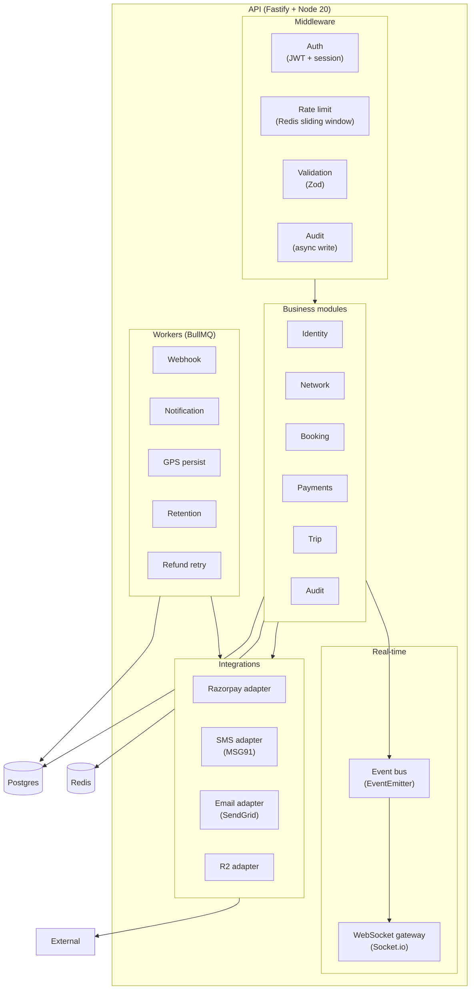

**Component responsibilities:**

| Component | Responsibility | Interactions |
|---|---|---|
| **Auth middleware** | Verify JWT signature, check session, check revoked list | Redis (revoked list) |
| **Rate limit middleware** | Sliding window per identity+endpoint | Redis (counters) |
| **Validation middleware** | Zod schema per endpoint | — |
| **Audit middleware** | Async audit log write after commit | BullMQ (`audit-queue`) |
| **Identity module** | Users, sessions, OTP generation + verification, password | Postgres, Redis, SMS adapter (MSG91) |
| **Network module** | Operators, buses, routes, schedules | Postgres |
| **Booking module** | Seat locks, bookings, tickets | Postgres, Redis, Payments (sync), Trip (async) |
| **Payments module** | Payment, refund, invoice | Postgres, Razorpay adapter, Booking (sync) |
| **Trip module** | Trips, GPS, boarding scans | Postgres, Redis, Network (sync), Booking (async) |
| **Audit module** | Audit log queries, export | Postgres |
| **Webhook worker** | Process Razorpay webhooks | Postgres, Payments (internal) |
| **Notification worker** | Send SMS + email | SMS adapter, Email adapter |
| **GPS persist worker** | Redis → Postgres every 30s | Postgres |
| **Retention cron** | Nightly cleanup per `06` §15 | Postgres |
| **Refund retry worker** | Retry failed refunds | Razorpay adapter |
| **Razorpay adapter** | Isolate Razorpay SDK | External |
| **SMS adapter** | Isolate MSG91 SDK | External |
| **Email adapter** | Isolate SendGrid SDK | External |
| **R2 adapter** | Signed URL generation | External |
| **WebSocket gateway** | Socket.io server, topic management | Redis pub/sub (Phase 2) |
| **Event bus** | In-process EventEmitter | Modules |

### 6.1 API request/response contract

Every API request follows this shape:

```
Request:
  POST /v1/{surface}/{resource} HTTP/1.1
  Host: api.busverse.app
  Authorization: Bearer <jwt>
  Content-Type: application/json
  Idempotency-Key: <uuid>     (money-path only)
  X-Request-Id: <uuid>         (optional)
  Body: { ... }

Response:
  HTTP/1.1 200 OK
  Content-Type: application/json
  X-Request-Id: <uuid>         (echo)
  X-RateLimit-Limit: 60
  X-RateLimit-Remaining: 42
  Body: { data, meta } or { error }
```

**Reference:** `07-API-AND-REALTIME-CONTRACTS.md` §2.

### 6.2 Error handling

**Diagram: Error propagation**
*Errors bubble up through modules to middleware to response. Every layer can transform or wrap. But the error code catalog is fixed — no module invents a new code.*

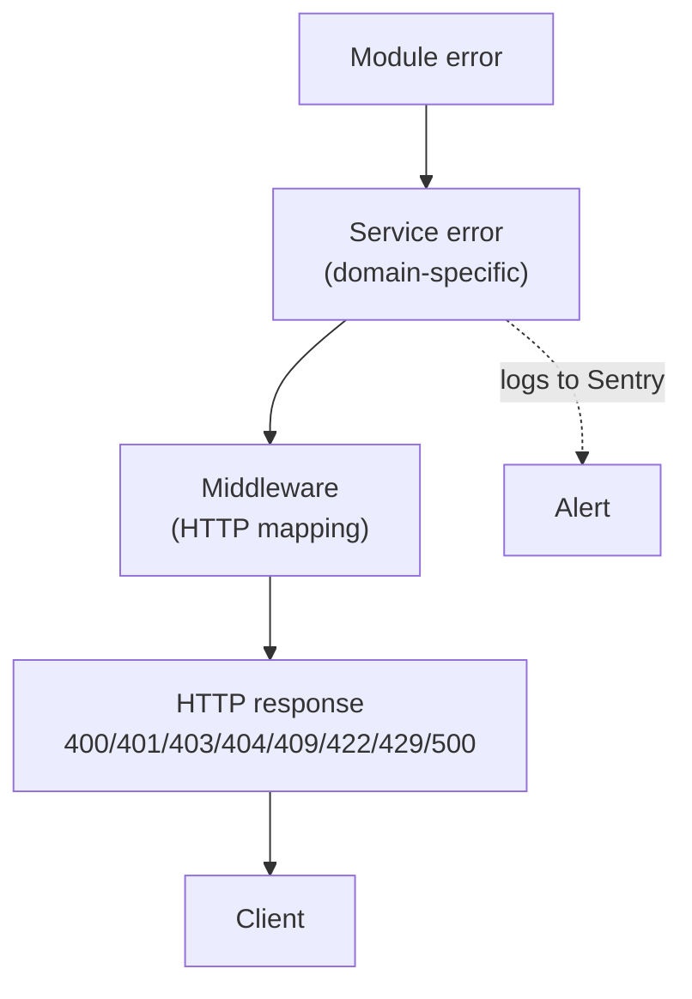

**Error catalog:** `07` §9 (46 codes).

**Rule:** Every error has a stable code. Never invent new codes without amending `07`.

---

## 7. Component (C4 Level 3) — Frontends

All three frontends share the same component shape.

**Diagram: C4 Level 3 — Frontend components**
*Each frontend has routes/screens, feature components, shared UI, API client (React Query), auth context, and (except BusCon) WebSocket client. BusVerse is PWA-capable with offline cache. BusCon has desktop-dense tables. Operator App has SQLite offline queue.*

```mermaid
flowchart TB
    subgraph BV["BusVerse (Next.js)"]
        BV_R["Routes<br/>search · book · track"]
        BV_F["Feature components"]
        BV_U["Shared UI"]
        BV_Q["API client<br/>React Query"]
        BV_A["Auth context"]
        BV_WS["WebSocket client"]
        BV_PWA["PWA cache<br/>(service worker)"]
    end

    subgraph BC["BusCon (Next.js)"]
        BC_R["Routes<br/>fleet · routes · admin"]
        BC_F["Feature components"]
        BC_U["Shared UI"]
        BC_Q["API client"]
        BC_A["Auth context"]
    end

    subgraph OA["Operator App (Expo)"]
        OA_S["Screens<br/>login · trips · scan"]
        OA_F["Feature components"]
        OA_U["Shared UI"]
        OA_Q["API client"]
        OA_A["Auth context"]
        OA_WS["WebSocket client"]
        OA_SQL["SQLite<br/>offline queue"]
    end

    SH["@busverse/ui<br/>@busverse/design-tokens"]
    BV_U -.-> SH
    BC_U -.-> SH
    OA_U -.-> SH
```

**Frontend component roles:**

| Component | Responsibility |
|---|---|
| Routes/Screens | Next.js App Router pages (web), Expo screens (mobile) |
| Feature components | Surface-specific (booking form, fleet table, scan view) |
| Shared UI | Buttons, inputs, modals (from `@busverse/ui`) |
| API client | React Query — caching, refetching, mutations |
| Auth context | JWT storage, refresh logic, logout |
| WebSocket client | Topic subscription, reconnection |
| PWA cache | Service worker (offline support, BusVerse only) |
| SQLite | Local queue for offline scans (Operator App only) |

### 7.1 Frontend state management

**Diagram: Frontend state flow**
*Server state in React Query (caching + refetch). UI state in local useState/Context. Auth state in dedicated context. No global state manager needed for Phase 1.*

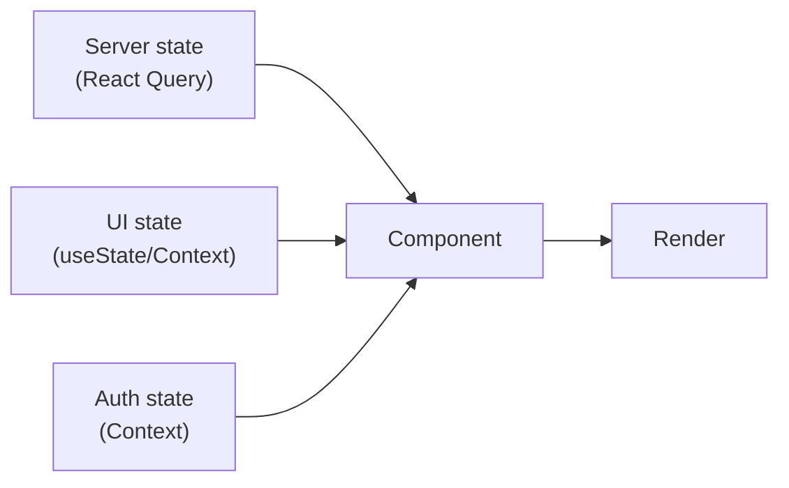

| State type | Where | Why |
|---|---|---|
| Server data | React Query cache | Avoids refetch, handles staleness |
| UI state (modals, form drafts) | Local `useState` | Component-scoped |
| Auth state (JWT, user) | Context provider | Cross-component access |
| WebSocket state | Custom hook | Connection status |

**Rule:** No Redux/Zustand. React Query + Context is sufficient for Phase 1.

---

## 8. Module Boundaries

### 8.1 Module dependency graph

**Diagram: Module dependency graph**
*Dependencies flow downward only. Identity is foundational. Network depends on Identity. Booking depends on Network. Payments depends on Booking. Trip depends on Booking + Network. Audit is depended on by everyone (via middleware) but depends on nothing. No cycles allowed.*

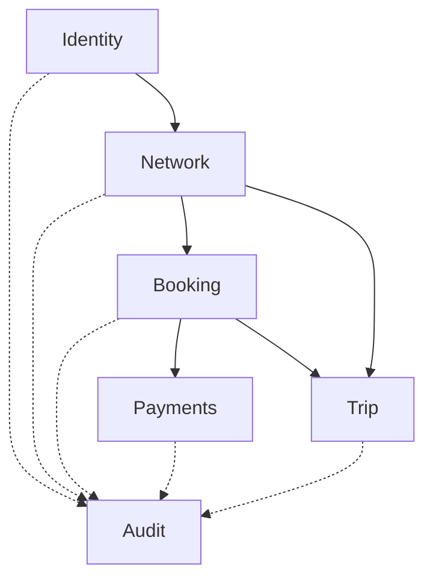

### 8.2 Module boundary rules

| Rule | Enforcement |
|---|---|
| Each module owns its tables | Prisma schema scoped per module |
| Cross-module calls go through service interface | No direct table access across modules |
| Sync calls allowed (same process) | Booking can call Network service synchronously |
| Async events for side effects | Booking emits `BookingCreated`; Payments reacts asynchronously |
| No circular dependencies | Lint rule + CI check |
| Each module has its own router | `/v1/passenger/bookings` maps to Booking module |
| No module imports another module's repository | Only service layer cross-calls |

### 8.3 Data ownership matrix

Every table has exactly one owning module.

| Module | Owns these tables |
|---|---|
| Identity | `users`, `passenger_profiles`, `operator_users`, `driver_profiles`, `admin_users`, `sessions`, `otp_challenges`, `refresh_token_chains`, `consent_records`, `password_reset_tokens` |
| Network | `cities`, `stands`, `operators`, `buses`, `seat_layouts`, `seats`, `routes`, `route_stands`, `schedules` |
| Booking | `seat_locks`, `bookings`, `booking_passengers`, `tickets` |
| Payments | `payments`, `refunds`, `gst_invoices`, `gateway_webhooks` |
| Trip | `trips`, `gps_samples`, `boarding_scans` |
| Audit | `audit_logs` |

**Cross-module access rules:**

| Access pattern | Allowed |
|---|---|
| Own module reads own tables | ✅ Direct via repository |
| Another module reads via service | ✅ Read-only service method |
| Another module writes | ❌ Must go through owning module's service |
| Direct table access across modules | ❌ Blocked by lint rule |

**Rule:** Ownership never changes without an ADR.

### 8.4 Cross-module call matrix

**Diagram: Cross-module sync vs async calls**
*Solid arrows = synchronous (blocking, same transaction or method call). Dashed arrows = asynchronous (fire-and-forget events). Sync chains are short (max 2 hops). Async flows allow side effects to be independent.*

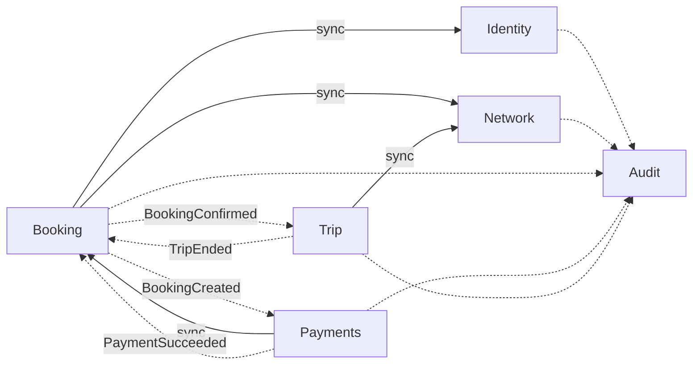

| From | To | Type | Purpose | Error handling |
|---|---|---|---|---|
| Booking | Identity | Sync | Verify user | Fail fast (400) |
| Booking | Network | Sync | Read schedule | Fail fast (404) |
| Payments | Booking | Sync | Read booking amount | Fail fast (404) |
| Trip | Network | Sync | Verify schedule | Fail fast (400) |
| Booking | Payments | Async | Initiate payment on `BookingCreated` | Retry via BullMQ |
| Booking | Trip | Async | Update manifest on `BookingConfirmed` | Retry via BullMQ |
| Payments | Booking | Async | Confirm booking on `PaymentSucceeded` | Retry via BullMQ |
| Trip | Booking | Async | Complete booking on `TripEnded` | Retry via BullMQ |
| All | Audit | Async | Log action | Retry, DLQ on failure |

**Rule:** No synchronous call chain longer than 2 hops. Prevents cascading timeouts.

---

## 9. Request Lifecycle

**Diagram: Request lifecycle**
*Full path of an authenticated request from browser to database and back. Middleware runs in order: request ID → CORS → rate limit → JWT validation → session check → Zod validation → route to module → module logic → DB query → response serialization → audit log write (async) → response. 20 steps, most under 1ms.*

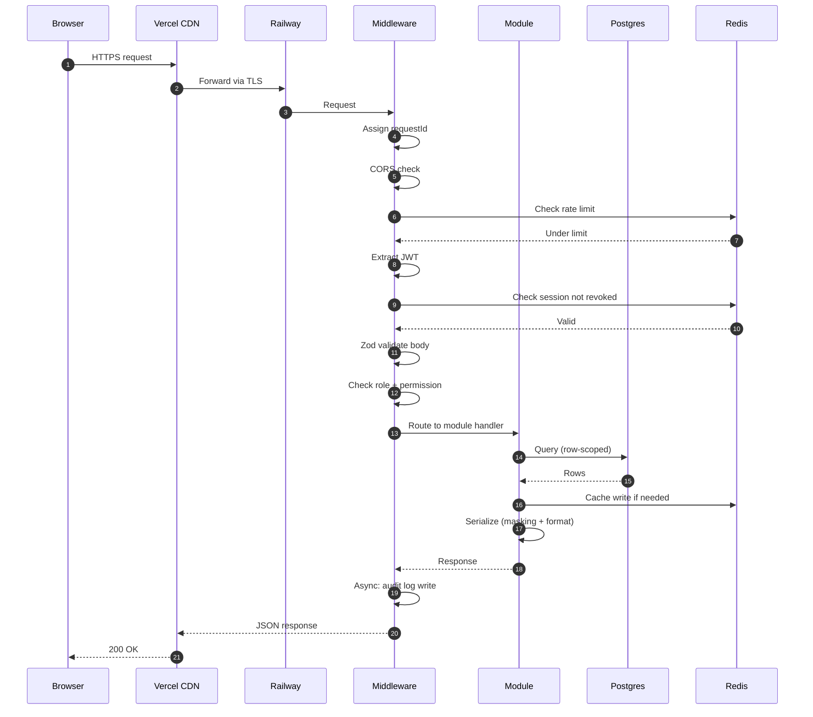

**Step-by-step:**

| # | Step | Component | Typical time |
|:---:|---|---|---|
| 1 | Browser sends HTTPS | Browser | — |
| 2 | Vercel edge receives | Vercel | ~5ms |
| 3 | Forward to Railway | Vercel | ~20ms |
| 4 | Middleware receives | API | <1ms |
| 5 | Assign request ID | Middleware | <1ms |
| 6 | CORS check | Middleware | <1ms |
| 7–8 | Rate limit check | Redis | ~2ms |
| 9 | Extract JWT | Middleware | <1ms |
| 10–11 | Session check | Redis | ~2ms |
| 12 | Zod validation | Middleware | ~1ms |
| 13 | Role + permission check | Middleware | <1ms |
| 14 | Route to module | Fastify | <1ms |
| 15–16 | DB query | Postgres | 5–50ms |
| 17 | Cache write (conditional) | Redis | ~2ms |
| 18 | Serialize | Module | ~1ms |
| 19 | Audit log write (async) | BullMQ | ~0ms (blocking) |
| 20 | Response | API → Vercel | ~5ms |

**Total typical p50:** ~50ms. **p95 target:** 200ms (search), 500ms (booking).

---

## 10. Data Layer Overview

### 10.1 Three data stores

**Diagram: Data layer**
*Three stores with clear roles. Postgres = source of truth, transactional. Redis = volatile, cache + locks + pub/sub. R2 = file storage. No data lives in two places except intentional caches.*

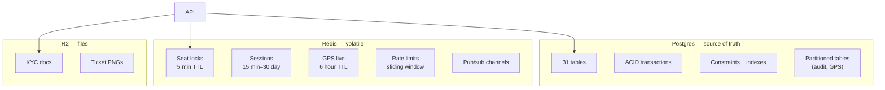

**Data store rules:**

| Rule | Enforcement |
|---|---|
| Postgres is source of truth | All writes go to Postgres first |
| Redis is never source of truth | Lock loss ≠ data loss (Postgres unique constraint backup) |
| R2 is file-only | No structured data |
| No shared state between stores except caches | Cache miss = hit Postgres |

### 10.2 Postgres configuration

| Parameter | Value |
|---|---|
| Version | PostgreSQL 16 |
| Region | India (Railway) |
| Extensions | `pgcrypto`, `pg_trgm` |
| Timezone | UTC |
| Connection pool | PgBouncer, 100 max connections |
| Statement timeout | 30s |

### 10.3 Redis configuration

| Parameter | Value |
|---|---|
| Version | Redis 7 |
| Region | India (Railway) |
| Auth | `requirepass` set |
| TLS | Enabled |
| Persistence | None (ephemeral) — safer than incorrect persistence |
| Max memory | 512 MB |
| Eviction policy | `allkeys-lru` for cache; `noeviction` for locks/sessions (separate key prefixes) |

### 10.4 Consistency model

**Diagram: Consistency windows**
*Different operations have different consistency guarantees. Money-path operations are strong (ACID). Side effects (notifications, audit, WebSocket push) are eventual within seconds. Dashboard reads are eventual within a minute. The system never promises "instant" for anything but the core transaction.*

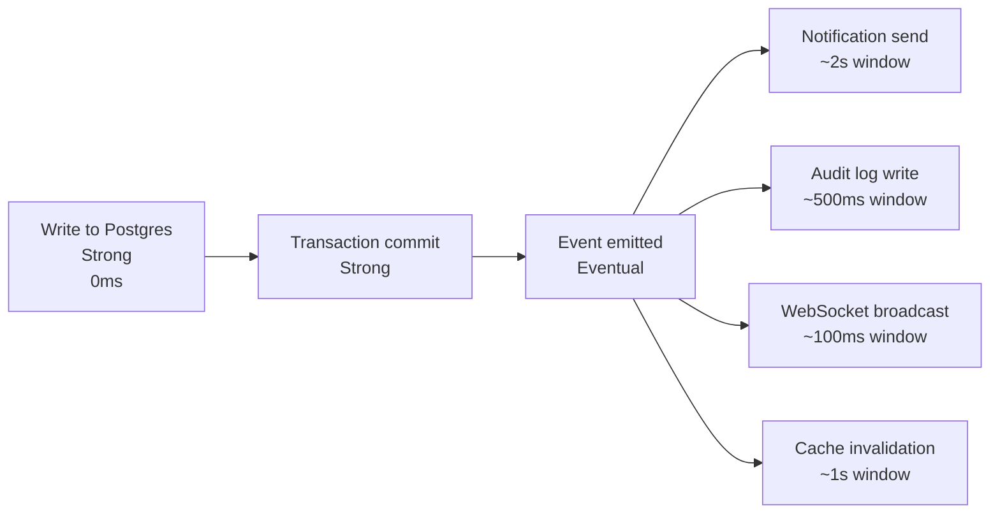

| Operation | Consistency | Guarantee | Window |
|---|---|---|---|
| Seat lock → booking | Strong | ACID transaction | 0ms |
| Payment → booking confirm | Strong | Atomic via webhook | 0ms |
| Trip start → GPS stream | Strong | Transaction + Redis | 0ms |
| Booking confirmed → Notification | Eventual | Async via BullMQ | ~2s |
| Booking confirmed → Audit log | Eventual | Async | ~500ms |
| Booking confirmed → WS push | Eventual | Async | ~100ms |
| GPS sample → passenger sees | Eventual | Redis TTL 6h | ~5s |
| Operator revenue dashboard | Eventual | 60s cached | 60s |
| Cross-tenant checks | Strong | Row scope in query | 0ms |

**Rule:** Every eventual operation must document its consistency window. "Eventually" without a number is not a guarantee.

### 10.5 Multi-tenancy model

**Diagram: Multi-tenancy type**
*Shared database, shared schema, row-level isolation. Each operator's data rows carry `operator_id`, and every query filters by it. This is the Phase 1 choice — cheapest and sufficient. Phase 3 could migrate to per-tenant schema if needed.*

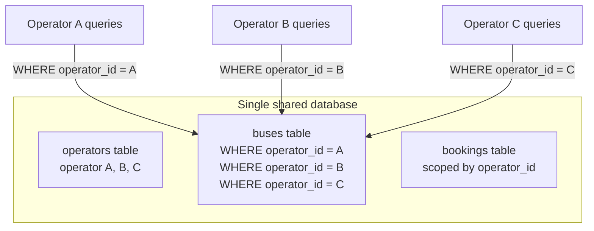

| Multi-tenancy type | Cost | Isolation | Phase 1 |
|---|---|---|---|
| Shared schema, row-level | Low | Row-level | ✅ Chosen |
| Shared schema, schema-per-tenant | Medium | Table-level | Phase 3 if needed |
| Separate database per tenant | High | Complete | Never (single-tenant B2C) |

**Rule:** Row-level isolation is enforced by Prisma middleware per `09` §5.5. Cross-tenant access returns 404 (not 403).

### 10.6 Test data layer

| Environment | Data store |
|---|---|
| Production | Railway Postgres |
| Staging | Railway Postgres (separate) |
| CI | Ephemeral Postgres via testcontainers |
| Local dev | Docker Compose Postgres |

**Rule:** Test data is never copied from production. Test data carries `is_test = true` per `01` §12.

---

## 11. Caching Strategy

### 11.1 Caching layers

**Diagram: Caching layers**
*Four caching layers stacked. React Query on the client (prevents refetch). Next.js SSR (server-rendered HTML). Redis on the server (avoids DB queries). Postgres partial indexes (avoids full scans). Each layer has its own TTL and invalidation strategy.*

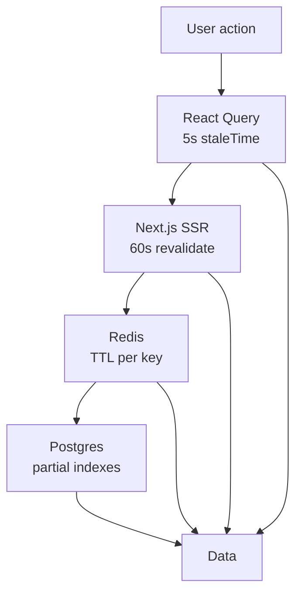

### 11.2 Caching table

| Data | Layer | TTL | Invalidation |
|---|---|---|---|
| Cities list | React Query + Redis | 5 min | On admin add |
| Search results | React Query | 60 sec | Time-based |
| Seat availability | Redis | 30 sec | On seat lock/booking |
| User session | Redis | Refresh TTL | On logout |
| Operator list | Redis | 5 min | On admin action |
| Revenue dashboard | Redis | 60 sec | Time-based |
| GPS position | Redis | 6 hours | On new sample |
| Rate limit counters | Redis | Window size | Time-based |

### 11.3 Cache invalidation

| Strategy | Where used |
|---|---|
| **Write-through** | Seat locks (Redis + DB in same transaction) |
| **Invalidate-on-write** | User sessions (delete key on logout) |
| **TTL only** | Search results (natural staleness is acceptable) |
| **Event-driven invalidation** | When booking confirmed → invalidate seat availability |

**Rule:** Every cache key has a TTL. No key lives forever (except rate limit counters which expire naturally).

### 11.4 Cache stampede prevention

**Diagram: Stampede prevention**
*When cache expires and 100 requests hit simultaneously, only one fetches from DB. Others wait on Redis lock. Prevents thundering herd.*

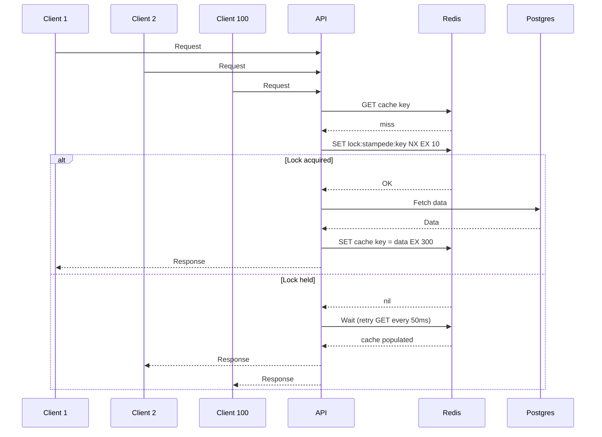

**Rule:** Every hot cache key uses single-flight pattern. Probabilistic early expiration (refresh slightly before TTL) as a secondary strategy.

---

## 12. Async Processing

### 12.1 Job topology

**Diagram: Async job topology**
*Five queues, each with its own worker. Producers (API) enqueue jobs. Workers process independently. Failure moves jobs to dead letter queue after N retries. Bull Board (dev only) provides visibility.*

```mermaid
flowchart LR
    API["API"] -->|"enqueue"| Q1["Webhook queue"]
    API -->|"enqueue"| Q2["Notification queue"]
    API -->|"enqueue"| Q3["GPS persist queue"]
    API -->|"enqueue"| Q4["Retention queue"]
    API -->|"enqueue"| Q5["Refund retry queue"]

    Q1 --> W1["Webhook worker<br/>concurrency 5"]
    Q2 --> W2["Notification worker<br/>concurrency 10"]
    Q3 --> W3["GPS worker<br/>concurrency 20"]
    Q4 --> W4["Retention cron<br/>concurrency 1"]
    Q5 --> W5["Refund worker<br/>concurrency 3"]

    W1 --> PG[("Postgres")]
    W2 --> EXT1["MSG91 + SendGrid"]
    W3 --> PG
    W4 --> PG
    W5 --> EXT2["Razorpay"]

    Q1 -.->|"after N retries"| DLQ["Dead Letter Queue"]
    Q2 -.-> DLQ
    Q5 -.-> DLQ
```

### 12.2 Job catalog

| Queue | Worker | Concurrency | Retry | Idempotency |
|---|---|---|---|---|
| `webhook-queue` | Process Razorpay webhooks | 5 | 5x exponential backoff | Required — DB unique on `(payment_id, event_type, payload_hash)` |
| `notification-queue` | Send SMS + email | 10 | 3x | Dedup window 1h |
| `gps-persist-queue` | Redis → Postgres every 30s | 20 | 3x | Append-only |
| `retention-queue` | Nightly cleanup | 1 | 1x | Yes (idempotent SQL) |
| `refund-retry-queue` | Retry failed refunds | 3 | 5x | Required (refund_id) |

### 12.3 Poison message handling

**Diagram: Poison message lifecycle**
*A job that fails all retries becomes a poison message. It moves to dead letter queue. Alert fires. Manual review. Fix applied. Retry from DLQ.*

```mermaid
stateDiagram-v2
    [*] --> Pending: enqueued
    Pending --> Processing: worker picks up
    Processing --> Completed: success
    Processing --> Retrying: failed
    Retrying --> Processing: retry
    Retrying --> DLQ: max retries exceeded
    DLQ --> Processing: manual retry
    Completed --> [*]
    DLQ --> Alerted: alert fires
    Alerted --> Investigating: manual review
    Investigating --> DLQ: after fix, re-enqueue
```

| Stage | Action |
|---|---|
| **Failure** | Log with job data (no PII) |
| **Retry 1-4** | Exponential backoff (1s, 5s, 30s, 5min) |
| **Retry 5 (max)** | Move to DLQ, alert via Sentry |
| **DLQ** | Manual review via Bull Board |
| **Manual retry** | After fix, re-enqueue from DLQ |
| **DLQ retention** | 7 days, then dropped |

**Rule:** Every poison message triggers a Sentry alert. Silent failures are forbidden.

### 12.4 Job timeout and cancellation

| Job type | Timeout | Cancelable |
|---|---|---|
| Webhook processing | 30s | No (must complete) |
| Notification send | 15s | No (best-effort) |
| GPS persistence | 10s | Yes (skip if too old) |
| Retention cleanup | 10min | Yes (mid-job checkpoint) |
| Refund retry | 30s | No |

---

## 13. Event Architecture

### 13.1 Event flow

**Diagram: Event flow**
*Domain events flow from emitters to subscribers via in-process EventEmitter. Some subscribers are synchronous (WebSocket broadcast), some enqueue to BullMQ (notification, audit). Phase 2 may migrate to a real message bus.*

```mermaid
flowchart LR
    MOD1["Booking module"] -->|"BookingCreated"| BUS["Event bus<br/>(EventEmitter)"]
    MOD2["Payment module"] -->|"PaymentSucceeded"| BUS
    MOD3["Trip module"] -->|"TripStarted"| BUS

    BUS --> SUB1["Notification<br/>subscriber"]
    BUS --> SUB2["Audit<br/>subscriber"]
    BUS --> SUB3["WebSocket<br/>broadcaster"]

    SUB1 --> Q["BullMQ queue"]
    SUB2 --> DB[("Postgres")]
    SUB3 --> WS["Socket.io"]
```

### 13.2 Event catalog (cross-module subset)

**Note on scope:** This table lists only the **cross-module events** — the subset of domain events whose subscribers live in a *different* bounded context. The full per-aggregate catalog (48 events, including events that stay within a single module) lives in `05-DOMAIN-MODEL.md` §10.4. Downstream docs that need "which events cross context boundaries" read this table; downstream docs that need "what events does aggregate X emit" read `05` §10.4.

| Event | Emitter | Subscribers |
|---|---|---|
| `UserRegistered` | Identity | Notification, Audit |
| `SessionRevoked` | Identity | Audit |
| `ConsentGranted` | Identity | Audit |
| `ConsentRevoked` | Identity | Audit |
| `PasswordResetRequested` | Identity | Notification, Audit |
| `PasswordResetCompleted` | Identity | Notification, Audit |
| `BookingCreated` | Booking | Notification, Audit |
| `BookingConfirmed` | Booking | Notification, Trip, Audit |
| `BookingCancelled` | Booking | Payment, Notification, Audit |
| `BookingCompleted` | Booking | Notification, Audit |
| `PaymentInitiated` | Payments | Audit |
| `PaymentSucceeded` | Payments | Booking, Notification, Audit |
| `PaymentFailed` | Payments | Booking, Notification, Audit |
| `RefundInitiated` | Payments | Notification, Audit |
| `RefundProcessed` | Payments | Booking, Notification, Audit |
| `TripStarted` | Trip | Booking, Notification, Audit |
| `TripEnded` | Trip | Notification, Audit |
| `BoardingVerified` | Trip | Notification, Audit |

**Count:** 18 cross-module events. The full per-aggregate catalog in `05` §10.4 lists 48 events (including intra-module events).

**Rule:** Events are named past-tense (something happened). They carry only entity IDs + actor ID + timestamp. No PII.

### 13.3 Event delivery guarantees

| Event path | Delivery | Ordering | Idempotency |
|---|---|---|---|
| Domain event → BullMQ job | **At-least-once** | Per entity | Required |
| BullMQ job → external call | **At-least-once** | Per queue | Idempotency key |
| WebSocket broadcast | **At-most-once** | N/A | Client handles loss |
| Audit log write | **At-least-once** | Per entity | Deduplication |
| Notification send | **At-least-once** | N/A | Dedup window 1h |

**Rules:**
- Every subscriber must handle duplicate delivery
- Ordering is guaranteed **per entity** (per booking, per trip) — not globally
- Events can arrive out of order across entities

### 13.4 Event schema

Every event follows this schema:

```typescript
interface DomainEvent<T> {
  eventId: string;        // UUID
  eventType: string;      // e.g. "BookingConfirmed"
  occurredAt: string;     // ISO 8601 UTC
  actorId: string | null; // user_id or null for system
  entityId: string;       // booking_id, trip_id, etc.
  entityType: string;     // "Booking", "Trip", etc.
  payload: T;             // event-specific data (no PII)
}
```

**Rule:** Event schema versioned via `_v` field for forward compatibility (per `06` §12).

---

## 14. Real-Time Architecture

### 14.1 Real-time topology

**Diagram: Real-time topology**
*Socket.io server runs inside the API process. Events flow from domain emitters → in-process bus → Socket.io rooms → subscribed clients. Fallback polling via REST when WebSocket fails.*

```mermaid
flowchart TB
    MOD["Domain module"] -->|"emit"| BUS["Event bus"]
    BUS --> WS["Socket.io server"]

    WS -->|"broadcast"| R1["Room:<br/>seat:availability:{id}"]
    WS -->|"broadcast"| R2["Room:<br/>trip:live:{id}"]
    WS -->|"broadcast"| R3["Room:<br/>booking:{id}"]
    WS -->|"broadcast"| R4["Room:<br/>admin:notifications"]

    R1 --> C1["Passenger"]
    R2 --> C2["Passenger"]
    R2 --> C3["Operator"]
    R3 --> C4["Passenger"]
    R4 --> C5["Admin"]

    C1 -.->|"fallback"| POLL1["Poll every 3s"]
    C2 -.->|"fallback"| POLL2["Poll every 3s"]
    C4 -.->|"fallback"| POLL3["Poll every 5s"]
```

### 14.2 Topic authorization

| Topic | Subscribers | Authorization |
|---|---|---|
| `seat:availability:{scheduleId}` | Anyone | Public (no auth needed) |
| `trip:live:{tripId}` | Booked passengers, operator, admin | JWT + booking check |
| `booking:{bookingId}` | Booking owner, admin | JWT + ownership |
| `admin:notifications` | Super Admin | JWT + role |

**Rule:** Unauthorized subscription gets `{ error: "FORBIDDEN" }` and connection closes with code 1008.

### 14.3 WebSocket stickiness decision

**Diagram: WebSocket scaling options**
*Phase 1 (single API instance) has no stickiness problem. Phase 2 (multi-instance) requires either sticky sessions or Redis pub/sub. Redis pub/sub is cleaner.*

```mermaid
flowchart TB
    subgraph P1["Phase 1 — no stickiness needed"]
        LB1["Load balancer"] --> API1["API (single)"]
        API1 --> WS1["Socket.io"]
    end

    subgraph P2["Phase 2 — Redis pub/sub (recommended)"]
        LB2["Load balancer"] --> API2A["API A"]
        LB2 --> API2B["API B"]
        API2A --> RDP["Redis pub/sub"]
        API2B --> RDP
    end
```

| Phase | Solution | Why |
|---|---|---|
| Phase 1 | Single instance | No problem |
| Phase 2 | Redis pub/sub (Socket.io Redis adapter) | Cleaner than sticky sessions |
| Phase 2 fallback | Sticky sessions by cookie | If Redis adapter unavailable |

### 14.4 Real-time events catalog

| Event | Topic | Emitted when | Frequency |
|---|---|---|---|
| `seat:locked` | `seat:availability:*` | Lock acquired | Per lock |
| `seat:released` | `seat:availability:*` | Lock released/expired | Per release |
| `seat:booked` | `seat:availability:*` | Booking confirmed | Per booking |
| `bus:position` | `trip:live:*` | Every GPS sample (5s) | 720/hour |
| `trip:started` | `trip:live:*` | Trip start | Once per trip |
| `trip:delayed` | `trip:live:*` | Delay reported | Rare |
| `trip:ended` | `trip:live:*` | Trip end | Once per trip |
| `booking:confirmed` | `booking:*` | Payment succeeds | Once |
| `booking:cancelled` | `booking:*` | Booking cancelled | Once |
| `boarding:verified` | `booking:*` | Scan succeeds | Once per boarding |
| `operator:applied` | `admin:notifications` | New operator signup | Rare |
| `refund:requested` | `admin:notifications` | Refund initiated | Per refund |

---

## 15. Deployment Topology

### 15.1 Deployment diagram

**Diagram: Deployment topology**
*Vercel (global CDN) hosts the two web apps. Railway (India region) hosts the API + Postgres + Redis. External services handle payments, SMS delivery, files, and map tiles. DNS routes domains to the right target.*

```mermaid
flowchart TB
    subgraph USER["User"]
        BROWSER["Browser"]
        PHONE["Phone"]
    end

    subgraph DNS["DNS"]
        D1["busverse.app"]
        D2["buscon.app"]
        D3["api.busverse.app"]
    end

    subgraph VERCEL["Vercel (global edge)"]
        BV["BusVerse"]
        BC["BusCon"]
    end

    subgraph RAILWAY["Railway (India)"]
        API["API"]
        PG[("Postgres")]
        RD[("Redis")]
    end

    subgraph EXT["External"]
        RZP["Razorpay"]
        SMS["MSG91"]
        R2["R2"]
        OSM["OSM"]
    end

    BROWSER --> D1
    BROWSER --> D2
    PHONE --> D3
    D1 --> BV
    D2 --> BC
    BV --> D3
    BC --> D3
    D3 --> API
    API --> PG
    API --> RD
    API --> RZP
    API --> SMS
    API --> R2
    BV --> OSM
    PHONE --> OSM
```

**Reference:** `11-DEPLOYMENT-AND-DEMO.md` §13 for deployment procedures.

### 15.2 Build and deployment pipeline

**Diagram: Build and deployment pipeline**
*GitHub push triggers CI. Turborepo detects affected apps. Tests run. Artifacts built. Vercel and Railway deploy in parallel. Staging auto-deploys on main; production requires manual approval.*

```mermaid
flowchart LR
    PUSH["GitHub push"] --> TR["Turborepo<br/>detect changes"]
    TR --> TESTS["Run tests<br/>(10 gates)"]
    TESTS -->|"all pass"| ART["Build artifacts"]
    TESTS -->|"fail"| BLOCK["Block deploy"]
    ART --> VERCEL["Vercel deploy<br/>busverse + buscon"]
    ART --> RAILWAY["Railway deploy<br/>api"]
    VERCEL --> STG["Staging URL"]
    RAILWAY --> STG
    STG --> APPROVAL["Manual approval"]
    APPROVAL --> PROD["Production deploy"]
```

**Pipeline stages:**

| Stage | Trigger | Time | Blocking |
|---|---|---|---|
| Lint + typecheck | Every PR | 1 min | ✅ |
| Unit + integration | Every PR | 5 min | ✅ |
| Contract | Every PR | 5 min | ✅ |
| Security | Every PR | 3 min | ✅ |
| E2E | Every PR | 10 min | ✅ |
| Coverage | Every PR | inline | ✅ |
| Deploy staging | On main | 3 min | — |
| Manual approval | After staging | — | ✅ |
| Deploy prod | After approval | 3 min | — |

### 15.3 Environment promotion

**Diagram: Environment promotion**
*Code flows forward: local → CI → staging → prod. Never backward. Each environment gate is stricter.*

```mermaid
flowchart LR
    DEV["Local dev"] --> CI["CI<br/>auto on PR"]
    CI --> STG["Staging<br/>auto on main"]
    STG --> PROD["Production<br/>manual approval"]
    PROD -.->|"never"| STG
    STG -.->|"never"| DEV
```

**Rule:** No data flows backward. Production data never copied to staging or dev.

### 15.4 Zero-downtime deployment

| Component | Strategy |
|---|---|
| **API** | Rolling deploy (Railway keeps old instance up until new one is healthy) |
| **Postgres** | No zero-downtime for schema migrations (use expand-contract pattern) |
| **Redis** | No schema, no migrations, ephemeral |
| **Web** | Vercel atomic deploy (old version until new is ready) |

---

## 16. Scaling Approach

### 16.1 Scaling path

**Diagram: Scaling path**
*Phase 1 architecture is deliberately simple. Phase 2 scales specific components based on actual bottlenecks. Phase 3 considers architectural change (extract modules, add read replicas).*

```mermaid
flowchart LR
    P1["Phase 1<br/>Single API instance<br/>Single DB<br/>Single Redis<br/>100 concurrent users"]
    P2["Phase 2<br/>+ Read replica<br/>+ Redis cluster<br/>+ Worker pool<br/>1K concurrent"]
    P3["Phase 3<br/>+ Extract modules<br/>+ Message bus<br/>+ Multi-region<br/>10K concurrent"]

    P1 --> P2 --> P3
```

### 16.2 Component scaling strategy

| Component | Phase 1 | Phase 2 trigger | Phase 3 |
|---|---|---|---|
| **API** | 1 instance | p95 > 2x target | Separate services |
| **Postgres** | 1 instance | CPU > 70% sustained | Read replicas + sharding |
| **Redis** | 1 instance | Memory > 80% | Redis cluster |
| **Workers** | In-process | Queue depth > 100 | Separate worker service |
| **WebSocket** | 1 instance (sticky) | > 200 concurrent connections | Redis adapter + sticky sessions |

### 16.3 Phase 1 limits

From `02` §8.6:

| Metric | Limit | Current headroom |
|---|---|---|
| Concurrent users | 100 | ~10x |
| Bookings per day | 1,000 | ~5x |
| Database size | 10 GB | ~50x |
| WebSocket connections | 500 | ~5x |

### 16.4 Module extraction criteria

When should a module be extracted to a separate service?

**Diagram: Module extraction criteria**
*Five triggers for extraction. Any single trigger crossed = review. Two triggers crossed = extract.*

```mermaid
flowchart TB
    MOD["Module candidate"]

    MOD --> T1["Team size<br/>> 3 engineers"]
    MOD --> T2["Traffic<br/>> 50% of total"]
    MOD --> T3["Deploy freq<br/>> 3x rest"]
    MOD --> T4["Resource conflict<br/>different scaling"]
    MOD --> T5["Consistency needs<br/>different DB"]

    T1 --> REVIEW["Review"]
    T2 --> REVIEW
    T3 --> REVIEW
    T4 --> REVIEW
    T5 --> REVIEW

    REVIEW --> |"2+ triggers"| EXTRACT["Extract to service"]
    REVIEW --> |"< 2 triggers"| KEEP["Keep in monolith"]
```

| Trigger | Threshold | Rationale |
|---|---|---|
| Team size for module | > 3 dedicated engineers | Coordination cost exceeds boundary cost |
| Request volume for module | > 50% of total API traffic | Isolating scale avoids over-provisioning |
| Deploy frequency conflict | Module needs > 3x deploys/week than rest | Independent deploy cadence |
| Resource conflict | Module needs different scaling (CPU vs. IO) | Independent resource allocation |
| Different consistency needs | Module needs different DB (e.g., analytics) | Separation of concerns |

**Rule:** No module is extracted without a written ADR. Extraction is a strategic decision, not an escape hatch.

---

## 17. Failure Modes and Resilience

### 17.1 Failure modes

**Diagram: Failure modes**
*Five external/internal failures with fallbacks. Only total Postgres failure brings the system down. Everything else degrades gracefully.*

```mermaid
flowchart TB
    F["Failure"]

    F --> F1["Razorpay down"]
    F --> F2["MSG91 down"]
    F --> F3["Redis down"]
    F --> F4["Postgres down"]
    F --> F5["WebSocket down"]

    F1 --> R1["Show 'payments unavailable'<br/>Bookings remain searchable"]
    F2 --> R2["Fallback to MOCK_OTP<br/>if enabled; else queue for retry via BullMQ"]
    F3 --> R3["Fallback to DB locks<br/>Slower but functional"]
    F4 --> R4["Full outage<br/>503 for all requests"]
    F5 --> R5["Polling fallback"]
```

### 17.2 Failure response matrix

| Failure | Detection | Response | Recovery |
|---|---|---|---|
| Razorpay API | Timeout/5xx | Circuit breaker opens, show error | Auto-recovery within 60s |
| Razorpay webhook | Missing confirmation | Alert, manual verification | Replay from Razorpay dashboard |
| MSG91 | Timeout/5xx | Fallback to MOCK_OTP if enabled; else queue via BullMQ | Auto-retry via BullMQ, alert after 3 failures |
| Redis | Connection refused | Fall back to DB locks (slower) | Reconnect when Redis returns |
| Postgres | Connection refused | 503 for all requests | Restart or failover |
| WebSocket | Client disconnect | Reconnect with backoff, then polling | Auto-reconnect |

### 17.3 Resilience patterns

| Pattern | Where used | Implementation |
|---|---|---|
| **Circuit breaker** | External API calls | Per §17.5 |
| **Retry with backoff** | Webhook delivery, notifications | BullMQ retries with exponential backoff |
| **Timeout** | Every external call | Per §17.4 |
| **Graceful degradation** | WebSocket → polling, Redis → DB | Per §17.1 |
| **Health checks** | Infra monitoring | `/v1/health` + `/v1/status` |
| **Fallback values** | Mock payment, mock OTP | Env-var controlled |

### 17.4 Timeout and retry budgets

**Diagram: Timeout budgets**
*Total request budget is 30s in browser, 25s in API. Every hop has a fraction of the total. Sum of worst-case hops must not exceed total.*

```mermaid
flowchart LR
    BROWSER["Browser<br/>30s total"] --> VERCEL["Vercel<br/>25s"]
    VERCEL --> API["API<br/>25s"]
    API --> PG["Postgres<br/>5s"]
    API --> RD["Redis<br/>500ms"]
    API --> RZP["Razorpay<br/>10s × 3 retries"]
    API --> SMS["MSG91<br/>5s × 3 retries"]
    API --> R2["R2<br/>30s"]
```

| Hop | Timeout | Retries | Max total |
|---|---|---|---|
| Browser → Vercel | 30s | 0 | 30s |
| Vercel → API | 25s | 0 | 25s |
| API → Postgres | 5s | 1 | 10s |
| API → Redis | 500ms | 1 | 1s |
| API → Razorpay (order) | 10s | 3 | 40s (async) |
| API → Razorpay (refund) | 15s | 3 | 60s (async) |
| API → MSG91 | 5s | 3 | 20s |
| API → R2 | 30s | 1 | 60s (async) |
| WebSocket handshake | 5s | 0 | 5s |
| BullMQ job | 30s | 5 | — |

**Rule:** Synchronous request total (browser → API → PG/Redis) ≤ 25s. Everything beyond that is async via BullMQ.

### 17.5 Circuit breaker

**Diagram: Circuit breaker state machine**
*Three states. Closed (normal) → Open (failing, fast fail) → Half-open (testing recovery). Threshold: >50% failures in 10 requests. Open duration: 60s. Then one test request.*

```mermaid
stateDiagram-v2
    [*] --> Closed
    Closed --> Open: >50% failures<br/>in 10 requests
    Open --> HalfOpen: after 60s
    HalfOpen --> Closed: test success
    HalfOpen --> Open: test failure
    Closed --> Closed: success
```

**Per-service configuration:**

| Service | Failure threshold | Open duration | Test |
|---|---|---|---|
| Razorpay order | 5 failures / 60s | 60s | 1 request |
| Razorpay refund | 3 failures / 60s | 120s | 1 request |
| MSG91 | 10 failures / 60s | 30s | 1 request |
| R2 uploads | 5 failures / 60s | 60s | 1 request |

### 17.6 Bulkhead pattern

**Diagram: Bulkhead pools**
*Each resource has its own pool. Failure in one pool doesn't starve others.*

```mermaid
flowchart TB
    API["API"]

    API --> P1["Postgres pool<br/>20 connections"]
    API --> P2["Redis pool<br/>10 connections"]
    API --> P3["Razorpay HTTP pool<br/>20 connections"]
    API --> P4["BullMQ workers<br/>per-queue concurrency"]
    API --> P5["WebSocket connections<br/>max 500"]
```

| Resource | Pool size | Reason |
|---|---|---|
| Postgres connections | 20 (via PgBouncer) | Avoid OOM |
| Redis connections | 10 | Avoid OOM |
| Razorpay HTTP clients | 20 | Avoid starvation |
| BullMQ worker concurrency | Per queue (5-20) | Isolate queues |
| WebSocket connections | 500 | Memory bound |

**Rule:** Any resource with a bounded pool must fail-fast when pool is exhausted (return 503, don't queue indefinitely).

---

## 18. Observability

### 18.1 Observability pipeline

**Diagram: Observability pipeline**
*Three pillars — logs, metrics, traces — flow to external systems. Logs → Loki. Metrics → Railway built-in. Traces → Sentry (errors + performance). Errors → Sentry.*

```mermaid
flowchart LR
    API["API"] --> LOG["Structured logs<br/>JSON"]
    API --> MET["Metrics<br/>counters · histograms"]
    API --> TRC["Traces<br/>request spans"]
    API --> ERR["Errors<br/>stack traces"]

    LOG --> LOKI["Loki<br/>(Railway)"]
    MET --> RAIL["Railway metrics"]
    TRC --> SENTRY["Sentry"]
    ERR --> SENTRY
```

### 18.2 Three pillars

| Pillar | Tool | Retention | What's captured |
|---|---|---|---|
| **Logs** | Loki (Railway) + CloudWatch | 30 days (app), 180 days (security) | Every request line + error |
| **Metrics** | Railway built-in | Rolling 30 days | CPU, memory, network, request rate |
| **Traces** | Sentry | 90 days | Request lifecycle with spans |
| **Errors** | Sentry | 90 days | Stack traces, context |

### 18.3 Log contract

Every log line contains:

| Field | Example |
|---|---|
| `requestId` | `req_abc123` |
| `userId` | `usr_xyz` (null if unauth) |
| `role` | `REGISTERED_PASSENGER` |
| `endpoint` | `/v1/passenger/bookings` |
| `method` | `POST` |
| `statusCode` | `201` |
| `durationMs` | `42` |
| `ip` | `203.0.113.5` |
| `userAgent` | `Mozilla/5.0...` |

**Rule:** No PII in logs. Scrubber middleware enforces (`09` §11.5).

### 18.4 Health and status endpoints

| Endpoint | Purpose | Checks |
|---|---|---|
| `GET /v1/health` | Liveness — is process alive? | None (fast) |
| `GET /v1/status` | Readiness — are dependencies OK? | Postgres, Redis |

**Health response:**
```json
{ "status": "ok" }
```

**Status response:**
```json
{
  "status": "ok",
  "checks": {
    "postgres": { "status": "ok", "latencyMs": 3 },
    "redis": { "status": "ok", "latencyMs": 1 }
  }
}
```

**If any check fails:** Return 503 with details.

### 18.5 Alerting

| Alert | Threshold | Channel |
|---|---|---|
| Error rate | > 1% over 5 min | Sentry → email |
| p95 latency | > 2x target over 5 min | Sentry → email |
| DLQ size | > 10 jobs | Sentry → email |
| Cross-tenant attempt | > 10/hour | Audit log alert |
| Backup failure | Any | Email |

---

## 19. Security Architecture View

### 19.1 Defense in depth

**Diagram: Security architecture**
*Five layers of defense from edge to data. Each layer stops attacks the previous layer missed. This is the architecture view of `09`'s controls.*

```mermaid
flowchart TB
    EDGE["Edge<br/>Vercel WAF · TLS 1.3"] --> MW["Middleware<br/>rate limit · auth · validation"]
    MW --> LOGIC["Business logic<br/>permissions · invariants"]
    LOGIC --> DATA["Data<br/>row scope · encryption"]
    DATA --> DB[("Postgres<br/>constraints · triggers")]
```

### 19.2 Security control placement

| Control | Layer | Enforcement |
|---|---|---|
| TLS 1.3 | Edge | Vercel + Railway |
| HSTS, CSP, security headers | Edge | Vercel config |
| Rate limiting | Middleware | Redis sliding window |
| Auth (JWT + session) | Middleware | Per `09` §4 |
| Input validation | Middleware | Zod |
| RBAC | Middleware + module | Route decorator + row scope |
| Cross-tenant isolation | Module | Prisma middleware |
| PII encryption | Data | AES-256-GCM per `09` §10 |
| Audit log | Data | Append-only per `09` §15 |
| Field-level masking | Serialization | Masker per `09` §11 |
| DB constraints | Data | CHECK, UNIQUE, FK per `06` |
| Immutable audit | Data | Grants + triggers |
| Circuit breakers | Module | Per §17.5 |

**Reference:** Full security specifications in `09-SECURITY-AND-PLATFORM-RULES.md`.

### 19.3 Trust boundaries in architecture

| Boundary | Crossing mechanism |
|---|---|
| Browser → API | JWT + HTTPS |
| Mobile → API | JWT + HTTPS |
| API → Postgres | TLS + Prisma parameterized queries |
| API → Redis | TLS + AUTH |
| Razorpay → API | HMAC-SHA256 + IP allowlist |
| API → R2 | Signed URLs |

---

## 20. Cross-Cutting Concerns

Six concerns that touch every module. Each has a standard implementation — no module invents its own.

**Diagram: Cross-cutting concerns**
*Six concerns with standard implementations. Every module uses the same pattern for each.*

```mermaid
flowchart TB
    XC["Cross-cutting concerns"]

    XC --> C1["Configuration<br/>Zod-validated .env"]
    XC --> C2["Logging<br/>structured JSON"]
    XC --> C3["Error handling<br/>error code catalog"]
    XC --> C4["Tracing<br/>requestId + spans"]
    XC --> C5["Health checks<br/>liveness + readiness"]
    XC --> C6["Graceful shutdown<br/>SIGTERM handling"]
```

### 20.1 Configuration loading

**Diagram: Config loading flow**
*API starts → loads `.env` → validates with Zod schema → crashes if invalid → starts services. Never starts in an invalid state.*

```mermaid
sequenceDiagram
    participant S as API startup
    participant E as .env
    participant Z as Zod
    participant C as Config

    S->>E: Load env vars
    E-->>Z: Raw values
    Z->>Z: Validate schema
    alt Invalid
        Z-->>S: Throw error, exit(1)
    else Valid
        Z->>C: Typed config object
        C-->>S: Ready to serve
    end
```

**Implementation:** Zod schema for every env var. Missing or invalid → crash on startup.

### 20.2 Logging

| Aspect | Implementation |
|---|---|
| Library | Pino (or Winston) |
| Format | JSON (structured) |
| Destination | Loki (Railway) |
| Request log | 1 line per request |
| Error log | Stack trace + context |
| PII scrubbing | Middleware strips PII |

### 20.3 Error handling

| Layer | Responsibility |
|---|---|
| Module | Throw typed errors (e.g., `SeatLockedError`) |
| Service | Wrap in domain errors |
| Middleware | Map to HTTP status + error code from `07` §9 |
| Client | Display human message |

**Rule:** Every error has a stable code. Never invent new codes without amending `07` §9.

### 20.4 Tracing

| Field | Purpose |
|---|---|
| `requestId` | Same across all log lines in a request |
| `span` (Sentry) | Sub-operation within request |
| `traceId` | If propagating to external (Phase 2) |

### 20.5 Rate limiter state machine

**Diagram: Rate limiter states**
*Sliding window counter per identity+endpoint. Client is "allowed" until limit is hit. Then "throttled" for the rest of the window. Returns to "allowed" when counter resets.*

```mermaid
stateDiagram-v2
    [*] --> Allowed
    Allowed --> Allowed: request < limit
    Allowed --> Throttled: request >= limit
    Throttled --> Throttled: 429 returned
    Throttled --> Allowed: window expires
```

**Implementation:** Redis sliding window per `09` §16.

### 20.6 Graceful shutdown

**Diagram: Graceful shutdown sequence**
*On SIGTERM: stop accepting new connections → wait for in-flight requests → drain BullMQ jobs → close WebSocket → close DB → close Redis → exit. Prevents data loss during deploy.*

```mermaid
sequenceDiagram
    participant OS
    participant API
    participant WS as WebSocket
    participant Q as BullMQ
    participant DB as Postgres
    participant RD as Redis

    OS->>API: SIGTERM
    API->>API: Stop accepting new HTTP
    API->>API: Wait for in-flight (up to 30s)
    API->>Q: Finish current jobs, stop pulling
    Q-->>API: Drained
    API->>WS: Close connections (code 1001)
    WS-->>API: Closed
    API->>DB: Close pool
    API->>RD: Close pool
    API->>OS: exit(0)
```

**Rules:**
- Stop accepting new requests first
- Wait up to 30s for in-flight requests
- Drain BullMQ jobs (finish current, don't pull new)
- Close WebSocket connections with `1001 going away`
- Close DB and Redis pools
- Exit cleanly

### 20.7 Secrets rotation

**Diagram: JWT secret rotation**
*Two keys active during rotation window. Clients refresh tokens, new tokens signed with new key. Old key verified for 24h. Then old key revoked.*

```mermaid
flowchart LR
    T1["T-0<br/>Current: K1"] --> T2["T+0<br/>Add K2 to valid set"]
    T2 --> T3["T+24h<br/>Rotate: K2 primary<br/>K1 still valid"]
    T3 --> T4["T+48h<br/>Remove K1"]
    T4 --> T5["T+48h<br/>Only K2 valid"]
```

| Step | Action | Duration |
|---|---|---|
| T-0 | Current secret K1 | — |
| T+0 | Add K2 to valid set (both valid) | 24h |
| T+24h | K2 becomes primary (new tokens), K1 still verifies | 24h |
| T+48h | Remove K1, only K2 valid | — |

**Reference:** `09` §17 for secret management.

---

## 21. Architecture Decision Records (ADRs)

Fifteen decisions made. Each has rationale and alternatives considered.

### ADR-001 — Modular monolith

| Field | Value |
|---|---|
| **Decision** | One deployable API with 6 internal modules |
| **Rationale** | Solo founder cannot operate 6 microservices. Modular monolith gives clean boundaries without distributed complexity. |
| **Alternatives** | Microservices (rejected: ops overhead), Serverless functions (rejected: cold starts, no shared state) |
| **Consequences** | Simple deployment, fast internal calls, one language. Cannot scale modules independently. Extract to services in Phase 3 if needed. |
| **Satisfies** | Principle 1 |

### ADR-002 — 3 apps + 1 API

| Field | Value |
|---|---|
| **Decision** | BusVerse, BusCon, Operator App are separate frontends, all talking to one API |
| **Rationale** | Clean separation, matches actors. Each frontend has its own UX needs. |
| **Alternatives** | Single app (rejected: muddled UX), 5 apps (rejected: over-separated) |
| **Consequences** | Shared API surface, shared auth, shared types. Frontend deploys independent. |

### ADR-003 — Next.js 15

| Field | Value |
|---|---|
| **Decision** | Next.js 15 App Router for both web apps |
| **Rationale** | SSR for search (SEO), PWA support, Vercel integration, largest ecosystem |
| **Alternatives** | CRA (rejected: no SSR), Vite + React Router (rejected: no SSR), Remix (rejected: smaller ecosystem) |
| **Consequences** | Vercel coupling (acceptable). React Server Components available if needed. |

### ADR-004 — Fastify

| Field | Value |
|---|---|
| **Decision** | Fastify for the API framework |
| **Rationale** | Fastest Node.js framework, schema-first, TypeScript support, mature |
| **Alternatives** | Express (rejected: slow, no schemas), Koa (rejected: small ecosystem), NestJS (rejected: over-engineered) |
| **Consequences** | Slight learning curve. Excellent performance. |

### ADR-005 — Prisma

| Field | Value |
|---|---|
| **Decision** | Prisma ORM for database access |
| **Rationale** | Type-safe, migrations, PostgreSQL support, good DX |
| **Alternatives** | Drizzle (rejected: newer, smaller ecosystem), TypeORM (rejected: less type-safe), raw SQL (rejected: no types) |
| **Consequences** | Generated client. Some queries less efficient than raw SQL — use `$queryRaw` when needed. |

### ADR-006 — PostgreSQL 16

| Field | Value |
|---|---|
| **Decision** | PostgreSQL 16 as the primary database |
| **Rationale** | ACID, JSONB, partitioned tables, extensions (pgcrypto, pg_trgm), mature |
| **Alternatives** | MySQL (rejected: weaker partitioning), MongoDB (rejected: no ACID for money), SQLite (rejected: not production-ready at scale) |
| **Consequences** | Requires managed service (Railway). |

### ADR-007 — Redis 7

| Field | Value |
|---|---|
| **Decision** | Redis 7 for cache, locks, sessions, pub/sub |
| **Rationale** | Single tool for four use cases. Mature. Fast. |
| **Alternatives** | Memcached (rejected: no pub/sub, no data structures), Valkey (rejected: newer, uncertain direction) |
| **Consequences** | Single point of failure (mitigated by fail-safe design). |

### ADR-008 — Socket.io

| Field | Value |
|---|---|
| **Decision** | Socket.io for WebSocket |
| **Rationale** | Reconnection, rooms, polling fallback built-in. Mature. |
| **Alternatives** | Raw WebSocket (rejected: manual reconnection), SSE (rejected: one-way only) |
| **Consequences** | ~40KB client bundle. |

### ADR-009 — BullMQ

| Field | Value |
|---|---|
| **Decision** | BullMQ for background job processing |
| **Rationale** | Redis-backed, retries, job types, mature, Bull Board dashboard |
| **Alternatives** | Custom queue (rejected: reinventing), SQS (rejected: AWS coupling) |
| **Consequences** | Redis is critical (mitigated by fail-safe design). |

### ADR-010 — Razorpay

| Field | Value |
|---|---|
| **Decision** | Razorpay as the payment gateway |
| **Rationale** | GPay + Paytm + cards in one checkout. Webhook model. Indian market leader. |
| **Alternatives** | Stripe (rejected: no GPay), PhonePe PG (rejected: fewer methods), Paytm (rejected: less developer-friendly) |
| **Consequences** | Razorpay integration required. Uses Razorpay test mode for Phase 1. |

### ADR-011 — MSG91 for SMS delivery

| Field | Value |
|---|---|
| **Decision** | MSG91 for SMS delivery (OTP + booking confirmations) |
| **Rationale** | OTP generation, hashing, storage, verification, and rate-limiting are **self-managed** (see `04` §7.1, `06` §4.8 `otp_challenges`). MSG91 is used as the delivery pipe only. This matches the schema in `06` v1.1 and the subprocessor list in `09` §18.5.1. Single vendor for both OTP and booking SMS. |
| **Alternatives** | Firebase Auth (rejected: moves OTP verification out of our DB, contradicts `06` `otp_challenges`, adds a second external processor with no DLT advantage since booking SMS still needs MSG91), Twilio (rejected: cost, no India DLT), AWS SNS (rejected: India SMS deliverability), custom SMS gateway (rejected: complexity) |
| **Consequences** | DLT registration required (one-time, ~1 week). Fallback to `MOCK_OTP` env var for local dev + demo. Retry via BullMQ on delivery failure. |
| **Satisfies** | Principle 2 |

### ADR-012 — Cloudflare R2

| Field | Value |
|---|---|
| **Decision** | Cloudflare R2 for file storage |
| **Rationale** | S3-compatible, free tier, no egress cost |
| **Alternatives** | AWS S3 (rejected: egress cost), GCS (rejected: no free tier), local FS (rejected: not production) |
| **Consequences** | R2 for staging/prod, local FS for dev. |

### ADR-013 — Vercel + Railway

| Field | Value |
|---|---|
| **Decision** | Vercel for frontends, Railway for API + DB + Redis |
| **Rationale** | Free tiers, easy deploy, good DX, India region available |
| **Alternatives** | Fly.io (rejected: more complex), Render (rejected: slower), self-hosted (rejected: ops burden) |
| **Consequences** | Vercel + Railway coupling. Migration to other providers if needed. |

### ADR-014 — Turborepo monorepo

| Field | Value |
|---|---|
| **Decision** | Turborepo monorepo with pnpm workspaces |
| **Rationale** | Fast builds (caching), simple setup, works with pnpm |
| **Alternatives** | Nx (rejected: complexity), Lerna (rejected: deprecated), pnpm workspaces only (rejected: no build orchestration) |
| **Consequences** | Turborepo config required. |

### ADR-015 — Sentry + Loki

| Field | Value |
|---|---|
| **Decision** | Sentry for errors, Loki for logs |
| **Rationale** | Free tiers, good DX, standard tools |
| **Alternatives** | DataDog (rejected: expensive), New Relic (rejected: expensive), custom + Grafana (rejected: ops burden) |
| **Consequences** | Sentry + Loki dependency. |

### ADR summary table

| ADR | Decision | Satisfies |
|---|---|---|
| ADR-001 | Modular monolith | Principle 1 |
| ADR-002 | 3 apps + 1 API | Principle 3 |
| ADR-003 | Next.js 15 | Principle 2 |
| ADR-004 | Fastify | Principle 2 |
| ADR-005 | Prisma | Principle 3 |
| ADR-006 | PostgreSQL 16 | Principle 2 |
| ADR-007 | Redis 7 | Principle 2 |
| ADR-008 | Socket.io | Principle 7 |
| ADR-009 | BullMQ | Principle 2 |
| ADR-010 | Razorpay | Principle 2 |
| ADR-011 | MSG91 | Principle 2 |
| ADR-012 | Cloudflare R2 | Principle 2 |
| ADR-013 | Vercel + Railway | Principle 2 |
| ADR-014 | Turborepo | Principle 3 |
| ADR-015 | Sentry + Loki | Principle 2 |

---

## 22. Open Questions

| # | Question | Owner | Default |
|:---:|---|---|---|
| 1 | Extract worker to separate process in Phase 2? | Shaghaf | No |
| 2 | Add read replica in Phase 2? | Shaghaf | No |
| 3 | Migrate WebSocket to Redis adapter before scaling? | Shaghaf | Phase 2 |
| 4 | Add SLO definitions? | Shaghaf | Phase 2 |
| 5 | Add distributed tracing (Jaeger)? | Shaghaf | Phase 2 |
| 6 | Add Kafka for events? | Shaghaf | Phase 3 or never |
| 7 | Extract module services? | Shaghaf | Phase 3 if criteria met |
| 8 | Add service mesh? | Shaghaf | Never |
| 9 | Add API gateway? | Shaghaf | Phase 2 (Vercel edge) |
| 10 | Add multi-region deployment? | Shaghaf | Phase 3 |
| 11 | Firebase Auth re-evaluation if DLT registration slips | Shaghaf | Fallback to `MOCK_OTP` for demo only |

---

## 23. Checklist Against Master List

| Item | Included? | Section |
|---|:---:|---|
| Purpose and scope | ✅ | §1 |
| Doc hierarchy | ✅ | §1.2 |
| Architecture principles (7) | ✅ | §2 |
| C4 model overview | ✅ | §3.1 |
| QA scenarios (ATAM) | ✅ | §3.2 |
| Architectural tactics | ✅ | §3.3 |
| QA trade-offs | ✅ | §3.4 |
| C4 Level 1 Context | ✅ | §4 |
| C4 Level 2 Container | ✅ | §5 |
| Monorepo structure | ✅ | §5.1 |
| C4 Level 3 API components | ✅ | §6 |
| API request/response contract | ✅ | §6.1 |
| Error handling | ✅ | §6.2 |
| C4 Level 3 Frontend components | ✅ | §7 |
| Frontend state management | ✅ | §7.1 |
| Module dependency graph | ✅ | §8.1 |
| Module boundary rules | ✅ | §8.2 |
| **Data ownership matrix** | ✅ | §8.3 |
| **Cross-module call matrix** | ✅ | §8.4 |
| Request lifecycle (20 steps) | ✅ | §9 |
| Data layer (3 stores) | ✅ | §10 |
| Postgres config | ✅ | §10.2 |
| Redis config | ✅ | §10.3 |
| **Consistency model** | ✅ | §10.4 |
| Multi-tenancy model | ✅ | §10.5 |
| Test data layer | ✅ | §10.6 |
| Caching layers (4) | ✅ | §11.1 |
| Caching table | ✅ | §11.2 |
| Cache invalidation | ✅ | §11.3 |
| Cache stampede prevention | ✅ | §11.4 |
| Job topology (5 queues) | ✅ | §12.1 |
| Job catalog | ✅ | §12.2 |
| Poison message handling | ✅ | §12.3 |
| Job timeout | ✅ | §12.4 |
| Event flow | ✅ | §13.1 |
| Event catalog (18 cross-module) | ✅ | §13.2 |
| **Delivery guarantees** | ✅ | §13.3 |
| Event schema | ✅ | §13.4 |
| Real-time topology | ✅ | §14.1 |
| Topic authorization | ✅ | §14.2 |
| **WebSocket stickiness decision** | ✅ | §14.3 |
| Real-time events (12) | ✅ | §14.4 |
| Deployment topology | ✅ | §15.1 |
| **Build pipeline** | ✅ | §15.2 |
| **Environment promotion** | ✅ | §15.3 |
| Zero-downtime deployment | ✅ | §15.4 |
| Scaling path | ✅ | §16.1 |
| Component scaling | ✅ | §16.2 |
| Phase 1 limits | ✅ | §16.3 |
| **Module extraction criteria** | ✅ | §16.4 |
| Failure modes (5) | ✅ | §17.1 |
| Failure response matrix | ✅ | §17.2 |
| Resilience patterns | ✅ | §17.3 |
| **Timeout and retry budgets** | ✅ | §17.4 |
| **Circuit breaker** | ✅ | §17.5 |
| **Bulkhead** | ✅ | §17.6 |
| Observability pipeline | ✅ | §18.1 |
| Three pillars | ✅ | §18.2 |
| Log contract | ✅ | §18.3 |
| Health/status endpoints | ✅ | §18.4 |
| Alerting | ✅ | §18.5 |
| Security defense in depth | ✅ | §19.1 |
| Security control placement | ✅ | §19.2 |
| Trust boundaries | ✅ | §19.3 |
| Cross-cutting (6) | ✅ | §20 |
| Config loading | ✅ | §20.1 |
| Logging | ✅ | §20.2 |
| Error handling | ✅ | §20.3 |
| Tracing | ✅ | §20.4 |
| Rate limiter state machine | ✅ | §20.5 |
| Graceful shutdown | ✅ | §20.6 |
| **Secrets rotation** | ✅ | §20.7 |
| 15 ADRs | ✅ | §21 |
| ADR summary table | ✅ | §21 (end) |
| Open questions (11) | ✅ | §22 |

**All items covered. ~44 Mermaid diagrams. Every diagram described.**

---

## 24. Summary

**BusVerse + BusCon Phase 1 has a complete architecture specification across 24 sections, 4 appendices, and 44 diagrams.** The system is a **modular monolith** with one deployable API (Fastify + Node 20) containing six business modules (Identity, Network, Booking, Payments, Trip, Audit) matching the six bounded contexts from `05`. Three frontends — BusVerse (Next.js web + PWA for passengers), BusCon (Next.js web for operators and admin), Operator App (Expo for drivers) — consume the API over HTTPS and WebSocket. One Postgres 16 database is the source of truth (31 tables); one Redis 7 handles locks, sessions, cache, and pub/sub; Cloudflare R2 stores KYC documents and ticket PNGs. Frontends deploy to Vercel (global CDN), API + Postgres + Redis to Railway (India region). Seven architecture principles guide every decision — modular monolith over microservices, **buy infrastructure not business logic (Razorpay, MSG91, R2, Sentry)**, explicit over implicit, idempotency over event sourcing, single source per concern, fail safe not fail open, progressive enhancement. The **quality attribute scenarios (ATAM format)** specify six concrete operational stories — booking path performance (p95 ≤ 500ms), external service failure handling (circuit breaker opens, no data loss), cross-tenant isolation (100% row-scope enforcement), mobile booking (360px, 5-step flow), change isolation (blast radius ≤ 1 module), and peak load (100 concurrent users, p95 ≤ 200ms read). Fifteen architectural tactics achieve the NFRs — cache-aside for login, circuit breakers for Razorpay and MSG91, retry with backoff for WebSocket, row-scope middleware for tenant isolation, AES-256-GCM for PII, ACID transactions for invariants. Six deliberate trade-offs are documented. The **C4 model** has 3 levels — Level 1 Context (4 actors + 4 external systems: **Razorpay, MSG91, Cloudflare R2, OSM tiles**), Level 2 Container (6 containers + monorepo structure), Level 3 Component (API internals + frontend components). **Module boundaries** are strictly enforced — Identity ← Network ← Booking ← Payments, Trip ← Network + Booking, Audit observes all. **Data ownership** assigns each of the **31 tables** to exactly one module — no cross-module direct table access. **Cross-module call matrix** distinguishes sync (max 2 hops) from async (fire-and-forget via event bus). **Request lifecycle** is 20 steps from browser to DB and back, all under p95 targets. **Data layer** uses Postgres (source of truth, ACID), Redis (volatile, TTL-based), R2 (files only). **Consistency model** states: money-path operations are strongly consistent (0ms), side effects (notification, audit, WS push) are eventually consistent with documented windows (~100ms to ~2s). **Multi-tenancy** uses shared schema with row-level isolation via Prisma middleware — cross-tenant access returns 404 (not 403). **Caching strategy** has 4 layers (React Query, Next.js SSR, Redis, partial indexes) with documented TTLs and invalidations, plus single-flight stampede prevention. **Async processing** uses 5 BullMQ queues (webhook, notification, GPS persist, retention, refund retry) with documented concurrency, retry, and idempotency; the webhook queue is deduplicated by DB unique on `(payment_id, event_type, payload_hash)`. **Event architecture** has **18 cross-module events** (subset of the 48 per-aggregate events catalogued in `05` §10.4) with at-least-once delivery, per-entity ordering, and required idempotency; v1.1 adds `ConsentGranted`, `ConsentRevoked`, `PasswordResetRequested`, `PasswordResetCompleted`. **Real-time architecture** uses Socket.io with 4 topics, topic-specific authorization, WebSocket stickiness decision (single instance Phase 1, Redis adapter Phase 2), and 12 events. **Deployment topology** is Vercel (frontends) + Railway (API + Postgres + Redis) + external services, with a 7-stage build pipeline (lint, unit, contract, security, E2E, coverage, deploy) and environment promotion (dev → CI → staging → prod, no backward flow). **Scaling approach** documents Phase 1→2→3 per component and 5 module extraction criteria (team size, traffic volume, deploy frequency, resource conflict, consistency needs). **Failure modes** cover 5 failures (Razorpay, **MSG91**, Redis, Postgres, WebSocket) with documented fallbacks — only Postgres failure causes full outage. **Timeout and retry budgets** are specified per hop (total request 25s, DB 5s, Razorpay 10s×3 retries, MSG91 5s×3 retries, R2 30s, WebSocket handshake 5s). **Circuit breakers** specify threshold (>50% failures in 10 requests), open duration (60s), and half-open testing per external service — configured for Razorpay (order + refund), **MSG91**, and R2. **Bulkheads** set pool sizes (Postgres 20, Redis 10, Razorpay 20, WebSocket 500). **Observability** has 3 pillars (logs via Loki, metrics via Railway, traces/errors via Sentry) with a structured log contract, health checks (`/v1/health` + `/v1/status`), and 5 alerts. **Security architecture** shows 5 layers of defense (edge WAF, middleware, business logic, data encryption, DB constraints) with every control traced to `09`. **Cross-cutting concerns** cover 6 patterns (config loading with Zod validation, structured JSON logging, error catalog mapping, requestId tracing, liveness/readiness health checks, graceful shutdown with SIGTERM → drain → exit, and JWT secret rotation via two-key window). **15 ADRs** document every major decision with rationale and alternatives rejected — modular monolith (not microservices), 3 apps + 1 API (not 5 apps), Next.js 15 (not CRA), Fastify (not Express), Prisma (not Drizzle), Postgres 16 (not MySQL), Redis 7 (not Valkey), Socket.io (not raw WS), BullMQ (not custom), Razorpay (not Stripe), **MSG91 (not Firebase Auth — self-managed OTP per `04`/`06`)**, R2 (not S3), Vercel + Railway (not Fly.io), Turborepo (not Nx), Sentry + Loki (not DataDog). Eleven open questions remain, all with Phase-2-decidable defaults.**

---

## Appendix A — Technical Debt Register

| Debt | Interest | Resolution |
|---|---|---|
| No 2FA on admin | Security risk | Phase 2 |
| Single DB (no replica) | Slow reads at scale | Phase 2 |
| No RLS on Postgres | Relies on app-level | Phase 2 if scaling |
| MSG91 DLT registration dependency | Registration window delays go-live | `MOCK_OTP` fallback; DLT registration started at project kick-off |
| No service mesh | No traffic management | Never |
| WebSocket single instance | Cannot scale > 500 conn | Phase 2 Redis adapter |
| No distributed tracing | Harder debugging at scale | Phase 2 |

**Rule:** Every debt item must have a resolution phase and rationale.

---

## Appendix B — ATAM Summary

**Business drivers:**
- Launch a bus booking marketplace for Phase 1 demo
- Prove concurrency-safe booking (no double-booking)
- Prove security (PII protection, tenant isolation)
- Prove real-time tracking
- Complete under solo founder + fixed deadline

**Architectural approaches considered:**
- Microservices (rejected — ops overhead)
- Serverless (rejected — cold starts, state)
- Event sourcing (rejected — replay complexity)
- CQRS (rejected — Phase 2)

**Chosen approach:** Modular monolith with 6 modules, one DB, one cache.

**Quality attribute analysis:**

| Attribute | Priority | Confidence |
|---|---|---|
| Performance | High | High |
| Availability | Medium | Medium |
| Security | High | High |
| Usability | High | Medium |
| Maintainability | High | High |
| Scalability | Low | High (for Phase 1) |

**Risks identified:**
- R1: Single API instance — mitigated by graceful shutdown, health checks
- R2: Razorpay dependency — mitigated by circuit breaker + mock mode
- R3: Redis dependency — mitigated by DB fallback
- R4: Solo founder — mitigated by managed services
- R5: MSG91 DLT registration — mitigated by `MOCK_OTP` fallback + early DLT kickoff

**Sensitivity points:**
- Seat lock transaction (single point of concurrency failure)
- Payment webhook handler (money-path)
- Tenant isolation middleware (data breach if bug)

**Trade-offs accepted:**
- Simplicity over isolation (modular monolith)
- Consistency over availability (money path)
- Managed over self-hosted (Railway + Vercel)

---

## Appendix C — Design Patterns Catalog

| Pattern | Where used | Purpose |
|---|---|---|
| Repository | Each module wraps Prisma | Isolate data access |
| Adapter | Razorpay/SMS/Email/R2 wrappers | Isolate external SDKs |
| Circuit breaker | External API calls | Fail fast when failing |
| Bulkhead | Connection pools | Isolate failures |
| Event emitter | Domain events | Decouple modules |
| Strategy | Payment gateways (future) | Swap gateway |
| Template method | Booking transaction | Atomicity |
| Observer | WebSocket broadcast | Real-time push |
| Facade | API clients | Simplify frontend |
| Singleton | Config object | Single env load |

---

## Appendix D — Anti-Patterns Avoided

| Anti-pattern | Why avoided | How |
|---|---|---|
| **Distributed monolith** | Worse than monolith | Single DB, no cross-service sync calls |
| **God object** | Untestable, unmaintainable | Module boundaries enforced by lint |
| **Anemic domain model** | Business rules leak | Rules live in modules, not just in DB |
| **Shared mutable state** | Race conditions | No globals, dependency injection |
| **Circular dependencies** | Impossible to build | Lint rule + CI check |
| **Service locator** | Hidden dependencies | Explicit dependency injection |
| **Sequential coupling** | Slow requests | Async events for side effects |
| **Hidden temporal coupling** | Ordering bugs | Events have documented guarantees |
| **Copy-paste config** | Drift | Single config module |
| **Silent failures** | Invisible bugs | Sentry alerts on every poison message |

---

**End of Document `03-SYSTEM-ARCHITECTURE.md` v1.0.**