# `docs/04-ACTORS-ROLES-PERMISSIONS.md`

**Document:** `docs/04-ACTORS-ROLES-PERMISSIONS.md`
**Project:** BusVerse + BusCon
**Version:** 1.1
**Status:** Locked — Foundational Document
**Owner:** Shaghaf
**Guide:** Mr. Mohit Srivastav
**Purpose:** The complete role and permission model for BusVerse + BusCon. Where `01-PLAN-AND-SCOPE.md` §4 defines the 4 top-level actors, this document expands each actor into identity, lifecycle, roles, permissions, sessions, and enforcement. Every API endpoint, every screen, and every database query traces back to a role defined here. If a permission is not in this document, it does not exist.

> **Derives from:** `01-PLAN-AND-SCOPE.md` §4 (the 4 actors).
>
> **Referenced by:** `02-REQUIREMENTS.md`, `05-DOMAIN-MODEL.md` v1.1, `06-DATABASE-SCHEMA.md` v1.1, `07-API-AND-REALTIME-CONTRACTS.md` v1.1, `08-WORKFLOWS.md`, `09-SECURITY-AND-PLATFORM-RULES.md` v1.1, `10-TESTING-STRATEGY.md` v1.1, and every screen spec in `busverse/`, `buscon/`.

---

## 1. Purpose of This Document

`01-PLAN-AND-SCOPE.md` §4 defined **who exists**. This document defines **what each role can do, how they prove who they are, how long they stay logged in, and what they can never do**.

It answers thirteen questions:

1. What is the difference between an actor, a role, a session, and a permission?
2. What are the Phase 1 roles?
3. What is each role's identity, lifecycle, and surface?
4. How do the 4 actors map to the database?
5. What permissions does each role hold?
6. What trust level does each role hold?
7. How does each actor authenticate, and at what rate?
8. How does password reset work?
9. How long does each session last, and how is it revoked?
10. What happens to sessions when an actor is suspended?
11. What is never allowed, for any role, at any trust level?
12. How are permission changes audited?
13. What tests enforce this document?

### 1.1 What this document does NOT cover

| Topic | Goes to |
|---|---|
| Exact entity attributes and invariants | `05-DOMAIN-MODEL.md` |
| Exact table columns and indexes | `06-DATABASE-SCHEMA.md` |
| Exact endpoint contracts | `07-API-AND-REALTIME-CONTRACTS.md` |
| End-to-end flows per actor | `08-WORKFLOWS.md` |
| QR signing, seat lock invariants | `09-SECURITY-AND-PLATFORM-RULES.md` |
| Test case implementations | `10-TESTING-STRATEGY.md` |

### 1.2 Document hierarchy

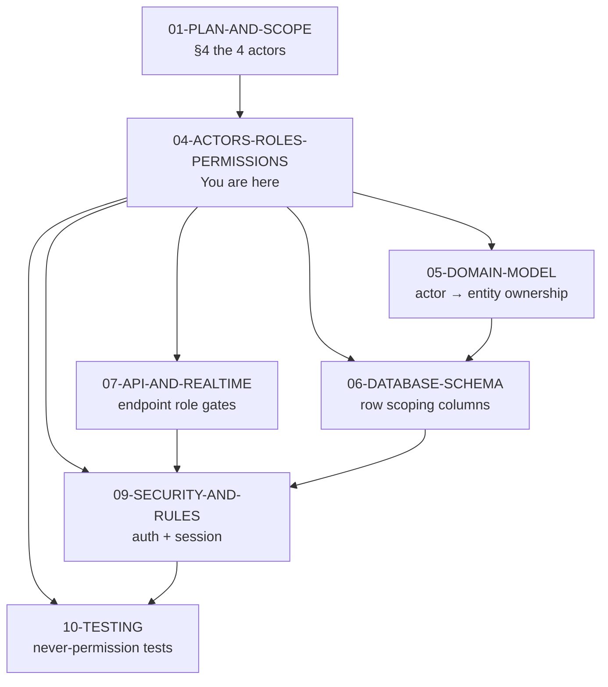

---

## 2. Core Concepts

Four terms must never be confused. Each means something specific in this document.

### 2.1 The four concepts

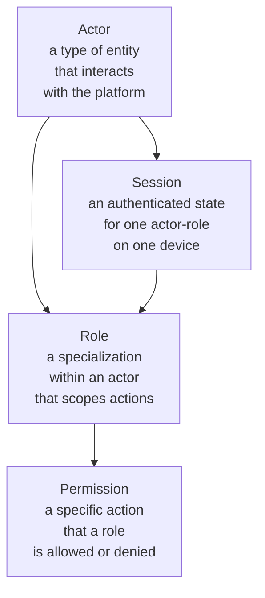

| Concept | Definition | Example | Lives in |
|---|---|---|---|
| **Actor** | A type of entity that interacts with the platform | Passenger | §3 |
| **Role** | A specialization within an actor that scopes what they can do | Registered Passenger | §4 |
| **Session** | An authenticated state for one actor-role on one device | A logged-in passenger on their phone | §8 |
| **Permission** | A specific action a role is allowed or denied | "Can create a booking" | §9 |

### 2.2 The rule that binds them

> **One person may be many actors. One session belongs to one actor-role. Permissions attach to roles, not actors.**

A driver who books a personal ticket:
- Logs into **BusVerse** as a **Registered Passenger** → session A
- Logs into **Operator App** as a **Driver** → session B

Two sessions, two actor-role pairs, two device contexts. They never merge. A person cannot be simultaneously a Passenger and a Driver in one session.

### 2.3 What "one session per actor-role" prevents

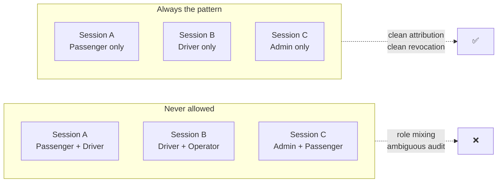

---

## 3. The Four Actors

Four top-level actor types in Phase 1. This is a scope decision from `01-PLAN-AND-SCOPE.md` §4, restated here with full detail.

### 3.1 Actor hierarchy

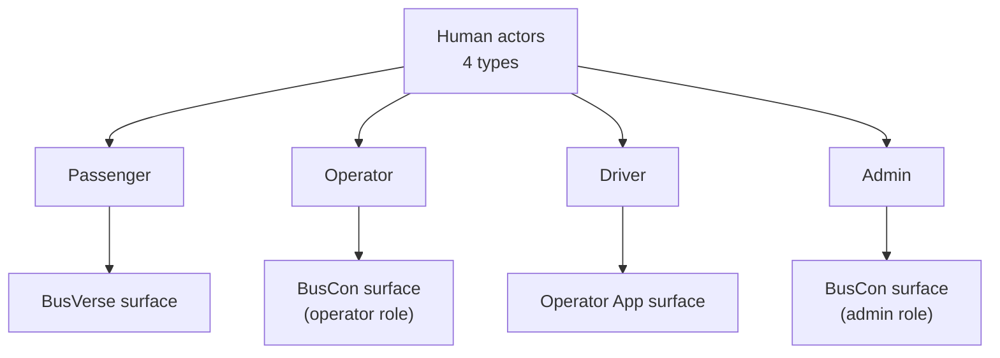

### 3.2 Passenger

| Attribute | Detail |
|---|---|
| **Definition** | A person who searches, books, pays for, and travels on a seat |
| **Identity** | Phone number (primary, required at signup), email (optional) |
| **Surface** | BusVerse (web + PWA) |
| **Roles** | Guest, Registered Passenger |
| **Auth methods** | Phone OTP (login + signup) OR email OTP (login only) |
| **Session model** | Multi-device, 15 min access / 7 day refresh |

**Passenger lifecycle:**

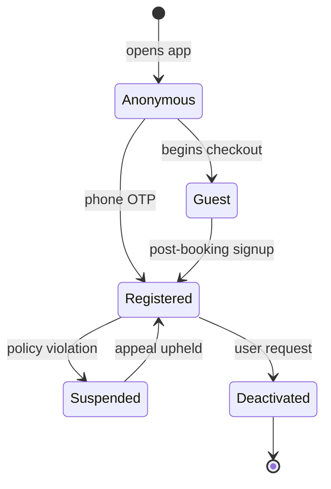

**Guest is stateless on the wire.** A Guest reads search results, operator profiles, seat availability, and schedule detail with no session. They do not receive a JWT. Their search history is local only. The moment they begin checkout, they must register — Guest is a UI state, not a session state.

**Note on email OTP:** Email OTP is supported for **passenger login only**. Passenger signup still requires a phone number (the anchor identity, per `06` v1.1 §4.2 `users.phone NOT NULL`). See `07` v1.1 §3.3 for the exact request shapes.

**What a passenger can never do:**
- See another passenger's booking
- Contact a driver directly
- See other passengers on the same trip
- Modify a confirmed booking without cancelling

### 3.3 Operator

| Attribute | Detail |
|---|---|
| **Definition** | A company that owns buses and employs drivers |
| **Identity** | GSTIN + PAN + company registration + bank account + KYC |
| **Surface** | BusCon (web, operator role) |
| **Roles** | Operator Owner, Operator Manager |
| **Auth methods** | Email + password OR phone OTP (chosen at signup) |
| **Session model** | Multi-device, 15 min access / 7 day refresh |

**Operator lifecycle:**

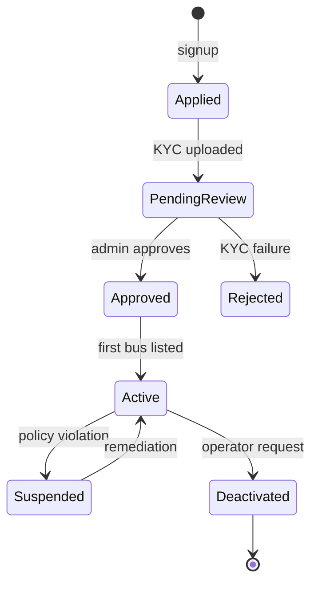

**What an operator can never do:**
- See another operator's fleet, bookings, or revenue
- Modify a confirmed booking
- Set refund amounts outside the policy
- Approve their own KYC or bus registration
- Access admin-only audit logs
- Access another operator's driver KYC documents

### 3.4 Driver

| Attribute | Detail |
|---|---|
| **Definition** | A licensed person who drives a bus for an operator |
| **Identity** | Phone number + KYC (license, ID, photo) + operator invitation |
| **Surface** | Operator App (native mobile) |
| **Roles** | Driver (single role) |
| **Auth methods** | Phone OTP |
| **Session model** | Single-device by default, 30 min access / 30 day refresh |

**Driver lifecycle:**

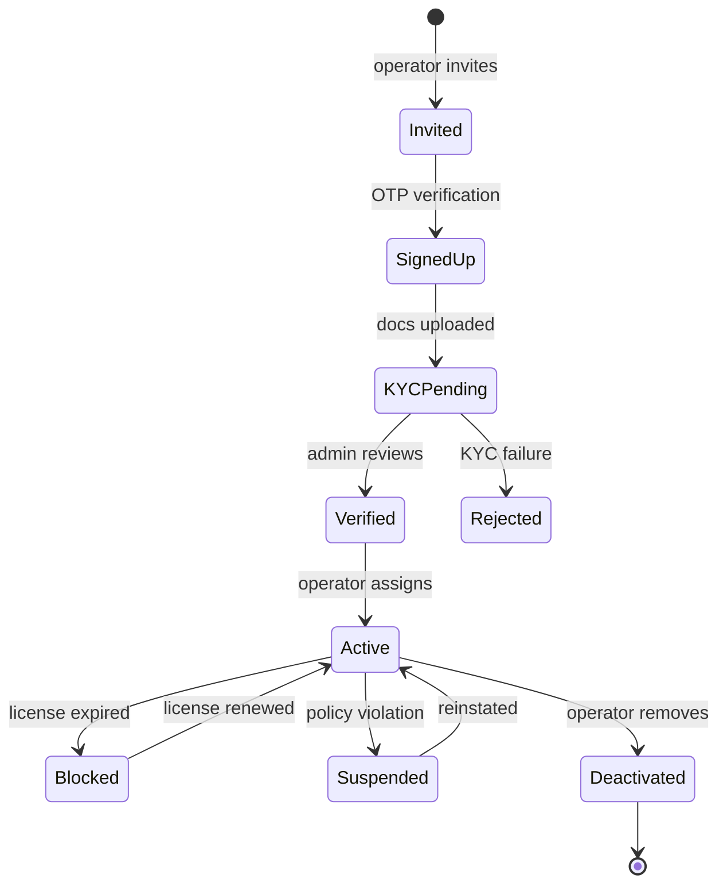

**What a driver can never do:**
- Cancel a trip (only operator can)
- See passenger contact details
- See other drivers' trips
- Book tickets as a passenger while on duty (see §13.5)
- Modify a confirmed booking

### 3.5 Admin

| Attribute | Detail |
|---|---|
| **Definition** | The BusVerse + BusCon operations team. In Phase 1, this is the founder |
| **Identity** | Email + password |
| **Surface** | BusCon (web, admin role) |
| **Roles** | Super Admin |
| **Auth methods** | Email + password |
| **Session model** | Multi-device, 5 min access / 1 day refresh |

**Admin lifecycle:**

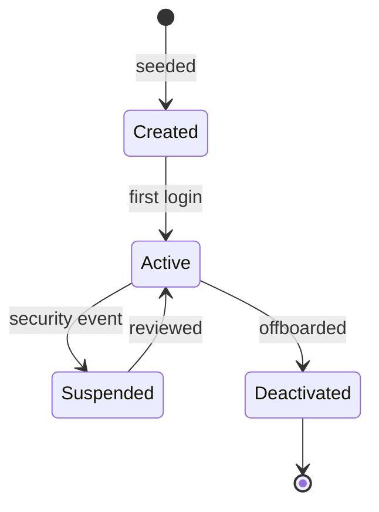

**What an admin can never do:**
- Modify a confirmed booking (can only cancel with reason)
- See raw card data or UPI PINs
- Redirect a refund to a non-original payment method
- Delete an audit log entry
- Impersonate a user
- Bypass legal compliance (GST invoicing, DPDP rights)

### 3.6 Actor → data model mapping

**Decision:** BusVerse + BusCon uses a **single `users` identity table** with role-specific profile tables. One person = one `user` row = up to four profiles.

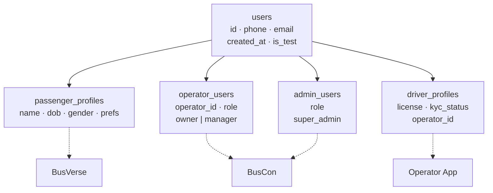

**Why one identity:**

| Reason | Detail |
|---|---|
| A driver may also be a passenger | Same `users.id`, two sessions, two roles |
| A founder may be both Super Admin and a Passenger | Same `users.id`, two sessions |
| Audit log needs one `actor_id` | Every audit row points to `users.id` |
| Phone number uniqueness | One phone = one person = one `users.id` |
| Email uniqueness | One email = one person = one `users.id` |

**Table split:**

| Table | Purpose | One row per |
|---|---|---|
| `users` | Identity anchor: phone, email, timestamps | Human |
| `passenger_profiles` | Passenger-specific fields | Passenger |
| `operator_users` | Operator membership + role | Operator member |
| `driver_profiles` | Driver KYC + license + assigned operator | Driver |
| `admin_users` | Admin role assignment | Admin |

**Rules:**

- A `users` row must have at least one profile — no orphan identities.
- Deactivating a `users` row deactivates all profiles and revokes all sessions.
- A driver may only have one active `driver_profiles` row. Switching operator requires the old operator to deactivate first.
- An operator may have multiple `operator_users` rows — one per Owner/Manager invited.

Exact column definitions live in `06-DATABASE-SCHEMA.md` v1.1 §4.

---

## 4. Role Taxonomy

Six roles across the 4 actors in Phase 1.

### 4.1 Phase 1 roles at a glance

| # | Role | Actor | Surface | Trust level |
|:---:|---|---|---|---|
| 1 | Guest | Passenger | BusVerse | L0 |
| 2 | Registered Passenger | Passenger | BusVerse | L1 |
| 3 | Operator Owner | Operator | BusCon | L2 |
| 4 | Operator Manager | Operator | BusCon | L2 |
| 5 | Driver | Driver | Operator App | L1 |
| 6 | Super Admin | Admin | BusCon | L3 |

**Total: 6 roles.** Every additional role must pass the bar of "does this make a demo criterion pass?" If not, it defers to Phase 2.

### 4.2 Role inheritance tree

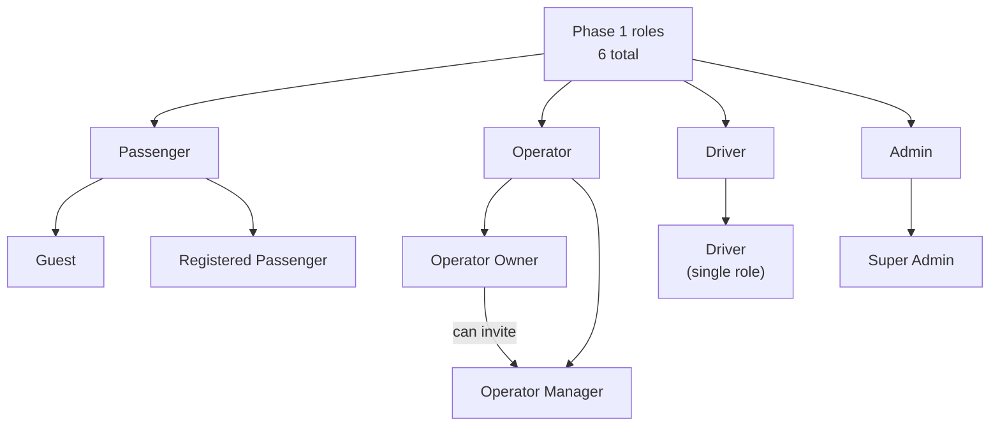

### 4.3 Why 6, not 11

| Role | Justified because | If removed |
|---|---|---|
| Guest | Lets users browse + begin booking without signup | Adds friction; demo shows guest → registered flow |
| Registered Passenger | Full booking, history, ticket | Core actor |
| Operator Owner | Full company access, billing, sub-user management | Core actor |
| Operator Manager | Realistic: an owner delegates fleet/route management | Demo shows multi-user operator |
| Driver | Field operations: trip, GPS, scan | Core actor |
| Super Admin | Approvals, refunds, audit | Core actor |

Deferred to Phase 2:
- Operator Accountant, Operator Fleet Manager
- Admin Ops, Admin Finance, Admin Auditor, Admin Support Agent
- Corporate Travel Manager, Corporate Finance, Corporate HR
- Agent Owner, Agent Staff

### 4.4 Role → actor → surface matrix

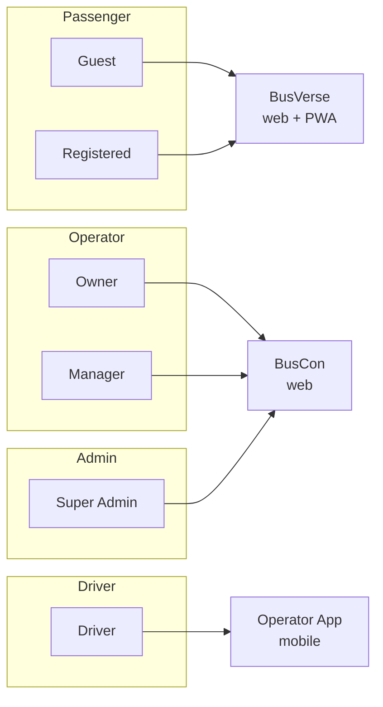

### 4.5 Operator: Owner vs Manager

Two operator roles differ in **one** dimension: **billing and sub-user management**.

| Action | Owner | Manager |
|---|:---:|:---:|
| View dashboard | ✅ | ✅ |
| Register a bus | ✅ | ✅ |
| Create a route | ✅ | ✅ |
| Create a schedule | ✅ | ✅ |
| Invite a driver | ✅ | ✅ |
| Assign driver to schedule | ✅ | ✅ |
| View bookings | ✅ | ✅ |
| View revenue (read-only) | ✅ | ✅ |
| View settlement statements | ✅ | ✅ |
| **Invite a Manager** | ✅ | ❌ |
| **Remove a Manager** | ✅ | ❌ |
| **Manage company KYC** | ✅ | ❌ |
| **Manage bank details** | ✅ | ❌ |
| **Deactivate the company** | ✅ | ❌ |

**Rule:** Only an Owner can create another Owner or a Manager. A Manager cannot escalate their own role or invite anyone above their own scope.

### 4.6 Super Admin scope (Phase 1)

In Phase 1, one human (the founder) holds the Super Admin role. Every admin action is logged with the Super Admin actor ID and the reason. Sub-roles (Ops, Finance, Auditor) are Phase 2.

**Explicit constraints on Super Admin** — even the founder cannot:
- Impersonate a user
- Modify a confirmed booking
- Redirect a refund
- Delete an audit entry
- Access raw card data or UPI PINs
- Bypass legal compliance

These constraints are enforced in code, not policy. Attempting them returns `404 Not Found`, not `403 Forbidden`.

---

## 5. Permission Notation

One symbol set, used consistently across every grid.

### 5.1 Symbols

| Symbol | Meaning |
|:---:|---|
| **C** | Create |
| **R** | Read |
| **U** | Update |
| **D** | Delete (soft unless noted) |
| **E** | Execute (named operation) |
| **X** | Export |
| **Cfg** | Configure |
| **Dl** | Delegate (grant a role) |
| **—** | No permission |
| **N** | Never — overrides all |
| **≤X** | Threshold (e.g. refund cap) |
| **F** | Field-level restriction |

### 5.2 Delete types

| Type | Meaning |
|---|---|
| **Soft** | Row marked `deleted_at`; excluded from normal queries |
| **Hard** | Row physically removed after retention window |
| **Never** | No delete path exists |
| **Archive** | Row moved to cold storage |

### 5.3 Row scoping

| Suffix | Meaning |
|---|---|
| **(own)** | Only rows the session owns |
| **(own fleet)** | Only rows belonging to the session's operator |
| **(own trip)** | Only trips assigned to the session's driver |
| **(all)** | All rows |

### 5.4 Money-path suffixes

| Suffix | Meaning |
|---|---|
| **+i** | Idempotent |
| **+a** | Audited with reason required |
| **+l** | Logged without exception |

---

## 6. Trust Levels

Five trust levels. Each role belongs to exactly one.

### 6.1 Trust level ladder

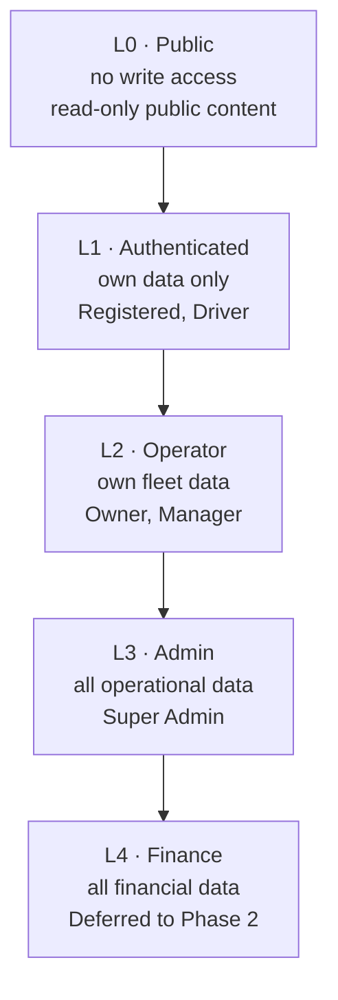

### 6.2 Assignment

| Level | Description | Roles |
|---|---|---|
| **L0** | No write; read-only public content | Guest |
| **L1** | Own data only | Registered Passenger, Driver |
| **L2** | Own operator scope | Operator Owner, Operator Manager |
| **L3** | All operational data | Super Admin |
| **L4** | Financial configuration | *(none in Phase 1)* |

### 6.3 The elevation rule

> **No role can elevate their own trust level. Elevation requires a new session or explicit re-authentication.**

### 6.4 Cross-tenant isolation rule

> **No role can read rows scoped to another role of the same type.**

| Example | Enforcement |
|---|---|
| Operator A cannot read Operator B's buses | Row-level `WHERE operator_id = :session_operator_id` |
| Driver A cannot read Driver B's trips | Row-level `WHERE driver_id = :session_driver_id` |
| Passenger A cannot read Passenger B's bookings | Row-level `WHERE user_id = :session_user_id` |

Every query touching operator, driver, or passenger data is row-scoped at the query level, not filtered in the UI.

---

## 7. Auth Model Per Actor

Four distinct auth flows. Each ends with a signed JWT access token plus a rotating refresh token bound to a device.

### 7.1 Passenger — OTP (phone or email)

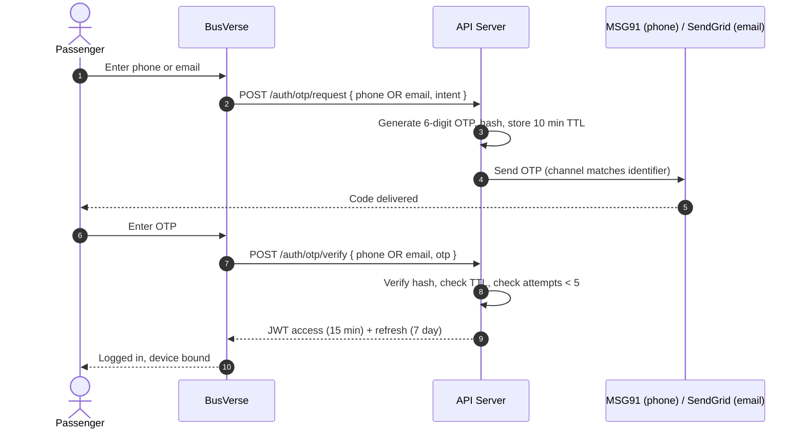

**Parameters:**

| Parameter | Value |
|---|---|
| OTP length | 6 digits |
| OTP TTL | 10 minutes |
| Attempts before lock | 5 |
| Lock duration | 15 minutes |
| Access TTL | 15 minutes |
| Refresh TTL | 7 days |
| Devices | Multi-device |

**Note:** Email OTP is **login only**. Signup requires phone (the anchor identity per `06` v1.1 §4.2). Delivery channel is inferred from the identifier: phone → MSG91, email → SendGrid (per `09` v1.1 §18.5.1 and `03` v1.1 ADR-011).

### 7.2 Operator — email + password OR phone OTP

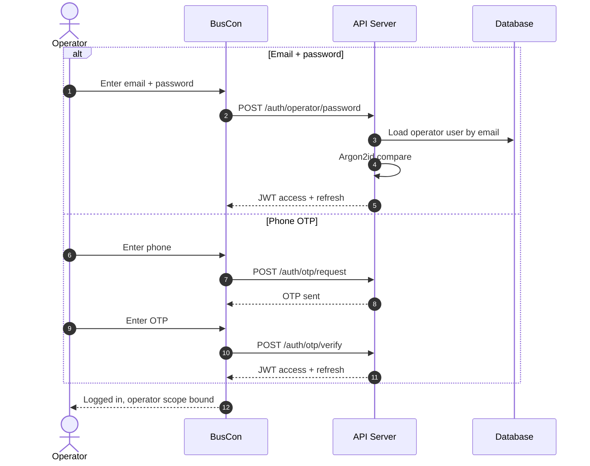

**Parameters:**

| Parameter | Value |
|---|---|
| Password hash | Argon2id |
| Password min length | 12 characters |
| Access TTL | 15 minutes |
| Refresh TTL | 7 days |
| Devices | Multi-device |
| Failed attempts before lock | 10 |
| Lock duration | 30 minutes |
| Email verification | Required before first login |

### 7.3 Driver — phone OTP, single device

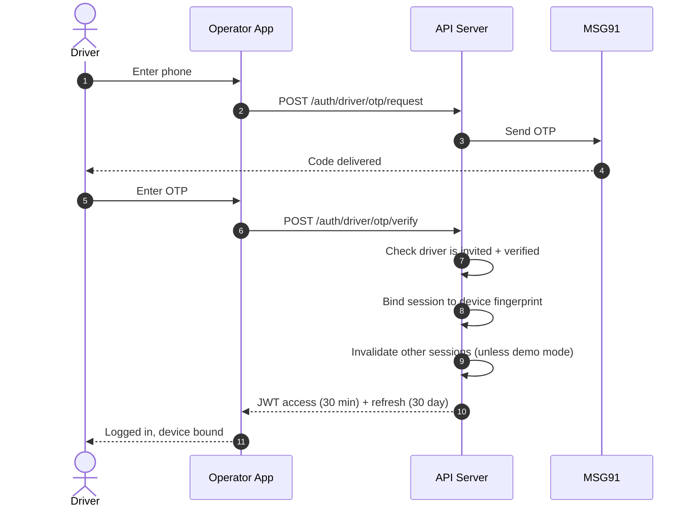

**Parameters:**

| Parameter | Value |
|---|---|
| OTP length | 6 digits |
| OTP TTL | 10 minutes |
| Access TTL | 30 minutes |
| Refresh TTL | 30 days |
| Devices | **Single-device by default** |
| Failed attempts before lock | 5 |

**Single-device rule:**

| Event | Behavior |
|---|---|
| Driver logs in on device A | Session A active |
| Driver logs in on device B | Session A revoked, session B active |
| Driver loses phone, logs in on device C | Sessions A and B revoked, session C active |
| Driver shares credentials | Second login kicks first out — logged as suspicious |

**Demo-mode override:** Server-side config `DEMO_MULTI_DEVICE_DRIVER=true` disables single-device enforcement. **Only enabled during showcase or viva** where multiple evaluators open the Operator App simultaneously. Any other environment: `false`.

### 7.4 Admin — email + password

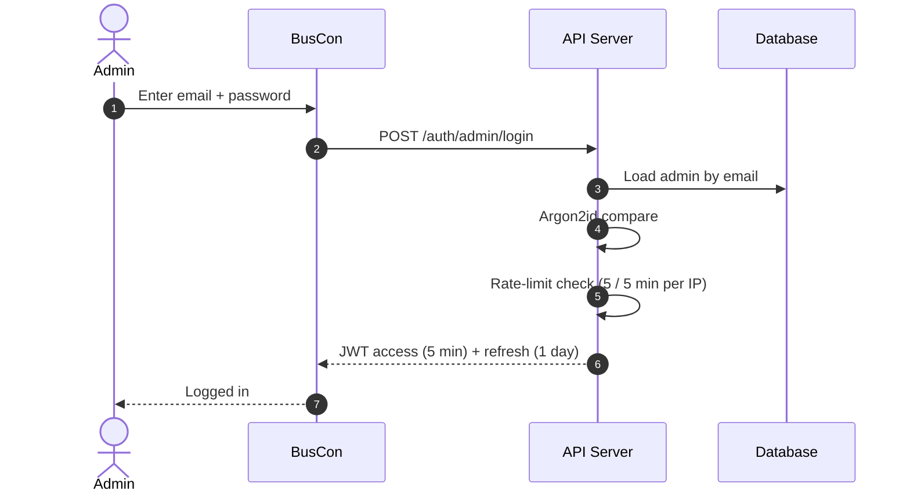

**Parameters:**

| Parameter | Value |
|---|---|
| Password hash | Argon2id |
| Password min length | 16 characters |
| Access TTL | 5 minutes |
| Refresh TTL | 1 day |
| Devices | Multi-device |
| Rate limit | 5 attempts / 5 min / IP |
| TOTP 2FA | **Deferred to Phase 2** — see §17 Q1 |

### 7.5 Auth comparison + rate limits

| Actor | Method | Access TTL | Refresh TTL | Devices | 2FA |
|---|---|---|---|---|---|
| Passenger | Phone OTP or email OTP (login) | 15 min | 7 days | Multi | — |
| Operator | Email + password OR phone OTP | 15 min | 7 days | Multi | — |
| Driver | Phone OTP | 30 min | 30 days | **Single** | — |
| Admin | Email + password | 5 min | 1 day | Multi | **None (P1)** |

**Rate limits per actor:**

| Endpoint | Passenger | Operator | Driver | Admin |
|---|---|---|---|---|
| OTP request | 3 / 10 min | 3 / 10 min | 3 / 10 min | — |
| OTP verify | 5 / 10 min | 5 / 10 min | 5 / 10 min | — |
| Password login | — | 10 / 30 min | — | 5 / 5 min |
| **Password reset** | **—** | **3 / hour** | **—** | **3 / hour** |
| Refresh | 60 / hour | 60 / hour | 60 / hour | 60 / hour |

**Note on password reset rate limit:** Passengers and drivers have **no password** (OTP-only login), so there is nothing to reset — hence `—` in those columns. Password reset applies to **operator and admin only** (see §7.6). The rate limit is enforced per identifier (email or phone) AND per IP, per `09` v1.1 §16.2.

**Rate limits are enforced at the API gateway** keyed by `(ip, endpoint, phone_or_email)` — so an attacker behind a shared IP cannot exhaust a specific user's OTP quota, and an attacker rotating IPs against the same user is still capped by the phone/email dimension.

### 7.6 Password reset

Applies to Operator and Admin only. Passenger and Driver use OTP-based login, so there is no password to reset.

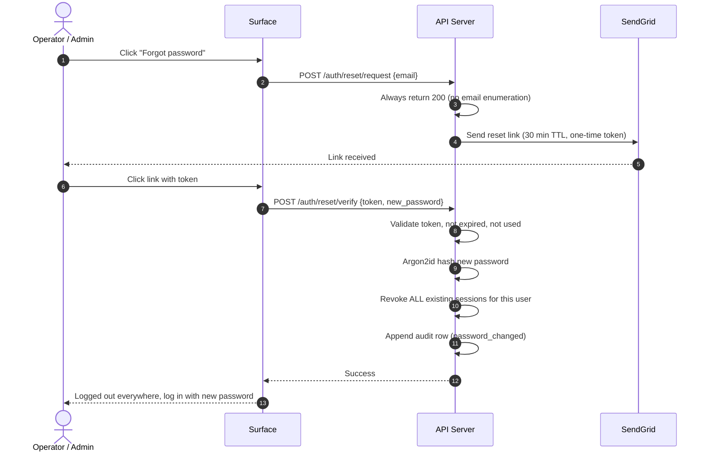

**Rules:**

| Rule | Reason |
|---|---|
| Always return 200 on reset request | No email enumeration |
| Reset link TTL 30 min | Short enough to prevent token leak, long enough for real users |
| One-time token | Cannot be reused |
| Revoke all sessions on reset | A password reset means "I don't trust my current sessions" |
| OTP fallback to phone | If email is inaccessible, send OTP to registered phone |
| Audit every reset | Logged with `user_id`, timestamp, IP |

**OTP fallback flow:** If the user clicks "email not accessible", they get an OTP to the phone number on file. Same TTL (10 min), same one-time rule, same 5-attempt cap, same session revocation. The OTP fallback is a distinct challenge from login OTP — created by `/auth/reset/request`, not by `/auth/otp/request` — and stored with `purpose = RESET` internally in `otp_challenges` (`06` v1.1 §4.8). The exact endpoint shapes are in `07` v1.1 §3.7.

**Note on token storage:** The reset email path stores a hashed one-time token in `password_reset_tokens` (`06` v1.1 §4.11). The OTP fallback path stores a hashed OTP in `otp_challenges`. Both paths revoke all sessions on success.

---

## 8. Session Model

Every authenticated interaction happens inside a session. This section defines session lifetime, rotation, revocation, and storage.

### 8.1 Session lifecycle

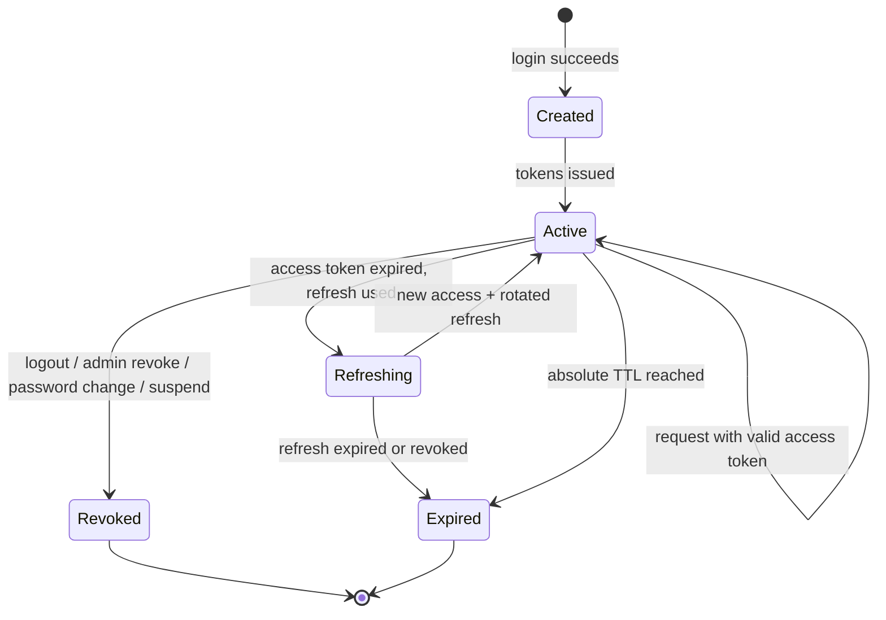

### 8.2 Token model

Every session issues two tokens:

| Token | Purpose | Storage | TTL |
|---|---|---|---|
| **Access token** | Bearer for API requests | In-memory on client | 5–30 min |
| **Refresh token** | Mints new access tokens | HTTP-only cookie or secure storage | 1–30 days |

Both are JWTs signed with HS256. Access tokens encode `{actor, role, session_id, expires_at}`. Refresh tokens encode `{session_id, chain_id, issued_at}` and are stored **hashed** in the DB for revocation.

### 8.3 Refresh token rotation

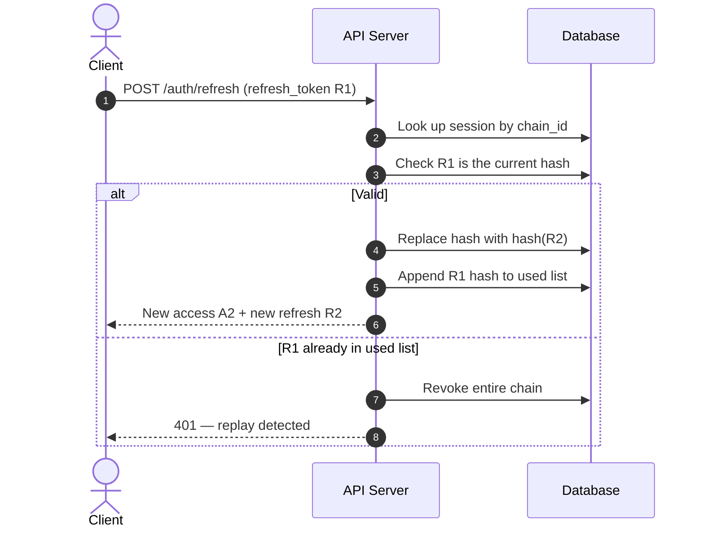

**Rules:**

- Refresh rotates **only when a new access token is issued**.
- Each used refresh token hash is stored in the chain's `used_hashes` list.
- A replayed refresh token triggers **entire chain revocation**.
- The chain is bound to the session. When the session dies, the chain dies.

### 8.4 Session parameters per actor

| Actor | Access TTL | Refresh TTL | Absolute max | Idle timeout | Devices |
|---|---|---|---|---|---|
| Passenger | 15 min | 7 days | 30 days | 30 days | Multi |
| Operator | 15 min | 7 days | 30 days | 30 days | Multi |
| Driver | 30 min | 30 days | 90 days | 90 days | Single (demo override) |
| Admin | 5 min | 1 day | 30 days | 7 days | Multi |

### 8.5 Session storage + JWT blacklist

| Data | Where stored | Why |
|---|---|---|
| Refresh token hash | Postgres `sessions.refresh_hash` | Revocation, replay detection |
| Refresh token chain | Postgres `refresh_token_chains` | Rotation history |
| Session metadata | Postgres `sessions` + `session_events` | Audit |
| Access token | Never stored server-side | Stateless JWT verification |
| Active session cache | Redis `session:{id}` with TTL = refresh TTL | Fast revocation check |
| **Revoked session blacklist** | Redis `revoked:{session_id}` with TTL = access TTL | Instant access-token invalidation |

**How the blacklist works:**

1. Every API request validates the JWT signature and extracts `session_id`.
2. Before processing, the API checks `Redis.exists(revoked:{session_id})`.
3. If the key exists, the request is rejected with `401 Unauthorized`.
4. The key is written on revocation with TTL equal to the access token's remaining lifetime. After that, the access token would have expired naturally, so the blacklist entry can expire.
5. The blacklist is **small and bounded** — at most one key per revoked session for at most one access-TTL window.

### 8.6 Session revocation

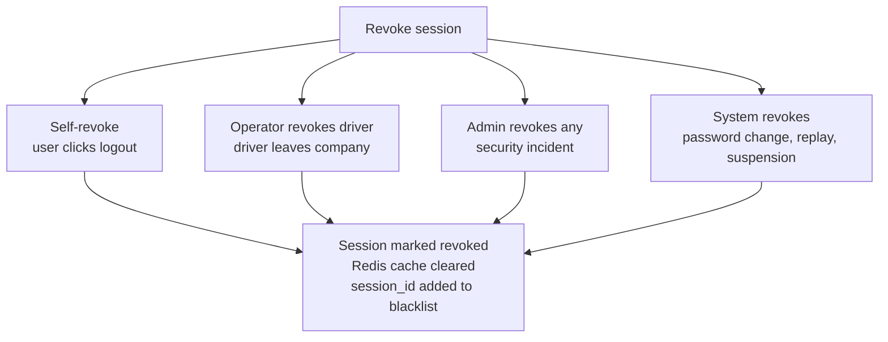

### 8.7 Revocation authority

| Revoker | Can revoke | Requires |
|---|---|---|
| Passenger | Own sessions | — |
| Operator Owner | Own + any Manager/Driver in own company | — |
| Operator Manager | Own + any Driver in own company | — |
| Driver | Own sessions | — |
| Super Admin | Any session | Reason (logged) |
| System | Any session | Triggered by password change, refresh replay, absolute TTL, actor suspension |

**Rule:** No role can revoke a session belonging to a higher trust level. Operator cannot revoke Admin. Admin can revoke anyone.

### 8.8 Session events

Every session lifecycle event writes an append-only row to `session_events`:

| Event | When written |
|---|---|
| `login_success` | Login completes |
| `login_failed` | Login fails (with reason) |
| `token_refreshed` | Refresh succeeds |
| `refresh_replay_detected` | Replay caught |
| `revoked_self` | User logs out |
| `revoked_by_operator` | Operator kills driver session |
| `revoked_by_admin` | Admin kills session |
| `revoked_by_suspension` | Actor state changed |
| `expired_absolute` | Absolute TTL reached |
| `expired_idle` | Idle timeout reached |
| `password_changed` | Password updated |
| `password_reset` | Password reset completed (either email link or OTP fallback) |

Each row records `{session_id, actor_id, ip_address, user_agent, occurred_at}`.

**Retention:** 180 days. After that, rows are purged by a nightly cron.

### 8.9 Cascade revocation on actor state change

When an actor's state changes, their active sessions are automatically revoked. This is **not** optional. Suspension means the account cannot act — sessions must die.

```mermaid
flowchart TB
    CHANGE["Actor state change"]

    CHANGE --> OP1["Operator suspended"]
    CHANGE --> OP2["Operator deactivated"]
    CHANGE --> D1["Driver deactivated"]
    CHANGE --> D2["Driver blocked (license expired)"]
    CHANGE --> P1["Passenger suspended"]
    CHANGE --> A1["Admin deactivated"]

    OP1 --> REV_ALL["Revoke all sessions of<br/>all operator_users in the company"]
    OP2 --> REV_ALL
    D1 --> REV_DRIVER["Revoke all sessions of<br/>that driver"]
    D2 --> REV_DRIVER
    P1 --> REV_PAX["Revoke all sessions of<br/>that passenger"]
    A1 --> REV_ADMIN["Revoke all sessions of<br/>that admin"]

    REV_ALL --> WRITE["Write session_events rows<br/>reason: revoked_by_suspension"]
    REV_DRIVER --> WRITE
    REV_PAX --> WRITE
    REV_ADMIN --> WRITE
```

**Cascade rules:**

| Trigger | What happens |
|---|---|
| Operator suspended | All `operator_users` sessions revoked; all `driver_profiles` sessions revoked |
| Operator deactivated | Same as suspension |
| Driver deactivated | Driver's sessions revoked |
| Driver license blocked | Driver's sessions revoked |
| Passenger suspended | Passenger's sessions revoked |
| Passenger deactivated | Passenger's sessions revoked |
| Admin deactivated | Admin's sessions revoked |
| Password changed | All sessions of that user revoked |
| Password reset (email or OTP) | All sessions of that user revoked |
| Refresh token replay | All sessions in that chain revoked |

**Not triggered by:**
- Role change within same company (Owner → Manager) — session continues, permission set changes on next request
- Operator changes driver assignment to different schedule — session continues

**Rule:** Suspension ≠ role change. Role change keeps the session alive with new permissions. Suspension kills the session.

---

## 9. Permission Grids

One grid per surface. Grids define **what each role can do on each entity**. Exact entity attributes and invariants live in `05-DOMAIN-MODEL.md` and `06-DATABASE-SCHEMA.md`.

### 9.1 BusVerse permission grid

| Entity | Guest | Registered Passenger | Notes |
|---|:---:|:---:|---|
| Search result | R | R | Public |
| Operator public profile | R | R | Public |
| Schedule detail | R | R | Public |
| Seat availability | R | R | Public |
| Seat lock | — | C E (own) | Guest must register to lock |
| Booking | — | C R U (own) | Guest cannot book |
| Booking history | — | R (own) | Guest has no history |
| Payment | — | C R (own) +i +l | Idempotent + audited |
| Ticket | — | R (own) | QR shows in My Trips only |
| Trip (live view) | — | R (own trip) | Only after driver starts |
| Cancel booking | — | E (own) | Creates refund record |
| Profile | — | R U (own) F | Name, email editable; phone locked |
| Notification | — | R (own) | In-app only |
| Review | — | — (Phase 2) | Deferred |
| Trip share link | — | — (Phase 2) | Deferred |
| Support ticket | — | — (Phase 2) | Deferred |

### 9.2 BusCon permission grid

| Entity | Operator Owner | Operator Manager | Super Admin | Notes |
|---|:---:|:---:|:---:|---|
| Operator KYC | R U E (own) | R (own) | C R U E (all) | Admin approves |
| Operator bank details | R U (own) | — | R U (all) | Manager cannot see bank |
| Bus | C R U D (own) | C R U D (own) | R E (all) | Admin approves but not edits |
| Seat layout | C R U D (own) | C R U D (own) | R (all) | — |
| Route | C R U D (own) | C R U D (own) | R E (all) | — |
| Schedule | C R U D (own) | C R U D (own) | R E (all) | Admin approves |
| Driver invitation | C (own) | C (own) | R (all) | — |
| Driver profile | R U D (own) | R U D (own) | R (all) F | Admin sees masked PII |
| Booking | R (own fleet) F | R (own fleet) F | R (all) | No role can modify |
| Payment | R (own fleet) F | R (own fleet) F | R (all) F | Masked PII for operator |
| Refund | R (own fleet) | R (own fleet) | C E +a (all) | Admin triggers with reason |
| Revenue view | R (own fleet) | R (own fleet) | R (all) | Read-only |
| Settlement statement | R (own fleet) | R (own fleet) | R (all) | Read-only |
| Audit log | — | — | R X (all) | Append-only |
| Feature flags *(Phase 2)* | — | — | — | Deferred to Phase 2 (see `05` v1.1 §10.2) |
| Manager invitation | C Dl (own) | — | C Dl (all) | Only Owner can invite Manager |
| Admin creation | — | — | C Dl | Only Super Admin creates admins |

### 9.3 Operator App permission grid

| Entity | Driver | Notes |
|---|:---:|---|
| Assigned trip | R U E (own) | Only trips assigned to this driver |
| GPS sample | C (own trip) | While trip is active |
| ETA estimate | R (own trip) | Read-only |
| Boarding scan | C E (own trip) | Offline capable |
| Manifest | R (own trip) F | Passenger name + seat only |
| Delay report | C (own trip) | With reason |
| Passenger phone | **N** | Never visible |
| Passenger email | **N** | Never visible |
| Passenger ID number | **N** | Never visible |
| Other drivers' trips | **N** | Never visible |
| Cancel trip | **N** | Only operator can |
| Break log | — (Phase 2) | Deferred |
| Announcement | — (Phase 2) | Deferred |
| SOS alert | — (Phase 2) | Deferred |

**Critical rule:** The `N` rows for passenger PII are **structural**, not policy. The endpoint does not exist. `GET /trips/:id/passenger/:id/contact` returns `404 Not Found`. The attack surface is zero.

**Second critical rule:** Offline scanning still requires a valid session. The Operator App caches the last 24 hours of assigned trips + public key. A driver who has not logged in for 30 days cannot scan offline.

### 9.4 Cross-surface summary

```mermaid
flowchart LR
    subgraph BV["BusVerse"]
        G["Guest<br/>L0"]
        RP["Registered<br/>L1"]
    end

    subgraph BC["BusCon"]
        OO["Owner<br/>L2"]
        OM["Manager<br/>L2"]
        SA["Super Admin<br/>L3"]
    end

    subgraph OA["Operator App"]
        D["Driver<br/>L1"]
    end

    BV -.->|"no cross-surface<br/>session sharing"| BC
    BC -.->|"no cross-surface<br/>session sharing"| OA
    OA -.->|"no cross-surface<br/>session sharing"| BV
```

---

## 10. Named Operations

Not every permission is C, R, U, or D. Some actions have side effects, need reasons, or trigger downstream events. These are **Execute (E)** operations.

### 10.1 Operations catalog

| Operation | Entity | Roles allowed | Notes |
|---|---|---|---|
| `approveOperator` | Operator | Super Admin | With reason, audited |
| `rejectOperator` | Operator | Super Admin | With reason, audited |
| `suspendOperator` | Operator | Super Admin | With reason, audited; triggers cascade revocation |
| `approveBus` | Bus | Super Admin | Audited |
| `approveRoute` | Route | Super Admin | Audited |
| `approveSchedule` | Schedule | Super Admin | Audited |
| `inviteManager` | Operator user | Owner | Delegate; audited role change |
| `inviteDriver` | Driver | Owner, Manager | Creates invite with 7-day TTL |
| `assignDriver` | Schedule | Owner, Manager | — |
| `startTrip` | Trip | Driver (own) | Begins GPS stream |
| `endTrip` | Trip | Driver (own) | Ends GPS stream |
| `cancelTrip` | Trip | Owner, Manager, Super Admin | Not driver |
| `scanTicket` | Ticket | Driver (own trip) | Marks boarded |
| `acquireSeatLock` | SeatLock | Registered | Atomic |
| `releaseSeatLock` | SeatLock | Registered (owner) | Self only |
| `cancelBooking` | Booking | Registered (own), Super Admin | Creates refund record |
| `initiateRefund` | Refund | Super Admin | With reason, capped |
| `retryRefund` | Refund | Super Admin | On gateway failure |
| `exportGST` | GSTInvoice | Super Admin | CSV/PDF |
| `exportAuditLog` | AuditLog | Super Admin | CSV/JSON |
| `revokeSession` | Session | Self, Owner (own company), Manager (own drivers), Super Admin | See §8.7 |
| `toggleFeatureFlag` *(Phase 2)* | FeatureFlag | Super Admin | Audited; deferred to Phase 2 (see `05` v1.1 §10.2) |

**Phase 1 operations: 21.** The `toggleFeatureFlag` entry is included for completeness (Phase 2), but the underlying `feature_flags` table does not exist in `06` v1.1 §9, so the operation cannot be invoked in Phase 1.

### 10.2 Never operations

| Operation | Status | Reason |
|---|---|---|
| `impersonateUser` | **Never** | No endpoint exists |
| `modifyConfirmedBooking` | **Never** | Booking is immutable after confirmation |
| `redirectRefund` | **Never** | Refund goes to original method only |
| `deleteAuditLog` | **Never** | Append-only table |
| `storeRawCard` | **Never** | Gateway handles card data |
| `storeUpiPin` | **Never** | Gateway handles UPI PIN |
| `contactDriverDirectly` | **Never** | No endpoint exists |
| `viewOtherOperatorFleet` | **Never** | Row-level scope blocks |
| `fakeGpsPosition` | **Never** | Server validates GPS provenance |

For the four "no endpoint exists" operations, the API returns `404 Not Found`. For the four "row-level blocked" operations, the API returns `403 Forbidden`.

### 10.3 Role change audit

Every role grant and revocation writes an audit row. This is non-negotiable — it is how we can answer "who made this person a Manager?" years later.

**What is audited:**

| Action | Audit row written |
|---|---|
| Owner invites Manager | `role_granted` with `{actor_id, target_id, role: manager, reason, timestamp}` |
| Owner removes Manager | `role_revoked` with same fields |
| Manager deactivated | `role_revoked` |
| Super Admin creates Admin | `role_granted` |
| Super Admin deactivates Admin | `role_revoked` |
| Super Admin changes own password | `password_changed` |
| Operator KYC approved | `operator_approved` |
| Operator suspended | `operator_suspended` |
| Driver KYC approved | `driver_verified` |
| Driver deactivated | `driver_deactivated` |

**Schema of a role change audit row:**

| Field | Value |
|---|---|
| `id` | UUID |
| `actor_id` | Who performed the change |
| `target_id` | Whose role changed |
| `action` | `role_granted` / `role_revoked` |
| `role` | The role granted/revoked |
| `scope` | `operator_id` if operator role; `null` otherwise |
| `reason` | Free text (required) |
| `session_id` | The session that performed the change |
| `ip_address` | Source IP |
| `occurred_at` | Timestamp |

**Rule:** A role change without an audit row is a bug. The audit write happens in the same transaction as the role change — if either fails, both fail.

---

## 11. Field-Level Restrictions

### 11.1 Field masking rules

| Field | Passenger | Driver | Operator Owner | Operator Manager | Super Admin |
|---|---|---|---|---|---|
| Own phone | Full | Full | Full | Full | Full |
| Own email | Full | Full | Full | Full | Full |
| **Passenger phone** | Own only | **✗** | **✗** | **✗** | Full + reason |
| **Passenger email** | Own only | **✗** | **✗** | **✗** | Full + reason |
| **Passenger ID number** | Own only | **✗** | **✗** | **✗** | Full + reason |
| Passenger name (booking) | Own | Full | Full | Full | Full |
| Driver license | Own | Own | Own fleet | Own fleet | Full |
| Booking reference | Own | Own trips | Own fleet | Own fleet | Full |
| Payment method | Own (masked last-4) | ✗ | ✗ | ✗ | Masked last-4 |
| Card last 4 | Own | ✗ | ✗ | ✗ | Full + reason |
| GPS position | Own trip | Own trip | Own fleet | Own fleet | Full |
| Company bank details | — | — | Full | ✗ | Full |

### 11.2 Masking levels

| Level | Meaning | Example |
|---|---|---|
| **Full** | Raw value visible | `9876543210` |
| **Masked** | Partially visible | `9876XXXXX0` |
| **✗** | Not visible (field absent from response) | — |
| **N** | Never visible to any role | — |

### 11.3 Enforcement

```mermaid
flowchart TD
    REQ["API request"]
    REQ --> ROLE["Load role from session"]
    ROLE --> QUERY["Row-scoped query"]
    QUERY --> FIELD{"Field-level rule<br/>for this role?"}
    FIELD -->|"Full"| RAW["Return raw value"]
    FIELD -->|"Full + reason"| REASON{"Reason supplied?"}
    FIELD -->|"Masked"| MASK["Return masked value"]
    FIELD -->|"✗"| OMIT["Omit field from response"]
    REASON -->|"No"| R400["400 REASON_REQUIRED"]
    REASON -->|"Yes"| RAW
    RAW --> LOG["Log access"]
    MASK --> LOG
    OMIT --> LOG
```

Field masking is applied **server-side, in serialization**. Never in the UI. A masked field is never sent to the client, not even hashed.

### 11.4 The audit rule

Every unmasked PII access by Super Admin is logged with:

- Actor ID (which admin)
- Field accessed (e.g. `booking.passenger.phone`)
- Record ID
- Reason (required free text)
- Timestamp

Unmasked access without a reason fails with `400 REASON_REQUIRED` and is logged as a failed attempt.

---

## 12. Never-Permissions

Twelve statements that no role, at any trust level, can override. Each is enforced in code and tested in CI.

### 12.1 The twelve never-permissions

| # | Never | Enforced by | Test |
|:---:|---|---|---|
| 1 | Store raw card data | No field exists; gateway handles cards | `never_01` |
| 2 | Store UPI PIN | No field exists; gateway handles UPI | `never_02` |
| 3 | Redirect a refund | Service refuses non-original method | `never_03` |
| 4 | Sell user data | No export endpoint for PII | `never_04` |
| 5 | Delete audit log | Append-only table; no DELETE grant | `never_05` |
| 6 | Modify a confirmed booking | Service rejects POST after confirm | `never_06` |
| 7 | Admin access password/PIN | No endpoint exists; hashes only | `never_07` |
| 8 | Admin bypass legal compliance | GST invoice cannot be disabled | `never_08` |
| 9 | Passenger → driver direct contact | No endpoint exists; 404 | `never_09` |
| 10 | Operator see another operator's data | Row-level scope enforced | `never_10` |
| 11 | Impersonate a user | No endpoint exists; 404 | `never_11` |
| 12 | Change role inside an active session | Session is immutable | `never_12` |

### 12.2 Never-permission map

```mermaid
flowchart TB
    NEVER["12 never-permissions"]
    NEVER --> MONEY["Money<br/>1 no raw card<br/>2 no UPI PIN<br/>3 no refund redirect"]
    NEVER --> DATA["Data<br/>4 no data sale<br/>5 no audit delete"]
    NEVER --> BOOK["Booking<br/>6 no modify confirmed"]
    NEVER --> ADMIN["Admin<br/>7 no password access<br/>8 no bypass compliance<br/>12 no role swap"]
    NEVER --> FIELD["Field<br/>9 no driver contact<br/>10 no cross-operator<br/>11 no impersonate"]
```

### 12.3 The 404 vs 403 rule

| Case | HTTP status | Example |
|---|---|---|
| Endpoint exists, role not allowed | `403 Forbidden` | Passenger tries to cancel another's booking |
| Endpoint does not exist | `404 Not Found` | Passenger tries to call driver |

**Rule:** Critical never-permissions use `404` to hide existence from attackers. Policy-driven never-permissions use `403` with an error code.

---

## 13. Role Escalation

Roles are bound to sessions. Escalation means ending one session and starting another with a different role.

### 13.1 Escalation paths

```mermaid
flowchart LR
    A["Anonymous"] -->|"browse"| GU["Guest"]
    GU -->|"begin checkout"| G["Registered<br/>Passenger"]
    G -->|"operator invites"| D["Driver"]
    D -->|"operator onboarded<br/>(new BusCon account)"| O["Operator<br/>Owner / Manager"]
    O -->|"founder access"| SA["Super Admin"]
```

### 13.2 The escalation rule

> **Escalation requires a new session. The old session ends; a new session begins with the new role.**

A Registered Passenger invited to become a Driver:
- Keeps their BusVerse session active
- Logs into Operator App separately (new session)
- The two sessions are independent — revoking one does not revoke the other

### 13.3 What cannot happen

| Attempt | Result |
|---|---|
| Passenger calls operator endpoint with passenger JWT | `403 Forbidden` |
| Driver accesses BusVerse as passenger while on duty | Must log out of Operator App first |
| Manager promotes self to Owner | `403 Forbidden` — no `promoteRole` endpoint |
| Admin acts on masked field without reason | `400 REASON_REQUIRED` |

### 13.4 Self-service boundaries

| Action | Who can do it |
|---|---|
| Change own phone | Passenger, Operator, Driver |
| Change own email | Passenger, Operator, Admin |
| Change own password | Operator, Admin |
| Change own name | All actors |
| Change own role | **Never** |
| Change own trust level | **Never** |
| Promote self | **Never** |
| Demote self | **Never** |

**Rule:** No role can change their own role or trust level. Role changes require an invitation from a role above.

### 13.5 On-duty status

A Driver has an **on-duty** flag on their `driver_profiles` row. This flag is set to `true` when the driver starts a trip and `false` when they end it.

**Rules:**

| Rule | Enforcement |
|---|---|
| Driver cannot book a passenger ticket while on duty | BusVerse rejects checkout if the same `users.id` has an active driver session with `on_duty = true` |
| Driver session and passenger session are separate | Even with on-duty flag, they are two sessions |
| On-duty flag auto-clears after trip end | `endTrip` sets `on_duty = false` |
| On-duty flag auto-clears after 6 hours of inactivity | Cron job safety net |

**Why this exists:** A driver cannot be their own passenger on the same trip. It also prevents "ghost bookings" where a driver books a seat and then cancels to inflate stats. It's a small rule, but it plugs a real hole.

---

## 14. RBAC Enforcement Layers

Five layers. Every layer checks. No layer trusts the previous.

### 14.1 The five layers

```mermaid
flowchart LR
    UI["1 · UI<br/>hide/show"]
    API["2 · API<br/>role check"]
    SVC["3 · Service<br/>business rule"]
    DB["4 · DB<br/>row-level scope"]
    AUD["5 · Audit<br/>log every action"]

    UI --> API --> SVC --> DB
    SVC --> AUD
```

| Layer | Enforces | Failure mode |
|---|---|---|
| **UI** | Hides buttons the role cannot use | UX only |
| **API** | Rejects requests from roles without permission | `403` or `404` |
| **Service** | Validates business rules | `400` with error code |
| **DB** | Row-level scope (`WHERE operator_id = ?`) | `0 rows` |
| **Audit** | Records every state-changing action | Append-only row |

### 14.2 Why every layer checks

- UI-only checks fail when attacker calls API directly
- API-only checks fail if a service bug bypasses them
- Service-only checks fail if a query forgets `WHERE operator_id`
- DB-only checks fail if the business rule belongs at the wrong layer
- Audit-only checks don't prevent anything

**Rule:** A permission is not enforced unless checked at **both API and DB layers**. Service layer handles business rules, not access control.

### 14.3 Endpoint → role requirement

Every endpoint declares its required role(s) in code as a decorator, verified against this document by CI.

```mermaid
flowchart TD
    EP["POST /operator/buses<br/>@RequireRole('Operator Owner', 'Operator Manager')"]
    EP --> C1["Session valid?"]
    C1 -->|"No"| R401["401 Unauthorized"]
    C1 -->|"Yes"| C2["Role in list?"]
    C2 -->|"No"| R403["403 Forbidden"]
    C2 -->|"Yes"| C3["operator_id = session.operator_id?"]
    C3 -->|"No"| R404["404 Not Found"]
    C3 -->|"Yes"| EXEC["Execute + audit"]
```

Ownership failures return `404`, not `403`, to prevent probing for resource existence.

---

## 15. Cross-Actor Interactions

One booking, four actors, four views.

### 15.1 The booking through four lenses

```mermaid
sequenceDiagram
    autonumber
    actor P as Passenger
    actor O as Operator
    actor D as Driver
    actor A as Admin

    P->>O: (indirect) books seat on schedule
    Note over O: Sees booking in fleet view<br/>masked PII, own fleet only
    O->>D: assigns to trip
    Note over D: Sees trip in Operator App<br/>name + seat only, no contact
    D->>P: (system) starts trip, GPS visible
    Note over A: Sees booking, payment,<br/>scan, each with timestamps
    D->>P: (system) scans QR at boarding
    Note over P: Ticket marked "Boarder verified"
```

### 15.2 What each actor sees of the same booking

| Data field | Passenger | Operator | Driver | Admin |
|---|:---:|:---:|:---:|:---:|
| Booking reference | Full | Full | Full | Full |
| Passenger name | Full (self) | Full | Full | Full |
| Passenger phone | Full (self) | **✗** | **✗** | Full + reason |
| Passenger email | Full (self) | **✗** | **✗** | Full + reason |
| Seat number | Full | Full | Full | Full |
| Fare amount | Full | Full | **✗** | Full |
| Payment method | Masked | **✗** | **✗** | Masked |
| GPS position | Full | Full | Full | Full |
| Boarding scan time | Full | Full | Full | Full |
| Audit trail | **✗** | **✗** | **✗** | Full |

**The rule:** The driver has exactly what they need to board the passenger — name, seat, boarding stand — and nothing else. The operator has fleet visibility without PII. Admin has full audit. Nobody sees more than they need.

---

## 16. Test Matrix

Every rule in this document has a corresponding test. Implementation lives in `10-TESTING-STRATEGY.md` v1.1 §21.

### 16.1 Test suites

| Suite | Count | Covers | Expected outcome |
|---|---:|---|---|
| `never_*` | 12 | Each §12 rule | Rejected with correct status |
| `isolation_*` | 6 | Operator A can't read Operator B's data | `404` or empty result |
| `escalation_*` | 5 | Guest → Registered, Driver → Operator | Requires new session |
| `trust_*` | 4 | Each level can't act above itself | `403` |
| `session_immutable_*` | 3 | Role can't change mid-session | `403` |
| `field_mask_*` | 10 | Each masked field per role | Field absent or masked |
| `driver_single_device_*` | 3 | Second login kills first (non-demo) | Old session revoked |
| `revocation_*` | 4 | Each revoker authority | Correct scope |
| `cascade_revocation_*` | 6 | Each suspension trigger | Sessions revoked |
| `refresh_replay_*` | 2 | Replayed refresh token | Whole chain revoked |
| `rate_limit_*` | 5 | Auth endpoints | 429 after threshold |
| `password_reset_*` | 4 | Reset flow (email link OR OTP fallback), TTL, session revocation | Correct behavior |
| `role_audit_*` | 4 | Role grants/revokes logged | Audit row present |
| `on_duty_*` | 2 | Driver cannot book while on duty | 409 rejected |
| `operation_*` | 22 | Each named operation (21 Phase 1 + 1 Phase 2) | Correct role gate |
| **Total** | **92** | | |

**Note on `operation_*`:** The suite has 22 test cases — 21 for Phase 1 operations and 1 for `toggleFeatureFlag` (Phase 2). The Phase 2 test is marked skipped in Phase 1 (feature_flags table does not exist in `06` v1.1). Effective Phase 1 executed test count: **91 of 92**.

**Note on `password_reset_*`:** The 4 tests cover the high-level flow (request, verify, session revocation, rate limit). The exhaustive per-path contract tests (email link + OTP fallback, mixed body, expired token, etc.) live in `07` v1.1 §15.6 and `10` v1.1 §7.6.

### 16.2 Sample test assertions

| Test | Assertion |
|---|---|
| `never_03_redirect_refund` | `POST /refunds/:id/redirect` returns `400 REFUND_REDIRECT_FORBIDDEN` |
| `isolation_01_operator_buses` | Operator A reads Operator B's bus ID → `404` |
| `cascade_revocation_01_operator_suspend` | Suspend operator → all sessions in company revoked within 1 second |
| `rate_limit_01_otp_request` | 4th OTP request within 10 min → `429 Too Many Requests` |
| `role_audit_01_invite_manager` | Owner invites Manager → `audit_logs` row with `action='role_granted'` |
| `on_duty_01_book_while_on_trip` | Driver with active trip tries to checkout → `409 DRIVER_ON_DUTY` |
| `password_reset_03_session_revoke` | Password reset (either path) → all sessions dead within 1 second |

---

## 17. Open Questions

Deferred from this doc. Each must close before the doc becomes truly operational.

| # | Question | Owner | Default |
|:---:|---|---|---|
| 1 | **Admin TOTP 2FA** — deferred to Phase 2 by decision. Evaluate before any public demo on external network. | Shaghaf | Deferred; local demo only in Phase 1 |
| 2 | **Break-glass recovery** — how does Super Admin recover access if password + email both lost? | Shaghaf | Seeded recovery token in `.env` (Phase 1) |
| 3 | **Session expiry warning UX** — when should the toast appear before access-token expiry? | Shaghaf | Toast at 3 min remaining before access-token expiry (single number, no ambiguity) |
| 4 | **Max concurrent sessions per passenger** — cap devices? | Shaghaf | Cap at 5 active sessions per user |
| 5 | **Driver invitation TTL** — 7 days default | Shaghaf | 7 days; expires → operator re-invites |
| 6 | **CAPTCHA on repeated failed OTP** — after 3 failures? | Shaghaf | Yes; after 3 failures in 10 min |
| 7 | **Password complexity rules** — length + history + reuse? | Shaghaf | Min 12 (operator) / 16 (admin); last 3 disallowed |
| 8 | **Email verification UX** — block first login or allow with banner? | Shaghaf | Allow login with persistent banner until verified |
| 9 | **Session event retention** — 180 days default; extend? | Shaghaf | 180 days; extend to 1 year in Phase 2 |
| 10 | **Operator signup domain check** — require company email domain? | Shaghaf | No check in Phase 1 |

---

## 18. Checklist Against Master List

| Item | Included? | Section |
|---|:---:|---|
| Purpose and scope | ✅ | §1 |
| Doc hierarchy | ✅ | §1.2 |
| Actor vs Role vs Session vs Permission | ✅ | §2 |
| One session per actor-role rule | ✅ | §2.2 |
| The 4 actors | ✅ | §3 |
| Actor hierarchy | ✅ | §3.1 |
| Passenger (identity, lifecycle, guest stateless, **email OTP note**) | ✅ | §3.2 |
| Operator (identity, lifecycle) | ✅ | §3.3 |
| Driver (identity, lifecycle) | ✅ | §3.4 |
| Admin (identity, lifecycle) | ✅ | §3.5 |
| **Actor → data model mapping** | ✅ | §3.6 |
| 6 Phase 1 roles | ✅ | §4.1 |
| Role inheritance tree | ✅ | §4.2 |
| Why 6 not 11 | ✅ | §4.3 |
| Role → surface matrix | ✅ | §4.4 |
| Owner vs Manager detail | ✅ | §4.5 |
| Super Admin scope | ✅ | §4.6 |
| Permission notation | ✅ | §5 |
| Trust levels L0–L4 | ✅ | §6 |
| Trust elevation rule | ✅ | §6.3 |
| Cross-tenant isolation rule | ✅ | §6.4 |
| Passenger auth flow (**phone OR email OTP**) | ✅ | §7.1 |
| Operator auth flow (dual method, email verification) | ✅ | §7.2 |
| Driver auth flow (single device) | ✅ | §7.3 |
| Admin auth flow | ✅ | §7.4 |
| Auth comparison + **rate limits (password reset = — for passenger/driver)** | ✅ | §7.5 |
| **Password reset flow (email + OTP fallback)** | ✅ | §7.6 |
| Session lifecycle | ✅ | §8.1 |
| Token model | ✅ | §8.2 |
| Refresh rotation | ✅ | §8.3 |
| Session parameters | ✅ | §8.4 |
| Session storage + **JWT blacklist** | ✅ | §8.5 |
| Session revocation | ✅ | §8.6 |
| Revocation authority | ✅ | §8.7 |
| Session events (**incl. password_reset**) | ✅ | §8.8 |
| **Cascade revocation (incl. password reset)** | ✅ | §8.9 |
| BusVerse permission grid | ✅ | §9.1 |
| BusCon permission grid (**FeatureFlag marked Phase 2**) | ✅ | §9.2 |
| Operator App permission grid | ✅ | §9.3 |
| Cross-surface summary | ✅ | §9.4 |
| Named operations (**toggleFeatureFlag Phase 2**) | ✅ | §10.1 |
| Never operations | ✅ | §10.2 |
| **Role change audit** | ✅ | §10.3 |
| Field-level restrictions | ✅ | §11.1 |
| Masking levels | ✅ | §11.2 |
| Masking enforcement | ✅ | §11.3 |
| 12 never-permissions | ✅ | §12.1 |
| Never map | ✅ | §12.2 |
| 404 vs 403 rule | ✅ | §12.3 |
| Role escalation paths | ✅ | §13.1 |
| Escalation rule | ✅ | §13.2 |
| Self-service boundaries | ✅ | §13.4 |
| **On-duty status** | ✅ | §13.5 |
| 5 RBAC enforcement layers | ✅ | §14.1 |
| Endpoint → role example | ✅ | §14.3 |
| Cross-actor interaction | ✅ | §15.1 |
| Four-lens data view | ✅ | §15.2 |
| Test matrix (92 listed, 91 executed Phase 1) | ✅ | §16 |
| Open questions (10, **Q3 fixed**) | ✅ | §17 |

**All items covered. 26 Mermaid diagrams.**

---

## 19. One-Paragraph Summary

**BusVerse + BusCon has 4 actor types (Passenger, Operator, Driver, Admin) across 6 Phase 1 roles (Guest, Registered Passenger, Operator Owner, Operator Manager, Driver, Super Admin) and 5 trust levels (L0 Public through L4 Finance, with L4 deferred). All 4 actors map to a single `users` identity table with role-specific profile extensions — `passenger_profiles`, `operator_users`, `driver_profiles`, `admin_users` — so one person can be many actors but never mixed in one session. Each actor authenticates through its own flow: Passenger via phone OTP **or email OTP (login only; signup requires phone per `06` v1.1 §4.2)**; Operator via email+password (email verification required) OR phone OTP; Driver via phone OTP with single-device binding (demo-mode override available); Admin via email+password with no 2FA in Phase 1. Password reset applies to **operator and admin only** (passengers and drivers are OTP-only, so §7.5 shows `—` in those rate-limit cells) and supports two paths — **email-link with 30-min one-time token (primary) and phone OTP fallback (if email inaccessible)** — both paths revoking all existing sessions on success and both rate-limited at 3/hour per identifier + IP. Sessions issue a short-lived JWT access token plus a long-lived rotating refresh token; refresh rotates on issuance only, a replayed refresh revokes the entire chain, and revoked sessions enter a bounded Redis blacklist with TTL equal to access-token lifetime. Suspending or deactivating any actor cascade-revokes all their sessions immediately, writing `revoked_by_suspension` events. Permissions use compact notation (C/R/U/D/E/X/Cfg/Dl plus thresholds, field masks, and row scopes) and are enforced at five layers — UI hides, API checks, service validates business rules, DB enforces row scope, audit logs every state change — with ownership failures returning `404` (not `403`) to prevent probing. Twelve never-permissions are absolute: no storing raw card data or UPI PINs, no refund redirect, no data sale, no audit log deletion, no modifying a confirmed booking, no admin access to passwords, no compliance bypass, no passenger-driver direct contact, no cross-operator data, no impersonation, no role change inside a session. Field-level PII masking is server-side in serialization; unmasked access by Super Admin requires a written reason logged to the audit trail; the Driver role has structural `N` (never) rows for passenger PII so the endpoint simply does not exist. Role changes are always audited with a `role_granted` or `role_revoked` row written in the same transaction, capturing actor, target, role, scope, reason, session, IP, and timestamp. Role escalation is always a new session — self-promotion is impossible by design. A `driver_profiles.on_duty` flag prevents drivers from booking as passengers while on an active trip. **The BusCon permission grid marks `Feature flags` as Phase 2** (aligned with `05` v1.1 §10.2 and `06` v1.1 which removed `feature_flags` from Phase 1), and the operations catalog marks `toggleFeatureFlag` as Phase 2 — Phase 1 has 21 invokable operations, not 22. Ninety-two tests across 15 suites are listed, with 91 executed in Phase 1 (the 22nd `operation_*` test being the skipped Phase 2 `toggleFeatureFlag` case). Ten open questions remain; the most important is Admin TOTP 2FA, deferred in Phase 1 but required before any public deployment. §17 Q3 is now unambiguous: "Toast at 3 min remaining before access-token expiry" — no more 5-vs-3 contradiction.**

---

**End of Document `04-ACTORS-ROLES-PERMISSIONS.md` v1.1.**