# `05-DOMAIN-MODEL.md` v1.2

**Document:** `docs/05-DOMAIN-MODEL.md`
**Project:** BusVerse + BusCon
**Version:** 1.2
**Status:** Locked — Foundational Document
**Owner:** Shaghaf
**Guide:** Mr. Mohit Srivastav
**Purpose:** The complete entity model of BusVerse + BusCon Phase 1. Defines every entity, which aggregate root owns it, what states it can be in, what invariants it must satisfy, what events it emits, how it is stored, and what is deliberately excluded. Every table in `06-DATABASE-SCHEMA.md`, every endpoint in `07-API-AND-REALTIME-CONTRACTS.md`, and every workflow in `08-WORKFLOWS.md` traces back to an entity defined here. If an entity is not in this document, it does not exist.

> **Derives from:** `01-PLAN-AND-SCOPE.md` §6 (Phase 1 scope), `04-ACTORS-ROLES-PERMISSIONS.md` §3.6 (identity model), `09-SECURITY-AND-PLATFORM-RULES.md` §18.3 (DPDP consent), `09-SECURITY-AND-PLATFORM-RULES.md` §4.5 (password reset).
>
> **Referenced by:** `06-DATABASE-SCHEMA.md`, `07-API-AND-REALTIME-CONTRACTS.md`, `08-WORKFLOWS.md`, `09-SECURITY-AND-PLATFORM-RULES.md`, `10-TESTING-STRATEGY.md`, `busverse/`, `buscon/`, and `report/12-DATABASE_DESIGN.md`.

> **v1.2 amendments:** Invariant #1 reworded to "CONFIRMED booking" (PENDING has no ticket). Payment state machine transitions updated (payment timeout replaces lock-TTL for PENDING→EXPIRED). `PaymentExpired` event added. `refund_tier` enum added. GST invoice timing rule added to §6.4.

---

## 1. Purpose of This Document

This document is the **blueprint** for everything that has data.

It answers twelve questions:

1. What is a domain model, and what is it not?
2. How are entities grouped into bounded contexts?
3. What are the exact 31 entities in Phase 1, and what key attributes does each hold?
4. What value objects are shared across entities?
5. Which entity owns which (aggregate roots)?
6. What does each entity do, and how does it relate to others with what cardinality?
7. What are the domain invariants every aggregate must satisfy?
8. What lifecycle states can a stateful entity enter, and what triggers each transition?
9. What events does each aggregate emit?
10. How is each entity stored, deleted, and retained?
11. What entities are deliberately excluded, and why?
12. What tests does this document require?

It does not define full column types, indexes, endpoints, or UI. Those live downstream.

### 1.1 What this document does NOT cover

| Topic | Goes to |
|---|---|
| Full column types, PKs, FKs, indexes, migrations | `06-DATABASE-SCHEMA.md` |
| REST endpoints and WebSocket events | `07-API-AND-REALTIME-CONTRACTS.md` |
| Flow sequences per actor | `08-WORKFLOWS.md` |
| Lock enforcement, QR signing, cryptographic detail | `09-SECURITY-AND-PLATFORM-RULES.md` |
| Test implementation | `10-TESTING-STRATEGY.md` |

### 1.2 Document hierarchy

**Diagram: Document hierarchy**
*This diagram shows where the domain model sits in the doc chain. It derives from the scope doc, the actor model, and the security doc (which owns DPDP consent and password-reset flows). It feeds every technical doc and the report chapter on database design.*

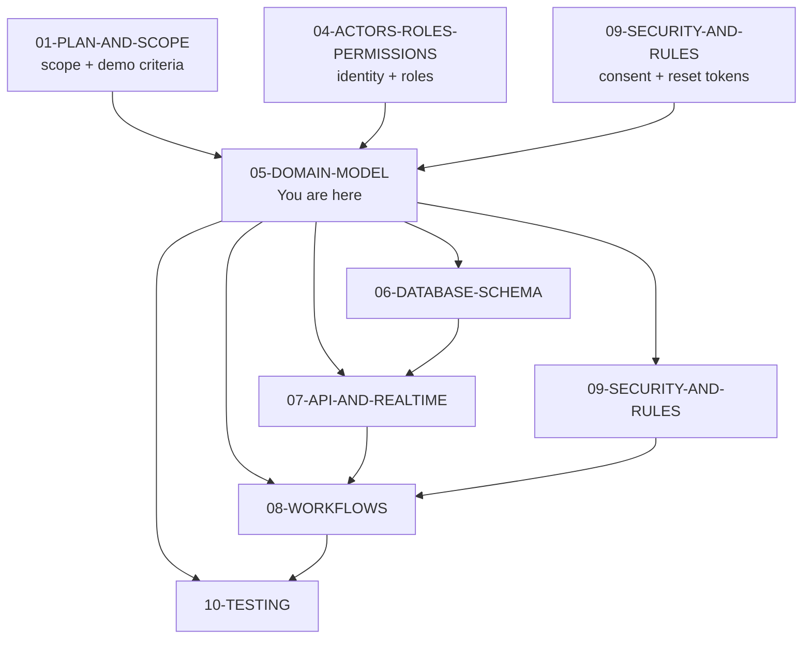

---

## 2. What a Domain Model Is and Is Not

### 2.1 The distinction

| Domain model IS | Domain model IS NOT |
|---|---|
| A vocabulary of entities and their relationships | A database schema (no column types, no indexes) |
| A set of business invariants per aggregate | An API contract (no endpoints, no payloads) |
| A bounded-context map | A UI spec (no screens, no components) |
| A lifecycle definition for stateful entities | A test plan (no assertions beyond invariant names) |
| A phase attribution | A deployment plan |
| A catalog of domain events | A message-broker config |

### 2.2 The test for "does this belong here?"

If a statement cannot be expressed as **"entity A has a relationship R to entity B with cardinality C"** or **"aggregate X must always satisfy invariant Y"**, it does not belong in this document.

| Statement | Belongs here? | Where it goes |
|---|---|---|
| "A Booking has exactly one Ticket" | ✅ | §7 Invariant |
| "Booking.id is a UUID primary key" | ❌ | `06-DATABASE-SCHEMA.md` |
| "POST /bookings returns 201 with booking_id" | ❌ | `07-API-AND-REALTIME-CONTRACTS.md` |
| "A Booking can transition from Confirmed to Cancelled" | ✅ | §8 State machine |
| "A Booking emits BookingConfirmed event" | ✅ | §10 Domain events |
| "The seat deck renders a 40-seat grid" | ❌ | `busverse/02-SEAT-MATRIX-UI.md` |

---

## 3. Six Bounded Contexts

Entities are grouped into six bounded contexts. Contexts determine which tables group in `06-DATABASE-SCHEMA.md`, which API namespaces exist in `07-API-AND-REALTIME-CONTRACTS.md`, and which internal service boundaries exist if the system ever splits.

### 3.1 The six contexts

**Diagram: Bounded contexts**
*Six contexts grouping the 31 Phase 1 entities. Arrows show the direction of dependency: Identity and Network are roots; Booking depends on both; Payments and Trip depend on Booking; Audit observes all.*

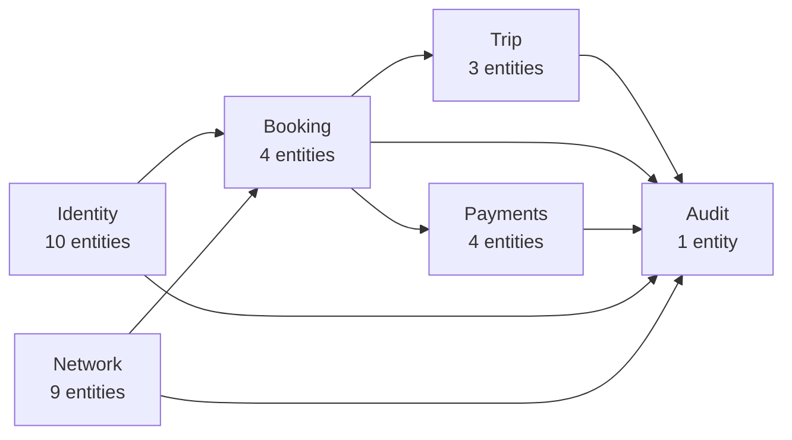

### 3.2 Context responsibility

| Context | Responsibility | Example entities |
|---|---|---|
| **Identity** | Who a person is, how they authenticate, how their session works, what they consent to | User, Session, DriverProfile, ConsentRecord, PasswordResetToken |
| **Network** | What buses exist, where they go, when they run, who operates them | Operator, Bus, Route, Schedule |
| **Booking** | Seat reservation, purchase, ticket issuance | SeatLock, Booking, Ticket |
| **Payments** | Money in, money back, tax invoicing | Payment, Refund, GSTInvoice |
| **Trip** | One actual run of a schedule, with GPS and boarding scans | Trip, GPSSample, BoardingScan |
| **Audit** | Append-only log of every state-changing action | AuditLog |

### 3.3 Context dependency + call type

This table states **which context calls which** and **whether the call is synchronous or asynchronous**. The distinction matters for `07-API-AND-REALTIME-CONTRACTS.md` (endpoint timing) and `08-WORKFLOWS.md` (flow sequencing).

| From | To | Type | Why |
|---|---|---|---|
| Booking | Identity | **Sync** | Verify user exists before creating booking |
| Booking | Network | **Sync** | Read schedule + seat availability |
| Booking | Payments | **Async** (event) | `BookingCreated` triggers payment initiation |
| Booking | Trip | **Async** (event) | `BookingConfirmed` updates manifest |
| Payments | Booking | **Async** (webhook event) | `PaymentSucceeded` confirms booking |
| Trip | Booking | **Async** (read) | Trip reads manifest from Booking's read model |
| Trip | Network | **Sync** (start) | Verify schedule still valid before starting trip |
| Trip | Audit | **Async** (append) | Audit rows written after commit |
| All | Audit | **Async** (append) | Never blocks the main flow |

**Rule:** No synchronous call crosses more than one context boundary. Booking → Identity is allowed. Booking → Payments → Gateway is not — payment is triggered by event.

### 3.4 Context dependency map with call types

**Diagram: Context dependency and call types**
*Extends the bounded-context diagram with call types. Solid arrows = synchronous calls (must succeed before response). Dashed arrows = asynchronous (events, webhooks, audit logs). Sync calls are always one-hop; async flows can cross multiple hops via events.*

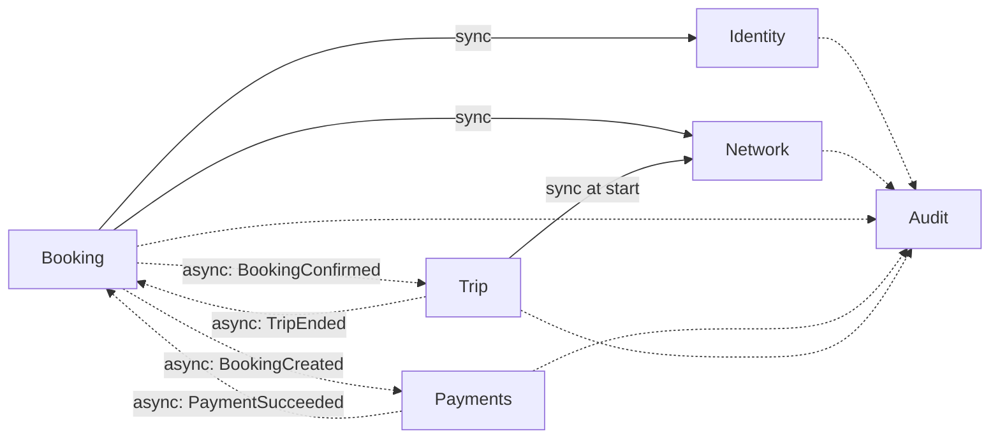

---

## 4. Entity Inventory, Attributes, and Value Objects

Phase 1 has exactly **31 entities**.

### 4.1 Count by context

**Diagram: Entity count by context**
*The 31 Phase 1 entities split across six contexts. Identity dominates because it holds the structural identity data plus the two compliance tables (consent, password reset). Network holds the bus/route/schedule graph. Booking, Payments, Trip, and Audit hold the transactional data.*

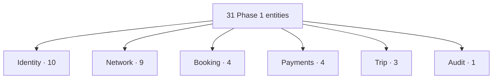

### 4.2 Full inventory

| # | Entity | Context | Root? | Purpose |
|:---:|---|---|:---:|---|
| 1 | **User** | Identity | ✅ | Identity anchor: phone, email, email_verified |
| 2 | PassengerProfile | Identity | ✗ | Passenger-specific fields, preferences |
| 3 | OperatorUser | Identity | ✗ | Operator membership + role (Owner / Manager) + password_hash |
| 4 | DriverProfile | Identity | ✗ | Driver KYC, license, assigned operator |
| 5 | AdminUser | Identity | ✗ | Admin role + password_hash |
| 6 | **Session** | Identity | ✅ | Authenticated state per device |
| 7 | OTPChallenge | Identity | ✗ | OTP codes and attempts |
| 8 | RefreshTokenChain | Identity | ✗ | Rotation history per session |
| 9 | **ConsentRecord** | Identity | ✗ | DPDP consent per purpose with policy version |
| 10 | **PasswordResetToken** | Identity | ✗ | One-time hashed reset tokens |
| 11 | **City** | Network | ✅ | Geographic city (Delhi, Kanpur, Lucknow) |
| 12 | Stand | Network | ✗ | Physical boarding point |
| 13 | **Operator** | Network | ✅ | Company |
| 14 | Bus | Network | ✗ | Vehicle |
| 15 | SeatLayout | Network | ✗ | Seating grid for a bus |
| 16 | Seat | Network | ✗ | Individual seat within a layout |
| 17 | Route | Network | ✗ | Ordered city path |
| 18 | RouteStand | Network | ✗ | Ordered stop on a route |
| 19 | Schedule | Network | ✗ | Bus + route + departure + fare (owned by Operator) |
| 20 | **SeatLock** | Booking | ✅ | Temporary seat reservation |
| 21 | **Booking** | Booking | ✅ | Confirmed purchase |
| 22 | BookingPassenger | Booking | ✗ | One passenger per seat |
| 23 | Ticket | Booking | ✗ | Signed QR payload |
| 24 | **Payment** | Payments | ✅ | One payment attempt (idempotent) |
| 25 | Refund | Payments | ✗ | Refund on a payment |
| 26 | GSTInvoice | Payments | ✗ | Tax invoice per booking |
| 27 | GatewayWebhook | Payments | ✗ | Raw webhook log |
| 28 | **Trip** | Trip | ✅ | One actual run of a schedule |
| 29 | GPSSample | Trip | ✗ | Position sample |
| 30 | BoardingScan | Trip | ✗ | One QR scan event |
| 31 | **AuditLog** | Audit | ✅ | Append-only event log |

**Aggregate roots:** 9 entities marked ✅.

**New in v1.1:** ConsentRecord (#9) and PasswordResetToken (#10). Both are children of User root. Neither requires a new aggregate root.

### 4.3 Key attributes per entity

Full column types, constraints, and indexes live in `06-DATABASE-SCHEMA.md`. This table lists the **key attributes** every entity must hold — the minimum that makes it a valid domain entity. Primary keys are `id` (UUIDv4); foreign keys follow `{parent_entity}_id`.

#### Identity (10 entities)

| Entity | Key attributes |
|---|---|
| **User** | `id` (PK), `phone` (unique), `phone_hash` (unique), `email` (unique, nullable), `email_verified` (bool), `name`, `is_test`, `created_at`, `deleted_at` |
| PassengerProfile | `id` (PK), `user_id` (FK, unique), `name`, `dob`, `gender`, `preferences_json` |
| OperatorUser | `id` (PK), `user_id` (FK), `operator_id` (FK), `role` (enum: `OWNER` / `MANAGER`), `password_hash`, `invited_by`, `invited_at`, `accepted_at` |
| DriverProfile | `id` (PK), `user_id` (FK, unique), `operator_id` (FK), `license_number` (unique), `kyc_status` (enum), `on_duty` (bool), `verified_at` |
| AdminUser | `id` (PK), `user_id` (FK, unique), `role` (enum: `SUPER_ADMIN`), `password_hash`, `created_at` |
| **Session** | `id` (PK), `user_id` (FK), `role` (enum: actor-role), `device_fingerprint_hash`, `refresh_hash`, `status` (enum), `created_at`, `revoked_at`, `expires_at` |
| OTPChallenge | `id` (PK), `user_id` (FK, nullable for pre-signup), `phone_or_email`, `otp_hash`, `otp_salt`, `attempts`, `expires_at`, `consumed_at` |
| RefreshTokenChain | `id` (PK), `session_id` (FK, unique), `used_hashes` (array), `created_at` |
| **ConsentRecord** | `id` (PK), `user_id` (FK), `purpose` (enum: `terms_of_service` / `privacy_policy` / `marketing` / `analytics`), `policy_version` (string), `granted_at`, `revoked_at` (nullable), `ip_address` |
| **PasswordResetToken** | `id` (PK), `user_id` (FK), `token_hash` (unique), `expires_at`, `used_at` (nullable), `ip_address` |

#### Network (9 entities)

| Entity | Key attributes |
|---|---|
| **City** | `id` (PK), `name`, `state`, `is_active` |
| Stand | `id` (PK), `city_id` (FK), `name`, `lat`, `lng`, `type` (enum: `BUS_STAND`, `BUS_STOP`, `AIRPORT`, `TRAIN_STATION`) |
| **Operator** | `id` (PK), `company_name`, `gstin` (unique), `pan`, `bank_account_ref`, `status` (enum), `is_test` (bool) |
| Bus | `id` (PK), `operator_id` (FK), `registration_number` (unique), `model`, `capacity`, `approval_status` (enum), `insurance_expires_at` |
| SeatLayout | `id` (PK), `bus_id` (FK, unique), `rows_count`, `columns_count`, `aisle_map_json` |
| Seat | `id` (PK), `layout_id` (FK), `seat_label` (unique within layout), `seat_row`, `seat_column`, `seat_type` (enum: `SEATER` / `SLEEPER` / `SEMI_SLEEPER`), `is_female_only` (bool) |
| Route | `id` (PK), `operator_id` (FK), `origin_city_id` (FK), `destination_city_id` (FK), `approval_status` (enum) |
| RouteStand | `id` (PK), `route_id` (FK), `stand_id` (FK), `sequence` (unique within route), `distance_from_prev_km`, `duration_from_prev_min` |
| Schedule | `id` (PK), `operator_id` (FK), `bus_id` (FK), `route_id` (FK), `departure_time`, `arrival_time`, `fare_amount_paise`, `fare_currency`, `status` (enum) |

#### Booking (4 entities)

| Entity | Key attributes |
|---|---|
| **SeatLock** | `id` (PK), `schedule_id` (FK), `seat_id` (FK), `user_id` (FK), `acquired_at`, `expires_at` |
| **Booking** | `id` (PK), `booking_reference` (unique), `user_id` (FK), `schedule_id` (FK), `boarding_stand_id` (FK), `dropping_stand_id` (FK), `total_fare_amount`, `total_fare_currency`, `status` (enum), `confirmed_at`, `cancelled_at` |
| BookingPassenger | `id` (PK), `booking_id` (FK), `seat_id` (FK), `schedule_id` (FK, denormalized), `name`, `age`, `gender`, `id_number` (nullable, encrypted) |
| Ticket | `id` (PK), `booking_id` (FK, unique), `qr_payload`, `qr_signature`, `status` (enum), `issued_at`, `scanned_at` |

#### Payments (4 entities)

| Entity | Key attributes |
|---|---|
| **Payment** | `id` (PK), `booking_id` (FK), `idempotency_key` (unique per 24h), `gateway` (enum: `RAZORPAY`), `method` (enum: `UPI` / `CARD` / `NETBANKING` / `WALLET` / `EMI`), `amount_paise`, `currency`, `status` (enum), `gateway_order_id`, `gateway_payment_id` |
| Refund | `id` (PK), `payment_id` (FK), `reason` (enum), `refund_tier` (enum), `amount_paise`, `status` (enum), `gateway_refund_id`, `initiated_at`, `processed_at` |
| GSTInvoice | `id` (PK), `booking_id` (FK, unique), `invoice_number` (unique, format `INV/YYYY-YY/NNNN`), `gstin`, `taxable_value_paise`, `gst_amount_paise`, `issued_at` |
| GatewayWebhook | `id` (PK), `payment_id` (FK), `event_type`, `payload_hash`, `payload_json`, `signature`, `received_at` |

#### Trip (3 entities)

| Entity | Key attributes |
|---|---|
| **Trip** | `id` (PK), `schedule_id` (FK), `bus_id` (FK), `driver_id` (FK), `status` (enum), `started_at`, `ended_at`, `delay_reason` (nullable), `delay_minutes` (nullable) |
| GPSSample | `id` (PK), `trip_id` (FK), `lat`, `lng`, `speed_kmh`, `recorded_at` |
| BoardingScan | `id` (PK), `trip_id` (FK), `ticket_id` (FK), `driver_id` (FK), `stand_id` (FK), `result` (enum), `scanned_at`, `scanned_lat`, `scanned_lng` |

#### Audit (1 entity)

| Entity | Key attributes |
|---|---|
| **AuditLog** | `id` (PK), `actor_id` (FK, nullable for system), `session_id` (FK, nullable), `entity_type`, `entity_id`, `action` (enum, see `04` §10.3), `reason` (nullable), `ip_address`, `metadata_json`, `occurred_at` |

### 4.4 Value objects

Value objects are defined by their values, not identity. They are shared across multiple entities and always behave identically.

| Value object | Where used | Fields | Notes |
|---|---|---|---|
| **PhoneNumber** | User, OTPChallenge, DriverProfile | `value` (E.164 string, e.g. `+919876543210`) | Stored as single column. Companion `phone_hash` (deterministic SHA-256) enables search without decrypting. |
| **Email** | User, OperatorUser | `value` (string, lowercased), `verified` (bool) | Stored as `email` + `email_verified` on `users`. Lowercased on insert. |
| **Money** | Payment, Refund, Booking, Schedule, GSTInvoice | `amount_paise` (bigint), `currency` (string, `INR`) | Stored as integers, never floats. |
| **GSTIN** | Operator, GSTInvoice | `value` (15-char string), `state_code` (2-digit derived) | Regex-validated. |
| **Coordinates** | Stand, GPSSample, BoardingScan | `lat` (decimal 9,6), `lng` (decimal 9,6) | WGS84. |
| **SeatLabel** | Seat, BookingPassenger | `seat_row` (string), `seat_column` (int), `seat_label` (string, e.g. `A1`) | Unique within a layout. |
| **BookingReference** | Booking | `value` (string, format `BKG-YYYY-NNNNN`) | Unique globally. |
| **QRPayload** | Ticket | `qr_payload` (text, base64), `qr_signature` (varchar, base64) | Immutable after issuance. |
| **FareBreakdown** | Booking, GSTInvoice | `base_fare_paise`, `tax_paise`, `convenience_fee_paise`, `total_paise` | All Money. Stored as `fare_breakdown_json`. |
| **TimeRange** | Schedule, Trip | `start`, `end` | Both UTC timestamps. |
| **IdempotencyKey** | Payment, Refund | `value` (string, UUIDv4 or client-supplied) | Unique per 24h window. |

**Rule:** Value objects have no `id` column. They are either inline columns (PhoneNumber as single E.164 `phone`) or embedded JSON (FareBreakdown as `jsonb`). `06-DATABASE-SCHEMA.md` decides which form per value object, but the field list is fixed here.

**Note on PhoneNumber shape (v1.1):** In v1.0 this document described PhoneNumber as a three-field composite (`country_code`, `number`, `verified`). The schema in `06` uses a single E.164 `phone` column plus a companion `phone_hash` for search; the `verified` flag lives on `Email` as `email_verified` (used for operator login gate), not on PhoneNumber. Phone verification is transient — captured by `otp_challenges.consumed_at` — not a persistent flag. The value object shape is now aligned with `06`.

---

## 5. Aggregate Roots

An aggregate root is a transactional boundary — a cluster of entities that must be consistent together. Every non-root entity is owned by exactly one root.

### 5.1 The nine roots

**Diagram: Nine aggregate roots**
*The nine aggregate roots in Phase 1. Each root is a transactional boundary; every child entity belongs to exactly one root. Roots are independent of each other and are only connected by foreign keys, not by shared transactions. `ConsentRecord` and `PasswordResetToken` are children of the `User` root — they do not require new roots.*

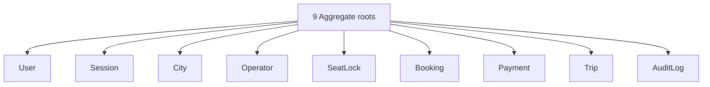

### 5.2 Roots with children

**Diagram: Aggregate ownership tree**
*Shows which entities own which. `Operator` is the largest aggregate — it owns buses, seat layouts, seats, routes, route stands, and schedules. `User` owns all four profile tables, OTP challenges, refresh token chains, and the two new compliance tables (consent, password reset). `Session` owns refresh token chains via one-to-one. `Booking` owns passengers and tickets. `Payment` owns refunds, invoices, and webhook logs. `Trip` owns GPS samples and boarding scans.*

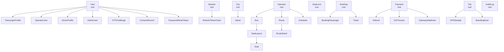

### 5.3 Why each root is a root

| Root | Why it's a root |
|---|---|
| **User** | Transactional boundary for identity. Booking, Session, and profiles all reference it. A User is created once and modified rarely. `ConsentRecord` and `PasswordResetToken` live under User because their lifecycles are strictly scoped to the owning user — deleting a user soft-deletes consent records and hard-deletes reset tokens. |
| **Session** | Login/logout is its own transaction. Session lifecycle is independent of User lifecycle — a user can have many sessions over years. |
| **City** | Admin-managed and rarely changed. Independent of any operator. Stands belong to cities. |
| **Operator** | Transactional boundary for the operator's fleet. Creating a bus, route, or schedule happens within the operator's scope. Suspending an operator cascades to all their assets. |
| **SeatLock** | Must be its own root because locks expire independently of bookings. Holding a Booking transaction open while a payment gateway processes for 5 minutes is unacceptable. |
| **Booking** | The atomic purchase. Its own root because confirmed bookings are immutable; changes require a new booking. |
| **Payment** | Each payment is its own transaction with idempotency. A booking can have multiple payment attempts; each is a separate aggregate. |
| **Trip** | A run of a schedule. Its own root because trips start and end independently of bookings — one cancelled booking does not affect the trip. |
| **AuditLog** | Append-only. Never modified, never deleted, never part of another aggregate's transaction. |

### 5.4 Why `Schedule` is owned by `Operator`

`Schedule` references a `Bus` (owned by `Operator`) and a `Route` (owned by `Operator`). It is created, modified, and deleted only by operator users. Admin has a special approval permission but does not own it. Putting `Schedule` under `Operator` keeps the aggregate consistent: if an operator is suspended, all its schedules are suspended together in one transaction.

### 5.5 The consistency rule

> **An aggregate is modified in one transaction. Cross-aggregate consistency is eventual via events.**

| Aggregate | Modified in | Modified by |
|---|---|---|
| User | One transaction | Identity service |
| Session | One transaction | Auth service |
| City | One transaction | Admin |
| Operator | One transaction | Operator service |
| SeatLock | One transaction | Booking service (lock endpoint) |
| Booking | One transaction | Booking service (book endpoint) |
| Payment | One transaction | Payment service |
| Trip | One transaction | Trip service |
| AuditLog | Append-only (never modified) | All services |

**Implication:** Creating a booking requires deleting a `SeatLock` (its own aggregate) AND inserting a `Booking` (a different aggregate) in the same logical operation. This is achieved via a **two-phase pattern**: `SeatLock` is deleted inside the booking transaction, but the transaction only succeeds if the lock row is still valid. The unique constraint on `(schedule_id, seat_id)` in `BookingPassenger` provides the second line of defense.

**New in v1.1 — consent and reset token transactions:**

- **Consent grant**: One transaction — `INSERT consent_records` (or `UPDATE` the existing active row's `revoked_at` and `INSERT` a new row) + `INSERT audit_logs`.
- **Password reset consumption**: One transaction — `UPDATE password_reset_tokens SET used_at` + `UPDATE operator_users SET password_hash` (or admin_users) + `UPDATE sessions SET status = REVOKED` + `INSERT audit_logs`.

Both are single-aggregate transactions (User root) and require no cross-aggregate coordination.

**New in v1.2 — payment confirmation transaction:**

When the Razorpay webhook fires `payment.captured`, **one transaction** does all of the following:

- `UPDATE payments SET status='SUCCEEDED'`
- `UPDATE bookings SET status='CONFIRMED'`
- `INSERT tickets` (Ed25519-signed QR)
- `INSERT gst_invoices` (with sequential invoice_number)
- `INSERT gateway_webhooks` (raw payload + payload_hash)
- `DELETE seat_locks` (release the seat permanently)
- `INSERT audit_logs`

**The `tickets (INSERT)` is what upgrades the PENDING booking to CONFIRMED.** A PENDING booking has no ticket (see §7.1 invariant #1). This is why booking creation cannot insert a ticket and webhook processing cannot merely UPDATE it — the transaction sequencing is: `INSERT booking (PENDING)` → `INSERT payment` → `webhook INSERT ticket` → `UPDATE booking (CONFIRMED)` all within the webhook transaction.

---

## 6. Per-Context Entity Detail

Each context has its own entity diagram with cardinality labels, followed by rules specific to that context.

### 6.1 Identity context (10 entities)

**Purpose:** Every person in BusVerse + BusCon is one `User`. Profile tables extend the base identity with role-specific fields, allowing a single person to be a Passenger, Driver, Operator User, and Admin without duplicating their identity. Sessions are separate aggregate roots attached to a user — they are the mechanism by which a User becomes an actor with a role. `ConsentRecord` captures DPDP consent per purpose; `PasswordResetToken` holds hashed one-time reset tokens.

**Diagram: Identity context entities**
*Ten entities in the Identity context. `User` is the anchor. Four profile tables (Passenger, Operator, Driver, Admin) extend it. `Session` is a separate root attached to User; `RefreshTokenChain` belongs to Session. `OTPChallenge` is a pre-session record. `ConsentRecord` and `PasswordResetToken` extend User with 1:N relationships. Cardinality labels show `1:0..1` for profiles and `1:0..*` for sessions, OTP challenges, consents, and reset tokens.*

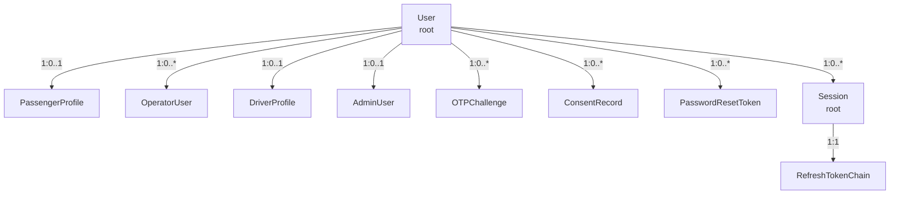

**Rules specific to this context:**

- A `User` must have at least one profile row (Passenger, OperatorUser, Driver, or Admin) before any session can be created. A user with no profiles is an orphan identity and rejected at signup completion.
- A `User` can have multiple profile rows (e.g., a person who is both a Passenger and a Driver). Each profile enables a distinct role in a distinct session.
- A `User` may also be an `OperatorUser` in one operator and a `DriverProfile` under a different operator — the two memberships are independent and never merge into a single session.
- Deleting a `User` soft-deletes all profiles and consent records, hard-deletes reset tokens; hard delete of the User row only after 8 years per §16 retention.
- `OperatorUser` rows are scoped to a specific `operator_id`. A person can belong to two operators only if they explicitly accept two separate invitations.
- `ConsentRecord` — one active consent per `(user, purpose)`. Revoking a consent sets `revoked_at` and does not delete the row (DPDP audit requirement).
- `PasswordResetToken` — stored hashed (SHA-256). Consuming a token sets `used_at`; a second consumption attempt fails. Multiple active tokens per user allowed.

### 6.2 Network context (9 entities)

**Purpose:** Geographic structure (cities + stands), operator-owned assets (buses + routes + schedules), and the seat grid within each bus.

**Diagram: Network context entities**
*Nine entities in the Network context. `City` and `Operator` are separate roots. `City` owns `Stand`. `Operator` owns `Bus`, `Route`, and `Schedule`. `Bus` owns `SeatLayout` which owns `Seat`. `Route` owns `RouteStand`. `Schedule` references `Bus` and `Route` (both within the same aggregate).*

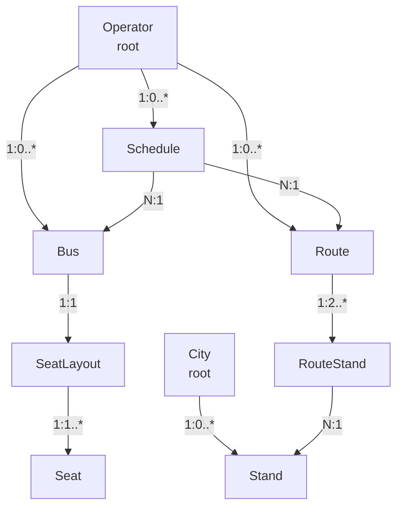

**Rules specific to this context:**

- A `City` cannot be deleted if any `Stand` or `Route` references it (BLK cascade).
- A `Stand` is shared across multiple routes. It is not route-specific.
- A `Bus` cannot be deleted if any `Schedule` references it (BLK). Must be deactivated instead.
- A `SeatLayout` must have exactly one `Seat` row per physical seat. `Bus.capacity` must equal `count(Seat)`.
- A `Schedule` cannot be deleted if any `Booking` exists on it (BLK). Must be cancelled instead.
- A `Route` must have at least 2 `RouteStand` rows (source and destination).

### 6.2.1 SeatLayout creation flow

**Decision:** Operators build their seat layout using a **grid builder** inside BusCon. They do not upload a photo. The layout is created in one screen, saved with the bus, and approved by admin before the bus goes live.

**Diagram: SeatLayout creation flow**
*Shows the operator-side workflow for creating a bus seat layout. The operator registers a bus, opens the grid builder, configures rows and columns, marks which cells are seats and which are aisles, sets each seat's type, saves, and submits for admin approval. Admin either approves (bus goes live) or rejects (operator edits and resubmits).*

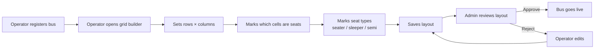

**Why grid builder, not photo upload:**

| Reason | Detail |
|---|---|
| **Self-service** | Operator adds a bus without waiting for admin to build the layout |
| **No storage dependency** | No file upload endpoint, no S3/R2 bucket, no image processing pipeline |
| **Simpler to build** | One screen, ~50 lines of React |
| **Demo-ready** | Layout is visible immediately in BusVerse seat deck |
| **No admin bottleneck** | In Phase 1, admin is the founder. Building layouts for every operator is unscalable |

**Validation rules:**

| Rule | Reason |
|---|---|
| Layout must have exactly `Bus.capacity` seats | A 40-seat bus must have exactly 40 seats |
| Seat labels must be unique within a layout | No two seat `A1` |
| At least 1 seat must exist | No empty layouts |
| Aisle cells must be marked (not left blank) | Renders correctly |

### 6.3 Booking context (4 entities)

**Purpose:** The atomic unit of purchase. A lock is temporary; a booking is permanent; a ticket is issued once.

**Diagram: Booking context entities**
*Four entities in the Booking context. `SeatLock` and `Booking` are both roots — a lock converts into a booking, but they are transactionally separate. `Booking` owns `BookingPassenger` (one per seat) and exactly one `Ticket`.*

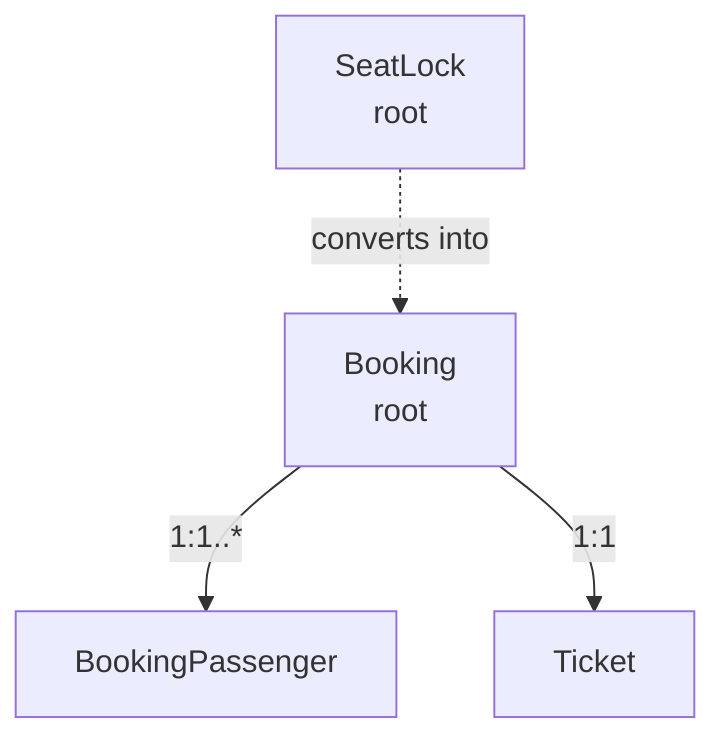

**Rules specific to this context:**

- A `SeatLock` has a 5-minute TTL for lock-acquire operations, extended to 15 minutes when a booking is created (holds seat during payment window). It is deleted (hard) on expiry or on payment success.
- A `Booking` cannot be deleted after confirmation. Cancellation sets `status = CANCELLED` and preserves the row.
- A `Booking` has exactly one `Ticket` **when CONFIRMED**. A PENDING booking has no ticket yet — the ticket is inserted in the webhook transaction. A booking without a ticket in CONFIRMED state is invalid; a booking with a ticket in PENDING state is impossible (see §7.1 invariant #1).
- A `Booking` cannot be modified after confirmation. Changing anything requires cancelling and re-booking.
- `BookingPassenger.seat_id` references a `Seat` in the same `Schedule`'s `Bus`'s `SeatLayout`. Cross-schedule seats are impossible by FK chain.

### 6.4 Payments context (4 entities)

**Purpose:** Money. Every payment is a separate transaction with its own idempotency guarantee.

**Diagram: Payments context entities**
*Four entities in the Payments context. `Payment` is the root. `Refund`, `GSTInvoice`, and `GatewayWebhook` all belong to a Payment. `GatewayWebhook` is append-only; it captures the raw webhook body for audit.*

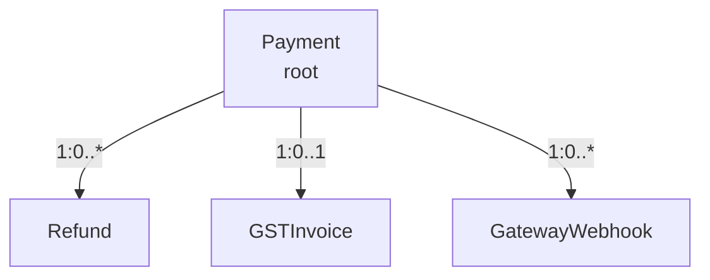

**Rules specific to this context:**

- A `Payment` cannot be deleted. Its status transitions capture history.
- A `Payment` with `status = SUCCEEDED` is immutable except for `status = REFUNDED`.
- `Payment.idempotency_key` must be unique per 24h window.
- A `Refund` cannot exceed the parent `Payment.amount`.
- A `Refund` can only be created for a `Payment` in `SUCCEEDED` state.
- A `GSTInvoice.invoice_number` is unique globally and immutable after issuance. Format: `INV/YYYY-YY/NNNN` (sequential per financial year).
- A `GatewayWebhook` row is never updated. Duplicate webhooks create new rows; the payment status is idempotently advanced.
- **A `GSTInvoice` is created in the same transaction as `PaymentSucceeded` (webhook). No invoice exists for PENDING/EXPIRED/FAILED bookings.** The invoice captures the tax breakdown at the moment of confirmation; if the booking is later cancelled and refunded, the invoice remains (marked with a refund reference in audit_logs), not deleted.

### 6.5 Trip context (3 entities)

**Purpose:** One actual run of a schedule. Trips carry driver, bus, GPS, and scans.

**Diagram: Trip context entities**
*Three entities in the Trip context. `Trip` is the root. `GPSSample` and `BoardingScan` both belong to a Trip. GPS samples persist every 30 seconds to Postgres; Redis holds the 5-second live stream separately.*

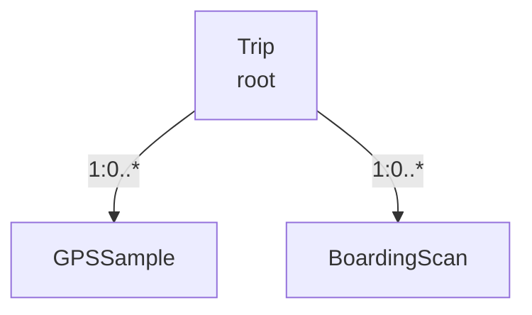

**Rules specific to this context:**

- A `Trip` is created when the driver starts. It references a `Schedule`, a `Bus`, and a `DriverProfile`.
- A `Trip` cannot start if the driver is blocked or inactive, or if the bus is not approved.
- A `Trip` cannot be deleted if any `BoardingScan` references it (BLK). Can be cancelled.
- `GPSSample` rows are hard-deleted after 90 days.
- `BoardingScan` rows are retained forever (audit).
- At most one active `Trip` per `DriverProfile` at any time.

### 6.5.1 GPS sampling decision

**Decision:** GPS is streamed every **5 seconds** from the driver phone. It is stored in **Redis** every 5 seconds for live passenger tracking and persisted to **PostgreSQL** every **30 seconds** for historical accuracy.

| Storage | Interval | Retention | Purpose |
|---|---|---|---|
| Redis `gps:trip:{id}` | 5 s | 6 hours | Live passenger view, ETA recompute |
| Postgres `GPSSample` | 30 s | 90 days | Historical accuracy, dispute resolution, on-time metrics |

**Why two-tier:**

- **Passenger experience** needs 5-second updates to feel live. The map would jerk if it updated every 30 seconds.
- **Database size** would explode if every 5-second sample were persisted. A 6-hour trip at 5 s = 4,320 rows per trip. At 30 s = 720 rows. Across hundreds of trips, this matters.
- **Historical accuracy** for disputes (e.g., "was the bus at stand X at 14:32?") only needs 30-second resolution.
- **Redis is bounded.** Old samples fall off with TTL. Postgres keeps the historical record.

### 6.6 Audit context (1 entity)

**Purpose:** Append-only record of every state-changing action. This is the only context where "no" is the answer to every write operation except append.

**Diagram: Audit context entity**
*A single append-only root. No children. Every other context writes to it asynchronously after committing its own transaction.*

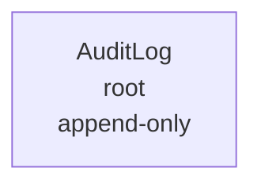

**Rules specific to this context:**

- `AuditLog` rows are never updated, never deleted. Enforced by database permissions, not application code.
- Every state-changing operation in any context writes one `AuditLog` row asynchronously (after commit, never blocking the main flow).
- `AuditLog.actor_id` and `session_id` may be `null` for system-triggered actions (cron jobs, webhook handlers).

---

## 7. Domain Invariants

Not every invariant goes here — only ones that live at the **domain level**, not at the API or DB level.

### 7.1 The twenty-one domain invariants

| # | Aggregate | Invariant | Enforced by |
|:---:|---|---|---|
| 1 | Booking | Every CONFIRMED booking has exactly one Ticket. PENDING/EXPIRED/FAILED bookings have no ticket | Transactional insert at webhook; DB unique on `booking_id`. Webhook transaction INSERTs ticket and UPDATEs booking to CONFIRMED in one atomic unit |
| 2 | Booking | A booking's passenger count matches its seat count | Aggregate insert transaction |
| 3 | Booking | A booking is either fully confirmed or not created | Payment status check before insert |
| 4 | Booking | A confirmed booking cannot be modified | Application-level guard |
| 5 | Booking | A booking's passengers must all be seated on the trip's schedule | FK chain + cross-check |
| 6 | SeatLock | A lock is either active or gone — never orphan | TTL expiry hard-deletes row |
| 7 | SeatLock | No two active locks on same `(schedule_id, seat_id)` | DB unique constraint |
| 8 | SeatLock | A seat cannot be simultaneously locked AND booked | Service-layer pre-check (§`09` §8.2) — queries `booking_passengers` before acquiring lock |
| 9 | Payment | A payment succeeds exactly once | Idempotency key + DB unique |
| 10 | Payment | A payment cannot be created for a booking that already has a successful payment | Application-level guard |
| 11 | Refund | A refund cannot exceed the parent payment amount | Application-level guard |
| 12 | Refund | A refund can only be issued for a cancelled booking | FK + state check |
| 13 | Trip | A trip has exactly one driver | FK with cardinality 1 |
| 14 | Trip | A trip's bus matches its schedule's bus | FK chain; validated at start |
| 15 | Trip | A trip cannot start if its driver is blocked or inactive | State check at start |
| 16 | Trip | A trip cannot start if its bus is not approved | State check at start |
| 17 | Ticket | A ticket is signed once and never re-signed | Immutable after insert |
| 18 | Ticket | A ticket cannot be issued without a payment | FK chain — `INSERT tickets` is inside the webhook `payment.captured` transaction |
| 19 | User | A user has at least one profile | Application-level guard at signup completion |
| **20** | **ConsentRecord** | **A user has at most one active consent per purpose** | **DB unique on `(user_id, purpose) WHERE revoked_at IS NULL`** |
| **21** | **PasswordResetToken** | **A reset token is consumed at most once** | **Application check on `used_at IS NULL`** |

**Change in v1.2:** Invariant #1 reworded to scope to CONFIRMED bookings. Invariant #8 upgraded from "aspirational" to "enforced by service-layer pre-check". Invariant #18 clarified that webhook transaction is the enforcement point.

### 7.2 Invariant: Booking ↔ Ticket

**Diagram: Booking-ticket 1:1 invariant**
*The core invariant of the booking system. Every CONFIRMED booking has exactly one ticket. A PENDING booking has none yet. The transition from PENDING to CONFIRMED is atomic with ticket INSERT inside the webhook transaction.*

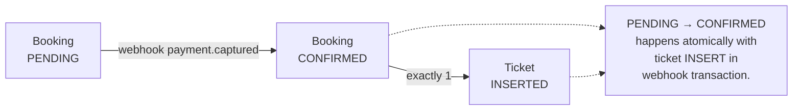

### 7.3 Invariant: SeatLock → Booking

**Diagram: SeatLock-to-booking invariant**
*A seat lock converts into a booking or expires — never both. Never leaves an intermediate state. The lock survives booking creation (PENDING state, extended TTL to 15 min) and is deleted at webhook time (payment success) or by payment timeout cron.*

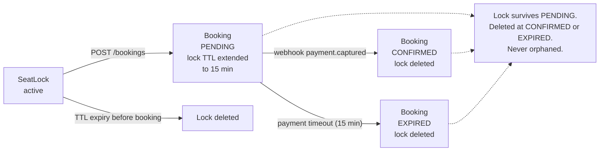

### 7.4 Invariant: One active consent per purpose

**Diagram: Consent-record uniqueness invariant**
*A user may have many consent rows over time (grant, revoke, re-grant with a new policy version), but at any moment at most one is active per purpose. The DB enforces this with a partial unique index on `(user_id, purpose) WHERE revoked_at IS NULL`. Revoking a consent sets `revoked_at` — the row is preserved for DPDP audit. A subsequent grant creates a new row.*

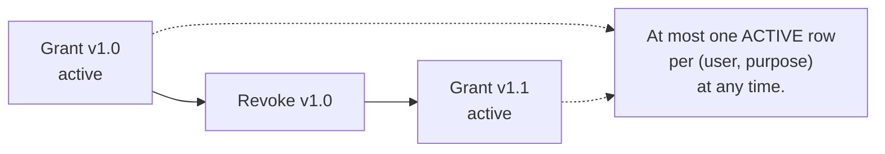

---

## 8. Entity Lifecycles

Not every entity has a lifecycle. Those that do are documented here with state machines and transition triggers.

### 8.1 Booking lifecycle

**Diagram: Booking state machine**
*The full lifecycle of a Booking. Starts as PENDING when a seat lock is converted to a booking. Transitions to CONFIRMED on payment success, EXPIRED on payment timeout (15 min), or FAILED on payment failure. From CONFIRMED it can go to CHECKED_IN (QR scanned), CANCELLED (passenger), or OPERATOR_CANCELLED (operator action). CHECKED_IN becomes COMPLETED when the trip ends. CANCELLED and OPERATOR_CANCELLED both flow into REFUNDED.*

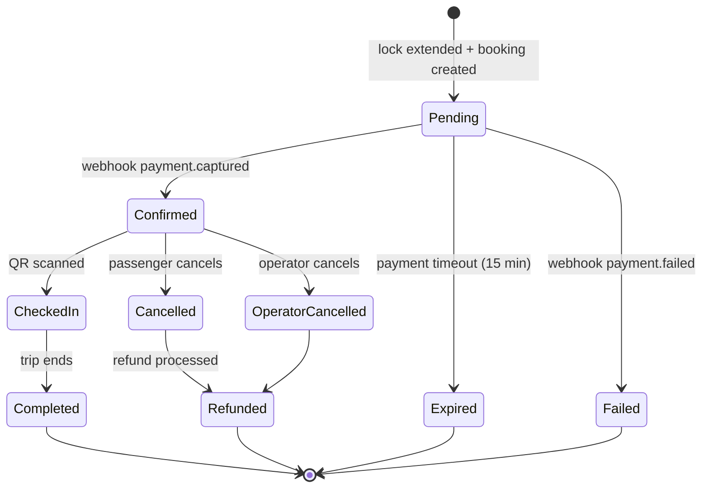

**Transition triggers:**

| From | To | Trigger | Actor |
|---|---|---|---|
| `PENDING` | `CONFIRMED` | `PaymentSucceeded` event (webhook) | System |
| `PENDING` | `EXPIRED` | **Payment timeout** (`expire_pending_bookings` cron, 15 min) | System |
| `PENDING` | `FAILED` | `PaymentFailed` event (webhook) | System |
| `CONFIRMED` | `CHECKED_IN` | `scanTicket` operation | Driver |
| `CONFIRMED` | `CANCELLED` | `cancelBooking` operation | Passenger |
| `CONFIRMED` | `OPERATOR_CANCELLED` | `cancelTrip` operation | Operator |
| `CHECKED_IN` | `COMPLETED` | `endTrip` operation | Driver |
| `CANCELLED` | `REFUNDED` | `RefundProcessed` event | System |
| `OPERATOR_CANCELLED` | `REFUNDED` | `RefundProcessed` event | System |

**Change in v1.2:** `PENDING → EXPIRED` trigger changed from `SeatLockExpired` event to payment timeout (15 min cron). Rationale: the lock TTL is extended at booking creation (per §6.3 rules), so lock expiry no longer coincides with booking timeout. The 15-minute payment window is the authoritative timeout, driven by the retention cron in `06` §15.

### 8.2 Payment lifecycle

**Diagram: Payment state machine**
*Lifecycle of a Payment. Starts INITIATED when the gateway order is created. PENDING when checkout is opened. Succeeds on the gateway's `payment.captured` webhook; fails on `payment.failed`; expires on payment timeout (15 min cron) or gateway timeout. A successful payment can become REFUNDED.*

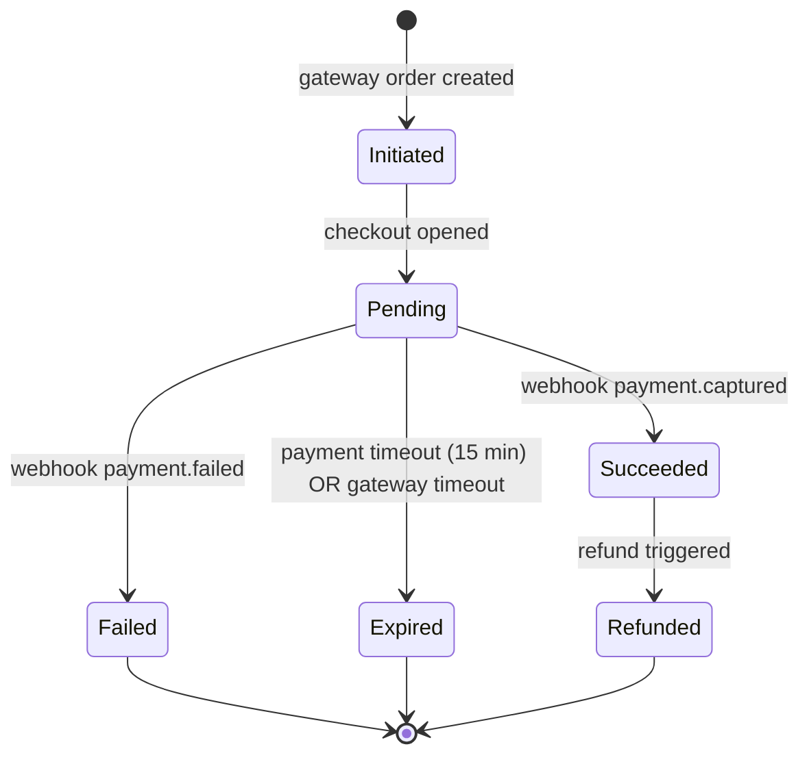

**Note:** A retry attempt after `FAILED` creates a new `Payment` row (same `booking_id`, new `idempotency_key`, new `Payment` aggregate). The old FAILED row is preserved for audit.

### 8.3 Trip lifecycle

**Diagram: Trip state machine**
*Lifecycle of a Trip. Created as SCHEDULED. Moves to IN_PROGRESS when the driver starts. Ends as COMPLETED when the driver ends, or CANCELLED if the operator cancels (before or during).*

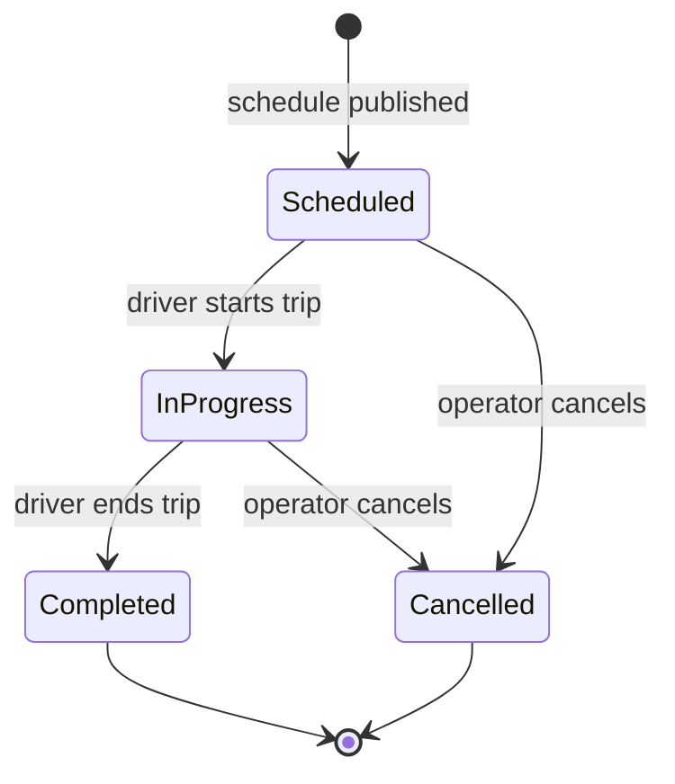

### 8.4 Operator lifecycle

**Diagram: Operator state machine**
*Lifecycle of an Operator. Starts APPLIED on signup. Moves through PENDING_REVIEW, APPROVED/REJECTED, then ACTIVE (once the first bus is listed). Can be SUSPENDED for policy violations, then reinstated, then DEACTIVATED.*

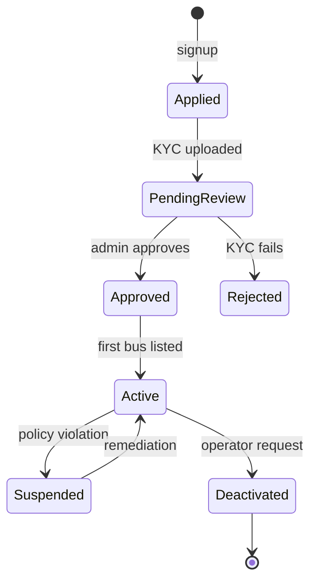

### 8.5 Driver lifecycle

**Diagram: Driver state machine**
*Lifecycle of a DriverProfile. Starts INVITED (operator invites). SIGNED_UP after OTP verification. KYC_PENDING then VERIFIED or KYC_FAILED. ACTIVE once assigned to a trip. Can be BLOCKED (license expired) or DEACTIVATED (removed).*

```mermaid
stateDiagram-v2
    [*] --> Invited: operator invites
    Invited --> SignedUp: OTP verified
    SignedUp --> KYCPending: docs uploaded
    KYCPending --> Verified: admin approves
    KYCPending --> KYCFailed: admin rejects
    Verified --> Active: first assignment
    Active --> Blocked: license expired
    Blocked --> Active: license renewed
    Active --> Deactivated: operator removes
    KYCFailed --> [*]
    Deactivated --> [*]
```

### 8.6 Ticket lifecycle

**Diagram: Ticket state machine**
*Lifecycle of a Ticket. INSERTED (ISSUED) on webhook payment.captured. ACTIVE while displayed in My Trips. SCANNED once the driver scans. USED after boarding records. CANCELLED if the booking is cancelled. A ticket can never return to ISSUED after being SCANNED.*

```mermaid
stateDiagram-v2
    [*] --> Issued: webhook payment.captured (INSERT)
    Issued --> Active: QR ready to display
    Active --> Scanned: driver scans
    Scanned --> Used: boarding recorded
    Active --> Cancelled: booking cancelled
    Used --> [*]
    Cancelled --> [*]
```

### 8.7 ConsentRecord and PasswordResetToken — no formal state machine

**ConsentRecord** has two conceptual states: **active** (`revoked_at IS NULL`) and **revoked** (`revoked_at IS NOT NULL`). This is a boolean flag, not a lifecycle — no transitions, no side effects. Invariant #20 covers the constraint. No formal state machine needed.

**PasswordResetToken** has three conceptual states: **issued** (`used_at IS NULL`, `expires_at > now`), **used** (`used_at IS NOT NULL`), **expired** (`expires_at < now`, `used_at IS NULL`). Transitions are:
- `issued → used` (successful reset)
- `issued → expired` (time passes, no reset performed)

Both transitions are trivial (one UPDATE), no side effects beyond audit logging. Invariant #21 covers the single-use constraint. No formal state machine needed.

### 8.8 State summary table

| Entity | States | Terminal states |
|---|---|---|
| Booking | PENDING · CONFIRMED · CHECKED_IN · COMPLETED · CANCELLED · OPERATOR_CANCELLED · REFUNDED · EXPIRED · FAILED | COMPLETED, REFUNDED, EXPIRED, FAILED |
| Payment | INITIATED · PENDING · SUCCEEDED · FAILED · EXPIRED · REFUNDED | FAILED, EXPIRED, REFUNDED |
| Trip | SCHEDULED · IN_PROGRESS · COMPLETED · CANCELLED | COMPLETED, CANCELLED |
| Operator | APPLIED · PENDING_REVIEW · APPROVED · REJECTED · ACTIVE · SUSPENDED · DEACTIVATED | REJECTED, DEACTIVATED |
| DriverProfile | INVITED · SIGNED_UP · KYC_PENDING · VERIFIED · KYC_FAILED · ACTIVE · BLOCKED · DEACTIVATED | KYC_FAILED, DEACTIVATED |
| Ticket | ISSUED · ACTIVE · SCANNED · USED · CANCELLED | USED, CANCELLED |
| ConsentRecord | active · revoked (boolean) | revoked (soft, row preserved) |
| PasswordResetToken | issued · used · expired | used, expired (row purged nightly) |

---

## 9. Cross-Context Relationships

Phase 1 has approximately **34 cross-context relationships**.

### 9.1 The relationship map

**Diagram: Cross-context relationship map**
*Shows which contexts reference which. Identity feeds Booking and Trip and Audit. Network feeds Booking and Trip and Audit. Booking feeds Payments and Trip and Audit. Every context except Identity and Network feeds Audit. This is the shape of the data dependency graph.*

```mermaid
flowchart LR
    ID["Identity"]
    NW["Network"]
    BK["Booking"]
    PY["Payments"]
    TR["Trip"]
    AU["Audit"]

    ID -->|"User → Booking"| BK
    NW -->|"Schedule → Booking"| BK
    BK -->|"Booking → Payment"| PY
    BK -->|"Booking → Trip"| TR
    ID -->|"User → AuditLog"| AU
    NW -->|"Operator → AuditLog"| AU
    BK -->|"Booking → AuditLog"| AU
    PY -->|"Payment → AuditLog"| AU
    TR -->|"Trip → AuditLog"| AU
```

### 9.2 Full relationship table

Every cross-context foreign key with cardinality, optionality, and cascade behavior. New in v1.1: rows 42 and 43 (ConsentRecord and PasswordResetToken → User).

| # | From | To | Cardinality | Optional | FK column | Cascade |
|:---:|---|---|---|---|---|---|
| 1 | User | PassengerProfile | 1:0..1 | ✅ | `passenger_profiles.user_id` | CASCADE |
| 2 | User | OperatorUser | 1:0..* | ✅ | `operator_users.user_id` | CASCADE |
| 3 | User | DriverProfile | 1:0..1 | ✅ | `driver_profiles.user_id` | CASCADE |
| 4 | User | AdminUser | 1:0..1 | ✅ | `admin_users.user_id` | CASCADE |
| 5 | User | OTPChallenge | 1:0..* | ✅ | `otp_challenges.user_id` | CASCADE |
| 6 | User | Session | 1:0..* | ✅ | `sessions.user_id` | CASCADE |
| 7 | Session | RefreshTokenChain | 1:1 | ❌ | `refresh_token_chains.session_id` | CASCADE |
| 8 | City | Stand | 1:0..* | ✅ | `stands.city_id` | RESTRICT |
| 9 | Operator | Bus | 1:0..* | ✅ | `buses.operator_id` | RESTRICT |
| 10 | Operator | Route | 1:0..* | ✅ | `routes.operator_id` | RESTRICT |
| 11 | Operator | Schedule | 1:0..* | ✅ | `schedules.operator_id` | RESTRICT |
| 12 | Operator | OperatorUser | 1:1..* | ❌ | `operator_users.operator_id` | CASCADE |
| 13 | Operator | DriverProfile | 1:0..* | ✅ | `driver_profiles.operator_id` | RESTRICT |
| 14 | Bus | SeatLayout | 1:1 | ❌ | `seat_layouts.bus_id` | CASCADE |
| 15 | SeatLayout | Seat | 1:1..* | ❌ | `seats.layout_id` | CASCADE |
| 16 | Bus | Schedule | 1:0..* | ✅ | `schedules.bus_id` | RESTRICT |
| 17 | Route | RouteStand | 1:2..* | ❌ | `route_stands.route_id` | CASCADE |
| 18 | Route | Schedule | 1:0..* | ✅ | `schedules.route_id` | RESTRICT |
| 19 | Stand | RouteStand | 1:0..* | ✅ | `route_stands.stand_id` | RESTRICT |
| 20 | User | SeatLock | 1:0..* | ✅ | `seat_locks.user_id` | CASCADE |
| 21 | Schedule | SeatLock | 1:0..* | ✅ | `seat_locks.schedule_id` | CASCADE |
| 22 | Seat | SeatLock | 1:0..* | ✅ | `seat_locks.seat_id` | RESTRICT |
| 23 | User | Booking | 1:0..* | ✅ | `bookings.user_id` | RESTRICT |
| 24 | Schedule | Booking | 1:0..* | ✅ | `bookings.schedule_id` | RESTRICT |
| 25 | Stand | Booking | 1:0..* | ✅ | `bookings.boarding_stand_id`, `dropping_stand_id` | RESTRICT |
| 26 | Booking | BookingPassenger | 1:1..* | ❌ | `booking_passengers.booking_id` | CASCADE |
| 27 | Seat | BookingPassenger | 1:0..* | ✅ | `booking_passengers.seat_id` | RESTRICT |
| 28 | Schedule | BookingPassenger | 1:0..* | ✅ | `booking_passengers.schedule_id` (denormalized) | RESTRICT |
| 29 | Booking | Ticket | 1:1 | ❌ | `tickets.booking_id` | CASCADE |
| 30 | Booking | Payment | 1:0..* | ✅ | `payments.booking_id` | RESTRICT |
| 31 | Payment | Refund | 1:0..* | ✅ | `refunds.payment_id` | RESTRICT |
| 32 | Booking | GSTInvoice | 1:1 | ❌ | `gst_invoices.booking_id` | RESTRICT |
| 33 | Payment | GatewayWebhook | 1:0..* | ✅ | `gateway_webhooks.payment_id` | CASCADE |
| 34 | Schedule | Trip | 1:0..* | ✅ | `trips.schedule_id` | RESTRICT |
| 35 | Bus | Trip | 1:0..* | ✅ | `trips.bus_id` | RESTRICT |
| 36 | DriverProfile | Trip | 1:0..* | ✅ | `trips.driver_id` | RESTRICT |
| 37 | Trip | GPSSample | 1:0..* | ✅ | `gps_samples.trip_id` | CASCADE |
| 38 | Trip | BoardingScan | 1:0..* | ✅ | `boarding_scans.trip_id` | RESTRICT |
| 39 | Ticket | BoardingScan | 1:0..* | ✅ | `boarding_scans.ticket_id` | RESTRICT |
| 40 | DriverProfile | BoardingScan | 1:0..* | ✅ | `boarding_scans.driver_id` | RESTRICT |
| 41 | Stand | BoardingScan | 1:0..* | ✅ | `boarding_scans.stand_id` | RESTRICT |
| 42 | **User** | **ConsentRecord** | **1:0..*** | **✅** | **`consent_records.user_id`** | **CASCADE** |
| 43 | **User** | **PasswordResetToken** | **1:0..*** | **✅** | **`password_reset_tokens.user_id`** | **CASCADE** |
| 44 | All entities | AuditLog | generic | ✅ | `audit_logs.entity_type` + `entity_id` | NONE |

**Total: 44 explicit relationships** (42 typed + 1 generic audit + 1 operator-membership).

### 9.3 Cardinality reference

| Cardinality | Meaning | Example |
|---|---|---|
| `1:0..1` | One parent may have zero or one child | User → PassengerProfile |
| `1:1` | One parent has exactly one child | Session → RefreshTokenChain |
| `1:0..*` | One parent may have many children | User → Booking |
| `1:1..*` | One parent has at least one child | Operator → OperatorUser |
| `1:2..*` | One parent has at least two children | Route → RouteStand |
| `N:1` | Many children to one parent | Schedule → Bus |

---

## 10. Phase Attribution and Domain Events

### 10.1 Phase map

**Diagram: Phase attribution**
*The 31 Phase 1 entities plus the 14 Phase 2 and 8 Phase 3 entities are named here. Only Phase 1 is built. Phase 2 and 3 names are reserved so downstream docs do not invent alternative names. `FeatureFlag` has been moved from Phase 1 to Phase 2 (no Phase 1 endpoint, workflow, or test exists for it).*

```mermaid
flowchart TB
    P1["Phase 1<br/>31 entities"]
    P2["Phase 2<br/>+14 entities"]
    P3["Phase 3<br/>+8 entities"]

    P1 --> P2 --> P3
```

### 10.2 Phase 2 entities (named, not built)

| Entity | Purpose |
|---|---|
| Review | Post-trip rating + text |
| Coupon | Promo code |
| PromoRedemption | Coupon usage per booking |
| WaitlistEntry | Notify when seats free up |
| SupportTicket | Customer support |
| ChatMessage | Support conversation |
| CorporateAccount | B2B company account |
| CorporateUser | Employee in a corporate account |
| AgentAccount | Travel agent account |
| AgentWallet | Pre-funded agent balance |
| LoyaltyAccount | Points balance per user |
| ReferralCode | Referral tracking |
| **FeatureFlag** | **Rollout control (moved from Phase 1 in v1.1)** |
| NotificationTemplate | SMS/email content templates |

### 10.3 Phase 3 entities (named, not built)

| Entity | Purpose |
|---|---|
| MLFraudSignal | Fraud detection signal |
| SubstitutionCase | Bus substitution record |
| OverbookingCase | Overbooking resolution |
| GovernmentSync | State transport API sync |
| CCTVFeed | Video stream reference |
| CCTVRecording | Stored video clip |
| ETAHistorical | Historical ETA per route |
| DemandForecast | ML-predicted demand |

### 10.4 Domain events per aggregate

Each aggregate emits domain events. Events are consumed asynchronously by other contexts.

| Aggregate | Emits | Consumed by |
|---|---|---|
| User | `UserRegistered`, `UserSuspended`, `UserDeactivated` | Audit, Notification |
| Session | `SessionCreated`, `SessionRevoked`, `SessionExpired` | Audit |
| **ConsentRecord** | **`ConsentGranted`, `ConsentRevoked`** | **Audit** |
| **PasswordResetToken** | **`PasswordResetRequested`, `PasswordResetCompleted`** | **Audit, Notification (email)** |
| Operator | `OperatorApplied`, `OperatorApproved`, `OperatorRejected`, `OperatorSuspended`, `OperatorActivated`, `OperatorDeactivated` | Audit, Notification |
| DriverProfile | `DriverInvited`, `DriverVerified`, `DriverBlocked`, `DriverDeactivated` | Audit, Notification |
| City | `CityCreated`, `CityDeactivated` | Audit |
| Bus | `BusRegistered`, `BusApproved`, `BusRejected` | Audit |
| Route | `RouteCreated`, `RouteApproved` | Audit |
| Schedule | `SchedulePublished`, `ScheduleCancelled` | Audit, Notification |
| SeatLock | `SeatLockAcquired`, `SeatLockReleased`, `SeatLockExpired` | Booking (internal) |
| Booking | `BookingCreated`, `BookingConfirmed`, `BookingCancelled`, `BookingCompleted`, `BookingExpired` | Payment, Trip, Notification, Audit |
| Payment | `PaymentInitiated`, `PaymentSucceeded`, `PaymentFailed`, **`PaymentExpired`**, `RefundInitiated`, `RefundProcessed`, `RefundFailed` | Booking, Notification, Audit |
| Trip | `TripStarted`, `TripDelayed`, `TripEnded`, `TripCancelled` | Booking, Notification, Admin, Audit |
| Ticket | `TicketIssued`, `TicketScanned`, `TicketCancelled` | Audit |
| BoardingScan | `BoardingVerified`, `BoardingDuplicate`, `BoardingRejected` | Notification, Audit |

**Rule:** Every event name is PascalCase, past tense, `<Entity><PastTenseVerb>`. Events are immutable value objects — they carry only what changed and the actor who changed it.

**Relationship to `03-SYSTEM-ARCHITECTURE.md` §13.2:** `03` §13.2 catalogues only the **cross-module event subset** consumed by other bounded contexts. This section catalogues **all events per aggregate**. The two are not contradictory — `03` is a filtered view of this catalog.

**Change in v1.2:** Added `PaymentExpired` event (consumed by Booking to transition PENDING → EXPIRED). Added `BookingExpired` event (emitted by Booking after `PaymentExpired`). Event count grew from 48 to 50.

---

## 11. Not Modelled (Deliberate Exclusions)

Some entities that exist in similar platforms are deliberately excluded. Every exclusion is classified below.

### 11.1 Exclusion classification

| Category | Meaning | Count |
|---|---|---|
| **Deferred to Phase 2** | Real entity, future phase | 14 |
| **Deferred to Phase 3** | Real entity, far future | 8 |
| **Merged into existing** | Column or JSON on existing entity | 4 |
| **Non-goal** | Never built, per `01` §12 | 3 |
| **Total** | | **29** |

### 11.2 The exclusion list

| Entity | Category | Why excluded |
|---|---|---|
| Review, Rating | Deferred to Phase 2 | Post-trip rating is not a demo criterion |
| Coupon, PromoRedemption | Deferred to Phase 2 | Discount engine is not in MVP |
| WaitlistEntry | Deferred to Phase 2 | Demand exceeds supply is a scaling problem |
| SupportTicket, ChatMessage | Deferred to Phase 2 | No support panel in Phase 1 |
| CorporateAccount, CorporateUser | Deferred to Phase 2 | No B2B in Phase 1 |
| AgentAccount, AgentWallet | Deferred to Phase 2 | No agent portal in Phase 1 |
| LoyaltyAccount | Deferred to Phase 2 | Not in MVP |
| ReferralCode | Deferred to Phase 2 | Not in MVP |
| FeatureFlag | Deferred to Phase 2 | No feature toggles in Phase 1 (FR-BA-015 moved to Phase 2) |
| NotificationTemplate | Deferred to Phase 2 | SMS content hardcoded as constants |
| **TripCrew** | **Deferred to Phase 2** | **One driver per trip in Phase 1; multi-driver trips are Phase 2** |
| DelayReport | **Merged** into `Trip.delay_reason` + `Trip.delay_minutes` | One delay per trip in Phase 1 |
| IdempotencyKey | **Merged** into `Payment.idempotency_key` column | No separate table needed |
| ETAEstimate | **Merged** into Redis cache + `Trip` denormalized fields | Historical ETA is Phase 2 |
| TripShareLink | **Merged** — future column on Booking | Share trip is Phase 2 |
| SOSAlert | Deferred to Phase 2 | No SOS in Phase 1 |
| EmergencyContact | Deferred to Phase 2 | No SOS in Phase 1 |
| Announcement | Deferred to Phase 2 | No driver-to-passenger announcements in Phase 1 |
| BreakLog | Deferred to Phase 2 | No break tracking in Phase 1 |
| StopRequest | Deferred to Phase 2 | No mid-route stop requests in Phase 1 |
| MLFraudSignal | Deferred to Phase 3 | ML is far future |
| SubstitutionCase | Deferred to Phase 3 | Bus substitution is a Phase 3 concern |
| OverbookingCase | Deferred to Phase 3 | Overbooking is rare in Phase 1 |
| GovernmentSync | Deferred to Phase 3 | Government API is Phase 3 |
| CCTVFeed, CCTVRecording | Deferred to Phase 3 | Video infrastructure is Phase 3 |
| ETAHistorical | Deferred to Phase 3 | Historical ETA is a Phase 3 analytics feature |
| DemandForecast | Deferred to Phase 3 | ML demand forecasting is Phase 3 |
| BusOwner | **Non-goal** | Operator owns buses (per `01` §12) |
| Fare | **Non-goal** | Fare is a column on `Schedule` (per `01` §12) |
| BookingItem | **Non-goal** | One seat per `BookingPassenger`; no line items |

**Rule:** Every exclusion above is a documented decision. None are forgotten.

**Change in v1.1:** `FeatureFlag` moved from Phase 1 to Phase 2 (consistent with FR-BA-015 being deferred). `TripCrew` added as a Phase 2 exclusion (one driver per trip in Phase 1).

---

## 12. Naming Conventions

Entity names, IDs, and references must be consistent so downstream docs don't drift.

### 12.1 Conventions

| Rule | Example | Anti-example |
|---|---|---|
| Entity names are PascalCase, singular | `Booking` | `Bookings`, `booking` |
| Table names are snake_case, plural | `bookings`, `gst_invoices` | `booking`, `GSTInvoices` |
| Column names are snake_case | `booking_id`, `created_at` | `bookingId`, `createdAt` |
| Primary key column is `id` (UUIDv4) | `bookings.id`, `users.id` | `booking_id`, `id` on non-PK |
| Foreign key columns are `{parent_table_singular}_id` | `booking_id`, `operator_id` | `id`, `parent_id` |
| Timestamps are UTC | `created_at`, `updated_at` | `timestamp`, `local_time` |
| Soft-delete is `deleted_at` (datetime) | `deleted_at = '2026-01-15T10:30:00Z'` | `is_deleted = true` |
| Booleans use `is_` or `has_` prefix | `is_test`, `is_active`, `has_insurance` | `test`, `active` |
| Enums are SCREAMING_SNAKE | `PENDING`, `CONFIRMED` | `pending`, `Pending` |
| Enum columns end with `_status` or `_type` or `_role` | `payment_status`, `seat_type`, `user_role` | `status`, `type` |
| Join tables use `{a}_{b}` or descriptive name | `route_stands`, `refresh_token_chains` | `route_stand_map` |
| JSON columns end with `_json` | `aisle_map_json`, `metadata_json` | `metadata`, `data` |
| Money columns end with `_amount` or `_paise` | `total_fare_amount`, `fare_amount_paise` | `fare`, `tax` |

**Change in v1.1:** Primary key column convention aligned with `06-DATABASE-SCHEMA.md` v1.1 — the PK column is always named `id` (not `{entity}_id`). Foreign key columns still follow `{parent}_id`.

### 12.2 Value object naming

Value objects are either composite columns or JSON columns. Each convention is applied consistently.

| Value object | Storage | Column naming |
|---|---|---|
| PhoneNumber | Single column (E.164) + companion hash | `phone` (varchar 20) + `phone_hash` (varchar 64) |
| Email | Two columns | `email` (varchar 255) + `email_verified` (boolean) |
| Money | Composite | `{purpose}_amount` (int paise) or `{purpose}_paise`, `{purpose}_currency` |
| GSTIN | Single column | `gstin` (15-char string) |
| Coordinates | Composite | `{purpose}_lat` (decimal 9,6), `{purpose}_lng` (decimal 9,6) |
| SeatLabel | Composite | `seat_row`, `seat_column`, `seat_label` |
| BookingReference | Single column | `booking_reference` (format `BKG-YYYY-NNNNN`) |
| QRPayload | Composite | `qr_payload`, `qr_signature` |
| FareBreakdown | JSON | `fare_breakdown_json` |
| TimeRange | Composite | `{purpose}_start`, `{purpose}_end` |
| IdempotencyKey | Single column | `idempotency_key` |

**Change in v1.1:** PhoneNumber shape updated from composite (`country_code` + `number` + `verified`) to single E.164 column + `phone_hash`, matching `06` v1.1. `Email` now documented as `email` + `email_verified` pair, matching `06` v1.1.

### 12.3 ID prefix conventions

Human-readable prefixes for external IDs (helpful in logs and support):

| Entity | Prefix | Example |
|---|---|---|
| User | `usr_` | `usr_abc123` |
| Session | `ses_` | `ses_xyz789` |
| Operator | `opr_` | `opr_qwe456` |
| Booking | `bkg_` | `bkg_rty234` |
| Payment | `pay_` | `pay_uio567` |
| Refund | `ref_` | `ref_pol890` |
| Trip | `trp_` | `trp_klm123` |
| Ticket | `tkt_` | `tkt_ghj345` |

**Rule:** Prefixes are for display and logs. Internal PKs are UUIDv4 (no prefix). API requests accept either; API responses return internal UUIDs plus prefixed display strings for human use.

---

## 13. Test Matrix

Domain-level tests required by this document. Implementation lives in `10-TESTING-STRATEGY.md`.

### 13.1 Test suites

| Suite | Count | Covers |
|---|---:|---|
| `invariant_*` | 21 | Each §7 invariant |
| `state_machine_*` | 6 | Each §8 formal lifecycle |
| `relationship_*` | 43 | Each §9 FK relationship |
| `event_*` | 20 | Each aggregate's event emission |
| `phase_*` | 1 | Every entity has a phase tag |
| `naming_*` | 3 | Naming conventions enforced |
| `cascade_*` | 8 | RESTRICT vs CASCADE behavior |
| **Total** | **102** | |

**Change in v1.2:** `event_*` grew 18→20 (added `PaymentExpired`, `BookingExpired`). Total grew 100→102.

### 13.2 Key assertions

| Test | Assertion |
|---|---|
| `invariant_01_booking_ticket` | Insert Ticket for PENDING booking → rejected. Insert CONFIRMED booking without ticket → rejected. Webhook transaction inserts both atomically |
| `invariant_07_seatlock_unique` | Two SeatLocks on same `(schedule_id, seat_id)` → second fails |
| `invariant_08_seatlock_vs_booking` | Seat lock request on booked seat → 409 SEAT_ALREADY_BOOKED (service-layer pre-check) |
| `invariant_09_payment_idempotent` | Same `idempotency_key` twice → one Payment row |
| `invariant_11_refund_exceeds` | Refund amount > payment amount → rejected |
| `invariant_13_trip_driver` | Insert Trip without DriverProfile → rejected |
| `invariant_19_user_profile` | Create Session for User with no profiles → rejected |
| `invariant_20_consent_active_unique` | Two active consents on same `(user, purpose)` → second fails |
| `invariant_21_reset_token_single_use` | Reuse of consumed reset token → rejected |
| `state_machine_01_booking` | All transitions in §8.1 work; PENDING → EXPIRED triggers on payment timeout |
| `state_machine_04_operator` | APPLIED → ACTIVE (skip review) → rejected |
| `relationship_08_city_stand` | Delete City with Stands → RESTRICT |
| `relationship_14_bus_layout` | Delete Bus with SeatLayout → CASCADE deletes layout + seats |
| `relationship_42_user_consent` | Delete User → consent_records cascade-deleted |
| `relationship_43_user_reset_token` | Delete User → password_reset_tokens cascade-deleted |
| `event_01_booking_created` | Create Booking → `BookingCreated` event published once |
| `event_15_consent_granted` | Grant consent → `ConsentGranted` event published |
| `event_17_reset_requested` | Request reset → `PasswordResetRequested` event published |
| `event_19_payment_expired` | Payment timeout → `PaymentExpired` event published → Booking → EXPIRED |
| `event_20_booking_expired` | PaymentExpired triggers → `BookingExpired` event published |
| `cascade_01_user_booking` | Delete User with Bookings → RESTRICT |

---

## 14. Open Questions

| # | Question | Owner | Default |
|:---:|---|---|---|
| 1 | **Seat types** — seater, sleeper, semi-sleeper. Do we add "ladies only" as a seat type or a boolean flag? | Shaghaf | Boolean `is_female_only` on `Seat` |
| 2 | **SeatLayout templates** — should common layouts be templates for Phase 2? | Shaghaf | Yes, Phase 2 |
| 3 | **RouteStand order** — does the order get validated against distance? | Shaghaf | No; operator-managed |
| 4 | **Multiple drivers per trip** — is one driver enough for a 6-hour trip? | Shaghaf | Yes in Phase 1; TripCrew deferred to Phase 2 |
| 5 | **Idempotency key TTL** — how long does `Payment.idempotency_key` stay unique? | Shaghaf | 24 hours |
| 6 | **GPSSample retention** — 90 days is the plan; extend? | Shaghaf | 90 days |
| 7 | **AuditLog retention** — forever? | Shaghaf | Forever (append-only) |
| 8 | **RouteStand duration** — should we store expected duration between stops? | Shaghaf | Yes; column `duration_from_prev_min` |
| 9 | **Multi-city routes** — Delhi → Kanpur → Lucknow is a route. Does a route support more than 2 cities? | Shaghaf | Yes, any number of stops |
| 10 | **Schedule arrival time** — derived from route + duration, or explicitly set? | Shaghaf | Explicitly set by operator |
| 11 | **Single password per human** — should `password_hash` move to `users` (shared across OperatorUser and AdminUser profiles)? | Shaghaf | Keep per-profile in Phase 1; revisit Phase 2 if user has multiple operator memberships |
| 12 | **Consent grace period** — if a user revokes marketing consent, should analytics still run for 24h? | Shaghaf | No; revoke is immediate |

**New in v1.1:** Q11 (single password per human) — flagged during `06` v1.1 reconciliation. Q12 (consent grace period) — new with the consent table.

---

## 15. Enum Catalog

Every enum in Phase 1. Values are SCREAMING_SNAKE_CASE, stored as VARCHAR in Postgres (not native ENUM type — allows adding values without migration).

| Field | Entity | Values |
|---|---|---|
| `status` | Booking | `PENDING`, `CONFIRMED`, `CHECKED_IN`, `COMPLETED`, `CANCELLED`, `OPERATOR_CANCELLED`, `REFUNDED`, `EXPIRED`, `FAILED` |
| `status` | Payment | `INITIATED`, `PENDING`, `SUCCEEDED`, `FAILED`, `EXPIRED`, `REFUNDED` |
| `gateway` | Payment | `RAZORPAY` |
| `method` | Payment | `UPI`, `CARD`, `NETBANKING`, `WALLET`, `EMI` |
| `status` | Refund | `INITIATED`, `PROCESSING`, `PROCESSED`, `FAILED` |
| `reason` | Refund | `PASSENGER_CANCELLED`, `OPERATOR_CANCELLED`, `TRIP_CANCELLED`, `DUPLICATE_CHARGE`, `DISPUTE` |
| **`refund_tier`** | **Refund** | **`TIER_FULL`, `TIER_75`, `TIER_50`, `TIER_ZERO`, `TIER_NOT_ELIGIBLE`** |
| `status` | Trip | `SCHEDULED`, `IN_PROGRESS`, `COMPLETED`, `CANCELLED` |
| `status` | Operator | `APPLIED`, `PENDING_REVIEW`, `APPROVED`, `REJECTED`, `ACTIVE`, `SUSPENDED`, `DEACTIVATED` |
| `kyc_status` | DriverProfile | `INVITED`, `SIGNED_UP`, `KYC_PENDING`, `VERIFIED`, `KYC_FAILED`, `ACTIVE`, `BLOCKED`, `DEACTIVATED` |
| `status` | Ticket | `ISSUED`, `ACTIVE`, `SCANNED`, `USED`, `CANCELLED` |
| `approval_status` | Bus | `PENDING`, `APPROVED`, `REJECTED` |
| `approval_status` | Route | `PENDING`, `APPROVED`, `REJECTED` |
| `status` | Schedule | `DRAFT`, `PUBLISHED`, `CANCELLED` |
| `seat_type` | Seat | `SEATER`, `SLEEPER`, `SEMI_SLEEPER` |
| `type` | Stand | `BUS_STAND`, `BUS_STOP`, `AIRPORT`, `TRAIN_STATION` |
| `result` | BoardingScan | `VALID`, `DUPLICATE`, `INVALID_SIGNATURE`, `INVALID_BOOKING`, `INVALID_TRIP` |
| `status` | Session | `ACTIVE`, `REVOKED`, `EXPIRED` |
| `role` | Session | `GUEST`, `REGISTERED_PASSENGER`, `OPERATOR_OWNER`, `OPERATOR_MANAGER`, `DRIVER`, `SUPER_ADMIN` |
| `role` | OperatorUser | `OWNER`, `MANAGER` |
| `role` | AdminUser | `SUPER_ADMIN` |
| `gender` | PassengerProfile, BookingPassenger | `MALE`, `FEMALE`, `OTHER` |
| `event_type` | GatewayWebhook | `payment.captured`, `payment.failed`, `refund.processed`, `refund.failed` |
| **`purpose`** | **ConsentRecord** | **`terms_of_service`, `privacy_policy`, `marketing`, `analytics`** |
| `action` | AuditLog | See `04` §10.3 — every named operation plus role changes plus state transitions |

**Change in v1.2:** `refund_tier` enum added (was implicitly undefined; now canonical in `07` §4.5 with tier thresholds).

---

## 16. Deletion Strategy and Retention

Every entity's delete behavior and retention.

| Entity | Delete strategy | Retention |
|---|---|---|
| User | Soft delete | Forever (audit) |
| PassengerProfile | Soft delete (cascades from User) | Forever |
| OperatorUser | Soft delete | Forever |
| DriverProfile | Soft delete | Forever |
| AdminUser | Soft delete | Forever |
| Session | Hard delete after revocation | 180 days from creation |
| OTPChallenge | Hard delete | 1 hour after consumption/expiry |
| RefreshTokenChain | Hard delete (cascades from Session) | 180 days |
| **ConsentRecord** | **Soft delete (`revoked_at`)** | **Forever (DPDP audit)** |
| **PasswordResetToken** | **Hard delete after use or expiry** | **24 hours after expiry or use** |
| City | Soft delete | Forever |
| Stand | Soft delete | Forever |
| Operator | Soft delete | Forever |
| Bus | Soft delete | Forever |
| SeatLayout | Soft delete | Forever |
| Seat | Soft delete | Forever |
| Route | Soft delete | Forever |
| RouteStand | Hard delete (cascades from Route) | Forever (archived with route) |
| Schedule | Soft delete via `status = CANCELLED` | 8 years |
| SeatLock | Hard delete on TTL | Ephemeral (5 min acquire, 15 min when booking PENDING) |
| Booking | Soft delete via `status = CANCELLED` | 8 years |
| BookingPassenger | Hard delete (cascades from Booking) | 8 years |
| Ticket | Immutably retained via `status = CANCELLED` | 8 years |
| Payment | Immutably retained | 8 years (financial) |
| Refund | Immutably retained | 8 years (financial) |
| GSTInvoice | Immutably retained | 8 years (legal) |
| GatewayWebhook | Hard delete after 90 days | 90 days |
| Trip | Soft delete via `status = CANCELLED` | 8 years |
| GPSSample | Hard delete | 90 days |
| BoardingScan | Immutably retained | Forever (audit) |
| AuditLog | Append-only | Forever |

**New in v1.1:** ConsentRecord (soft-revoke, forever retention for DPDP audit) and PasswordResetToken (hard delete after use or expiry, 24h max retention).

**`is_test` flag:** All entities that hold money-path or user data carry an `is_test` boolean. Test rows are excluded from production analytics and settlement views.

**Settlement:** Phase 1 has no `SettlementStatement` entity. Operator revenue is derived on-the-fly from `Payment` + `Booking` on the BusCon operator dashboard. No settlement entity is needed until Phase 2 when NEFT payout is automated.

---

## 17. Concurrency Strategy

Some aggregates are modified by multiple actors; some are single-writer. This table states the strategy per aggregate.

| Aggregate | Concurrency strategy | Implementation | Used in tests |
|---|---|---|---|
| User | Optimistic lock | `version` column; `UPDATE ... WHERE version = ?` | `concurrency_01_user` |
| Session | Optimistic lock + Redis blacklist | `version` column; Redis `revoked:{session_id}` | `concurrency_02_session` |
| City | No lock (admin-only, rare) | — | — |
| Operator | Optimistic lock | `version` column | `concurrency_03_operator` |
| SeatLock | Redis `SET NX` + Postgres unique + service-layer pre-check | Redis is authority; Postgres unique is backup; service pre-check blocks booked seats | `concurrency_04_seatlock` |
| Booking | Optimistic lock + DB unique `(schedule_id, seat_id)` | `version` column + unique constraint on `booking_passengers` | `concurrency_05_booking` |
| Payment | Idempotency key (unique) | `idempotency_key` unique index | `concurrency_06_payment` |
| Trip | Optimistic lock + Redis state cache | `version` column; Redis `trip:state:{id}` | `concurrency_07_trip` |
| AuditLog | Append-only | No concurrency issue (inserts only) | — |
| **ConsentRecord** | **Unique constraint handles concurrency** | **Partial unique on `(user_id, purpose) WHERE revoked_at IS NULL`; second concurrent grant fails at DB** | `concurrency_08_consent` |
| **PasswordResetToken** | **Single-use flag** | **`UPDATE ... WHERE used_at IS NULL` returns 0 rows on second consumption; caller treats 0 rows as already-used** | `concurrency_09_reset` |

**Rule:** Every aggregate that uses optimistic locking has a `version INT NOT NULL DEFAULT 0` column. Updates increment it. Reads that will be followed by writes must capture the version.

**Change in v1.2:** SeatLock concurrency strategy now includes service-layer pre-check (invariant #8). This closes the gap where a user could lock an already-booked seat.

---

## 18. PII Classification

Every entity with PII fields is classified. Masking rules per role live in `04-ACTORS-ROLES-PERMISSIONS.md` §11. This table states what PII exists where — needed for `06` schema (which columns get encrypted) and `09` security (which fields get masked).

| Entity | Field | PII class | Encrypted at rest | Masked in logs |
|---|---|---|---|---|
| User | `phone` | Restricted | ✅ | ✅ |
| User | `email` | Restricted | ✅ | ✅ |
| PassengerProfile | `name` | PII | — | — |
| PassengerProfile | `dob` | PII | ✅ | ✅ |
| DriverProfile | `license_number` | Restricted | ✅ | ✅ |
| DriverProfile | `kyc_documents_ref` | Restricted | ✅ (ref only) | ✅ |
| Operator | `gstin` | PII | — | — |
| Operator | `pan` | Restricted | ✅ | ✅ |
| Operator | `bank_account_ref` | Restricted | ✅ (ref only) | ✅ |
| BookingPassenger | `name` | PII | — | — |
| BookingPassenger | `id_number` | Restricted | ✅ | ✅ |
| Payment | `method_details_json` | Restricted | ✅ | ✅ |
| BoardingScan | `scanned_lat`, `scanned_lng` | Sensitive (location) | — | — |
| GPSSample | `lat`, `lng` | Sensitive (location) | — | — |
| Session | `device_fingerprint_hash` | Sensitive | ✅ | ✅ |
| Session | `ip_address` | Sensitive | — | ✅ |
| AuditLog | `ip_address` | Sensitive | — | ✅ |
| OTPChallenge | `otp_hash` | Restricted | ✅ | ✅ |
| **ConsentRecord** | **`ip_address`** | **Sensitive** | **—** | **✅** |
| **PasswordResetToken** | **`token_hash`** | **Restricted** | **✅** | **✅** |
| **PasswordResetToken** | **`ip_address`** | **Sensitive** | **—** | **✅** |

**Rule:** PII fields marked Restricted must be encrypted at rest (application-level encryption or column-level encryption). Masked-in-logs fields must be stripped by the logging middleware before any log line is emitted.

**New in v1.1:** ConsentRecord and PasswordResetToken PII fields classified.

---

## 19. Storage Tier

Not every entity lives entirely in Postgres. Some have Redis components, some have file storage, some are only in memory.

| Entity | Postgres | Redis | File storage | Notes |
|---|---|---|---|---|
| User | ✅ | — | — | — |
| Session | ✅ | ✅ (`session:{id}`, `revoked:{id}`) | — | Redis for fast revocation check |
| RefreshTokenChain | ✅ | — | — | — |
| OTPChallenge | ✅ | — | — | — |
| **ConsentRecord** | ✅ | — | — | **Postgres only** |
| **PasswordResetToken** | ✅ | — | — | **Postgres only (transient)** |
| City | ✅ | — | — | — |
| Stand | ✅ | — | — | — |
| Operator | ✅ | — | ✅ (KYC documents) | Docs stored in object storage |
| Bus | ✅ | — | ✅ (insurance doc) | — |
| SeatLayout | ✅ | — | — | — |
| Seat | ✅ | — | — | — |
| Route | ✅ | — | — | — |
| RouteStand | ✅ | — | — | — |
| Schedule | ✅ | ✅ (`schedule:availability:{id}`) | — | Redis caches seat availability |
| SeatLock | ✅ | ✅ (`lock:sch:seat`) | — | Redis is authority |
| Booking | ✅ | — | — | — |
| BookingPassenger | ✅ | — | — | — |
| Ticket | ✅ | — | ✅ (QR PNG export) | QR is generated on-demand, cached |
| Payment | ✅ | — | — | — |
| Refund | ✅ | — | — | — |
| GSTInvoice | ✅ | — | ✅ (PDF export) | — |
| GatewayWebhook | ✅ | — | — | — |
| Trip | ✅ | ✅ (`trip:state:{id}`, `trip:pos:{id}`) | — | Live position in Redis |
| GPSSample | ✅ (30s) | ✅ (5s, TTL 6h) | — | Two-tier storage per §6.5.1 |
| BoardingScan | ✅ | — | — | — |
| AuditLog | ✅ | — | — | — |

**New in v1.1:** ConsentRecord and PasswordResetToken storage tiers documented (Postgres only).

---

## 20. Seed Data Volume

Matching `01-PLAN-AND-SCOPE.md` §10 demo corridor (Delhi → Kanpur → Lucknow).

| Entity | Seed count | Notes |
|---|---:|---|
| City | 3 | Delhi, Kanpur, Lucknow |
| Stand | 12–15 | 4-5 per city |
| Operator | 2–3 | Sharma Travels, Rajdhani Express, UP Roadways |
| Bus | 6–8 | 2-3 per operator |
| SeatLayout | 6–8 | One per bus |
| Seat | ~250 | 40 × 6 + 30 × 2 |
| Route | 3–5 | Delhi → Kanpur → Lucknow plus variations |
| RouteStand | 15–20 | 4-6 per route |
| Schedule | 10–15 | Across a day (morning, afternoon, evening, night) |
| OperatorUser | 3–5 | Owner + Manager per operator |
| DriverProfile | 4–6 | 1-2 per operator |
| AdminUser | 1 | Founder |
| User | 5–10 | Including admins and operators |
| **ConsentRecord** | **≥ 2 × users** | **Each seeded user gets `terms_of_service` + `privacy_policy` consent (policy_version `v1.0`)** |
| **PasswordResetToken** | **0** | **Not seeded — created via password reset flow only** |
| Booking | 0 | Created via demo |
| Payment | 0 | Created via demo |
| Trip | 0 | Created via demo |
| AuditLog | 0 | Created by demo actions |
| **Total rows** | **~360** | Small enough to seed in 30 seconds |

**Rule:** All seed data carries `is_test = true` except City and Stand (geographic data is real, not test). Seed data can be reset with a single script.

**Change in v1.1:** ConsentRecord seed added (2 per user). PasswordResetToken not seeded.

---

## 21. Immutability Declaration

Which entities are immutable after creation, which are append-only, which are mutable.

| Entity | Immutability |
|---|---|
| User | Mutable (phone, email, profiles can change) |
| Session | Mutable (only status transitions; TTL extends) |
| OTPChallenge | Mutable (attempts, consumed_at) |
| RefreshTokenChain | Mutable (used_hashes grows) |
| **ConsentRecord** | **Immutable after `revoked_at` is set (revoke is a one-way transition)** |
| **PasswordResetToken** | **Mutable (only `used_at` can be set once; no other field changes after issuance)** |
| City | Mutable (admin can rename) |
| Stand | Mutable |
| Operator | Mutable (status transitions, KYC updates) |
| Bus | Mutable (approval status, insurance expiry) |
| SeatLayout | Immutable after bus approval |
| Seat | Immutable after bus approval |
| Route | Immutable after approval |
| RouteStand | Immutable after route approval |
| Schedule | Mutable (fare can change before first booking; immutable after) |
| SeatLock | Mutable (only TTL; deleted on expiry) |
| Booking | Immutable after confirmation |
| BookingPassenger | Immutable after booking confirmation |
| Ticket | Immutable after issuance |
| Payment | Immutable after SUCCEEDED (except status → REFUNDED) |
| Refund | Mutable (status transitions) |
| GSTInvoice | Immutable after issuance |
| GatewayWebhook | Immutable after insert (append-only) |
| Trip | Mutable (status transitions, delay fields) |
| GPSSample | Immutable after insert |
| BoardingScan | Immutable after insert |
| AuditLog | Append-only (no updates) |

**Rule:** "Immutable after X" means no field can be updated after event X. Attempts return `400 IMMUTABLE_ENTITY`. This is enforced at the service layer.

**New in v1.1:** ConsentRecord (immutable after revoke) and PasswordResetToken (single-write `used_at`) immutability declared.

---

## 22. Checklist Against Master List

| Item | Included? | Section |
|---|:---:|---|
| Purpose and scope | ✅ | §1 |
| Doc hierarchy | ✅ | §1.2 |
| What a domain model is / is not | ✅ | §2 |
| Belongs-here test | ✅ | §2.2 |
| Six bounded contexts | ✅ | §3.1 |
| Context responsibility | ✅ | §3.2 |
| Sync vs async per context pair | ✅ | §3.3, §3.4 |
| Entity count by context (31) | ✅ | §4.1 |
| Full inventory (31 entities) | ✅ | §4.2 |
| **ConsentRecord entity** | ✅ | §4.2 (#9) |
| **PasswordResetToken entity** | ✅ | §4.2 (#10) |
| **Refund `refund_tier` attribute** | ✅ | §4.3 (Payments) |
| Key attributes per entity | ✅ | §4.3 |
| Value objects catalog (PhoneNumber shape aligned) | ✅ | §4.4 |
| Nine aggregate roots | ✅ | §5.1 |
| Aggregate ownership tree (incl. ConsentRecord, PasswordResetToken) | ✅ | §5.2 |
| Why each root is a root | ✅ | §5.3 |
| Why Schedule is under Operator | ✅ | §5.4 |
| Consistency rule + new payment/webhook transaction | ✅ | §5.5 |
| Identity context + cardinalities (10 entities) | ✅ | §6.1 |
| Network context + cardinalities | ✅ | §6.2 |
| SeatLayout creation flow | ✅ | §6.2.1 |
| Booking context + cardinalities (**updated** for PENDING-no-ticket) | ✅ | §6.3 |
| Payments context + cardinalities (**GST invoice timing**) | ✅ | §6.4 |
| Trip context + cardinalities | ✅ | §6.5 |
| GPS sampling decision | ✅ | §6.5.1 |
| Audit context | ✅ | §6.6 |
| **21 domain invariants** (invariant #1, #8 updated) | ✅ | §7.1 |
| Booking ↔ Ticket invariant (**CONFIRMED only**) | ✅ | §7.2 |
| SeatLock → Booking invariant (**PENDING extends lock**) | ✅ | §7.3 |
| **Consent active-unique invariant** | ✅ | §7.4 |
| Booking state machine + triggers (**payment timeout**) | ✅ | §8.1 |
| Payment state machine + triggers | ✅ | §8.2 |
| Trip state machine + triggers | ✅ | §8.3 |
| Operator state machine + triggers | ✅ | §8.4 |
| Driver state machine + triggers | ✅ | §8.5 |
| Ticket state machine + triggers | ✅ | §8.6 |
| **ConsentRecord/PasswordResetToken no-state-machine note** | ✅ | §8.7 |
| State summary table | ✅ | §8.8 |
| Cross-context map | ✅ | §9.1 |
| **Full 44-relationship table** | ✅ | §9.2 |
| Cardinality reference | ✅ | §9.3 |
| Phase attribution | ✅ | §10.1 |
| Phase 2 entities (14, incl. FeatureFlag) | ✅ | §10.2 |
| Phase 3 entities (8) | ✅ | §10.3 |
| Domain events per aggregate (**50 events, +PaymentExpired, +BookingExpired**) | ✅ | §10.4 |
| **Note reconciling with `03` §13.2** | ✅ | §10.4 |
| Exclusion classification | ✅ | §11.1 |
| Exclusion list (incl. TripCrew, FeatureFlag moved) | ✅ | §11.2 |
| Naming conventions (PK = `id`) | ✅ | §12.1 |
| Value object naming (PhoneNumber E.164) | ✅ | §12.2 |
| ID prefixes | ✅ | §12.3 |
| Test matrix (**102 tests**, incl. payment timeout + booking-ticket event) | ✅ | §13 |
| **New invariants/relationship/event tests** | ✅ | §13.2 |
| Open questions (12) | ✅ | §14 |
| **Enum catalog (with `refund_tier`)** | ✅ | §15 |
| **Deletion strategy (with 2 new entities)** | ✅ | §16 |
| **Concurrency strategy (with pre-check added)** | ✅ | §17 |
| **PII classification (with 2 new entities)** | ✅ | §18 |
| **Storage tier (with 2 new entities)** | ✅ | §19 |
| **Seed data volume (with ConsentRecord)** | ✅ | §20 |
| **Immutability declaration (with 2 new entities)** | ✅ | §21 |

**All items covered. Every diagram has a description. 41 Mermaid diagrams.**

---

## 23. One-Paragraph Summary

**BusVerse + BusCon Phase 1 has 31 entities across 6 bounded contexts — Identity (10), Network (9), Booking (4), Payments (4), Trip (3), Audit (1) — organised under 9 aggregate roots (User, Session, City, Operator, SeatLock, Booking, Payment, Trip, AuditLog). Identity uses a single `users` anchor with role-specific profile extensions (PassengerProfile, OperatorUser, DriverProfile, AdminUser), plus the two compliance tables (consent_records and password_reset_tokens). Every person is one User with up to four profiles, but only ever one active actor-role per session. Network groups geographic structure (City → Stand) with operator assets (Operator → Bus → SeatLayout → Seat, and Operator → Route → RouteStand, and Operator → Schedule). SeatLayouts are created by operators via a grid builder in BusCon and approved by admin. **Booking defines the atomic purchase unit: SeatLock (its own root, 5-min TTL for lock-acquire, extended to 15 min at booking creation) survives booking creation and converts into Booking (PENDING, immutable after confirmation), which owns BookingPassenger and — only once CONFIRMED — a single Ticket (Ed25519-signed QR). The ticket is INSERTED at webhook time (not at booking creation) to enforce invariant #1 (CONFIRMED bookings have exactly one ticket).** Payments wraps every money movement in a Payment aggregate with idempotency key + Refund (with a canonical `refund_tier` enum: TIER_FULL, TIER_75, TIER_50, TIER_ZERO, TIER_NOT_ELIGIBLE) + GSTInvoice (created atomically with PaymentSucceeded) + GatewayWebhook (with payload_hash for replay protection). Trip groups one actual run of a schedule with GPSSample (persisted every 30 s to Postgres, cached every 5 s in Redis) and BoardingScan (offline-capable QR verification). AuditLog is a single append-only root written by every context. There are 21 domain invariants — including 2 for consent-active uniqueness and reset-token single-use, plus a rewritten invariant #1 scoped to CONFIRMED bookings, an upgraded invariant #8 (seat lock vs booking enforcement via service-layer pre-check), and clarified invariant #18 (webhook transaction enforces ticket insertion); 6 state machines (Booking, Payment, Trip, Operator, Driver, Ticket) with explicit transition triggers per state — Booking PENDING → EXPIRED now triggered by payment timeout (15 min cron) instead of lock TTL; 44 explicit cross-context FK relationships; 50 domain events emitted by aggregates (including new PaymentExpired and BookingExpired events); 25 enums catalogued (including the new `refund_tier` enum); deletion strategy and retention periods per entity; optimistic-lock concurrency strategy per aggregate; PII classification per field; storage tier per entity; seed data volume; and immutability declarations per entity. Twenty-nine entities are deliberately excluded from Phase 1. One hundred and two tests across seven suites enforce this document. Twelve open questions remain, all Phase-2-decidable defaults. The v1.2 amendments reconcile `05` with the payment flow contract in `07` §4.5 (refund tiers), the retention cron in `06` §15 (payment timeout), the webhook DB fallback in `09` §13.5, the seat lock pre-check in `09` §8.2, and the GST invoice timing rule in `06` §7.4.**

---

**End of Document `05-DOMAIN-MODEL.md` v1.2.**

---
