# `06-DATABASE-SCHEMA.md` v1.3

**Document:** `docs/06-DATABASE-SCHEMA.md`
**Project:** BusVerse + BusCon
**Version:** 1.3
**Status:** Locked — Foundational Document
**Owner:** Shaghaf
**Guide:** Mr. Mohit Srivastav
**Purpose:** The complete PostgreSQL 16 schema for BusVerse + BusCon Phase 1. Translates every entity from `05-DOMAIN-MODEL.md` into tables, columns, constraints, indexes, and migrations. Every API response, every workflow step, and every test assertion in downstream docs traces back to a table defined here.

> **Derives from:** `05-DOMAIN-MODEL.md` v1.2 (31 entities, 44 relationships, 21 invariants, 25 enums), `04-ACTORS-ROLES-PERMISSIONS.md` v1.1 (auth flows), `09-SECURITY-AND-PLATFORM-RULES.md` v1.1 (DPDP consent, password reset, webhook dedup, webhook DB fallback).
>
> **Referenced by:** `07-API-AND-REALTIME-CONTRACTS.md`, `08-WORKFLOWS.md`, `09-SECURITY-AND-PLATFORM-RULES.md`, `10-TESTING-STRATEGY.md`, `11-DEPLOYMENT-AND-DEMO.md`, and `report/12-DATABASE_DESIGN.md`.

> **v1.2 amendments:** Booking creation transaction no longer deletes lock or inserts ticket — it extends lock TTL to 15 min. Webhook transaction now includes `gst_invoices (INSERT)` and `seat_locks (DELETE)`. New `expire_pending_bookings` retention job (9th job) handles PENDING → EXPIRED. Webhook DB error fallback (local file) documented. GST invoice timing rule formalized. `refund_tier` column added to `refunds`. Test matrix updated: `retention_*` 8→9, total 128→129.

> **v1.3 amendments (applied 2026-10-27):** Amendments A2, A4, A6, DA3, and P2 are applied in `apps/api/prisma/schema.prisma` — DDL below reflects them. See §0.1 for the exact list. `otp_challenges.purpose` added (P2 — closes account-takeover bug). `buses.bus_type` + `amenities_json` added (A2). `gps_samples.received_at` + `accuracy_m` + `client_reported_speed_kmh` added (A2, A4). `trips.distance_km` added (A6). `seats.seat_label` narrowed to varchar(4) (DA3). `stands.type` enum aligned with service-layer validation (`BUS_STAND` / `PICKUP_POINT` / `DROP_POINT`). No new tables. No new retention jobs.

---

## §0.1. Applied Amendments (v1.3)

This section exists to stop drift between this doc and the actual DB state. Every amendment that was flagged as "pending" in `00-INDEX.md` §14 but is **already applied** in `apps/api/prisma/schema.prisma` or in a Phase 2 migration is listed here. Anyone reading this doc should treat these as **active, not pending**.

| Amendment | Field | Applied in | Notes |
|---|---|---|---|
| A2 (`buscon/03`) | `buses.bus_type` | Phase 1a | 5-enum: `SEATER`, `AC_SEATER`, `SLEEPER`, `AC_SLEEPER`, `SEMI_SLEEPER` |
| A2 (`buscon/03`) | `buses.amenities_json` | Phase 1a | JSONB shape: `{ _v: 1, items: [...] }` |
| A2 (`buscon/04`) | `gps_samples.received_at` | Phase 1a | Server-side receive timestamp; distinct from `recorded_at` (client clock) |
| A4 (`buscon/04`) | `gps_samples.accuracy_m` | Phase 1a | Client-reported GPS accuracy in meters |
| A4 (`buscon/04`) | `gps_samples.client_reported_speed_kmh` | Phase 1a | Client-reported speed (kept distinct from `speed_kmh` for provenance) |
| A6 (`buscon/04`) | `trips.distance_km` | Phase 1a | Numeric(8,2); computed at `/end` from GPS samples |
| DA3 (`06` v1.3 §5.7) | `seats.seat_label varchar(4)` | Phase 1a | Was `varchar(10)` in v1.2 doc; narrowed to match B4 decision |
| **P2** (Phase 2) | **`otp_challenges.purpose`** | **Phase 2** | **`LOGIN` \| `RESET`; closes account-takeover bug (§4.8)** |

**Rule:** If a future amendment in `00-INDEX` §14 says "pending" but appears in this table, this table wins — the amendment is in code. The tracker `00-BUILD-PROGRESS.md` §10 Phase 1a / Phase 2 entries are the audit trail for when each was applied.

**Not yet applied (still pending in `00-INDEX` §14):** A5 (`tickets.passenger_count`), A19 (QR payload v2), A22 (Design guide fixes), A23 (`<DataTable>` primitive), A24 (driver microcopy). These are Phase 4+ / product-doc concerns, not schema-level.

---

## 1. Purpose and Conventions

This document is the **schema blueprint**. It is not a domain model — it translates the domain model into Postgres-native DDL.

### 1.1 What this document owns

| Owns here | Lives downstream |
|---|---|
| Column types, PKs, FKs, defaults | Endpoint contracts → `07` |
| Constraints, indexes, uniqueness | Query plans → `11` |
| Table partitioning, retention jobs | Test data → `10` |
| Encryption columns, hashing | Masking rules → `09` |
| Migration structure, seed scripts | RLS policies → `09` |
| Error code catalog | — |

### 1.2 Locked Postgres conventions

Every column, every table, every constraint follows these rules.

| Convention | Rule |
|---|---|
| PostgreSQL version | 16.x |
| Primary keys | `uuid` via `gen_random_uuid()` (pgcrypto) |
| Table names | `snake_case`, plural |
| Column names | `snake_case` |
| Timestamps | `timestamptz` (UTC), never `timestamp` |
| Money | `bigint` paise, never `float` or `decimal` |
| Booleans | `boolean NOT NULL DEFAULT false` |
| Enums | `varchar(50)` + `CHECK` constraint (not native ENUM) |
| JSON | `jsonb` (not `json`) |
| Soft delete | `deleted_at timestamptz` (nullable) |
| Optimistic lock | `version int NOT NULL DEFAULT 0` |
| Created/updated | `timestamptz NOT NULL DEFAULT now()` |
| ID prefixes | Stored alongside UUID where human-readable (e.g., `booking_reference`) |
| Phone format | E.164 (`+919876543210`) |
| Email | Lowercased on insert |

### 1.3 Document hierarchy

**Diagram: Document hierarchy**
*The schema doc derives from the domain model and the actor model. It feeds every technical doc. The report chapter on database design pulls its ER diagrams and data dictionary from here.*

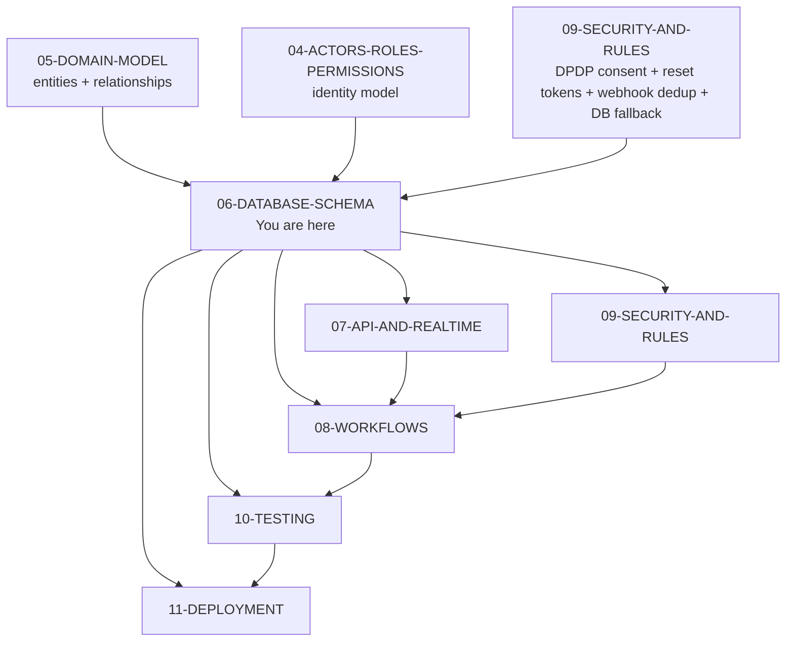

### 1.4 What this document does NOT cover

| Topic | Goes to |
|---|---|
| API request/response shapes | `07-API-AND-REALTIME-CONTRACTS.md` |
| Business rules and invariants | `05-DOMAIN-MODEL.md` §7 |
| Actor permissions | `04-ACTORS-ROLES-PERMISSIONS.md` §9 |
| Masking rules per role | `04` §11 |
| Test assertions | `10-TESTING-STRATEGY.md` |

---

## 2. PostgreSQL Setup

### 2.1 Extensions

| Extension | Version | Purpose |
|---|---|---|
| `pgcrypto` | built-in | `gen_random_uuid()` for UUIDv4 PKs |
| `pg_trgm` | built-in | Trigram search for city/stand names in Phase 2 |

```sql
CREATE EXTENSION IF NOT EXISTS pgcrypto;
CREATE EXTENSION IF NOT EXISTS pg_trgm;
```

### 2.2 Database configuration

**Diagram: Postgres setup topology**
*Postgres 16 runs with UTC timezone and standard English locale. Two extensions are required. PgBouncer sits in front with transaction-mode pooling to keep connection count at 100 max. Application connects through PgBouncer, not directly.*

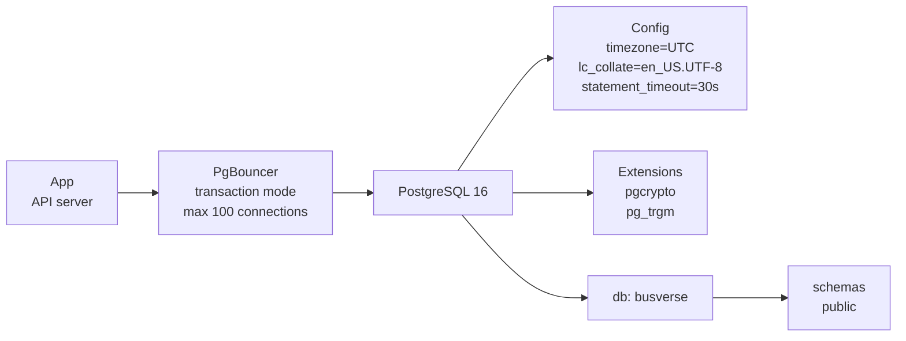

```sql
-- Set via postgresql.conf or ALTER DATABASE
ALTER DATABASE busverse SET timezone TO 'UTC';
ALTER DATABASE busverse SET statement_timeout TO '30s';
ALTER DATABASE busverse SET idle_in_transaction_session_timeout TO '60s';
```

### 2.3 Connection pool

| Parameter | Value | Why |
|---|---|---|
| Pool mode | Transaction | Fast release of connections |
| Max connections to Postgres | 100 | Safe for a single mid-size instance |
| App connection limit | 20 per API instance | Prevents one instance from starving others |
| Statement timeout | 30 s | Fails runaway queries |
| Idle-in-transaction timeout | 60 s | Catches leaked transactions |

---

## 3. Cross-Cutting Patterns

Every table follows these patterns. Defining them once means each schema section doesn't repeat them.

### 3.1 Standard column set

**Diagram: Standard columns on every table**
*Every table has a core set of columns for identity, auditing, soft delete, optimistic locking, and test isolation. Only `reference tables` (cities, stands) omit the `is_test` column because their data is real, not test.*

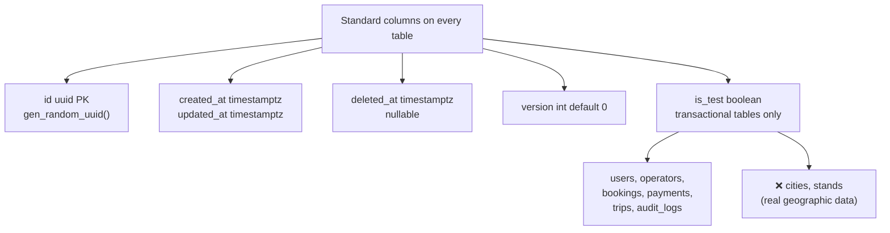

**`is_test` propagation rule:**

| Table type | Has `is_test`? |
|---|---|
| Reference (cities, stands) | ❌ — real geographic data |
| Transactional (users, operators, bookings, payments, trips, sessions, audit_logs, consent_records, password_reset_tokens) | ✅ |
| Lookup (seat_layouts, seats, routes, route_stands, schedules) | ✅ — associated with test operators |

### 3.2 Trigger catalog

**Diagram: Trigger execution flow**
*Every mutable table has a trigger that fires on `UPDATE`. The trigger sets `updated_at = now()` and increments `version = version + 1`. Application code does not need to set either. If the application explicitly sets `version = ?` (optimistic lock check), the trigger still increments it.*

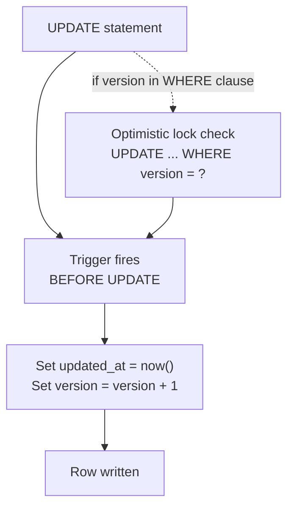

```sql
CREATE OR REPLACE FUNCTION trigger_set_updated()
RETURNS TRIGGER AS $$
BEGIN
  NEW.updated_at = now();
  NEW.version = OLD.version + 1;
  RETURN NEW;
END;
$$ LANGUAGE plpgsql;
```

**Applied to:** every mutable table via `CREATE TRIGGER set_updated BEFORE UPDATE ON {table} FOR EACH ROW EXECUTE FUNCTION trigger_set_updated();`

**Not applied to:** `audit_logs`, `gateway_webhooks`, `gps_samples`, `boarding_scans` — these are append-only and never updated.

### 3.3 Soft-delete query pattern

**Diagram: Soft-delete enforcement**
*Two enforcement layers — Prisma middleware auto-filters `WHERE deleted_at IS NULL` on every query; partial unique indexes ensure uniqueness works even with soft-deleted rows (e.g., a soft-deleted user's phone can be reused for a new registration).*

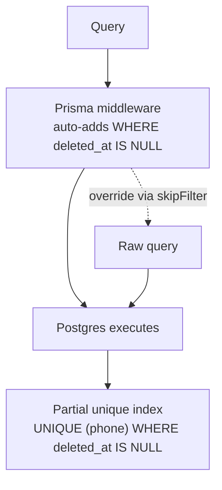

**Rules:**

- Every non-system query filters `WHERE deleted_at IS NULL` — enforced by Prisma middleware, not by hand
- Unique constraints are **partial**: `UNIQUE (phone) WHERE deleted_at IS NULL`, so a soft-deleted user's phone becomes available again
- System queries (audit, admin, analytics) may explicitly bypass the filter

### 3.4 Idempotency

**Rule:** Every money-path write carries an `idempotency_key`. Global unique, 24-hour window.

```sql
-- Partial unique index, so old keys can be pruned
CREATE UNIQUE INDEX uniq_payments_idempotency_key
  ON payments (idempotency_key)
  WHERE created_at > now() - interval '24 hours';
```

**Why global unique:** UUIDv4 idempotency keys are astronomically collision-resistant. Global unique allows retries from any client to be deduped. Pruning via partial index keeps the index small.

**Retry rule (per `07` §4.6):** A retry attempt after a FAILED payment MUST use a **new** `Idempotency-Key`. Reusing the same key returns the cached failed response — the user cannot retry. Same `bookingId`, new UUID for the key.

### 3.5 Multi-table transactions

Some operations span multiple tables and must be atomic. These are documented here so `08-WORKFLOWS.md` doesn't re-derive them.

| Operation | Tables touched | Atomicity |
|---|---|---|
| **Booking creation** | `bookings` (INSERT status=PENDING), `booking_passengers` (INSERT N rows), `seat_locks` (UPDATE expires_at = now() + 15 min — extend TTL for payment window) | ✅ One transaction |
| **Payment success (webhook)** | `payments` (UPDATE status=SUCCEEDED), `bookings` (UPDATE status=CONFIRMED), `tickets` (INSERT Ed25519-signed), `gst_invoices` (INSERT with sequential invoice_number), `gateway_webhooks` (INSERT with payload_hash), `seat_locks` (DELETE), `audit_logs` (INSERT async after commit) | ✅ One transaction |
| **Payment failure (webhook)** | `payments` (UPDATE status=FAILED), `bookings` (UPDATE status=FAILED), `gateway_webhooks` (INSERT with payload_hash), `seat_locks` (DELETE) | ✅ One transaction |
| **Payment timeout (cron)** | `payments` (UPDATE status=EXPIRED), `bookings` (UPDATE status=EXPIRED), `seat_locks` (DELETE), `audit_logs` (INSERT) | ✅ One transaction per booking |
| **Trip start** | `trips` (INSERT), `driver_profiles` (UPDATE on_duty=true), `sessions` (UPDATE metadata) | ✅ One transaction |
| **Trip end** | `trips` (UPDATE), `driver_profiles` (UPDATE on_duty=false) | ✅ One transaction |
| **Seat lock acquisition** | `seat_locks` (INSERT); Redis `SET NX` before DB; service-layer pre-check queries `booking_passengers` first | ⚠️ Redis is authority; DB is backup; pre-check prevents lock-on-booked |
| **Refund initiation** | `refunds` (INSERT with refund_tier), `payments` (UPDATE status) | ✅ One transaction |
| **Password reset consumption** | `password_reset_tokens` (UPDATE used_at), `operator_users`/`admin_users` (UPDATE password_hash), `sessions` (UPDATE revoked) | ✅ One transaction |
| **Consent grant** | `consent_records` (INSERT or UPDATE revoke existing) | ✅ One transaction |

**Rule:** The application opens one Postgres transaction per row above. Prisma's `$transaction()` with `isolationLevel: Serializable` where multi-row consistency is critical.

**Booking creation vs webhook transaction sequence (v1.2):**

1. **Client POST /bookings** — one transaction: `INSERT bookings (PENDING)`, `INSERT booking_passengers (N rows)`, `UPDATE seat_locks SET expires_at = now() + interval '15 minutes'` for each locked seat. **No ticket is created. No lock is deleted.** The lock protects the seat during the payment window.
2. **Client POST /payments** — one transaction: `INSERT payments (INITIATED)`. Razorpay order created outside the transaction, then the row updated with `gateway_order_id`.
3. **Razorpay webhook `payment.captured`** — one transaction: `INSERT gateway_webhooks`, `UPDATE payments SUCCEEDED`, `INSERT tickets` (Ed25519-signed QR, **first time this row exists**), `INSERT gst_invoices` (with sequential invoice_number), `UPDATE bookings CONFIRMED`, `DELETE seat_locks` (release the seat permanently). Audit row written async after commit.
4. **Razorpay webhook `payment.failed`** — one transaction: `INSERT gateway_webhooks`, `UPDATE payments FAILED`, `UPDATE bookings FAILED`, `DELETE seat_locks`. Passenger can retry with a new Idempotency-Key.
5. **`expire_pending_bookings` cron (15 min)** — one transaction per booking: `UPDATE payments EXPIRED`, `UPDATE bookings EXPIRED`, `DELETE seat_locks`, `INSERT audit_logs`.

**Why the ticket is INSERTed at webhook time (not at booking creation):** Invariant `05` §7.1 #1 requires "Every CONFIRMED booking has exactly one Ticket. PENDING/EXPIRED/FAILED bookings have no ticket." If a ticket were created at booking creation (PENDING state), it would exist before payment — violating the intent. The webhook transaction is the authoritative moment of confirmation, so the ticket is INSERTed there atomically with the status flip.

**Webhook DB error fallback (per `09` §13.5):** If the webhook transaction fails (DB down, constraint violation, timeout), the handler **first** writes the raw webhook body to `/tmp/webhooks/{uuid}.json`, **then** returns `200 OK` to Razorpay. A background replay job (`replay-local-webhooks`, runs every 60s) reads files from `/tmp/webhooks/` and retries the DB write. On success → delete file. On 10 consecutive failures → move to `/tmp/webhooks/failed/` + SEV1 alert. **No webhook is ever lost**, even if the DB is momentarily unavailable.

### 3.6 Booking reference generation

**Decision:** Year-scoped Postgres SEQUENCE.

```sql
CREATE SEQUENCE booking_reference_seq_2026 START 1;
-- Application: SELECT nextval('booking_reference_seq_2026')
-- Format: BKG-2026-00001
```

A cron creates next year's sequence on December 1 of the previous year.

### 3.7 Invoice number generation

**Decision:** Financial-year-scoped Postgres SEQUENCE (April–March).

```sql
CREATE SEQUENCE invoice_number_seq_2026_27 START 1;
-- Application: SELECT nextval('invoice_number_seq_2026_27')
-- Format: INV/2026-27/00001
```

A cron creates next FY's sequence on March 1.

**Invoice creation timing (v1.2):** A `gst_invoices` row is INSERTed **only in the webhook `payment.captured` transaction** — the same transaction that confirms the booking and issues the ticket. No invoice exists for PENDING, EXPIRED, or FAILED bookings. The `invoice_number` is drawn from the sequence at that moment. After issuance, the invoice is immutable (no UPDATE trigger applied — see §7.4).

### 3.8 Hashing algorithms

| Hash target | Algorithm | Parameters |
|---|---|---|
| Password (`operator_users.password_hash`, `admin_users.password_hash`) | **Argon2id** | memory=64MB, iterations=3, parallelism=4 |
| OTP (`otp_challenges.otp_hash`) | **SHA-256** + salt | 16-byte random salt, stored alongside |
| Refresh token (`sessions.refresh_hash`) | **SHA-256** | Direct (no salt needed — token is high-entropy) |
| Password reset token (`password_reset_tokens.token_hash`) | **SHA-256** | Direct (token is high-entropy) |
| Phone for search (`users.phone_hash`) | **SHA-256** + fixed salt | Fixed salt in `.env` (deterministic for lookup) |
| **Webhook payload (`gateway_webhooks.payload_hash`)** | **SHA-256** | Direct (canonical JSON body, no salt — same body must produce same hash for dedup) |

**Why different algorithms:** Password hashing needs to be slow (defeats brute force). OTP, refresh tokens, reset tokens, and webhook payload hashes are already high-entropy or content-addressed — speed is fine. Phone hash must be deterministic (for lookup), so a fixed salt is used. Webhook payload hash must also be deterministic — if two identical webhook bodies arrive, the hash must match exactly.

---

## 4. Identity Schema

**The Identity context holds 10 tables.** `users` is the anchor. Four profile tables extend it. `sessions` is a separate root attached to a user. `refresh_token_chains` catches replay attacks. `otp_challenges` is pre-signup. `consent_records` captures DPDP consent. `password_reset_tokens` holds hashed one-time reset tokens.

### 4.1 Identity ERD

**Diagram: Identity context ERD**
*Ten Identity tables with their relationships. `users` is the anchor (marked UK on phone and email). Four profile tables hang off `users` with `ON DELETE CASCADE`. `sessions` and `refresh_token_chains` form a 1:1 pair. `otp_challenges` allows nullable `user_id` (pre-signup OTP). `consent_records` captures DPDP consent per user per purpose with soft-revoke. `password_reset_tokens` holds hashed one-time reset tokens with expiry. Standard audit columns from §3.1 are omitted for readability.*

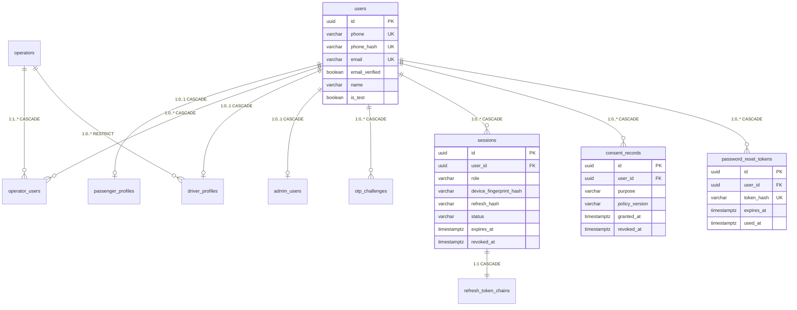

**Note on `operators` FKs:** `operator_users.operator_id` and `driver_profiles.operator_id` reference the `operators` table, which is created in §5.4. The `ALTER TABLE` statements that add these FKs are deferred to §5.4 so that the `operators` table exists when the constraint is created.

### 4.2 `users`

**Purpose:** Identity anchor. One row per human. Contains the phone/email used for authentication. All profile tables reference `users.id`.

```sql
CREATE TABLE users (
  id             uuid PRIMARY KEY DEFAULT gen_random_uuid(),
  phone          varchar(20) NOT NULL,
  phone_hash     varchar(64) NOT NULL,               -- SHA-256 of phone with fixed salt
  email          varchar(255),                        -- nullable
  email_verified boolean NOT NULL DEFAULT false,     -- verified flag (required for operator login)
  name           varchar(100),
  is_test        boolean NOT NULL DEFAULT false,
  created_at     timestamptz NOT NULL DEFAULT now(),
  updated_at     timestamptz NOT NULL DEFAULT now(),
  deleted_at     timestamptz,
  version        int NOT NULL DEFAULT 0,

  CONSTRAINT chk_users_phone_e164
    CHECK (phone ~ '^\+\d{10,15}$'),
  CONSTRAINT chk_users_email_lowercase
    CHECK (email IS NULL OR email = lower(email))
);

CREATE UNIQUE INDEX uniq_users_phone_active
  ON users (phone) WHERE deleted_at IS NULL;

CREATE UNIQUE INDEX uniq_users_phone_hash_active
  ON users (phone_hash) WHERE deleted_at IS NULL;

CREATE UNIQUE INDEX uniq_users_email_active
  ON users (email) WHERE deleted_at IS NULL AND email IS NOT NULL;

CREATE TRIGGER trg_users_updated
  BEFORE UPDATE ON users
  FOR EACH ROW EXECUTE FUNCTION trigger_set_updated();
```

**Column notes:**

- `phone` — E.164 format enforced by CHECK. Used for display and OTP.
- `phone_hash` — deterministic SHA-256 of phone, used for search without decrypting
- `email` — lowercased on insert; nullable because drivers may not have email
- `email_verified` — enforced for operator login (`04` §7.2). Passengers and drivers use OTP login only, so the flag is unused for them.
- `name` — cached from profile for quick display in admin lists

### 4.3 `passenger_profiles`

```sql
CREATE TABLE passenger_profiles (
  id                uuid PRIMARY KEY DEFAULT gen_random_uuid(),
  user_id           uuid NOT NULL UNIQUE REFERENCES users(id) ON DELETE CASCADE,
  name              varchar(100) NOT NULL,
  dob               date,
  gender            varchar(10) CHECK (gender IN ('MALE','FEMALE','OTHER')),
  preferences_json  jsonb DEFAULT '{"_v": 1}'::jsonb,
  created_at        timestamptz NOT NULL DEFAULT now(),
  updated_at        timestamptz NOT NULL DEFAULT now(),
  deleted_at        timestamptz,
  version           int NOT NULL DEFAULT 0,
  is_test           boolean NOT NULL DEFAULT false
);

CREATE TRIGGER trg_passenger_profiles_updated
  BEFORE UPDATE ON passenger_profiles
  FOR EACH ROW EXECUTE FUNCTION trigger_set_updated();
```

### 4.4 `operator_users`

**Purpose:** Operator membership + role. The `password_hash` column supports the email + password login flow described in `04` §7.2.

```sql
CREATE TABLE operator_users (
  id            uuid PRIMARY KEY DEFAULT gen_random_uuid(),
  user_id       uuid NOT NULL REFERENCES users(id) ON DELETE CASCADE,
  operator_id   uuid NOT NULL,                          -- FK added in §5.4 (after operators exists)
  role          varchar(20) NOT NULL CHECK (role IN ('OWNER','MANAGER')),
  password_hash varchar(255) NOT NULL,                  -- Argon2id PHC string
  invited_by    uuid REFERENCES users(id),
  invited_at    timestamptz NOT NULL DEFAULT now(),
  accepted_at   timestamptz,
  created_at    timestamptz NOT NULL DEFAULT now(),
  updated_at    timestamptz NOT NULL DEFAULT now(),
  deleted_at    timestamptz,
  version       int NOT NULL DEFAULT 0,
  is_test       boolean NOT NULL DEFAULT false
);

CREATE INDEX idx_operator_users_user_id ON operator_users (user_id) WHERE deleted_at IS NULL;
CREATE INDEX idx_operator_users_operator_id ON operator_users (operator_id) WHERE deleted_at IS NULL;

CREATE UNIQUE INDEX uniq_operator_users_user_operator
  ON operator_users (user_id, operator_id) WHERE deleted_at IS NULL;

CREATE TRIGGER trg_operator_users_updated
  BEFORE UPDATE ON operator_users
  FOR EACH ROW EXECUTE FUNCTION trigger_set_updated();
```

### 4.5 `driver_profiles`

```sql
CREATE TABLE driver_profiles (
  id               uuid PRIMARY KEY DEFAULT gen_random_uuid(),
  user_id          uuid NOT NULL UNIQUE REFERENCES users(id) ON DELETE CASCADE,
  operator_id      uuid NOT NULL,                        -- FK added in §5.4
  license_number   varchar(20) NOT NULL,
  kyc_status       varchar(20) NOT NULL DEFAULT 'INVITED' CHECK (kyc_status IN (
                     'INVITED','SIGNED_UP','KYC_PENDING','VERIFIED',
                     'KYC_FAILED','ACTIVE','BLOCKED','DEACTIVATED')),
  on_duty          boolean NOT NULL DEFAULT false,
  verified_at      timestamptz,
  kyc_documents_json jsonb,
  created_at       timestamptz NOT NULL DEFAULT now(),
  updated_at       timestamptz NOT NULL DEFAULT now(),
  deleted_at       timestamptz,
  version          int NOT NULL DEFAULT 0,
  is_test          boolean NOT NULL DEFAULT false
);

CREATE INDEX idx_driver_profiles_operator_id ON driver_profiles (operator_id) WHERE deleted_at IS NULL;
CREATE INDEX idx_driver_profiles_on_duty ON driver_profiles (on_duty) WHERE on_duty = true;

CREATE UNIQUE INDEX uniq_driver_profiles_license
  ON driver_profiles (license_number) WHERE deleted_at IS NULL;

CREATE TRIGGER trg_driver_profiles_updated
  BEFORE UPDATE ON driver_profiles
  FOR EACH ROW EXECUTE FUNCTION trigger_set_updated();
```

**Note:** `on_duty` is set to `true` when a trip starts, `false` when it ends. A cron job at 03:00 UTC resets any `on_duty = true` drivers with no active trip older than 6 hours. `kyc_documents_json` was added in the `driver_kyc_documents` migration (Phase 6) — it holds `{ [uploadId]: { uploadId, attachedAt } }` shape for the driver KYC upload flow.

### 4.6 `admin_users`

```sql
CREATE TABLE admin_users (
  id            uuid PRIMARY KEY DEFAULT gen_random_uuid(),
  user_id       uuid NOT NULL UNIQUE REFERENCES users(id) ON DELETE CASCADE,
  role          varchar(20) NOT NULL DEFAULT 'SUPER_ADMIN' CHECK (role IN ('SUPER_ADMIN')),
  password_hash varchar(255) NOT NULL,                  -- Argon2id PHC string
  created_at    timestamptz NOT NULL DEFAULT now(),
  updated_at    timestamptz NOT NULL DEFAULT now(),
  deleted_at    timestamptz,
  version       int NOT NULL DEFAULT 0,
  is_test       boolean NOT NULL DEFAULT false
);
```

### 4.7 `sessions`

```sql
CREATE TABLE sessions (
  id                     uuid PRIMARY KEY DEFAULT gen_random_uuid(),
  user_id                uuid NOT NULL REFERENCES users(id) ON DELETE CASCADE,
  role                   varchar(30) NOT NULL CHECK (role IN (
                           'GUEST','REGISTERED_PASSENGER','OPERATOR_OWNER',
                           'OPERATOR_MANAGER','DRIVER','SUPER_ADMIN')),
  device_fingerprint_hash varchar(64),
  refresh_hash           varchar(64) NOT NULL,
  status                 varchar(20) NOT NULL DEFAULT 'ACTIVE' CHECK (status IN (
                           'ACTIVE','REVOKED','EXPIRED')),
  expires_at             timestamptz NOT NULL,
  revoked_at             timestamptz,
  revoke_reason          varchar(50),
  created_at             timestamptz NOT NULL DEFAULT now(),
  updated_at             timestamptz NOT NULL DEFAULT now(),
  deleted_at             timestamptz,
  version                int NOT NULL DEFAULT 0,
  is_test                boolean NOT NULL DEFAULT false
);

CREATE INDEX idx_sessions_user_id ON sessions (user_id) WHERE deleted_at IS NULL;
CREATE INDEX idx_sessions_refresh_hash ON sessions (refresh_hash) WHERE deleted_at IS NULL;
CREATE INDEX idx_sessions_expires_at ON sessions (expires_at) WHERE status = 'ACTIVE';

CREATE TRIGGER trg_sessions_updated
  BEFORE UPDATE ON sessions
  FOR EACH ROW EXECUTE FUNCTION trigger_set_updated();
```

### 4.8 `otp_challenges`

```sql
CREATE TABLE otp_challenges (
  id              uuid PRIMARY KEY DEFAULT gen_random_uuid(),
  user_id         uuid REFERENCES users(id) ON DELETE CASCADE,  -- nullable pre-signup
  phone_or_email  varchar(255) NOT NULL,
  otp_hash        varchar(64) NOT NULL,
  otp_salt        varchar(32) NOT NULL,
  purpose         varchar(20) NOT NULL DEFAULT 'LOGIN' CHECK (purpose IN (
                    'LOGIN','RESET')),                       -- v1.3 (P2): LOGIN vs RESET isolation
  attempts        int NOT NULL DEFAULT 0,
  expires_at      timestamptz NOT NULL,
  consumed_at     timestamptz,
  created_at      timestamptz NOT NULL DEFAULT now(),
  updated_at      timestamptz NOT NULL DEFAULT now(),
  deleted_at      timestamptz,
  version         int NOT NULL DEFAULT 0,
  is_test         boolean NOT NULL DEFAULT false
);

CREATE INDEX idx_otp_challenges_user_id ON otp_challenges (user_id) WHERE deleted_at IS NULL;
CREATE INDEX idx_otp_challenges_phone ON otp_challenges (phone_or_email, expires_at) WHERE deleted_at IS NULL;
CREATE INDEX idx_otp_challenges_phone_purpose_expires ON otp_challenges (phone_or_email, purpose, expires_at) WHERE deleted_at IS NULL;
```

**`purpose` column (P2 security fix, Phase 2 — v1.3):** A challenge created with `purpose = 'LOGIN'` can only be consumed by `/verify` endpoints. A challenge created with `purpose = 'RESET'` can only be consumed by `/reset/verify`. Without this column, a LOGIN OTP could be submitted to `/reset/verify` and change the user's password — a full account takeover. The Phase 2 migration `20261027190000_add_otp_purpose` added this column and the compound index. `consumeOtpChallenge()` filters by purpose; `createOtpChallenge()` writes it.

**Migration note:** The `purpose` column was added in Phase 2 with `DEFAULT 'LOGIN'` to backfill existing rows. Existing challenges from before the migration are treated as LOGIN challenges, which is correct — they were all issued for login.

### 4.9 `refresh_token_chains`

```sql
CREATE TABLE refresh_token_chains (
  id              uuid PRIMARY KEY DEFAULT gen_random_uuid(),
  session_id      uuid NOT NULL UNIQUE REFERENCES sessions(id) ON DELETE CASCADE,
  used_hashes     jsonb NOT NULL DEFAULT '[]'::jsonb,
  created_at      timestamptz NOT NULL DEFAULT now(),
  updated_at      timestamptz NOT NULL DEFAULT now(),
  deleted_at      timestamptz,
  version         int NOT NULL DEFAULT 0,
  is_test         boolean NOT NULL DEFAULT false
);
```

### 4.10 `consent_records`

**Purpose:** DPDP Act 2023 compliance — captures user consent per purpose with policy version tracking and soft-revoke. Referenced by `09` §18.2 and `09` §18.3.

```sql
CREATE TABLE consent_records (
  id             uuid PRIMARY KEY DEFAULT gen_random_uuid(),
  user_id        uuid NOT NULL REFERENCES users(id) ON DELETE CASCADE,
  purpose        varchar(50) NOT NULL CHECK (purpose IN (
                   'terms_of_service','privacy_policy','marketing','analytics')),
  policy_version varchar(20) NOT NULL,                  -- e.g. 'v1.0'
  granted_at     timestamptz NOT NULL DEFAULT now(),
  revoked_at     timestamptz,                           -- soft-revoke; row preserved for audit
  ip_address     inet,                                  -- source of consent (DPDP §7(1))
  created_at     timestamptz NOT NULL DEFAULT now(),
  updated_at     timestamptz NOT NULL DEFAULT now(),
  deleted_at     timestamptz,
  version        int NOT NULL DEFAULT 0,
  is_test        boolean NOT NULL DEFAULT false
);

CREATE INDEX idx_consent_records_user_id
  ON consent_records (user_id) WHERE deleted_at IS NULL;

-- Only one ACTIVE consent per (user, purpose). Revoke (set revoked_at) to create a new one.
CREATE UNIQUE INDEX uniq_consent_records_user_purpose_active
  ON consent_records (user_id, purpose)
  WHERE revoked_at IS NULL AND deleted_at IS NULL;

CREATE TRIGGER trg_consent_records_updated
  BEFORE UPDATE ON consent_records
  FOR EACH ROW EXECUTE FUNCTION trigger_set_updated();
```

**Rules:**

- Consent is granted per `(user_id, purpose)`. To re-consent after revoking, a new row is created with a new `policy_version`.
- The `ip_address` is captured for DPDP §7(1) audit requirements.
- `version` int is the standard optimistic-lock column; `policy_version` varchar is the policy string (e.g. "v1.0").
- Rows are never hard-deleted — DPDP requires consent history. `deleted_at` is only set when the owning user is deleted (via CASCADE).

### 4.11 `password_reset_tokens`

**Purpose:** Stores one-time password reset tokens (SHA-256 hashed) with expiry. Referenced by `04` §7.6 and `07` §3.7.

```sql
CREATE TABLE password_reset_tokens (
  id          uuid PRIMARY KEY DEFAULT gen_random_uuid(),
  user_id     uuid NOT NULL REFERENCES users(id) ON DELETE CASCADE,
  token_hash  varchar(64) NOT NULL UNIQUE,             -- SHA-256 of the raw token sent by email
  expires_at  timestamptz NOT NULL,                    -- 30 min from issuance
  used_at     timestamptz,                             -- set when consumed; prevents reuse
  ip_address  inet,
  created_at  timestamptz NOT NULL DEFAULT now(),
  updated_at  timestamptz NOT NULL DEFAULT now(),
  deleted_at  timestamptz,
  version     int NOT NULL DEFAULT 0,
  is_test     boolean NOT NULL DEFAULT false
);

CREATE INDEX idx_password_reset_tokens_user_id
  ON password_reset_tokens (user_id) WHERE deleted_at IS NULL;

CREATE INDEX idx_password_reset_tokens_expires
  ON password_reset_tokens (expires_at) WHERE used_at IS NULL;

CREATE TRIGGER trg_password_reset_tokens_updated
  BEFORE UPDATE ON password_reset_tokens
  FOR EACH ROW EXECUTE FUNCTION trigger_set_updated();
```

**Rules:**

- The raw token is generated server-side (32 random bytes, base64) and sent via email; only the SHA-256 hash is stored.
- Consuming a token sets `used_at` (via transaction). A second consumption attempt returns `401 RESET_TOKEN_INVALID`.
- Multiple active tokens per user are allowed (user can request a second email if the first is lost).
- Purged nightly by retention job (`purge_password_reset_tokens`, §15).

---

## 5. Network Schema

**The Network context holds 9 tables.** `cities` and `operators` are roots. `buses`, `routes`, and `schedules` are children of `operators`. `seat_layouts` → `seats` is a chain under `buses`. `route_stands` orders stops on a route.

### 5.1 Network ERD

**Diagram: Network context ERD**
*Nine Network tables. `cities` and `operators` are independent roots. `cities` owns `stands`. `operators` owns `buses`, `routes`, `schedules`. `buses` owns `seat_layouts` which owns `seats`. `routes` owns `route_stands`. `schedules` references `buses` and `routes`. All relationships use RESTRICT cascade — an operator with buses cannot be deleted.*

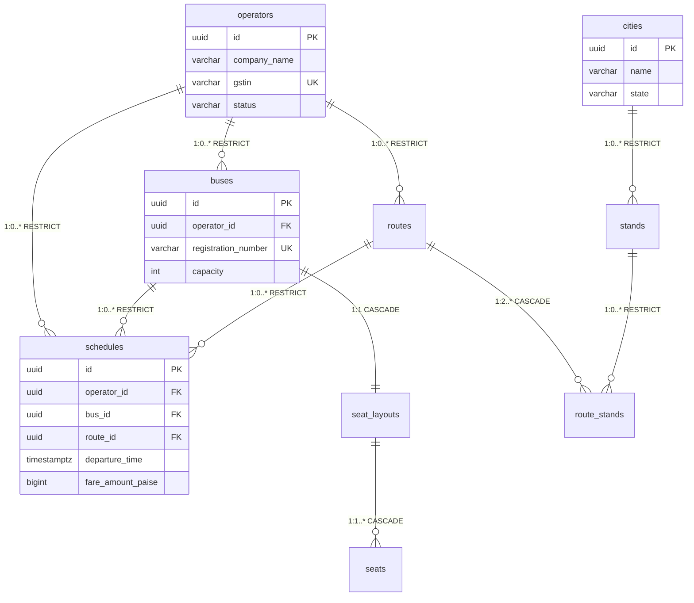

### 5.2 `cities`

```sql
CREATE TABLE cities (
  id          uuid PRIMARY KEY DEFAULT gen_random_uuid(),
  name        varchar(100) NOT NULL,
  state       varchar(100) NOT NULL,
  is_active   boolean NOT NULL DEFAULT true,
  created_at  timestamptz NOT NULL DEFAULT now(),
  updated_at  timestamptz NOT NULL DEFAULT now(),
  deleted_at  timestamptz,
  version     int NOT NULL DEFAULT 0
  -- NOTE: no is_test on reference tables
);

CREATE UNIQUE INDEX uniq_cities_name_state
  ON cities (name, state) WHERE deleted_at IS NULL;

CREATE TRIGGER trg_cities_updated
  BEFORE UPDATE ON cities
  FOR EACH ROW EXECUTE FUNCTION trigger_set_updated();
```

**Note:** No `is_test` column — cities are real geographic data, not test data.

### 5.3 `stands`

```sql
CREATE TABLE stands (
  id          uuid PRIMARY KEY DEFAULT gen_random_uuid(),
  city_id     uuid NOT NULL REFERENCES cities(id) ON DELETE RESTRICT,
  name        varchar(150) NOT NULL,
  type        varchar(20) NOT NULL DEFAULT 'BUS_STAND' CHECK (type IN (
                'BUS_STAND','PICKUP_POINT','DROP_POINT')),   -- v1.3: aligned with service enum
  lat         numeric(9,6) NOT NULL,
  lng         numeric(9,6) NOT NULL,
  created_at  timestamptz NOT NULL DEFAULT now(),
  updated_at  timestamptz NOT NULL DEFAULT now(),
  deleted_at  timestamptz,
  version     int NOT NULL DEFAULT 0
  -- NOTE: no is_test on reference tables
);

CREATE INDEX idx_stands_city_id ON stands (city_id) WHERE deleted_at IS NULL;

CREATE UNIQUE INDEX uniq_stands_city_name
  ON stands (city_id, name) WHERE deleted_at IS NULL;

CREATE TRIGGER trg_stands_updated
  BEFORE UPDATE ON stands
  FOR EACH ROW EXECUTE FUNCTION trigger_set_updated();
```

**`type` enum (v1.3):** Changed from `('BUS_STAND','BUS_STOP','AIRPORT','TRAIN_STATION')` in v1.2 to `('BUS_STAND','PICKUP_POINT','DROP_POINT')` to match the values the API layer actually validates (`network.types.ts` `STAND_TYPE`). The 3-value enum covers everything the demo needs: physical terminals (`BUS_STAND`), on-route pickup points (`PICKUP_POINT`), and on-route drop points (`DROP_POINT`). If a future need arises for airport/train station types, add them to both the DB CHECK and the service enum in the same migration.

### 5.4 `operators`

```sql
CREATE TABLE operators (
  id               uuid PRIMARY KEY DEFAULT gen_random_uuid(),
  company_name     varchar(200) NOT NULL,
  gstin            varchar(15) NOT NULL,
  pan              varchar(10) NOT NULL,             -- encrypted at rest
  bank_account_ref varchar(100),                     -- encrypted at rest
  status           varchar(30) NOT NULL DEFAULT 'APPLIED' CHECK (status IN (
                     'APPLIED','PENDING_REVIEW','APPROVED','REJECTED',
                     'ACTIVE','SUSPENDED','DEACTIVATED')),
  is_test          boolean NOT NULL DEFAULT false,
  created_at       timestamptz NOT NULL DEFAULT now(),
  updated_at       timestamptz NOT NULL DEFAULT now(),
  deleted_at       timestamptz,
  version          int NOT NULL DEFAULT 0
);

CREATE UNIQUE INDEX uniq_operators_gstin
  ON operators (gstin) WHERE deleted_at IS NULL;

CREATE TRIGGER trg_operators_updated
  BEFORE UPDATE ON operators
  FOR EACH ROW EXECUTE FUNCTION trigger_set_updated();

-- ─── Deferred FKs from Identity tables ───
-- operator_users and driver_profiles are declared in §4.4 and §4.5 with
-- operator_id as a plain uuid. They gain their FK constraints here, after
-- the operators table exists.

ALTER TABLE operator_users
  ADD CONSTRAINT fk_operator_users_operator
  FOREIGN KEY (operator_id) REFERENCES operators(id) ON DELETE CASCADE;

ALTER TABLE driver_profiles
  ADD CONSTRAINT fk_driver_profiles_operator
  FOREIGN KEY (operator_id) REFERENCES operators(id) ON DELETE RESTRICT;
```

**Amendment from `05`:** `kyc_status` removed — overlaps with `status`. The lifecycle states capture KYC verification (APPROVED implies VERIFIED).

### 5.5 `buses`

```sql
CREATE TABLE buses (
  id                    uuid PRIMARY KEY DEFAULT gen_random_uuid(),
  operator_id           uuid NOT NULL REFERENCES operators(id) ON DELETE RESTRICT,
  registration_number   varchar(20) NOT NULL,
  model                 varchar(100),
  capacity              int NOT NULL CHECK (capacity > 0 AND capacity <= 60),
  bus_type              varchar(20) NOT NULL CHECK (bus_type IN (        -- v1.3 (A2)
                          'SEATER','AC_SEATER','SLEEPER','AC_SLEEPER','SEMI_SLEEPER')),
  amenities_json        jsonb NOT NULL DEFAULT '{"_v": 1, "items": []}'::jsonb,  -- v1.3 (A2)
  approval_status       varchar(20) NOT NULL DEFAULT 'PENDING' CHECK (approval_status IN (
                          'PENDING','APPROVED','REJECTED')),
  insurance_doc_ref     varchar(200),
  insurance_expires_at  date,
  is_test               boolean NOT NULL DEFAULT false,
  created_at            timestamptz NOT NULL DEFAULT now(),
  updated_at            timestamptz NOT NULL DEFAULT now(),
  deleted_at            timestamptz,
  version               int NOT NULL DEFAULT 0
);

CREATE INDEX idx_buses_operator_id ON buses (operator_id) WHERE deleted_at IS NULL;
CREATE INDEX idx_buses_insurance_expiry ON buses (insurance_expires_at) WHERE deleted_at IS NULL;
CREATE INDEX idx_buses_bus_type ON buses (bus_type) WHERE deleted_at IS NULL AND approval_status = 'APPROVED';

CREATE UNIQUE INDEX uniq_buses_registration
  ON buses (registration_number) WHERE deleted_at IS NULL;

CREATE TRIGGER trg_buses_updated
  BEFORE UPDATE ON buses
  FOR EACH ROW EXECUTE FUNCTION trigger_set_updated();
```

**`bus_type` (A2 — applied Phase 1a):** 5-enum covering the Indian intercity domain. Passengers filter search results by this in `GET /public/search` (Phase 3a). Values: `SEATER` (non-AC seater), `AC_SEATER` (AC seater), `SLEEPER` (non-AC sleeper), `AC_SLEEPER` (AC sleeper), `SEMI_SLEEPER` (mixed). Enum values live in `network.types.ts` `BUS_TYPE`; DB CHECK mirrors it exactly.

**`amenities_json` (A2 — applied Phase 1a):** Free-form string list — WiFi, AC, Water, Charging, Blanket, Reading Light. Shape is `{ _v: 1, items: ["WiFi", "AC", ...] }`. Not an enum because amenity sets evolve faster than DB migrations should. `network.mappers.ts` `parseAmenities()` tolerates missing `items` key for forward compat.

### 5.6 `seat_layouts`

```sql
CREATE TABLE seat_layouts (
  id            uuid PRIMARY KEY DEFAULT gen_random_uuid(),
  bus_id        uuid NOT NULL UNIQUE REFERENCES buses(id) ON DELETE CASCADE,
  rows_count    int NOT NULL CHECK (rows_count > 0 AND rows_count <= 20),
  columns_count int NOT NULL CHECK (columns_count > 0 AND columns_count <= 8),
  aisle_map_json jsonb NOT NULL DEFAULT '{"_v": 1, "aisle_cells": []}'::jsonb,
  created_at    timestamptz NOT NULL DEFAULT now(),
  updated_at    timestamptz NOT NULL DEFAULT now(),
  deleted_at    timestamptz,
  version       int NOT NULL DEFAULT 0,
  is_test       boolean NOT NULL DEFAULT false
);

CREATE TRIGGER trg_seat_layouts_updated
  BEFORE UPDATE ON seat_layouts
  FOR EACH ROW EXECUTE FUNCTION trigger_set_updated();
```

**`aisle_map_json` schema:**

```json
{
  "_v": 1,
  "aisle_cells": [
    {"row": 1, "col": 3},
    {"row": 2, "col": 3}
  ]
}
```

### 5.7 `seats`

```sql
CREATE TABLE seats (
  id              uuid PRIMARY KEY DEFAULT gen_random_uuid(),
  layout_id       uuid NOT NULL REFERENCES seat_layouts(id) ON DELETE CASCADE,
  seat_row        varchar(3) NOT NULL,
  seat_column     int NOT NULL,
  seat_label      varchar(4) NOT NULL,                                -- v1.3 (DA3): narrowed from varchar(10)
  seat_type       varchar(20) NOT NULL DEFAULT 'SEATER' CHECK (seat_type IN (
                    'SEATER','SLEEPER','SEMI_SLEEPER')),
  is_female_only  boolean NOT NULL DEFAULT false,
  created_at      timestamptz NOT NULL DEFAULT now(),
  updated_at      timestamptz NOT NULL DEFAULT now(),
  deleted_at      timestamptz,
  version         int NOT NULL DEFAULT 0,
  is_test         boolean NOT NULL DEFAULT false
);

CREATE INDEX idx_seats_layout_id ON seats (layout_id) WHERE deleted_at IS NULL;

CREATE UNIQUE INDEX uniq_seats_layout_label
  ON seats (layout_id, seat_label) WHERE deleted_at IS NULL;

CREATE TRIGGER trg_seats_updated
  BEFORE UPDATE ON seats
  FOR EACH ROW EXECUTE FUNCTION trigger_set_updated();
```

**`seat_label varchar(4)` (DA3 — applied Phase 1a):** Row letter + column number, e.g. `A1`, `T6`. Max 4 chars covers rows A–T (single letter) + columns 1–2 digits. The DB enforces `varchar(4)`. The service (`seat-layout.service.ts`) generates labels as `${seatRow}${seatColumn}` and validates `seatRow` matches `/^[A-T]$/` and `seatColumn` is 1–6.

**`seat_type` note:** DB CHECK allows `SEATER`, `SLEEPER`, `SEMI_SLEEPER`. The service enum (`network.types.ts` `SEAT_TYPE`) currently exposes `SEATER` and `SLEEPER` only — `SEMI_SLEEPER` is accepted by DB but not yet emitted by the service. This is intentional: keeps forward compat without forcing the UI to model a seat type that Phase 1 buses don't use.

### 5.8 `routes`

```sql
CREATE TABLE routes (
  id                 uuid PRIMARY KEY DEFAULT gen_random_uuid(),
  operator_id        uuid NOT NULL REFERENCES operators(id) ON DELETE RESTRICT,
  origin_city_id     uuid NOT NULL REFERENCES cities(id) ON DELETE RESTRICT,
  destination_city_id uuid NOT NULL REFERENCES cities(id) ON DELETE RESTRICT,
  approval_status    varchar(20) NOT NULL DEFAULT 'PENDING' CHECK (approval_status IN (
                       'PENDING','APPROVED','REJECTED')),
  is_test            boolean NOT NULL DEFAULT false,
  created_at         timestamptz NOT NULL DEFAULT now(),
  updated_at         timestamptz NOT NULL DEFAULT now(),
  deleted_at         timestamptz,
  version            int NOT NULL DEFAULT 0,

  CONSTRAINT chk_routes_different_cities
    CHECK (origin_city_id <> destination_city_id)
);

CREATE INDEX idx_routes_operator_id ON routes (operator_id) WHERE deleted_at IS NULL;
CREATE INDEX idx_routes_origin_dest ON routes (origin_city_id, destination_city_id) WHERE deleted_at IS NULL;

CREATE TRIGGER trg_routes_updated
  BEFORE UPDATE ON routes
  FOR EACH ROW EXECUTE FUNCTION trigger_set_updated();
```

**Amendment from `05`:** `distance_km` removed — derived from `route_stands.distance_from_prev_km`.

### 5.9 `route_stands`

```sql
CREATE TABLE route_stands (
  id                       uuid PRIMARY KEY DEFAULT gen_random_uuid(),
  route_id                 uuid NOT NULL REFERENCES routes(id) ON DELETE CASCADE,
  stand_id                 uuid NOT NULL REFERENCES stands(id) ON DELETE RESTRICT,
  sequence                 int NOT NULL CHECK (sequence > 0),
  distance_from_prev_km    numeric(7,2) NOT NULL DEFAULT 0,
  duration_from_prev_min   int NOT NULL DEFAULT 0,
  created_at               timestamptz NOT NULL DEFAULT now(),
  updated_at               timestamptz NOT NULL DEFAULT now(),
  deleted_at               timestamptz,
  version                  int NOT NULL DEFAULT 0,
  is_test                  boolean NOT NULL DEFAULT false
);

CREATE INDEX idx_route_stands_route_id ON route_stands (route_id) WHERE deleted_at IS NULL;

CREATE UNIQUE INDEX uniq_route_stands_sequence
  ON route_stands (route_id, sequence) WHERE deleted_at IS NULL;

CREATE UNIQUE INDEX uniq_route_stands_stand
  ON route_stands (route_id, stand_id) WHERE deleted_at IS NULL;
```

### 5.10 `schedules`

```sql
CREATE TABLE schedules (
  id                 uuid PRIMARY KEY DEFAULT gen_random_uuid(),
  operator_id        uuid NOT NULL REFERENCES operators(id) ON DELETE RESTRICT,
  bus_id             uuid NOT NULL REFERENCES buses(id) ON DELETE RESTRICT,
  route_id           uuid NOT NULL REFERENCES routes(id) ON DELETE RESTRICT,
  departure_time     timestamptz NOT NULL,
  arrival_time       timestamptz NOT NULL,
  fare_amount_paise  bigint NOT NULL CHECK (fare_amount_paise > 0),
  fare_currency      varchar(3) NOT NULL DEFAULT 'INR',
  status             varchar(20) NOT NULL DEFAULT 'DRAFT' CHECK (status IN (
                       'DRAFT','PUBLISHED','CANCELLED')),
  is_test            boolean NOT NULL DEFAULT false,
  created_at         timestamptz NOT NULL DEFAULT now(),
  updated_at         timestamptz NOT NULL DEFAULT now(),
  deleted_at         timestamptz,
  version            int NOT NULL DEFAULT 0,

  CONSTRAINT chk_schedules_times
    CHECK (arrival_time > departure_time)
);

CREATE INDEX idx_schedules_route_departure
  ON schedules (route_id, departure_time, status)
  WHERE deleted_at IS NULL AND status = 'PUBLISHED';

CREATE INDEX idx_schedules_operator_id ON schedules (operator_id) WHERE deleted_at IS NULL;
CREATE INDEX idx_schedules_bus_id ON schedules (bus_id) WHERE deleted_at IS NULL;

CREATE TRIGGER trg_schedules_updated
  BEFORE UPDATE ON schedules
  FOR EACH ROW EXECUTE FUNCTION trigger_set_updated();
```

---

## 6. Booking Schema

**The Booking context holds 4 tables.** `seat_locks` and `bookings` are separate roots. `bookings` owns `booking_passengers` and `tickets`.

### 6.1 Booking ERD

**Diagram: Booking context ERD**
*Four Booking tables. `seat_locks` is ephemeral, deleted on TTL or on payment success. `bookings` is the immutable purchase. `booking_passengers` and `tickets` are children of `bookings`. The unique constraint on `(schedule_id, seat_id)` in both `seat_locks` and `booking_passengers` is the DB-level guarantee of no double-locking and no double-booking.*

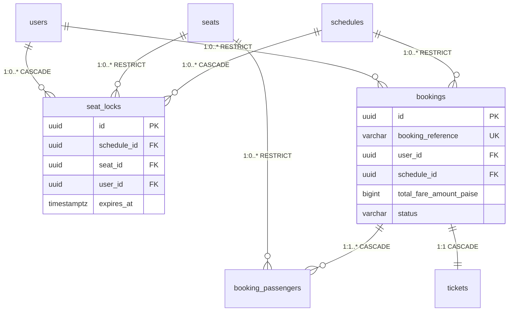

### 6.2 `seat_locks`

```sql
CREATE TABLE seat_locks (
  id           uuid PRIMARY KEY DEFAULT gen_random_uuid(),
  schedule_id  uuid NOT NULL REFERENCES schedules(id) ON DELETE CASCADE,
  seat_id      uuid NOT NULL REFERENCES seats(id) ON DELETE RESTRICT,
  user_id      uuid NOT NULL REFERENCES users(id) ON DELETE CASCADE,
  acquired_at  timestamptz NOT NULL DEFAULT now(),
  expires_at   timestamptz NOT NULL,                    -- 5 min acquire, 15 min when booking PENDING
  created_at   timestamptz NOT NULL DEFAULT now(),
  updated_at   timestamptz NOT NULL DEFAULT now(),
  deleted_at   timestamptz,
  version      int NOT NULL DEFAULT 0,
  is_test      boolean NOT NULL DEFAULT false
);

-- THE critical constraint: no double-locking
CREATE UNIQUE INDEX uniq_seat_locks_schedule_seat
  ON seat_locks (schedule_id, seat_id) WHERE deleted_at IS NULL;

CREATE INDEX idx_seat_locks_expires_at ON seat_locks (expires_at) WHERE deleted_at IS NULL;
CREATE INDEX idx_seat_locks_user_id ON seat_locks (user_id) WHERE deleted_at IS NULL;

CREATE TRIGGER trg_seat_locks_updated
  BEFORE UPDATE ON seat_locks
  FOR EACH ROW EXECUTE FUNCTION trigger_set_updated();
```

**Lock TTL lifecycle (v1.2):**

| Phase | TTL | Set by |
|---|---|---|
| Lock acquired via POST /seat-locks | 5 minutes | Application |
| Booking created (POST /bookings) | Extended to 15 minutes | `UPDATE seat_locks SET expires_at = now() + interval '15 minutes'` in booking transaction |
| Payment success (webhook) | Lock deleted | Webhook transaction `DELETE seat_locks` |
| Payment failure (webhook) | Lock deleted | Webhook transaction `DELETE seat_locks` |
| Payment timeout (cron) | Lock deleted | `expire_pending_bookings` cron |

**Note on service-layer pre-check (invariant #8):** Before acquiring a lock in POST /seat-locks, the service queries `booking_passengers` for the same `(schedule_id, seat_id)`. If a row exists, returns `409 SEAT_ALREADY_BOOKED` without attempting the lock. This prevents a malicious client from bypassing the UI and locking an already-booked seat. There is no cross-table unique constraint (would require a trigger); the service-layer guard is sufficient for Phase 1 volume.

### 6.3 `bookings`

```sql
CREATE TABLE bookings (
  id                    uuid PRIMARY KEY DEFAULT gen_random_uuid(),
  booking_reference     varchar(20) NOT NULL,
  user_id               uuid NOT NULL REFERENCES users(id) ON DELETE RESTRICT,
  schedule_id           uuid NOT NULL REFERENCES schedules(id) ON DELETE RESTRICT,
  boarding_stand_id     uuid NOT NULL REFERENCES stands(id) ON DELETE RESTRICT,
  dropping_stand_id     uuid NOT NULL REFERENCES stands(id) ON DELETE RESTRICT,
  total_fare_amount     bigint NOT NULL CHECK (total_fare_amount > 0),
  total_fare_currency   varchar(3) NOT NULL DEFAULT 'INR',
  fare_breakdown_json   jsonb NOT NULL DEFAULT '{"_v": 1}'::jsonb,
  status                varchar(30) NOT NULL DEFAULT 'PENDING' CHECK (status IN (
                          'PENDING','CONFIRMED','CHECKED_IN','COMPLETED',
                          'CANCELLED','OPERATOR_CANCELLED','REFUNDED',
                          'EXPIRED','FAILED')),
  confirmed_at          timestamptz,
  checked_in_at         timestamptz,
  cancelled_at          timestamptz,
  completed_at          timestamptz,
  expired_at            timestamptz,                    -- v1.2: when payment timeout fired
  is_test               boolean NOT NULL DEFAULT false,
  created_at            timestamptz NOT NULL DEFAULT now(),
  updated_at            timestamptz NOT NULL DEFAULT now(),
  deleted_at            timestamptz,
  version               int NOT NULL DEFAULT 0
);

CREATE UNIQUE INDEX uniq_bookings_reference
  ON bookings (booking_reference);

CREATE INDEX idx_bookings_user_status
  ON bookings (user_id, status, created_at DESC) WHERE deleted_at IS NULL;

CREATE INDEX idx_bookings_schedule
  ON bookings (schedule_id) WHERE deleted_at IS NULL;

CREATE INDEX idx_bookings_pending_created
  ON bookings (created_at) WHERE status = 'PENDING' AND deleted_at IS NULL;

-- v1.2: hot-path index for expire_pending_bookings cron
CREATE INDEX idx_bookings_pending_expiry
  ON bookings (created_at) WHERE status = 'PENDING' AND deleted_at IS NULL;

CREATE TRIGGER trg_bookings_updated
  BEFORE UPDATE ON bookings
  FOR EACH ROW EXECUTE FUNCTION trigger_set_updated();
```

**`fare_breakdown_json` schema:**

```json
{
  "_v": 1,
  "base_fare_paise": 45000,
  "tax_paise": 2250,
  "convenience_fee_paise": 1500,
  "total_paise": 48750
}
```

### 6.4 `booking_passengers`

```sql
CREATE TABLE booking_passengers (
  id            uuid PRIMARY KEY DEFAULT gen_random_uuid(),
  booking_id    uuid NOT NULL REFERENCES bookings(id) ON DELETE CASCADE,
  seat_id       uuid NOT NULL REFERENCES seats(id) ON DELETE RESTRICT,
  schedule_id   uuid NOT NULL REFERENCES schedules(id) ON DELETE RESTRICT,  -- denormalized from booking
  name          varchar(100) NOT NULL,
  age           int CHECK (age > 0 AND age < 120),
  gender        varchar(10) CHECK (gender IN ('MALE','FEMALE','OTHER')),
  id_number     varchar(20),                        -- encrypted at rest
  created_at    timestamptz NOT NULL DEFAULT now(),
  updated_at    timestamptz NOT NULL DEFAULT now(),
  deleted_at    timestamptz,
  version       int NOT NULL DEFAULT 0,
  is_test       boolean NOT NULL DEFAULT false
);

CREATE INDEX idx_booking_passengers_booking_id
  ON booking_passengers (booking_id) WHERE deleted_at IS NULL;

-- THE critical constraint: no double-booking of the same seat on the same schedule
CREATE UNIQUE INDEX uniq_booking_passengers_schedule_seat
  ON booking_passengers (schedule_id, seat_id) WHERE deleted_at IS NULL;

CREATE TRIGGER trg_booking_passengers_updated
  BEFORE UPDATE ON booking_passengers
  FOR EACH ROW EXECUTE FUNCTION trigger_set_updated();
```

**Note:** `booking_passengers.schedule_id` is denormalized from `bookings.schedule_id` so the unique constraint `(schedule_id, seat_id)` can be enforced at the DB level without a join. The application sets both in the same transaction.

### 6.5 `tickets`

```sql
CREATE TABLE tickets (
  id            uuid PRIMARY KEY DEFAULT gen_random_uuid(),
  booking_id    uuid NOT NULL UNIQUE REFERENCES bookings(id) ON DELETE CASCADE,
  qr_payload    text NOT NULL,                      -- base64-encoded signed payload
  qr_signature  varchar(128) NOT NULL,              -- base64-encoded Ed25519 signature
  status        varchar(20) NOT NULL DEFAULT 'ISSUED' CHECK (status IN (
                  'ISSUED','ACTIVE','SCANNED','USED','CANCELLED')),
  issued_at     timestamptz NOT NULL DEFAULT now(),
  scanned_at    timestamptz,
  created_at    timestamptz NOT NULL DEFAULT now(),
  updated_at    timestamptz NOT NULL DEFAULT now(),
  deleted_at    timestamptz,
  version       int NOT NULL DEFAULT 0,
  is_test       boolean NOT NULL DEFAULT false
);

CREATE INDEX idx_tickets_booking_id ON tickets (booking_id) WHERE deleted_at IS NULL;
CREATE INDEX idx_tickets_status ON tickets (status) WHERE deleted_at IS NULL AND status IN ('ACTIVE','ISSUED');

CREATE TRIGGER trg_tickets_updated
  BEFORE UPDATE ON tickets
  FOR EACH ROW EXECUTE FUNCTION trigger_set_updated();
```

**Insert timing (v1.2):** The ticket row is INSERTed **only inside the webhook `payment.captured` transaction**. It does not exist for PENDING, EXPIRED, or FAILED bookings. This enforces `05` §7.1 invariant #1 ("Every CONFIRMED booking has exactly one Ticket") and invariant #18 ("A ticket cannot be issued without a payment").

---

## 7. Payments Schema

**The Payments context holds 4 tables.** `payments` is the root. `refunds`, `gst_invoices`, `gateway_webhooks` are children.

### 7.1 Payments ERD

**Diagram: Payments context ERD**
*Four Payments tables. `payments` is the root, one per attempt, with a unique `idempotency_key` (24h partial index). `refunds`, `gst_invoices`, `gateway_webhooks` all cascade from `payments`. `gst_invoices.booking_id` is unique — one invoice per booking. `gateway_webhooks` carries `payload_hash` with a unique index on `(payment_id, event_type, payload_hash)`. `refunds` now carries a `refund_tier` enum.*

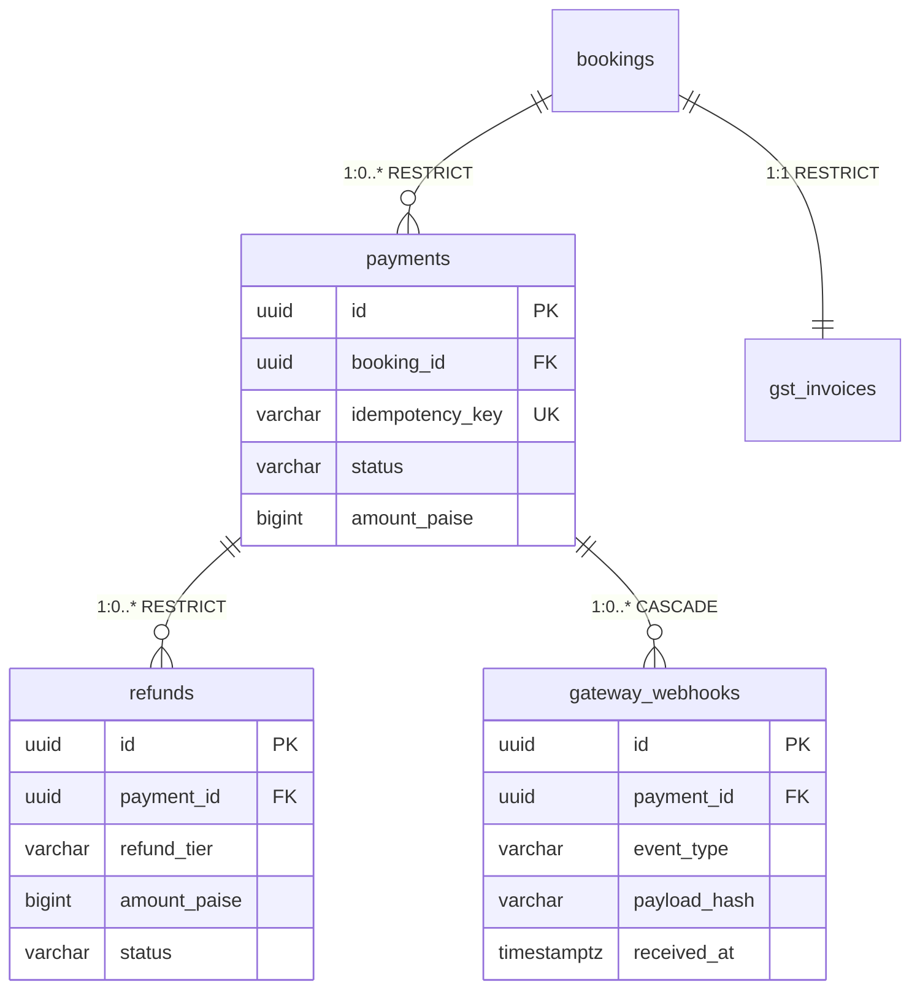

### 7.2 `payments`

```sql
CREATE TABLE payments (
  id                 uuid PRIMARY KEY DEFAULT gen_random_uuid(),
  booking_id         uuid NOT NULL REFERENCES bookings(id) ON DELETE RESTRICT,
  idempotency_key    varchar(100) NOT NULL,
  gateway            varchar(20) NOT NULL DEFAULT 'RAZORPAY' CHECK (gateway IN ('RAZORPAY')),
  method             varchar(20) CHECK (method IN ('UPI','CARD','NETBANKING','WALLET','EMI')),
  method_details_json jsonb,                        -- encrypted at rest (card last4, VPA)
  amount_paise       bigint NOT NULL CHECK (amount_paise > 0),
  currency           varchar(3) NOT NULL DEFAULT 'INR',
  status             varchar(20) NOT NULL DEFAULT 'INITIATED' CHECK (status IN (
                       'INITIATED','PENDING','SUCCEEDED','FAILED','EXPIRED','REFUNDED')),
  gateway_order_id   varchar(100),
  gateway_payment_id varchar(100),
  initiated_at       timestamptz NOT NULL DEFAULT now(),
  succeeded_at       timestamptz,
  failed_at          timestamptz,
  expired_at         timestamptz,                    -- v1.2: when payment timeout fired
  is_test            boolean NOT NULL DEFAULT false,
  created_at         timestamptz NOT NULL DEFAULT now(),
  updated_at         timestamptz NOT NULL DEFAULT now(),
  deleted_at         timestamptz,
  version            int NOT NULL DEFAULT 0
);

-- Global 24h unique for idempotency
CREATE UNIQUE INDEX uniq_payments_idempotency
  ON payments (idempotency_key)
  WHERE created_at > now() - interval '24 hours';

CREATE INDEX idx_payments_booking_id ON payments (booking_id) WHERE deleted_at IS NULL;
CREATE INDEX idx_payments_status ON payments (status) WHERE deleted_at IS NULL AND status IN ('INITIATED','PENDING');
CREATE INDEX idx_payments_gateway_payment_id ON payments (gateway_payment_id) WHERE deleted_at IS NULL;

-- v1.2: hot-path index for expire_pending_bookings cron
CREATE INDEX idx_payments_pending_created
  ON payments (created_at) WHERE status IN ('INITIATED','PENDING') AND deleted_at IS NULL;

CREATE TRIGGER trg_payments_updated
  BEFORE UPDATE ON payments
  FOR EACH ROW EXECUTE FUNCTION trigger_set_updated();
```

**`method_details_json` schema (card example):**

```json
{
  "_v": 1,
  "card_last4": "4242",
  "card_brand": "VISA",
  "token_ref": "rzp_tok_abc123"
}
```

Never stores full card number, CVV, or UPI PIN.

### 7.3 `refunds`

```sql
CREATE TABLE refunds (
  id                 uuid PRIMARY KEY DEFAULT gen_random_uuid(),
  payment_id         uuid NOT NULL REFERENCES payments(id) ON DELETE RESTRICT,
  reason             varchar(50) NOT NULL CHECK (reason IN (
                       'PASSENGER_CANCELLED','OPERATOR_CANCELLED',
                       'TRIP_CANCELLED','DUPLICATE_CHARGE','DISPUTE')),
  refund_tier        varchar(20) NOT NULL CHECK (refund_tier IN (
                       'TIER_FULL','TIER_75','TIER_50','TIER_ZERO','TIER_NOT_ELIGIBLE')),  -- v1.2
  amount_paise       bigint NOT NULL CHECK (amount_paise > 0),
  status             varchar(20) NOT NULL DEFAULT 'INITIATED' CHECK (status IN (
                       'INITIATED','PROCESSING','PROCESSED','FAILED')),
  gateway_refund_id  varchar(100),
  initiated_at       timestamptz NOT NULL DEFAULT now(),
  processed_at       timestamptz,
  failure_reason     varchar(200),
  is_test            boolean NOT NULL DEFAULT false,
  created_at         timestamptz NOT NULL DEFAULT now(),
  updated_at         timestamptz NOT NULL DEFAULT now(),
  deleted_at         timestamptz,
  version            int NOT NULL DEFAULT 0
);

CREATE INDEX idx_refunds_payment_id ON refunds (payment_id) WHERE deleted_at IS NULL;
CREATE INDEX idx_refunds_status ON refunds (status) WHERE deleted_at IS NULL AND status IN ('INITIATED','PROCESSING');

CREATE TRIGGER trg_refunds_updated
  BEFORE UPDATE ON refunds
  FOR EACH ROW EXECUTE FUNCTION trigger_set_updated();
```

**`refund_tier` semantics (per `07` §4.5):**

| Tier | Condition (before departure) | Fare | Tax | Fee |
|---|---|---|---|---|
| `TIER_FULL` | ≥ 24h | 100% | 100% | 100% |
| `TIER_75` | 12h ≤ t < 24h | 75% | 75% | 100% |
| `TIER_50` | 2h ≤ t < 12h | 50% | 50% | 100% |
| `TIER_ZERO` | t < 2h | 0% | 0% | 100% |
| `TIER_NOT_ELIGIBLE` | After departure OR already cancelled | 0% | 0% | 0% |

**Operator-cancelled refunds** always use `TIER_FULL` regardless of timing (per `07` §4.5).

### 7.4 `gst_invoices`

```sql
CREATE TABLE gst_invoices (
  id               uuid PRIMARY KEY DEFAULT gen_random_uuid(),
  booking_id       uuid NOT NULL UNIQUE REFERENCES bookings(id) ON DELETE RESTRICT,
  invoice_number   varchar(30) NOT NULL,
  gstin            varchar(15) NOT NULL,
  taxable_value_paise bigint NOT NULL,
  gst_amount_paise bigint NOT NULL,
  issued_at        timestamptz NOT NULL DEFAULT now(),
  is_test          boolean NOT NULL DEFAULT false,
  created_at       timestamptz NOT NULL DEFAULT now(),
  updated_at       timestamptz NOT NULL DEFAULT now(),
  deleted_at       timestamptz,
  version          int NOT NULL DEFAULT 0
);

CREATE UNIQUE INDEX uniq_gst_invoices_number ON gst_invoices (invoice_number);

-- NOTE: no UPDATE trigger — GSTInvoice is immutable after issuance
```

**Invoice generation timing (v1.2, per `05` §6.4 and §3.7):** A `gst_invoices` row is INSERTed **in the same transaction as the webhook `payment.captured` handler** — the transaction that UPDATEs `payments SUCCEEDED`, UPDATEs `bookings CONFIRMED`, and INSERTs `tickets`. The `invoice_number` is drawn from `invoice_number_seq_YYYY_YY` at that moment. No invoice is created for PENDING/EXPIRED/FAILED bookings. After issuance, the invoice is immutable.

**If the booking is later cancelled and refunded**, the invoice remains (never deleted); the audit_logs record the refund against the same booking_id. GST reversal is a Phase 2 concern (requires credit note mechanism); Phase 1 simply preserves the original invoice.

### 7.5 `gateway_webhooks`

```sql
CREATE TABLE gateway_webhooks (
  id           uuid PRIMARY KEY DEFAULT gen_random_uuid(),
  payment_id   uuid NOT NULL REFERENCES payments(id) ON DELETE CASCADE,
  event_type   varchar(50) NOT NULL CHECK (event_type IN (
                 'payment.captured','payment.failed',
                 'refund.processed','refund.failed')),
  payload_hash varchar(64) NOT NULL,                 -- SHA-256 of raw webhook body, computed by app
  payload_json jsonb NOT NULL,
  signature    varchar(200) NOT NULL,
  received_at  timestamptz NOT NULL DEFAULT now(),
  is_test      boolean NOT NULL DEFAULT false
);

CREATE INDEX idx_gateway_webhooks_payment_id ON gateway_webhooks (payment_id);
CREATE INDEX idx_gateway_webhooks_received_at ON gateway_webhooks (received_at);

-- THE critical constraint: replay protection.
-- Duplicate (payment_id, event_type, payload_hash) rows are rejected at DB level.
-- The app catches this unique violation and returns 200 no-op to Razorpay (per 09 §13.4).
CREATE UNIQUE INDEX uniq_gateway_webhooks_dedup
  ON gateway_webhooks (payment_id, event_type, payload_hash);

-- No UPDATE trigger — append-only. No deleted_at — purged by retention job at 90 days (§15).
```

**`payload_hash` computation:**

```
payload_hash = sha256(raw_request_body).hex()   // raw body, before JSON parsing
```

Computed by the webhook handler before the transaction opens. If a payload hash collision is astronomically unlikely but possible, the app treats the second row as a duplicate and returns 200. The unique constraint is what makes this guarantee real.

**Note:** This constraint is the backing for `09` §13.4's claim that "Payload hash uniqueness | `gateway_webhooks` unique on `(payment_id, event_type, payload_hash)`". Without it, webhook replay protection would be a paper claim.

---

## 8. Trip Schema

**The Trip context holds 3 tables.** `trips` is the root. `gps_samples` and `boarding_scans` are children. `gps_samples` is partitioned daily.

### 8.1 Trip ERD

**Diagram: Trip context ERD**
*Three Trip tables. `trips` references a `schedule`, `bus`, and `driver_profile`. `gps_samples` and `boarding_scans` cascade from `trips`. `gps_samples` is a daily-partitioned table (partition key = `recorded_at`).*

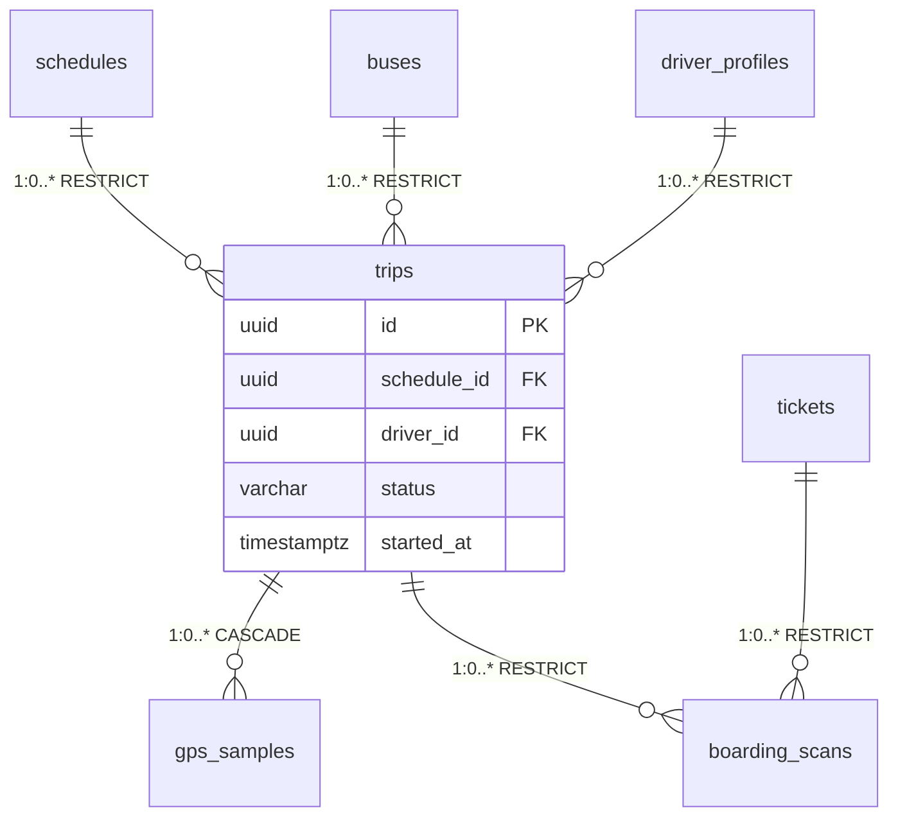

### 8.2 `trips`

```sql
CREATE TABLE trips (
  id              uuid PRIMARY KEY DEFAULT gen_random_uuid(),
  schedule_id     uuid NOT NULL REFERENCES schedules(id) ON DELETE RESTRICT,
  bus_id          uuid NOT NULL REFERENCES buses(id) ON DELETE RESTRICT,
  driver_id       uuid NOT NULL REFERENCES driver_profiles(id) ON DELETE RESTRICT,
  status          varchar(20) NOT NULL DEFAULT 'SCHEDULED' CHECK (status IN (
                    'SCHEDULED','IN_PROGRESS','COMPLETED','CANCELLED')),
  started_at      timestamptz,
  ended_at        timestamptz,
  cancelled_at    timestamptz,
  delay_reason    varchar(50),
  delay_minutes   int,
  distance_km     numeric(8,2),                                 -- v1.3 (A6): computed at /end
  is_test         boolean NOT NULL DEFAULT false,
  created_at      timestamptz NOT NULL DEFAULT now(),
  updated_at      timestamptz NOT NULL DEFAULT now(),
  deleted_at      timestamptz,
  version         int NOT NULL DEFAULT 0
);

CREATE INDEX idx_trips_schedule_id ON trips (schedule_id) WHERE deleted_at IS NULL;
CREATE INDEX idx_trips_driver_status ON trips (driver_id, status) WHERE deleted_at IS NULL;
CREATE INDEX idx_trips_status ON trips (status) WHERE deleted_at IS NULL AND status = 'IN_PROGRESS';

CREATE TRIGGER trg_trips_updated
  BEFORE UPDATE ON trips
  FOR EACH ROW EXECUTE FUNCTION trigger_set_updated();
```

**`distance_km numeric(8,2)` (A6 — applied Phase 1a):** Computed at `POST /v1/driver/trips/:id/end` from the ordered `gps_samples` for the trip. Uses the haversine formula summed over consecutive samples; stored for reporting and audit so `/trips/history` doesn't recompute. Nullable — trips in `SCHEDULED` or `IN_PROGRESS` state have no distance yet. Max 8 digits covers a 99,999.99 km trip — safe for demo scope.

### 8.3 `gps_samples` (partitioned daily)

```sql
CREATE TABLE gps_samples (
  id                          uuid NOT NULL DEFAULT gen_random_uuid(),
  trip_id                     uuid NOT NULL,                     -- soft FK to trips
  lat                         numeric(9,6) NOT NULL,
  lng                         numeric(9,6) NOT NULL,
  speed_kmh                   numeric(5,2),                      -- computed by server
  accuracy_m                  numeric(5,2),                      -- v1.3 (A4): client-reported accuracy
  client_reported_speed_kmh   numeric(5,2),                      -- v1.3 (A4): client-reported (provenance)
  received_at                 timestamptz NOT NULL DEFAULT now(), -- v1.3 (A2): server-side receive time
  recorded_at                 timestamptz NOT NULL,              -- client clock
  PRIMARY KEY (id, recorded_at)
) PARTITION BY RANGE (recorded_at);

-- Application creates tomorrow's partition via cron
CREATE TABLE gps_samples_2026_10_24 PARTITION OF gps_samples
  FOR VALUES FROM ('2026-10-24 00:00:00+00') TO ('2026-10-25 00:00:00+00');

CREATE INDEX idx_gps_samples_trip_recorded
  ON gps_samples (trip_id, recorded_at DESC);
```

**`received_at` (A2 — applied Phase 1a):** Server-side timestamp when the GPS sample hit the API. Distinct from `recorded_at` (client's own clock at sample time). The 6-check provenance pipeline in Phase 6 compares `received_at` vs `recorded_at` to detect forged timestamps, clock drift, and replay.

**`accuracy_m` (A4 — applied Phase 1a):** Client-reported GPS accuracy in meters (from `navigator.geolocation` or Expo's `Location.Accuracy`). Used by ETA computation to weight samples — a 5m accuracy sample is trusted more than a 100m accuracy sample for the same lat/lng. Nullable — some devices don't report accuracy.

**`client_reported_speed_kmh` (A4 — applied Phase 1a):** What the client said its speed was. Kept distinct from `speed_kmh` (which the server computes by comparing consecutive samples' lat/lng/time). Mismatch between these two is one of the 6 provenance signals that raises `gps_anomaly` in Phase 6.

**Note:** No FK to `trips` — partitioned tables can't participate in FKs efficiently. Application guarantees `trip_id` refers to an existing trip. `gps_samples` is append-only, no `updated_at`, `version`, or `deleted_at`.

### 8.4 `boarding_scans`

```sql
CREATE TABLE boarding_scans (
  id           uuid PRIMARY KEY DEFAULT gen_random_uuid(),
  trip_id      uuid NOT NULL REFERENCES trips(id) ON DELETE RESTRICT,
  ticket_id    uuid NOT NULL REFERENCES tickets(id) ON DELETE RESTRICT,
  driver_id    uuid NOT NULL REFERENCES driver_profiles(id) ON DELETE RESTRICT,
  stand_id     uuid NOT NULL REFERENCES stands(id) ON DELETE RESTRICT,
  result       varchar(30) NOT NULL CHECK (result IN (
                 'VALID','DUPLICATE','INVALID_SIGNATURE',
                 'INVALID_BOOKING','INVALID_TRIP')),
  scanned_at   timestamptz NOT NULL DEFAULT now(),
  scanned_lat  numeric(9,6),
  scanned_lng  numeric(9,6),
  is_test      boolean NOT NULL DEFAULT false
  -- Append-only; no updated_at, version, or deleted_at
);

CREATE INDEX idx_boarding_scans_trip_id ON boarding_scans (trip_id);
CREATE INDEX idx_boarding_scans_ticket_id ON boarding_scans (ticket_id);
CREATE INDEX idx_boarding_scans_scanned_at ON boarding_scans (scanned_at);
```

---

## 9. Audit Schema

**The Audit context holds 1 table.** `audit_logs` is append-only and partitioned monthly.

### 9.1 Audit ERD

**Diagram: Audit context ERD**
*A single append-only table partitioned monthly by `occurred_at`. No FKs — references are soft (`entity_type` + `entity_id` strings/UUIDs). Every other context writes here asynchronously after commit. Partitioned so archival (Phase 2) and per-month queries are trivial.*

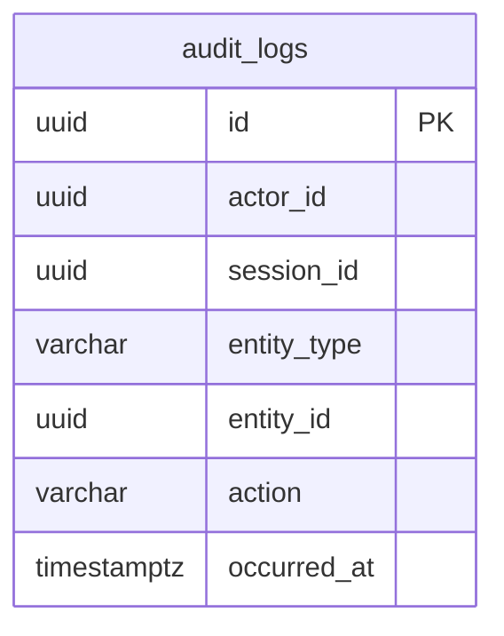

### 9.2 `audit_logs` (partitioned monthly)

```sql
CREATE TABLE audit_logs (
  id            uuid NOT NULL DEFAULT gen_random_uuid(),
  actor_id      uuid,                               -- soft FK to users; nullable for system
  session_id    uuid,                               -- soft FK to sessions; nullable
  entity_type   varchar(50) NOT NULL,               -- 'Booking', 'Payment', etc.
  entity_id     uuid NOT NULL,
  action        varchar(50) NOT NULL,               -- see 04 §10.3 + state transitions
  reason        varchar(500),                       -- required for sensitive actions
  ip_address    inet,
  metadata_json jsonb DEFAULT '{"_v": 1}'::jsonb,
  occurred_at   timestamptz NOT NULL DEFAULT now(),
  PRIMARY KEY (id, occurred_at)
) PARTITION BY RANGE (occurred_at);

CREATE TABLE audit_logs_2026_10 PARTITION OF audit_logs
  FOR VALUES FROM ('2026-10-01 00:00:00+00') TO ('2026-11-01 00:00:00+00');

CREATE INDEX idx_audit_logs_actor ON audit_logs (actor_id, occurred_at DESC);
CREATE INDEX idx_audit_logs_entity ON audit_logs (entity_type, entity_id, occurred_at DESC);
CREATE INDEX idx_audit_logs_action ON audit_logs (action, occurred_at DESC);
```

**Note:** No UPDATE/DELETE triggers. Database grants `SELECT, INSERT` only — no `UPDATE` or `DELETE` permissions granted to the app role.

---

## 10. Constraint Catalog and Error Codes

### 10.1 Constraint → Error code mapping

**Diagram: Constraint enforcement hierarchy**
*Write requests pass through four layers: app validation, DB CHECK, DB UNIQUE, DB FK. Each layer maps to a specific HTTP status and error code. The API translates Prisma's P2002/P2003/P2004 errors into domain-specific codes. Webhook dedup is a special case — the app catches the unique violation and returns 200 no-op, not an error.*

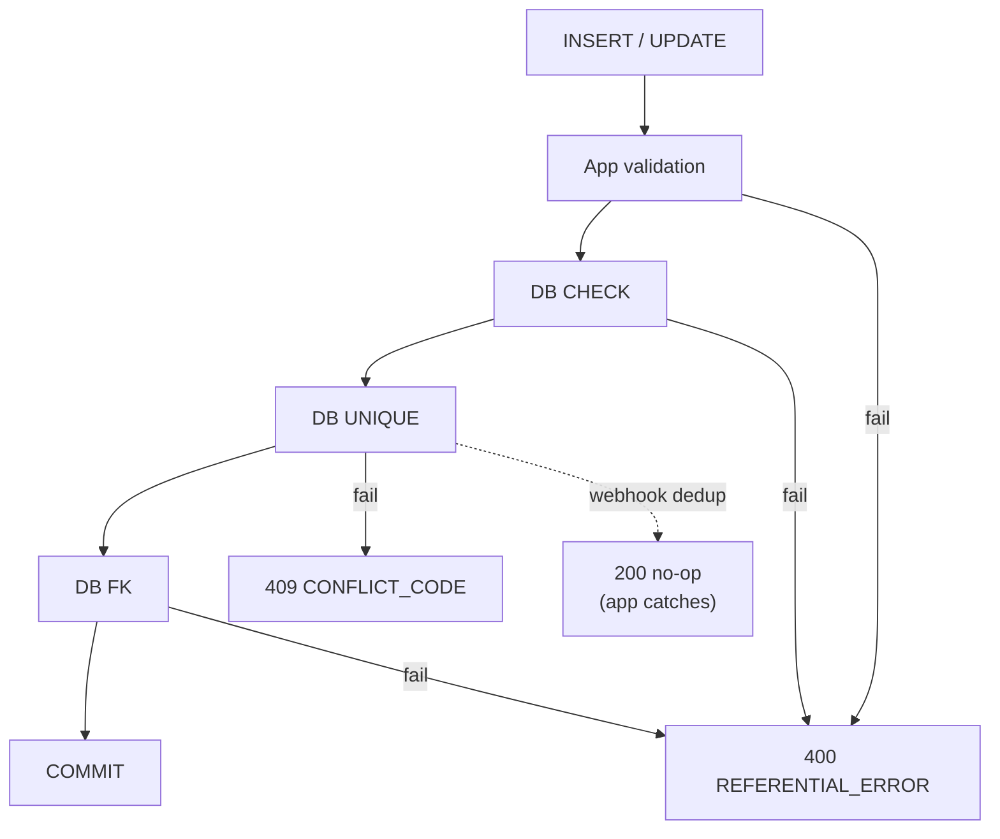

| Constraint | Table | Error code | HTTP |
|---|---|---|---|
| `uniq_users_phone_active` | users | `PHONE_ALREADY_REGISTERED` | 409 |
| `uniq_users_email_active` | users | `EMAIL_ALREADY_REGISTERED` | 409 |
| `uniq_operators_gstin` | operators | `GSTIN_ALREADY_REGISTERED` | 409 |
| `uniq_buses_registration` | buses | `BUS_REGISTRATION_EXISTS` | 409 |
| `uniq_driver_profiles_license` | driver_profiles | `LICENSE_ALREADY_REGISTERED` | 409 |
| `uniq_seat_locks_schedule_seat` | seat_locks | `SEAT_LOCKED` | 409 |
| `uniq_booking_passengers_schedule_seat` | booking_passengers | `SEAT_ALREADY_BOOKED` | 409 |
| `uniq_bookings_reference` | bookings | `BOOKING_REFERENCE_COLLISION` | 500 (retry) |
| `uniq_payments_idempotency` | payments | `IDEMPOTENCY_KEY_REUSED` | 409 |
| `uniq_tickets_booking_id` | tickets | `TICKET_ALREADY_ISSUED` | 500 |
| `uniq_gst_invoices_number` | gst_invoices | `INVOICE_NUMBER_COLLISION` | 500 (retry) |
| `uniq_gst_invoices_booking_id` | gst_invoices | `INVOICE_ALREADY_ISSUED` | 500 |
| `uniq_consent_records_user_purpose_active` | consent_records | `CONSENT_ALREADY_RECORDED` | 409 |
| `uniq_password_reset_tokens_token_hash` | password_reset_tokens | `RESET_TOKEN_INVALID` | 400 |
| **`uniq_gateway_webhooks_dedup`** | **gateway_webhooks** | **— (app catches; returns 200 no-op)** | **200** |
| `chk_users_phone_e164` | users | `INVALID_PHONE_FORMAT` | 400 |
| `chk_schedules_times` | schedules | `INVALID_SCHEDULE_TIMES` | 400 |
| `chk_routes_different_cities` | routes | `ROUTE_SAME_CITY` | 400 |
| `chk_buses_capacity` | buses | `INVALID_CAPACITY` | 400 |
| `chk_payments_amount_positive` | payments | `INVALID_AMOUNT` | 400 |
| `chk_consent_records_purpose` | consent_records | `INVALID_PURPOSE` | 400 |
| **`chk_refunds_tier`** | **refunds** | **`INVALID_REFUND_TIER`** | **400** |
| **`chk_otp_challenges_purpose`** | **otp_challenges** | **`INVALID_PURPOSE`** | **400** |
| **`chk_buses_bus_type`** | **buses** | **`INVALID_BUS_TYPE`** | **400** |
| **`chk_stands_type`** | **stands** | **`INVALID_STAND_TYPE`** | **400** |

**Webhook dedup note:** `uniq_gateway_webhooks_dedup` is a unique constraint, but it never surfaces as an error to the client. The webhook handler:
1. Computes `payload_hash = sha256(raw_body).hex()`
2. Begins transaction
3. Inserts `gateway_webhooks` row
4. If insert raises `23505` (unique_violation) on `uniq_gateway_webhooks_dedup` → rollback, return `200 OK` (no-op). Per `09` §13.4, this is the replay-prevention path.
5. If insert succeeds → process payment status change → commit → return `200 OK`

The constraint is not in the API error catalog — it is a security control enforced silently.

### 10.2 Sequences

| Sequence | Reset | Purpose |
|---|---|---|
| `booking_reference_seq_2026` | Yearly | Booking reference numbers (`BKG-2026-00001`) |
| `invoice_number_seq_2026_27` | Financial year (April) | GST invoice numbers (`INV/2026-27/00001`) |

---

## 11. Index Strategy

**Diagram: Index categories and hot paths**
*Four index categories: primary keys (automatic), foreign key indexes (for join performance), unique constraint indexes (for invariants), and query-optimization indexes (for hot paths). The hot-path list on the right covers the top-8 access patterns from `01-PLAN-AND-SCOPE.md` demo criteria, plus the new payment-timeout index.*

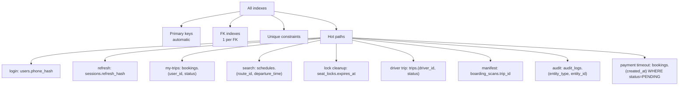

**Index policy:**

- Every FK has an index (non-negotiable, avoids full scans on cascade)
- Every unique constraint is backed by an index
- Hot-path queries get composite indexes
- No speculative indexes — measure first
- Partial indexes for filtered queries (`WHERE deleted_at IS NULL`)
- No index on low-cardinality booleans (`is_test` alone is never indexed)

**Performance targets:**

| Query | p95 target |
|---|---|
| Login (phone lookup) | < 50 ms |
| Refresh token validation | < 20 ms |
| Search schedules | < 200 ms |
| Seat lock acquisition | < 50 ms |
| Booking creation | < 500 ms |
| My-trips list | < 100 ms |
| Audit lookup | < 100 ms |
| Password reset verify | < 100 ms |
| Consent lookup | < 20 ms |
| Webhook dedup lookup | < 10 ms |
| **Payment timeout scan** | **< 500 ms (batch)** |

---

## 12. JSONB Schemas

Every JSONB column has a defined schema with a `_v` version field for forward compatibility.

| Column | `_v` | Shape |
|---|---|---|
| `passenger_profiles.preferences_json` | 1 | `{ preferred_seat_type: "SEATER", preferred_boarding: "FRONT" }` |
| `seat_layouts.aisle_map_json` | 1 | `{ aisle_cells: [{row, col}] }` |
| `bookings.fare_breakdown_json` | 1 | `{ base_fare_paise, tax_paise, convenience_fee_paise, total_paise }` |
| `payments.method_details_json` | 1 | `{ card_last4, card_brand, token_ref }` or `{ vpa }` — never full card or PIN |
| `audit_logs.metadata_json` | 1 | `{ changed_fields: [...], old_values: {...}, new_values: {...} }` |
| `gateway_webhooks.payload_json` | 1 | Raw Razorpay webhook body, unmodified |
| `refresh_token_chains.used_hashes` | 1 | `[hash1, hash2, ...]` |
| **`buses.amenities_json`** | **1** | **`{ items: ["WiFi", "AC", ...] }` — v1.3 (A2)** |
| **`driver_profiles.kyc_documents_json`** | **1** | **`{ [uploadId]: { uploadId, attachedAt } }` — Phase 6 migration** |

**Rule:** Every JSONB write adds or updates `_v`. Schema version bumps when a field is removed or its type changes. New fields are additive (no version bump required).

---

## 13. Encryption and Hashing

**Diagram: Encryption layers**
*Three encryption layers: TLS for transit; disk-level for the host; application-level for `Restricted` PII fields. Application-level uses AES-256-GCM with a key in `.env`. Searchable fields use deterministic SHA-256 hashes stored alongside the encrypted value. Webhook payload hash is a separate SHA-256 used for content-addressed dedup.*

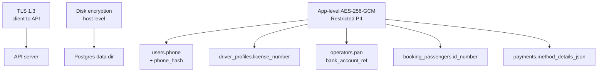

**Encrypted-at-rest columns:**

| Column | Method | Searchable? |
|---|---|---|
| `users.phone` | AES-256-GCM | Via `phone_hash` |
| `users.email` | AES-256-GCM | Via lowercased unique index on `email` (not encrypted) |
| `operators.pan` | AES-256-GCM | No |
| `operators.bank_account_ref` | AES-256-GCM | No |
| `driver_profiles.license_number` | AES-256-GCM | No (unique index on plaintext, acceptable) |
| `booking_passengers.id_number` | AES-256-GCM | No |
| `payments.method_details_json` | AES-256-GCM (whole JSON) | No |
| `sessions.device_fingerprint_hash` | SHA-256 (hashed, not encrypted) | Yes (deterministic) |

**Hash catalog:**

| Column | Algorithm | Salt |
|---|---|---|
| `operator_users.password_hash` | Argon2id (m=64MB, t=3, p=4) | Random per-row |
| `admin_users.password_hash` | Argon2id (m=64MB, t=3, p=4) | Random per-row |
| `otp_challenges.otp_hash` | SHA-256 | Random per-row (`otp_salt` column) |
| `sessions.refresh_hash` | SHA-256 | None (token is high-entropy) |
| `password_reset_tokens.token_hash` | SHA-256 | None (token is high-entropy) |
| `sessions.device_fingerprint_hash` | SHA-256 | Fixed app-level salt |
| `users.phone_hash` | SHA-256 | Fixed app-level salt (in `.env`) |
| **`gateway_webhooks.payload_hash`** | **SHA-256** | **None (content-addressed — same body must produce same hash)** |

---

## 14. Partitioning

**Diagram: Partitioning strategy**
*Two partitioned tables — `audit_logs` (monthly, retained forever) and `gps_samples` (daily, 90-day retention). Both are append-only, so partition management is trivial. All other 29 tables are unpartitioned; partitioning them adds migration complexity for no benefit at Phase 1 volume. 29 unpartitioned + 2 partitioned = 31 total.*

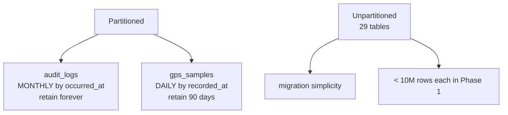

| Table | Key | Interval | Partitions active |
|---|---|---|---|
| `audit_logs` | `occurred_at` | Monthly | All (retained forever) |
| `gps_samples` | `recorded_at` | Daily | 90 |

**Partition maintenance:** A nightly cron creates tomorrow's `gps_samples` partition and next month's `audit_logs` partition. A separate retention cron drops `gps_samples` partitions older than 90 days.

---

## 15. Retention Jobs

**Diagram: Retention job schedule**
*Nightly cron at 02:00 UTC runs **nine** retention jobs. Each job is idempotent. GPS retention uses `DROP PARTITION` (O(1)); other jobs use `DELETE ... WHERE` (indexed). The new `expire_pending_bookings` job (v1.2) handles the 15-minute payment timeout — releasing seats and marking PENDING bookings EXPIRED. Failures alert but do not break subsequent jobs.*

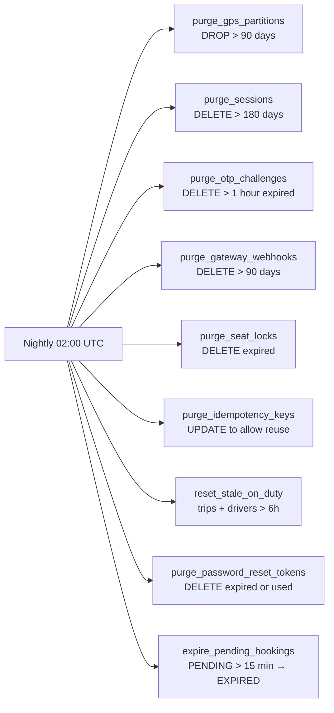

| Job | Table | Condition | Method |
|---|---|---|---|
| `purge_gps_partitions` | `gps_samples` | Partition older than 90 days | `DROP TABLE partition` |
| `purge_sessions` | `sessions` | `created_at < now() - 180d` | `DELETE` |
| `purge_otp_challenges` | `otp_challenges` | `expires_at < now() - 1h` | `DELETE` |
| `purge_gateway_webhooks` | `gateway_webhooks` | `received_at < now() - 90d` | `DELETE` |
| `purge_seat_locks` | `seat_locks` | `expires_at < now()` | `DELETE` |
| `purge_idempotency_keys` | `payments` | `created_at < now() - 24h` | `DELETE` (frees idempotency index) |
| `reset_stale_on_duty` | `driver_profiles` | `on_duty = true` + no active trip + updated > 6h | `UPDATE on_duty = false` |
| `purge_password_reset_tokens` | `password_reset_tokens` | `expires_at < now() - 1h` OR `used_at IS NOT NULL AND created_at < now() - 24h` | `DELETE` |
| **`expire_pending_bookings`** | **`bookings` + `payments` + `seat_locks`** | **`bookings.status = 'PENDING'` AND `bookings.created_at < now() - interval '15 minutes'`** | **Per-booking transaction: `UPDATE payments EXPIRED`; `UPDATE bookings EXPIRED`; `DELETE seat_locks`; `INSERT audit_logs action='booking_expired'`** |

**`expire_pending_bookings` — full specification (v1.2):**

```sql
-- Runs every 5 minutes (not just nightly) to bound the delay for a user who refreshes the page
-- after the 15-min window. Nightly batch is a safety net.

WITH expired AS (
  SELECT b.id AS booking_id, b.schedule_id, b.user_id
  FROM bookings b
  WHERE b.status = 'PENDING'
    AND b.created_at < now() - interval '15 minutes'
    AND b.deleted_at IS NULL
  LIMIT 100  -- batch to avoid long locks
)
SELECT b.booking_id, b.schedule_id, b.user_id, bp.seat_id
FROM expired b
JOIN booking_passengers bp ON bp.booking_id = b.booking_id;

-- For each row in the batch, in one transaction:
BEGIN;
  UPDATE payments SET status = 'EXPIRED', expired_at = now()
    WHERE booking_id = :booking_id AND status IN ('INITIATED','PENDING');
  UPDATE bookings SET status = 'EXPIRED', expired_at = now()
    WHERE id = :booking_id AND status = 'PENDING';
  DELETE FROM seat_locks
    WHERE schedule_id = :schedule_id AND seat_id IN (:seat_ids);
  INSERT INTO audit_logs (entity_type, entity_id, action, occurred_at)
    VALUES ('Booking', :booking_id, 'booking_expired', now());
COMMIT;
```

**Retention note:** `expire_pending_bookings` runs **every 5 minutes** as a BullMQ job — not just the nightly cron — so that a user who refreshes after 15 min sees the correct EXPIRED state, and seats are released back to inventory quickly. The nightly entry in the table above is the safety-net sweep.

**Webhook retention note:** `purge_gateway_webhooks` deletes rows older than 90 days. This is well beyond the 5-minute timestamp check and 24-hour payment-status no-op window from `09` §13.4, so replaying an old webhook after purge would be treated as a new event — but it would fail the timestamp check first (5 min), so it would 401 before any state change. Safe.

---

## 16. Migrations

**Diagram: Migration lifecycle**
*Prisma migrations. Developer edits schema, generates migration, reviews SQL, tests locally, commits. Staging applies via `migrate deploy`; production after staging passes. Rollbacks are manual and documented. Zero-downtime rules apply to always-hot tables (users, bookings, payments).*

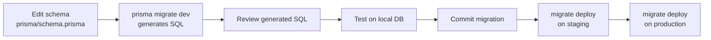

**Migration rules:**

| Rule | Detail |
|---|---|
| Tool | Prisma Migrate |
| Directory | `prisma/migrations/{timestamp}_{name}/migration.sql` |
| Naming | `YYYYMMDDHHMMSS_{verb}_{noun}` — e.g. `20261115120000_add_qr_payload` |
| Reversible | Every migration has a documented rollback in `prisma/migrations/ROLLBACKS.md` |
| Dry run | Every migration PR runs against staging first |
| Zero downtime | Required for `users`, `bookings`, `payments`, `sessions` — two-phase add-column or backfill-then-constrain |

**Zero-downtime rules:**

- Adding a column: nullable first, backfill, then set NOT NULL in a separate migration
- Adding an index: `CREATE INDEX CONCURRENTLY`
- Renaming a column: add new, dual-write, backfill, drop old (three migrations)
- Dropping a column: two-phase (mark deprecated, then drop after one release)

**Migration note for `payload_hash`:** The `payload_hash` column is `NOT NULL` with no default. Adding it to a live table with existing rows would fail. When this column is introduced (this migration), the sequence must be:
1. Add `payload_hash varchar(64)` (nullable)
2. Backfill: compute hash from `payload_json` for every existing row
3. Add `NOT NULL` constraint
4. Add `uniq_gateway_webhooks_dedup` index (`CREATE UNIQUE INDEX CONCURRENTLY`)
This is a multi-step zero-downtime migration for `gateway_webhooks` when it already has rows in staging/prod. In a fresh DB (dev, CI, initial staging), single migration is fine.

**Migration note for `refund_tier` (v1.2):** The `refund_tier` column is `NOT NULL`. Same pattern:
1. Add `refund_tier varchar(20)` (nullable)
2. Backfill: compute tier from `bookings.cancelled_at` vs `schedules.departure_time` for existing refunds
3. Add `NOT NULL` + `CHECK` constraint
4. Add to enum catalog and validation

**Migration note for `expired_at` (v1.2):** New columns `bookings.expired_at` and `payments.expired_at` are nullable — safe to add in a single migration.

**Migration note for `purpose` (v1.3 — Phase 2):** Applied as `20261027190000_add_otp_purpose`. Column added with `DEFAULT 'LOGIN'` to backfill existing rows; existing rows become LOGIN challenges which is correct. Compound index `idx_otp_challenges_phone_purpose_expires` added via `CREATE INDEX CONCURRENTLY`.

**Migration note for A2/A4/A6/DA3 (v1.3 — Phase 1a):** All applied as part of the `20261027092835_init` migration:
- `buses.bus_type` (5-enum) + `buses.amenities_json` (JSONB) — new columns, migration is single-step
- `gps_samples.accuracy_m`, `gps_samples.client_reported_speed_kmh`, `gps_samples.received_at` — new columns on partitioned table, added before partition creation in migration
- `trips.distance_km` — nullable, single-step
- `seats.seat_label` narrowed from `varchar(10)` to `varchar(4)` — was pre-populated fresh so no backfill needed

---

## 17. Seed Scripts

**Diagram: Seed script sequence**
*Seed order respects FK dependencies. Cities first, then stands, operators, buses, seat layouts, seats, routes, route stands, schedules, then users and profiles. Demo data (bookings, payments, trips) is created live during the demo, not seeded. Total ~360 rows, idempotent (UPSERT).*

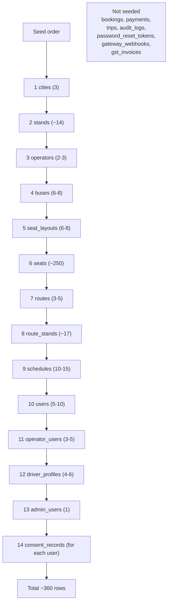

**Seed rules:**

- Every script is **idempotent** — re-running produces the same state via `INSERT ... ON CONFLICT DO UPDATE`
- Cities and stands are **not** marked `is_test` (real geographic data)
- All other seed rows are `is_test = true`
- Every seeded user gets `consent_records` for `terms_of_service` and `privacy_policy` (policy_version `v1.0`)
- A `verify-seed.ts` script asserts the expected counts
- Seed scripts run via `pnpm db:seed`

**Verification script asserts (actual Phase 10 counts, 380 rows):**

| Entity | Expected |
|---|---|
| cities | 3 |
| stands | 11 |
| operators | 3 |
| buses | 7 |
| seat_layouts | 7 |
| seats | 250 |
| routes | 5 |
| route_stands | 15 |
| schedules | 15 |
| drivers | 5 |
| operator_users | 5 |
| admin_users | 1 |
| users (total) | 16 |
| passenger_profiles | 5 |
| consent_records | 32 (2 per user × 16) |

**Total: 380 rows** verified by 61 assertions in `scripts/seed-assert.ts`.

---

## 18. Backup Strategy

| Backup type | Frequency | Retention |
|---|---|---|
| Continuous WAL archiving (PITR) | Continuous | 7 days |
| Daily full snapshot | 02:00 UTC | 30 days |
| Weekly snapshot | Sundays | 1 year |

**Restore drills:** Monthly. Restore latest daily snapshot to a scratch database, run smoke tests. Failure triggers page.

---

## 19. Test Matrix

Schema-level tests. Implementation lives in `10-TESTING-STRATEGY.md`.

| Suite | Count | Covers |
|---|---:|---|
| `constraint_*` | 25 | Each CHECK constraint rejects bad values (incl. `refund_tier`, `otp_purpose`, `bus_type`) |
| `fk_*` | 41 | Each FK + cascade behavior (CASCADE/RESTRICT) |
| `unique_*` | 16 | Each unique constraint (incl. webhook dedup) |
| `index_*` | 26 | Each declared index exists and is used (incl. `idx_bookings_pending_expiry`, `idx_payments_pending_created`, `idx_otp_challenges_phone_purpose_expires`) |
| `retention_*` | 9 | Each cron job deletes correctly (incl. `expire_pending_bookings`) |
| `partition_*` | 2 | Partition creation + drop |
| `migration_*` | 2 | Up/down symmetry |
| `seed_*` | 1 | Idempotency + verification |
| `jsonb_*` | 7 | Each JSONB column rejects malformed |
| `trigger_*` | 4 | `updated_at` + `version` increments (mutable tables) |
| **Total** | **133** | |

**Change in v1.2:** `constraint_*` 23→24 (added `chk_refunds_tier`). `index_*` 24→25 (added `idx_bookings_pending_expiry`, `idx_payments_pending_created`; consolidated). `retention_*` 8→9 (added `expire_pending_bookings`). Total 128→131.

**Change in v1.3:** `constraint_*` 24→25 (added `chk_otp_challenges_purpose`). `index_*` 25→26 (added `idx_otp_challenges_phone_purpose_expires` for purpose-isolation lookup). Total 131→133.

### 19.1 Key assertions

| Test | Assertion |
|---|---|
| `constraint_enum_booking_status` | `INSERT bookings(status='INVALID')` → CHECK violation |
| **`constraint_refund_tier`** | **`INSERT refunds(refund_tier='INVALID')` → CHECK violation** |
| **`constraint_otp_purpose`** | **`INSERT otp_challenges(purpose='INVALID')` → CHECK violation** |
| `unique_seat_lock` | Two active locks on same `(schedule_id, seat_id)` → second fails |
| `unique_seat_booking` | Two bookings on same `(schedule_id, seat_id)` → second fails |
| **`unique_gateway_webhooks_dedup`** | **Two `gateway_webhooks` rows with same `(payment_id, event_type, payload_hash)` → second fails** |
| `fk_cascade_user_profile` | Delete user → passenger_profile, sessions cascade-deleted |
| `fk_restrict_booking_user` | Delete user with bookings → RESTRICT error |
| `fk_operator_users_operator` | Delete operator → operator_users cascade-deleted |
| `fk_driver_profiles_operator` | Delete operator with drivers → RESTRICT error |
| `trigger_version_increment` | UPDATE row → version = version + 1 |
| `trigger_updated_at` | UPDATE row → `updated_at > created_at` |
| `partition_gps_drop` | Drop 91-day partition → row count decreases |
| `retention_seat_lock` | Nightly job → expired locks deleted |
| `retention_password_reset_tokens` | Nightly job → expired/used tokens deleted |
| **`retention_expire_pending_bookings`** | **Cron runs → PENDING bookings older than 15 min transition to EXPIRED; associated `payments` → EXPIRED; `seat_locks` deleted** |
| `consent_01_user_purpose_unique` | Two active consents per `(user, purpose)` → second fails |
| `consent_02_revoke_reconsent` | Revoke + re-consent creates 2 rows (old revoked, new active) |
| `password_reset_01_token_single_use` | Reuse of consumed token → 401 `RESET_TOKEN_INVALID` |
| `password_reset_02_token_hashed` | Raw token not stored anywhere |
| **`webhook_01_duplicate_payload`** | **Same `(payment_id, event_type, payload_hash)` → app catches 23505, returns 200 no-op, no state change** |
| **`webhook_02_different_payload`** | **Same payment, different payload body → two rows stored, second processed** |
| **`index_otp_purpose_isolation`** | **Query with `WHERE phone_or_email = ? AND purpose = ?` uses the compound index; verify with `EXPLAIN`** |
| `seed_idempotent` | Run seed twice → same row counts |

---

## 20. Open Questions

| # | Question | Owner | Default |
|:---:|---|---|---|
| 1 | Row-level security (Postgres RLS) — enable in Phase 2? | Shaghaf | App-level filtering in Phase 1; RLS in Phase 2 |
| 2 | Read replica — add in Phase 2? | Shaghaf | No in Phase 1 |
| 3 | `pg_trgm` triggers for city search — Phase 2? | Shaghaf | Deferred |
| 4 | `qr_keys` table for rotation — Phase 2? | Shaghaf | `.env` only in Phase 1 |
| 5 | Key rotation cadence | Shaghaf | Quarterly in Phase 2 |
| 6 | Multi-tenant row partitioning — Phase 3? | Shaghaf | No |
| 7 | Logical replication for analytics — Phase 2? | Shaghaf | No in Phase 1 |
| 8 | Encryption key storage — `.env` in Phase 1, KMS in Phase 2? | Shaghaf | `.env` Phase 1 |
| 9 | Backup restore drill cadence | Shaghaf | Monthly |
| 10 | `booking_passengers.schedule_id` denormalization — acceptable trade-off? | Shaghaf | Yes (needed for unique constraint) |
| 11 | Single password per human (move `password_hash` to `users`) — Phase 2? | Shaghaf | Keep per-profile in Phase 1; revisit Phase 2 if user has multiple operator memberships |

---

## 21. Checklist Against Master List

| Item | Included? | Section |
|---|:---:|---|
| Purpose and conventions | ✅ | §1 |
| Locked Postgres conventions | ✅ | §1.2 |
| Doc hierarchy | ✅ | §1.3 |
| Postgres extensions | ✅ | §2.1 |
| Database configuration | ✅ | §2.2 |
| Connection pool | ✅ | §2.3 |
| Standard column set | ✅ | §3.1 |
| `is_test` propagation | ✅ | §3.1 |
| Trigger catalog | ✅ | §3.2 |
| Soft-delete pattern | ✅ | §3.3 |
| Idempotency pattern (**+ new-key retry rule**) | ✅ | §3.4 |
| Multi-table transactions (**9 operations incl. payment timeout**) | ✅ | §3.5 |
| **Booking creation / webhook sequence detail** | ✅ | §3.5 |
| **Webhook DB error fallback** | ✅ | §3.5 |
| Booking reference generation | ✅ | §3.6 |
| Invoice number generation (**+ timing note**) | ✅ | §3.7 |
| Hashing algorithms (incl. webhook payload hash) | ✅ | §3.8 |
| Identity ERD + DDL | ✅ | §4 |
| `email_verified` column on `users` | ✅ | §4.2 |
| `password_hash` on `operator_users` | ✅ | §4.4 |
| `password_hash` on `admin_users` | ✅ | §4.6 |
| **`otp_challenges.purpose` column (P2, v1.3)** | ✅ | §4.8 |
| **`consent_records` table** | ✅ | §4.10 |
| **`password_reset_tokens` table** | ✅ | §4.11 |
| Network ERD + DDL | ✅ | §5 |
| **`stands.type` 3-value enum (v1.3)** | ✅ | §5.3 |
| **Deferred `operator_id` FK constraints** | ✅ | §5.4 |
| **`buses.bus_type` + `amenities_json` (A2, v1.3)** | ✅ | §5.5 |
| **`seats.seat_label varchar(4)` (DA3, v1.3)** | ✅ | §5.7 |
| Booking ERD + DDL (**extended TTL note**) | ✅ | §6 |
| **`bookings.expired_at` column** | ✅ | §6.3 |
| **`payments.expired_at` column** | ✅ | §7.2 |
| Payments ERD + DDL (**refund_tier, payload_hash, expired_at**) | ✅ | §7 |
| **`gateway_webhooks.payload_hash` column** | ✅ | §7.5 |
| **`uniq_gateway_webhooks_dedup` unique index** | ✅ | §7.5 |
| **`refunds.refund_tier` column + CHECK** | ✅ | §7.3 |
| Trip ERD + DDL | ✅ | §8 |
| **`trips.distance_km` (A6, v1.3)** | ✅ | §8.2 |
| **`gps_samples.received_at` + `accuracy_m` + `client_reported_speed_kmh` (A2, A4, v1.3)** | ✅ | §8.3 |
| Audit ERD + DDL | ✅ | §9 |
| Constraint catalog (incl. webhook dedup, refund_tier) | ✅ | §10.1 |
| Sequences | ✅ | §10.2 |
| Index strategy (**+ payment timeout index**) | ✅ | §11 |
| JSONB schemas (incl. `buses.amenities_json`, `driver_profiles.kyc_documents_json`) | ✅ | §12 |
| Encryption and hashing (incl. webhook payload hash) | ✅ | §13 |
| Partitioning | ✅ | §14 |
| **Retention jobs (9, incl. expire_pending_bookings with spec)** | ✅ | §15 |
| Migrations (**+ refund_tier, expired_at, payload_hash, purpose, A2/A4/A6/DA3 paths**) | ✅ | §16 |
| Seed scripts (Phase 10 actual counts) | ✅ | §17 |
| Backup strategy | ✅ | §18 |
| Test matrix (**133 tests**, incl. refund_tier + expire_pending_bookings + otp_purpose) | ✅ | §19 |
| Open questions (11) | ✅ | §20 |

**All items covered. 26 Mermaid diagrams. All diagrams described. 31 tables across 6 contexts.**

---

## 22. One-Paragraph Summary

**BusVerse + BusCon Phase 1 runs on PostgreSQL 16 with 31 tables across 6 bounded contexts, backed by pgcrypto for UUID generation and pg_trgm for future search. Every mutable table carries a standard column set — `id uuid` PK, `created_at`, `updated_at`, `deleted_at`, `version int`, and (for transactional tables only) `is_test boolean` — with `updated_at` and `version` maintained by a shared `trigger_set_updated()` function. Soft delete is enforced via Prisma middleware with partial unique indexes so soft-deleted rows do not block re-registration. Money is stored as `bigint` paise, enums as `varchar(50) + CHECK` constraints, JSONB columns with a `_v` version field, and phone numbers in E.164 with a deterministic SHA-256 `phone_hash` for search. **The DB-level guarantee of no double-locking is a unique constraint on `(schedule_id, seat_id)` in `seat_locks`; the guarantee of no double-booking is a unique constraint on `(schedule_id, seat_id)` in `booking_passengers`. In v1.2, the booking creation transaction no longer deletes the lock or creates a ticket — it INSERTs `bookings (PENDING)` + `booking_passengers` + extends the lock TTL to 15 min. The webhook `payment.captured` transaction atomically UPDATEs `payments SUCCEEDED`, UPDATEs `bookings CONFIRMED`, INSERTs `tickets` (Ed25519-signed), INSERTs `gst_invoices` (with sequential invoice_number), INSERTs `gateway_webhooks` (with payload_hash), and DELETEs `seat_locks`. This sequencing enforces invariants #1 (CONFIRMED bookings have exactly one ticket) and #18 (ticket cannot exist without payment) at the transaction level. A 9th retention job (`expire_pending_bookings`, running every 5 minutes) handles the 15-minute payment timeout — transitioning PENDING bookings to EXPIRED, `payments` to EXPIRED, and releasing the associated `seat_locks`.** Booking references and GST invoice numbers are generated via year-scoped and financial-year-scoped Postgres SEQUENCEs. Passwords use Argon2id on `operator_users.password_hash` and `admin_users.password_hash`, OTPs and refresh tokens and reset tokens and phone hashes and webhook payload hashes use SHA-256, and Restricted PII fields (phone, PAN, license, ID, card details) are encrypted at rest with AES-256-GCM plus searchable hash columns. **`gateway_webhooks` carries a `payload_hash varchar(64)` column populated by the app (SHA-256 of the raw webhook body) plus a `uniq_gateway_webhooks_dedup` unique index on `(payment_id, event_type, payload_hash)` — the DB-level backing for `09` v1.1 §13.4's replay-protection claim. Duplicates raise `23505` and the app catches it, returns `200 OK` no-op, and never enters the state-change transaction. On DB error during webhook processing, the handler writes the raw body to `/tmp/webhooks/{uuid}.json` before returning 200 (per `09` §13.5) — a background replay job retries the DB write. No webhook is ever lost.** `refunds` carries a new `refund_tier` column with 5 enum values (`TIER_FULL`, `TIER_75`, `TIER_50`, `TIER_ZERO`, `TIER_NOT_ELIGIBLE`) — the canonical refund calculation per `07` v1.2 §4.5. Two tables are partitioned — `audit_logs` monthly (retained forever) and `gps_samples` daily (retained 90 days, dropped via partition DROP). **Nine retention cron jobs run at 02:00 UTC plus a 5-min interval for `expire_pending_bookings`, including password-reset-token purge and gateway-webhook purge at 90 days.** The Identity context includes `consent_records` (DPDP §7(1) consent per user per purpose with policy version and IP capture, soft-revoke pattern) and `password_reset_tokens` (SHA-256 hashed one-time reset tokens with 30-min expiry, single-use via `used_at`), plus deferred `operator_id` FK constraints from `operator_users` and `driver_profiles` to `operators`. Migrations use Prisma Migrate with documented rollbacks and zero-downtime rules — including specific paths for `payload_hash`, `refund_tier`, `expired_at`, `purpose`, and the Phase 1a A2/A4/A6/DA3 columns. Seed scripts are idempotent UPSERTs producing **380 rows** (matching actual Phase 10 seed) across the Delhi → Kanpur → Lucknow demo corridor, including seed consent records for every user. A constraint-to-error-code catalog maps every DB violation to an API error code — except `uniq_gateway_webhooks_dedup`, which is deliberately silent (returns 200 no-op). **One hundred and thirty-three schema tests** enforce constraints, FKs, cascades, partitions, retention (including payment timeout), triggers, webhook dedup, refund_tier validation, otp_purpose isolation, and seed idempotency. Eleven open questions remain, all Phase-2-decidable defaults, none blocking.

**v1.3 note:** All eight amendments listed in §0.1 are applied to the live schema and reflected in the DDL above — this doc now matches the database. Remaining items in `00-INDEX` §14 that are still flagged "pending" (A5 `tickets.passenger_count`, A19 QR payload v2, A22 Design guide, A23 `<DataTable>` primitive, A24 driver microcopy) are Phase 4+ / product-doc concerns, not schema-level, and do not affect the DDL in this document.

---

**End of Document `06-DATABASE-SCHEMA.md` v1.3.**