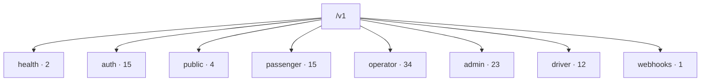
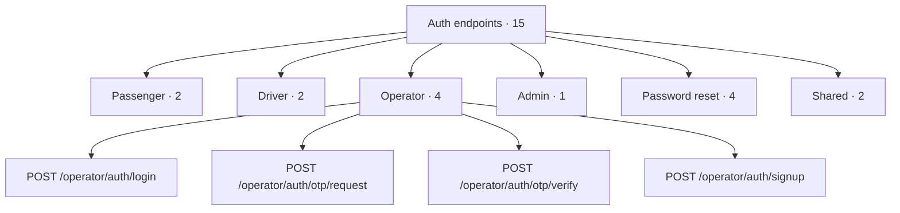
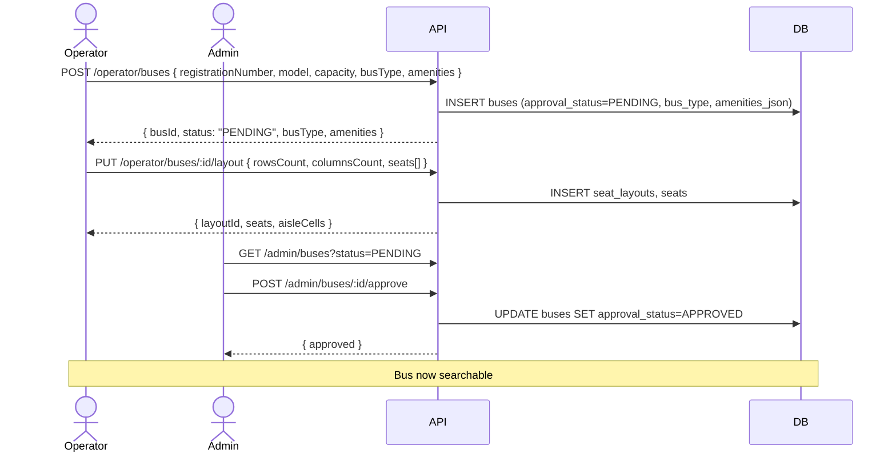

# `07-API-AND-REALTIME-CONTRACTS.md` — v1.4 DRAFT

**Document:** `docs/07-API-AND-REALTIME-CONTRACTS.md`
**Version:** 1.4 (draft)
**Status:** Locked — Foundational Document
**Owner:** Shaghaf
**Guide:** Mr. Mohit Srivastav
**Purpose:** Complete REST + WebSocket + webhook contract for BusVerse + BusCon Phase 1.

> **Draft format note:** This is the **v1.4 draft**. Sections marked **`[unchanged from v1.2]`** are byte-identical to the v1.2 body you already have in the file — do not re-paste, leave those sections alone. Sections **without** that marker are the ones that changed or are new; replace/insert them. A full reconciliation table in §1.5.3 explains the 101 → 108 arithmetic and flags **2 endpoints pending route-grep confirmation** (see §1.5.3, "TBD" rows).

> **v1.2 amendments (retained):** Refund-preview shape + tier table (§4.5). `expiresAt` on booking + 15-min PENDING window (§4.5). New Idempotency-Key on payment retry (§4.6, §11.2). Seat lock pre-check (§4.4). `PAYMENT_NOT_ALLOWED` error (§9.2 — 48 → 49). Webhook dedup + DB fallback (§13.3). `OPERATOR_CANCELLED` always `TIER_FULL` (§4.5).

> **v1.3 amendments (rolled into this draft):** `GET /v1/public/cities/:id/stands` (§4.2). `SCHEDULE_CONFLICT` error (§5.6, §9.2 — 49 → 50). Phase 3c operator response contracts fully specified (§5.7–§5.10). Bus registration includes `busType` + `amenities` (§5.3). Concrete PII mask table per endpoint family (§5.5). Endpoint count 101 → 102. Test matrix updated (§15.5).

> **v1.4 amendments (this draft):**
> - `POST /v1/operator/auth/signup` — §3.10 **(P13)** — 4 new error codes: `INVALID_GSTIN_FORMAT` (400), `INVALID_PAN_FORMAT` (400); `GSTIN_ALREADY_REGISTERED` already existed. Auth count 14 → 15.
> - `POST /v1/operator/trips/:id/cancel` — §5.11 **(P12)** — operator-initiated trip cancel with booking-cascade refunds. Operator count 33 → 34. **[VERIFY PATH — see §1.5.3]**
> - `POST /v1/admin/audit-logs/export-async` — §6.7 **(P12)** — start async export job. Admin count 21 → 22.
> - `GET /v1/admin/audit-logs/export-async/:jobId` — §6.7 **(P12)** — poll job status. Admin count 22 → 23.
> - Error catalog 50 → **52** (added `INVALID_GSTIN_FORMAT`, `INVALID_PAN_FORMAT`).
> - Endpoint count 102 → **108** (4 above documented + 2 flagged TBD in §1.5.3).
> - §15.5 test matrix bumped (`contract_*`/`rbac_*` → 108, `error_*` → 52).

---

## 1. Purpose and Principles

### 1.1–1.4 `[unchanged from v1.2]`

Six subsections — What this document owns / API position diagram / Ten API principles / What this document does NOT cover — are byte-identical. Leave as-is.

### 1.5 Endpoint Summary Table

#### 1.5.1 Endpoint tree

**Diagram: Endpoint surface tree (v1.4)**
*Eight endpoint categories. Auth, operator, admin counts increased vs v1.2. Public is 4 (v1.3). Totals 108 per §1.5.3 reconciliation.*



#### 1.5.2 Master endpoint list

| Category | Count | Auth required |
|---|---:|---|
| Health | 2 | None |
| Auth | **15** | Public (except refresh/logout) |
| Public (passenger-facing) | **4** | None |
| Passenger | 15 | JWT (`REGISTERED_PASSENGER`) |
| Operator | **34** | JWT (`OPERATOR_OWNER` / `OPERATOR_MANAGER`) |
| Admin | **23** | JWT (`SUPER_ADMIN`) |
| Driver | 12 | JWT (`DRIVER`) |
| Webhooks | 1 | Razorpay signature |
| **Total** | **108** | |

**Note on endpoint count:** v1.2 = 101. v1.3 added 1 (`GET /public/cities/:id/stands`). v1.4 adds 4 individually-documented endpoints (`POST /operator/auth/signup`, `POST /operator/trips/:id/cancel`, `POST /admin/audit-logs/export-async`, `GET /admin/audit-logs/export-async/:jobId`) = 106 documented. **2 endpoints remain TBD** — the exact delta from the tracker (P11 module delta). See §1.5.3.

#### 1.5.3 Endpoint count reconciliation (NEW v1.4)

The arithmetic from the tracker (`00-BUILD-PROGRESS` v2.8 §2.3) does not cleanly match what this doc has documented. This table records every step and flags the gap.

| Step | Endpoint total | Documented here? |
|---|---:|---|
| v1.2 baseline | 101 | ✅ fully |
| v1.3: `GET /public/cities/:id/stands` | 102 | ✅ §4.2 |
| v1.4: `POST /operator/auth/signup` (P13) | 103 | ✅ §3.10 |
| v1.4: `POST /operator/trips/:id/cancel` (P12) | 104 | ✅ §5.11 — path flagged below |
| v1.4: `POST /admin/audit-logs/export-async` (P12) | 105 | ✅ §6.7 |
| v1.4: `GET /admin/audit-logs/export-async/:jobId` (P12) | 106 | ✅ §6.7 |
| P11 module delta (unknown) | 108 | ❌ **TBD — 2 endpoints** |

**Two TBD endpoints (route-grep pending):** The tracker §2.3 shows 104 endpoints at end of P11 vs 101 documented in v1.2 — a 3-endpoint gap, but only 1 (`city stands`) is documented in v1.3. Therefore **2 endpoints shipped in P11 are not in this doc**. Most likely candidates from the P11 test set (`network-public.test.ts` +3, `trip-service-lifecycle.test.ts` 15 new): either 2 additional public endpoints (e.g. schedule-filter variants) or 2 trip-service action endpoints (delay-resume, seat-lock admin release). **To be confirmed by `grep -R "app\.\(get\|post\|patch\|put\|delete\)" apps/api/src/modules --include=*.router.ts` before this doc is saved to disk.**

**VERIFY PATH — `POST /operator/trips/:id/cancel`:** The tracker module table shows the +1 in P12 landed in the **Trip module** (15 → 16), not the Operator module. That could mean the path is `POST /v1/operator/trips/:id/cancel` (Trip module exposing operator route) **or** `POST /v1/driver/trips/:id/cancel` (Trip module exposing driver route). The cascade semantics ("trip cancellation triggers per-booking refunds, per-booking failures non-fatal" per tracker non-negotiables) strongly imply operator-initiated, so this draft uses **operator surface**. If recon shows otherwise, move §5.11 → §7 and adjust counts. **Zero response-shape impact** — the response and cascade rules are identical either way.

---

## 2. URL and Response Conventions `[unchanged from v1.2]`

Six subsections — URL structure diagram, URL conventions table, response envelope diagram + examples, data type glossary, HTTP methods, state-transition endpoints — are unchanged. No response shapes changed in v1.3/v1.4.

---

## 3. Auth Endpoints

### 3.1 Auth endpoint map `[unchanged from v1.2]`

The map diagram changes only by adding `operator signup` under the Operator branch. New v1.4 diagram:



### 3.2 Endpoint catalog

| Method | Path | Auth | Role | Purpose |
|---|---|---|---|---|
| POST | `/v1/passenger/auth/otp/request` | None | — | Send OTP to phone or email |
| POST | `/v1/passenger/auth/otp/verify` | None | — | Verify OTP → issue tokens |
| POST | `/v1/driver/auth/otp/request` | None | — | Send OTP to driver phone |
| POST | `/v1/driver/auth/otp/verify` | None | — | Verify OTP → issue tokens |
| POST | `/v1/operator/auth/login` | None | — | Email + password login |
| POST | `/v1/operator/auth/otp/request` | None | — | Send OTP to operator phone |
| POST | `/v1/operator/auth/otp/verify` | None | — | Verify OTP → issue tokens |
| **POST** | **`/v1/operator/auth/signup`** | **None** | **—** | **New operator self-signup (P13)** |
| POST | `/v1/admin/auth/login` | None | — | Email + password login |
| POST | `/v1/operator/auth/reset/request` | None | — | Request password reset |
| POST | `/v1/operator/auth/reset/verify` | None | — | Complete password reset |
| POST | `/v1/admin/auth/reset/request` | None | — | Request password reset |
| POST | `/v1/admin/auth/reset/verify` | None | — | Complete password reset |
| POST | `/v1/{surface}/auth/refresh` | Refresh cookie | any | Rotate access + refresh |
| POST | `/v1/{surface}/auth/logout` | JWT | any | Revoke session |

### 3.3–3.9 `[unchanged from v1.2]`

Passenger OTP, Driver OTP, Operator dual login, Admin login, Password reset, Refresh/logout, Auth error codes — unchanged.

### 3.10 Operator signup (NEW v1.4 — P13)

Operator self-service signup. Creates `User` + `Operator` + `OperatorUser` + 2 consent records in **one transaction**. Emits `operator:applied` WS event to `admin:notifications` **after** transaction commit. Writes audit row.

**Request:**
```
POST /v1/operator/auth/signup
Content-Type: application/json

{
  "companyName": "Sharma Travels Pvt Ltd",
  "gstin": "09AAACH7409R1ZZ",
  "pan": "AAACH7409R",
  "email": "founder@sharmatravels.com",
  "phone": "+919876543210",
  "password": "SecurePass123!"
}
```

**Request schema (`.strict()`):**

| Field | Type | Validation |
|---|---|---|
| `companyName` | string | 2–200 chars |
| `gstin` | string | 15-char regex `^[0-9]{2}[A-Z]{5}[0-9]{4}[A-Z]{1}[1-9A-Z]{1}Z[0-9A-Z]{1}$` |
| `pan` | string | 10-char regex `^[A-Z]{5}[0-9]{4}[A-Z]{1}$` |
| `email` | string | valid email, lowercased server-side |
| `phone` | string | E.164 (per §2.4) |
| `password` | string | 12–128 chars, must include letter + digit (Argon2id-hashed) |

**Response (201):**
```json
{
  "data": {
    "operatorId": "uuid",
    "userId": "uuid",
    "status": "APPLIED",
    "message": "Application submitted. You will be notified when your account is approved."
  },
  "meta": {
    "requestId": "req_abc123"
  }
}
```

**Rules:**

- Pre-check (all in one query): `findOperatorByGstin` for duplicate; `users` for duplicate email; `users` for duplicate phone.
- All 4 writes (`User`, `Operator` with `status: 'APPLIED'`, `OperatorUser` with `role: 'OWNER'`, 2 `consent_records`) happen inside **one** `prisma.$transaction`.
- Password hashed with Argon2id before `OperatorUser` insert.
- Audit row: `action: 'operator_signup'`, `reason: 'Self-signup via /operator/auth/signup'`, `actorUserId: <new user>`.
- WS emit: `emitToTopic('admin:notifications', events.operatorApplied(...))` — fires **after** tx commit (per §2.4 non-negotiable "Emit AFTER tx commit").
- On any step failure, whole tx rolls back. Unique constraint on GSTIN at commit time is the final race guard.

**Errors:**

| Error | HTTP | When |
|---|---|---|
| `INVALID_GSTIN_FORMAT` | 400 | GSTIN fails regex — **new v1.4 code** |
| `INVALID_PAN_FORMAT` | 400 | PAN fails regex — **new v1.4 code** |
| `INVALID_PHONE_FORMAT` | 400 | Phone not E.164 |
| `INVALID_EMAIL_FORMAT` | 400 | Email malformed |
| `VALIDATION_ERROR` | 422 | Password too weak, `companyName` out of bounds, or extra field (`.strict()`) |
| `EMAIL_ALREADY_REGISTERED` | 409 | Email exists |
| `PHONE_ALREADY_REGISTERED` | 409 | Phone exists |
| `GSTIN_ALREADY_REGISTERED` | 409 | GSTIN exists (existing error code) |
| `RATE_LIMITED` | 429 | >3 requests / 10 min / IP |

**No `emailVerified` gate at signup.** The `users` row is created with `emailVerified: false`. Operator cannot log in via `/operator/auth/login` until admin approves and email is verified — that's a separate flow. The signup response does **not** issue tokens.

---

## 4. BusVerse Endpoints (Passenger)

### 4.1 Passenger endpoint flow `[unchanged from v1.2]`

### 4.2 Public endpoints (EXPANDED v1.3)

| Method | Path | Purpose |
|---|---|---|
| GET | `/v1/public/cities` | City autocomplete (`?q=del&limit=50`) |
| **GET** | **`/v1/public/cities/:id/stands`** | **v1.3 — List stands in a city** |
| GET | `/v1/public/search` | Search schedules by route + date |
| GET | `/v1/public/schedules/:id` | Schedule detail with stops + fare + bus |

**Cities request:** `GET /v1/public/cities?q=del&limit=50`

**Cities response:**
```json
{
  "data": [
    { "id": "uuid", "name": "Delhi", "state": "Delhi", "isActive": true }
  ]
}
```

**City stands request:** `GET /v1/public/cities/:id/stands`

**City stands response:**
```json
{
  "data": [
    {
      "id": "uuid",
      "cityId": "uuid",
      "name": "ISBT Kashmere Gate",
      "type": "BUS_STAND",
      "lat": 28.6675,
      "lng": 77.2284
    }
  ]
}
```

Errors: `404 NOT_FOUND` if city id doesn't exist. Stand `type` enum: `BUS_STAND` | `PICKUP_POINT` | `DROP_POINT` (per `06` v1.3 §5.3).

**Search request:**
```
GET /v1/public/search?originCityId=uuid&destinationCityId=uuid&date=2026-11-01&sortBy=departureTime
```

Query params: `originCityId` (required), `destinationCityId` (required), `date` (YYYY-MM-DD, required, IST-anchored), `sortBy` (`departureTime` | `fare`, default `departureTime`).

**Search response:** Array of schedules `{ scheduleId, busType, operatorName, departureTime, arrivalTime, durationMinutes, fare, availableSeats }`. Only `PUBLISHED`. `availableSeats = capacity − booked − active locks` (R28).

**Schedule detail request:** `GET /v1/public/schedules/:id`

**Schedule detail response:**
```json
{
  "data": {
    "scheduleId": "uuid",
    "status": "PUBLISHED",
    "busType": "AC_SEATER",
    "operatorName": "Sharma Travels",
    "departureTime": "2026-11-01T08:00:00.000Z",
    "arrivalTime": "2026-11-01T16:00:00.000Z",
    "durationMinutes": 480,
    "fare": { "amountPaise": 45000, "currency": "INR" },
    "availableSeats": 40,
    "bus": {
      "id": "uuid",
      "registrationNumber": "DL01AB1234",
      "model": "Volvo 9400",
      "capacity": 40,
      "busType": "AC_SEATER",
      "amenities": ["WiFi", "AC", "Water"]
    },
    "route": {
      "id": "uuid",
      "originCity": { "id": "uuid", "name": "Delhi", "state": "Delhi", "isActive": true },
      "destinationCity": { "id": "uuid", "name": "Lucknow", "state": "UP", "isActive": true },
      "stands": [
        {
          "stand": { "id": "uuid", "cityId": "uuid", "name": "ISBT Kashmere Gate", "type": "BUS_STAND", "lat": 28.6675, "lng": 77.2284 },
          "sequence": 1,
          "distanceFromPrevKm": 0,
          "durationFromPrevMin": 0
        }
      ]
    }
  }
}
```

Errors: `404 NOT_FOUND` if schedule doesn't exist OR `status != 'PUBLISHED'`.

### 4.3–4.8 `[unchanged from v1.2]`

Seat availability, seat-lock endpoints (with pre-check rule), booking endpoints (with `expiresAt`, refund tier table), payment flow, live tracking, profile — all unchanged. §4.4, §4.5, §4.6 already carry the v1.2 amendments.

---

## 5. BusCon Operator Endpoints

### 5.1 Operator endpoint groups `[unchanged from v1.2]`

Tree diagram unchanged (group counts not shown in tree).

### 5.2 Endpoint catalog (updated — 34)

| Method | Path | Owner | Manager |
|---|---|:---:|:---:|
| GET | `/v1/operator/me` | ✅ | ✅ |
| PATCH | `/v1/operator/me` | ✅ | ❌ |
| POST | `/v1/operator/me/documents` | ✅ | ❌ |
| GET | `/v1/operator/buses` | ✅ | ✅ |
| POST | `/v1/operator/buses` | ✅ | ✅ |
| GET | `/v1/operator/buses/:id` | ✅ | ✅ |
| PATCH | `/v1/operator/buses/:id` | ✅ | ✅ |
| DELETE | `/v1/operator/buses/:id` | ✅ | ✅ |
| GET | `/v1/operator/buses/:id/layout` | ✅ | ✅ |
| PUT | `/v1/operator/buses/:id/layout` | ✅ | ✅ |
| GET | `/v1/operator/routes` | ✅ | ✅ |
| POST | `/v1/operator/routes` | ✅ | ✅ |
| GET | `/v1/operator/routes/:id` | ✅ | ✅ |
| PATCH | `/v1/operator/routes/:id` | ✅ | ✅ |
| POST | `/v1/operator/routes/:id/stands` | ✅ | ✅ |
| DELETE | `/v1/operator/routes/:id` | ✅ | ✅ |
| GET | `/v1/operator/schedules` | ✅ | ✅ |
| POST | `/v1/operator/schedules` | ✅ | ✅ |
| GET | `/v1/operator/schedules/:id` | ✅ | ✅ |
| PATCH | `/v1/operator/schedules/:id` | ✅ | ✅ |
| POST | `/v1/operator/schedules/:id/publish` | ✅ | ✅ |
| GET | `/v1/operator/drivers` | ✅ | ✅ |
| POST | `/v1/operator/drivers/invite` | ✅ | ✅ |
| GET | `/v1/operator/drivers/:id` | ✅ | ✅ |
| DELETE | `/v1/operator/drivers/:id` | ✅ | ✅ |
| GET | `/v1/operator/bookings` | ✅ | ✅ |
| GET | `/v1/operator/bookings/:id` | ✅ | ✅ |
| GET | `/v1/operator/dashboard` | ✅ | ✅ |
| GET | `/v1/operator/revenue` | ✅ | ✅ |
| GET | `/v1/operator/revenue/daily` | ✅ | ✅ |
| GET | `/v1/operator/settlements` | ✅ | ✅ |
| POST | `/v1/operator/uploads` | ✅ | ✅ |
| GET | `/v1/operator/me/managers` | ✅ | ❌ |
| **POST** | **`/v1/operator/trips/:id/cancel`** | **✅** | **✅** |

*(P13 signup is unauthenticated — counted under Auth in §1.5.2, not here.)*

### 5.3 Bus registration flow (EXPANDED v1.3)

**Diagram: Bus registration sequence**
*Two phases — operator registers (PENDING), admin approves. `busType` + `amenities` set at registration; required for search filtering.*



**Create bus request:**
```json
{
  "registrationNumber": "DL01AB1234",
  "model": "Volvo 9400",
  "capacity": 40,
  "busType": "AC_SEATER",
  "amenities": ["WiFi", "AC", "Water", "Charging"],
  "insuranceDocRef": "r2://uploads/insurance-xyz.pdf",
  "insuranceExpiresAt": "2027-06-30"
}
```

`busType` ∈ `SEATER` | `AC_SEATER` | `SLEEPER` | `AC_SLEEPER` | `SEMI_SLEEPER`. `amenities`: string array, max 20, each 1–50 chars.

**Create bus response (201):**
```json
{
  "data": {
    "id": "uuid",
    "operatorId": "uuid",
    "registrationNumber": "DL01AB1234",
    "model": "Volvo 9400",
    "capacity": 40,
    "busType": "AC_SEATER",
    "amenities": ["WiFi", "AC", "Water", "Charging"],
    "approvalStatus": "PENDING",
    "insuranceDocRef": "r2://uploads/insurance-xyz.pdf",
    "insuranceExpiresAt": "2027-06-30",
    "createdAt": "2026-10-27T19:00:00.000Z"
  }
}
```

**Create layout request:**
```json
{
  "rowsCount": 10,
  "columnsCount": 4,
  "seats": [
    { "seatRow": "A", "seatColumn": 1, "seatType": "SEATER", "isFemaleOnly": false }
  ]
}
```

**Create layout response:**
```json
{
  "data": {
    "id": "uuid",
    "busId": "uuid",
    "rowsCount": 10,
    "columnsCount": 4,
    "aisleCells": [{ "row": "A", "column": 3 }],
    "seats": [
      { "id": "uuid", "seatRow": "A", "seatColumn": 1, "seatLabel": "A1", "seatType": "SEATER", "isFemaleOnly": false }
    ]
  }
}
```

Rules: `seats.length == bus.capacity`; unique `(seatRow, seatColumn)`; layout locked once bus has bookings; `aisleCells` auto-computed server-side.

### 5.4 Upload endpoint `[unchanged from v1.2]`

### 5.5 Field masking (EXPANDED v1.3)

Operator endpoints return **masked PII** per `04` §11.1. Concrete rules per endpoint family:

**`GET /v1/operator/bookings/:id` — masked PII fields:**

| Field | Operator sees |
|---|:---:|
| `passenger.name` | ✅ |
| `passenger.seatLabel` | ✅ |
| `passenger.age` | ✅ |
| `passenger.gender` | ✅ |
| `passenger.phone` | ❌ **Absent** |
| `passenger.email` | ❌ **Absent** |
| `passenger.idNumber` | ❌ **Absent** |
| `payment.method` | ❌ **Absent** |
| `payment.cardLast4` | ❌ **Absent** |
| `payment.amountPaise` | ✅ |
| `payment.status` | ✅ |
| `boardingScan.scannedAt` | ✅ |
| `trip.gpsPosition` | ✅ (own fleet) |
| `audit_trail` | ❌ **Absent** |

**`GET /v1/operator/drivers/:id` — masked PII fields:**

| Field | Operator sees |
|---|:---:|
| `driver.name` | ✅ |
| `driver.phone` | ✅ (own fleet dispatch) |
| `driver.licenseNumber` | ✅ |
| `driver.kycStatus` | ✅ |
| `driver.onDuty` | ✅ |

**Absent vs masked:** A field marked ❌ **Absent** is removed from JSON entirely, not set to `null`. Clients use `'phone' in obj`, not `obj.phone === null`.

**Admin unmasking:** `GET /v1/admin/bookings/:id?includePii=true&reason=...` unmask per `04` §11.4, writes audit row. Without `reason`, masked.

### 5.6 Operator error codes (EXPANDED v1.3)

| Error | HTTP | When |
|---|---|---|
| `BUS_REGISTRATION_EXISTS` | 409 | Duplicate registration number |
| `LICENSE_ALREADY_REGISTERED` | 409 | Duplicate driver license |
| `SCHEDULE_HAS_BOOKINGS` | 409 | Cannot delete schedule with bookings |
| `ROUTE_IN_USE` | 409 | Cannot delete route referenced by schedules |
| `INVALID_SCHEDULE_TIMES` | 400 | Arrival ≤ departure |
| `ROUTE_SAME_CITY` | 400 | Origin = destination |
| **`SCHEDULE_CONFLICT`** | **409** | **v1.3 — publish-time bus overlap** |
| `INVALID_REQUEST` | 400 | Generic domain errors (duplicate seat coord, capacity mismatch, stand city mismatch) |
| `TRIP_NOT_CANCELLABLE` | 400 | **v1.4** — cancel attempted on COMPLETED/CANCELLED trip |
| `NOT_FOUND` | 404 | Cross-tenant access or missing trip |

**Schedule conflict response (v1.3):**
```json
{
  "error": {
    "code": "SCHEDULE_CONFLICT",
    "message": "Bus has an overlapping schedule",
    "details": {
      "conflictingScheduleId": "uuid",
      "departureTime": "2026-11-01T08:00:00.000Z",
      "arrivalTime": "2026-11-01T16:00:00.000Z"
    },
    "requestId": "req_abc123"
  }
}
```

Overlap rule: `existing.departure < new.arrival AND existing.arrival > new.departure`. Only PUBLISHED count.

### 5.7 Drivers (Phase 3c) — NEW v1.3

**`GET /v1/operator/drivers`** — paginated list.

Response row:
```json
{
  "id": "uuid",
  "userId": "uuid",
  "name": "Rajesh Kumar",
  "phone": "+919876543210",
  "licenseNumber": "DL-0420110000123",
  "kycStatus": "VERIFIED",
  "onDuty": false,
  "verifiedAt": "2026-09-15T10:00:00.000Z",
  "createdAt": "2026-09-01T08:00:00.000Z"
}
```

`kycStatus` ∈ `INVITED` | `SIGNED_UP` | `KYC_PENDING` | `VERIFIED` | `KYC_FAILED` | `ACTIVE` | `BLOCKED` | `DEACTIVATED`. Only VERIFIED/ACTIVE assignable.

**`POST /v1/operator/drivers/invite`** — request:
```json
{ "phone": "+919876543210", "licenseNumber": "DL-0420110000123", "name": "Rajesh Kumar" }
```
Response (201): driver profile with `kycStatus: "INVITED"`. Existing user → linked; no user → created + SMS invite (MSG91, mocked in dev). Duplicate license → `409 LICENSE_ALREADY_REGISTERED`. Same phone already invited → `409 INVALID_REQUEST`.

**`GET /v1/operator/drivers/:id`** — same shape, full PII (own fleet).

**`DELETE /v1/operator/drivers/:id`** — 204. Blocked by `onDuty = true` OR assigned to IN_PROGRESS trip → `409 DRIVER_ON_DUTY`. Cross-tenant → `404`.

### 5.8 Bookings view (Phase 3c) — NEW v1.3

**`GET /v1/operator/bookings`** — paginated. Query: `status`, `scheduleId`, `from`, `to`.

Response row:
```json
{
  "bookingId": "uuid",
  "bookingReference": "BKG-2026-00042",
  "status": "CONFIRMED",
  "scheduleId": "uuid",
  "departureTime": "2026-11-01T08:00:00.000Z",
  "routeSummary": { "originCity": "Delhi", "destinationCity": "Lucknow" },
  "passengerCount": 2,
  "passengers": [
    { "name": "Alice Gupta", "seatLabel": "A1", "age": 28, "gender": "FEMALE" }
  ],
  "totalFarePaise": 48750,
  "confirmedAt": "2026-11-01T07:30:00.000Z",
  "createdAt": "2026-11-01T07:25:00.000Z"
}
```

`passengers[].phone/email/idNumber` absent per §5.5.

**`GET /v1/operator/bookings/:id`** — full detail with `schedule`, `boardingStand`, `droppingStand`, `passengers`, `totalFarePaise`, `fareBreakdown`, `payment`, `boardingScans`, `confirmedAt`, `createdAt`. Cross-tenant → `404`.

### 5.9 Dashboard and Revenue (Phase 3c) — NEW v1.3

**`GET /v1/operator/dashboard`** — today's KPIs (IST day boundaries):
```json
{
  "data": {
    "asOf": "2026-10-27T20:00:00.000Z",
    "today": {
      "date": "2026-10-27",
      "timezone": "Asia/Kolkata",
      "bookingsCount": 18,
      "passengerCount": 34,
      "revenuePaise": 1635000,
      "cancelledCount": 2,
      "refundedPaise": 45000
    },
    "activeTrips": 3,
    "upcomingTripsToday": 5,
    "pendingApprovals": { "buses": 2, "routes": 1, "schedules": 4 },
    "drivers": { "total": 8, "onDuty": 3, "kycPending": 1 }
  }
}
```

**`GET /v1/operator/revenue`** — `?from=YYYY-MM-DD&to=YYYY-MM-DD&groupBy=day|week|month`. Max 90-day range. Returns `totalRevenuePaise`, `totalRefundsPaise`, `netRevenuePaise`, `buckets[]`.

**`GET /v1/operator/revenue/daily`** — always last 7 IST days, ordered ascending, chart-ready.

### 5.10 Settlements and Managers (Phase 3c) — NEW v1.3

**`GET /v1/operator/settlements`** — Phase 1 stub: `{ "data": [], "meta": { "nextCursor": null, "note": "Settlements are processed in Phase 5 (Payments). This endpoint returns an empty array until then." } }`.

**`GET /v1/operator/me/managers`** — OWNER only (`OPERATOR_MANAGER` → 403). Response rows: `operatorUserId, userId, name, email, phone, role, invitedAt, acceptedAt`. Includes owner + all active managers.

### 5.11 Operator trip cancel (NEW v1.4 — P12)

**`POST /v1/operator/trips/:id/cancel`**

Operator-initiated cancellation of an entire trip. Triggers cascade refunds for every CONFIRMED booking on the trip. Per-booking cascade failure is **non-fatal** (per §2.4 non-negotiable) — the trip is cancelled even if 1+ refunds fail; failures are logged + retried by `webhook-replay.worker`.

**Request:**
```json
{
  "reason": "BUS_BREAKDOWN",
  "notes": "Engine failure before departure"
}
```

`reason` ∈ `BUS_BREAKDOWN` | `OPERATOR_ISSUE` | `WEATHER` | `GOVERNMENT_RESTRICTION` | `OTHER`. `notes` optional, 0–500 chars.

**Response (200):**
```json
{
  "data": {
    "tripId": "uuid",
    "status": "CANCELLED",
    "cancelledAt": "2026-10-27T21:00:00.000Z",
    "cancellationReason": "BUS_BREAKDOWN",
    "bookingsCancelled": 12,
    "refundsInitiated": 12,
    "refundFailures": 0,
    "totalRefundPaise": 585000
  }
}
```

**Rules:**

- Pre-conditions: trip status ∈ `SCHEDULED` | `IN_PROGRESS`; if `COMPLETED` or `CANCELLED` → `400 TRIP_NOT_CANCELLABLE`.
- All affected bookings transition to `CANCELLED` with `refund_tier: 'TIER_FULL'` (per §4.5 — operator-cancel always full).
- Each booking's refund is `INITIATED` — actual processing via Razorpay per §13 webhook flow.
- Cascade per booking wrapped in try/catch; one failure does not abort the rest. Failures counted in `refundFailures` and retried asynchronously.
- Emits `trip:cancelled` to `trip:live:{tripId}` (per §8.7).
- Emits `booking:cancelled` + `refund:requested` per affected booking (per §8.7).
- Audit row per booking + one aggregate audit row for the trip cancel itself.
- Cross-tenant → `404`.
- **WS emit AFTER tx commit** (per §2.4).

---

## 6. BusCon Admin Endpoints

### 6.1 Admin endpoint groups `[unchanged from v1.2]` — now 23 total.

### 6.2 Endpoint catalog (updated — 23)

The 21 rows from v1.2 **plus** 2 new rows (see §6.7): `POST /v1/admin/audit-logs/export-async`, `GET /v1/admin/audit-logs/export-async/:jobId`.

### 6.3–6.6 `[unchanged from v1.2]`

Approval flow, refund flow, admin PII access, admin error codes — unchanged.

### 6.7 Async audit export (NEW v1.4 — P12)

Two endpoints for asynchronous CSV/JSON export of the audit log. Preserves the synchronous `GET /v1/admin/audit-logs/export` path per §2.4 non-negotiable ("Async audit export is additive — sync path preserved").

**`POST /v1/admin/audit-logs/export-async`** — start an export job.

**Request:**
```json
{
  "format": "CSV",
  "from": "2026-10-01T00:00:00.000Z",
  "to": "2026-10-27T23:59:59.999Z",
  "filters": {
    "action": "operator_approved",
    "actorUserId": "uuid"
  }
}
```

`format` ∈ `CSV` | `JSON`. `filters` optional, all fields optional. Range max 366 days.

**Response (202):**
```json
{
  "data": {
    "jobId": "uuid",
    "status": "QUEUED",
    "createdAt": "2026-10-27T21:00:00.000Z",
    "estimatedRowCount": 4821
  },
  "meta": { "requestId": "req_abc123" }
}
```

**Rules:** job queued via BullMQ, picked up by a new worker (`audit-export.worker.ts` — if not yet present, this endpoint returns `503 SERVICE_UNAVAILABLE` until worker ships). CSV streamed to R2, signed URL valid 1 hour.

**`GET /v1/admin/audit-logs/export-async/:jobId`** — poll job status.

**Response (200 — job in progress):**
```json
{
  "data": {
    "jobId": "uuid",
    "status": "PROCESSING",
    "progressPct": 42,
    "createdAt": "2026-10-27T21:00:00.000Z",
    "startedAt": "2026-10-27T21:00:03.000Z"
  }
}
```

**Response (200 — job complete):**
```json
{
  "data": {
    "jobId": "uuid",
    "status": "COMPLETED",
    "rowCount": 4821,
    "downloadUrl": "https://r2.example.com/audit-export/uuid.csv?sig=...",
    "downloadExpiresAt": "2026-10-27T22:00:00.000Z",
    "createdAt": "2026-10-27T21:00:00.000Z",
    "completedAt": "2026-10-27T21:00:18.000Z"
  }
}
```

**Response (200 — job failed):**
```json
{
  "data": {
    "jobId": "uuid",
    "status": "FAILED",
    "error": "R2 upload failed after 3 retries",
    "createdAt": "2026-10-27T21:00:00.000Z"
  }
}
```

`status` enum: `QUEUED` | `PROCESSING` | `COMPLETED` | `FAILED` | `EXPIRED`. Jobs auto-deleted after 24 hours (`EXPIRED`).

**Errors:** `404 NOT_FOUND` (unknown jobId or cross-admin access), `403 FORBIDDEN` (non-SUPER_ADMIN), `429 RATE_LIMITED` (>3 export jobs / hour / admin), `400 INVALID_REQUEST` (range >366 days, malformed date).

---

## 7. Operator App Endpoints (Driver) `[unchanged from v1.2]`

Twelve endpoints. No additions in v1.3/v1.4 (pending §1.5.3 VERIFY PATH on trip-cancel — if recon shows `POST /v1/driver/trips/:id/cancel`, move §5.11 here and update both §1.5.2 counts).

---

## 8. WebSocket Contract `[unchanged from v1.2]`

Four topics, 16 events, auth handshake, reconnection state machine, re-auth on token expiry, polling fallback. `booking:expired` already added in v1.2. No further changes.

---

## 9. Error Model

### 9.1 Error taxonomy `[unchanged from v1.2]`

### 9.2 Full error code catalog (EXPANDED — 52 codes)

**52 error codes** across three categories.

All 50 rows from v1.3 plus:

| Code | HTTP | When |
|---|---|---|
| **`INVALID_GSTIN_FORMAT`** | **400** | **v1.4 — GSTIN fails 15-char regex at `/operator/auth/signup`** |
| **`INVALID_PAN_FORMAT`** | **400** | **v1.4 — PAN fails 10-char regex at `/operator/auth/signup`** |

Also added in v1.3 (already present in v1.3 body, retained here):

| Code | HTTP | When |
|---|---|---|
| `SCHEDULE_CONFLICT` | 409 | Publish-time bus overlap |
| `TRIP_NOT_CANCELLABLE` | 400 | v1.4 — cancel on COMPLETED/CANCELLED trip |

**Change from v1.1:** Added `PAYMENT_NOT_ALLOWED` (400). Total 48 → 49.
**Change from v1.2:** Added `SCHEDULE_CONFLICT` (409). Total 49 → 50.
**Change from v1.3:** Added `INVALID_GSTIN_FORMAT`, `INVALID_PAN_FORMAT`. Total 50 → **52**.

### 9.3 Error response structure `[unchanged from v1.2]`

---

## 10. Rate Limits `[unchanged from v1.2]`

Auth 3/10min OTP request; write 60/min; read 300/min; webhook allowlisted. **New v1.4 note:** `/operator/auth/signup` uses auth-tier rate limit (3/10min/IP). `/admin/audit-logs/export-async` uses write-tier + additional 3/hour/admin cap.

---

## 11. Idempotency `[unchanged from v1.2]`

Only `/passenger/payments` and `/admin/payments/:id/refund` require idempotency keys. `/operator/trips/:id/cancel` is idempotent by design (second call on already-CANCELLED trip → `400 TRIP_NOT_CANCELLABLE`, no double-refund).

---

## 12. Pagination `[unchanged from v1.2]`

Cursor-based. New v1.4 paginated endpoint: none — `/operator/drivers`, `/operator/bookings`, `/operator/settlements`, `/admin/audit-logs/export-async` status is single-item, not paginated.

---

## 13. Webhooks `[unchanged from v1.2]`

Razorpay. Signature-verified. Three layers of dedup. DB fallback. Unchanged.

---

## 14. OpenAPI and Versioning `[unchanged from v1.2]`

Code-first Fastify schemas → OpenAPI 3.1. `/v1/openapi.json` and `/v1/docs` public. 6-month deprecation window for breaking changes.

---

## 15. Observability and Test Matrix

### 15.1–15.4 `[unchanged from v1.2]`

Log contract, log fields, headers, health/status — unchanged.

### 15.5 Test matrix (updated)

| Suite | Count | Covers |
|---|---:|---|
| `contract_*` | **108** | One per endpoint |
| `auth_*` | 20 | Phone OTP (2), email OTP (3), driver OTP (2), operator password+OTP (3), admin password (1), reset email (3), reset OTP (3), refresh (2), logout (1) — **plus new operator-signup coverage counted under `contract_*` + `rbac_*`** |
| `rbac_*` | **108** | Every endpoint rejects wrong roles |
| **`error_*`** | **52** | **Every error code (50 + `INVALID_GSTIN_FORMAT` + `INVALID_PAN_FORMAT`)** |
| `idempotency_*` | 4 | Payment create + retry-new-key + retry-old-key + refund |
| `pagination_*` | 6 | Each paginated endpoint |
| `ws_*` | 16 | Topics, auth, reconnect, re-auth, fallback, `booking:expired` |
| `webhook_*` | 10 | Signature (2), payload_hash dedup (2), terminal-state no-op (2), event transition (2), DB error fallback (2) |
| `rate_limit_*` | 11 | Each tier, **+ signup tier, + audit-export tier** |
| `upload_*` | 6 | 3 upload endpoints × 2 |
| `observability_*` | 4 | requestId propagation, log format |
| `versioning_*` | 2 | OpenAPI served, unknown version 404 |
| **Total** | **~348** | |

**Change from v1.1:** `error_*` 48 → 49 (`PAYMENT_NOT_ALLOWED`); `idempotency_*` 3 → 4; `ws_*` 15 → 16; `webhook_*` 8 → 10; total 323 → 328.
**Change from v1.2:** `contract_*`/`rbac_*` 101 → 102; `error_*` 49 → 50; total 328 → 330.
**Change from v1.3:** `contract_*`/`rbac_*` 102 → 108; `error_*` 50 → 52; `rate_limit_*` 9 → 11; total 330 → **~348**.

### 15.6 New test assertions (v1.4)

| Test | Assertion |
|---|---|
| `contract_103_operator_signup` | `POST /operator/auth/signup` → 201 with `{ operatorId, userId, status: "APPLIED" }` |
| `contract_103_signup_dupe_email` | Duplicate email → 409 `EMAIL_ALREADY_REGISTERED` |
| `contract_103_signup_dupe_phone` | Duplicate phone → 409 `PHONE_ALREADY_REGISTERED` |
| `contract_103_signup_dupe_gstin` | Duplicate GSTIN → 409 `GSTIN_ALREADY_REGISTERED` |
| `contract_103_signup_bad_gstin` | Bad GSTIN format → 400 `INVALID_GSTIN_FORMAT` |
| `contract_103_signup_bad_pan` | Bad PAN format → 400 `INVALID_PAN_FORMAT` |
| `contract_104_trip_cancel` | `POST /operator/trips/:id/cancel` → 200 with `bookingsCancelled`, `refundsInitiated` |
| `contract_104_trip_cancel_completed` | Cancel COMPLETED trip → 400 `TRIP_NOT_CANCELLABLE` |
| `contract_105_audit_export_start` | `POST /admin/audit-logs/export-async` → 202 `{ jobId, status: "QUEUED" }` |
| `contract_106_audit_export_status` | `GET /admin/audit-logs/export-async/:jobId` → 200 with `status` enum |
| `ws_17_operator_applied_emit` | Signup → `operator:applied` delivered to `admin:notifications` |
| `ws_18_trip_cancelled_emit` | Trip cancel → `trip:cancelled` delivered to `trip:live:{tripId}` |

**Note:** These tests ship in the backend (per `00-BUILD-PROGRESS` §2.5: "WS emit integration 13/13"). This matrix lists *contract tests* the frontend can rely on.

---

## 16. Open Questions

1–15 unchanged from v1.2.

**16** | Should `SCHEDULE_CONFLICT` be added to the code in Phase 3c? (currently emits `INVALID_REQUEST` with 409 + details) | Shaghaf | **Yes — Phase 3c updates `network.errors.ts` + `network.router.ts`. Tests check `details.conflictingScheduleId`, not the code string, so no test changes needed.**

**17** | `GET /operator/settlements` returns empty array until Phase 5 — acceptable for viva? | Shaghaf | **Yes — `meta.note` explains it. Frontend renders empty state.**

**18** | **v1.4** — `POST /operator/trips/:id/cancel` surface: operator or driver? | Shaghaf | **Operator per cascade semantics. If recon shows driver surface, move §5.11 → §7 — no response-shape impact.**

**19** | **v1.4** — 2 undocumented P11 endpoints (per §1.5.3): what are they? | Shaghaf | **Route-grep pending. Candidates: additional public search variants OR trip-service action endpoints. Must be resolved before v1.4 is saved to disk.**

**20** | **v1.4** — `audit-export.worker.ts` existence? | Shaghaf | **If worker not yet shipped, `POST /admin/audit-logs/export-async` returns 503 `SERVICE_UNAVAILABLE`. Frontend should treat 503 as "try sync export instead."**

---

## 17. Checklist Against Master List

Full checklist unchanged from v1.2. **Additional items covered in v1.3/v1.4:**

| Item | Included? | Section |
|---|:---:|---|
| `GET /public/cities/:id/stands` | ✅ | §4.2 |
| `SCHEDULE_CONFLICT` error + response | ✅ | §5.6, §9.2 |
| §5.7–5.10 Phase 3c contracts | ✅ | §5.7–§5.10 |
| Bus registration `busType` + `amenities` | ✅ | §5.3 |
| PII mask table per endpoint family | ✅ | §5.5 |
| `POST /operator/auth/signup` | ✅ | §3.10 |
| `POST /operator/trips/:id/cancel` | ✅ | §5.11 |
| `POST /admin/audit-logs/export-async` | ✅ | §6.7 |
| `GET /admin/audit-logs/export-async/:jobId` | ✅ | §6.7 |
| Endpoint reconciliation table | ✅ | §1.5.3 |
| `INVALID_GSTIN_FORMAT`, `INVALID_PAN_FORMAT` | ✅ | §9.2 |
| **2 P11 endpoints (TBD)** | ❌ | Flagged in §1.5.3, §16 Q19 |

---

## 18. One-Paragraph Summary

**BusVerse + BusCon Phase 1 exposes 108 REST endpoints across eight categories (health 2, auth 15, public 4, passenger 15, operator 34, admin 23, driver 12, webhooks 1)** — of which **106 are individually documented** in this draft and **2 are flagged TBD in §1.5.3** pending route-grep confirmation. Plus **4 WebSocket topics**, **16 event types**, **1 Razorpay webhook** with three layers of dedup. All conventions from v1.2 retained. **v1.2 additions retained:** `expiresAt` on booking + 15-min PENDING timeout + `PAYMENT_NOT_ALLOWED` (400); refund-preview `tier` enum + canonical tier table (`OPERATOR_CANCELLED` → `TIER_FULL` always); new Idempotency-Key on payment retry; seat lock pre-check; `booking:expired` WS event; webhook DB fallback. **v1.3 additions:** `GET /v1/public/cities/:id/stands` (§4.2); `SCHEDULE_CONFLICT` 409 with full details shape (§5.6, §9.2); Phase 3c response contracts — `GET/POST/DELETE /operator/drivers/*` (§5.7), `GET /operator/bookings` + `/:id` masked view (§5.8), `GET /operator/dashboard` + `GET /operator/revenue` + `/daily` (§5.9), `GET /operator/settlements` + `GET /operator/me/managers` (§5.10); bus registration `busType` + `amenities` (§5.3); concrete PII mask table per endpoint family (§5.5). **v1.4 additions:** `POST /v1/operator/auth/signup` (§3.10) with GSTIN/PAN regex validation + atomic 4-row transaction + `operator:applied` WS emit; `POST /v1/operator/trips/:id/cancel` (§5.11) with cascade refunds; `POST /v1/admin/audit-logs/export-async` + `GET .../:jobId` (§6.7); `INVALID_GSTIN_FORMAT` + `INVALID_PAN_FORMAT` errors (§9.2 — 50 → **52**). **Endpoint count reconciliation explicitly tracked in §1.5.3** — 101 (v1.2) → 102 (v1.3) → 106 (this draft) → 108 (backend actual, 2 endpoints TBD). **Open questions:** 20 (5 Phase-2-decidable, 2 blocking — Q19 route-grep, Q20 worker existence). **~348 tests across 13 suites** enforce this document (`contract_*`/`rbac_*` → 108, `error_*` → 52, `rate_limit_*` → 11). Twenty open questions remain; two must be resolved before v1.4 is saved to disk.

---

**End of draft `07-API-AND-REALTIME-CONTRACTS.md` v1.4.**

---
