# `08-WORKFLOWS.md` v1.1

**Document:** `docs/08-WORKFLOWS.md`
**Project:** BusVerse + BusCon
**Version:** 1.1
**Status:** Locked — Foundational Document
**Owner:** Shaghaf
**Guide:** Mr. Mohit Srivastav
**Purpose:** The complete sequence catalog for BusVerse + BusCon Phase 1. Defines 38 named, referencable workflows — each with narrative, preconditions, screen flow, sequence diagram, endpoint chain, state changes, notifications, audit actions, error branches, postconditions, and resume path. Every downstream doc references workflows by ID. If a flow is not defined here, it does not exist.

> **Derives from:** `04-ACTORS-ROLES-PERMISSIONS.md` v1.1 (roles, permissions), `05-DOMAIN-MODEL.md` v1.2 (entities, invariants, state machines), `06-DATABASE-SCHEMA.md` v1.2 (tables, constraints, `expire_pending_bookings` cron, `refund_tier` column), `07-API-AND-REALTIME-CONTRACTS.md` v1.2 (endpoints, error codes, refund tier table, new Idempotency-Key rule).
>
> **Referenced by:** `09-SECURITY-AND-PLATFORM-RULES.md`, `10-TESTING-STRATEGY.md`, `11-DEPLOYMENT-AND-DEMO.md`, `busverse/`, `buscon/`, `shared/`, and the demo chapter `report/17-RESULTS_OUTPUT.md`.

> **v1.1 amendments:** WF-P-03 (§4.3) gains service-layer pre-check for booked seats. WF-P-04 (§4.4) sequence reflects lock TTL extension to 15 min and ticket/GST-invoice INSERT at webhook. WF-P-07 (§4.7) adds refund tier calculation. WF-N-01 (§9.1) adds new-Idempotency-Key rule for retry. WF-N-02 (§9.2) is reworked to cover both lock-expiry-before-booking and payment-timeout-after-booking. WF-N-03 (§9.3) adds TIER_FULL operator-cancellation rule.

---

## 1. Purpose and Scope

### 1.1 What this document owns

| Owns here | Lives downstream |
|---|---|
| Sequence of steps per workflow | Test implementation → `10` |
| Endpoint chain per step | Endpoint contracts → `07` |
| State transitions per step | State machines → `05` §8 |
| Preconditions / postconditions | — |
| Screen flow (forward refs) | Screen specs → `busverse/05-UI-SPEC.md`, `buscon/06-UI-SPEC.md` |
| Audit + notification triggers | Audit catalog → `04` §10.3 |
| Error branches → negative workflows | Error catalog → `07` §9 |
| Resume path per workflow | — |

**Rule:** A workflow is a **named, referencable sequence** that starts with a trigger and ends in a specific state. If another doc says "when the passenger cancels," it references `WF-P-07` and does not re-describe.

### 1.2 Document hierarchy

**Diagram: Document hierarchy**
*The workflow doc sits between the API contract and the security rules. Derives from four upstream docs (actors, domain, schema, API) and feeds three downstream docs (security, testing, deployment). Every workflow is a test scenario. Every demo step is a workflow. Every rule in `09` is enforced within a workflow step.*

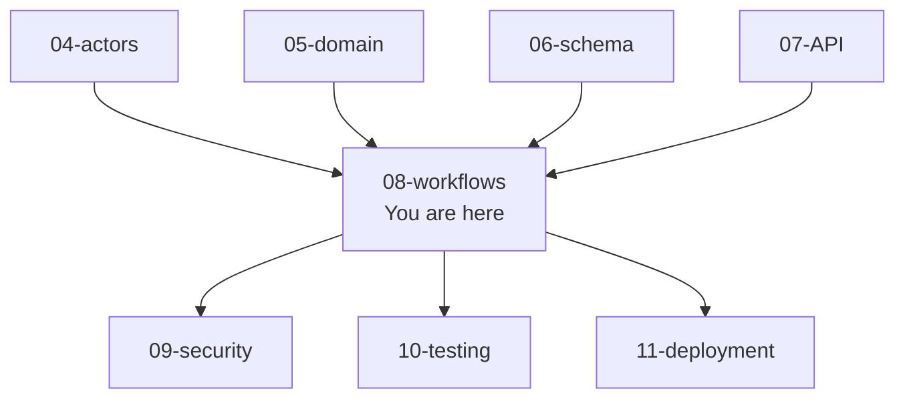

### 1.3 What this document does NOT cover

| Topic | Goes to |
|---|---|
| Endpoint contracts and error codes | `07-API-AND-REALTIME-CONTRACTS.md` |
| DB constraints and triggers | `06-DATABASE-SCHEMA.md` |
| Domain invariants | `05-DOMAIN-MODEL.md` §7 |
| Permission matrix | `04-ACTORS-ROLES-PERMISSIONS.md` §9 |
| UI screen designs | `busverse/05-UI-SPEC.md`, `buscon/06-UI-SPEC.md` |
| Test assertions | `10-TESTING-STRATEGY.md` |
| Performance targets | `11-DEPLOYMENT-AND-DEMO.md` |
| Retry/backoff detail | `09-SECURITY-AND-PLATFORM-RULES.md` |

---

## 2. Workflow Catalog

38 workflows across 7 categories. Every downstream doc references workflows by ID.

### 2.1 Category map

**Diagram: Workflow categories**
*Seven categories. Each has a distinct actor focus. Cross-actor bind the per-actor workflows into end-to-end stories — these are the demo flows. Negative and Recovery handle failure and interruption.*

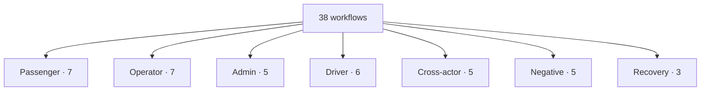

### 2.2 Full catalog

| ID | Workflow | Actor(s) | Category |
|---|---|---|---|
| `WF-P-01` | Register + login | Passenger | Happy |
| `WF-P-02` | Search and browse | Passenger | Happy |
| `WF-P-03` | Seat selection and lock | Passenger | Happy |
| `WF-P-04` | Book and pay | Passenger | Happy |
| `WF-P-05` | View ticket | Passenger | Happy |
| `WF-P-06` | Live tracking | Passenger | Happy |
| `WF-P-07` | Cancel booking | Passenger | Happy |
| `WF-O-01` | Signup + KYC submission | Operator | Happy |
| `WF-O-02` | Bus registration + layout | Operator | Happy |
| `WF-O-03` | Route creation | Operator | Happy |
| `WF-O-04` | Schedule creation + publish | Operator | Happy |
| `WF-O-05` | Driver invitation + assignment | Operator | Happy |
| `WF-O-06` | Revenue review | Operator | Happy |
| `WF-O-07` | Password reset | Operator | Happy |
| `WF-A-01` | Admin login + password reset | Admin | Happy |
| `WF-A-02` | Operator approval | Admin | Happy |
| `WF-A-03` | Bus/route/schedule approval | Admin | Happy |
| `WF-A-04` | Refund handling | Admin | Happy |
| `WF-A-05` | Audit log review | Admin | Happy |
| `WF-D-01` | Login + config fetch | Driver | Happy |
| `WF-D-02` | Trip start | Driver | Happy |
| `WF-D-03` | GPS streaming | Driver | Happy |
| `WF-D-04` | QR scan (online) | Driver | Happy |
| `WF-D-05` | QR scan (offline) | Driver | Happy |
| `WF-D-06` | Trip end | Driver | Happy |
| `WF-X-01` | **Full demo flow** | All 4 | ⭐ THE viva demo |
| `WF-X-02` | Seat lock race | 2 passengers | Concurrency proof |
| `WF-X-03` | Payment webhook convergence | System | Idempotency proof |
| `WF-X-04` | Suspension cascade | Admin + actor | Governance |
| `WF-X-05` | Boarding → passenger sees boarded | Driver + passenger | Live UX |
| `WF-N-01` | Payment fails → retry (new key) | Passenger | Negative |
| `WF-N-02` | Timeout (lock expiry before booking OR payment timeout after) | Passenger | Negative |
| `WF-N-03` | Operator cancels trip (100% refund) | Operator + passenger | Negative |
| `WF-N-04` | QR scan invalid | Driver | Negative |
| `WF-N-05` | Suspension mid-trip | Admin + driver | Negative |
| `WF-R-01` | Resume abandoned booking | Passenger | Recovery |
| `WF-R-02` | Offline scan replay | Driver | Recovery |
| `WF-R-03` | Session refresh after disconnect | Any | Recovery |

**Change in v1.1:** WF-N-02 repurposed to cover both timeout scenarios (lock-expiry-before-booking at 5 min and payment-timeout-after-booking at 15 min). WF-N-01 updated with new-Idempotency-Key rule. WF-N-03 updated with TIER_FULL refund rule.

---

## 3. Notation and Conventions

### 3.1 Workflow template

**Diagram: Workflow section template**
*Every workflow follows the same template. Preconditions state exact DB state required. Screen flow maps UI states. Sequence diagram shows endpoint calls. Endpoint chain lists step, method, path, role, permission, idempotency. State changes are before/after tables. Notifications, audit actions, error branches, and postconditions close out. Resume path says what happens if interrupted.*

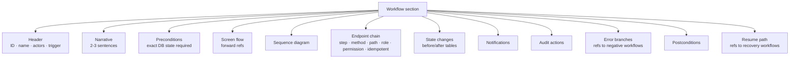

### 3.2 Workflow ID scheme

| Prefix | Category | Range |
|---|---|---|
| `WF-P-NN` | Passenger | 01–07 |
| `WF-O-NN` | Operator | 01–07 |
| `WF-A-NN` | Admin | 01–05 |
| `WF-D-NN` | Driver | 01–06 |
| `WF-X-NN` | Cross-actor | 01–05 |
| `WF-N-NN` | Negative | 01–05 |
| `WF-R-NN` | Recovery | 01–03 |

### 3.3 Cross-references

| Reference | Source | Used for |
|---|---|---|
| Endpoint path | `07` §4–§7 | Endpoint chain |
| Role + permission | `04` §4, §9 | Endpoint chain |
| Error codes | `07` §9 | Error branches |
| State transitions | `05` §8 | from → to annotations |
| Invariants | `05` §7 | Preconditions + postconditions |
| Tables | `06` §4–§9 | State change assertions |
| Audit actions | `04` §10.3 | Audit action list |
| Notification events | `07` §8.7 | Notification list |
| Screens | `busverse/05-UI-SPEC.md`, `buscon/06-UI-SPEC.md` | Screen flow |

### 3.4 Idempotency markers

| Marker | Meaning |
|---|---|
| `[idem]` | Requires `Idempotency-Key` header |
| `[idem-new]` | Requires a **fresh** `Idempotency-Key` (retry scenario) |
| `[idem-opt]` | Optional idempotency |
| *(blank)* | Not idempotent-wrapped |

### 3.5 Screen catalog (forward refs)

Workflows reference screens by name. Screen designs live in UI specs — this catalog defines names so workflows can reference them consistently.

| Screen ID | Name | Surface | UI spec owner |
|---|---|---|---|
| `SCR-BV-HOME` | Home | BusVerse | `busverse/05-UI-SPEC.md` |
| `SCR-BV-SEARCH` | Search | BusVerse | `busverse/05-UI-SPEC.md` |
| `SCR-BV-RESULTS` | Results list | BusVerse | `busverse/05-UI-SPEC.md` |
| `SCR-BV-SEATDECK` | Seat deck | BusVerse | `busverse/05-UI-SPEC.md` |
| `SCR-BV-PAXFORM` | Passenger details | BusVerse | `busverse/05-UI-SPEC.md` |
| `SCR-BV-CHECKOUT` | Checkout | BusVerse | `busverse/05-UI-SPEC.md` |
| `SCR-BV-TICKET` | Ticket | BusVerse | `busverse/05-UI-SPEC.md` |
| `SCR-BV-MYTRIPS` | My trips | BusVerse | `busverse/05-UI-SPEC.md` |
| `SCR-BV-TRACKING` | Live tracking | BusVerse | `busverse/05-UI-SPEC.md` |
| `SCR-BV-CANCEL` | Cancel booking | BusVerse | `busverse/05-UI-SPEC.md` |
| `SCR-BV-PROFILE` | Profile | BusVerse | `busverse/05-UI-SPEC.md` |
| `SCR-BC-LOGIN` | Login | BusCon | `buscon/06-UI-SPEC.md` |
| `SCR-BC-DASHBOARD` | Dashboard | BusCon | `buscon/06-UI-SPEC.md` |
| `SCR-BC-BUSES` | Buses list | BusCon | `buscon/06-UI-SPEC.md` |
| `SCR-BC-BUSEDIT` | Bus edit + layout | BusCon | `buscon/06-UI-SPEC.md` |
| `SCR-BC-ROUTES` | Routes | BusCon | `buscon/06-UI-SPEC.md` |
| `SCR-BC-SCHEDULES` | Schedules | BusCon | `buscon/06-UI-SPEC.md` |
| `SCR-BC-DRIVERS` | Drivers | BusCon | `buscon/06-UI-SPEC.md` |
| `SCR-BC-BOOKINGS` | Bookings | BusCon | `buscon/06-UI-SPEC.md` |
| `SCR-BC-REVENUE` | Revenue | BusCon | `buscon/06-UI-SPEC.md` |
| `SCR-BC-APPROVALS` | Approvals queue | BusCon (admin) | `buscon/06-UI-SPEC.md` |
| `SCR-BC-REFUNDS` | Refunds | BusCon (admin) | `buscon/06-UI-SPEC.md` |
| `SCR-BC-AUDIT` | Audit log | BusCon (admin) | `buscon/06-UI-SPEC.md` |
| `SCR-OA-LOGIN` | Login | Operator App | `buscon/06-UI-SPEC.md` |
| `SCR-OA-TODAY` | Today's trips | Operator App | `buscon/06-UI-SPEC.md` |
| `SCR-OA-TRIP` | Active trip | Operator App | `buscon/06-UI-SPEC.md` |
| `SCR-OA-SCAN` | QR scanner | Operator App | `buscon/06-UI-SPEC.md` |
| `SCR-OA-MANIFEST` | Manifest | Operator App | `buscon/06-UI-SPEC.md` |
| `SCR-OA-SUMMARY` | Trip summary | Operator App | `buscon/06-UI-SPEC.md` |

---

## 4. Passenger Workflows

### 4.1 `WF-P-01` Register + login

**Actors:** Passenger
**Trigger:** User opens BusVerse, enters phone

**Narrative:** New passenger enters phone. Server sends 6-digit OTP. Passenger verifies. If phone is new, `users` + `passenger_profiles` rows are created. Session issued with access (15 min) + refresh (7 day) tokens.

**Preconditions:**

| Table | State |
|---|---|
| `users` | May not exist (signup) or exists (login) |
| `otp_challenges` | Created by step 1 |

**Screen flow:** `SCR-BV-HOME` (phone input) → `SCR-BV-HOME` (OTP input) → `SCR-BV-SEARCH`.

**Sequence:**

**Diagram: Register + login sequence**
*Passenger submits phone, server sends OTP, passenger submits OTP, server issues tokens and creates profile if new.*

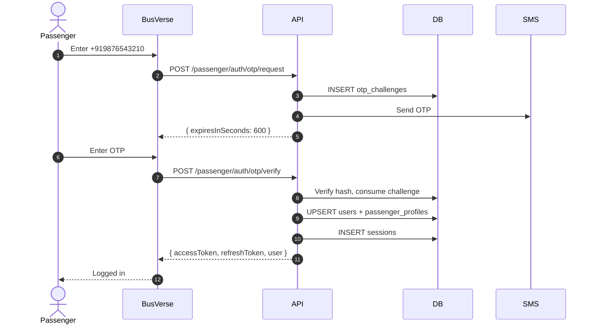

**Endpoint chain:**

| # | Method | Path | Role | Permission | Idempotency |
|:---:|---|---|---|---|---|
| 1 | POST | `/v1/passenger/auth/otp/request` | public | — | — |
| 2 | POST | `/v1/passenger/auth/otp/verify` | public | — | — |

**State changes:**

| Table | Before | After |
|---|---|---|
| `otp_challenges` | 0 rows | 1 consumed row |
| `users` | 0 or 1 | 1 row |
| `passenger_profiles` | 0 or 1 | 1 row |
| `sessions` | 0 rows | 1 active row |
| `audit_logs` | — | 1 row (`user_registered` if new) |

**Notifications:** Welcome SMS (new user only).

**Audit actions:** `user_registered` (new), `session_created` (always).

**Error branches:** `INVALID_OTP` → `400`, `OTP_EXPIRED` → `400`, `OTP_ATTEMPTS_EXCEEDED` → `429`.

**Postconditions:** Passenger authenticated, session active.

**Resume:** N/A.

---

### 4.2 `WF-P-02` Search and browse

**Actors:** Passenger (may be unauthenticated)
**Trigger:** User opens search

**Narrative:** Passenger enters origin city, destination city, date. Server returns matching schedules with availability. Read-only flow.

**Preconditions:** Cities and schedules exist.

**Screen flow:** `SCR-BV-SEARCH` → `SCR-BV-RESULTS`.

**Sequence:**

**Diagram: Search sequence**
*Passenger queries cities, autocompletes, then searches. Server returns schedules filtered by route and date.*

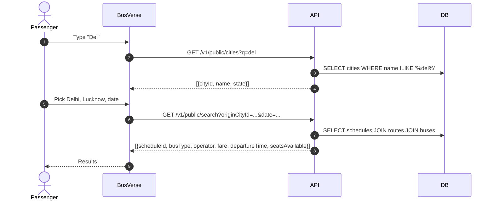

**Endpoint chain:**

| # | Method | Path | Role | Idempotency |
|:---:|---|---|---|---|
| 1 | GET | `/v1/public/cities` | public | — |
| 2 | GET | `/v1/public/search` | public | — |
| 3 | GET | `/v1/public/schedules/:id` | public | — |

**State changes:** None (read-only).

**Notifications:** None.

**Audit actions:** None.

**Error branches:** `INVALID_REQUEST` → `400`.

**Postconditions:** None.

---

### 4.3 `WF-P-03` Seat selection and lock

**Actors:** Passenger
**Trigger:** Passenger opens seat deck

**Narrative:** Passenger taps a seat. Server runs a service-layer pre-check (is the seat already booked?), then atomically locks for 5 minutes. Lock written to Redis (authority) and Postgres (backup). Passenger sees countdown. If no booking within 5 min, lock expires.

**Preconditions:**

| Table | State |
|---|---|
| `users` | Logged in |
| `schedules` | Row exists, `status = PUBLISHED` |
| `seats` | Seat is `AVAILABLE` |
| `booking_passengers` | **No row for `(schedule_id, seat_id)`** (v1.1 pre-check) |

**Screen flow:** `SCR-BV-SEATDECK` (passenger selects seat) → countdown appears.

**Sequence:**

**Diagram: Seat lock sequence**
*Passenger requests lock. **Service pre-check** queries `booking_passengers` first — if the seat is already booked, returns `409 SEAT_ALREADY_BOOKED` without touching Redis. Then Redis SET NX, then Postgres insert. Two concurrent requests: first wins, second gets 409.*

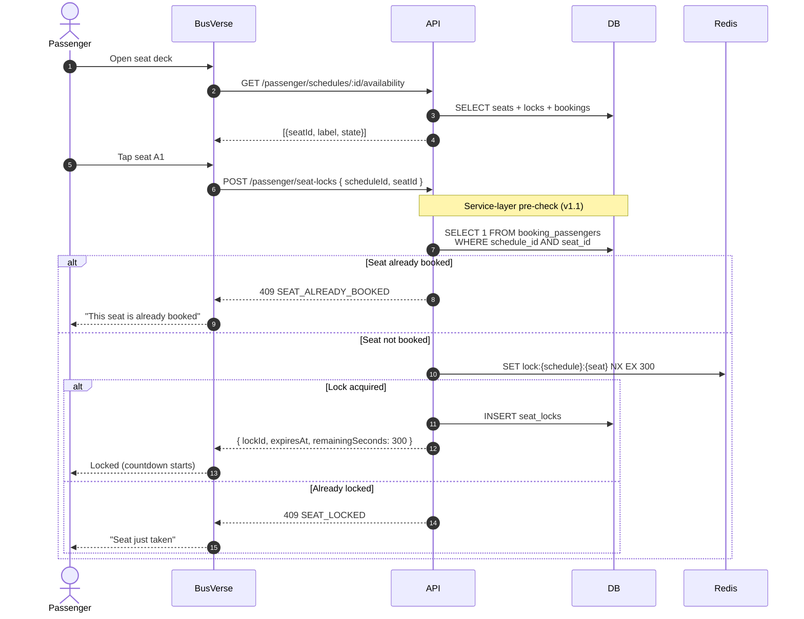

**Endpoint chain:**

| # | Method | Path | Role | Permission | Idempotency |
|:---:|---|---|---|---|---|
| 1 | GET | `/v1/passenger/schedules/:id/availability` | REGISTERED | read | — |
| 2 | POST | `/v1/passenger/seat-locks` | REGISTERED | create | — |
| 3 | GET | `/v1/passenger/seat-locks/active` | REGISTERED | read-own | — |
| 4 | DELETE | `/v1/passenger/seat-locks/:id` | REGISTERED | delete-own | — |

**State changes:**

| Table | Before | After |
|---|---|---|
| `seat_locks` | 0 for seat | 1 row (TTL 5 min) |
| Redis `lock:{s}:{seat}` | Not present | Present, TTL 300 |
| `audit_logs` | — | 0 rows (locks not audited) |

**Notifications:** WebSocket `seat:locked` to other passengers viewing same schedule.

**Audit actions:** None.

**Error branches:** `SEAT_LOCKED` → `409` → user picks another seat. **`SEAT_ALREADY_BOOKED` → `409` → user picks another seat (v1.1 new pre-check branch).**

**Postconditions:** Lock exists in Redis + Postgres, expires in 5 min.

**Resume:** Tab closed → `WF-R-01` (`GET /seat-locks/active`).

**Concurrency proof:** Two concurrent `POST /seat-locks` on same `(scheduleId, seatId)` — exactly one succeeds, one returns `409 SEAT_LOCKED`. Enforced by Redis `SET NX` + Postgres unique index. **v1.1: the service-layer pre-check runs before either the Redis or DB write, so a booked seat is rejected without ever entering the lock path.**

---

### 4.4 `WF-P-04` Book and pay

**Actors:** Passenger
**Trigger:** Passenger submits passenger details

**Narrative:** Passenger fills in names/ages/genders for each locked seat. Server creates `PENDING` booking and **extends the lock TTL to 15 minutes** (payment window). Passenger initiates payment — Razorpay hosted checkout — pays. Razorpay webhook confirms the booking by: flipping `payments` → `SUCCEEDED`, INSERTing the ticket (Ed25519-signed), INSERTing the GST invoice, flipping `bookings` → `CONFIRMED`, deleting the seat lock. Notification fanout to all parties.

**Preconditions:**

| Table | State |
|---|---|
| `seat_locks` | Row exists, `expires_at > now()` |
| `bookings` | No active booking for this lock |

**Screen flow:** `SCR-BV-PAXFORM` → `SCR-BV-CHECKOUT` → Razorpay → `SCR-BV-TICKET`.

**Sequence:**

**Diagram: Book and pay sequence**
*Core workflow (v1.1 — reflects lock TTL extension + webhook INSERT of ticket/GST invoice). Booking created PENDING; lock TTL extended to 15 min. Payment initiated. Razorpay opens. Passenger pays. Webhook transaction confirms: payments SUCCEEDED, **tickets INSERT**, **gst_invoices INSERT**, bookings CONFIRMED, **seat_locks DELETE**. Client callback is UX only.*

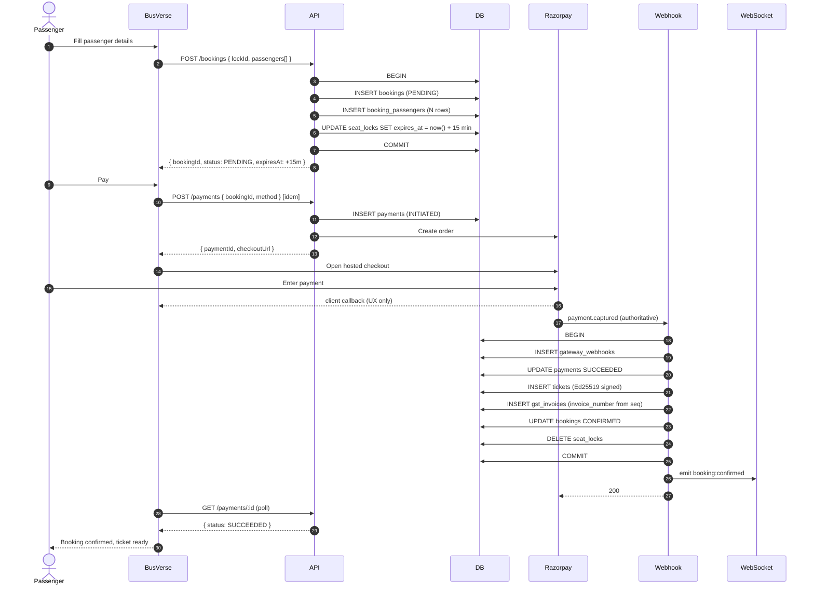

**Endpoint chain:**

| # | Method | Path | Role | Permission | Idempotency |
|:---:|---|---|---|---|---|
| 1 | POST | `/v1/passenger/bookings` | REGISTERED | create-own | [idem-opt] |
| 2 | POST | `/v1/passenger/payments` | REGISTERED | create-own | **[idem]** |
| 3 | GET | `/v1/passenger/payments/:id` | REGISTERED | read-own | — |

**State changes:**

| Table | Before | After |
|---|---|---|
| `bookings` | 0 rows | 1 row `CONFIRMED` |
| `booking_passengers` | 0 | N rows |
| `seat_locks` | 1 row (TTL extended to 15 min) | 0 (deleted at webhook) |
| `payments` | 0 | 1 `SUCCEEDED` |
| `tickets` | 0 | 1 `ISSUED` (**INSERTed at webhook, not at booking creation — v1.1**) |
| `gst_invoices` | 0 | 1 row (**INSERTed at webhook — v1.1**) |
| `gateway_webhooks` | 0 | 1 row |
| `audit_logs` | — | 2 rows (`booking_created`, `payment_succeeded`) |

**Notifications:** Booking confirmed SMS + email + WebSocket `booking:confirmed` to passenger; WebSocket `seat:booked` to other viewers.

**Audit actions:** `booking_created`, `payment_succeeded`, `ticket_issued`.

**Error branches:** Payment fails → `WF-N-01`. Lock expired before booking → `WF-N-02` scenario A. Payment timeout after booking → `WF-N-02` scenario B. Webhook delay → idempotency prevents double-processing.

**Postconditions:** Booking confirmed, ticket issued, GST invoice issued, lock gone.

**Resume:** Client crash → `GET /bookings` shows the confirmed booking (or, if payment still pending, polling `GET /payments/:id` shows current state).

**Invariants enforced:** 1:1 booking↔ticket (CONFIRMED state), no double-book, lock survives PENDING then converts-or-expires (deleted at webhook), payment idempotent.

**v1.1 note on lock TTL:** The lock is extended to 15 min at booking creation (`UPDATE seat_locks SET expires_at = now() + interval '15 minutes'`) so it survives the whole payment window. Without extension, the 5-min acquire TTL would expire mid-Razorpay-checkout, letting another user grab the seat. The webhook then deletes the lock on success or failure.

**v1.1 note on ticket INSERT:** The ticket row is INSERTed at webhook time (not at booking creation) so that invariant `05` §7.1 #1 ("Every CONFIRMED booking has exactly one Ticket. PENDING/EXPIRED/FAILED bookings have no ticket") is enforced transactionally. A PENDING booking genuinely has no ticket row.

---

### 4.5 `WF-P-05` View ticket

**Actors:** Passenger
**Trigger:** Passenger opens booking

**Narrative:** Server returns signed QR payload + signature. QR is scannable only by Operator App. Only CONFIRMED or CHECKED_IN bookings have a ticket row (PENDING/EXPIRED/FAILED return `404 TICKET_NOT_FOUND`).

**Preconditions:** Booking `CONFIRMED` or `CHECKED_IN` (ticket row exists).

**Screen flow:** `SCR-BV-MYTRIPS` → `SCR-BV-TICKET`.

**Sequence:**

**Diagram: View ticket sequence**
*Simple read. Returns QR payload + signature from `tickets`. QR is not a URL — only Operator App can verify.*

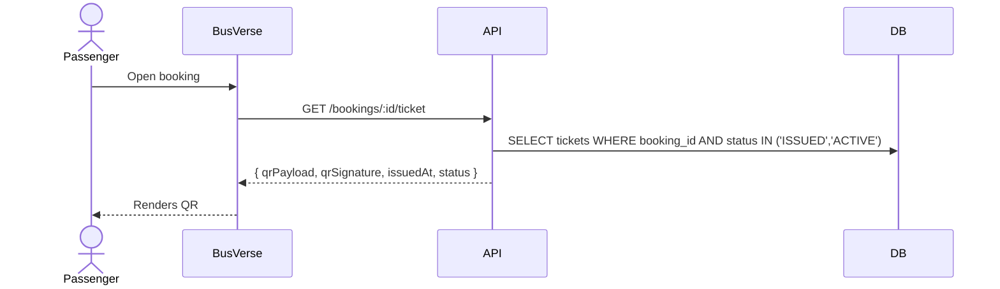

**Endpoint chain:**

| # | Method | Path | Role | Permission |
|:---:|---|---|---|---|
| 1 | GET | `/v1/passenger/bookings/:id/ticket` | REGISTERED | read-own |

**State changes:** None.

**Notifications:** None.

**Audit actions:** None.

---

### 4.6 `WF-P-06` Live tracking

**Actors:** Passenger
**Trigger:** Passenger opens tracking for active trip

**Narrative:** Once driver starts, passenger sees bus moving. Position updates via WebSocket every 5s. If WS fails, client polls.

**Preconditions:** Trip `IN_PROGRESS`, passenger has confirmed booking on trip.

**Screen flow:** `SCR-BV-MYTRIPS` → `SCR-BV-TRACKING`.

**Sequence:**

**Diagram: Live tracking sequence**
*Passenger subscribes to `trip:live:{tripId}` via WS. Server verifies booking. Every GPS sample publishes `bus:position`. Fallback: poll `GET /trips/:id/live`.*

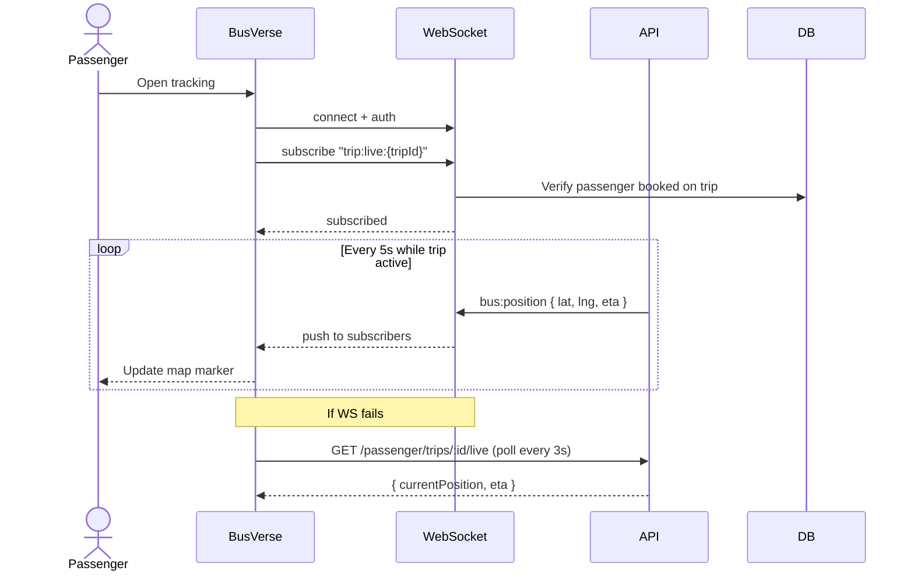

**Endpoint chain:**

| # | Method | Path | Role | Permission |
|:---:|---|---|---|---|
| 1 | WS | `/v1/ws` topic `trip:live:{tripId}` | REGISTERED | read-booked |
| 2 | GET | `/v1/passenger/trips/:id/live` | REGISTERED | read-booked |
| 3 | GET | `/v1/passenger/trips/:id/map` | REGISTERED | read-booked |

**State changes:** None.

**Notifications:** WebSocket `bus:position` every 5s.

**Error branches:** WS disconnect → polling fallback; trip ends → WS emits `trip:ended`.

**Resume:** `WF-R-03`.

---

### 4.7 `WF-P-07` Cancel booking

**Actors:** Passenger
**Trigger:** Passenger taps cancel on confirmed booking

**Narrative:** Refund preview (with tier calculation) → confirm → booking `CANCELLED`, refund initiated with the computed tier, ticket `CANCELLED`. Refund tier is computed from time-to-departure per `07` §4.5: `TIER_FULL` ≥24h, `TIER_75` 12–24h, `TIER_50` 2–12h, `TIER_ZERO` <2h, `TIER_NOT_ELIGIBLE` after departure or already cancelled.

**Preconditions:** Booking `CONFIRMED`, departure in future.

**Screen flow:** `SCR-BV-CANCEL` → `SCR-BV-MYTRIPS`.

**Sequence:**

**Diagram: Cancel booking sequence (v1.1 — with tier calculation)**
*Preview refund with tier → confirm → cancel. Refund record carries the computed `refund_tier`. Razorpay processes async.*

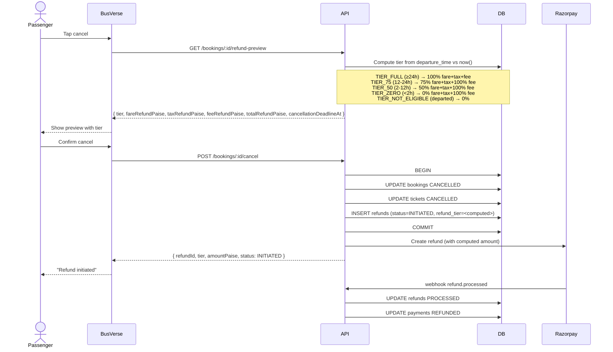

**Endpoint chain:**

| # | Method | Path | Role | Permission | Idempotency |
|:---:|---|---|---|---|---|
| 1 | GET | `/v1/passenger/bookings/:id/refund-preview` | REGISTERED | read-own | — |
| 2 | POST | `/v1/passenger/bookings/:id/cancel` | REGISTERED | cancel-own | [idem-opt] |

**State changes:**

| Table | Before | After |
|---|---|---|
| `bookings` | `CONFIRMED` | `CANCELLED` → `REFUNDED` |
| `tickets` | `ACTIVE` | `CANCELLED` |
| `refunds` | 0 | 1 (`INITIATED` → `PROCESSED`), `refund_tier` set |
| `payments` | `SUCCEEDED` | `REFUNDED` |
| `audit_logs` | — | 2 rows (`booking_cancelled`, `refund_initiated`) |

**Notifications:** SMS + email "Cancelled, refund initiated", WebSocket `booking:cancelled`.

**Audit actions:** `booking_cancelled`, `refund_initiated`, `refund_processed`.

**Error branches:** Not owned → `404`. `COMPLETED` or `CHECKED_IN` → `400 INVALID_TRANSITION`. After departure → `TIER_NOT_ELIGIBLE` returned from preview; cancel still allowed but refund is 0.

**Postconditions:** Cancelled, refund initiated with correct tier.

---

## 5. Operator Workflows

### 5.1 `WF-O-01` Signup + KYC submission

**Narrative:** Company signs up with GSTIN, PAN, company name. Uploads KYC docs. Awaits admin approval. Cannot list buses until approved.

**Screen flow:** `SCR-BC-LOGIN` → signup form → KYC upload.

**Sequence:**

**Diagram: Operator signup + KYC sequence**
*Signup → email verify → upload docs → status PENDING_REVIEW.*

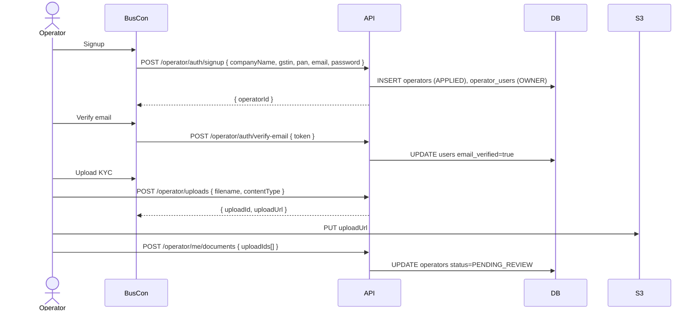

**Endpoint chain:**

| # | Method | Path | Role |
|:---:|---|---|---|
| 1 | POST | `/v1/operator/auth/signup` | public |
| 2 | POST | `/v1/operator/auth/verify-email` | public |
| 3 | POST | `/v1/operator/uploads` | OWNER |
| 4 | POST | `/v1/operator/me/documents` | OWNER |

**State changes:** `operators.status`: `APPLIED` → `PENDING_REVIEW`.

**Notifications:** Email "KYC submitted", alert to admin.

**Audit actions:** `operator_applied`, `operator_docs_submitted`.

**Error branches:** `GSTIN_ALREADY_REGISTERED` → `409`.

---

### 5.2 `WF-O-02` Bus registration + layout

**Narrative:** Two-phase. Create bus, then build seat layout via grid builder. Server validates seat count matches capacity.

**Screen flow:** `SCR-BC-BUSES` → `SCR-BC-BUSEDIT`.

**Sequence:**

**Diagram: Bus registration + layout sequence**
*Phase 1: create bus. Phase 2: grid builder + save. Bus PENDING.*

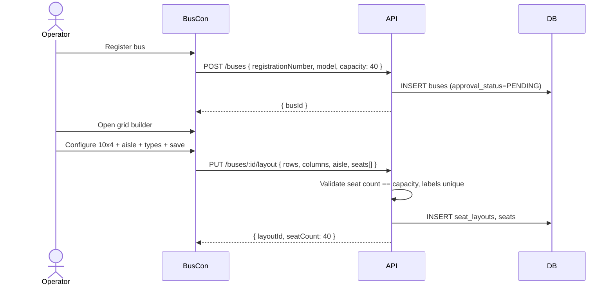

**Endpoint chain:**

| # | Method | Path | Role |
|:---:|---|---|---|
| 1 | POST | `/v1/operator/buses` | OWNER/MANAGER |
| 2 | PUT | `/v1/operator/buses/:id/layout` | OWNER/MANAGER |

**State changes:** `buses` PENDING, `seat_layouts` + `seats` created.

**Notifications:** Admin alert.

**Audit actions:** `bus_registered`, `seat_layout_created`.

**Error branches:** `BUS_REGISTRATION_EXISTS` → `409`, `INVALID_CAPACITY` → `400`.

---

### 5.3 `WF-O-03` Route creation

**Narrative:** Operator selects origin/destination + ordered stops.

**Screen flow:** `SCR-BC-ROUTES` → route editor.

**Sequence:**

**Diagram: Route creation sequence**
*Create route → add ordered stops → PENDING.*

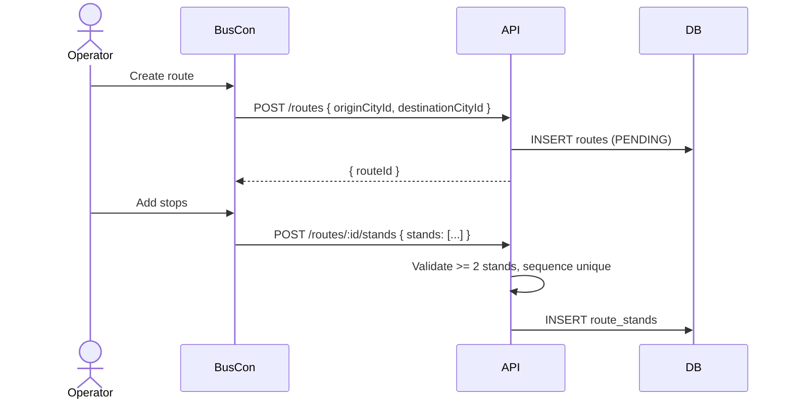

**Endpoint chain:**

| # | Method | Path | Role |
|:---:|---|---|---|
| 1 | POST | `/v1/operator/routes` | OWNER/MANAGER |
| 2 | POST | `/v1/operator/routes/:id/stands` | OWNER/MANAGER |

**State changes:** Route + stands PENDING.

**Audit actions:** `route_created`.

**Error branches:** `ROUTE_SAME_CITY` → `400`.

---

### 5.4 `WF-O-04` Schedule creation + publish

**Narrative:** Select bus, route, departure, arrival, fare. DRAFT until published. Publishing makes searchable.

**Screen flow:** `SCR-BC-SCHEDULES`.

**Sequence:**

**Diagram: Schedule creation + publish sequence**
*Create DRAFT → publish → searchable.*

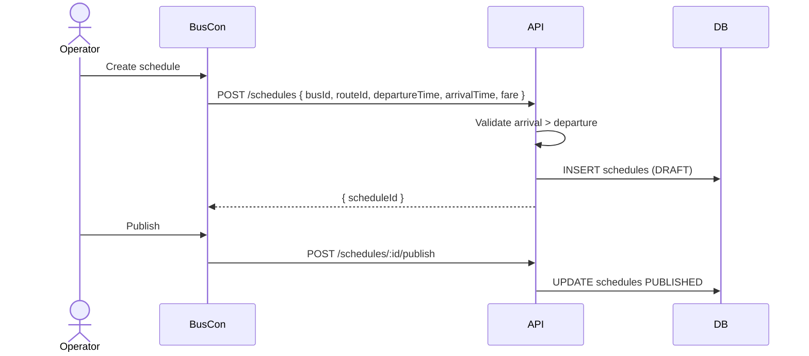

**Endpoint chain:**

| # | Method | Path | Role |
|:---:|---|---|---|
| 1 | POST | `/v1/operator/schedules` | OWNER/MANAGER |
| 2 | POST | `/v1/operator/schedules/:id/publish` | OWNER/MANAGER |

**State changes:** `DRAFT` → `PUBLISHED`.

**Audit actions:** `schedule_created`, `schedule_published`.

**Error branches:** `INVALID_SCHEDULE_TIMES` → `400`.

---

### 5.5 `WF-O-05` Driver invitation + assignment

**Narrative:** Operator invites by phone. Driver signs up in Operator App, uploads license. Admin verifies. Then assignable.

**Screen flow:** `SCR-BC-DRIVERS` → invite form.

**Sequence:**

**Diagram: Driver invitation + assignment**
*Invite → signup → upload license → admin verify.*

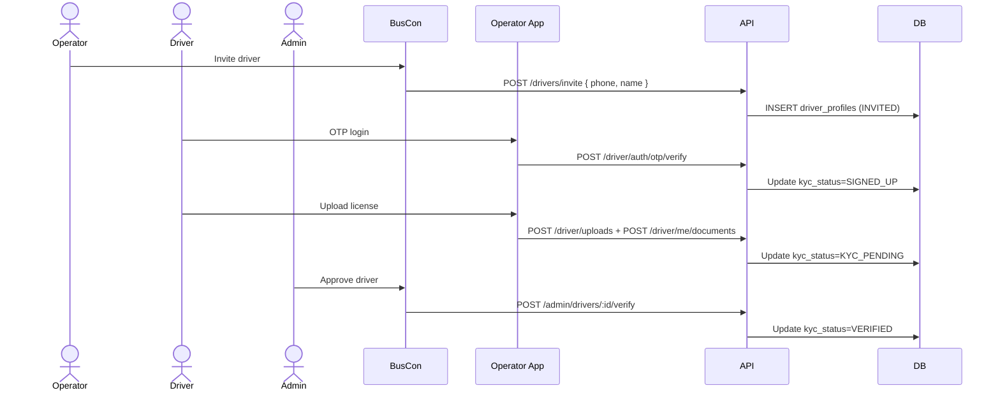

**Endpoint chain:**

| # | Method | Path | Role |
|:---:|---|---|---|
| 1 | POST | `/v1/operator/drivers/invite` | OWNER/MANAGER |
| 2 | POST | `/v1/driver/auth/otp/verify` | public |
| 3 | POST | `/v1/driver/uploads` | DRIVER |
| 4 | POST | `/v1/driver/me/documents` | DRIVER |
| 5 | POST | `/v1/admin/drivers/:id/verify` | SUPER_ADMIN |

**State changes:** `driver_profiles.kyc_status`: `INVITED` → `SIGNED_UP` → `KYC_PENDING` → `VERIFIED`.

**Notifications:** SMS to driver (invite, verified).

**Audit actions:** `driver_invited`, `driver_docs_submitted`, `driver_verified`.

---

### 5.6 `WF-O-06` Revenue review

**Narrative:** Read-only dashboard. Aggregates from `Payment` + `Booking`.

**Screen flow:** `SCR-BC-DASHBOARD` → `SCR-BC-REVENUE`.

**Sequence:**

**Diagram: Revenue review sequence**
*Read-only. Cached 60s.*

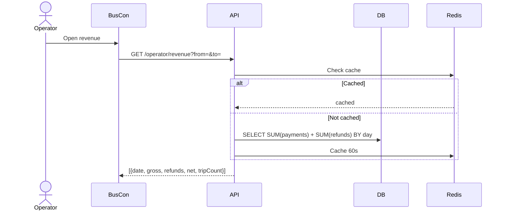

**Endpoint chain:**

| # | Method | Path | Role |
|:---:|---|---|---|
| 1 | GET | `/v1/operator/dashboard` | OWNER/MANAGER |
| 2 | GET | `/v1/operator/revenue` | OWNER/MANAGER |
| 3 | GET | `/v1/operator/revenue/daily` | OWNER/MANAGER |

**State changes:** None.

---

### 5.7 `WF-O-07` Password reset

**Narrative:** Two-step. Request → email link (30 min). Verify → update password + revoke all sessions.

**Screen flow:** `SCR-BC-LOGIN` → forgot password → email → reset → login.

**Sequence:**

**Diagram: Password reset sequence**
*Two-step. Session revocation on verify.*

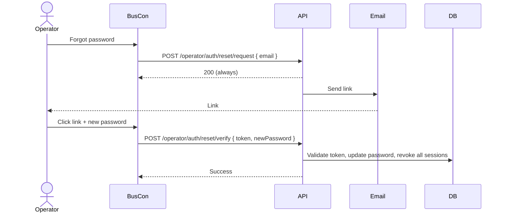

**Endpoint chain:**

| # | Method | Path | Role |
|:---:|---|---|---|
| 1 | POST | `/v1/operator/auth/reset/request` | public |
| 2 | POST | `/v1/operator/auth/reset/verify` | public |

**State changes:** `password_hash` updated; all `sessions` revoked.

**Error branches:** `RESET_TOKEN_INVALID` / `RESET_TOKEN_EXPIRED` → `400`.

---

## 6. Admin Workflows

### 6.1 `WF-A-01` Admin login + password reset

**Narrative:** Email + password. Rate limited 5/5min/IP. No TOTP Phase 1.

**Screen flow:** `SCR-BC-LOGIN`.

**Sequence:**

**Diagram: Admin login sequence**
*Email+password. Rate limited. 5-min access, 1-day refresh.*

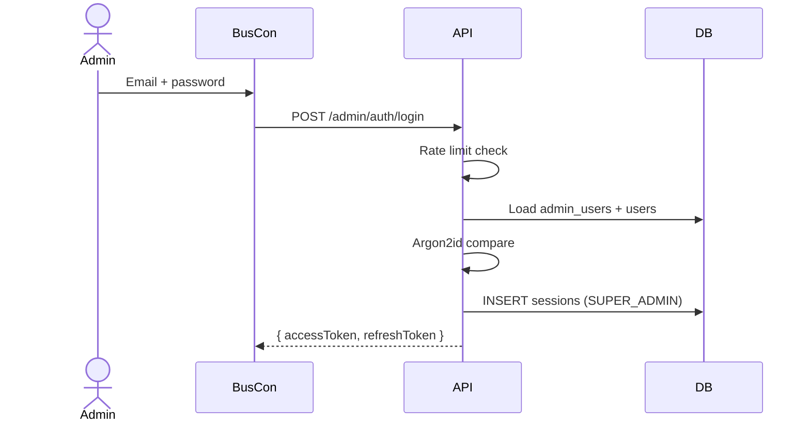

**Endpoint chain:**

| # | Method | Path | Role |
|:---:|---|---|---|
| 1 | POST | `/v1/admin/auth/login` | public |
| 2 | POST | `/v1/admin/auth/reset/request` | public |
| 3 | POST | `/v1/admin/auth/reset/verify` | public |

**Error branches:** `INVALID_CREDENTIALS` → `401`, `RATE_LIMITED` → `429`.

---

### 6.2 `WF-A-02` Operator approval

**Narrative:** Review KYC, approve/reject. Reason required.

**Screen flow:** `SCR-BC-APPROVALS`.

**Sequence:**

**Diagram: Operator approval sequence**
*List → view → approve/reject with reason → status transitions.*

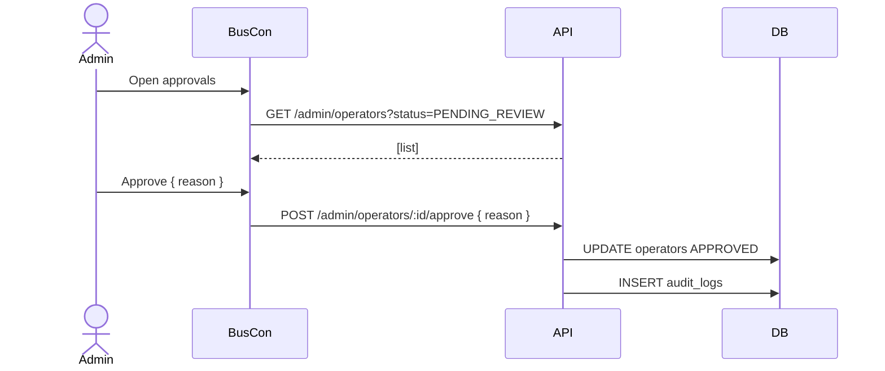

**Endpoint chain:**

| # | Method | Path | Role |
|:---:|---|---|---|
| 1 | GET | `/v1/admin/operators` | SUPER_ADMIN |
| 2 | POST | `/v1/admin/operators/:id/approve` | SUPER_ADMIN |
| 3 | POST | `/v1/admin/operators/:id/reject` | SUPER_ADMIN |

**State changes:** `PENDING_REVIEW` → `APPROVED` or `REJECTED`.

**Notifications:** Email to operator.

**Audit actions:** `operator_approved`, `operator_rejected`.

**Error branches:** `REASON_REQUIRED` → `400`.

---

### 6.3 `WF-A-03` Bus/route/schedule approval

**Narrative:** Same pattern as operator approval.

**Screen flow:** `SCR-BC-APPROVALS` (unified queue).

**Sequence:**

**Diagram: Bus/route/schedule approval sequence**
*List pending, view, approve/reject with reason.*

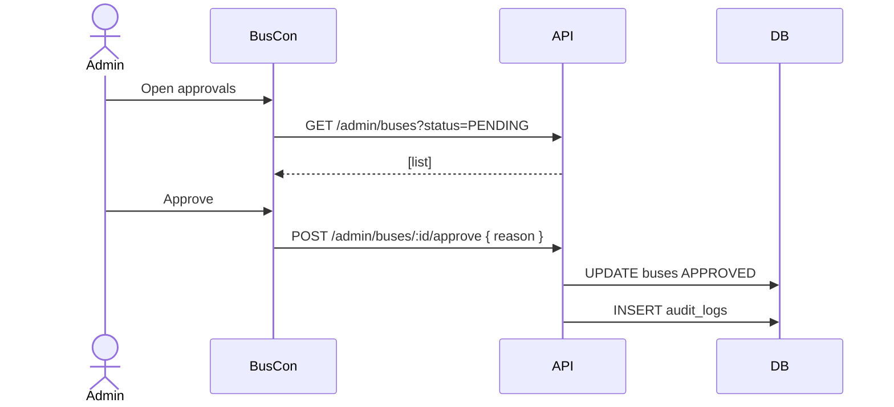

**Endpoint chain:**

| # | Method | Path | Role |
|:---:|---|---|---|
| 1 | POST | `/v1/admin/buses/:id/approve` | SUPER_ADMIN |
| 2 | POST | `/v1/admin/routes/:id/approve` | SUPER_ADMIN |
| 3 | POST | `/v1/admin/schedules/:id/approve` | SUPER_ADMIN |

**State changes:** `approval_status` → `APPROVED`.

**Audit actions:** `bus_approved`, `route_approved`, `schedule_approved`.

---

### 6.4 `WF-A-04` Refund handling

**Narrative:** Manual refund. Amount ≤ payment, status `SUCCEEDED`. Razorpay refund created. Webhook confirms. **Admin-initiated refunds always use `refund_tier = TIER_FULL`** (v1.1).

**Screen flow:** `SCR-BC-REFUNDS`.

**Sequence:**

**Diagram: Admin refund sequence (v1.1 — TIER_FULL default)**
*Admin-initiated refund defaults to TIER_FULL. Requires reason. Idempotent.*

```mermaid
sequenceDiagram
    actor A as Admin
    participant BC as BusCon
    participant API as API
    participant DB as DB
    participant RZP as Razorpay

    A->>BC: Initiate refund { amountPaise, reason }
    BC->>API: POST /admin/payments/:id/refund [idem]
    API->>DB: Validate SUCCEEDED, amount <= payment
    API->>RZP: Create refund
    API->>DB: INSERT refunds (status=INITIATED, refund_tier=TIER_FULL)
    API->>DB: INSERT audit_logs

    RZP->>API: webhook refund.processed
    API->>DB: UPDATE refunds PROCESSED
    API->>DB: UPDATE payments REFUNDED
```

**Endpoint chain:**

| # | Method | Path | Role | Idempotency |
|:---:|---|---|---|---|
| 1 | POST | `/v1/admin/payments/:id/refund` | SUPER_ADMIN | **[idem]** |

**State changes:** `refunds` inserted (`refund_tier=TIER_FULL`), `payments` → `REFUNDED`.

**Notifications:** SMS + email to passenger.

**Audit actions:** `refund_initiated`, `refund_processed`.

**Error branches:** `REASON_REQUIRED` → `400`, `REFUND_EXCEEDS_PAYMENT` → `400`.

---

### 6.5 `WF-A-05` Audit log review

**Narrative:** Query + export. Read-only.

**Screen flow:** `SCR-BC-AUDIT`.

**Sequence:**

**Diagram: Audit log review sequence**
*Paginated query with filters. Export streams CSV.*

```mermaid
sequenceDiagram
    actor A as Admin
    participant BC as BusCon
    participant API as API
    participant DB as DB

    A->>BC: Open audit log
    BC->>API: GET /admin/audit-logs?entityType=Booking&limit=50
    API->>DB: SELECT audit_logs WHERE ...
    API-->>BC: { data: [...], meta: { nextCursor } }

    A->>BC: Export
    BC->>API: GET /admin/audit-logs/export?format=csv
    API-->>BC: CSV stream
```

**Endpoint chain:**

| # | Method | Path | Role |
|:---:|---|---|---|
| 1 | GET | `/v1/admin/audit-logs` | SUPER_ADMIN |
| 2 | GET | `/v1/admin/audit-logs/export` | SUPER_ADMIN |

**State changes:** None.

---

## 7. Driver Workflows

### 7.1 `WF-D-01` Login + config fetch

**Narrative:** OTP login. Server validates KYC verified, binds device. Config fetch gives QR public key + server time.

**Screen flow:** `SCR-OA-LOGIN` → `SCR-OA-TODAY`.

**Sequence:**

**Diagram: Driver login + config fetch**
*OTP verify + single-device binding. Config gives QR public key.*

```mermaid
sequenceDiagram
    actor D as Driver
    participant OA as Operator App
    participant API as API
    participant DB as DB
    participant SMS

    D->>OA: Enter phone
    OA->>API: POST /driver/auth/otp/request
    API->>SMS: Send OTP
    SMS-->>D: OTP

    D->>OA: Enter OTP + device
    OA->>API: POST /driver/auth/otp/verify { phone, otp, deviceFingerprint }
    API->>DB: Verify KYC VERIFIED
    API->>DB: Revoke other sessions, INSERT new
    API-->>OA: { accessToken, refreshToken }

    OA->>API: GET /driver/config
    API-->>OA: { qrPublicKey, serverTime, minAppVersion }
```

**Endpoint chain:**

| # | Method | Path | Role |
|:---:|---|---|---|
| 1 | POST | `/v1/driver/auth/otp/request` | public |
| 2 | POST | `/v1/driver/auth/otp/verify` | public |
| 3 | GET | `/v1/driver/config` | DRIVER |

**State changes:** `sessions` row with `device_fingerprint_hash`.

**Error branches:** `LICENSE_EXPIRED` → `403`, `INVALID_OTP` → `400`.

---

### 7.2 `WF-D-02` Trip start

**Narrative:** Server validates driver assigned, bus approved, schedule valid. Trip `SCHEDULED` → `IN_PROGRESS`. `on_duty = true`. GPS begins.

**Screen flow:** `SCR-OA-TODAY` → `SCR-OA-TRIP`.

**Sequence:**

**Diagram: Trip start sequence**
*Three-table atomic transaction. Trip + driver + session.*

```mermaid
sequenceDiagram
    actor D as Driver
    participant OA as Operator App
    participant API as API
    participant DB as DB

    D->>OA: Open today's trips
    OA->>API: GET /driver/trips
    API-->>OA: [trips]

    D->>OA: Start trip
    OA->>API: POST /driver/trips/:id/start
    API->>API: Validate driver, bus, schedule
    API->>DB: BEGIN TX
    API->>DB: UPDATE trips IN_PROGRESS
    API->>DB: UPDATE driver_profiles on_duty=true
    API->>DB: COMMIT
    API-->>OA: { status: IN_PROGRESS }
```

**Endpoint chain:**

| # | Method | Path | Role |
|:---:|---|---|---|
| 1 | GET | `/v1/driver/trips` | DRIVER |
| 2 | POST | `/v1/driver/trips/:id/start` | DRIVER |

**State changes:** `trips.status`: `SCHEDULED` → `IN_PROGRESS`; `driver_profiles.on_duty`: `false` → `true`.

**Notifications:** WebSocket `trip:started` to booked passengers.

**Audit actions:** `trip_started`.

**Error branches:** `TRIP_NOT_ASSIGNED` → `403`, `TRIP_ALREADY_STARTED` → `409`.

---

### 7.3 `WF-D-03` GPS streaming

**Narrative:** Every 5s. Redis always, Postgres every 30s. Broadcast to subscribers.

**Screen flow:** Background — no visible change.

**Sequence:**

**Diagram: GPS streaming sequence**
*Two writes per sample — Redis always, Postgres every 6th.*

```mermaid
sequenceDiagram
    participant OA as Operator App
    participant API as API
    participant Redis
    participant DB as DB
    participant WS as WebSocket

    loop Every 5s
        OA->>API: POST /driver/trips/:id/gps { lat, lng, speed }
        API->>Redis: SET gps:trip:{id} TTL 6h
        API->>API: If 6th sample
        API->>DB: INSERT gps_samples
        API->>WS: emit bus:position
    end
```

**Endpoint chain:**

| # | Method | Path | Role |
|:---:|---|---|---|
| 1 | POST | `/v1/driver/trips/:id/gps` | DRIVER |

**State changes:** `gps_samples` every 30s; Redis `gps:trip:{id}` every 5s.

**Notifications:** WebSocket `bus:position`.

**Error branches:** `TRIP_NOT_IN_PROGRESS` → `400`.

---

### 7.4 `WF-D-04` QR scan (online)

**Narrative:** Server verifies Ed25519 signature, ticket status, trip match. Records boarding. Passenger sees "Boarded" via WS.

**Screen flow:** `SCR-OA-SCAN`.

**Sequence:**

**Diagram: Online QR scan sequence**
*Verify signature → ticket status → trip match → record scan.*

```mermaid
sequenceDiagram
    actor D as Driver
    participant OA as Operator App
    participant API as API
    participant DB as DB
    participant WS as WebSocket

    D->>OA: Scan QR
    OA->>API: POST /driver/trips/:id/scan { qrPayload, scannedAt }
    API->>API: Verify Ed25519 signature
    API->>DB: Check ticket ACTIVE, not scanned
    API->>DB: Check trip matches
    API->>DB: INSERT boarding_scans
    API->>DB: UPDATE tickets SCANNED
    API->>WS: emit boarding:verified
    API-->>OA: { result: VALID, passengerName, seatLabel }
```

**Endpoint chain:**

| # | Method | Path | Role |
|:---:|---|---|---|
| 1 | POST | `/v1/driver/trips/:id/scan` | DRIVER |

**State changes:** `boarding_scans` inserted; `tickets` `ACTIVE` → `SCANNED`; `bookings` `CONFIRMED` → `CHECKED_IN`.

**Notifications:** WebSocket `boarding:verified` to passenger.

**Audit actions:** `boarding_verified`.

**Error branches:** `INVALID_SIGNATURE` → `400`, `SCAN_EXPIRED` → `400`.

---

### 7.5 `WF-D-05` QR scan (offline)

**Narrative:** App verifies signature locally (public key from config). Result shown, scan queued. On network return, queue syncs. Server re-verifies.

**Screen flow:** `SCR-OA-SCAN` → "Pending" → "Boarded" on sync.

**Sequence:**

**Diagram: Offline scan sequence**
*Local verify → queue → network returns → batch POST → re-verify.*

```mermaid
sequenceDiagram
    actor D as Driver
    participant OA as Operator App
    participant Local as Local verify
    participant API as API
    participant DB as DB

    D->>OA: Scan QR (offline)
    OA->>Local: Verify with cached key
    Local-->>OA: Signature OK
    OA->>OA: Queue (SQLite)
    OA-->>D: "Pending verification"

    Note over OA,API: Network returns
    OA->>API: POST /driver/trips/:id/scan (batch)
    API->>API: Re-verify signature
    API->>DB: Check status + trip
    API->>DB: INSERT boarding_scans with scannedAt
    API-->>OA: { result: VALID }
```

**Endpoint chain:**

| # | Method | Path | Role |
|:---:|---|---|---|
| 1 | POST | `/v1/driver/trips/:id/scan` | DRIVER |

**State changes:** Same as WF-D-04, `scanned_at` = original time.

**Error branches:** `SCAN_EXPIRED` (> 6h old) → `400`.

**Resume:** `WF-R-02`.

---

### 7.6 `WF-D-06` Trip end

**Narrative:** `IN_PROGRESS` → `COMPLETED`. `on_duty = false`. GPS stops.

**Screen flow:** `SCR-OA-TRIP` → `SCR-OA-SUMMARY`.

**Sequence:**

**Diagram: Trip end sequence**
*Two-table atomic. on_duty false. GPS stops.*

```mermaid
sequenceDiagram
    actor D as Driver
    participant OA as Operator App
    participant API as API
    participant DB as DB
    participant WS as WebSocket

    D->>OA: End trip
    OA->>API: POST /driver/trips/:id/end
    API->>DB: BEGIN TX
    API->>DB: UPDATE trips COMPLETED
    API->>DB: UPDATE driver_profiles on_duty=false
    API->>DB: COMMIT
    API->>WS: emit trip:ended
    API-->>OA: { status: COMPLETED }
```

**Endpoint chain:**

| # | Method | Path | Role |
|:---:|---|---|---|
| 1 | POST | `/v1/driver/trips/:id/end` | DRIVER |

**State changes:** `trips` → `COMPLETED`; `driver_profiles.on_duty` → `false`.

**Notifications:** WebSocket `trip:ended` to passengers.

**Audit actions:** `trip_ended`.

---

## 8. Cross-Actor Workflows

### 8.1 `WF-X-01` Full demo flow ⭐ THE VIVA DEMO

**Actors:** All 4
**Trigger:** Viva demo starts

**Narrative:** The 8-step flow from `01-PLAN-AND-SCOPE.md` §13. This is THE workflow the project is judged on. Reflects v1.1 sequencing (lock TTL extension, ticket at webhook, refund tiers).

**Preconditions:** Seed loaded. Operator approved. Bus approved. Schedule published.

**Screen flow:** `SCR-BV-SEARCH` → `SCR-BV-RESULTS` → `SCR-BV-SEATDECK` → `SCR-BV-CHECKOUT` → `SCR-BV-TICKET` → (Operator App) `SCR-OA-TRIP` → `SCR-OA-SCAN` → (BusVerse) `SCR-BV-TRACKING` → (BusCon admin) `SCR-BC-AUDIT`.

**Sequence:**

**Diagram: Full demo flow (v1.1)**
*8 demo steps. Every actor. Every subsystem. Note lock TTL extension at booking creation and ticket INSERT at webhook.*

```mermaid
sequenceDiagram
    autonumber
    actor P as Passenger
    actor D as Driver
    actor O as Operator
    actor A as Admin
    participant BV as BusVerse
    participant OA as Operator App
    participant BC as BusCon
    participant API as API
    participant RZP as Razorpay
    participant WS as WebSocket

    Note over P,A: STEP 1: Search
    P->>BV: Delhi → Lucknow, 24 Oct
    BV->>API: GET /public/search
    API-->>P: 3 schedules

    Note over P,A: STEP 2: Seat lock
    P->>BV: Pick 14:00, seat A1
    BV->>API: POST /seat-locks (service pre-check + Redis NX + DB insert)
    API-->>P: Locked 5 min

    Note over P,A: STEP 3: Pay
    P->>BV: Fill details
    BV->>API: POST /bookings (PENDING, lock TTL extended to 15 min)
    BV->>API: POST /payments [idem]
    API-->>P: Razorpay checkout
    P->>RZP: Pay (test)
    RZP->>API: webhook payment.captured
    API->>API: UPDATE payments SUCCEEDED + INSERT tickets + INSERT gst_invoices + UPDATE bookings CONFIRMED + DELETE seat_locks

    Note over P,A: STEP 4: Ticket
    BV-->>P: QR ticket

    Note over P,A: STEP 5: Driver login
    D->>OA: OTP
    OA->>API: GET /driver/trips
    API-->>D: Assigned trip

    Note over P,A: STEP 6: Trip start
    D->>OA: Start trip
    OA->>API: POST /trips/:id/start
    API->>WS: trip:started
    WS-->>P: Bus moving

    Note over P,A: STEP 7: Live tracking
    loop Every 5s
        OA->>API: POST /gps
        API->>WS: bus:position
        WS-->>P: Marker moves
    end

    Note over P,A: STEP 8: Scan + audit
    D->>OA: Scan QR
    OA->>API: POST /scan
    API->>WS: boarding:verified
    WS-->>P: "Boarded"

    A->>BC: Open audit log
    BC->>API: GET /admin/audit-logs
    API-->>A: Booking, payment, scan rows
```

**Endpoint chain (summary):**

| # | Step | Endpoint | Actor |
|:---:|---|---|---|
| 1 | Search | `GET /v1/public/search` | Passenger |
| 2 | Lock | `POST /v1/passenger/seat-locks` | Passenger |
| 3 | Book | `POST /v1/passenger/bookings` | Passenger |
| 4 | Pay | `POST /v1/passenger/payments` | Passenger |
| 5 | Webhook | `POST /v1/webhooks/razorpay` | Razorpay |
| 6 | Driver login | `POST /v1/driver/auth/otp/verify` | Driver |
| 7 | Trip start | `POST /v1/driver/trips/:id/start` | Driver |
| 8 | GPS | `POST /v1/driver/trips/:id/gps` (loop) | Driver |
| 9 | Scan | `POST /v1/driver/trips/:id/scan` | Driver |
| 10 | Audit | `GET /v1/admin/audit-logs` | Admin |

**State changes:**

| Table | After WF-X-01 |
|---|---|
| `bookings` | 1 `CONFIRMED` → `CHECKED_IN` |
| `payments` | 1 `SUCCEEDED` |
| `tickets` | 1 `SCANNED` |
| `gst_invoices` | 1 row |
| `seat_locks` | 0 (deleted at webhook) |
| `trips` | 1 `IN_PROGRESS` |
| `gps_samples` | N rows |
| `boarding_scans` | 1 `VALID` |
| `audit_logs` | 5+ rows |

**Notifications:** SMS + email "Booking confirmed"; WS `booking:confirmed`, `trip:started`, `bus:position`, `boarding:verified`.

**Demo failure modes:**
- Razorpay webhook fails → retry from Razorpay dashboard (idempotency prevents double-processing)
- GPS fails → fall back to simulated movement
- WS fails → polling
- DB error during webhook → local file fallback + replay job (invisible to user)

---

### 8.2 `WF-X-02` Seat lock race

**Actors:** 2 passengers
**Trigger:** Both tap same seat within milliseconds

**Narrative:** Concurrency proof. Service-layer pre-check (v1.1) runs first, then Redis `SET NX` + DB unique index guarantees exactly one succeeds.

**Diagram: Seat lock race**
*Two simultaneous POSTs. Service pre-check runs first, then Redis serializes. Second gets 409.*

```mermaid
sequenceDiagram
    participant U1 as Passenger A
    participant U2 as Passenger B
    participant API as API
    participant DB as DB
    participant Redis

    par Concurrent
        U1->>API: POST /seat-locks
        U2->>API: POST /seat-locks
    end

    API->>DB: Pre-check booking_passengers (both requests, seat not booked)
    DB-->>API: no row (both pass pre-check)

    API->>Redis: SET lock:{s}:{seat} "A" NX EX 300
    API->>Redis: SET lock:{s}:{seat} "B" NX EX 300

    alt A wins
        Redis-->>API: OK (A)
        API->>DB: INSERT seat_locks (A)
        API-->>U1: 200 { lockId }
        Redis-->>API: nil (B)
        API-->>U2: 409 SEAT_LOCKED
    else B wins
        Redis-->>API: nil (A)
        API-->>U1: 409 SEAT_LOCKED
        Redis-->>API: OK (B)
        API->>DB: INSERT seat_locks (B)
        API-->>U2: 200 { lockId }
    end
```

**Invariant:** No two active locks on same `(schedule_id, seat_id)`; no lock on a booked seat.

**State assertion:** After race, exactly one `seat_locks` row.

---

### 8.3 `WF-X-03` Payment webhook convergence

**Actors:** System
**Trigger:** Client callback and webhook arrive in either order

**Narrative:** Idempotency proof. Booking confirms exactly once regardless of arrival order. Webhook DB error fallback ensures no loss (v1.1).

**Diagram: Webhook convergence**
*Both paths trigger confirm. Idempotency ensures one wins.*

```mermaid
sequenceDiagram
    participant APP as Passenger app
    participant RZP as Razorpay
    participant API as API
    participant DB as DB
    participant FILE as Local file

    Note over APP,RZP: Case 1: Client first, then webhook
    RZP-->>APP: callback
    APP->>API: GET /payments/:id
    API-->>APP: { pending: true }

    RZP->>API: webhook payment.captured
    API->>DB: Payment PENDING → SUCCEEDED
    API->>DB: INSERT ticket + gst_invoice
    API->>DB: Booking PENDING → CONFIRMED
    API->>DB: DELETE seat_lock

    Note over APP,RZP: Case 2: Webhook first, then client
    RZP->>API: webhook payment.captured
    API->>DB: Payment PENDING → SUCCEEDED
    API->>DB: INSERT ticket + gst_invoice
    API->>DB: Booking PENDING → CONFIRMED
    API->>DB: DELETE seat_lock

    RZP-->>APP: callback
    APP->>API: GET /payments/:id
    API-->>APP: { status: SUCCEEDED, booking: CONFIRMED }

    Note over API,FILE: Case 3: DB error during webhook
    RZP->>API: webhook payment.captured
    API->>DB: BEGIN fails
    API->>FILE: Write /tmp/webhooks/{uuid}.json
    API-->>RZP: 200 (fallback saved)
    Note over FILE,DB: Replay job retries later
```

**Invariant:** Payment succeeds exactly once.

**State assertion:** Exactly 1 `payments`, 1 `tickets`, 1 `gst_invoices`, 1 `gateway_webhooks` row after both paths.

---

### 8.4 `WF-X-04` Suspension cascade

**Actors:** Admin
**Trigger:** Admin suspends operator or driver

**Narrative:** All active sessions revoked immediately. Existing trips continue; new bookings blocked.

**Diagram: Suspension cascade**
*Admin suspends → cascade revokes all sessions → existing trips continue.*

```mermaid
sequenceDiagram
    actor A as Admin
    participant BC as BusCon
    participant API as API
    participant DB as DB
    participant Redis

    A->>BC: Suspend { reason }
    BC->>API: POST /admin/operators/:id/suspend
    API->>DB: UPDATE operators SUSPENDED
    API->>DB: INSERT audit_logs
    API->>DB: SELECT all sessions for operator users + drivers
    API->>Redis: Mark all revoked
    API->>DB: UPDATE sessions REVOKED
```

**Invariant:** Session revocation cascade per `04` §8.9.

**State assertion:** All sessions revoked within 1 second.

---

### 8.5 `WF-X-05` Boarding → passenger sees boarded

**Actors:** Driver + Passenger
**Narrative:** Passenger's phone updates from "Confirmed" to "Boarded" the moment scan succeeds.

**Diagram: Boarding UX flow**
*Scan → verify → update status → WS emit → passenger sees "Boarded".*

```mermaid
sequenceDiagram
    actor D as Driver
    actor P as Passenger
    participant OA as Operator App
    participant API as API
    participant WS as WebSocket
    participant BV as BusVerse

    D->>OA: Scan QR
    OA->>API: POST /trips/:id/scan
    API->>API: Verify + update status
    API->>DB: bookings → CHECKED_IN
    API->>DB: tickets → SCANNED
    API->>WS: boarding:verified
    WS-->>BV: Push event
    BV-->>P: "Boarded"
    API-->>OA: { result: VALID }
```

---

## 9. Negative Workflows

### 9.1 `WF-N-01` Payment fails → retry (new Idempotency-Key)

**References:** `WF-P-04` failure branch.

**v1.1 rule:** Retry must use a **new Idempotency-Key**. Reusing the old key returns the cached failed response — the user cannot retry. Same `bookingId`, new UUID.

**Diagram: Payment failure + retry (v1.1)**
*Webhook fails → booking FAILED, lock preserved. Retry **requires new Idempotency-Key**. Old key returns cached fail.*

```mermaid
sequenceDiagram
    actor P as Passenger
    participant BV as BusVerse
    participant API as API
    participant DB as DB
    participant RZP as Razorpay

    P->>BV: Pay (attempt 1)
    BV->>API: POST /payments [idem-key-A]
    API->>RZP: Create order
    RZP-->>P: Fails
    RZP->>API: webhook payment.failed
    API->>DB: UPDATE payments FAILED
    API->>DB: UPDATE bookings FAILED
    API->>DB: DELETE seat_locks
    Note over DB: Seat released

    P->>BV: Retry
    Note over P,BV: Attempt 1 with old key → cached fail
    BV->>API: POST /payments [idem-key-A]
    API-->>BV: 200 cached (FAILED response)

    Note over P,BV: Attempt 2 with NEW key
    BV->>API: POST /payments [idem-key-B-NEW]
    API->>DB: Check booking status
    alt Booking FAILED (retry allowed)
        API->>DB: Re-lock seat (seat_locks INSERT, TTL 5 min)
        API->>DB: New payment row (INITIATED)
        API->>DB: UPDATE bookings PENDING, extend lock TTL 15 min
        API->>RZP: New order
        RZP-->>P: Attempt 2
        RZP->>API: webhook payment.captured
        API->>DB: Full confirm transaction
    else Booking EXPIRED (retry denied)
        API-->>P: 400 PAYMENT_NOT_ALLOWED
        Note over P: Must re-book from scratch
    end
```

**Rollback:** Payment FAILED row stays for audit. Seat lock is released — user must re-lock the seat.

**Postconditions:** Booking CONFIRMED (retry with new key) or FAILED (user gives up) or EXPIRED (payment window passed).

**v1.1 note on re-lock:** Since the webhook failure deletes the seat lock (per v1.2 §3.5), a retry after FAILED requires the user to re-lock the seat via `POST /seat-locks` first. The retry flow therefore involves: re-lock → book (creates new PENDING booking) → pay (new key) — or, if the booking is still in FAILED state, `POST /payments` handles the re-lock internally.

---

### 9.2 `WF-N-02` Timeout during checkout (two scenarios)

**v1.1 note:** This workflow covers **two distinct timeout scenarios**. Both are valid failure modes; the client must handle both.

#### Scenario A — Lock expires during form fill (before booking created)

**Diagram: Lock expiry during form fill**
*User takes too long to fill the passenger form (> 5 min from lock acquire). `POST /bookings` returns `LOCK_EXPIRED`.*

```mermaid
sequenceDiagram
    actor P as Passenger
    participant BV as BusVerse
    participant API as API
    participant DB as DB
    participant Cron

    P->>BV: Acquire lock (5 min TTL)
    P->>BV: Fill passenger form slowly
    Note over DB: 5 min pass
    Cron->>DB: DELETE seat_locks WHERE expires_at < now()
    Cron->>DB: Redis DEL

    P->>BV: Submit form
    BV->>API: POST /bookings
    API->>DB: SELECT lock WHERE expires_at > now()
    alt Lock gone
        API-->>P: 400 LOCK_EXPIRED
        Note over P: Must re-lock the seat
    end
```

#### Scenario B — Payment timeout after booking created (15 min)

**Diagram: Payment timeout after booking**
*User creates PENDING booking, opens Razorpay, abandons checkout. After 15 min, `expire_pending_bookings` cron transitions booking → EXPIRED, releases lock, emits WS event.*

```mermaid
sequenceDiagram
    actor P as Passenger
    participant BV as BusVerse
    participant API as API
    participant DB as DB
    participant WS as WebSocket
    participant Cron as expire_pending_bookings

    P->>BV: Fill form + submit
    BV->>API: POST /bookings
    API->>DB: INSERT bookings PENDING + extend lock TTL to 15 min
    API-->>P: { bookingId, expiresAt: +15m }

    P->>BV: Opens Razorpay, abandons

    Note over Cron: 15 min pass (runs every 5 min)
    Cron->>DB: SELECT bookings PENDING WHERE created_at < now() - 15m
    Cron->>DB: UPDATE payments EXPIRED
    Cron->>DB: UPDATE bookings EXPIRED, set expired_at
    Cron->>DB: DELETE seat_locks
    Cron->>DB: INSERT audit_logs (booking_expired)
    Cron->>WS: emit booking:expired (topic booking:{id})
    WS-->>P: { event: "booking:expired" }

    P->>BV: Checks booking
    BV->>API: GET /bookings/:id
    API-->>BV: { status: EXPIRED }

    P->>BV: Tries to pay (too late)
    BV->>API: POST /payments
    API-->>BV: 400 PAYMENT_NOT_ALLOWED
```

**Rollback:** Both scenarios leave the seat released. The PENDING booking row is preserved (status=EXPIRED) for audit. The passenger must start a new booking.

**Postconditions:** Booking EXPIRED (either scenario). Seat released back to inventory.

**v1.1 note:** Scenario A is rare in practice (5 min is usually enough to fill the form). Scenario B is the common case. Both must be tested.

---

### 9.3 `WF-N-03` Operator cancels trip (100% refund)

**v1.1 rule:** Operator-initiated cancellation always triggers **100% refund (`TIER_FULL`)** regardless of time before departure. The operator bears the cost, not the passenger.

**Diagram: Operator cancels trip (v1.1 — TIER_FULL always)**
*Bulk refund. All confirmed bookings cancelled with `refund_tier = TIER_FULL`. Notifications.*

```mermaid
sequenceDiagram
    actor O as Operator
    participant BC as BusCon
    participant API as API
    participant DB as DB
    participant RZP as Razorpay
    participant WS as WebSocket

    O->>BC: Cancel trip { reason }
    BC->>API: POST /operator/trips/:id/cancel
    API->>DB: UPDATE trips CANCELLED
    API->>DB: SELECT bookings on trip
    loop For each booking
        API->>DB: BEGIN
        API->>DB: UPDATE bookings OPERATOR_CANCELLED
        API->>DB: UPDATE tickets CANCELLED
        API->>DB: INSERT refunds (refund_tier=TIER_FULL, amount=payment.amount)
        API->>DB: COMMIT
        API->>WS: emit booking:cancelled to passenger
    end
    API->>RZP: Batch refunds
    API->>DB: INSERT audit_logs (operator_cancelled_trip, reason)
```

**Refund calculation:** `TIER_FULL` — 100% fare + 100% tax + 100% fee. Total refund = `payments.amount_paise` (no deductions).

**Notifications:** SMS + email to every affected passenger: "Your trip was cancelled by the operator. Full refund of ₹X initiated."

**Audit actions:** `trip_cancelled_by_operator`, `refund_initiated` (per booking).

**Reason required:** The operator must supply a `reason` (per `04` §10.1). Audited in `audit_logs.reason`.

---

### 9.4 `WF-N-04` QR scan invalid

**Diagram: QR scan invalid**
*Signature, status, trip, or duplicate — each distinct error.*

```mermaid
flowchart TB
    SCAN["Scan QR"] --> VER{"Sig valid?"}
    VER -->|No| ERR1["INVALID_SIGNATURE"]
    VER -->|Yes| ST{"Ticket active?"}
    ST -->|No| ERR2["INVALID_BOOKING"]
    ST -->|Yes| TRIP{"Wrong trip?"}
    TRIP -->|Yes| ERR3["INVALID_TRIP"]
    TRIP -->|No| DUP{"Already scanned?"}
    DUP -->|Yes| ERR4["DUPLICATE"]
    DUP -->|No| OK["VALID"]
```

---

### 9.5 `WF-N-05` Suspension mid-trip

**References:** `WF-X-04`, `WF-D-06`.

**Diagram: Suspension mid-trip**
*Admin suspends driver. Sessions revoked. Trip continues. Driver cannot end via API. Admin force-ends.*

```mermaid
sequenceDiagram
    actor A as Admin
    actor D as Driver
    participant API as API
    participant DB as DB

    Note over D: Trip in progress
    A->>API: Suspend driver
    API->>DB: UPDATE driver_profiles SUSPENDED
    API->>DB: Revoke all sessions
    Note over D: Session dies
    Note over D: Trip state remains IN_PROGRESS
    A->>API: POST /admin/trips/:id/force-end
    API->>DB: UPDATE trips COMPLETED
```

---

## 10. Recovery Workflows

### 10.1 `WF-R-01` Resume abandoned booking

**Diagram: Resume abandoned booking**
*Tab closed mid-checkout → reopen → check active locks → offer resume.*

```mermaid
sequenceDiagram
    actor P as Passenger
    participant BV as BusVerse
    participant API as API
    participant DB as DB

    P->>BV: Reopen app
    BV->>API: GET /seat-locks/active
    API->>DB: SELECT seat_locks WHERE user_id AND expires_at > now()

    alt Active lock
        API-->>BV: { locks: [...] }
        BV-->>P: "Resume booking" banner
    else No lock
        API-->>BV: { locks: [] }
        BV-->>P: Home
    end
```

---

### 10.2 `WF-R-02` Offline scan replay

**Diagram: Offline scan replay**
*App reopens after network. Queue flushed. Server processes. Expired scans flagged.*

```mermaid
sequenceDiagram
    participant OA as Operator App
    participant Queue as SQLite
    participant API as API
    participant DB as DB

    OA->>Queue: SELECT unsynced
    loop Each scan
        OA->>API: POST /scan { qrPayload, scannedAt }
        alt Success
            API->>DB: INSERT boarding_scans
            API-->>OA: VALID
            OA->>Queue: DELETE
        else Expired
            API-->>OA: SCAN_EXPIRED
            OA->>Queue: Mark for review
        end
    end
```

---

### 10.3 `WF-R-03` Session refresh after disconnect

**Diagram: Session refresh**
*WS drops, JWT may expire. Client reconnects, refreshes, resumes.*

```mermaid
sequenceDiagram
    participant C as Client
    participant WS as WebSocket
    participant API as API
    participant DB as DB

    Note over C,WS: Dropped
    C->>WS: Reconnect
    C->>WS: { action: "auth", token }
    WS-->>C: { error: "TOKEN_EXPIRED" }
    C->>API: POST /auth/refresh
    API->>DB: Validate + rotate
    API-->>C: new tokens
    C->>WS: { action: "auth", token: new }
    WS-->>C: { event: "auth:ok" }
    C->>WS: { action: "subscribe" }
```

---

## 11. Common Patterns

### 11.1 Common patterns map

**Diagram: Cross-workflow patterns**
*Five patterns. Workflows reference by name.*

```mermaid
flowchart TB
    COMMON["Patterns"]

    COMMON --> AUTH["Auth<br/>§11.2"]
    COMMON --> AUD["Audit<br/>§11.3"]
    COMMON --> NOTIF["Notification<br/>§11.4"]
    COMMON --> IDEM["Idempotency<br/>§11.5"]
    COMMON --> LOCK["Seat lock<br/>§11.6"]
```

### 11.2 Auth pattern

Every authenticated step:
1. Extract `Authorization: Bearer <jwt>`
2. Verify HS256
3. Check `session_id` against Redis blacklist
4. Load session
5. Check role in `sessions.role`
6. Check permission per `04` §9
7. Check row-level scope (`WHERE operator_id = ...`)

### 11.3 Audit pattern

Every state change writes one `audit_logs` row after commit (async):
- `actor_id`, `session_id`, `entity_type`, `entity_id`, `action`, `reason`, `ip_address`, `metadata_json`

Reads are not audited.

### 11.4 Notification pattern

| Event | Channels |
|---|---|
| Booking confirmed | SMS + email + WebSocket |
| Payment failed | WebSocket |
| **Booking expired (payment timeout)** | **WebSocket `booking:expired`** |
| Refund processed | SMS + email |
| Trip started | WebSocket |
| Trip delayed | SMS + email + WebSocket |
| Boarding verified | WebSocket |
| Booking cancelled | SMS + email + WebSocket |

### 11.5 Idempotency pattern

Money-path endpoints only:
- `POST /v1/passenger/payments`
- `POST /v1/admin/payments/:id/refund`

Server:
- Same key + same body within 24h → cached
- Same key + different body → `409 IDEMPOTENCY_KEY_REUSED`
- New key → normal processing

**Retry rule (v1.1):** Payment retry MUST use a **new** `Idempotency-Key`. Reusing the old key returns the cached failed response and the user cannot retry. This is why `WF-N-01` explicitly shows two attempts with keys A and B.

### 11.6 Seat lock pattern

Acquisition (v1.1 — with service-layer pre-check):
1. **Pre-check** `booking_passengers` for `(schedule_id, seat_id)` — if row exists, return `409 SEAT_ALREADY_BOOKED`
2. Redis `SET lock:{s}:{seat} NX EX 300`
3. If OK → `INSERT seat_locks` (TTL 5 min)
4. If nil → `409 SEAT_LOCKED`
5. Deleted on payment success / payment failure / payment timeout / TTL expiry

Booking creation:
1. Booking transaction: `INSERT bookings (PENDING)` + `INSERT booking_passengers` + `UPDATE seat_locks SET expires_at = now() + interval '15 minutes'`
2. Webhook `payment.captured` transaction: `INSERT tickets` + `INSERT gst_invoices` + `UPDATE bookings CONFIRMED` + `DELETE seat_locks`
3. Webhook `payment.failed` transaction: `UPDATE bookings FAILED` + `DELETE seat_locks`
4. Payment timeout cron: `UPDATE bookings EXPIRED` + `DELETE seat_locks`

Unique constraints:
- `(schedule_id, seat_id)` in `seat_locks` — no double-lock
- `(schedule_id, seat_id)` in `booking_passengers` — no double-book

---

## 12. Test Matrix

Each workflow has a corresponding scenario test.

### 12.1 Test suites

| Suite | Count | Covers |
|---|---:|---|
| `wf_passenger_*` | 7 | WF-P-01 to WF-P-07 |
| `wf_operator_*` | 7 | WF-O-01 to WF-O-07 |
| `wf_admin_*` | 5 | WF-A-01 to WF-A-05 |
| `wf_driver_*` | 6 | WF-D-01 to WF-D-06 |
| `wf_cross_*` | 5 | WF-X-01 to WF-X-05 |
| `wf_negative_*` | 6 | WF-N-01 to WF-N-05 (**WF-N-02 covers 2 sub-scenarios**) |
| `wf_recovery_*` | 3 | WF-R-01 to WF-R-03 |
| `wf_pattern_*` | 5 | Each common pattern |
| **Total** | **44** | |

**Change in v1.1:** `wf_negative_*` 5→6 (WF-N-02 now has two test cases — Scenario A lock expiry during fill and Scenario B payment timeout). Total 43→44.

### 12.2 Key assertions

| Workflow | Assertion |
|---|---|
| `WF-X-01` | All 8 demo steps pass; state tables show expected rows |
| `WF-X-02` | Two concurrent locks → one 200, one 409. **Pre-check blocks booked-seat requests** |
| `WF-X-03` | Webhook + callback in either order → confirmed once. **DB error fallback saves file + returns 200** |
| `WF-P-03` | Pre-check returns `SEAT_ALREADY_BOOKED` for booked seat without Redis write |
| `WF-P-04` | 1 booking, 1 payment, **1 ticket (INSERTed at webhook)**, **1 gst_invoice**, 0 locks, lock TTL extended to 15 min at booking creation |
| `WF-P-07` | Refund tier computed correctly: `TIER_FULL` ≥24h, `TIER_75` 12-24h, `TIER_50` 2-12h, `TIER_ZERO` <2h, `TIER_NOT_ELIGIBLE` after departure |
| `WF-N-01` | Payment fail → booking FAILED, lock released. **Retry with old key → cached fail. Retry with new key → new payment row** |
| `WF-N-02a` | Lock expired before booking → `400 LOCK_EXPIRED` on `POST /bookings` |
| **`WF-N-02b`** | **Payment timeout after booking → booking EXPIRED, payment EXPIRED, lock deleted, WS `booking:expired` fired, subsequent `POST /payments` returns `400 PAYMENT_NOT_ALLOWED`** |
| `WF-N-03` | Operator cancel → all bookings cancelled with **`refund_tier=TIER_FULL`** regardless of timing |
| `WF-D-05` | Offline scan sync → `scanned_at` = original |
| `WF-R-01` | Reopen → `/seat-locks/active` shows lock |

---

## 13. Checklist Against Master List

| Item | Included? | Section |
|---|:---:|---|
| Purpose and scope | ✅ | §1 |
| Doc hierarchy | ✅ | §1.2 |
| Workflow catalog (38) | ✅ | §2 |
| Category map | ✅ | §2.1 |
| Full catalog | ✅ | §2.2 |
| Workflow template | ✅ | §3.1 |
| ID scheme | ✅ | §3.2 |
| Cross-references | ✅ | §3.3 |
| Idempotency markers (**+ [idem-new]**) | ✅ | §3.4 |
| Screen catalog | ✅ | §3.5 |
| Passenger workflows (7) | ✅ | §4 |
| **WF-P-03 with pre-check** | ✅ | §4.3 |
| **WF-P-04 with lock TTL extension + ticket INSERT at webhook** | ✅ | §4.4 |
| **WF-P-07 with refund tier calculation** | ✅ | §4.7 |
| Operator workflows (7) | ✅ | §5 |
| Admin workflows (5, incl. TIER_FULL default) | ✅ | §6 |
| Driver workflows (6) | ✅ | §7 |
| Cross-actor workflows (5) | ✅ | §8 |
| **WF-X-01 full detail (v1.1 sequence)** | ✅ | §8.1 |
| **WF-X-03 with DB fallback** | ✅ | §8.3 |
| **WF-N-01 with new-key retry rule** | ✅ | §9.1 |
| **WF-N-02 with two scenarios** | ✅ | §9.2 |
| **WF-N-03 with TIER_FULL rule** | ✅ | §9.3 |
| Negative workflows (5, WF-N-02 dual) | ✅ | §9 |
| Recovery workflows (3) | ✅ | §10 |
| Common patterns (5, updated seat lock) | ✅ | §11 |
| Test matrix (44 suites) | ✅ | §12 |
| Per-workflow: preconditions | ✅ | Throughout |
| Per-workflow: screen flow | ✅ | Throughout |
| Per-workflow: endpoint chain | ✅ | Throughout |
| Per-workflow: state changes | ✅ | Throughout |
| Per-workflow: notifications | ✅ | Throughout |
| Per-workflow: audit actions | ✅ | Throughout |
| Per-workflow: error branches | ✅ | Throughout |
| Per-workflow: postconditions | ✅ | Throughout |
| Per-workflow: resume path | ✅ | Where applicable |

**All items covered. ~45 Mermaid diagrams. Every diagram described.**

---

## 14. Open Questions

| # | Question | Owner | Default |
|:---:|---|---|---|
| 1 | Screen states in this doc or UI specs? | Shaghaf | UI specs (forward refs) |
| 2 | Per-step telemetry here or `09`? | Shaghaf | `09` |
| 3 | Negative workflows inline or separate? | Shaghaf | Separate (§9) |
| 4 | Multi-day trip workflows timing? | Shaghaf | Single sequence + note |
| 5 | Cross-actor timing diagrams? | Shaghaf | No — sequence only |
| 6 | Demo flow sub-doc for script? | Shaghaf | Yes — in `11` |
| 7 | Phase 2 workflows here or deferred? | Shaghaf | Deferred |
| 8 | Read/write tables per workflow? | Shaghaf | Covered in state changes |
| 9 | Sample payloads per workflow? | Shaghaf | No — `07` has them |
| 10 | Rollback per negative workflow? | Shaghaf | Yes — added inline |
| 11 | WF-N-02 as two scenarios or split into WF-N-02 and WF-N-06? | Shaghaf | Keep as one workflow with 2 sub-scenarios (keeps total 38) |
| 12 | Payment timeout cron frequency — nightly only or every 5 min? | Shaghaf | Every 5 min (bounds user wait after timeout) |

---

## 15. One-Paragraph Summary

**BusVerse + BusCon Phase 1 has 38 named workflows across 7 categories — Passenger (7: register, search, seat lock, book+pay, ticket, tracking, cancel), Operator (7: signup+KYC, bus+layout, route, schedule+publish, driver invite+assign, revenue review, password reset), Admin (5: login+reset, operator approval, bus/route/schedule approval, refund handling, audit review), Driver (6: login+config, trip start, GPS streaming, QR scan online, QR scan offline, trip end), Cross-actor (5: full 8-step demo flow, seat lock race, payment webhook convergence, suspension cascade, boarding → passenger sees boarded), Negative (5: payment fails+retry, timeout — dual-scenario, operator cancels trip, QR invalid, suspension mid-trip), and Recovery (3: resume abandoned booking, offline scan replay, session refresh). Every workflow follows the same template — header, narrative, preconditions, screen flow (with forward references to UI specs), sequence diagram, endpoint chain with role/permission/idempotency markers, before/after state tables, notifications, audit actions, error branches pointing to negative workflows, postconditions, and resume path where applicable. Workflows cross-reference everything — endpoints from `07`, error codes from `07` §9, invariants from `05` §7, state transitions from `05` §8, tables from `06`, audit actions from `04` §10.3, screens from a forward-reference catalog (§3.5), and permissions from `04` §9. **v1.1 amendments:** (1) **WF-P-03** gains a service-layer pre-check — before Redis `SET NX`, service queries `booking_passengers`; booked seats return `409 SEAT_ALREADY_BOOKED` without any lock attempt. (2) **WF-P-04** sequence now reflects the v1.2 transaction model — booking creation INSERTs `bookings (PENDING)` + `booking_passengers` + **extends lock TTL to 15 min** (no lock delete, no ticket insert); webhook transaction INSERTs `tickets` + `gst_invoices` + UPDATEs `bookings CONFIRMED` + DELETEs `seat_locks`. This enforces invariant #1 (CONFIRMED bookings have exactly one ticket) and #18 (ticket requires payment) transactionally. (3) **WF-P-07** now shows refund tier calculation per `07` §4.5 — the preview endpoint computes `TIER_FULL` (≥24h), `TIER_75` (12-24h), `TIER_50` (2-12h), `TIER_ZERO` (<2h), or `TIER_NOT_ELIGIBLE` (departed) and the `refund_tier` column is written to `refunds`. (4) **WF-N-01** shows the new-Idempotency-Key retry rule — retry with old key returns cached fail, retry with new key creates new payment row. (5) **WF-N-02** is reworked to cover **both timeout scenarios** — Scenario A (lock expiry during form fill, `400 LOCK_EXPIRED` on POST /bookings) and Scenario B (payment timeout after booking, `expire_pending_bookings` cron fires, booking → EXPIRED, seat released, WS `booking:expired` emitted, subsequent `POST /payments` returns `400 PAYMENT_NOT_ALLOWED`). (6) **WF-N-03** shows operator-cancellation always triggers **`TIER_FULL` (100% refund)** regardless of timing. (7) **WF-A-04** shows admin-initiated refunds default to `TIER_FULL`. (8) **WF-X-03** shows the DB-error fallback path — if the webhook DB transaction fails, raw body written to `/tmp/webhooks/{uuid}.json` before returning 200; replay job retries. (9) **WF-X-01** (full demo) shows the complete v1.1 sequence with lock TTL extension and webhook ticket INSERT. (10) Common patterns §11.6 (seat lock) and §11.5 (idempotency) updated with the new pre-check and new-key rules. **Test matrix grew from 43 to 44 suites** (wf_negative_* 5→6 to cover WF-N-02's two scenarios). The full demo flow (WF-X-01) is the single most-detailed workflow — it touches all 4 actors, 10 endpoints, and 5 WebSocket channels, and is the demo the viva is judged on. Five common patterns (auth, audit, notification, idempotency, seat lock) are defined once so workflows can reference them by name. Twelve open questions remain, all Phase-2-decidable defaults.**

---

**End of Document `08-WORKFLOWS.md` v1.1.**

---
