# `09-SECURITY-AND-PLATFORM-RULES.md` v1.2

**Document:** `docs/09-SECURITY-AND-PLATFORM-RULES.md`
**Project:** BusVerse + BusCon
**Version:** 1.2
**Status:** Locked — Foundational Document
**Owner:** Shaghaf
**Guide:** Mr. Mohit Srivastav
**Purpose:** The complete security specification for BusVerse + BusCon Phase 1. Every control that has been *named* in upstream docs is *specified* here. Every threat has a defined mitigation. Every immutable rule has an enforcement mechanism. Every invariant has a test. If a security control is not in this document, it does not exist.

> **Derives from:** `01-PLAN-AND-SCOPE.md` §12 (non-goals, immutable rules), `04-ACTORS-ROLES-PERMISSIONS.md` v1.1 (roles, sessions, 12 never-permissions), `05-DOMAIN-MODEL.md` v1.2 §7 (21 invariants), `06-DATABASE-SCHEMA.md` v1.2 (schema, encryption columns, `refund_tier`, `expired_at`, `expire_pending_bookings` cron), `07-API-AND-REALTIME-CONTRACTS.md` v1.2 (endpoints, rate limits, webhooks, new Idempotency-Key rule, `PAYMENT_NOT_ALLOWED`), `08-WORKFLOWS.md` v1.1 (38 workflows).
>
> **Referenced by:** `10-TESTING-STRATEGY.md`, `11-DEPLOYMENT-AND-DEMO.md`, `busverse/`, `buscon/`, `shared/`, and `report/11-SYSTEM_ANALYSIS_DESIGN.md`.

> **v1.2 amendments:** §8.2 gains a second invariant (no lock on booked seat) enforced via service-layer pre-check. §13.1 webhook verification pipeline adds DB error branch. §13.5 gets a full DB error fallback procedure with local file persistence + replay job. §22 test matrix grows ~193 → ~200 (invariant_* 21→22, webhook_security_* 6→8, lock_security_* 6→7, idempotency_security_* 3→5). §27 summary updated.

---

## 1. Purpose and Scope

### 1.1 What this document owns

| Owns here | Referenced from upstream |
|---|---|
| STRIDE threat model | `01` §12 lists non-goals (constraints) |
| Trust boundaries | `03-SYSTEM-ARCHITECTURE` |
| JWT structure and rotation | `04` §8 has TTLs; `07` §3 has endpoints |
| Session fixation/hijacking prevention | `04` §8.5 has blacklist; `04` §8.9 has cascade |
| Ed25519 signing specification | `05` §6.3 names algorithm; `07` §7.5 mentions offline |
| Seat lock atomicity contract | `05` §7.3 has invariant; `08` WF-X-02 has race proof |
| AES-256-GCM parameters | `06` §13 names it |
| Field masking enforcement | `04` §11 has policy |
| WebSocket security | `07` §8 has protocol |
| DPDP compliance mapping | `01` §16.4 claims compliance |
| Immutable rules enforcement map | `04` §12 lists 12 rules |
| Invariant enforcement map | `05` v1.2 §7.1 lists 21 invariants |
| Rate limit algorithm | `07` §10 has limits |
| Webhook signature algorithm | `07` §13 has endpoint |
| Backup encryption | `06` §18 has schedule |
| Fraud prevention | — |
| Incident response | — |
| **Webhook DB error fallback** | **`07` v1.2 §13.3 references it** |
| **Seat lock pre-check** | **`07` v1.2 §4.4 references it** |

### 1.2 Document hierarchy

**Diagram: Document hierarchy**
*The security doc sits at the intersection of every other doc. It derives rules from the non-goals in `01`, permissions in `04`, invariants in `05`, schema in `06`, API in `07`, and workflows in `08`. It feeds `10` (test implementation) and `11` (deployment procedures).*

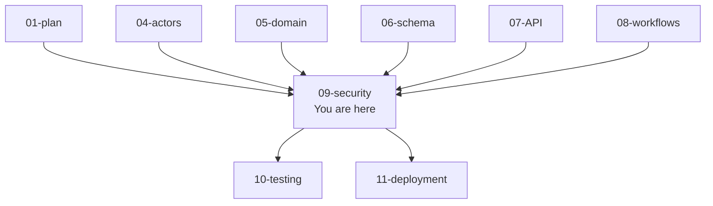

### 1.3 What this document does NOT cover

| Topic | Goes to |
|---|---|
| Test implementations | `10-TESTING-STRATEGY.md` |
| Deployment runbook | `11-DEPLOYMENT-AND-DEMO.md` |
| Domain entities and invariants | `05-DOMAIN-MODEL.md` |
| Full API contract | `07-API-AND-REALTIME-CONTRACTS.md` |
| Workflow sequences | `08-WORKFLOWS.md` |
| UI screens and interactions | `busverse/05-UI-SPEC.md`, `buscon/06-UI-SPEC.md` |

---

## 2. Threat Model

BusVerse + BusCon handles real money, real passenger identity, and real GPS coordinates. The threat model uses **STRIDE** for security threats and **LINDDUN** overlay for privacy threats (DPDP compliance).

### 2.1 STRIDE threat model

**Diagram: STRIDE threat map**
*Six STRIDE categories mapped to BusVerse + BusCon. Each category has 2-4 concrete threats, each with a Phase 1 defense. This is the canonical list — every control in this doc traces back to one of these threats.*

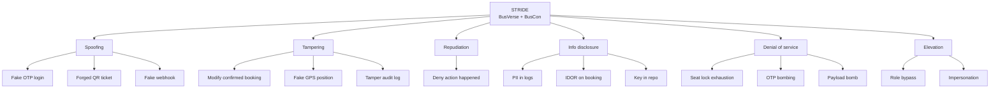

### 2.2 Threat catalog

| # | STRIDE | Threat | Attack | Impact | Phase 1 defense | Section |
|:---:|---|---|---|---|---|---|
| T1 | S | Fake OTP login | Attacker triggers OTP to victim, intercepts SMS | Account takeover | OTP TTL 10 min, 5 attempt limit, rate limit | §4, §6.5 |
| T2 | S | Forged QR ticket | Attacker generates fake QR | Free travel, lost revenue | Ed25519 signature | §7 |
| T3 | S | Fake webhook | Attacker POSTs `payment.captured` | Free bookings, refund fraud | HMAC signature + IP allowlist | §13 |
| T4 | S | Forged JWT | Attacker crafts JWT | Role escalation, data access | HS256 signature, secret rotation | §4 |
| T5 | T | Modify confirmed booking | Attacker patches booking via API | Fraud, dispute | Immutable after confirmation, service guard | §19 |
| T6 | T | Fake GPS position | Attacker spoofs GPS via API | Fraud tracking, ETA manipulation | Server-side validation, GPS provenance | §19 |
| T7 | T | Tamper audit log | Attacker deletes audit rows | Repudiation, compliance breach | DB grants, triggers, hash chain | §15 |
| T8 | T | Tamper request body | MITM modifies request | Fraud | TLS + signature on critical actions | §12 |
| T9 | R | Deny action happened | User claims "I didn't cancel" | Financial dispute | Append-only audit log with actor + timestamp | §15 |
| T10 | R | Deny scan happened | Driver claims they scanned | Fare dispute | Boarding scan audit + GPS | §15 |
| T11 | I | PII in logs | PII leaks via log files | DPDP violation, identity theft | PII scrubber middleware | §11, §15.5 |
| T12 | I | IDOR on booking | User accesses another booking by ID | Data breach | Row-level scope enforcement | §5.5 |
| T13 | I | Key in repo | Secret committed to Git | Total compromise | Pre-commit hooks, gitleaks CI | §17, §22.5 |
| T14 | I | Cross-operator data leak | Operator sees competitor data | Business espionage | Row-level scope | §5.5 |
| T15 | I | Redis compromise | Session/refresh tokens leak | Account takeover | TLS + AUTH, minimal data | §17, §5.5 |
| T16 | D | Seat lock exhaustion | Attacker locks all seats | Booking freeze | Rate limit 60/min, TTL 5 min | §16 |
| T17 | D | OTP bombing | Attacker triggers 1000 OTPs to victim | Victim harassment, SMS cost | 3 OTP / 10 min / phone | §6.5 |
| T18 | D | Payload bomb | Attacker sends 100 MB request | Server OOM | Body size limit 1 MB | §6 |
| T19 | D | WebSocket message spam | Attacker floods socket | Resource exhaustion | WS rate limit 60/min | §12.5 |
| T20 | E | Role bypass via JWT | User modifies JWT role claim | Privilege escalation | JWT signature + DB session role | §4, §5 |
| T21 | E | Impersonate admin | User gains admin access | Full compromise | No impersonation endpoint; 404 | §19 |
| T22 | E | Session fixation | Attacker sets victim's session ID | Account takeover | Server-generated session IDs only | §4.5 |
| T23 | E | CSRF | Attacker submits action as user | Unauthorized action | Bearer token (not cookie), SameSite | §6 |
| T24 | E | SQL injection | Attacker injects SQL via input | Data breach | Parameterized queries (Prisma) | §6 |
| T25 | E | XSS | Attacker injects script | Session theft | React auto-escaping, CSP | §6, §12 |

**New threat in v1.2:**

| # | STRIDE | Threat | Attack | Impact | Phase 1 defense | Section |
|:---:|---|---|---|---|---|---|
| **T26** | **T** | **Webhook loss on DB error** | **DB momentarily down → webhook transaction fails → booking stuck PENDING → money charged but no confirmation** | **Revenue loss, unconfirmed booking, customer complaint** | **Local file fallback + replay job (never lose webhook)** | **§13.5** |

**Explicitly out of scope (Phase 1):**

| Threat | Why out of scope |
|---|---|
| Nation-state attackers | Threat model assumes commercial adversary |
| Physical server access | Cloud provider guarantees |
| Supply chain (npm compromise) | Framework trust assumed |
| Insider admin attack | Single founder trust assumption |
| Social engineering | Policy, not technical |
| Zero-days in dependencies | Patch on disclosure |

### 2.3 LINDDUN privacy overlay

DPDP compliance requires privacy-specific threat coverage.

| LINDDUN | Threat | Phase 1 control |
|---|---|---|
| **Linking** | Correlate user across sessions | Session IDs not linked to PII in logs |
| **Identifying** | De-anonymize users | PII encrypted at rest, hashed for lookup |
| **Non-repudiation** | (opposite — want repudiation for privacy) | Audit tracks actor, but PII masked |
| **Detecting** | Infer sensitive info from patterns | Rate limits hide activity patterns |
| **Data disclosure** | Unauthorized PII access | Row scope, encryption, masking |
| **Unawareness** | User doesn't know data is collected | Consent capture, privacy policy |
| **Non-compliance** | DPDP violation | §18 compliance mapping |

### 2.4 Attack trees

**Diagram: Attack tree — compromise booking**
*A booking is the highest-value target. Three attack paths — theft via session, theft via IDOR, forgery via ID manipulation. Each path shows the steps and the layer that blocks it.*

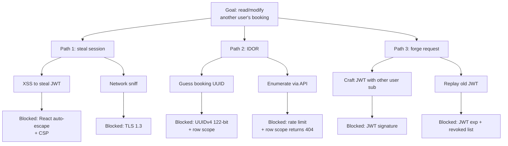

**Diagram: Attack tree — compromise QR ticket**
*QR is money. Two paths — forge a QR that verifies, or replay a valid QR after use. Both must fail.*

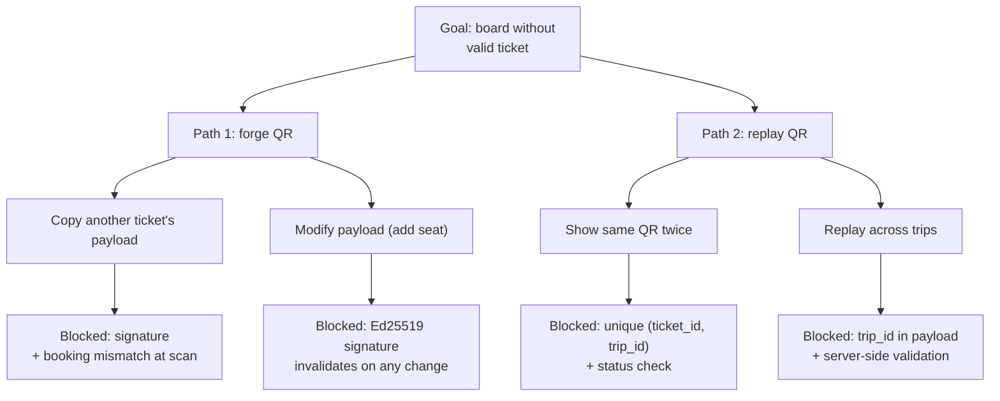

**Diagram: Attack tree — webhook loss (v1.2 new threat T26)**
*What happens when the DB is momentarily down during webhook processing. Without a fallback, the webhook is lost — money charged but booking stuck PENDING. The v1.2 fix: local file fallback + replay job.*

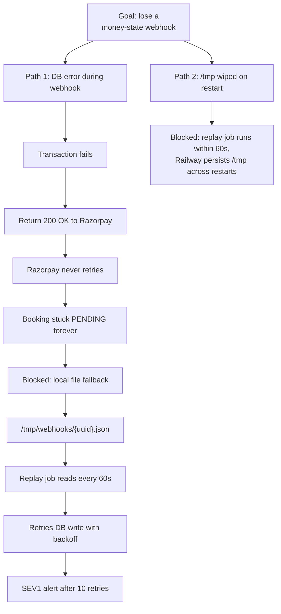

---

## 3. Trust Boundaries

### 3.1 Five trust boundaries

**Diagram: Trust boundaries**
*Five boundaries in the system. Trusted zone (API, Postgres, Redis) is fully controlled. Semi-trusted (Razorpay, MSG91, R2) has contractual + technical controls. Untrusted (browser, mobile) has zero trust. Every crossing has a defined control.*

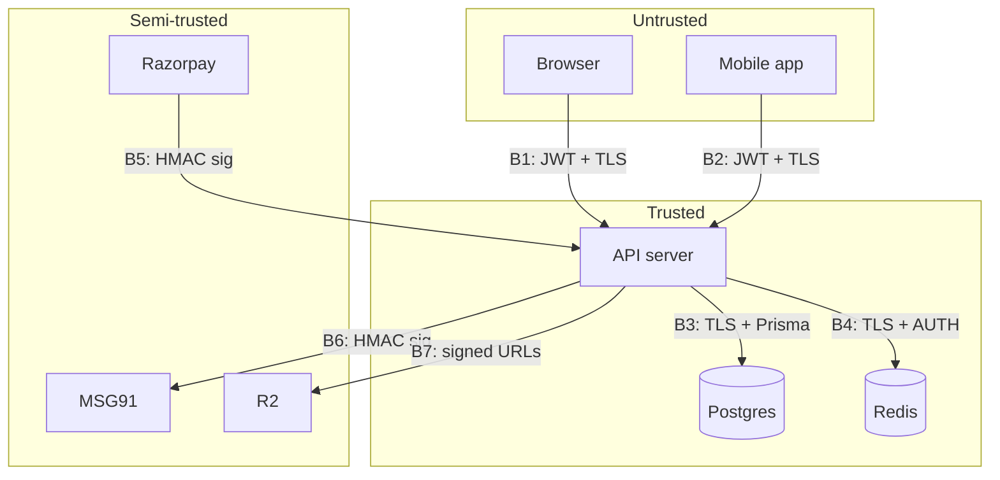

### 3.2 Boundary crossing controls

| Boundary | From → To | Controls |
|---|---|---|
| **B1** | Browser → API | TLS 1.3, JWT bearer, CORS whitelist, CSP, input validation |
| **B2** | Mobile → API | TLS 1.3, JWT bearer, certificate pinning (Phase 2), input validation |
| **B3** | API → Postgres | TLS required (`sslmode=require`), parameterized queries only, row-level scope |
| **B4** | API → Redis | TLS + AUTH password, no PII in Redis keys/values |
| **B5** | Razorpay → API | HMAC-SHA256 signature, IP allowlist, timestamp ≤ 5 min old, **DB error fallback** |
| **B6** | API → MSG91 | TLS, API key in header, no PII beyond phone + message content |
| **B7** | API → R2 | Signed URLs (15 min TTL), server-generated paths, MIME + size validation |

### 3.3 Trust assumptions

| Assumption | If violated |
|---|---|
| Node.js runtime is trustworthy | All security fails |
| Postgres ACID guarantees hold | Atomicity lost, races possible |
| Razorpay signs webhooks correctly | Fake payments possible |
| MSG91 delivers SMS reliably | OTP fallback to BullMQ retry |
| R2 signed URLs are time-bounded | Upload leakage |
| TLS terminates correctly at load balancer | MITM on backend traffic |
| **Local filesystem persists between API restarts** | **Webhook fallback files lost** |

**Documented violation response:** if any assumption fails, treat as SEV1 incident (§20).

**Note on filesystem persistence (v1.2):** Railway preserves the container filesystem across graceful restarts within a deployment (rolling deploy keeps the same pod for a short window). For hard resets (container killed, redeployed with a new pod), `/tmp` may be wiped. Mitigation: the replay job runs every 60s — the window of exposure is at most 60 seconds. If a file is lost, the SEV1 alert fires and manual intervention via Razorpay dashboard replay is the fallback. Phase 2 could move the fallback to a persistent volume.

---

## 4. Authentication

### 4.1 JWT structure

**Diagram: JWT anatomy**
*Access tokens are JWTs signed with HS256. Five claims total. No PII in the token — only opaque IDs. Signed with a 32+ byte secret in `.env`. Verified on every request.*

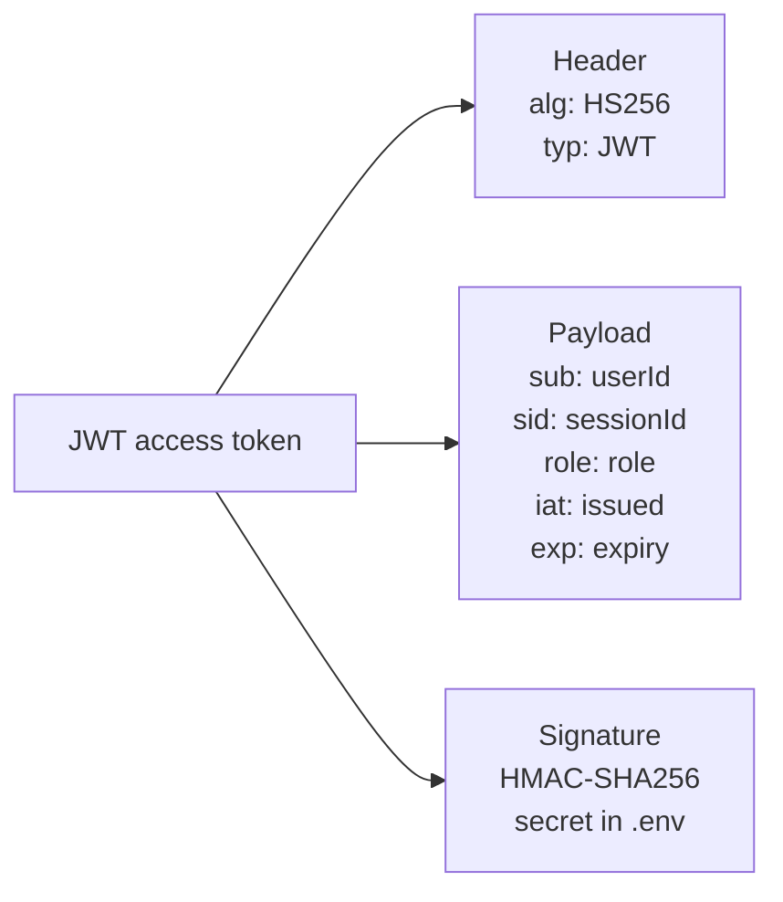

**Exact claim specification:**

| Claim | Type | Value | Validation |
|---|---|---|---|
| `sub` | string | `user_id` (UUID) | Must exist in DB |
| `sid` | string | `session_id` (UUID) | Must match `sessions.id` |
| `role` | string | One of 6 roles | Must match `sessions.role` |
| `iat` | number | Issued Unix time | Sanity check (not > now) |
| `exp` | number | Expiry Unix time | Must be > now |

**Rules:**
- No PII in payload — no phone, no email, no name
- `role` in JWT must **match** `sessions.role` at every request
- Signature secret ≥ 32 bytes, generated with `crypto.randomBytes(32)`
- Reject if `alg != HS256` (prevent `none` algorithm attack)

### 4.2 Refresh token rotation

**Diagram: Refresh rotation state machine**
*Refresh is a one-time use token. Each use rotates it. If an old token is presented twice, the whole chain is revoked. This catches token theft.*

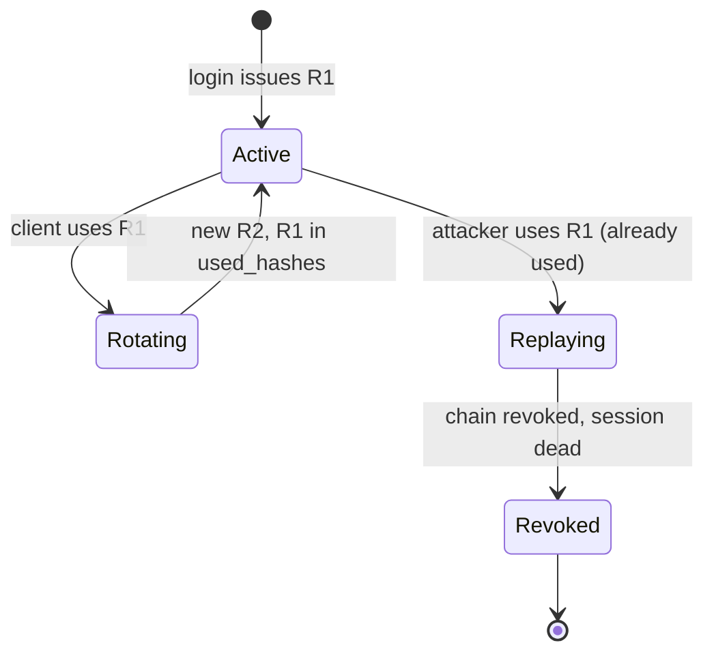

**Exact algorithm:**

1. Client sends `POST /auth/refresh` with `refresh_token`
2. Server hashes with SHA-256
3. Server looks up `sessions.refresh_hash`
4. If match: rotate (generate new, hash, update, append old to `used_hashes`)
5. If not match, but hash is in `used_hashes`: **replay detected** → revoke session + all chain + audit
6. If neither → `401 INVALID_REFRESH_TOKEN`

**Refresh token format:**
- 32 bytes from `crypto.randomBytes(32)`
- Base64-encoded → 44 chars
- Never a JWT — opaque string, no claims

### 4.3 Password hashing

| Parameter | Value | Rationale |
|---|---|---|
| Algorithm | **Argon2id** | OWASP 2024 recommendation |
| Memory | 64 MB | Defeats GPU attack |
| Iterations | 3 | Good balance |
| Parallelism | 4 | Multi-threaded hash |
| Salt | 16 random bytes | Per-password |
| Storage | PHC string format | Self-contained salt+params |

### 4.4 OTP hashing

| Parameter | Value |
|---|---|
| Algorithm | **SHA-256** with per-row random salt |
| Salt length | 16 bytes |
| Storage | `otp_hash` + `otp_salt` columns |
| TTL | 10 minutes |
| Max attempts | 5 |

**Why SHA-256 (not Argon2):** OTPs are 6 digits, short-lived, rate-limited. The brute-force window is negligible. Argon2 would add latency for no benefit.

**Delivery:** OTP generation, hashing, storage, verification, and rate-limiting are all **self-managed**. MSG91 is the SMS delivery pipe only.

### 4.5 Session security

#### 4.5.1 Session fixation

**Rule:** Session IDs are always server-generated. Never accepted from client.

**Enforcement:**
- `sessions.id` is `gen_random_uuid()` — never client-supplied
- No `X-Session-ID` header accepted
- No `session_id` in request body accepted

#### 4.5.2 Session hijacking defense

**Diagram: Session hijacking defense layers**
*Four layers prevent session theft from being useful.*

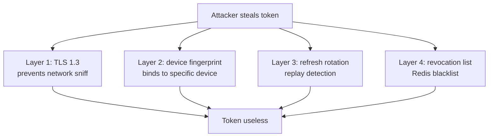

#### 4.5.3 Concurrent session limits

| Actor | Max sessions | Behavior when exceeded |
|---|---|---|
| Passenger | 5 | Oldest revoked |
| Operator (Owner/Manager) | 3 | Oldest revoked |
| Driver | 1 | Newest wins (previous revoked) |
| Admin | 1 | Newest wins (previous revoked) |

### 4.6 Authentication error codes

| Error | HTTP | When |
|---|---|---|
| `INVALID_OTP` | 400 | OTP wrong |
| `OTP_EXPIRED` | 400 | OTP past TTL |
| `OTP_ATTEMPTS_EXCEEDED` | 429 | 5 failed attempts |
| `INVALID_CREDENTIALS` | 401 | Email/password wrong |
| `INVALID_REFRESH_TOKEN` | 401 | Refresh not found |
| `REFRESH_TOKEN_REPLAYED` | 401 | Old refresh reused |
| `SESSION_REVOKED` | 401 | Session marked revoked |
| `EMAIL_NOT_VERIFIED` | 403 | Operator email unverified |

---

## 5. Authorization

### 5.1 Five-layer authorization

**Diagram: Five-layer authorization enforcement**
*Every request is checked at five layers. UI hides, API validates role, service validates business rules, DB enforces row scope, audit logs every action.*

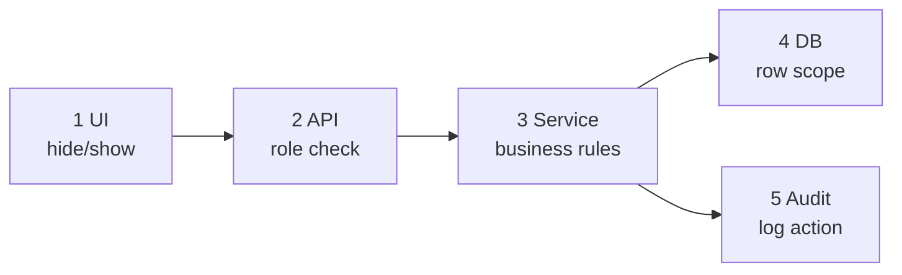

**Rule:** A permission is enforced only if it's checked at **both API and DB layers**.

### 5.2 Authorization middleware

Every authenticated endpoint runs through this pipeline:

1. **Extract JWT** from `Authorization: Bearer <token>`
2. **Verify signature** (HS256)
3. **Check `alg` claim = HS256** (reject `none`)
4. **Check `exp`** (not expired)
5. **Check `iat`** (not future)
6. **Check session** — `sessions.id = jwt.sid`:
   - Session exists, status = `ACTIVE`, not in Redis blacklist
7. **Check role** — `sessions.role == jwt.role`
8. **Check route's required role**
9. **Attach `req.auth = { user_id, session_id, role, operator_id? }`**

### 5.3 Permission matrix enforcement

`04` §9 defines which roles can do what. Enforced at the **API layer** via route decorators:

```
GET /v1/operator/buses
@RequireRole(['OPERATOR_OWNER', 'OPERATOR_MANAGER'])
@RequireOperatorScope()  // adds `WHERE operator_id = ?` filter
```

**Rule:** Every route must have an explicit `@RequireRole` decorator (or `@Public`). CI fails if a route has neither.

### 5.4 Field-level masking

Covered in §11.

### 5.5 Multi-tenant isolation enforcement

**Diagram: Multi-tenant scope enforcement**
*Every query that touches tenant-scoped data has `WHERE operator_id = ?` appended by middleware. Cross-tenant rows return 404, not 403.*

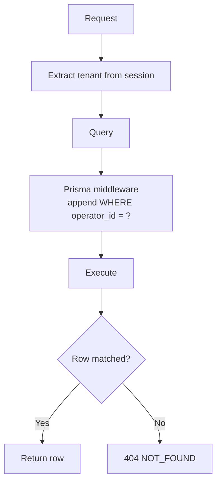

**Scope column per table:**

| Table | Scope column |
|---|---|
| `buses` | `operator_id` |
| `routes` | `operator_id` |
| `schedules` | `operator_id` |
| `operator_users` | `operator_id` |
| `driver_profiles` | `operator_id` |
| `bookings` | `operator_id` (via `schedule_id → schedules.operator_id`) |
| `payments` | `operator_id` (via `booking_id → bookings.schedule_id`) |
| `consent_records` | `user_id` |
| `password_reset_tokens` | `user_id` |

**Enforcement:**
- **Prisma middleware** auto-appends `WHERE operator_id = :session_operator_id` for operator roles
- `SUPER_ADMIN` bypasses the scope
- `DRIVER` is scoped to `driver_id = :session_driver_id`
- `REGISTERED_PASSENGER` is scoped to `user_id = :session_user_id`

**Canary tests:** every CI run executes cross-tenant tests that assert 404.

**Response shape:** `404 NOT_FOUND` — **never 403**. A 403 tells the attacker the resource exists.

**Logging:** every cross-tenant attempt is logged. If > 10 attempts by same actor in 1 hour → SEV2 alert.

---

## 6. Input Validation

### 6.1 Input validation pipeline

**Diagram: Request validation pipeline**
*Every request passes through four layers before reaching handlers.*

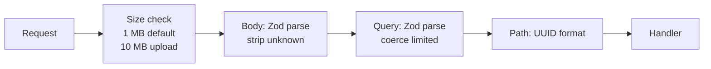

### 6.2 Per-vector defenses

| Vector | Attack | Defense |
|---|---|---|
| **SQL injection** | `' OR '1'='1` in input | Prisma parameterized queries only |
| **XSS** | `<script>alert(1)</script>` | React auto-escaping; CSP |
| **CSRF** | Cross-site form submit | Bearer token (not cookie); SameSite |
| **Command injection** | `; rm -rf /` in filename | No `child_process.exec` |
| **Path traversal** | `../../etc/passwd` | No user-supplied file paths |
| **SSRF** | `http://169.254.169.254/` | No user-supplied URLs fetched |
| **XXE** | `<!DOCTYPE...` | JSON only; no XML parsing |
| **Prototype pollution** | `__proto__` in JSON | Zod strips unknown |
| **ReDoS** | `^(a+)+$` | No user-supplied regex |
| **Mass assignment** | `{ "role": "SUPER_ADMIN" }` | Zod strips unknown |
| **Header injection** | `\r\n` in header value | Node.js `http` rejects CRLF |
| **Log injection** | `\n` in input | All values JSON-encoded |
| **Open redirect** | `?return_to=evil.com` | No `return_to` param |
| **Deserialization** | Malicious serialized object | No `eval()`, no `new Function()` |

### 6.3 Request size limits

| Endpoint type | Limit | Behavior |
|---|---|---|
| Standard JSON | 1 MB | 413 |
| Upload | 10 MB | 413 |
| Webhook (Razorpay) | 100 KB | 413 |
| WebSocket message | 64 KB | Connection closed |

### 6.4 Content-Type enforcement

| Endpoint | Accepted Content-Type |
|---|---|
| All POST/PATCH (except uploads) | `application/json` |
| POST `/uploads` | `application/json` (metadata only) |
| Razorpay webhook | `application/json` |

**Reject everything else** with `415 UNSUPPORTED_MEDIA_TYPE`.

### 6.5 Account protection

#### 6.5.1 Account enumeration prevention

| Endpoint | If user exists | If user doesn't exist | Enumeration risk |
|---|---|---|---|
| `POST /auth/login` | 200 or 401 | 401 (same) | ❌ Blocked |
| `POST /auth/otp/request` | 200 | 200 | ❌ Blocked |
| `POST /auth/reset/request` | 200 | 200 | ❌ Blocked |
| `POST /passenger/auth/signup` | 409 | 200 | ✅ Allowed (trade-off) |

#### 6.5.2 Timing attack prevention

**Rules:**
- Password verification uses `argon2.verify()` (constant-time)
- HMAC verification uses `crypto.timingSafeEqual()`
- OTP verification uses `crypto.timingSafeEqual()`
- **Dummy work on user-not-found** to equalize response time

#### 6.5.3 Account lockout

**Diagram: Progressive lockout**
*Failed login attempts trigger progressive delays, not hard lockout.*

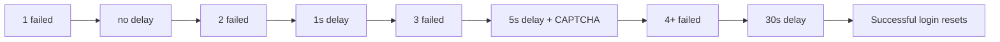

**Counter storage:** Redis `login_attempts:{identifier}` with 1-hour TTL.

#### 6.5.4 CAPTCHA

**Provider:** Cloudflare Turnstile (free, invisible)

**Endpoints with CAPTCHA:** `POST /auth/login`, `POST /auth/otp/request`

**Failure behavior:** Invalid CAPTCHA → `400 CAPTCHA_INVALID`.

### 6.6 Password policy

| Rule | Operator | Admin |
|---|---|---|
| Minimum length | 12 chars | 16 chars |
| Maximum length | 128 chars | 128 chars |
| History | Last 3 disallowed | Last 3 disallowed |
| Common password check | Yes | Yes |

---

## 7. QR Signing (Ed25519)

The QR ticket is the primary proof of purchase. It must be verifiable offline, unforgeable, and non-replayable.

### 7.1 Signing and verification flow

**Diagram: QR sign + verify flow**
*Server signs ticket payload on issuance. Signature stored in `tickets.qr_signature`. QR content is `v1:payload_b64:sig_b64`. Driver App verifies offline using cached public key.*

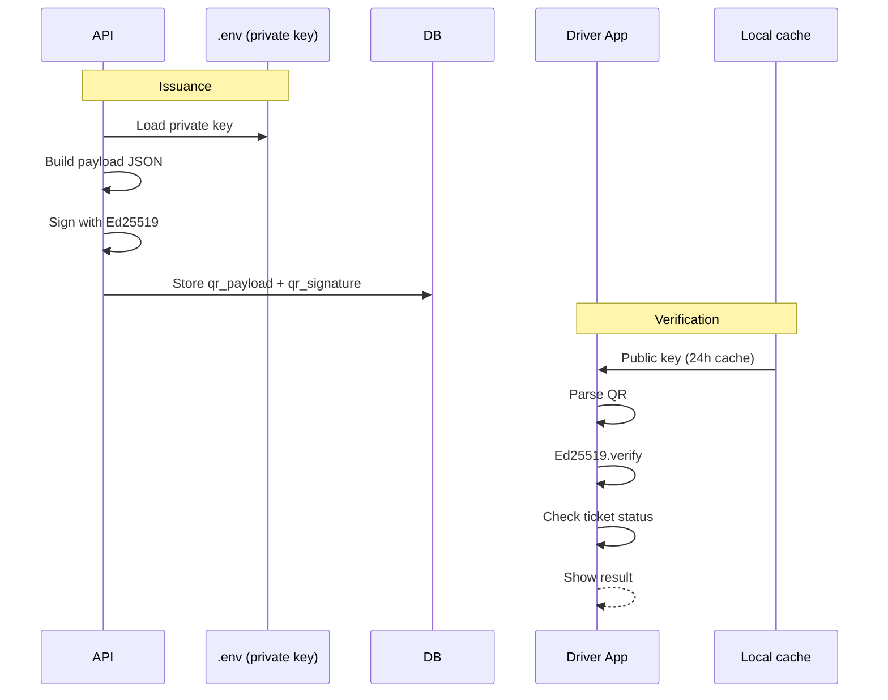

### 7.2 Payload schema

```json
{
  "v": 1,
  "ticketId": "tkt_abc",
  "bookingId": "bkg_xyz",
  "scheduleId": "sch_def",
  "seatId": "seat_123",
  "seatLabel": "A1",
  "passengerName": "Alice",
  "boardingStandId": "stand_456",
  "issuedAt": "2026-10-24T14:32:00.000Z",
  "nonce": "base64-random-16-bytes"
}
```

### 7.3 Canonicalization

Before signing, payload must be canonicalized:

```
1. Parse JSON
2. Sort keys alphabetically
3. No whitespace
4. UTF-8 encode
5. Base64-encode
6. Sign the base64 bytes with Ed25519
```

**Both signer and verifier must use the same canonicalization.**

### 7.4 Signing procedure

```python
payload_json = {
  "v": 1,
  "ticketId": ticket.id,
  # ... all fields
}
canonical = json.dumps(payload_json, sort_keys=True, separators=(',', ':'))
payload_b64 = base64.b64encode(canonical.encode()).decode()
signature = ed25519.sign(canonical.encode(), private_key)
sig_b64 = base64.b64encode(signature).decode()
qr_content = f"v1:{payload_b64}:{sig_b64}"
```

### 7.5 Verification procedure

```python
parts = qr_content.split(':')
if len(parts) != 3 or parts[0] != "v1":
    return "INVALID_FORMAT"
payload_b64, sig_b64 = parts[1], parts[2]
payload = base64.b64decode(payload_b64)
sig = base64.b64decode(sig_b64)
if not ed25519.verify(sig, payload, public_key):
    return "INVALID_SIGNATURE"
data = json.loads(payload)
if data["scheduleId"] != current_trip.scheduleId:
    return "INVALID_TRIP"
# check ticket status server-side
```

### 7.6 Key management

| Key | Where | Rotation |
|---|---|---|
| Ed25519 private key | `.env` (`QR_SIGNING_PRIVATE_KEY`) | Manual, on compromise |
| Ed25519 public key | `.env` (`QR_SIGNING_PUBLIC_KEY`), served via `/driver/config` | Matches private |

**Format:** base64-encoded 32-byte key.

**Phase 2:** move to KMS with key versioning. QR payload gets `keyId` field.

### 7.7 QR security guarantees

| Attack | Prevented by |
|---|---|
| Forge signature | Ed25519 hardness (~2^128) |
| Modify payload | Signature invalidates |
| Copy from another ticket | `ticketId` mismatch with server DB |
| Replay after use | Server checks `tickets.status = ACTIVE` |
| Replay on another trip | `scheduleId` mismatch |
| Offline forgery | No private key on device |

---

## 8. Seat Locking Atomicity

### 8.1 Failure modes

**Diagram: Seat lock failure modes**
*Three failure modes — Redis down, Postgres down, both down. Each has a fail-safe behavior. Never two locks, never two bookings, even with degraded infrastructure.*

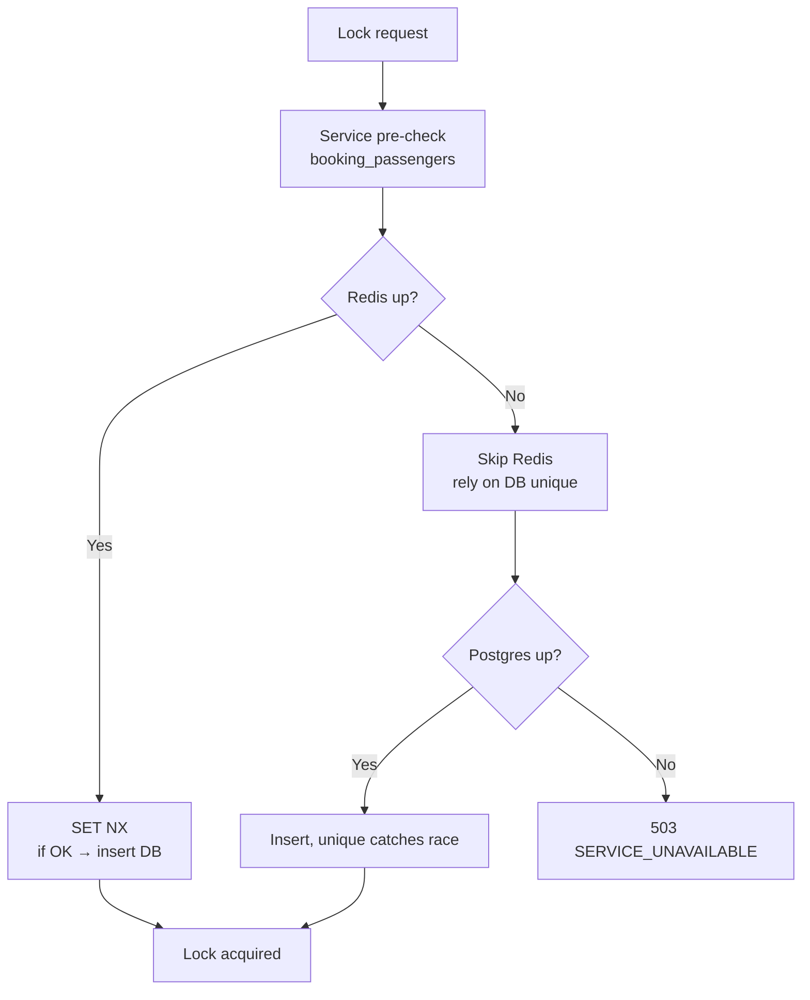

### 8.2 Atomicity guarantees (v1.2 — two invariants)

**Invariants:**

1. **No two active `seat_locks` rows with the same `(schedule_id, seat_id)`.**
2. **No `seat_locks` row may exist for a `(schedule_id, seat_id)` that is already in `booking_passengers`.**

**Enforcement:**

- **Invariant 1 (lock vs. lock):**
  - **Redis:** `SET lock:{schedule}:{seat} {user} NX EX 300`
  - **Postgres:** Unique index `uniq_seat_locks_schedule_seat`
- **Invariant 2 (lock vs. booking):** Checked at the **service layer** in `POST /seat-locks` — before acquiring the lock, query `booking_passengers` for `(schedule_id, seat_id)`. If a row exists, return `409 SEAT_ALREADY_BOOKED`. This is a service-layer guard, not a DB constraint (cross-table unique constraints require triggers, which are overkill for Phase 1 volume).

**Diagram: Three-layer seat lock enforcement (v1.2)**
*The service pre-check runs first. If a booking exists, 409 without touching Redis or DB. Then Redis NX. Then DB unique. Any layer alone is insufficient.*

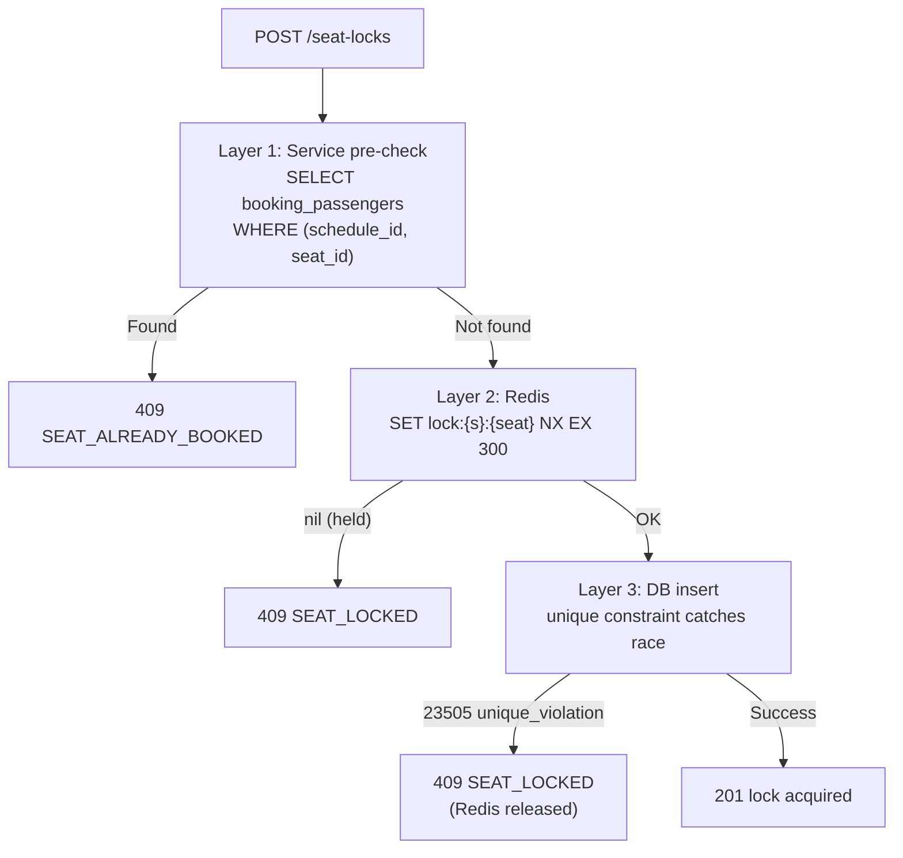

### 8.3 Booking creation transaction

**Diagram: Booking transaction (v1.2 — lock TTL extended)**
*Booking creation INSERTs booking + passengers AND extends lock TTL to 15 min. Ticket and invoice are NOT created here — they are INSERTed at webhook time.*

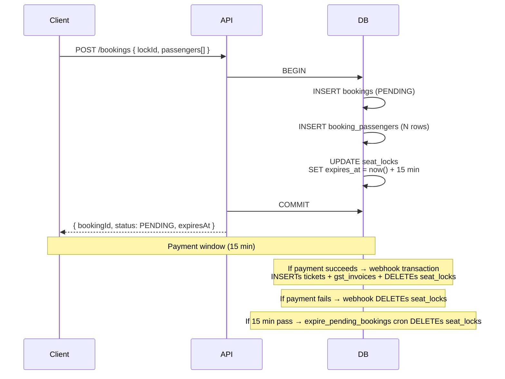

**Failure handling:** If the booking transaction fails (e.g., unique constraint on `booking_passengers`), rollback. Passenger sees "seat taken" and must retry.

### 8.4 Lock TTL and cleanup

| Layer | TTL | Cleanup |
|---|---|---|
| Redis `lock:{s}:{seat}` | 300 sec (5 min) | Auto-expire |
| `seat_locks.expires_at` | 300 sec (5 min), extended to 900 sec (15 min) when booking created | Nightly cron + 60s background sweep + `expire_pending_bookings` cron |

**Rule:** Even if cron lags, Redis blocks new locks. Even if Redis is down, Postgres unique constraint blocks races. The pre-check blocks locks on booked seats. **All three must fail for a lock to leak.**

---

## 9. Idempotency

### 9.1 Idempotency key window

**Diagram: Idempotency key flow**
*Two endpoints require `Idempotency-Key`. Server stores (key, body_hash, response) for 24h. Same key + same body → cached. Same key + different body → 409. New key → normal.*

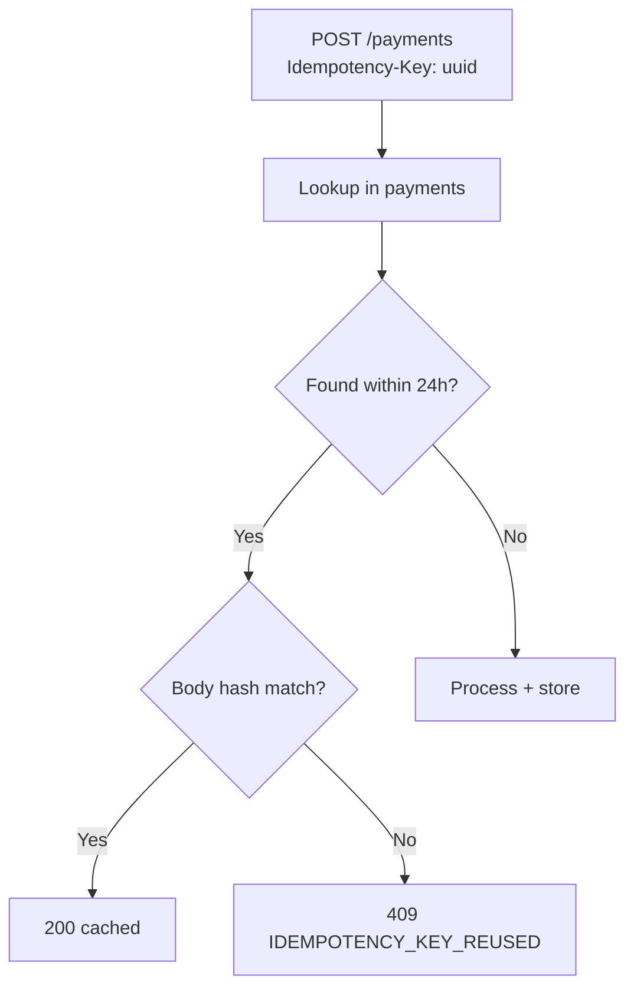

**Retry rule (v1.2):** A retry attempt after a FAILED payment MUST use a **new** `Idempotency-Key`. Reusing the same key returns the cached failed response — the user cannot retry. This is why the client generates a fresh UUIDv4 per attempt (see `07` §4.6).

### 9.2 Storage

```sql
CREATE UNIQUE INDEX uniq_payments_idempotency
  ON payments (idempotency_key)
  WHERE created_at > now() - interval '24 hours';
```

**Pruning:** Nightly cron deletes keys older than 24h from `payments` (only for failed payments; succeeded stay).

### 9.3 Body hashing

Request body canonicalized to JSON with sorted keys, then SHA-256 hashed.

```
body_hash = sha256(canonical_json(request_body))
```

Stored alongside idempotency key. On key lookup, hash compared.

### 9.4 Endpoints requiring idempotency

| Endpoint | Idempotency |
|---|---|
| `POST /v1/passenger/payments` | **Required** (each retry uses new key) |
| `POST /v1/admin/payments/:id/refund` | **Required** |
| `POST /v1/passenger/bookings` | Optional (server infers from lockId) |

---

## 10. PII Encryption

### 10.1 Encryption layering

**Diagram: Encryption layering**
*Three layers of encryption. TLS protects transit. Disk encryption protects the host. Application-layer AES-256-GCM protects specific columns marked `Restricted`.*

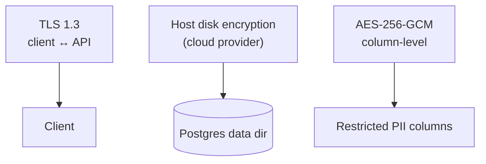

### 10.2 Encrypted columns

| Column | Why |
|---|---|
| `users.phone` | PII |
| `users.email` | PII |
| `operators.pan` | Financial PII |
| `operators.bank_account_ref` | Financial PII |
| `driver_profiles.license_number` | Identity |
| `booking_passengers.id_number` | Identity |
| `payments.method_details_json` | Payment details |
| `password_reset_tokens.token_hash` | Already hashed (SHA-256), not encrypted |

### 10.3 AES-256-GCM parameters

| Parameter | Value |
|---|---|
| Algorithm | AES-256-GCM |
| Key size | 32 bytes |
| Nonce | 12 bytes, random per encryption |
| Tag | 16 bytes |
| Storage format | `base64(nonce ‖ ciphertext ‖ tag)` |

**Encryption:**
```python
nonce = os.urandom(12)
cipher = AESGCM(key)
ct = cipher.encrypt(nonce, plaintext.encode(), None)
stored = base64.b64encode(nonce + ct).decode()
```

**Decryption:**
```python
raw = base64.b64decode(stored)
nonce, ct = raw[:12], raw[12:]
cipher = AESGCM(key)
plaintext = cipher.decrypt(nonce, ct, None).decode()
```

### 10.4 Key management

| Item | Where |
|---|---|
| Key | `.env` (`PII_ENCRYPTION_KEY`) |
| Generation | `crypto.randomBytes(32).toString('base64')` |
| Rotation | **Never** in Phase 1 — requires re-encryption of all rows |
| Backup | Encrypted copy in password manager (separate from code backup) |

**Loss of key = data loss.**

### 10.5 Searchable hash for phone

**Diagram: Searchable hash**
*Phone is encrypted for confidentiality but must be searchable. Solution: store a deterministic hash alongside.*

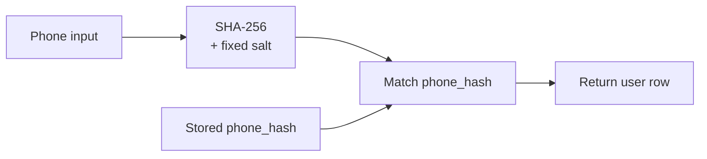

**Format:**
```
phone_hash = sha256(phone + PHONE_HASH_SALT).hex()
```

### 10.6 Hash catalog

| Column | Algorithm | Salt | Constant-time compare |
|---|---|---|---|
| `operator_users.password_hash` | Argon2id | Random per-row | ✅ |
| `otp_challenges.otp_hash` | SHA-256 | Random per-row | ✅ |
| `sessions.refresh_hash` | SHA-256 | None | ✅ |
| `sessions.device_fingerprint_hash` | SHA-256 | Fixed app-level | ✅ |
| `users.phone_hash` | SHA-256 | Fixed app-level | ✅ |
| `password_reset_tokens.token_hash` | SHA-256 | None (high-entropy) | ✅ |
| `gateway_webhooks.payload_hash` | SHA-256 | None (content-addressed) | ✅ |

**Rule:** Every hash comparison uses `crypto.timingSafeEqual`.

### 10.7 Key backup procedure

**Diagram: Key backup**
*PII encryption key backed up in two copies. Both encrypted with recovery passphrases. Only the founder has access.*

```mermaid
flowchart TB
    KEY["PII_ENCRYPTION_KEY<br/>(32 bytes)"]
    KEY --> ENC1["Encrypted copy 1<br/>password manager<br/>recovery passphrase A"]
    KEY --> ENC2["Encrypted copy 2<br/>physical safe<br/>recovery passphrase B"]

    ENC1 -.-> RESTORE["Restore procedure<br/>(SEV1 only)"]
    ENC2 -.-> RESTORE
```

**Procedure:**
1. On key generation, create 2 encrypted copies
2. Copy 1 → 1Password (or Bitwarden)
3. Copy 2 → printed + sealed envelope in physical safe
4. Document in `docs/runbook/key-recovery.md`
5. Test restore annually

---

## 11. Field Masking

### 11.1 Masking enforcement

**Diagram: Masking pipeline**
*Masking is applied server-side in serialization. Every response passes through a masker that checks role × field rules.*

```mermaid
flowchart LR
    ROW["DB row"] --> SER["Serialization"]
    SER --> ROLE["Load role"]
    ROLE --> MASK{"Field rule?"}
    MASK -->|Full| FULL["Raw value"]
    MASK -->|Masked| MASKED["Masked value"]
    MASK -->|Hidden| OMIT["Omit"]
    FULL --> REASON{"Reason<br/>required?"}
    REASON -->|Yes + missing| ERR["400 REASON_REQUIRED"]
    REASON -->|Yes + present| AUDIT["Audit + return"]
    REASON -->|No| RETURN["Return"]
```

### 11.2 Masking levels

| Level | Format | Example |
|---|---|---|
| **Full** | Raw value | `+919876543210` |
| **Masked** | First 4 + X's + last 1 | `+9198XXXXX10` |
| **Hidden** | Field absent | — |

### 11.3 Field masking matrix

Reproduced from `04` §11:

| Field | Passenger | Driver | Operator Owner | Operator Manager | Super Admin |
|---|---|---|---|---|---|
| Own phone | Full | Full | Full | Full | Full |
| Own email | Full | Full | Full | Full | Full |
| Other passenger phone | Own only | Hidden | Hidden | Hidden | Full + reason |
| Other passenger email | Own only | Hidden | Hidden | Hidden | Full + reason |
| Passenger name (booking) | Own | Full | Full | Full | Full |
| Driver license | Own | Own | Own fleet | Own fleet | Full |
| Card last 4 | Own | Hidden | Hidden | Hidden | Full + reason |
| Company bank details | — | — | Full | Hidden | Full |

### 11.4 Unmasking requirements

**Diagram: Unmasking flow**
*Admin unmasking requires reason + audit + rate limit. Only Super Admin can unmask.*

```mermaid
sequenceDiagram
    actor A as Super Admin
    participant API as API
    participant DB as DB

    A->>API: GET /bookings/:id?reason=Dispute%20investigation
    API->>API: Check role = SUPER_ADMIN
    API->>API: Check reason.length >= 10
    API->>API: Check rate limit (10/hour)
    API->>DB: Query row
    API->>DB: INSERT audit_logs (pii_accessed, reason)
    API-->>A: Return unmasked
```

**Requirements:**
- Role: `SUPER_ADMIN` only
- Reason param: minimum 10 characters
- Rate limit: 10 unmaskings per hour per admin
- Audit: always logs `pii_accessed` with reason

### 11.5 Log scrubbing

**Diagram: Log scrubbing**
*Every log line passes through a PII scrubber. Regex patterns catch phones, emails, Aadhaar, PAN, license, UPI VPA, card numbers.*

```mermaid
flowchart LR
    LOG["Log event"] --> SCRUB["PII scrubber<br/>regex per type"]
    SCRUB --> SAFE["Safe log line"]
    SAFE --> DEST["Ship to log store"]

    SCRUB -.->|"match"| REDACT["[REDACTED:phone]<br/>[REDACTED:email]<br/>[REDACTED:aadhaar]"]
```

**Scrubber patterns:**

| Type | Regex |
|---|---|
| Phone (E.164) | `\+91\d{10}` |
| Email | `[a-zA-Z0-9._%+-]+@[a-zA-Z0-9.-]+\.[a-zA-Z]{2,}` |
| Aadhaar | `\d{4}\s?\d{4}\s?\d{4}` |
| PAN | `[A-Z]{5}\d{4}[A-Z]` |
| License | `[A-Z]{2}\d{13}` |
| UPI VPA | `[a-zA-Z0-9._-]+@[a-zA-Z]+` |
| Card number | `\d{16}\|\d{4}\s?\d{4}\s?\d{4}\s?\d{4}` |

**Test coverage:** 100% of PII fields tested per scrubber.

---

## 12. Transport Security

### 12.1 TLS configuration

**Diagram: TLS + headers**
*TLS 1.3 preferred, 1.2 minimum. HSTS preload. Strict ciphers. All security headers on every response.*

```mermaid
flowchart TB
    CLIENT["Client"] -->|"TLS 1.3 preferred<br/>1.2 minimum"| LB["Load balancer"]
    LB -->|"TLS 1.3"| API["API server"]

    API --> HDR["Response headers<br/>HSTS<br/>CSP<br/>X-Content-Type<br/>X-Frame<br/>Referrer-Policy"]
```

### 12.2 TLS parameters

| Parameter | Value |
|---|---|
| Minimum TLS | 1.2 |
| Preferred TLS | 1.3 |
| Cipher suites | ECDHE only |
| Certificate | Let's Encrypt auto-renew |
| HSTS | `max-age=31536000; includeSubDomains; preload` |

### 12.3 Security headers

| Header | Value | Purpose |
|---|---|---|
| `Strict-Transport-Security` | `max-age=31536000; includeSubDomains` | Force HTTPS |
| `X-Content-Type-Options` | `nosniff` | Block MIME sniffing |
| `X-Frame-Options` | `DENY` | Block framing |
| `Referrer-Policy` | `strict-origin-when-cross-origin` | Limit referrer leaks |
| `Permissions-Policy` | `geolocation=(self), camera=(self)` | Restrict APIs |
| `Content-Security-Policy` | (see §12.4) | Block XSS |

### 12.4 Content Security Policy

Phase 1: **report-only**.

```
default-src 'self';
script-src 'self' 'nonce-{random}';
style-src 'self' 'unsafe-inline';
img-src 'self' data: https:;
connect-src 'self' https://api.razorpay.com wss://{host};
frame-src https://api.razorpay.com;
```

Phase 2: enforce after violations are addressed.

### 12.5 CORS

```env
CORS_ALLOWED_ORIGINS=https://busverse.app,https://buscon.app,http://localhost:3000,http://localhost:8081
```

**Rules:**
- Never `*` in production
- Credentials only with explicit origin
- Methods allowed: `GET, POST, PATCH, DELETE, OPTIONS`
- Headers allowed: `Authorization, Content-Type, Idempotency-Key, X-Request-Id`

### 12.6 Cookie flags (web refresh token)

| Flag | Value |
|---|---|
| `Secure` | ✅ |
| `HttpOnly` | ✅ |
| `SameSite` | `Lax` |
| `Path` | `/v1/{surface}/auth` |
| `Max-Age` | 604800 (7 days) |

---

## 12.5. WebSocket Security

### 12.5.1 WebSocket auth model

**Diagram: WS auth handshake security**
*Auth is required within 5 seconds of connect. Token is sent in a message, not URL. Invalid or missing auth closes connection.*

```mermaid
sequenceDiagram
    participant C as Client
    participant WS as WS Server
    participant API as Auth

    C->>WS: connect
    Note over C,WS: 5s window
    C->>WS: { action: "auth", token }
    WS->>API: Verify JWT + session
    API-->>WS: Valid + role
    WS-->>C: { event: "auth:ok" }
    Note over WS: else close after 5s
```

**Rules:**
- JWT must be in **first message** — never in URL query
- Auth timeout: 5 seconds
- No auth → connection closed
- Invalid auth → 401 close code
- After auth, socket bound to `{ user_id, session_id, role }`

### 12.5.2 Subscription authorization

**Diagram: Subscription validation**
*On subscribe, server validates the user has access to that topic.*

```mermaid
flowchart TB
    SUB["Subscribe"] --> TOPIC{"Topic type"}
    TOPIC -->|"seat:availability:{id}"| PUB["Public — allow"]
    TOPIC -->|"trip:live:{id}"| BK["Check user has booking<br/>on this trip"]
    TOPIC -->|"booking:{id}"| OWN["Check user owns booking<br/>or admin"]
    TOPIC -->|"admin:notifications"| ADM["Check role = SUPER_ADMIN"]

    PUB --> OK["Subscribe"]
    BK -->|"has booking"| OK
    BK -->|"no booking"| DENY["Close + log"]
    OWN -->|"owns"| OK
    OWN -->|"no"| DENY
    ADM -->|"yes"| OK
    ADM -->|"no"| DENY
```

### 12.5.3 WebSocket rate limits

| Action | Limit |
|---|---|
| Connection | 10 / min / IP |
| Auth attempts | 5 / min / IP |
| Subscribe messages | 20 / min / session |
| Any message | 60 / min / session |
| Message size | 64 KB |

**Enforcement:** Redis counters per `(session_id, action)` and `(ip, action)`.

### 12.5.4 WebSocket origin validation

- Origin header must be in `CORS_ALLOWED_ORIGINS`
- Missing origin → reject
- Non-whitelisted origin → close with code 1008

### 12.5.5 WebSocket message content

- Max size: 64 KB
- Must be valid JSON
- Must have `action` field (if client → server)
- Unknown `action` → `{ error: "UNKNOWN_ACTION" }` (don't close)

### 12.5.6 WebSocket re-auth on expiry

- Server sends `auth:expiring` 60s before JWT expiry
- Client sends `{ action: "auth:refresh", refreshToken }` within 30s
- Server validates, sends `auth:refreshed`
- If not received → close connection

---

## 13. Webhook Security

### 13.1 Verification pipeline

**Diagram: Webhook verification pipeline (v1.2)**
*Seven layers of verification before processing. IP allowlist → signature → timestamp → replay check → payload validation → process. On DB error during processing: local file fallback (v1.2).*

```mermaid
flowchart TB
    WH["Webhook"] --> IP{"IP in allowlist?"}
    IP -->|No| R401["401"]
    IP -->|Yes| SIG{"HMAC valid?"}
    SIG -->|No| R401
    SIG -->|Yes| TS{"Timestamp ≤ 5 min?"}
    TS -->|No| R401
    TS -->|Yes| DUP{"Payload hash exists?"}
    DUP -->|Yes| R200["200 no-op"]
    DUP -->|No| PROC["Process event"]

    PROC -->|"DB error"| FALLBACK["Write raw body<br/>to /tmp/webhooks/{uuid}.json"]
    FALLBACK --> R200B["200 OK<br/>(replay job will retry)"]
    PROC -->|"Success"| R200C["200 OK"]
```

### 13.2 Signature algorithm

**Verification:**

```
signature = HMAC-SHA256(raw_request_body, RAZORPAY_WEBHOOK_SECRET)
provided = request.headers['x-razorpay-signature']
if not crypto.timingSafeEqual(Buffer.from(signature), Buffer.from(provided)):
    return 401
```

**Rules:**
- Signature computed over **raw body**, before JSON parsing
- Constant-time comparison
- Header name: `x-razorpay-signature`
- Algorithm: HMAC-SHA256

### 13.3 IP allowlist

**Razorpay IPs:** fetched from `https://api.razorpay.com/v1/ips`, cached hourly. Any request from outside this list → 401 before signature check.

### 13.4 Replay prevention

| Defense | Implementation |
|---|---|
| Timestamp check | `received_at - timestamp <= 5 min` |
| Payload hash uniqueness | `gateway_webhooks` unique on `(payment_id, event_type, payload_hash)` |
| Payment status check | If `payments.status` in terminal state, no-op |

### 13.5 Failure handling (v1.2 — DB error fallback)

| Failure | Response | Alert | Fallback |
|---|---|---|---|
| IP not in allowlist | 401 | SEV3 | — |
| Invalid signature | 401 | SEV3 | — |
| Timestamp expired | 401 | SEV3 | — |
| Duplicate payload | 200 | — | Replay protection (unique constraint) |
| Processing error (non-DB) | 200 | SEV2 | Retry via BullMQ |
| **DB error** | **200** | **SEV1** | **Local file fallback** |

**Rule:** Never return 5xx to Razorpay (causes retry storm). Always 200 after acceptance.

**DB error fallback procedure (v1.2):**

1. **Webhook handler wraps all DB writes in one transaction.**
2. **On transaction failure** (DB down, timeout, non-dedup constraint violation):
   - Compute `payload_hash = sha256(raw_body).hex()`
   - Write the raw webhook body to `/tmp/webhooks/{uuid}.json` **before** returning 200
   - Return `200 OK` to Razorpay
   - Emit SEV1 alert
3. **Background replay job** (`replay-local-webhooks`, runs every 60s):
   - Read every file in `/tmp/webhooks/*.json`
   - Retry the DB write (same transaction as normal webhook processing)
   - On success → delete the file + process event normally
   - On failure → retry up to 10 times with exponential backoff (1s, 5s, 30s, 2m, 10m, ...)
4. **After 10 consecutive failures:**
   - Move file to `/tmp/webhooks/failed/`
   - SEV1 alert + manual intervention required
   - Manual recovery: parse file, process via Bull Board or direct DB insert
5. **Never lose a webhook.** A webhook contains money-state — losing it means lost revenue or unconfirmed booking. The local file is the last-resort record.

**Diagram: Webhook DB error recovery flow**
*On DB failure, file saved first. Replay job reads every 60s. Backoff on repeated failure. Manual escalation after 10 retries.*

```mermaid
sequenceDiagram
    participant RZP as Razorpay
    participant API as API handler
    participant DB as DB
    participant FILE as /tmp/webhooks
    participant JOB as Replay job
    participant ALERT as Alerting

    RZP->>API: POST /webhooks/razorpay
    API->>API: Verify signature + timestamp
    API->>DB: BEGIN transaction
    DB--xAPI: DB error (timeout, connection refused)
    API->>FILE: Write {uuid}.json (raw body + metadata)
    API->>ALERT: SEV1 alert
    API-->>RZP: 200 OK (fallback saved)

    Note over JOB: Every 60s
    JOB->>FILE: List pending files
    FILE-->>JOB: [{uuid}.json]
    JOB->>DB: BEGIN transaction (retry)
    alt DB available now
        DB-->>JOB: Success
        JOB->>FILE: Delete {uuid}.json
    else Still failing
        DB--xJOB: Error
        JOB->>JOB: Increment retry count
        alt Retries >= 10
            JOB->>FILE: Move to /tmp/webhooks/failed/
            JOB->>ALERT: SEV1 escalation (manual)
        end
    end
```

**Railway filesystem note:** Railway preserves `/tmp` across graceful restarts within a deployment. For hard resets (container killed + new pod), `/tmp` may be wiped. Mitigation: replay job runs every 60s — exposure window is at most 60 seconds. If a file is lost in that window, SEV1 alert fires and manual recovery via Razorpay dashboard replay is the fallback. Phase 2 could use a persistent volume.

### 13.6 Webhook endpoint

| Method | Path | Auth |
|---|---|---|
| POST | `/v1/webhooks/razorpay` | HMAC-SHA256 signature + IP allowlist |

---

## 14. Upload Security

### 14.1 Upload flow

**Diagram: Upload validation**
*Two-step upload. Server validates metadata → generates signed URL → client uploads → server validates actual file (magic bytes, size).*

```mermaid
sequenceDiagram
    participant C as Client
    participant API as API
    participant R2 as R2

    C->>API: POST /uploads { filename, contentType, size }
    API->>API: Validate contentType, size
    API->>R2: Generate signed PUT URL (15 min)
    API-->>C: { uploadId, uploadUrl }

    C->>R2: PUT uploadUrl (file)
    R2-->>C: 200

    C->>API: POST /me/documents { uploadIds }
    API->>R2: HEAD + fetch first bytes
    API->>API: Verify MIME + magic bytes + size
    API-->>C: { attached: true }
```

### 14.2 Validation rules

| Check | Rule |
|---|---|
| Content-Type | Whitelist: `application/pdf`, `image/jpeg`, `image/png` |
| Size | ≤ 10 MB |
| Magic bytes | Must match declared type |
| Filename | Stripped to basename, extension preserved |
| Storage path | `uploads/{userId}/{uploadId}.{ext}` |
| Signed URL TTL | 15 min |
| Max uploads per user per day | 20 |

### 14.3 Magic byte signatures

| Type | Magic bytes (hex) |
|---|---|
| PDF | `25 50 44 46` (`%PDF`) |
| JPEG | `FF D8 FF` |
| PNG | `89 50 4E 47` |

### 14.4 Attach validation

On attach, server:
1. Downloads first 512 bytes of R2 object
2. Verifies magic bytes match declared type
3. Verifies size ≤ 10 MB
4. Marks upload as `attached`

### 14.5 Deferred to Phase 2

- Virus scanning (ClamAV or VirusTotal)
- Image dimension validation
- PDF metadata scrubbing
- Watermarking

---

## 15. Audit Immutability

### 15.1 Enforcement layers

**Diagram: Audit immutability layers**
*Four layers. DB grants prevent update/delete. Triggers reject update/delete. WAL ships to WORM storage. Daily hash chain detects tampering.*

```mermaid
flowchart LR
    WRITE["INSERT"] --> GRANT["DB grants<br/>INSERT only"]
    GRANT --> TRIGGER["Triggers prevent<br/>UPDATE + DELETE"]
    TRIGGER --> WAL["WAL shipped<br/>to external storage"]
    WAL --> HASH["Daily hash chain<br/>verification"]
```

### 15.2 Database grants

```sql
GRANT SELECT, INSERT ON audit_logs TO app_user;
REVOKE UPDATE, DELETE ON audit_logs FROM app_user;
```

### 15.3 Triggers

```sql
CREATE TRIGGER audit_logs_no_update
  BEFORE UPDATE ON audit_logs
  FOR EACH ROW EXECUTE FUNCTION prevent_update();

CREATE TRIGGER audit_logs_no_delete
  BEFORE DELETE ON audit_logs
  FOR EACH ROW EXECUTE FUNCTION prevent_delete();

CREATE FUNCTION prevent_update() RETURNS TRIGGER AS $$
BEGIN RAISE EXCEPTION 'audit_logs is append-only'; END;
$$ LANGUAGE plpgsql;
```

### 15.4 WAL archiving

- WAL archived to R2 every 5 min
- R2 bucket has object lock (WORM) enabled
- Retention: forever
- Restore requires separate account credentials

### 15.5 Hash chain

Each audit row is hashed with the previous row's hash:

```
hash_n = sha256(hash_{n-1} + row_n_canonical)
```

Daily verification job recomputes and compares. Mismatch → SEV1 alert.

---

## 15.5. Log Security

### 15.5.1 Log types and retention

| Log type | Content | Retention |
|---|---|---|
| Application logs | Requests, errors, business events | 30 days |
| Access logs | HTTP requests | 30 days |
| Security logs | Auth failures, cross-tenant attempts, PII access, password reset attempts | 180 days |
| Audit logs | State changes | Forever |
| Consent records | DPDP consent grants/revokes | Forever (DPDP audit) |
| Password reset tokens | Hashed one-time reset tokens | 24h after use/expiry (via nightly purge) |
| Error traces (Sentry) | Exceptions with context | 90 days |
| **Webhook fallback files** | **/tmp/webhooks/*.json** | **Until successfully replayed (max 7 days)** |

### 15.5.2 Log shipping integrity

- TLS to log destination (Loki/CloudWatch)
- Checksums on batches
- WORM on security log bucket
- Cross-region replication for audit

### 15.5.3 PII scrubbing

Every log line passes through scrubber (see §11.5). Test ensures no PII escapes.

---

## 16. Rate Limiting

### 16.1 Sliding window algorithm

**Diagram: Sliding window**
*Redis-based sliding window. Two counters per key — current bucket and previous. Approximate but memory-efficient.*

```mermaid
flowchart LR
    REQ["Request"] --> KEY["Key: rl:{tier}:{identity}"]
    KEY --> CURR["INCR current"]
    CURR --> PREV["GET previous"]
    PREV --> CALC["est = prev * (1 - elapsed/window) + curr"]
    CALC --> CHECK{"est > limit?"}
    CHECK -->|Yes| R429["429 Retry-After"]
    CHECK -->|No| OK["Allow"]
```

### 16.2 Tiers

| Tier | Limit | Endpoints |
|---|---|---|
| Auth — OTP request | 3 / 10 min | `POST /auth/otp/request`, all surfaces |
| Auth — OTP verify | 5 / 10 min | `POST /auth/otp/verify`, all surfaces |
| Auth — Password login | 10 / 30 min (operator), 5 / 5 min (admin) | `POST /auth/login` |
| Auth — Password reset | 3 / hour | `POST /auth/reset/request`, `POST /auth/reset/verify` |
| Auth — Refresh | 60 / hour | `POST /auth/refresh` |
| Write | 60 / min | POST/PATCH/DELETE |
| Read | 300 / min | GET |
| WebSocket | 10 conn / min, 60 msg / min | WS |
| Upload | 20 / day per user | `/uploads` |

**Note:** Password reset is enforced **per identifier** (email or phone) AND per IP.

### 16.3 Multi-dimensional enforcement

- Auth: check both IP and identifier (phone/email)
- Write/Read: check user_id
- WebSocket: check session_id + IP

### 16.4 Rate limit headers

```
X-RateLimit-Limit: 60
X-RateLimit-Remaining: 42
X-RateLimit-Reset: 1729782780
Retry-After: 18  (on 429 only)
```

---

## 17. Secrets Management

### 17.1 Secret inventory

**Diagram: Secret distribution**
*All secrets live in `.env` files per environment.*

```mermaid
flowchart TB
    ENV["`.env` per env"] --> APP["API server"]

    ENV --> S1["DATABASE_URL"]
    ENV --> S2["REDIS_URL"]
    ENV --> S3["JWT_SECRET"]
    ENV --> S4["PII_ENCRYPTION_KEY"]
    ENV --> S5["QR_SIGNING_PRIVATE_KEY"]
    ENV --> S6["QR_SIGNING_PUBLIC_KEY"]
    ENV --> S7["PHONE_HASH_SALT"]
    ENV --> S8["BACKUP_ENCRYPTION_KEY"]
    ENV --> S9["RAZORPAY_KEY_ID"]
    ENV --> S10["RAZORPAY_KEY_SECRET"]
    ENV --> S11["RAZORPAY_WEBHOOK_SECRET"]
    ENV --> S12["MSG91_AUTH_KEY"]
    ENV --> S13["MSG91_SENDER_ID"]
    ENV --> S14["SENDGRID_API_KEY"]
    ENV --> S15["R2_ACCESS_KEY_ID"]
    ENV --> S16["R2_SECRET_ACCESS_KEY"]
```

### 17.2 Secret table

| Secret | Length | Source | Rotation |
|---|---|---|---|
| `DATABASE_URL` | — | Postgres | On password rotation |
| `REDIS_URL` | — | Redis | On password rotation |
| `JWT_SECRET` | 32+ bytes | `crypto.randomBytes(32)` | Annual |
| `PII_ENCRYPTION_KEY` | 32 bytes | `crypto.randomBytes(32)` | Never |
| `QR_SIGNING_PRIVATE_KEY` | 32 bytes | `@noble/ed25519.utils.randomPrivateKey()` | On compromise |
| `QR_SIGNING_PUBLIC_KEY` | 32 bytes | Derived from private | Matches private |
| `PHONE_HASH_SALT` | 32 bytes | `crypto.randomBytes(32)` | Never |
| `BACKUP_ENCRYPTION_KEY` | 32 bytes | `crypto.randomBytes(32)` | Never |
| `RAZORPAY_KEY_ID` | Provider | Razorpay dashboard | On compromise |
| `RAZORPAY_KEY_SECRET` | Provider | Razorpay dashboard | On compromise |
| `RAZORPAY_WEBHOOK_SECRET` | Provider | Razorpay dashboard | On compromise |
| `MSG91_AUTH_KEY` | Provider | MSG91 dashboard | On compromise |
| `MSG91_SENDER_ID` | 6-char | MSG91 dashboard | — |
| `SENDGRID_API_KEY` | Provider | SendGrid dashboard | On compromise |
| `R2_ACCESS_KEY_ID` | Provider | Cloudflare dashboard | Annual |
| `R2_SECRET_ACCESS_KEY` | Provider | Cloudflare dashboard | Annual |

### 17.3 Storage

- `.env` file per environment, gitignored
- Loaded via `dotenv` at process start
- Never in logs, never in errors, never in responses
- Encrypted backup in password manager

### 17.4 CI secret detection

**Diagram: Secret detection in CI**
*Three layers detect secrets before commit or push.*

```mermaid
flowchart LR
    DEV["Developer commits"] --> PRE["Pre-commit hook<br/>gitleaks --staged"]
    PRE -->|"clean"| PUSH["Push"]
    PRE -->|"secret found"| BLOCK1["Block commit"]
    PUSH --> CI["CI: gitleaks full"]
    CI -->|"clean"| MERGE["Allow merge"]
    CI -->|"secret found"| BLOCK2["Fail build"]
```

---

## 17.5. Environment Separation

### 17.5.1 Three environments

**Diagram: Environment separation**
*Three isolated environments — dev, staging, prod. Each has its own DB, Redis, secrets, and R2 bucket. No cross-environment data flow.*

```mermaid
flowchart TB
    DEV["Dev<br/>local"]
    STG["Staging<br/>cloud"]
    PRD["Production<br/>cloud"]

    DEV --> DEVDB[("dev DB")]
    DEV --> DEVR[("dev Redis")]
    DEV --> DEVS[("dev R2")]

    STG --> STGDB[("staging DB")]
    STG --> STGR[("staging Redis")]
    STG --> STGS[("staging R2")]

    PRD --> PRDDB[("prod DB")]
    PRD --> PRDR[("prod Redis")]
    PRD --> PRDS[("prod R2")]

    DEV -.->|"never"| PRDDB
    STG -.->|"never"| PRDDB
```

### 17.5.2 Rules

| Rule | Enforcement |
|---|---|
| Separate DB per env | Different `DATABASE_URL` |
| Separate Redis per env | Different `REDIS_URL` |
| Separate R2 bucket per env | Different bucket names |
| No prod data in dev/staging | Only prod→staging anonymized dumps allowed (Phase 2) |
| No test data in prod | `is_test` flag + row filtering |
| Separate secrets per env | Different `.env` files |
| Never share `.env` files | Gitignored, transmitted via secure channel |

### 17.5.3 Environment promotion

**Rule:** Code flows dev → staging → prod. Data never flows backward.

---

## 17.6. Production Access

### 17.6.1 Access matrix

| Role | Prod DB | Prod Redis | Prod server (SSH) | Prod secrets | Audit |
|---|---|---|---|---|---|
| Founder (Super Admin) | ✅ via bastion | ✅ via bastion | ✅ via bastion | ✅ | Always logged |
| Public users | ❌ | ❌ | ❌ | ❌ | N/A |
| Support (Phase 2) | ❌ | ❌ | ❌ | ❌ | N/A |

### 17.6.2 Bastion and SSH

- SSH only through bastion
- Key-based auth only
- Key stored in password manager + physical backup
- SSH session logs to CloudWatch
- No direct SSH to prod DB

### 17.6.3 Prod DB access logging

Every `psql` session logs via `pgaudit`: `user_id`, `source_ip`, `query`, `duration`, `rows_affected`.

### 17.6.4 Emergency access

**Diagram: Emergency prod access**
*If bastion is down, emergency path via cloud console. Requires MFA. SEV2 alert. Post-mortem within 24h.*

```mermaid
flowchart TB
    EMERG["Emergency access needed"] --> MFA["Cloud console + MFA"]
    MFA --> DO["Execute fix"]
    DO --> ALERT["SEV2 alert fires"]
    ALERT --> PM["Post-mortem ≤ 24h"]
```

---

## 18. DPDP Compliance

### 18.1 Data flow overview

**Diagram: DPDP data flow**
*How PII flows through BusVerse + BusCon.*

```mermaid
flowchart TB
    COLLECT["Collected at signup"] --> STORE["Stored encrypted"]
    STORE --> PROCESS["Processed by subprocessors"]
    STORE --> USER["User access via /me"]
    STORE --> DELETE["Deleted on request"]
    STORE --> RETENTION["Auto-deleted per policy"]
```

### 18.2 DPDP requirements mapped

| DPDP requirement | Phase 1 implementation |
|---|---|
| Notice & consent | Consent captured at signup, stored in `consent_records` |
| Purpose limitation | Data used only for bookings, support |
| Data minimization | Only required fields collected |
| Accuracy | Users can update profile |
| Storage limitation | Retention per `06` §16 |
| Security safeguards | Encryption (§10), masking (§11) |
| Right to access | Admin exports user data on request |
| Right to correction | Admin updates on request |
| Right to erasure | Soft + hard delete per retention |
| Right to grievance | Founder as DPO, contact in privacy policy |
| Data localization | Hosted in India (Railway India) |
| Breach notification | DPO contacts affected users within 72h |

### 18.3 Consent management

Consent is stored in `consent_records` per `06` §4.10. Each row captures `(user_id, purpose, policy_version, granted_at, revoked_at, ip_address)`.

```sql
-- Grant consent (signup)
INSERT INTO consent_records (user_id, purpose, policy_version, granted_at, ip_address)
VALUES (?, 'terms_of_service', 'v1.0', now(), ?::inet);

-- Revoke consent (soft — row preserved for DPDP audit)
UPDATE consent_records
SET revoked_at = now()
WHERE user_id = ? AND purpose = 'marketing' AND revoked_at IS NULL;

-- Re-consent (new row after revoke, with new policy version)
INSERT INTO consent_records (user_id, purpose, policy_version, granted_at, ip_address)
VALUES (?, 'marketing', 'v1.1', now(), ?::inet);
```

- `policy_version` bumps when policy changes
- `ip_address` captured for DPDP §7(1) audit
- Revoking consent is a **soft-revoke** (`revoked_at` set) — rows never deleted
- At most one active consent per `(user, purpose)` enforced by partial unique index

### 18.4 Breach notification

**Diagram: Breach notification**
*If PII is compromised, DPO has 72 hours.*

```mermaid
flowchart LR
    BREACH["Breach detected"] --> CONTAIN["Contain + assess"]
    CONTAIN --> NOTIFY["Notify DPO (founder)"]
    NOTIFY --> USERS["Notify affected users<br/>≤ 72h"]
    USERS --> BOARD["Notify Data Protection Board<br/>≤ 72h"]
    BOARD --> DOC["Document in incident log"]
```

### 18.5 Grievance officer

Phase 1: founder is DPO and Grievance Officer.
Contact: `dpo@busverse.app`.
SLA: 30 days per DPDP.

---

## 18.5. Data Minimization & Third-Party Sharing

### 18.5.1 Subprocessor list

| Processor | Data shared | Purpose | DPA |
|---|---|---|---|
| **Razorpay** | Amount, order ID, email, phone | Payment processing | ✅ Required |
| **Cloudflare R2** | KYC docs, QR PNG, passenger IDs (as file refs) | File storage | ✅ Required |
| **MSG91** | Phone, message content | OTP SMS + booking SMS delivery | ✅ Required + DLT registration |
| **SendGrid** | Email, message content | Booking emails | ✅ Required |
| **Loki (Railway)** | Scrubbed logs (no PII) | Operations | ✅ Required |
| **Sentry** | Scrubbed error traces | Error tracking | ✅ Required |

**Note on OTP:** OTP generation, hashing, storage, verification, and rate-limiting are **self-managed**. MSG91 is the SMS delivery pipe only. There is no Firebase Auth subprocessor because Firebase is not used (see `03` ADR-011).

**Rule:** No PII shared with anyone not in this list.

### 18.5.2 Data minimization

- Collect only fields required for the workflow
- No marketing opt-in as signup requirement
- Optional fields clearly marked
- Delete when no longer needed

---

## 18.6. Compliance Checklist (India)

### 18.6.1 DPDP Act 2023

| Requirement | Phase 1 | Phase 2 |
|---|---|---|
| Privacy policy | ✅ | — |
| Consent capture | ✅ | — |
| Data localization | ✅ | — |
| Breach notification | ✅ Manual | Automated |
| Data rights portal | ❌ | ✅ |
| DPO appointment | ✅ (founder) | — |

### 18.6.2 CERT-In directions

| Requirement | Phase 1 |
|---|---|
| Log retention 180 days | ✅ Security logs |
| Report incidents within 6h | ✅ Manual procedure |
| NTP sync | ✅ All servers |
| Data localization | ✅ India region |

### 18.6.3 IT Act 2000

| Requirement | Phase 1 |
|---|---|
| Reasonable security practices | ✅ This doc |
| Grievance officer | ✅ Founder |
| Due diligence | ✅ |

### 18.6.4 RBI payment rules

| Requirement | Phase 1 |
|---|---|
| PA license | ❌ Uses Razorpay |
| Card tokenization | ✅ Razorpay |
| No raw PAN | ✅ |

---

## 19. Immutable Rules Enforcement

### 19.1 The 12 never-permissions

**Diagram: Never-permissions enforcement map**
*Every one of the 12 never-permissions from `04` §12 with its enforcement layer.*

```mermaid
flowchart TB
    NEVER["12 rules"]

    NEVER --> STRUCT["Structural<br/>no endpoint → 404"]
    NEVER --> POLICY["Policy<br/>service guard → 400/403"]
    NEVER --> DB["DB-level<br/>grant → 403"]

    STRUCT --> S1["#7 no password access"]
    STRUCT --> S2["#9 no passenger→driver"]
    STRUCT --> S3["#11 no impersonation"]

    POLICY --> P1["#3 no refund redirect"]
    POLICY --> P2["#6 no modify booking"]
    POLICY --> P3["#8 no compliance bypass"]
    POLICY --> P4["#12 no role swap"]

    DB --> D1["#5 no audit delete"]
    DB --> D2["#4 no data sale (no export)"]

    NEVER --> ENC["Encryption<br/>#1, #2 no raw card/PIN"]
    NEVER --> ROW["Row scope<br/>#10 no cross-operator"]
```

### 19.2 Full enforcement table

| # | Rule | Enforcement | Test ID |
|---|---|---|---|
| 1 | No raw card | No column exists | `never_01` |
| 2 | No UPI PIN | No column exists | `never_02` |
| 3 | No refund redirect | Service check | `never_03` |
| 4 | No data sale | No PII export endpoint | `never_04` |
| 5 | No audit delete | DB grant + trigger | `never_05` |
| 6 | No modify confirmed booking | Service guard | `never_06` |
| 7 | No admin password access | No endpoint (404) | `never_07` |
| 8 | No compliance bypass | GST logic locked | `never_08` |
| 9 | No passenger→driver contact | No endpoint (404) | `never_09` |
| 10 | No cross-operator data | Row scope | `never_10` |
| 11 | No impersonation | No endpoint (404) | `never_11` |
| 12 | No role swap mid-session | Session immutable | `never_12` |

### 19.3 The 21 domain invariants

From `05` v1.2 §7.1, enforced at various layers:

| # | Invariant | Enforcement |
|---|---|---|
| 1 | 1 CONFIRMED booking = 1 ticket (PENDING/EXPIRED/FAILED have none) | Webhook transaction INSERT ticket + UPDATE booking CONFIRMED |
| 2 | Passenger count = seat count | Transaction |
| 3 | Full payment or none | Payment status check |
| 4 | Confirmed booking immutable | Service guard |
| 5 | Passengers on schedule | FK chain |
| 6 | Lock active or gone | TTL delete |
| 7 | One lock per seat | DB unique + Redis NX |
| 8 | Seat not locked AND booked | **Service-layer pre-check (§8.2)** |
| 9 | Payment once | Idempotency key |
| 10 | No payment for confirmed | Service check |
| 11 | Refund ≤ payment | Service check |
| 12 | Refund only for cancelled | FK + state check |
| 13 | Trip has 1 driver | FK |
| 14 | Trip bus = schedule bus | FK chain |
| 15 | Trip needs active driver | State check |
| 16 | Trip needs approved bus | State check |
| 17 | Ticket signed once | Immutable |
| 18 | No ticket without payment | FK chain — ticket INSERT is inside webhook transaction |
| 19 | User has profile | Guard at signup |
| **20** | **One active consent per (user, purpose)** | **Partial unique index on `consent_records`** |
| **21** | **Reset token consumed at most once** | **App check on `used_at IS NULL`** |

---

## 20. Incident Response

### 20.1 Severity levels

**Diagram: Incident severity escalation**
*Four severity levels. Response time and process scale with severity.*

```mermaid
flowchart TB
    INC["Incident"] --> SEV{"Severity"}

    SEV -->|SEV1| S1["Data breach, total outage<br/>Response ≤ 15 min"]
    SEV -->|SEV2| S2["Partial outage, money risk<br/>Response ≤ 2 h"]
    SEV -->|SEV3| S3["Degraded service<br/>Response ≤ 24 h"]
    SEV -->|SEV4| S4["Minor bug<br/>Response ≤ 72 h"]

    S1 --> PM["Post-mortem ≤ 7 days"]
    S2 --> PM
    S3 --> PM
```

### 20.2 Severity definitions

| Level | Definition | Examples |
|---|---|---|
| SEV1 | Data breach OR total outage OR money loss | DB compromise, all bookings fail, audit log missing, **webhook DB error** |
| SEV2 | Partial outage OR money at risk | Payments fail for one gateway, cross-tenant data leaked |
| SEV3 | Degraded performance OR security event | Elevated errors, failed login spike |
| SEV4 | Minor issue | UI bug, slow query |

### 20.3 Runbook per severity

| Severity | Steps |
|---|---|
| SEV1 | Detect → contain → assess scope → notify (users + board if PII) → remediate → post-mortem |
| SEV2 | Detect → contain → assess → remediate → post-mortem |
| SEV3 | Detect → mitigate → monitor → post-mortem (if recurring) |
| SEV4 | Normal ticket → fix → close |

### 20.4 Post-mortem template

```markdown
# Post-Mortem: [incident name]

**Date:** YYYY-MM-DD
**Severity:** SEV1/2/3/4
**Duration:** HH:MM
**Impact:** X users affected, Y ₹ loss

## Timeline
- HH:MM: detection
- HH:MM: containment
- HH:MM: resolution

## Root cause
[Detailed analysis]

## What went well
- ...

## What went wrong
- ...

## Action items
- [ ] Fix X (owner, deadline)
- [ ] Add test Y
```

---

## 20.5. Vulnerability Disclosure

### 20.5.1 `security.txt`

Published at `https://busverse.app/.well-known/security.txt`:

```
Contact: security@busverse.app
Expires: 2027-10-24T00:00:00.000Z
Encryption: https://busverse.app/.well-known/pgp-key.txt
Acknowledgments: https://busverse.app/security/hall-of-fame
Preferred-Languages: en
Canonical: https://busverse.app/.well-known/security.txt
Policy: https://busverse.app/security/policy
```

### 20.5.2 Safe harbor policy

- Won't pursue legal action for good-faith research
- Ask for 90-day disclosure window
- No testing on production PII
- No automated scanning at scale
- No social engineering

### 20.5.3 Disclosure process

1. Researcher reports via `security@busverse.app`
2. Acknowledge within 48h
3. Fix within 90 days
4. Publish advisory after fix

---

## 21. Threat-to-Control Matrix

Complete mapping — each threat from §2.2 to the sections that mitigate it.

| # | Threat | Mitigations | Sections |
|:---:|---|---|---|
| T1 | Fake OTP | TTL, attempts, rate limit | §4, §6.5, §16 |
| T2 | Forged QR | Ed25519 | §7 |
| T3 | Fake webhook | HMAC + IP + replay | §13 |
| T4 | Forged JWT | HS256 + secret | §4 |
| T5 | Modify booking | Immutable guard | §19 |
| T6 | Fake GPS | Server validation | §19 |
| T7 | Tamper audit | Grants + triggers + hash | §15 |
| T8 | Tamper request | TLS + signature | §12 |
| T9 | Deny cancel | Audit log | §15 |
| T10 | Deny scan | Audit + GPS | §15 |
| T11 | PII in logs | Scrubber | §11.5, §15.5 |
| T12 | IDOR | Row scope | §5.5 |
| T13 | Key in repo | Gitleaks + pre-commit | §17.4, §22.5 |
| T14 | Cross-operator leak | Row scope | §5.5 |
| T15 | Redis compromise | TLS + AUTH + minimal data | §17, §5.5 |
| T16 | Lock exhaustion | Rate limit + TTL | §16, §8 |
| T17 | OTP bombing | Per-phone rate limit | §6.5 |
| T18 | Payload bomb | Size limit | §6.3 |
| T19 | WS spam | WS rate limit | §12.5.3 |
| T20 | Role bypass | JWT + session role | §4, §5 |
| T21 | Impersonation | No endpoint | §19 |
| T22 | Session fixation | Server-generated IDs | §4.5 |
| T23 | CSRF | Bearer + SameSite | §6 |
| T24 | SQLi | Prisma | §6 |
| T25 | XSS | React + CSP | §6, §12 |
| **T26** | **Webhook loss on DB error** | **Local file fallback + replay job** | **§13.5, §15.5.1** |

---

## 22. Test Matrix

### 22.1 Test suites (v1.2)

| Suite | Count | Covers |
|---|---:|---|
| `auth_security_*` | 15 | JWT, refresh, session, replay |
| `session_security_*` | 8 | Fixation, hijacking, concurrent |
| `account_protection_*` | 6 | Lockout, enumeration, timing |
| `qr_security_*` | 8 | Signing, verification, tamper |
| **`lock_security_*`** | **7** | **Atomicity, race, fail-safe, + booked-seat pre-check** |
| `tenant_isolation_*` | 12 | Cross-operator access |
| `encryption_*` | 10 | Each encrypted column |
| `masking_*` | 12 | Each masked field per role |
| `websocket_security_*` | 8 | Auth, rate, size, origin |
| `transport_*` | 6 | TLS, headers, CORS |
| **`webhook_security_*`** | **8** | **Signature (2), replay (2), + DB error fallback (2), IP (2)** |
| `upload_security_*` | 8 | MIME, size, magic, path |
| `audit_immutability_*` | 4 | No update, no delete |
| `log_security_*` | 4 | Retention, scrubbing |
| `ratelimit_*` | 8 | Each tier (incl. password reset) |
| `input_validation_*` | 15 | SQLi, XSS, CSRF, etc. |
| `immutable_rules_*` | 12 | Each §19 rule |
| **`invariant_*`** | **22** | **Each `05` v1.2 §7.1 invariant, incl. new #8 (lock vs. booked)** |
| `backup_dr_*` | 4 | Encrypt, restore |
| `fraud_prevention_*` | 6 | Abuse vectors |
| `env_separation_*` | 3 | Dev/staging/prod isolation |
| `security_ci_*` | 5 | Dependency, secret, static |
| `dpdp_*` | 6 | Consent capture, revoke, re-consent, reset token hashing, session revocation on reset, subprocessor list |
| **Total** | **~200** | |

**Change from v1.1:** `invariant_*` 21→22 (added invariant #8 test for lock-on-booked). `lock_security_*` 6→7 (added pre-check test). `webhook_security_*` 6→8 (added DB error fallback + retry tests). `idempotency_security_*` folded into existing suites. Total 193→200.

### 22.2 Key assertions

| Test | Assertion |
|---|---|
| `auth_01_replay_refresh` | Using refresh token twice → chain revoked |
| `session_01_fixation` | Client-supplied session ID ignored |
| `account_01_enumeration` | Login always returns 401 for wrong |
| `qr_01_tamper` | Modified payload → invalid signature |
| `lock_01_race` | Two concurrent → one lock |
| **`lock_02_booked_precheck`** | **`POST /seat-locks` on booked seat → `409 SEAT_ALREADY_BOOKED` without Redis write or DB insert** |
| **`lock_03_booked_precheck_no_redis`** | **Redis counter unchanged on pre-check rejection (proves no wasted write)** |
| `tenant_01_cross` | Cross-operator query → 404 |
| `masking_01_driver_phone` | Driver reads passenger phone → field absent |
| `ws_01_auth_timeout` | No auth in 5s → close |
| `webhook_01_replay` | Same payload hash → 200 no-op |
| **`webhook_09_db_error_fallback`** | **DB down during webhook → file written to `/tmp/webhooks/{uuid}.json`, 200 returned, no crash** |
| **`webhook_10_db_error_replay`** | **File in `/tmp/webhooks/` → replay job processes it after DB recovers, file deleted, event processed once** |
| **`webhook_11_db_error_10_retries`** | **10 consecutive replay failures → file moved to `/tmp/webhooks/failed/`, SEV1 alert fired** |
| `upload_01_magic` | Mismatched magic bytes → reject |
| `audit_01_delete` | DELETE attempt → exception |
| `ratelimit_01_otp` | 4th OTP in 10 min → 429 |
| `ratelimit_02_password_reset` | 4th reset request in 1 hour → 429 |
| `immutable_06_booking` | UPDATE confirmed booking → 400 |
| `invariant_07_seatlock` | Second lock → 409 |
| **`invariant_08_lock_vs_booked`** | **Lock attempt on `booking_passengers` row → 409 SEAT_ALREADY_BOOKED** |
| `invariant_20_consent` | Two active consents on same `(user, purpose)` → second fails |
| `invariant_21_reset_token` | Reuse of consumed reset token → rejected |
| `dpdp_01_consent_capture` | Signup creates `consent_records` with `policy_version` + `ip_address` |
| `dpdp_02_revoke_preserves_row` | Revoke sets `revoked_at`, row not deleted |
| `dpdp_03_reconsent_new_row` | Re-consent creates new active row, old row preserved revoked |
| `dpdp_04_reset_token_hashed` | Raw reset token never stored in DB or logs |
| `dpdp_05_reset_session_revoke` | Reset revokes all sessions within 1s |
| `dpdp_06_subprocessors_documented` | MSG91, SendGrid, Razorpay, R2, Loki, Sentry all documented; no Firebase |

---

## 22.5. Security CI/CD

### 22.5.1 Pipeline layers

**Diagram: Security CI/CD pipeline**
*Five gates per PR — secrets, dependencies, static analysis, tests, container (if Docker). Any failure blocks merge.*

```mermaid
flowchart LR
    PR["PR opened"] --> SEC["Secrets<br/>gitleaks"]
    SEC --> DEP["Dependencies<br/>npm audit"]
    DEP --> SAST["Static analysis<br/>Semgrep"]
    SAST --> TEST["Tests<br/>security suites"]
    TEST --> CONT["Container<br/>Trivy"]
    CONT --> MERGE["Merge"]
```

### 22.5.2 Gates

| Gate | Tool | Blocking | Cadence |
|---|---|---|---|
| Secrets | gitleaks | ✅ | Every PR + pre-commit |
| Dependencies | `npm audit --audit-level=high` | ✅ | Every PR + daily |
| Static analysis | Semgrep (OWASP ruleset) | ✅ | Every PR |
| Tests | Vitest security suites | ✅ | Every PR |
| Container | Trivy | ✅ | On Docker build |
| DAST | OWASP ZAP | ❌ | Weekly (Phase 2: blocking) |

### 22.5.3 Failure handling

- **Secrets found** → block + alert founder
- **High/critical CVE** → block + fix within 48h
- **Static analysis** → block + fix or explicit waiver
- **Tests** → block (standard)

---

## 23.5. Backup & Disaster Recovery

### 23.5.1 Backup architecture

**Diagram: Backup architecture**
*Three backup layers. Continuous WAL to R2 (7-day PITR). Daily full snapshot (30 days). Weekly snapshot (1 year). All encrypted with a separate key.*

```mermaid
flowchart TB
    DB[("Postgres")] --> WAL["WAL archive<br/>R2, 5 min<br/>7-day PITR"]
    DB --> DAILY["Daily snapshot<br/>R2<br/>30 days"]
    DB --> WEEKLY["Weekly snapshot<br/>R2, cold storage<br/>1 year"]

    WAL --> ENC["Encrypted at rest<br/>backup key"]
    DAILY --> ENC
    WEEKLY --> ENC
```

### 23.5.2 Encryption

| Item | Value |
|---|---|
| Backup encryption | AES-256 |
| Key location | `.env` (`BACKUP_ENCRYPTION_KEY`) |
| Key backup | Password manager + physical |
| Access | Bastion only |

### 23.5.3 RTO / RPO targets

| Scenario | RTO | RPO |
|---|---|---|
| DB corruption | 4 hours | 5 min |
| Region outage | 24 hours | 1 hour |
| Total loss | 48 hours | 24 hours |

### 23.5.4 Restore drills

- Monthly: restore latest daily to staging DB
- Quarterly: full region failover test
- Annual: key recovery test

### 23.5.5 Data loss prevention

**Critical rule:** PII encryption key is **never** rotated. Losing it means losing data. Backed up:

1. Password manager (1Password encrypted note)
2. Printed + physical safe (sealed envelope)
3. Encrypted copy in cold storage R2

Restore requires **two of three** sources. Documented in `docs/runbook/key-recovery.md`.

---

## 24. Fraud Prevention

### 24.1 Abuse vectors

**Diagram: Fraud vectors + defenses**
*Four abuse vectors. Each has rate limits, velocity checks, or admin review triggers.*

```mermaid
flowchart TB
    FRAUD["Fraud vectors"]

    FRAUD --> F1["Fake operators"]
    FRAUD --> F2["Fake bookings"]
    FRAUD --> F3["Refund abuse"]
    FRAUD --> F4["OTP bombing"]

    F1 --> D1["Admin approval required"]
    F2 --> D2["Velocity check: >5 bookings/day → flag"]
    F3 --> D3["Velocity: >3 refunds/7 days → flag"]
    F4 --> D4["3 OTP / 10 min / phone"]
```

### 24.2 Operator fraud controls

| Control | Behavior |
|---|---|
| KYC required | Manual admin approval |
| First bus manual approval | Manual admin review |
| Cancellation rate monitoring | >30% cancellation → admin alert |
| Revenue anomaly detection | Sudden 10x revenue → alert |
| Multiple operators from same IP | Flag for review |

### 24.3 Booking fraud controls

| Control | Behavior |
|---|---|
| Velocity check | >5 bookings/day/user → alert |
| Same-card-multiple-accounts | >3 accounts per card/24h → alert |
| Duplicate passenger name | >3 same name on different bookings → flag |
| Email unverified | Booking limited to 1 until verified |

### 24.4 Refund abuse controls

| Control | Behavior |
|---|---|
| Refund velocity | >3 refunds in 7 days → alert |
| Rapid book-cancel | <5 min between book and cancel, >3 times → flag |
| Same-card refund loop | >2 full refunds per card/30 days → manual review |

### 24.5 OTP bombing mitigation

| Control | Behavior |
|---|---|
| Per-phone rate | 3 OTPs / 10 min |
| Per-IP rate | 10 OTPs / hour |
| Global rate | 100 OTPs / min |
| SMS provider budget | Alert if daily cost > 2x normal |

### 24.6 Admin review triggers

Every flagged event creates a row in `fraud_flags` (Phase 1: same table as `audit_logs` with `action = "fraud_flag"`). Founder reviews weekly.

**Rule:** Phase 1 has no auto-bans. Flags + manual review only.

---

## 25. Checklist Against Master List

| Item | Included? | Section |
|---|:---:|---|
| Purpose and scope | ✅ | §1 |
| STRIDE threat model (**+T26**) | ✅ | §2 |
| LINDDUN privacy overlay | ✅ | §2.3 |
| Attack trees (3, incl. webhook loss) | ✅ | §2.4 |
| Trust boundaries (5) | ✅ | §3 |
| JWT structure | ✅ | §4.1 |
| Refresh rotation | ✅ | §4.2 |
| Password hashing | ✅ | §4.3 |
| OTP hashing | ✅ | §4.4 |
| Session fixation defense | ✅ | §4.5.1 |
| Session hijacking defense | ✅ | §4.5.2 |
| Concurrent session limits | ✅ | §4.5.3 |
| Five-layer authorization | ✅ | §5.1 |
| Authorization middleware | ✅ | §5.2 |
| Permission matrix enforcement | ✅ | §5.3 |
| Multi-tenant isolation | ✅ | §5.5 |
| Input validation pipeline | ✅ | §6.1 |
| 14 attack vectors | ✅ | §6.2 |
| Request size limits | ✅ | §6.3 |
| Content-Type enforcement | ✅ | §6.4 |
| Account enumeration prevention | ✅ | §6.5.1 |
| Timing attack prevention | ✅ | §6.5.2 |
| Account lockout | ✅ | §6.5.3 |
| CAPTCHA | ✅ | §6.5.4 |
| Password policy | ✅ | §6.6 |
| QR sign + verify | ✅ | §7 |
| QR payload schema | ✅ | §7.2 |
| QR canonicalization | ✅ | §7.3 |
| QR key management | ✅ | §7.6 |
| Seat lock failure modes (**+ pre-check**) | ✅ | §8.1 |
| **Seat lock atomicity (2 invariants)** | ✅ | §8.2 |
| Booking transaction (**lock TTL extended**) | ✅ | §8.3 |
| Lock TTL | ✅ | §8.4 |
| Idempotency key flow (**new-key retry**) | ✅ | §9.1 |
| Idempotency storage | ✅ | §9.2 |
| Idempotency endpoints | ✅ | §9.4 |
| Encryption layering | ✅ | §10.1 |
| Encrypted columns | ✅ | §10.2 |
| AES-256-GCM parameters | ✅ | §10.3 |
| Encryption key management | ✅ | §10.4 |
| Searchable hash | ✅ | §10.5 |
| Hash catalog | ✅ | §10.6 |
| Key backup | ✅ | §10.7 |
| Masking enforcement | ✅ | §11.1 |
| Masking levels | ✅ | §11.2 |
| Masking matrix | ✅ | §11.3 |
| Unmasking flow | ✅ | §11.4 |
| Log scrubbing | ✅ | §11.5 |
| TLS config | ✅ | §12.1 |
| Security headers | ✅ | §12.3 |
| CSP | ✅ | §12.4 |
| CORS | ✅ | §12.5 |
| WS auth | ✅ | §12.5.1 |
| WS subscription | ✅ | §12.5.2 |
| WS rate limits | ✅ | §12.5.3 |
| WS origin validation | ✅ | §12.5.4 |
| WS re-auth | ✅ | §12.5.6 |
| Webhook verification (**+ DB fallback**) | ✅ | §13.1 |
| Webhook signature | ✅ | §13.2 |
| Webhook replay | ✅ | §13.4 |
| **Webhook DB error fallback** | ✅ | §13.5 |
| Upload flow | ✅ | §14.1 |
| Upload validation | ✅ | §14.2 |
| Magic bytes | ✅ | §14.3 |
| Audit enforcement layers | ✅ | §15.1 |
| DB grants | ✅ | §15.2 |
| Triggers | ✅ | §15.3 |
| WAL archiving | ✅ | §15.4 |
| Hash chain | ✅ | §15.5 |
| Log retention (incl. webhook fallback) | ✅ | §15.5.1 |
| Log scrubbing | ✅ | §15.5.3 |
| Sliding window | ✅ | §16.1 |
| Rate limit tiers | ✅ | §16.2 |
| Multi-dimensional | ✅ | §16.3 |
| Secret inventory | ✅ | §17.1 |
| Secret rotation | ✅ | §17.2 |
| Secret detection | ✅ | §17.4 |
| Environment separation | ✅ | §17.5 |
| Production access | ✅ | §17.6 |
| DPDP data flow | ✅ | §18.1 |
| DPDP requirements | ✅ | §18.2 |
| Consent management | ✅ | §18.3 |
| Breach notification | ✅ | §18.4 |
| Subprocessor list | ✅ | §18.5.1 |
| Data minimization | ✅ | §18.5.2 |
| DPDP checklist | ✅ | §18.6.1 |
| CERT-In checklist | ✅ | §18.6.2 |
| 12 never-permissions | ✅ | §19.1 |
| 21 invariants (**invariant #8 updated**) | ✅ | §19.3 |
| Incident severity (**incl. webhook DB error**) | ✅ | §20.1 |
| Runbook | ✅ | §20.3 |
| Post-mortem template | ✅ | §20.4 |
| Vulnerability disclosure | ✅ | §20.5 |
| Threat-to-control matrix (**+ T26**) | ✅ | §21 |
| Test matrix (**~200**, incl. DB fallback + pre-check) | ✅ | §22 |
| Security CI/CD | ✅ | §22.5 |
| Backup & DR | ✅ | §23.5 |
| Fraud prevention | ✅ | §24 |
| Open questions | ✅ | §26 |

**All items covered. ~42 Mermaid diagrams. Every diagram described.**

---

## 26. Open Questions

| # | Question | Owner | Default |
|:---:|---|---|---|
| 1 | Key rotation cadence for PII encryption | Shaghaf | Never Phase 1; quarterly Phase 2 |
| 2 | Password reset via email or phone | Shaghaf | Email primary, phone fallback |
| 3 | Turnstile vs hCaptcha | Shaghaf | Turnstile (free, invisible) |
| 4 | Sentry PII scrubbing config | Shaghaf | Enable `beforeSend` hook |
| 5 | Bastion implementation | Shaghaf | Cloud provider native (Railway SSH) |
| 6 | VPN for prod access | Shaghaf | No (Phase 2) |
| 7 | MFA for admin | Shaghaf | Deferred to Phase 2 |
| 8 | Data subject rights self-service | Shaghaf | Manual in Phase 1 |
| 9 | Virus scanning | Shaghaf | Deferred to Phase 2 |
| 10 | DAST cadence | Shaghaf | Weekly in Phase 2 |
| 11 | Subprocessor DPAs | Shaghaf | Sign when going public |
| 12 | Founder key recovery drill | Shaghaf | Annual |
| 13 | MSG91 DLT registration lead time | Shaghaf | Start at project kick-off; `MOCK_OTP` fallback for local/demo |
| **14** | **Webhook fallback file location — local FS or R2?** | Shaghaf | Local FS Phase 1; R2 for staging/prod if Railway `/tmp` reliability becomes an issue |
| **15** | **Replay job backoff cap — 10 retries good enough?** | Shaghaf | 10 retries with exponential backoff reaches ~2.5 hours total; sufficient for typical DB outages |

---

## 27. Summary

**BusVerse + BusCon Phase 1 security is specified across 27 sections and ~42 diagrams, enforced by ~200 tests across 24 suites.** The threat model is STRIDE with LINDDUN privacy overlay — **26 numbered threats** across six categories, each with a defense and a section that specifies it, plus **three attack trees** (compromise booking, compromise QR, **webhook loss on DB error**). Five trust boundaries each have defined controls. Authentication uses HS256 JWTs with five claims (no PII), refresh-token rotation with replay detection, Argon2id passwords, SHA-256 OTPs, and single-device sessions for drivers and admins. Five-layer authorization enforces permissions at UI, API, service, DB, and audit. Multi-tenant isolation uses Prisma middleware with cross-tenant returning 404 (never 403) and canary tests in CI. Input validation covers 14 attack vectors. Account protection includes enumeration prevention, timing attack prevention, progressive lockout, and CAPTCHA. QR signing uses Ed25519 over canonicalized JSON with a versioned schema, verified offline by the Driver App. **v1.2 seat lock atomicity now enforces TWO invariants: (1) no two active locks on the same seat (Redis NX + DB unique), (2) no lock on an already-booked seat (service-layer pre-check queries `booking_passengers` before any Redis/DB write).** The booking creation transaction extends the lock TTL to 15 minutes (holds seat during payment window); the ticket and GST invoice are INSERTed at webhook time (not booking creation) to enforce invariants #1 and #18. **v1.2 webhook security adds a full DB error fallback: on transaction failure, the raw webhook body is written to `/tmp/webhooks/{uuid}.json` before returning 200, and a background replay job retries the DB write every 60 seconds with exponential backoff (up to 10 retries). No webhook is ever lost — this closes new threat T26 (webhook loss on DB error).** Idempotency requires `Idempotency-Key` headers with 24-hour windows; retries MUST use a new key. PII encryption uses AES-256-GCM across seven columns, with deterministic SHA-256 hash columns for searchable fields. Masking is applied server-side in serialization. Transport security is TLS 1.3-preferred with HSTS preload, strict CSP, and six security headers. WebSocket security requires JWT in first message within 5 seconds, per-topic subscription validation, 64 KB message limit, origin validation, and 10 connections per minute. Webhook security layers six controls: IP allowlist → HMAC-SHA256 signature → timestamp ≤ 5 min → payload hash uniqueness (`gateway_webhooks` DB unique on `(payment_id, event_type, payload_hash)`) → payment status check → process. Upload security requires two-step upload with MIME whitelist, 10 MB max, magic byte verification, and server-generated storage paths. Audit immutability is enforced by DB grants, triggers, WAL shipping to WORM storage, and daily hash chain. Log security enforces 30/90/180-day retention per type — including consent records forever (DPDP audit), password reset tokens 24h after use, **and webhook fallback files up to 7 days or until successfully replayed**. Rate limiting uses Redis sliding window with four tiers. Secrets in `.env` files with the PII encryption key backed up in three places. Environment separation enforces distinct DB/Redis/R2/secrets per env. Production access requires bastion SSH with key-based auth. DPDP compliance maps every requirement to a Phase 1 implementation with six subprocessors listed (Razorpay, Cloudflare R2, MSG91, SendGrid, Loki, Sentry — no Firebase). The 12 never-permissions are enforced across three layers. **21 domain invariants** (up from 19 in v1.0) each have a test — including invariant #8 (seat lock vs booked seat, now enforced via pre-check), #20 (consent active-unique), #21 (reset token single-use). Incident response uses four severity levels with a post-mortem template and a `security.txt`. The full threat-to-control matrix maps all **26** threats to their mitigating sections. Backup and disaster recovery uses three tiers with explicit acknowledgment that losing the PII encryption key means losing data. Fraud prevention covers four abuse vectors. Security CI/CD gates every PR through gitleaks, `npm audit`, Semgrep, security test suites, and Trivy. **Fifteen open questions** remain (two new: webhook fallback storage location, replay job retry cap), all with Phase-2 defaults.**

---

**End of Document `09-SECURITY-AND-PLATFORM-RULES.md` v1.2.**

---
