#  `10-TESTING-STRATEGY.md` v1.2

**Document:** `docs/10-TESTING-STRATEGY.md`
**Project:** BusVerse + BusCon
**Version:** 1.2
**Status:** Locked — Foundational Document
**Owner:** Shaghaf
**Guide:** Mr. Mohit Srivastav
**Purpose:** The complete testing strategy for BusVerse + BusCon Phase 1. Unifies ~1,130 tests scattered across `04`, `05` v1.2, `06` v1.2, `07` v1.2, `08` v1.1, and `09` v1.2 into one coherent plan — what each layer tests, how it's implemented, where it runs, when it blocks merge, and who owns it. Every test referenced in upstream docs is catalogued here. If a test is not in this document, it does not run.

> **Derives from:** `04-ACTORS-ROLES-PERMISSIONS.md` v1.1 §16 (92 tests), `05-DOMAIN-MODEL.md` v1.2 §13 (102 domain tests), `06-DATABASE-SCHEMA.md` v1.2 §19 (131 schema tests), `07-API-AND-REALTIME-CONTRACTS.md` v1.2 §15.5 (~328 API tests), `08-WORKFLOWS.md` v1.1 §2 (38 workflows) + §12 (44 test suites), `09-SECURITY-AND-PLATFORM-RULES.md` v1.2 §22 (~200 security tests).
>
> **Referenced by:** `11-DEPLOYMENT-AND-DEMO.md`, `report/16-TESTING.md`, and every CI pipeline config.

> **v1.2 amendments:** Refund tier calculation tests added to unit layer (5 tiers, §5.5 fully rewritten). Seat-lock pre-check concurrency test added (§10.2). Upstream count updates: `05` v1.2 domain tests 100→102 (event_* 18→20), `06` v1.2 schema tests 128→131 (constraint_* 23→24, index_* 24→25, retention_* 8→9), `07` v1.2 contract tests 323→328 (error_* 48→49, idempotency_* 3→4, ws_* 15→16, webhook_* 8→10), `08` v1.1 E2E test suites 43→44 (WF-N-02 dual scenario), `09` v1.2 security tests 193→200 (invariant_* 21→22, lock_security_* 6→7, webhook_security_* 6→8). Critical 20% grew 85→97. Total grew ~1,100→~1,130.

---

## 1. Purpose and Philosophy

### 1.1 What this document owns

| Owns here | Referenced from upstream |
|---|---|
| Test pyramid with layer counts | All six upstream docs name test IDs |
| Tooling per layer | — |
| Coverage targets | — |
| Mocking strategy | — |
| Test data strategy | `06` §17 has seed scripts |
| Test database strategy | `06` §2 has PgBouncer |
| CI gates | `09` §22.5 has security gates |
| Flaky test policy | — |
| Execution matrix | — |
| Full test catalog (~1,130 tests) | Scattered across upstream docs |
| Workflow → test mapping | `08` v1.1 §2 has **38 workflows**; §12 has **44 test suites** (WF-N-02 has 2 sub-scenarios) |

### 1.2 Document hierarchy

**Diagram: Document hierarchy**
*The test strategy sits above six upstream docs that name tests and below two downstream docs that consume test results. Every test referenced in upstream docs is catalogued here in one place.*

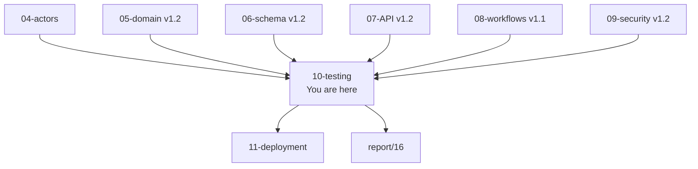

### 1.3 What this document does NOT cover

| Topic | Goes to |
|---|---|
| Test implementations (actual code) | Repo `/tests` directory |
| CI pipeline config | `.github/workflows/` |
| Manual QA checklists | `11-DEPLOYMENT-AND-DEMO.md` |
| Demo acceptance criteria | `01-PLAN-AND-SCOPE.md` §13 |
| Security test rationale | `09-SECURITY-AND-PLATFORM-RULES.md` §22 |

### 1.4 Five testing principles

| # | Principle |
|:---:|---|
| 1 | **Test behavior, not implementation** — assert what the system does, not how |
| 2 | **The pyramid is a target, not a rule** — some features need more integration than unit |
| 3 | **Flaky tests are bugs, not noise** — quarantine within 24h |
| 4 | **E2E covers the demo, not every path** — 38 workflows, not 380 |
| 5 | **Coverage is a means, not an end** — 80% doesn't mean safe; the critical 20% must be 100% |

**Rule:** A feature is not "done" until its tests pass. A bug fix is not "done" until a test catches the regression.

---

## 2. Test Pyramid

### 2.1 The five layers

**Diagram: Test pyramid with counts (v1.2)**
*Five layers. Unit at the base (~355 tests, +5 refund tiers). Integration above (~233 = 102 domain + 131 schema). Contract parallel (~328). Security (~200). E2E at the top (44 test suites = 38 workflows + 6 pattern, with WF-N-02 having 2 sub-scenarios). Each layer's tool and target run time is shown.*

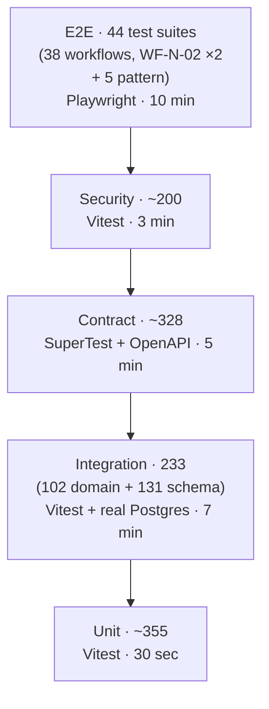

### 2.2 Layer distribution

| Layer | Count | Speed | Share | Purpose |
|---|---:|---|---:|---|
| Unit | ~355 | ms | 31% | Pure functions, validators, mappers, **refund tiers** |
| Integration (domain) | 102 | sec | 9% | Domain invariants, state machines, events (from `05` v1.2 §13) |
| Integration (schema) | 131 | sec | 11% | DB constraints, cascades, transactions (from `06` v1.2 §19) |
| Contract | 328 | sec | 29% | API shapes, RBAC, WS, webhook (from `07` v1.2 §15.5) |
| Security | ~200 | sec | 18% | Auth, encryption, masking, invariants, DPDP (from `09` v1.2 §22) |
| E2E | 44 test suites (38 workflows) | min | 4% | Full workflows (esp. demo) |
| **Total** | **~1,130** | | | After dedup across layers |

**Note:** Layers overlap — a security test for seat lock atomicity also exercises integration behaviour. The total is approximate; the sum of layer counts is ~1,160, deduplicated to ~1,130.

**Change from v1.1:** Unit 350→355 (+5 refund tier tests). Domain 100→102 (+2 events `PaymentExpired`, `BookingExpired`). Schema 128→131 (+1 constraint, +1 index, +1 retention job). Contract 323→328 (+1 error, +1 idempotency, +1 ws, +2 webhook). Security 193→200 (+1 invariant #8, +1 lock pre-check, +2 webhook DB fallback, +3 misc). E2E 43→44 (+1 WF-N-02 dual scenario). Total ~1,100 → ~1,130.

### 2.3 The pyramid rule

| Layer | Target band | If exceeded |
|---|---|---|
| Unit | 30–40% | Review — maybe testing implementation not behavior |
| Integration (combined) | 15–25% | Review — maybe too many DB tests slowing CI |
| Contract | 25–32% | Acceptable if API is complex |
| Security | 15–20% | Acceptable for security-critical systems |
| E2E | 3–7% | Review — maybe duplicating integration tests |

### 2.4 Test type decision tree

**Diagram: Test type decision tree**
*When writing a new test, this tree determines the layer.*

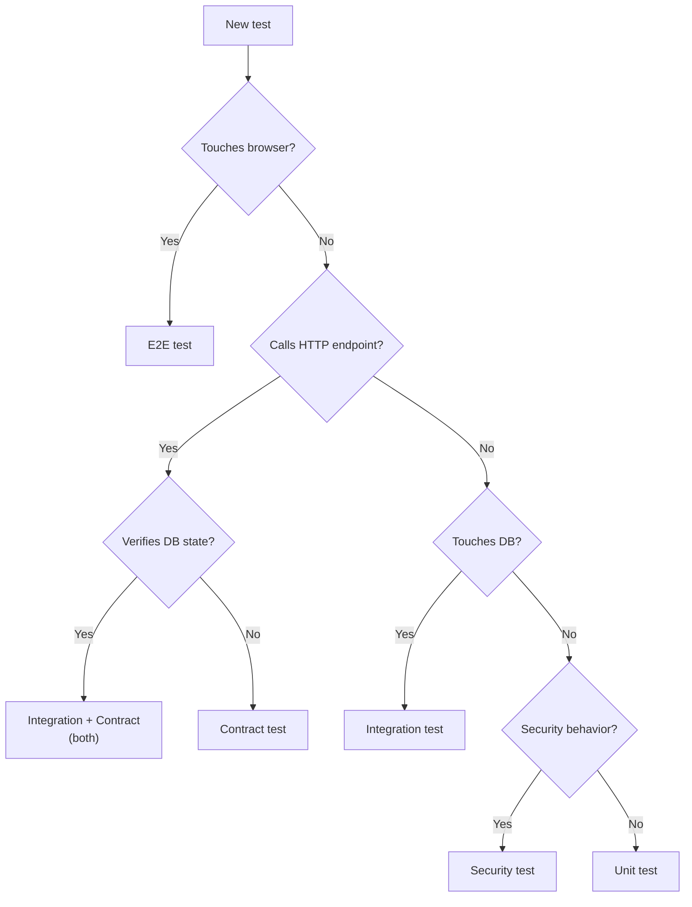

---

## 3. Test Environments

### 3.1 Three environments

**Diagram: Test environments**
*Three environments. Local dev for fast iteration. CI for gate enforcement. Staging for E2E rehearsal and demo prep. Data flows forward, never backward.*

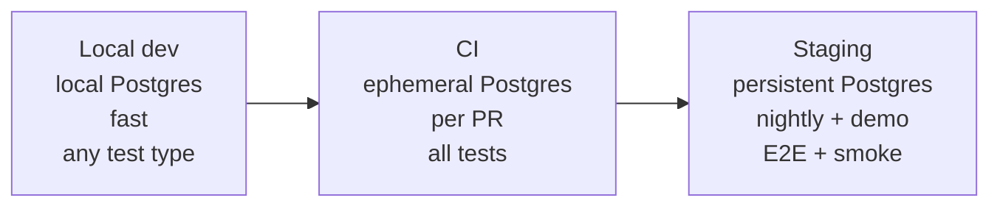

### 3.2 Environment matrix

| Environment | DB | Purpose | Run cadence | Data |
|---|---|---|---|---|
| Local dev | Local Postgres | Fast iteration | On save (watch) | Factories |
| CI (GitHub Actions) | Ephemeral Postgres (Docker) | Gate merge | On PR + nightly | Factories + seed |
| Staging | Persistent Postgres | Demo rehearsal, smoke | Nightly + manual | Seed from `06` §17 |

### 3.3 Isolation guarantees

- Each CI run gets a **fresh Postgres container**
- Each test suite gets its own **schema** (parallel workers don't collide)
- Each test gets a **transaction that rolls back** (unit/integration)
- E2E uses **full seeded data** reset between test files
- No test touches **production** ever

---

## 4. Test Data Strategy

### 4.1 Three data sources

**Diagram: Test data sources**
*Three sources feed different test layers. Factories generate dynamic in-memory entities. Seed data from `06` §17 is reused for contract and E2E. Fixtures are static JSON files for serialization scenarios.*

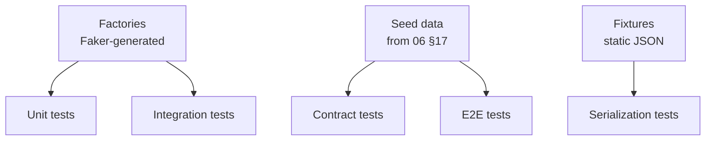

### 4.2 Source matrix

| Source | Where used | Example | Volume |
|---|---|---|---|
| Factories | Unit, integration | `createUser()`, `createBooking()` | Per-test |
| Seed data | Contract, E2E | Demo corridor | ~360 rows |
| Fixtures | Serialization | A specific JSON payload | Static files |

### 4.3 Test data rules

| Rule | Enforcement |
|---|---|
| Never use production data | CI has no prod credentials |
| `is_test = true` on all generated rows | Factory default |
| Factories generate valid entities | Zod validation on factory output |
| No hardcoded IDs in tests | Use returned entity's `.id` |
| Fixtures are versioned | `tests/fixtures/*.json` in repo |

### 4.4 Cleanup strategy

| Layer | Cleanup |
|---|---|
| Unit | None (in-memory) |
| Integration | Transaction rollback after each test |
| Contract | Truncate all tables before each test |
| E2E | Full DB reset + reseed per test file |

---

## 5. Unit Tests

### 5.1 Scope

**Diagram: Unit test scope**
*Unit tests cover pure functions with no external dependencies. Fast enough to run on every save.*

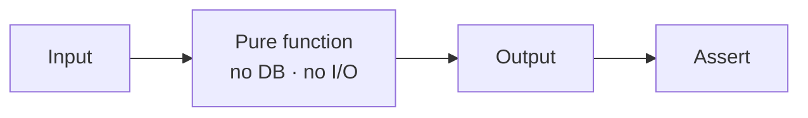

### 5.2 What's unit tested

| Category | Examples |
|---|---|
| Validators | Zod schemas, phone, GSTIN, PAN, email validators |
| Mappers | DB row → API response, snake_case → camelCase |
| **Calculators** | **Refund amount (5 tiers), fare breakdown, ETA** |
| Formatters | Money formatting, date formatting |
| Guards | Pure permission checks |
| Crypto helpers | Canonicalization, base64, hashing (with mocks) |

### 5.3 What's NOT unit tested

| Not unit tested | Why | Where instead |
|---|---|---|
| DB queries | Need real DB | Integration |
| HTTP endpoints | Need server | Contract |
| Full workflows | Need all layers | E2E |
| External services | Need mock anyway | Integration (with MSW) |

### 5.4 Tooling and targets

| Item | Value |
|---|---|
| Framework | Vitest |
| Config | `vitest.config.ts` |
| Test file pattern | `*.test.ts` (next to source) |
| Target count | ~355 |
| Target coverage | 80% line, 75% branch on pure functions |
| Run time | ~30 seconds |
| Run cadence | On save (watch), every PR |

### 5.5 Example (v1.2 — full refund tier coverage)

The refund calculator is critical — it determines how much money passengers get back. The v1.2 test suite covers **all five tiers** to prevent regressions in tier boundaries. The tier names and thresholds are canonical per `07` v1.2 §4.5.

```typescript
describe('calculateRefund', () => {
  const base = {
    fareAmountPaise: 45000,
    taxAmountPaise: 2250,
    feeAmountPaise: 1500,
  };

  it('TIER_FULL: ≥24h → 100% fare + tax + fee', () => {
    const r = calculateRefund({ ...base, departureAt: futureDate(48, 'hours'), cancelledAt: now() });
    expect(r.tier).toBe('TIER_FULL');
    expect(r.fareRefundPaise).toBe(45000);
    expect(r.taxRefundPaise).toBe(2250);
    expect(r.feeRefundPaise).toBe(1500);
    expect(r.totalRefundPaise).toBe(48750);
  });

  it('TIER_75: 12-24h → 75% fare + tax + 100% fee', () => {
    const r = calculateRefund({ ...base, departureAt: futureDate(18, 'hours'), cancelledAt: now() });
    expect(r.tier).toBe('TIER_75');
    expect(r.fareRefundPaise).toBe(33750);
    expect(r.taxRefundPaise).toBe(1688);
    expect(r.feeRefundPaise).toBe(1500);
    expect(r.totalRefundPaise).toBe(36938);
  });

  it('TIER_50: 2-12h → 50% fare + tax + 100% fee', () => {
    const r = calculateRefund({ ...base, departureAt: futureDate(4, 'hours'), cancelledAt: now() });
    expect(r.tier).toBe('TIER_50');
    expect(r.fareRefundPaise).toBe(22500);
    expect(r.taxRefundPaise).toBe(1125);
    expect(r.feeRefundPaise).toBe(1500);
    expect(r.totalRefundPaise).toBe(25125);
  });

  it('TIER_ZERO: <2h → 0% fare + tax + 100% fee', () => {
    const r = calculateRefund({ ...base, departureAt: futureDate(1, 'hours'), cancelledAt: now() });
    expect(r.tier).toBe('TIER_ZERO');
    expect(r.fareRefundPaise).toBe(0);
    expect(r.taxRefundPaise).toBe(0);
    expect(r.feeRefundPaise).toBe(1500);
    expect(r.totalRefundPaise).toBe(1500);
  });

  it('TIER_NOT_ELIGIBLE: after departure → 0%', () => {
    const r = calculateRefund({ ...base, departureAt: pastDate(1, 'hours'), cancelledAt: now() });
    expect(r.tier).toBe('TIER_NOT_ELIGIBLE');
    expect(r.totalRefundPaise).toBe(0);
  });
});
```

**Boundary rule:** The tier boundaries themselves need explicit tests at exactly 24h, exactly 12h, exactly 2h, and exactly at departure time. These are covered in `refund_06_boundary_24h`, `refund_07_boundary_12h`, `refund_08_boundary_2h`, `refund_09_boundary_departure` (in the domain integration suite).

---

## 6. Integration Tests

### 6.1 Scope

**Diagram: Integration test scope**
*Integration tests hit a real Postgres. They verify DB constraints, cascades, transactions, and business logic that depends on DB state.*

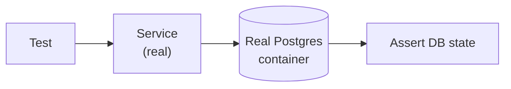

### 6.2 What's integration tested

Integration is split into two sub-layers — **domain** (`05` v1.2 §13, 102 tests) and **schema** (`06` v1.2 §19, 131 tests).

| Sub-layer | Category | Count | Source |
|---|---|---:|---|
| **Domain** | Invariants (`invariant_*`) | 21 | `05` v1.2 §13.1 |
| **Domain** | State machines (`state_machine_*`) | 6 | `05` v1.2 §13.1 |
| **Domain** | Relationships (`relationship_*`) | 43 | `05` v1.2 §13.1 |
| **Domain** | Events (`event_*`) | **20** | `05` v1.2 §13.1 (+ `PaymentExpired`, `BookingExpired`) |
| **Domain** | Phase, naming, cascade (`phase_*`, `naming_*`, `cascade_*`) | 12 | `05` v1.2 §13.1 |
| **Domain subtotal** | | **102** | `05` v1.2 §13.1 |
| **Schema** | CHECK constraints (`constraint_*`) | **24** | `06` v1.2 §19 (+ `chk_refunds_tier`) |
| **Schema** | FK/cascade (`fk_*`) | 41 | `06` v1.2 §19 |
| **Schema** | Unique (incl. webhook dedup) | 16 | `06` v1.2 §19 |
| **Schema** | Index (incl. payment timeout) | **25** | `06` v1.2 §19 (+ `idx_bookings_pending_expiry`, `idx_payments_pending_created`) |
| **Schema** | Retention jobs | **9** | `06` v1.2 §19 (+ `expire_pending_bookings`) |
| **Schema** | Partition behavior | 2 | `06` v1.2 §19 |
| **Schema** | Migration up/down | 2 | `06` v1.2 §19 |
| **Schema** | Seed idempotency | 1 | `06` v1.2 §19 |
| **Schema** | JSONB schema validation | 7 | `06` v1.2 §19 |
| **Schema** | Triggers (`updated_at`, `version`) | 4 | `06` v1.2 §19 |
| **Schema subtotal** | | **131** | `06` v1.2 §19 |
| **Total integration** | | **233** | With some overlap |

**Change from v1.1:** Domain 100→102 (events 18→20). Schema 128→131 (constraint_* 23→24, index_* 24→25, retention_* 8→9). Total 228→233.

**Note on overlap:** Some domain invariant tests (`05` §13) overlap with schema constraint tests (`06` §19). The pyramid treats them as separate suites because they assert at different layers.

### 6.3 Tooling and targets

| Item | Value |
|---|---|
| Framework | Vitest |
| DB client | Prisma (same as production) |
| Test DB | testcontainers Postgres 16 |
| Test file pattern | `*.integration.test.ts` (domain) and `*.schema.test.ts` (schema) |
| Target count | 233 (102 domain + 131 schema) |
| Target coverage | 100% of domain invariants + 100% of schema constraints |
| Run time | ~7 minutes |
| Run cadence | Every PR |

### 6.4 Example (v1.2 — payment timeout retention job)

The new `expire_pending_bookings` job (from `06` v1.2 §15) is a money-critical path: it releases seats when the 15-minute payment window closes. Test it explicitly.

```typescript
describe('expire_pending_bookings cron', () => {
  it('transitions PENDING bookings older than 15 min to EXPIRED', async () => {
    const booking = await createBooking({
      status: 'PENDING',
      createdAt: fifteenMinutesAgo(),
    });
    await createPayment({ bookingId: booking.id, status: 'PENDING' });
    await createSeatLock({ ... });

    await runCron('expire_pending_bookings');

    const after = await prisma.booking.findUnique({ where: { id: booking.id } });
    expect(after.status).toBe('EXPIRED');
    expect(after.expiredAt).not.toBeNull();

    const payment = await prisma.payment.findFirst({ where: { bookingId: booking.id } });
    expect(payment.status).toBe('EXPIRED');

    const lock = await prisma.seatLock.findFirst({ where: { ... } });
    expect(lock).toBeNull();
  });

  it('does not touch PENDING bookings younger than 15 min', async () => {
    const booking = await createBooking({
      status: 'PENDING',
      createdAt: fiveMinutesAgo(),
    });

    await runCron('expire_pending_bookings');

    const after = await prisma.booking.findUnique({ where: { id: booking.id } });
    expect(after.status).toBe('PENDING');
  });
});
```

**Note on refund tier constraint test:** `06` v1.2 §19 adds `chk_refunds_tier` — verifies `INSERT refunds(refund_tier='INVALID')` fails.

**Note on webhook dedup test:** `06` v1.1 §19 adds `unique_gateway_webhooks_dedup` — verifies that two `gateway_webhooks` rows with same `(payment_id, event_type, payload_hash)` fail on the second insert.

---

## 7. Contract Tests

### 7.1 Scope

**Diagram: Contract test scope**
*Contract tests verify the API matches the OpenAPI spec, RBAC is enforced, and error codes are correct.*

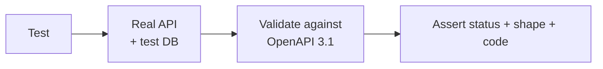

### 7.2 What's contract tested (v1.2)

Source of truth: `07` v1.2 §15.5.

| Suite | Count | Covers |
|---|---:|---|
| `contract_*` | 101 | One per endpoint (happy path + schema validation) |
| `auth_*` | 20 | Phone OTP, email OTP, driver OTP, operator password+OTP, admin password, password reset email link, password reset OTP fallback, refresh, logout |
| `rbac_*` | 101 | Every endpoint rejects wrong roles |
| **`error_*`** | **49** | **Every error code (48 + `PAYMENT_NOT_ALLOWED`)** |
| **`idempotency_*`** | **4** | **Payment create + retry with new key + retry with old key (fails) + refund** |
| `pagination_*` | 6 | Each paginated endpoint |
| **`ws_*`** | **16** | **Topics, auth, reconnect, re-auth, fallback, `booking:expired`** |
| **`webhook_*`** | **10** | **Signature (2), payload_hash dedup (2), terminal-state no-op (2), event transition (2), DB error fallback (2)** |
| `rate_limit_*` | 9 | Each rate limit tier — including password reset 3/hour |
| `upload_*` | 6 | 3 upload endpoints × 2 (success + size limit) |
| `observability_*` | 4 | requestId propagation, log format |
| `versioning_*` | 2 | OpenAPI served, unknown version 404 |
| **Total** | **~328** | |

**Change from v1.1:** `error_*` 48→49 (+`PAYMENT_NOT_ALLOWED`). `idempotency_*` 3→4 (+retry-new-key test). `ws_*` 15→16 (+`booking:expired` event). `webhook_*` 8→10 (+DB error fallback, +retry job). Total 323→328.

### 7.3 Tooling and targets

| Item | Value |
|---|---|
| Framework | Vitest + SuperTest |
| Schema validator | `ajv` against OpenAPI 3.1 |
| Test file pattern | `*.contract.test.ts` |
| Target count | 328 |
| Target coverage | 100% of endpoints |
| Run time | ~5 minutes |
| Run cadence | Every PR |

### 7.4 The three-test minimum per endpoint

For every endpoint, at minimum:

1. **Happy path** — valid auth, valid input → 2xx with schema-conformant body
2. **401 without auth** — no token → 401
3. **403 wrong role** — authenticated but wrong role → 403

For endpoints with bodies, add:

4. **422 invalid input** — missing required field → 422

For endpoints with state, add:

5. **404 resource not found** — valid request, bad ID → 404
6. **409 conflict** — valid request, conflicting state → 409

### 7.5 Example

```typescript
describe('POST /v1/passenger/seat-locks', () => {
  it('creates lock for authenticated passenger', async () => {
    const res = await request(app)
      .post('/v1/passenger/seat-locks')
      .set('Authorization', `Bearer ${passengerToken}`)
      .send({ scheduleId, seatId });
    expect(res.status).toBe(201);
    expect(res.body.data).toMatchSchema(seatLockSchema);
  });

  it('returns 401 without auth', async () => {
    const res = await request(app)
      .post('/v1/passenger/seat-locks')
      .send({ scheduleId, seatId });
    expect(res.status).toBe(401);
  });

  it('returns 403 for operator role', async () => {
    const res = await request(app)
      .post('/v1/passenger/seat-locks')
      .set('Authorization', `Bearer ${operatorToken}`)
      .send({ scheduleId, seatId });
    expect(res.status).toBe(403);
  });

  it('returns 422 with invalid body', async () => {
    const res = await request(app)
      .post('/v1/passenger/seat-locks')
      .set('Authorization', `Bearer ${passengerToken}`)
      .send({});
    expect(res.status).toBe(422);
  });

  it('returns 409 if seat already locked', async () => {
    await createLock(scheduleId, seatId, otherUser);
    const res = await request(app)
      .post('/v1/passenger/seat-locks')
      .set('Authorization', `Bearer ${passengerToken}`)
      .send({ scheduleId, seatId });
    expect(res.status).toBe(409);
    expect(res.body.error.code).toBe('SEAT_LOCKED');
  });

  it('returns 409 SEAT_ALREADY_BOOKED if seat is booked', async () => {
    await createBookingPassenger({ scheduleId, seatId });
    const res = await request(app)
      .post('/v1/passenger/seat-locks')
      .set('Authorization', `Bearer ${passengerToken}`)
      .send({ scheduleId, seatId });
    expect(res.status).toBe(409);
    expect(res.body.error.code).toBe('SEAT_ALREADY_BOOKED');
  });
});
```

### 7.6 New contract tests in v1.2

| Test | Assertion |
|---|---|
| `error_50_payment_not_allowed` | `POST /payments` on EXPIRED booking → 400 `PAYMENT_NOT_ALLOWED` |
| `idempotency_03_retry_new_key` | Payment fail → retry with new `Idempotency-Key` → new payment row created |
| `idempotency_04_retry_old_key` | Payment fail → retry with same `Idempotency-Key` → cached failed response (no new row) |
| `ws_17_booking_expired` | Payment timeout → WebSocket `booking:expired` event delivered to booking owner |
| `webhook_09_db_fallback` | DB down during webhook → raw body saved to `/tmp/webhooks/{uuid}.json`, returns 200 |
| `webhook_10_db_fallback_10_retries` | Replay job fails 10x → file moved to `/tmp/webhooks/failed/`, SEV1 alert |
| `booking_05_expires_at` | `POST /bookings` response includes `expiresAt` (ISO 8601, 15 min in future) |
| `booking_06_refund_preview_full` | `GET /bookings/:id/refund-preview` returns `tier: TIER_FULL` when >24h |
| `booking_07_refund_preview_75` | Returns `tier: TIER_75` when 12h ≤ t < 24h |
| `booking_08_refund_preview_50` | Returns `tier: TIER_50` when 2h ≤ t < 12h |
| `booking_09_refund_preview_zero` | Returns `tier: TIER_ZERO` when t < 2h |
| `booking_10_refund_preview_not_eligible` | Returns `tier: TIER_NOT_ELIGIBLE` after departure |
| `booking_11_refund_preview_operator_cancel` | OPERATOR_CANCELLED always returns `tier: TIER_FULL` |
| `seatlock_05_booked_precheck` | `POST /seat-locks` on booked seat → 409 `SEAT_ALREADY_BOOKED` without Redis write |

---

## 8. End-to-End Tests

### 8.1 Scope

**Diagram: E2E scope**
*E2E tests drive real workflows from `08` v1.1 §2 against a full stack. All 38 workflows are tested via 44 E2E test suites (WF-N-02 has two sub-scenarios: lock-expiry-before-booking and payment-timeout-after-booking).*

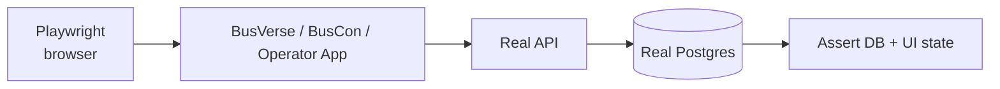

### 8.2 What's E2E tested

All **38 workflows** from `08` v1.1 §2, grouped into **44 test suites** in `08` v1.1 §12 (WF-N-02 has 2 sub-scenarios: lock-expiry-during-fill and payment-timeout-after-booking):

| Category | Workflow count |
|---|---:|
| Passenger | 7 |
| Operator | 7 |
| Admin | 5 |
| Driver | 6 |
| Cross-actor | 5 |
| **Negative** | **5 workflows, 6 test suites** (WF-N-02 dual) |
| Recovery | 3 |
| **Workflow subtotal** | **38 workflows, 39 test cases** |
| Pattern tests (concurrency, webhook convergence, lock TTL, offline replay, session refresh) | 5 |
| **Total E2E test suites** | **44** |

**Focus areas:**

- `WF-X-01` full demo flow — the viva demo
- `WF-X-02` seat lock race — concurrency proof
- `WF-X-03` payment webhook convergence — idempotency proof
- `WF-N-02a` / `WF-N-02b` — timeout scenarios
- `WF-P-01` to `WF-P-07` — passenger flows
- `WF-D-01` to `WF-D-06` — driver flows

### 8.3 Tooling and targets

| Item | Value |
|---|---|
| Framework | Playwright |
| Browser | Chromium (primary), Firefox + WebKit (nightly) |
| Test file pattern | `e2e/*.spec.ts` |
| Target count | **44 test suites** (39 workflow test cases + 5 pattern tests) |
| Target coverage | 100% of workflows (38) + 100% of pattern tests (5) |
| Run time | ~10 minutes |
| Run cadence | Every PR + nightly |

### 8.4 Example

```typescript
test('WF-X-01: full demo flow', async ({ page }) => {
  // Step 1: search
  await page.goto('/');
  await page.fill('[name="origin"]', 'Delhi');
  await page.fill('[name="destination"]', 'Lucknow');
  await page.click('button:has-text("Search")');
  await expect(page.locator('[data-testid="schedule-card"]')).toHaveCount(3);

  // Step 2: lock seat
  await page.click('[data-schedule="14:00"]');
  await page.click('[data-seat="A1"]');
  await expect(page.locator('[data-seat="A1"].locked')).toBeVisible();
  await expect(page.locator('[data-testid="countdown"]')).toContainText('4:59');

  // Step 3: book + pay
  await page.click('button:has-text("Proceed")');
  await page.fill('[name="passenger-name"]', 'Test Passenger');
  await page.click('button:has-text("Pay")');
  // ... Razorpay test checkout automation

  // Step 4: ticket
  await expect(page.locator('[data-testid="qr-code"]')).toBeVisible();
  const bookingRef = await page.textContent('[data-testid="booking-reference"]');

  // Step 5-8: driver scans, admin sees audit
  // (switch to driver app context, scan QR, verify boarded)
});

test('WF-N-02a: lock expires during form fill', async ({ page }) => {
  // Fast-forward time 5+ minutes after lock acquired
  await page.clock.install();
  await page.click('[data-seat="A1"]');
  await page.clock.fastForward('05:01');

  await page.click('button:has-text("Proceed")');
  await page.fill('[name="passenger-name"]', 'Slow User');
  await page.click('button:has-text("Continue")');
  await expect(page.locator('[data-testid="error-toast"]')).toContainText('Lock expired');
});

test('WF-N-02b: payment timeout after booking', async ({ page }) => {
  // Create PENDING booking then wait 15+ minutes
  await bookAndAbandon(page);
  await page.clock.fastForward('15:30');
  await runCron('expire_pending_bookings');

  await page.goto('/my-trips');
  await expect(page.locator('[data-testid="booking-card"]')).toContainText('Expired');
});
```

---

## 9. Security Tests

### 9.1 Coverage breakdown

**Diagram: Security test coverage (v1.2)**
*~200 security tests from `09` v1.2 §22. v1.2 adds lock pre-check, webhook DB fallback, and the new invariant #8 test.*

```mermaid
flowchart TB
    SEC["~200 security tests"]

    SEC --> AUTH["Auth · 15"]
    SEC --> SESSION["Session · 8"]
    SEC --> ACCT["Account · 6"]
    SEC --> QR["QR · 8"]
    SEC --> LOCK["Lock · 7"]
    SEC --> TENANT["Tenant · 12"]
    SEC --> ENC["Encryption · 10"]
    SEC --> MASK["Masking · 12"]
    SEC --> WS["WebSocket · 8"]
    SEC --> TRANSPORT["Transport · 6"]
    SEC --> WEBHOOK["Webhook · 8"]
    SEC --> UPLOAD["Upload · 8"]
    SEC --> AUDIT["Audit · 4"]
    SEC --> LOGS["Logs · 4"]
    SEC --> RATE["Rate · 8"]
    SEC --> INPUT["Input · 15"]
    SEC --> RULES["Rules · 12"]
    SEC --> INV["Invariants · 22"]
    SEC --> BACKUP["Backup · 4"]
    SEC --> FRAUD["Fraud · 6"]
    SEC --> ENV["Env · 3"]
    SEC --> CI["CI · 5"]
    SEC --> DPDP["DPDP · 6"]
```

### 9.2 Scope

Source of truth: `09` v1.2 §22.

| Category | Count | Change from v1.1 |
|---|---:|---|
| Auth | 15 | — |
| Session | 8 | — |
| Account | 6 | — |
| QR | 8 | — |
| **Lock** | **7** | **+1 booked pre-check** |
| Tenant isolation | 12 | — |
| Encryption | 10 | — |
| Masking | 12 | — |
| WebSocket | 8 | — |
| Transport | 6 | — |
| **Webhook** | **8** | **+2 DB error fallback** |
| Upload | 8 | — |
| Audit | 4 | — |
| Logs | 4 | — |
| Rate limit | 8 | — |
| Input | 15 | — |
| Immutable rules | 12 | — |
| **Invariants** | **22** | **+1 invariant #8** |
| Backup | 4 | — |
| Fraud | 6 | — |
| Environment | 3 | — |
| CI | 5 | — |
| DPDP | 6 | — |
| **Total** | **~200** | **+7** |

### 9.3 Tooling and targets

| Item | Value |
|---|---|
| Framework | Vitest + custom helpers |
| Test DB | testcontainers Postgres |
| Test file pattern | `*.security.test.ts` |
| Target count | ~200 |
| Target coverage | 100% |
| Run time | ~3 minutes |
| Run cadence | Every PR (blocking) |

### 9.4 Example

```typescript
describe('QR tamper detection', () => {
  it('rejects payload with modified seat', () => {
    const validQr = signTicket({ ticketId: 'tkt_1', seatId: 'seat_1' });
    const tampered = validQr.replace('seat_1', 'seat_2');
    const result = verifyQr(tampered, publicKey);
    expect(result).toBe('INVALID_SIGNATURE');
  });
});

describe('cross-tenant isolation', () => {
  it('operator A cannot read operator B booking', async () => {
    const booking = await createBooking({ operatorId: operatorB.id });
    const res = await request(app)
      .get(`/v1/operator/bookings/${booking.id}`)
      .set('Authorization', `Bearer ${operatorAToken}`);
    expect(res.status).toBe(404);  // 404, not 403
  });
});

describe('seat lock pre-check', () => {
  it('rejects lock on booked seat without Redis write', async () => {
    await createBookingPassenger({ scheduleId, seatId });

    const redisBefore = await redis.dbsize();
    const res = await request(app)
      .post('/v1/passenger/seat-locks')
      .set('Authorization', `Bearer ${passengerToken}`)
      .send({ scheduleId, seatId });

    expect(res.status).toBe(409);
    expect(res.body.error.code).toBe('SEAT_ALREADY_BOOKED');
    const redisAfter = await redis.dbsize();
    expect(redisAfter).toBe(redisBefore);  // no Redis write
  });
});

describe('webhook DB error fallback', () => {
  it('writes raw body to file when DB is down', async () => {
    await db.disconnect();
    const rawBody = JSON.stringify({ event: 'payment.captured', ... });
    const signature = hmac(rawBody, webhookSecret);

    const res = await request(app)
      .post('/v1/webhooks/razorpay')
      .set('x-razorpay-signature', signature)
      .send(rawBody);

    expect(res.status).toBe(200);
    const files = await fs.readdir('/tmp/webhooks');
    expect(files.length).toBe(1);
    const content = await fs.readFile(`/tmp/webhooks/${files[0]}`, 'utf8');
    expect(content).toBe(rawBody);

    await db.reconnect();
  });
});
```

### 9.5 New security tests in v1.2

| Test | Assertion |
|---|---|
| `lock_02_booked_precheck` | `POST /seat-locks` on booked seat → 409 `SEAT_ALREADY_BOOKED` without Redis write or DB insert |
| `lock_03_booked_precheck_no_redis` | Redis counter unchanged on pre-check rejection (proves no wasted write) |
| `webhook_09_db_error_fallback` | DB down during webhook → file written to `/tmp/webhooks/{uuid}.json`, 200 returned, no crash |
| `webhook_10_db_error_replay` | File in `/tmp/webhooks/` → replay job processes it after DB recovers, file deleted, event processed once |
| `webhook_11_db_error_10_retries` | 10 consecutive replay failures → file moved to `/tmp/webhooks/failed/`, SEV1 alert fired |
| `invariant_08_lock_vs_booked` | Lock attempt on `booking_passengers` row → 409 `SEAT_ALREADY_BOOKED` |
| `refund_06_boundary_24h` | Refund calculator at exactly 24h returns `TIER_FULL` |
| `refund_07_boundary_12h` | At exactly 12h returns `TIER_75` |
| `refund_08_boundary_2h` | At exactly 2h returns `TIER_50` |
| `refund_09_boundary_departure` | At departure time returns `TIER_NOT_ELIGIBLE` |

---

## 10. Concurrency Tests

### 10.1 Scope

**Diagram: Concurrency test scenarios**
*These prove the invariants hold under load. Each runs N concurrent requests and asserts exactly one winner.*

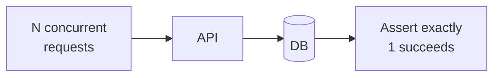

### 10.2 Scenarios (v1.2)

| Scenario | Reference | Assertion |
|---|---|---|
| Seat lock race | `WF-X-02` | 10 concurrent → exactly 1 succeeds, 9 fail with 409 |
| Payment webhook convergence | `WF-X-03` | Webhook + callback in either order → 1 booking |
| Double payment | — | 2 concurrent payments → 1 succeeds (idempotency) |
| Lock TTL vs. booking | `WF-N-02a` | Lock expires during form fill → booking fails, lock gone |
| **Payment timeout vs. webhook** | **`WF-N-02b`** | **Webhook arrives at T=15:01 (after cron ran) → booking already EXPIRED → webhook returns 200 no-op, payment stays EXPIRED** |
| Booking transactions | — | 2 concurrent bookings of same seat → 1 succeeds |
| Trip start | `WF-D-02` | 2 concurrent starts → 1 succeeds |
| Webhook dedup race | `06` v1.2 §19 `unique_gateway_webhooks_dedup` | 2 concurrent identical webhooks → 1 accepted, 1 deduped |
| **Lock on booked seat** | **`09` v1.2 §8.2 invariant #8** | **`POST /seat-locks` on seat with existing `booking_passengers` row → 409 `SEAT_ALREADY_BOOKED`, no lock acquired** |
| **Concurrent pre-check + booking** | **`05` v1.2 invariant #8** | **If a booking is created between the pre-check and Redis SET NX, the booking's unique constraint still wins; the lock is rejected** |

### 10.3 Tooling and targets

| Item | Value |
|---|---|
| Framework | Vitest |
| Concurrency | `Promise.all()` |
| Test file pattern | `*.concurrency.test.ts` |
| Target count | ~13 (v1.1: ~11) |
| Target coverage | 100% |
| Run time | ~30 seconds |
| Run cadence | Every PR |

### 10.4 Example

```typescript
describe('seat lock race', () => {
  it('only one lock succeeds among 10 concurrent attempts', async () => {
    const results = await Promise.all(
      Array.from({ length: 10 }, () =>
        request(app)
          .post('/v1/passenger/seat-locks')
          .set('Authorization', `Bearer ${passengerToken}`)
          .send({ scheduleId, seatId })
      )
    );
    const successes = results.filter((r) => r.status === 201);
    const conflicts = results.filter((r) => r.status === 409);
    expect(successes).toHaveLength(1);
    expect(conflicts).toHaveLength(9);
    expect(await db.seatLock.count()).toBe(1);
  });
});

describe('lock on booked seat', () => {
  it('rejects with SEAT_ALREADY_BOOKED and does not acquire lock', async () => {
    await createBookingPassenger({ scheduleId, seatId });

    const res = await request(app)
      .post('/v1/passenger/seat-locks')
      .set('Authorization', `Bearer ${passengerToken}`)
      .send({ scheduleId, seatId });

    expect(res.status).toBe(409);
    expect(res.body.error.code).toBe('SEAT_ALREADY_BOOKED');
    expect(await db.seatLock.count()).toBe(0);
  });
});
```

---

## 11. Performance Tests

### 11.1 Targets

**Diagram: Performance targets**
*Seven critical paths have p95 latency targets. These run nightly on staging.*

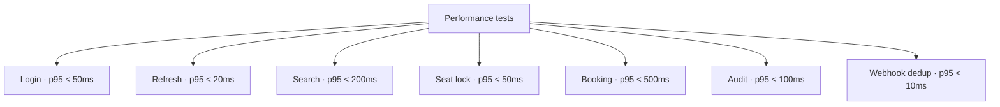

### 11.2 Test targets

| Query | p95 target | Load | Source |
|---|---|---|---|
| Login | 50 ms | 100 concurrent | `06` §11 |
| Refresh | 20 ms | 1000/sec | `06` §11 |
| Search | 200 ms | 50 concurrent | `06` §11 |
| Seat lock | 50 ms | 100 concurrent | `06` §11 |
| Booking create | 500 ms | 10 concurrent | `06` §11 |
| Audit query | 100 ms | 20 concurrent | `06` §11 |
| Webhook dedup lookup | 10 ms | 500/sec | `06` v1.2 §11 |
| **Payment timeout scan** | **500 ms (batch)** | **1/sec (cron)** | **`06` v1.2 §11** |

### 11.3 Tooling and cadence

| Item | Value |
|---|---|
| Framework | k6 |
| Test file pattern | `perf/*.js` |
| Target count | 8 scenarios (v1.1: 7) |
| Run time | ~5 minutes |
| Run cadence | Nightly on staging |

### 11.4 What's NOT performance tested

| Not tested | Why | Phase |
|---|---|---|
| Peak load (1000 users) | Load testing, not perf | Phase 2 |
| Soak testing (24h) | Expensive, low value in Phase 1 | Phase 2 |
| Spike testing | Rare scenarios | Phase 2 |

### 11.5 Example

```javascript
// perf/login.js
import http from 'k6/http';
import { check } from 'k6';

export const options = {
  vus: 100,
  duration: '30s',
  thresholds: {
    http_req_duration: ['p(95)<50'],
  },
};

export default function () {
  const res = http.post('https://staging.busverse.app/v1/passenger/auth/otp/request', {
    phone: '+919876543210',
  });
  check(res, { 'status 200': (r) => r.status === 200 });
}
```

---

## 12. Coverage Requirements

### 12.1 Coverage by layer

**Diagram: Coverage by layer**
*Different targets per layer.*

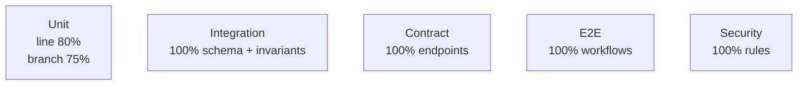

### 12.2 Target table

| Layer | Metric | Target |
|---|---|---|
| Unit | Line coverage | ≥ 80% |
| Unit | Branch coverage | ≥ 75% |
| Integration | Domain invariants | 100% (21 of 21) |
| Integration | Schema constraints | 100% (all CHECK/UNIQUE/FK) |
| **Contract** | **Error codes** | **100% (all 49)** |
| Contract | Endpoints tested | 100% (all 101) |
| Contract | RBAC enforced | 100% (all roles × endpoints) |
| E2E | Workflows | 100% (all 38) |
| E2E | Pattern tests | 100% (all 5) |
| Security | All rules | 100% (all 12 never-permissions) |
| **Security** | **All invariants** | **100% (all 21)** |
| Security | DPDP controls | 100% (all 6) |

### 12.3 The critical 20% rule (v1.2)

Some code must be **100% covered** regardless of aggregate:

| Component | Tests |
|---|---:|
| Booking creation transaction (incl. lock TTL extension, `expiresAt`) | 10 |
| Payment webhook handler (incl. `payload_hash` dedup, DB error fallback, `booking:expired`) | 18 |
| Seat lock acquisition (incl. booked pre-check) | 7 |
| QR signing and verification | 8 |
| Session issue and refresh | 10 |
| Permission middleware | 15 |
| Audit write | 4 |
| Encryption / decryption | 10 |
| Password reset (email + OTP fallback) | 6 |
| Consent capture and revoke | 4 |
| **Refund calculation (5 tiers + boundaries)** | **5** |
| **Total** | **97** |

**Enforcement:** CI fails if critical 20% drops below 100%.

**Change from v1.1:** 85 → 97 (added refund tiers 5, seat lock pre-check 1, webhook DB fallback 2, `expiresAt` 1, `booking:expired` 1, idempotency retry 2).

### 12.4 Coverage enforcement flow

**Diagram: Coverage enforcement**
*Coverage runs as part of the test suite. c8 generates reports. CI compares against thresholds.*

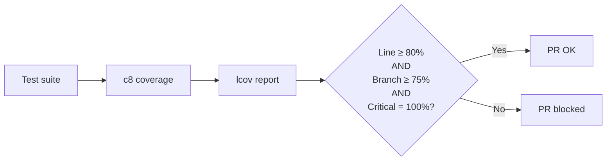

### 12.5 Anti-patterns

| Anti-pattern | Why it's bad |
|---|---|
| Gaming coverage with trivial tests | Doesn't catch real bugs |
| Excluding critical code | Hides untested paths |
| Accepting lower targets to ship | Tech debt compounds |
| Measuring only line coverage | Misses branches |

---

## 13. Mocking Strategy

### 13.1 Mock vs. real matrix

**Diagram: Mock vs. real matrix**
*Some dependencies are always real, some real in CI but mocked in unit, some always mocked.*

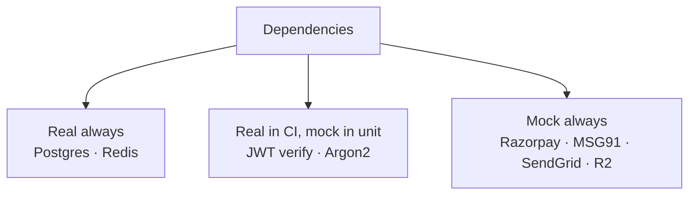

### 13.2 Dependency matrix

| Dependency | Unit | Integration | Contract | E2E |
|---|---|---|---|---|
| Postgres | Mock | Real | Real | Real |
| Redis | Mock | Real | Real | Real |
| Razorpay API | Mock | Mock | Mock | Mock |
| Razorpay webhook | Mock | Mock | Mock | Real (replay) |
| SMS (MSG91) | Mock | Mock | Mock | Mock |
| Email (SendGrid) | Mock | Mock | Mock | Mock |
| R2 | Mock | Mock | Mock | Mock |
| Argon2 | Mock | Real | Real | Real |
| Ed25519 | Mock | Real | Real | Real |
| **Local filesystem** | **Mock** | **Real (temp dir)** | **Real (temp dir)** | **Real (temp dir)** |

**Note:** Firebase is not used — MSG91 handles SMS delivery and SendGrid handles email (see `03` ADR-011). **Local FS is now a test concern (v1.2)** because webhook DB fallback writes to `/tmp/webhooks/{uuid}.json`. Integration and contract tests use a per-test temp directory, not the real `/tmp/webhooks/`.

### 13.3 Mocking rules

| Rule | Why |
|---|---|
| Never mock what you're testing | Defeats the purpose |
| Never mock DB (test real schema) | Schema bugs only caught against real DB |
| Mock external SaaS at HTTP boundary | MSW for portability |
| Mock time carefully | `vi.setSystemTime()` affects only JS |
| **Isolate filesystem tests** | **Per-test `os.tmpdir()` subdirectory; cleaned up in `afterEach`** |

### 13.4 Tooling

| Tool | Purpose |
|---|---|
| `vitest-mock-extended` | Typed mocks for services |
| `msw` (Mock Service Worker) | HTTP mocks for external APIs |
| `testcontainers` | Real Postgres / Redis in Docker |
| `vi.setSystemTime()` | Deterministic time |
| **`mock-fs`** | **Filesystem mocking (only when testing non-FS behavior)** |

---

## 14. Test Database Strategy

### 14.1 Lifecycle

**Diagram: Test DB lifecycle**
*Each CI run spins up a fresh Postgres container. Migrations run once. Each test suite gets its own schema. Each test rolls back its transaction.*

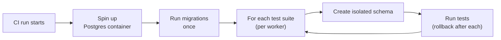

### 14.2 Strategy per layer

| Layer | DB strategy |
|---|---|
| Unit | No DB |
| Integration | Real Postgres, one transaction per test, rollback |
| Contract | Real Postgres, truncate between tests |
| E2E | Real Postgres, full reset between test files |

### 14.3 Speed optimizations

| Optimization | Effect |
|---|---|
| Migrations once per container | Saves 10-20 sec per worker |
| Parallel workers via `vitest --pool=forks` | 4x faster |
| Worker-specific schemas | No collisions |
| Seed data cached between runs | Instant reseed |

### 14.4 Reset commands

```bash
# Integration test setup
beforeEach(() => prisma.$executeRaw`BEGIN`);
afterEach(() => prisma.$executeRaw`ROLLBACK`);

# Contract test setup
beforeEach(async () => {
  await prisma.gatewayWebhook.deleteMany();  // webhook dedup
  await prisma.refund.deleteMany();          // v1.2 (refund_tier)
  await prisma.bookingPassenger.deleteMany();
  await prisma.booking.deleteMany();
  // ... in FK order
});

# E2E reset
await exec('pnpm db:reset && pnpm db:seed');

# v1.2: filesystem cleanup for webhook fallback tests
afterEach(async () => {
  await fs.rm(TEST_WEBHOOK_DIR, { recursive: true, force: true });
  await fs.mkdir(TEST_WEBHOOK_DIR, { recursive: true });
});
```

---

## 15. Test Fixtures and Factories

### 15.1 Factory pattern

**Diagram: Factory pattern**
*Factories generate valid entities with overridable fields.*

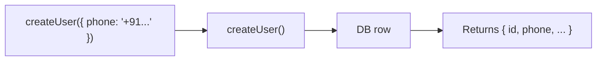

### 15.2 Factory catalog

| Factory | Default fields | Overridable |
|---|---|---|
| `createUser()` | Random phone, random email | phone, email, name |
| `createOperator()` | Random GSTIN, status=APPROVED | status, companyName |
| `createBus()` | Random rego, capacity=40 | capacity, operatorId |
| `createRoute()` | Delhi→Lucknow, 4 stops | origin, destination |
| `createSchedule()` | Tomorrow 14:00, ₹450 | departureTime, farePaise |
| `createBooking()` | Confirmed, 1 passenger | status, farePaise, **expiredAt** |
| `createPayment()` | Succeeded, ₹450 | status, amountPaise, **expiredAt** |
| **`createRefund()`** | **`TIER_FULL`, ₹487.50** | **refund_tier, amountPaise, reason** |
| `createTrip()` | Scheduled | status, driverId |
| `createAuditLog()` | Generic entry | entityType, action |
| `createConsentRecord()` | `terms_of_service`, `v1.0` | purpose, policy_version, revoked_at |
| `createPasswordResetToken()` | Unused, 30-min TTL | used_at, expires_at |
| `createGatewayWebhook()` | Unique payload_hash | event_type, payload_hash |
| **`createGSTInvoice()`** | **Sequential invoice_number** | gstin, taxable_value_paise |

### 15.3 Factory rules

| Rule | Detail |
|---|---|
| Factories return real DB rows | Not just objects — actual `INSERT` |
| Factory calls are fast | Bulk insert where possible |
| All fields overridable | Pass `Partial<Entity>` |
| No fixture JSON | Unless testing serialization |
| Faker for random data | `@faker-js/faker` |

### 15.4 Example

```typescript
export async function createBooking(overrides?: Partial<Booking>): Promise<Booking> {
  const user = overrides?.userId ? null : await createUser();
  const schedule = overrides?.scheduleId ? null : await createSchedule();
  return prisma.booking.create({
    data: {
      userId: overrides?.userId ?? user!.id,
      scheduleId: overrides?.scheduleId ?? schedule!.id,
      bookingReference: overrides?.bookingReference ?? generateRef(),
      status: overrides?.status ?? 'CONFIRMED',
      totalFareAmount: overrides?.totalFareAmount ?? 45000,
      ...overrides,
    },
  });
}
```

---

## 16. CI/CD Gates

### 16.1 Pipeline

**Diagram: CI/CD pipeline with gates**
*Every PR runs through five gates sequentially. E2E runs in parallel with security. Total time budget: 15 minutes.*

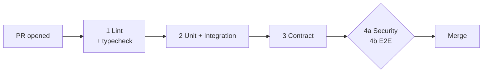

### 16.2 Gate table

| # | Gate | Tool | Blocking | Timeout |
|:---:|---|---|:---:|---|
| 1 | Lint + typecheck | ESLint, tsc | ✅ | 1 min |
| 2 | Unit + integration | Vitest | ✅ | 6 min |
| 3 | Contract | Vitest + SuperTest | ✅ | 5 min |
| 4a | Security | Vitest | ✅ | 3 min |
| 4b | E2E | Playwright | ✅ | 10 min |
| 5 | Coverage | c8 + threshold | ✅ | (inline) |
| 6 | Contract drift | OpenAPI validator | ✅ | (inline) |

### 16.3 Optional (advisory) gates

| Gate | Warn only in Phase 1 |
|---|---|
| Bundle size | Yes |
| A11y | Yes |
| Performance smoke | Yes |

### 16.4 Branch protection

- Main branch protected
- No direct push
- All gates must pass
- At least 1 approval (founder in Phase 1)

---

## 17. Flaky Test Policy

### 17.1 Lifecycle

**Diagram: Flaky test lifecycle**
*Flaky test detected → quarantined within 24h → investigate → fix or delete.*

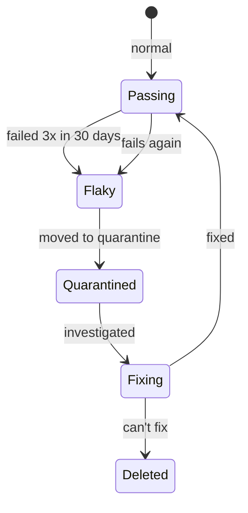

### 17.2 Detection

| Step | Detail |
|---|---|
| Retry each test twice in CI | If passes on retry → flaky |
| Report to `flaky-tests.md` | Append entry with date + reason |
| 3 flakes in 30 days | Triggers quarantine |

### 17.3 Quarantine

| Rule | Detail |
|---|---|
| Move to `*.quarantine.test.ts` | Runs separately, non-blocking |
| Must fix or delete within 14 days | Tracked in `flaky-tests.md` |
| Owner assigned | Founder in Phase 1 |
| Status visible in dashboard | Simple markdown table |

### 17.4 Common flakiness causes and fixes

| Cause | Fix |
|---|---|
| Timing (setTimeout, waits) | Use `waitFor`, `expect.poll` |
| Time-dependent tests | Mock time with `vi.setSystemTime()` |
| Random data collisions | Use Faker with enough entropy |
| Shared state | Isolate each test's DB state |
| Network requests | Mock with MSW |
| Port conflicts | Use random ports |
| Order-dependent tests | Each test independent |
| **Filesystem state (`/tmp/webhooks/`)** | **Per-test temp dir + `afterEach` cleanup** |

### 17.5 Anti-patterns

| Anti-pattern | Why it's bad |
|---|---|
| `test.skip()` | Hides flakiness, doesn't fix |
| `test.retry(5)` | Hides flakiness, slows CI |
| Ignoring flaky tests | Erodes trust |
| Deleting without investigation | Loses signal |
| **Hardcoded `/tmp/webhooks/` path** | **Test pollution + parallel worker collisions** |

---

## 18. Test Reporting

### 18.1 Reporting pipeline

**Diagram: Test reporting pipeline**
*Tests produce three output formats: JUnit XML, coverage lcov, HTML.*

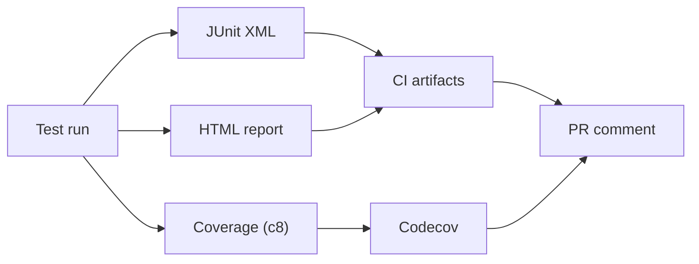

### 18.2 Reports produced

| Report | Format | Destination |
|---|---|---|
| Test results | JUnit XML | CI artifacts + PR summary |
| Coverage | lcov + HTML | Codecov + CI artifacts |
| Performance | k6 JSON | CI artifacts |
| Flaky tests | Markdown | `flaky-tests.md` |
| E2E videos | WebM | CI artifacts (on failure) |
| E2E screenshots | PNG | CI artifacts (on failure) |

### 18.3 PR comment format

```
✅ All tests passed
- 1,130 tests passed
- 0 skipped
- Coverage: 82% line, 78% branch (+1.2%)
- Critical coverage: 100%
- Duration: 14m 32s
```

---

## 19. Test Ownership

### 19.1 Phase 1 ownership

| Owner | Responsibility |
|---|---|
| Founder | All tests, all layers |

### 19.2 Phase 2 ownership (future)

| Owner | Responsibility |
|---|---|
| Feature teams | Their feature tests |
| Platform team | Test infrastructure |
| QA | E2E suites |

### 19.3 Maintenance rules

| Rule | Detail |
|---|---|
| Test file lives next to source | `users.test.ts` next to `users.ts` |
| Tests updated when behavior changes | Same PR |
| Tests deleted when behavior is deprecated | Same PR |
| Bug fixes come with regression test | Non-negotiable |

### 19.4 Test file structure

**Diagram: Test file structure**
*Tests colocated with source. E2E tests in a separate top-level folder.*

```mermaid
flowchart TB
    ROOT["repo root"]
    ROOT --> SRC["src/"]
    ROOT --> E2E["e2e/"]
    ROOT --> TST["tests/"]

    SRC --> F1["features/bookings/"]
    F1 --> F1A["bookings.service.ts"]
    F1 --> F1B["bookings.service.test.ts<br/>(unit)"]
    F1 --> F1C["bookings.integration.test.ts<br/>(integration)"]
    F1 --> F1D["bookings.contract.test.ts<br/>(contract)"]

    E2E --> E1["wf-x-01-demo.spec.ts"]
    E2E --> E2["wf-n-02a-lock-expiry.spec.ts"]
    E2E --> E3["wf-n-02b-payment-timeout.spec.ts"]

    TST --> T1["factories/"]
    TST --> T2["fixtures/"]
    TST --> T3["helpers/"]
```

### 19.5 Naming conventions

```typescript
describe('feature or function name', () => {
  it('does X when Y', () => { ... });
  it('throws error when Y is invalid', () => { ... });
});
```

---

## 20. Workflow → Test Map

### 20.1 Coverage map

**Diagram: Workflow coverage**
*Every workflow from `08` v1.1 §2 has at least one E2E test. All 38 workflows are covered by 44 E2E test suites (WF-N-02 has 2 sub-scenarios: WF-N-02a lock-expiry, WF-N-02b payment-timeout).*

```mermaid
flowchart LR
    WF["38 workflows"] --> E2E["44 E2E test suites<br/>(39 workflow test cases + 5 pattern)"]
    WF --> INT["Integration tests"]
    WF --> SEC["Security tests"]
```

### 20.2 Full mapping (38 workflows)

| Workflow | E2E | Integration | Security |
|---|:---:|:---:|:---:|
| WF-P-01 Register + login | ✅ | ✅ | ✅ |
| WF-P-02 Search | ✅ | — | — |
| WF-P-03 Seat lock | ✅ | ✅ | ✅ |
| WF-P-04 Book + pay | ✅ | ✅ | ✅ |
| WF-P-05 View ticket | ✅ | — | — |
| WF-P-06 Live tracking | ✅ | — | — |
| WF-P-07 Cancel | ✅ | ✅ | ✅ |
| WF-O-01 Signup + KYC | ✅ | — | ✅ |
| WF-O-02 Bus + layout | ✅ | ✅ | — |
| WF-O-03 Route | ✅ | ✅ | — |
| WF-O-04 Schedule | ✅ | ✅ | — |
| WF-O-05 Driver invite | ✅ | — | — |
| WF-O-06 Revenue | ✅ | — | — |
| WF-O-07 Password reset | ✅ | — | ✅ |
| WF-A-01 Admin login | ✅ | — | ✅ |
| WF-A-02 Operator approval | ✅ | — | ✅ |
| WF-A-03 Bus/route approval | ✅ | — | ✅ |
| WF-A-04 Refund | ✅ | ✅ | ✅ |
| WF-A-05 Audit | ✅ | — | ✅ |
| WF-D-01 Driver login | ✅ | — | ✅ |
| WF-D-02 Trip start | ✅ | ✅ | — |
| WF-D-03 GPS | ✅ | — | — |
| WF-D-04 Scan online | ✅ | ✅ | ✅ |
| WF-D-05 Scan offline | ✅ | ✅ | ✅ |
| WF-D-06 Trip end | ✅ | ✅ | — |
| WF-X-01 Demo flow | ✅ | ✅ | ✅ |
| WF-X-02 Lock race | ✅ | ✅ | ✅ |
| WF-X-03 Webhook convergence | ✅ | ✅ | ✅ |
| WF-X-04 Suspension cascade | ✅ | ✅ | — |
| WF-X-05 Boarding UX | ✅ | — | — |
| WF-N-01 Payment fail | ✅ | ✅ | — |
| **WF-N-02a Lock expired (during fill)** | ✅ | ✅ | — |
| **WF-N-02b Payment timeout (after booking)** | ✅ | ✅ | — |
| WF-N-03 Operator cancel | ✅ | ✅ | — |
| WF-N-04 QR invalid | ✅ | ✅ | ✅ |
| WF-N-05 Suspension mid-trip | ✅ | — | — |
| WF-R-01 Resume booking | ✅ | — | — |
| WF-R-02 Offline replay | ✅ | — | — |
| WF-R-03 Session refresh | ✅ | — | ✅ |

**Note:** WF-N-02 has 2 test cases (2a lock-expiry-during-fill, 2b payment-timeout-after-booking). This is why 38 workflows → 39 workflow test cases → + 5 pattern = 44 E2E test suites.

---

## 21. Full Test Catalog

### 21.1 Catalog by source

**Diagram: Full catalog by source**
*~355 unit + 102 domain + 131 schema + 328 contract + 200 security + 44 E2E test suites ≈ 1,160, deduped to ~1,130.*

```mermaid
flowchart TB
    ALL["~1,130 tests"]

    ALL --> U["Unit ~355"]
    ALL --> ID["Integration (domain) 102<br/>from 05 v1.2"]
    ALL --> IS["Integration (schema) 131<br/>from 06 v1.2"]
    ALL --> C["Contract 328<br/>from 07 v1.2"]
    ALL --> S["Security 200<br/>from 09 v1.2"]
    ALL --> E["E2E 44 test suites<br/>(38 workflows)<br/>from 08 v1.1"]
```

### 21.2 Source table

| Source | Count | Layer |
|---|---:|---|
| `04` §16 | 92 | Security + Contract |
| `05` v1.2 §13 | 102 | Integration (domain) |
| `06` v1.2 §19 | 131 | Integration (schema) |
| `07` v1.2 §15.5 | 328 | Contract |
| `08` v1.1 §12 | 44 test suites (39 workflow tests + 5 pattern) | E2E |
| `09` v1.2 §22 | 200 | Security |
| Net-new unit | ~355 | Unit |
| **Sum before dedup** | **~1,248** | |
| **After dedup** | **~1,130** | |

**Change from v1.1:**
- `05` §13: 100 → **102** (v1.2 adds 2 events: `PaymentExpired`, `BookingExpired`)
- `06` §19: 128 → **131** (v1.2 adds `chk_refunds_tier`, +1 index, `expire_pending_bookings`)
- `07` §15.5: 323 → **328** (v1.2 adds `PAYMENT_NOT_ALLOWED`, idempotency retry, `booking:expired`, webhook DB fallback)
- `08` §12: 43 → **44** (v1.1 splits WF-N-02 into 2 scenarios)
- `09` §22: 193 → **200** (v1.2 adds invariant #8, lock pre-check, webhook DB fallback)
- Total: ~1,100 → **~1,130**

### 21.3 Catalog by feature

| Feature | Tests |
|---|---:|
| Auth (login, refresh, reset) | 52 |
| Sessions | 22 |
| Permissions / RBAC | 40 |
| Bookings | **97** |
| Payments | **86** |
| Seat locks | **33** |
| Trips | 45 |
| GPS | 20 |
| Tickets / QR | 35 |
| Audit | 25 |
| Masking | 30 |
| Encryption | 15 |
| Rate limits | 16 |
| Webhooks | **26** |
| Uploads | 15 |
| Workflows (E2E) | 44 test suites (38 workflows) |
| Schema (integration) | 131 |
| Domain (integration) | 102 |
| Validators | 60 |
| Mappers | 40 |
| Calculators | **55** |
| Formatters | 30 |
| Guards | 40 |
| Crypto helpers | 20 |
| DPDP | 6 |
| Misc | ~50 |
| **Total** | **~1,130** |

**Change from v1.1:** Bookings 95→97 (+expiresAt, +booking:expired). Payments 82→86 (+PAYMENT_NOT_ALLOWED, +idempotency retry ×2, +webhook DB fallback tests). Seat locks 30→33 (+pre-check ×2, +no-Redis-write test). Webhooks 22→26 (+DB fallback ×2, +retry ×2). Calculators 50→55 (+5 refund tiers).

### 21.4 Critical 20% (must be 100% covered)

| Component | Tests |
|---|---:|
| Booking creation transaction (incl. lock TTL, `expiresAt`) | 10 |
| Payment webhook handler (incl. `payload_hash` dedup, DB fallback, `booking:expired`) | 18 |
| Seat lock acquisition (incl. booked pre-check) | 7 |
| QR sign / verify | 8 |
| Session issue / refresh | 10 |
| Permission middleware | 15 |
| Audit write | 4 |
| Encryption / decryption | 10 |
| Password reset (email + OTP fallback) | 6 |
| Consent capture and revoke | 4 |
| **Refund calculation (5 tiers + boundaries)** | **5** |
| **Total** | **97** |

**Change from v1.1:** 85 → 97 (added refund tiers 5, seat lock pre-check 1, webhook DB fallback 2, `expiresAt` 1, `booking:expired` 1, idempotency retry 2).

---

## 22. Execution Matrix

### 22.1 When each test runs

**Diagram: Execution matrix**
*Which test types run where.*

```mermaid
flowchart TB
    TEST["Test type"] --> DEV["Local<br/>watch mode"]
    TEST --> PRE["Pre-commit"]
    TEST --> PR["PR CI"]
    TEST --> NIGHT["Nightly"]
    TEST --> DEPLOY["Pre-deploy"]

    U["Unit"] --> DEV
    U --> PR
    I["Integration"] --> DEV
    I --> PR
    C["Contract"] --> PR
    S["Security"] --> PR
    E["E2E"] --> PR
    E --> NIGHT
    P["Performance"] --> NIGHT
    P --> DEPLOY
```

### 22.2 Execution table

| Test type | Local | Pre-commit | PR CI | Nightly | Pre-deploy |
|---|:---:|:---:|:---:|:---:|:---:|
| Unit | ✅ (watch) | ✅ | ✅ | ✅ | ✅ |
| Integration | ✅ (watch) | — | ✅ | ✅ | ✅ |
| Contract | ✅ | — | ✅ | ✅ | ✅ |
| Security | — | — | ✅ | ✅ | ✅ |
| E2E | ✅ | — | ✅ | ✅ | ✅ |
| Performance | — | — | — | ✅ | ✅ |
| Smoke | — | — | — | — | ✅ |

### 22.3 Time budgets

| Layer | Local | CI | Nightly |
|---|---:|---:|---:|
| Unit | 30s | 30s | 30s |
| Integration | 6m | 6m | 7m |
| Contract | 5m | 5m | 5m |
| Security | 3m | 3m | 3m |
| E2E | 10m | 10m | 10m |
| Performance | — | — | 5m |
| **Total** | ~24m | ~15m | ~30m |

**CI budget:** ≤ 15 minutes per PR. Nightly has no hard cap but aims for ≤ 30 min.

### 22.4 Smoke test pipeline

**Diagram: Smoke test pipeline**
*Pre-deploy runs a subset of tests as a final gate.*

```mermaid
flowchart LR
    BUILD["Build artifact"] --> DEPLOY_STG["Deploy to staging"]
    DEPLOY_STG --> SMOKE["Smoke tests<br/>~12 tests"]
    SMOKE --> PROD["Deploy to prod"]
```

**Smoke test suite (v1.2):**

| Test | Purpose |
|---|---|
| `GET /v1/health` | App is running |
| `GET /v1/status` | Dependencies up |
| `GET /v1/public/cities` | DB reachable |
| `POST /v1/passenger/auth/otp/request` | Auth reachable (phone) |
| `POST /v1/passenger/auth/otp/request` (email) | Email OTP delivery |
| `POST /v1/webhooks/razorpay` (signed) | Webhook handler up |
| **`POST /v1/passenger/bookings` returns `expiresAt`** | **Payment window advertised** |
| **`GET /v1/passenger/bookings/:id/refund-preview` returns `tier`** | **Refund tier computed** |
| **Payment timeout cron dry-run: 0 pending bookings older than 15 min** | **No stale PENDING in prod** |
| **`/tmp/webhooks/` fallback dir empty** | **No stuck webhooks** |
| **Redis `lock:*` count under threshold** | **No lock leaks** |
| **`sessions` count under threshold** | **No session leaks** |

---

## 23. Open Questions

| # | Question | Owner | Default |
|:---:|---|---|---|
| 1 | Headless browser only or real browser in E2E? | Shaghaf | Headless (fast) |
| 2 | Do performance tests block merge or only nightly? | Shaghaf | Nightly |
| 3 | Coverage: 80% or 90%? | Shaghaf | 80% line, 75% branch |
| 4 | Visual regression tests Phase 1? | Shaghaf | No |
| 5 | A11y testing tool | Shaghaf | Deferred to Phase 2 |
| 6 | Load testing tool | Shaghaf | k6 |
| 7 | Snapshot tests for API responses? | Shaghaf | No (schema validation only) |
| 8 | Mobile app E2E Phase 1? | Shaghaf | No |
| 9 | Test data volume for E2E | Shaghaf | Full seed |
| 10 | Coverage per file or per directory? | Shaghaf | Per directory |
| 11 | E2E email OTP — real SendGrid or MSW mock? | Shaghaf | MSW mock (test inbox) |
| **12** | **Payment timeout cron in tests — real time or fast-forward?** | Shaghaf | **Fast-forward via `vi.setSystemTime()` + manual cron invocation** |
| **13** | **Filesystem isolation for webhook fallback — `os.tmpdir()` or mock?** | Shaghaf | **`os.tmpdir()` subdirectory per test; `mock-fs` only when testing non-FS logic** |
| **14** | **Refund tier boundary tests — exact millisecond or minute precision?** | Shaghaf | **Minute precision (e.g., exactly 24h = 1440 min)** |

---

## 24. Checklist Against Master List

| Item | Included? | Section |
|---|:---:|---|
| Purpose and philosophy | ✅ | §1 |
| Five testing principles | ✅ | §1.4 |
| Doc hierarchy | ✅ | §1.2 |
| Test pyramid | ✅ | §2 |
| Layer distribution (**v1.2 counts**) | ✅ | §2.2 |
| Pyramid rule | ✅ | §2.3 |
| Test type decision tree | ✅ | §2.4 |
| Test environments | ✅ | §3 |
| Environment matrix | ✅ | §3.2 |
| Isolation guarantees | ✅ | §3.3 |
| Test data sources | ✅ | §4.1 |
| Data source matrix | ✅ | §4.2 |
| Data rules | ✅ | §4.3 |
| Cleanup strategy | ✅ | §4.4 |
| Unit test scope | ✅ | §5 |
| Unit tests what/not | ✅ | §5.2, §5.3 |
| Unit tooling | ✅ | §5.4 |
| **Refund tier unit tests (5 tiers + boundaries)** | ✅ | §5.5 |
| Integration scope | ✅ | §6 |
| Integration counts (233: 102 domain + 131 schema) | ✅ | §6.2 |
| Integration tooling | ✅ | §6.3 |
| **Payment timeout cron test** | ✅ | §6.4 |
| Contract scope | ✅ | §7 |
| Contract counts (328) | ✅ | §7.2 |
| New contract tests (v1.2) | ✅ | §7.6 |
| Three-test minimum | ✅ | §7.4 |
| **Seat-lock pre-check test** | ✅ | §7.5 |
| E2E scope | ✅ | §8 |
| E2E counts (44 test suites / 38 workflows) | ✅ | §8.2 |
| E2E tooling | ✅ | §8.3 |
| **WF-N-02 dual-scenario E2E** | ✅ | §8.4 |
| Security coverage (~200) | ✅ | §9 |
| New security tests (v1.2) | ✅ | §9.5 |
| Security tooling | ✅ | §9.3 |
| **Filesystem isolation for webhook fallback tests** | ✅ | §9.4 |
| Concurrency scenarios (13) | ✅ | §10 |
| **Lock on booked seat test** | ✅ | §10.4 |
| Performance targets (8) | ✅ | §11 |
| Performance tooling | ✅ | §11.3 |
| Coverage requirements | ✅ | §12 |
| **Critical 20% rule (97 tests, incl. refund tiers)** | ✅ | §12.3 |
| Coverage enforcement | ✅ | §12.4 |
| Mock matrix (**incl. local FS**) | ✅ | §13.2 |
| Mocking rules (**FS isolation**) | ✅ | §13.3 |
| DB lifecycle | ✅ | §14.1 |
| DB strategy per layer | ✅ | §14.2 |
| **FS cleanup in test setup** | ✅ | §14.4 |
| Factory catalog (**+createRefund, createGSTInvoice**) | ✅ | §15.2 |
| Factory rules | ✅ | §15.3 |
| CI pipeline | ✅ | §16.1 |
| CI gates | ✅ | §16.2 |
| Branch protection | ✅ | §16.4 |
| Flaky test lifecycle | ✅ | §17.1 |
| Flaky detection | ✅ | §17.2 |
| Flaky quarantine | ✅ | §17.3 |
| **FS flakiness cause** | ✅ | §17.4 |
| Reporting pipeline | ✅ | §18.1 |
| Reports produced | ✅ | §18.2 |
| PR comment format (**1,130 tests**) | ✅ | §18.3 |
| Test ownership | ✅ | §19 |
| Test file structure | ✅ | §19.4 |
| Naming conventions | ✅ | §19.5 |
| Workflow → test map (38 workflows, WF-N-02 dual) | ✅ | §20 |
| Full catalog (~1,130) | ✅ | §21 |
| Catalog by source | ✅ | §21.2 |
| Catalog by feature | ✅ | §21.3 |
| Critical 20% coverage (97) | ✅ | §21.4 |
| Execution matrix | ✅ | §22 |
| Time budgets | ✅ | §22.3 |
| Smoke pipeline (**12 tests**) | ✅ | §22.4 |
| Open questions (14) | ✅ | §23 |

**All items covered. ~30 Mermaid diagrams. Every diagram described.**

---

## 25. Summary

**BusVerse + BusCon Phase 1 has a five-layer testing strategy enforced by ~1,130 tests across 30 diagrams. All counts are aligned with v1.2 upstream docs (`05`, `06`, `07`, `09`) and v1.1 of `08`.** The pyramid has unit tests at the base (~355, Vitest, pure functions with mocked crypto/validators/mappers, **30-second run time — 5 new tests cover all five refund tiers**), integration tests above split into two sub-layers — **domain (102 tests from `05` v1.2 §13, covering 21 invariants, 6 state machines, 43 relationships, 20 events including `PaymentExpired`/`BookingExpired`, and phase/naming/cascade)** and **schema (131 tests from `06` v1.2 §19, covering 24 CHECK constraints including the new `chk_refunds_tier`, 41 FKs, 16 unique constraints including `uniq_gateway_webhooks_dedup`, 25 indexes including payment-timeout indexes, 9 retention jobs including `expire_pending_bookings`)** — 7-minute run time — contract tests parallel (**328 tests from `07` v1.2 §15.5, including 20 auth tests, 49 error codes including `PAYMENT_NOT_ALLOWED`, 4 idempotency tests including retry-with-new-key, 16 WebSocket tests including `booking:expired`, 10 webhook tests including DB error fallback**, 5-minute run), security tests (**~200 from `09` v1.2 §22, including 22 invariants (up from 21, invariant #8 now enforced via service pre-check), 7 lock tests (up from 6, with booked-seat pre-check), 8 webhook tests (up from 6, with DB error fallback and retry)**, 3-minute run), and E2E at the top (**44 E2E test suites covering all 38 workflows from `08` v1.1 §2 plus 5 pattern tests; WF-N-02 has 2 sub-scenarios — lock-expiry-during-fill and payment-timeout-after-booking**, including `WF-X-01` demo, `WF-X-02` seat lock race, `WF-X-03` webhook convergence, 10-minute run). Three test environments support this — local dev (fast iteration, watch mode, local Postgres), CI (ephemeral Postgres per PR via testcontainers, all tests, 15-minute budget), and staging (persistent Postgres, nightly E2E + demo rehearsal). Test data comes from three sources — factories (Faker-generated, per-test, all `is_test = true`, **with new factories for `createRefund()`, `createGSTInvoice()`, `createConsentRecord()`, `createPasswordResetToken()`, and `createGatewayWebhook()`**), seed data from `06` §17 (~360 rows, reused for contract and E2E), and static fixtures (JSON, only for serialization tests). Coverage targets vary per layer: unit at 80% line / 75% branch, integration at 100% of domain invariants and schema constraints, contract at 100% of endpoints and roles and error codes, security at 100% of rules and invariants and DPDP controls, E2E at 100% of workflows and patterns, with a critical 20% rule (**97 tests — up from 85 — requiring 100% on booking transaction, payment webhook handler, seat lock acquisition, QR signing, session issue/refresh, permission middleware, audit write, encryption, password reset, consent capture, and the new refund tier calculation**). Mocking is explicit — Postgres and Redis are always real, JWT/Argon2/Ed25519 are real in CI but mocked in unit, Razorpay/MSG91/SendGrid/R2 are always mocked at the HTTP boundary via MSW, **and the local filesystem (for webhook DB fallback) is tested with per-test `os.tmpdir()` subdirectories cleaned up in `afterEach`**. Each CI run uses testcontainers for fresh Postgres with migrations run once, isolated schemas per worker, and transaction rollback per test (with `gatewayWebhooks.deleteMany()` and `refund.deleteMany()` added to the truncate order per v1.2 schema). Factories generate valid entities with overridable fields and return real DB rows. The CI pipeline runs six blocking gates sequentially (lint, unit+integration, contract, security, E2E, coverage) with a 15-minute budget, plus three advisory gates (bundle size, a11y, performance smoke). Flaky tests are retried twice in CI, and 3 flakes in 30 days triggers quarantine (moved to `*.quarantine.test.ts`, must be fixed or deleted within 14 days). **v1.2 adds filesystem state as a common flakiness cause** — tests touching `/tmp/webhooks/` must isolate per-test. Reports produce JUnit XML, lcov coverage, HTML, and k6 JSON — uploaded to Codecov and CI artifacts, summarized in PR comments. All tests live next to source with E2E in a separate `e2e/` folder, and **v1.2 splits WF-N-02 into two separate E2E files** (`wf-n-02a-lock-expiry.spec.ts`, `wf-n-02b-payment-timeout.spec.ts`). All 38 workflows from `08` v1.1 §2 are mapped to their E2E and integration coverage; **the negative category has 5 workflows but 6 test suites because WF-N-02 has 2 sub-scenarios**. The full catalog breaks down by source (~355 unit + 102 domain + 131 schema + 328 contract + 200 security + 44 E2E ≈ 1,248 before dedup, ~1,130 after) and by feature (auth 52, bookings 97, payments 86, seat locks 33, webhooks 26, schema 131, domain 102, workflows 44 test suites, etc.), with a **97-test critical 20% subset** that must stay at 100%. The execution matrix defines what runs where — unit and integration on every save (watch), contract and security on every PR, E2E on every PR plus nightly, and performance nightly only, with time budgets of 30 seconds for unit up to 30 minutes for the full nightly. A pre-deploy smoke suite of **12 tests** (including email OTP, `expiresAt`, refund-preview tier, payment timeout dry-run, `/tmp/webhooks/` empty, lock count, session count) hits the deployed staging environment as the final gate. **Fourteen open questions remain** (three new in v1.2: payment timeout cron in tests — fast-forward vs real, filesystem isolation strategy, refund tier boundary precision), all Phase-2-decidable defaults.**

---

**End of Document `10-TESTING-STRATEGY.md` v1.2.**

---
