# `buscon/00-OVERVIEW.md` v1.0

**Document:** `buscon/00-OVERVIEW.md`
**Project:** BusVerse + BusCon
**Version:** 1.0
**Status:** Locked — Product Document
**Owner:** Shaghaf
**Guide:** Mr. Mohit Srivastav
**Purpose:** The map for the operations ecosystem. Explains what BusCon web (operator + admin) and the Operator App (driver) are, who uses them, what they do, what they don't do, and how the seven BusCon docs fit together. This doc is a navigation aid — it points to foundational docs and product detail docs rather than duplicating them. If you are new to the operations side, start here.

> **Derives from:** `01-PLAN-AND-SCOPE.md` §4 (four actors), §6.3–§6.5 (scope per surface), `02-REQUIREMENTS.md` §6.4 (33 FR-BO), §6.5 (18 FR-BA), §6.6 (23 FR-OP), `03-SYSTEM-ARCHITECTURE.md` §5 (container), §7 (frontend architecture), `04-ACTORS-ROLES-PERMISSIONS.md` §3.3 (Operator), §3.4 (Driver), §3.5 (Admin), §9.2 (BusCon grid), §9.3 (Operator App grid), `07-API-AND-REALTIME-CONTRACTS.md` §5, §6, §7 (endpoint surfaces), `08-WORKFLOWS.md` §5, §6, §7 (18 workflows), `Design_guide.html` §1 (structural tokens — inherited), `docs/assets/brand/buscon-icon-pack.html` (brand — pending creation, see §8).
>
> **Referenced by:** `buscon/01-OPERATOR-WORKFLOWS.md`, `buscon/02-DRIVER-WORKFLOWS.md`, `buscon/03-FLEET-ROUTES-SCHEDULES.md`, `buscon/04-TRIP-GPS-TELEMETRY.md`, `buscon/05-QR-SCAN-AND-BOARDING.md`, `buscon/06-UI-SPEC.md`, `report/14-MODULE_DESCRIPTION.md`, `report/15-SCREENSHOTS_UI.md`, `viva/03-DEMO_SCRIPT.md`.

---

## 1. Purpose and Scope

### 1.1 What this document owns

| Owns here | Referenced from upstream |
|---|---|
| Positioning statement (3 actors, 2 surfaces) | `01` §2, §3 |
| Actor summary (operator, admin, driver) | `04` §3.3, §3.4, §3.5 |
| Surface boundary (web + mobile) | `01` §3, `03` §5 |
| Feature inventory (74 FRs across 3 surfaces) | `02` §6.4, §6.5, §6.6 |
| Workflow map (18 workflows) | `08` §5, §6, §7 |
| Screen catalog (18 screens) | `08` §3.5 |
| Brand identity — Emerald (intent + gap flag) | Brand icon pack (pending) |
| BusCon web — role-routed architecture | `03` §5 |
| Operator App — field tool | `03` §5 |
| Three actor journeys | `08` §5, §6, §7 |
| Technical stack summary | `03` §5, §21 |
| External dependency list | `02` §10 |
| Performance targets | `02` §8.1 |
| **Navigation across seven docs** | — |

### 1.2 Document hierarchy

**Diagram: BusCon docs and their sources**
*The seven BusCon docs sit below the foundational docs and above the actual products. This overview (00) is the entry point. It references foundational docs for context and points to six detail docs for depth. Every detail doc references foundational docs directly — this overview is not a bottleneck.*

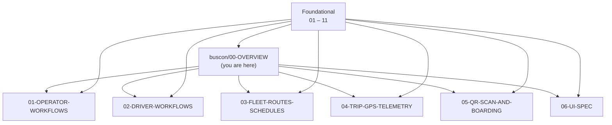

### 1.3 What this document does NOT cover

| Topic | Goes to |
|---|---|
| Detailed API contracts | `07-API-AND-REALTIME-CONTRACTS.md` §5–§7 |
| Workflow sequences | `08-WORKFLOWS.md` §5, §6, §7; `buscon/01`–`05` |
| Domain entities | `05-DOMAIN-MODEL.md` |
| Database schema | `06-DATABASE-SCHEMA.md` |
| Security controls | `09-SECURITY-AND-PLATFORM-RULES.md` |
| Tests | `10-TESTING-STRATEGY.md` |
| Full UI component specs | `buscon/06-UI-SPEC.md` (pending — §8 flag) |
| Full fleet/route/schedule detail | `buscon/03-FLEET-ROUTES-SCHEDULES.md` |
| Full GPS/telemetry detail | `buscon/04-TRIP-GPS-TELEMETRY.md` |
| Full QR scan detail | `buscon/05-QR-SCAN-AND-BOARDING.md` |

### 1.4 Scope clarification — "BusCon" vs the BusCon folder

**`00-INDEX.md` §4.2 titles the folder "BusCon (Operator + Admin)" but lists 7 docs** including `BC-02 DRIVER-WORKFLOWS` and `BC-05 QR-SCAN-AND-BOARDING` — both driver-mobile topics. This document resolves the ambiguity:

| Term | Means |
|---|---|
| **BusCon** | The Next.js 15 web app serving operator + admin roles |
| **Operator App** | The Expo (React Native) mobile app serving the driver role |
| **buscon/ folder** | The 7-doc family covering the entire **operations ecosystem** — both surfaces |

**Rule:** "buscon" in a doc path means the folder, not the web app. When the web app specifically is meant, this doc says "BusCon web."

---

## 2. What the Operations Ecosystem Is

### 2.1 Positioning

**Diagram: Operations ecosystem position**
*The operations ecosystem is the supply side of the two-sided marketplace. Two surfaces — BusCon web (operator + admin) on desktop, Operator App (driver) on mobile — both consume the same shared API. Passengers interact with the demand side (BusVerse) but never see BusCon or the Operator App directly.*

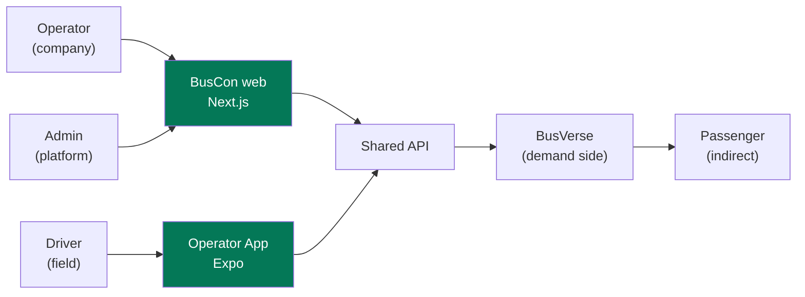

**Positioning statement:**

> The operations ecosystem is the supply-side companion to BusVerse. It lets verified operators list buses, define routes and schedules, assign drivers, and manage bookings; it lets the platform admin approve operators, oversee bookings, process refunds, and audit every action; and it gives drivers a field tool for starting trips, streaming GPS, and scanning passenger QR tickets. Two surfaces — BusCon web for operator + admin, Operator App for driver — share one backend with the passenger-facing BusVerse.

### 2.2 What the operations ecosystem is NOT

| Not | Why |
|---|---|
| A passenger-facing surface | That's BusVerse |
| A single app | Two surfaces (web + mobile), different actors |
| A public product | Every screen is auth-gated (§3.2) |
| A marketplace | Operators onboard; BusCon is not a listing site |
| A payments processor | Operator revenue is read-only; Razorpay used for refunds |
| A customer-support tool | Phase 2 (support panel deferred per `01` §12) |
| A multi-tenant SaaS dashboard | Phase 1 = single-tenant operators with row-level isolation |

### 2.3 Where operations sits in Phase 1

| Element | BusCon web | Operator App |
|---|---|---|
| Form factor | Next.js 15 web | Expo (React Native) |
| Deploy target | Vercel | Expo Go (Phase 1); App Store + Play Store (Phase 2) |
| Primary device | **Desktop** (≥1024px) | **Mobile** (Android 10+, iOS 14+) |
| Secondary device | Mobile read-only (Phase 2) | — |
| Launch region | Delhi–Kanpur–Lucknow corridor | Same |
| Users | Operator, Admin | Driver |
| Auth | Email+password (operator+admin); phone OTP (operator only) | Phone OTP (single-device binding) |

**Reference:** `01-PLAN-AND-SCOPE.md` §3 (surfaces), `03-SYSTEM-ARCHITECTURE.md` §5 (container), `04-ACTORS-ROLES-PERMISSIONS.md` §7.2–§7.4 (auth flows).

---

## 3. Actor Context — Three Roles

**Diagram: Operations actors**
*Three actors across two surfaces. Operator and Admin share BusCon web (role-routed). Driver uses Operator App (mobile). No guest access exists — every screen is auth-gated. No cross-surface session — an operator must log in separately to the Operator App if they also drive.*

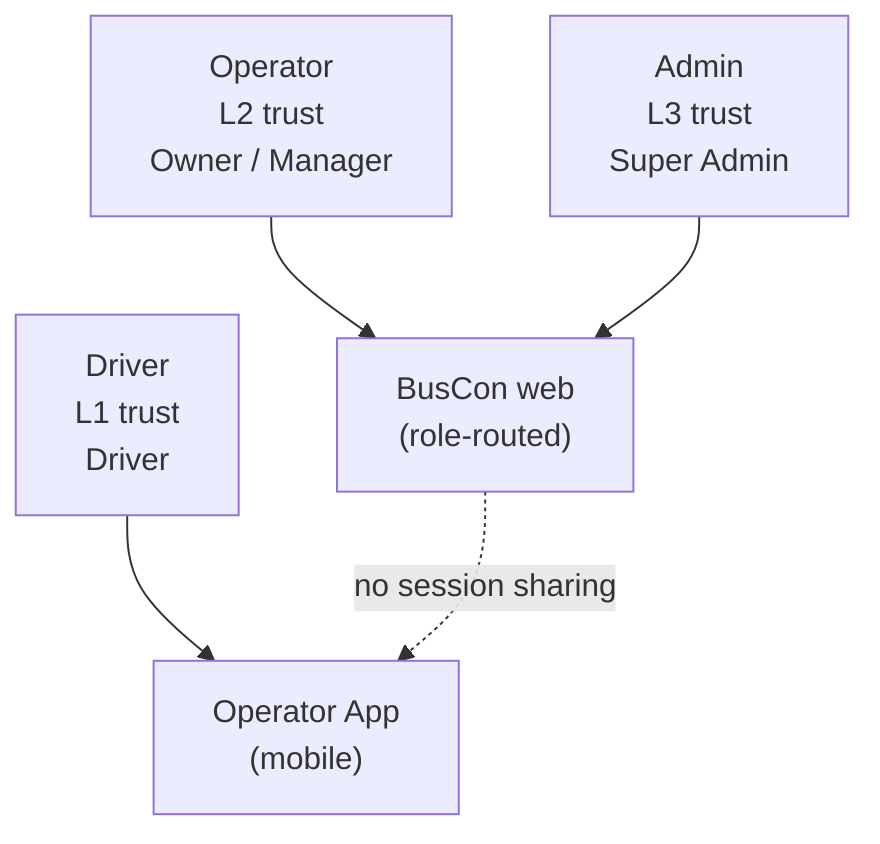

### 3.1 Operations roles

| Role | Actor | Surface | Trust | Access |
|---|---|---|---|---|
| **Operator Owner** | Operator | BusCon web | L2 | Full company access, billing, sub-user management |
| **Operator Manager** | Operator | BusCon web | L2 | Fleet/route/schedule management; no billing |
| **Super Admin** | Admin | BusCon web | L3 | Platform-wide approvals, refunds, audit |
| **Driver** | Driver | Operator App | L1 | Own assigned trips only |

**Reference:** `04-ACTORS-ROLES-PERMISSIONS.md` §4.1 (roles), §4.5 (Owner vs Manager), §4.6 (Super Admin scope).

### 3.2 Login-first model

**Rule:** Every operations screen requires authentication. There is no guest or public route on BusCon web or Operator App.

| Concern | BusVerse | Operations |
|---|---|---|
| Guest access | Yes (browse, search) | **No** |
| Public pages | Home, Search, Results | **None** |
| First screen | Home (may show auth form) | **Login** |
| Route guards | Per-route (some public) | **All routes** |

**Why:** Operators and admins manage company and platform data respectively. Drivers manage their own trips. There is nothing for a guest to see.

### 3.3 Driver's dual footprint

**Note:** A driver can be a passenger on BusVerse separately (per `04` §3.6 — one `users` row, four possible profiles). But **a driver cannot book as a passenger while on duty** (`04` §13.5) — enforced at the BusVerse checkout.

**Rule:** Operations roles never share a session with BusVerse roles. Same human, different sessions, different tokens.

---

## 4. Surface Boundary — Web vs Mobile

### 4.1 BusCon web — route groups

**Diagram: BusCon route groups**
*BusCon web is one Next.js 15 app with seven route groups. Two role layers — operator and admin — share the same deploy but different paths. Auth middleware checks role on every route.*

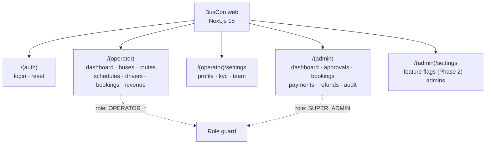

### 4.2 BusCon web — surface rules

| Rule | Enforcement |
|---|---|
| Only Operator (Owner/Manager) or Admin can use BusCon web | Auth middleware per route |
| No passenger or driver routes | No routes exist |
| No direct DB access | API-only |
| Desktop-first layout | Breakpoints ≥1024px primary; mobile read-only secondary (Phase 2) |
| Table-density pattern | Every list view uses sortable columns, bulk actions, filter chips |
| Session-scoped to one role | JWT `role` claim + server-side session check (`04` §5.2) |

**Reference:** `03` §5 (container), `04` §9.2 (permission grid).

### 4.3 Operator App — screen groups

**Diagram: Operator App screen groups**
*The Operator App is a single Expo app with six screens grouped into three areas — auth, today's trip, and trip operations. No multi-trip dashboard — the driver sees one screen per active trip.*

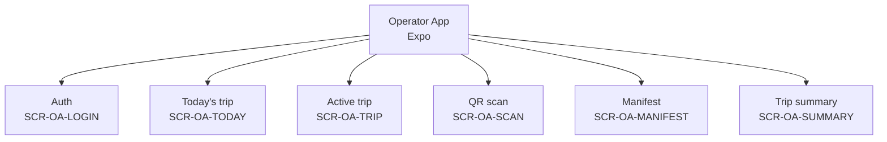

### 4.4 Operator App — surface rules

| Rule | Enforcement |
|---|---|
| Only Driver can use Operator App | Auth middleware |
| No operator, admin, or passenger features | No screens exist |
| **Mobile-first layout** | Portrait orientation; 360px+ width |
| **Offline-capable** | QR scan works without network (§10.3) |
| Single-device by default | `04` §7.3 (demo override for viva) |
| Native capabilities | GPS background streaming, camera scan, SQLite queue |

**Reference:** `03` §5, `04` §7.3, §9.3.

### 4.5 What the operations ecosystem owns

| Owns | Where specified |
|---|---|
| Operator onboarding, KYC, fleet, routes, schedules | `buscon/01-OPERATOR-WORKFLOWS.md`, `03-FLEET-ROUTES-SCHEDULES.md` |
| Admin approvals, oversight, refunds, audit | `buscon/01-OPERATOR-WORKFLOWS.md` (admin sections) |
| Driver trip lifecycle, GPS, scan | `buscon/02-DRIVER-WORKFLOWS.md`, `04-TRIP-GPS-TELEMETRY.md`, `05-QR-SCAN-AND-BOARDING.md` |
| BusCon + Operator App UI | `buscon/06-UI-SPEC.md` (pending) |

### 4.6 What the operations ecosystem does NOT own

| Not owned | Owned by |
|---|---|
| Backend business logic | API (`03` §6) |
| Seat lock atomicity | API + Redis (`03` §10) |
| Payment processing | Razorpay (`03` §12, `09` §13) |
| QR ticket signing | API (`09` §7) |
| Passenger permissions | BusVerse (`04` §9.1) |
| Ticket lifecycle | Booking module (`05` §8.6) |

---

## 5. Feature Inventory

**Diagram: Feature inventory**
*74 functional requirements across three surfaces, grouped into nine areas. Each area maps to a workflow and primary doc.*

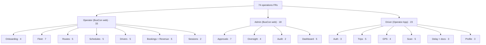

### 5.1 Feature area breakdown

| Surface | Area | FRs | Must | Should | Primary doc | Workflow |
|---|---|---:|---:|---:|---|---|
| BusCon operator | Onboarding | 4 | 3 | 1 | `01-OPERATOR-WORKFLOWS` | WF-O-01, WF-O-07 |
| BusCon operator | Fleet | 7 | 5 | 2 | `03-FLEET-ROUTES-SCHEDULES` | WF-O-02 |
| BusCon operator | Routes | 5 | 4 | 1 | `03-FLEET-ROUTES-SCHEDULES` | WF-O-03 |
| BusCon operator | Schedules | 5 | 4 | 1 | `03-FLEET-ROUTES-SCHEDULES` | WF-O-04 |
| BusCon operator | Drivers | 5 | 3 | 2 | `01-OPERATOR-WORKFLOWS` | WF-O-05 |
| BusCon operator | Bookings + Revenue | 5 | 4 | 1 | `01-OPERATOR-WORKFLOWS` | WF-O-06 |
| BusCon operator | Sessions | 2 | 1 | 1 | `01-OPERATOR-WORKFLOWS` | WF-O-07 |
| BusCon admin | Approvals | 7 | 6 | 1 | `01-OPERATOR-WORKFLOWS` | WF-A-02, WF-A-03 |
| BusCon admin | Oversight | 4 | 4 | 0 | `01-OPERATOR-WORKFLOWS` | WF-A-04, WF-A-05 |
| BusCon admin | Audit | 2 | 1 | 1 | `01-OPERATOR-WORKFLOWS` | WF-A-05 |
| BusCon admin | Dashboard | 5 | 3 | 2 | `01-OPERATOR-WORKFLOWS` | WF-A-01 |
| Operator App | Auth | 3 | 3 | 0 | `02-DRIVER-WORKFLOWS` | WF-D-01 |
| Operator App | Trips | 5 | 4 | 1 | `02-DRIVER-WORKFLOWS` | WF-D-02, WF-D-06 |
| Operator App | GPS | 4 | 4 | 0 | `04-TRIP-GPS-TELEMETRY` | WF-D-03 |
| Operator App | Scan | 5 | 3 | 2 | `05-QR-SCAN-AND-BOARDING` | WF-D-04, WF-D-05 |
| Operator App | Delay + docs | 3 | 1 | 2 | `02-DRIVER-WORKFLOWS` | WF-O-05 (shared) |
| Operator App | Profile | 3 | 1 | 2 | `02-DRIVER-WORKFLOWS` | — |
| **Total** | **17 areas** | **74** | **52** | **22** | | |

### 5.2 FR ID ranges

| Range | Surface | Area |
|---|---|---|
| FR-BO-001 to FR-BO-004 | BusCon operator | Onboarding |
| FR-BO-005 to FR-BO-011 | BusCon operator | Fleet |
| FR-BO-012 to FR-BO-016 | BusCon operator | Routes |
| FR-BO-017 to FR-BO-021 | BusCon operator | Schedules |
| FR-BO-022 to FR-BO-026 | BusCon operator | Drivers |
| FR-BO-027 to FR-BO-031 | BusCon operator | Bookings + Revenue |
| FR-BO-032 to FR-BO-033 | BusCon operator | Sessions |
| FR-BA-001 to FR-BA-007 | BusCon admin | Approvals |
| FR-BA-008 to FR-BA-011 | BusCon admin | Oversight |
| FR-BA-012 to FR-BA-013 | BusCon admin | Audit |
| FR-BA-014 to FR-BA-018 | BusCon admin | Dashboard |
| FR-OP-001 to FR-OP-003 | Operator App | Auth |
| FR-OP-004 to FR-OP-008 | Operator App | Trips |
| FR-OP-009 to FR-OP-012 | Operator App | GPS |
| FR-OP-013 to FR-OP-017 | Operator App | Scan |
| FR-OP-018 to FR-OP-020 | Operator App | Delay + docs |
| FR-OP-021 to FR-OP-023 | Operator App | Profile |

**Reference:** Full FR list with acceptance criteria in `02-REQUIREMENTS.md` §6.4, §6.5, §6.6.

---

## 6. Workflow Map

**Diagram: Workflow categories**
*Four workflow categories across 18 named workflows. Operator (7) + Admin (5) run on BusCon web. Driver (6) runs on Operator App. Cross-actor (5) span both surfaces and BusVerse.*

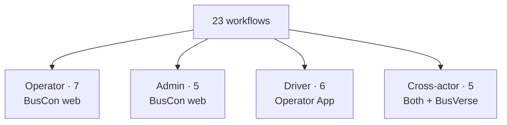

### 6.1 Full catalog

**Operator workflows:**

| ID | Workflow | Primary doc |
|---|---|---|
| WF-O-01 | Signup + KYC submission | `01-OPERATOR-WORKFLOWS` |
| WF-O-02 | Bus registration + layout | `03-FLEET-ROUTES-SCHEDULES` |
| WF-O-03 | Route creation | `03-FLEET-ROUTES-SCHEDULES` |
| WF-O-04 | Schedule creation + publish | `03-FLEET-ROUTES-SCHEDULES` |
| WF-O-05 | Driver invitation + assignment | `01-OPERATOR-WORKFLOWS` |
| WF-O-06 | Revenue review | `01-OPERATOR-WORKFLOWS` |
| WF-O-07 | Password reset | `01-OPERATOR-WORKFLOWS` |

**Admin workflows:**

| ID | Workflow | Primary doc |
|---|---|---|
| WF-A-01 | Admin login + password reset | `01-OPERATOR-WORKFLOWS` |
| WF-A-02 | Operator approval | `01-OPERATOR-WORKFLOWS` |
| WF-A-03 | Bus/route/schedule approval | `01-OPERATOR-WORKFLOWS` |
| WF-A-04 | Refund handling | `01-OPERATOR-WORKFLOWS` |
| WF-A-05 | Audit log review | `01-OPERATOR-WORKFLOWS` |

**Driver workflows:**

| ID | Workflow | Primary doc |
|---|---|---|
| WF-D-01 | Login + config fetch | `02-DRIVER-WORKFLOWS` |
| WF-D-02 | Trip start | `02-DRIVER-WORKFLOWS` |
| WF-D-03 | GPS streaming | `04-TRIP-GPS-TELEMETRY` |
| WF-D-04 | QR scan (online) | `05-QR-SCAN-AND-BOARDING` |
| WF-D-05 | QR scan (offline) | `05-QR-SCAN-AND-BOARDING` |
| WF-D-06 | Trip end | `02-DRIVER-WORKFLOWS` |

**Cross-actor workflows (all span operations + BusVerse):**

| ID | Workflow | Primary doc |
|---|---|---|
| WF-X-01 | ⭐ Full demo flow | (referenced by all — see `08` §8.1) |
| WF-X-02 | Seat lock race | (concurrency — see `08` §8.2) |
| WF-X-03 | Payment webhook convergence | (system — see `08` §8.3) |
| WF-X-04 | Suspension cascade | `01-OPERATOR-WORKFLOWS` (admin side) |
| WF-X-05 | Boarding → passenger sees boarded | `05-QR-SCAN-AND-BOARDING` (driver side), `busverse/04` §12 (passenger side) |

### 6.2 Workflow → doc map

| Doc | Owns | Cross-refs |
|---|---|---|
| `01-OPERATOR-WORKFLOWS` | WF-O-01, 05, 06, 07; WF-A-01 to 05; WF-X-04 | All operator + admin flows |
| `02-DRIVER-WORKFLOWS` | WF-D-01, 02, 06 | Login, trip lifecycle, profile |
| `03-FLEET-ROUTES-SCHEDULES` | WF-O-02, 03, 04 | Fleet + routes + schedules |
| `04-TRIP-GPS-TELEMETRY` | WF-D-03 | GPS streaming |
| `05-QR-SCAN-AND-BOARDING` | WF-D-04, 05; WF-X-05 (driver side) | Scan + boarding |
| `06-UI-SPEC` | (visual — no flows owned) | All screens |

**Note on WF-X-01 to WF-X-03:** These cross-actor workflows are not owned by any single buscon doc — they are the viva demo flow (`08` §8.1), the concurrency proof (`08` §8.2), and the payment convergence proof (`08` §8.3). Every buscon doc references them; none claims them as primary.

### 6.3 Negative workflows affecting operations

| Workflow | When triggered | Detail |
|---|---|---|
| WF-N-01 Payment fails → retry | Passenger retries | `08` §9.1 (visible in BusCon bookings) |
| WF-N-03 Operator cancels trip | Operator cancels schedule | `08` §9.3; affects all passengers on trip |
| WF-N-04 QR scan invalid | Driver scans invalid QR | `08` §9.4; operator sees audit trail |
| WF-N-05 Suspension mid-trip | Admin suspends driver mid-trip | `08` §9.5; forces trip end via admin |

**Reference:** `08-WORKFLOWS.md` §5 (7 operator), §6 (5 admin), §7 (6 driver), §9 (5 negative).

---

## 7. Screen Catalog

**Diagram: Screen flow (BusCon web + Operator App)**
*18 screens across two surfaces. The top half shows BusCon web (12 screens); the bottom half shows Operator App (6 screens). No screen is shared between surfaces.*

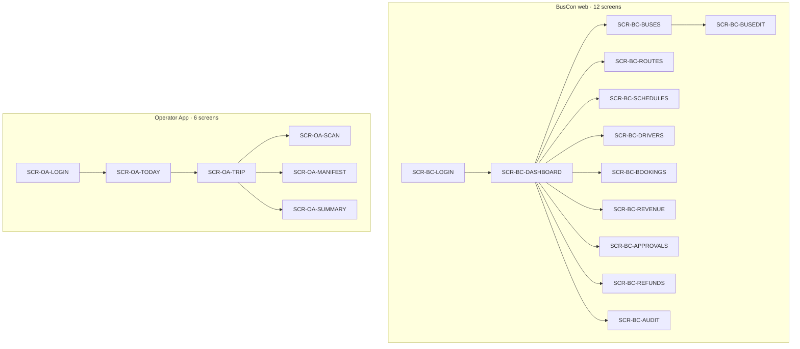

### 7.1 Screen catalog — BusCon web

| ID | Screen | Purpose | Primary workflow | Doc |
|---|---|---|---|---|
| SCR-BC-LOGIN | Login | Operator + admin auth | WF-O-01, WF-A-01 | `01-OPERATOR-WORKFLOWS` |
| SCR-BC-DASHBOARD | Dashboard | Role-specific landing | WF-O-06 | `01-OPERATOR-WORKFLOWS` |
| SCR-BC-BUSES | Fleet list | Bus management | WF-O-02 | `03-FLEET-ROUTES-SCHEDULES` |
| SCR-BC-BUSEDIT | Bus edit + layout | Bus detail + grid builder | WF-O-02 | `03-FLEET-ROUTES-SCHEDULES` |
| SCR-BC-ROUTES | Routes | Route list + editor | WF-O-03 | `03-FLEET-ROUTES-SCHEDULES` |
| SCR-BC-SCHEDULES | Schedules | Schedule management | WF-O-04 | `03-FLEET-ROUTES-SCHEDULES` |
| SCR-BC-DRIVERS | Drivers | Driver management | WF-O-05 | `01-OPERATOR-WORKFLOWS` |
| SCR-BC-BOOKINGS | Bookings | Booking list (masked PII) | WF-O-06 | `01-OPERATOR-WORKFLOWS` |
| SCR-BC-REVENUE | Revenue | Revenue dashboard | WF-O-06 | `01-OPERATOR-WORKFLOWS` |
| SCR-BC-APPROVALS | Approvals | Admin approval queue | WF-A-02, WF-A-03 | `01-OPERATOR-WORKFLOWS` |
| SCR-BC-REFUNDS | Refunds | Admin refund management | WF-A-04 | `01-OPERATOR-WORKFLOWS` |
| SCR-BC-AUDIT | Audit log | Admin audit query + export | WF-A-05 | `01-OPERATOR-WORKFLOWS` |

### 7.2 Screen catalog — Operator App

| ID | Screen | Purpose | Primary workflow | Doc |
|---|---|---|---|---|
| SCR-OA-LOGIN | Login | Driver auth + config fetch | WF-D-01 | `02-DRIVER-WORKFLOWS` |
| SCR-OA-TODAY | Today's trips | Assigned trips | WF-D-02 | `02-DRIVER-WORKFLOWS` |
| SCR-OA-TRIP | Active trip | In-progress trip controls | WF-D-02, WF-D-06 | `02-DRIVER-WORKFLOWS` |
| SCR-OA-SCAN | QR scanner | Camera scan + offline queue | WF-D-04, WF-D-05 | `05-QR-SCAN-AND-BOARDING` |
| SCR-OA-MANIFEST | Manifest | Passenger list per stand | WF-D-04 | `05-QR-SCAN-AND-BOARDING` |
| SCR-OA-SUMMARY | Trip summary | End-of-trip recap | WF-D-06 | `02-DRIVER-WORKFLOWS` |

### 7.3 State matrix (key states per screen)

| Screen | Key states |
|---|---|
| SCR-BC-LOGIN | Email + password · phone OTP · forgot password · session expired |
| SCR-BC-DASHBOARD | Loading · operator dashboard · admin dashboard |
| SCR-BC-BUSES | Loading · list · empty · error · filter applied |
| SCR-BC-BUSEDIT | Loading · create · edit · layout builder · approval pending · validation error |
| SCR-BC-ROUTES | Loading · list · create · edit · stands editor · error |
| SCR-BC-SCHEDULES | Loading · list · create · edit · publish · cancel confirm · error |
| SCR-BC-DRIVERS | Loading · list · invite · detail · assignment · error |
| SCR-BC-BOOKINGS | Loading · list · filter · detail (masked PII) · error |
| SCR-BC-REVENUE | Loading · dashboard · date range · export · error |
| SCR-BC-APPROVALS | Loading · queue · detail · approve confirm · reject confirm · error |
| SCR-BC-REFUNDS | Loading · list · detail · refund confirm · error |
| SCR-BC-AUDIT | Loading · query · results · export · error |
| SCR-OA-LOGIN | Phone input · OTP input · verifying · error |
| SCR-OA-TODAY | Loading · list · empty · error |
| SCR-OA-TRIP | Loaded · GPS active · GPS paused · network lost · trip end confirm · error |
| SCR-OA-SCAN | Camera ready · scanning · valid · duplicate · invalid · offline queued · error |
| SCR-OA-MANIFEST | Loading · list · filter by stand · refreshed · error |
| SCR-OA-SUMMARY | Loading · summary · error |

**Reference:** Full state specs in `buscon/06-UI-SPEC.md` (pending — §8 flag).

---

## 8. Brand Identity — Emerald (Intent + Gap Flag)

### 8.1 Positioning

**Diagram: Brand identity intent**
*BusCon and the Operator App use Emerald as their primary brand color, visually distinguishing operations from BusVerse (Royal Blue). Structural tokens (spacing, radii, motion, fonts) are inherited from `Design_guide.html` §1. Full visual authority is pending — see §8.4.*

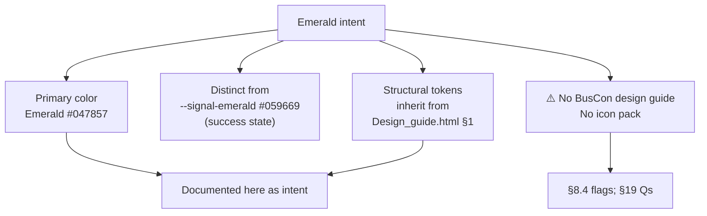

### 8.2 Color intent

| Token | Value | Use | Distinct from |
|---|---|---|---|
| `--brand-emerald` | **`#047857`** | Primary actions on BusCon + Operator App | `--signal-emerald #059669` (success state, BusVerse seat avail) |
| `--brand-emerald-hover` | `#036249` | Hover state | — |
| `--brand-emerald-active` | `#024D3A` | Active state | — |
| `--brand-emerald-subtle` | `rgba(4, 120, 87, 0.08)` | Light backgrounds, chips | — |
| `--brand-emerald-border` | `rgba(4, 120, 87, 0.25)` | Focus/active borders | — |

**Dark mode variants:** `#10B981` (hover `#34D399`, active `#059669`) — brighter for OLED contrast.

**Rationale for `#047857` instead of `#059669`:** `#059669` is already `--signal-emerald` (success), used across both surfaces for "success" semantics. Reusing it as primary would create ambiguity — is this a CTA or a success message? `#047857` is a distinct darker shade, visually distinguishable while staying in the emerald family.

### 8.3 Structural token inheritance

BusCon and the Operator App **inherit** these from `Design_guide.html` §1 — they are not redefined:

| Category | Tokens |
|---|---|
| Spacing | `--space-4xs` (2px) through `--space-4xl` (96px) |
| Radii | `--radius-xs` (4px) through `--radius-pill` (9999px) |
| Motion | `--ease-instant`, `--ease-smooth`, `--ease-bounce` |
| Fonts | `--font-sans` (Plus Jakarta Sans), `--font-mono` (JetBrains Mono) |
| Elevation | `--shadow-ambient`, `--shadow-floating`, `--shadow-modal` |

**Rule:** Only the primary color identity differs. Structural tokens are shared — one design language across three surfaces (BusVerse + BusCon + Operator App), one codebase for tokens.

### 8.4 Gap flag — BusCon design guide + icon pack missing

**This is a real gap.** No document currently exists to specify visual authority for BusCon web or the Operator App. `Design_guide.html` covers BusVerse (dual theme, seat cells, ticket stub, telemetry) but not operator/admin tables, KYC forms, fleet editors, approval queues, or the native mobile trip flow.

**Referenced by (blocked on this):**

| Doc | Needs |
|---|---|
| `buscon/06-UI-SPEC.md` | Full visual authority (blocker — cannot be written without) |
| `buscon/03-FLEET-ROUTES-SCHEDULES.md` (visual sections) | Table density, grid builder, form patterns |
| `buscon/04-TRIP-GPS-TELEMETRY.md` (visual sections) | Mobile trip UI, GPS indicator |
| `buscon/05-QR-SCAN-AND-BOARDING.md` (visual sections) | Camera scan UI, result states |
| `00-INDEX.md` §7 | `assets/brand/buscon-icon-pack.html` (asset not created) |

**Three resolution paths:**

| Path | Effort | Unlocks |
|---|---|---|
| **A:** Create `docs/assets/brand/buscon-design-guide.html` (parallel to `Design_guide.html`, emerald palette, table density, mobile trip UI) | ~4–6 hrs | Full visual authority for BusCon web + Operator App |
| **B:** Reuse `Design_guide.html` tokens with emerald swap; add table/mobile patterns inline in `buscon/06-UI-SPEC` | ~2 hrs | Good-enough visual spec; some duplication |
| **C:** Defer BusCon visual spec to Phase 2; use functional defaults in Phase 1 | 0 hrs | Fast, but risks the demo |

**Recommendation:** Path A. It is the smallest net effort (one design guide unlocks six docs), matches the pattern established by BusVerse, and gives the viva demo a coherent visual story across all three surfaces. **This doc does not resolve the path — it flags it for `buscon/06-UI-SPEC` planning** (see §19 Q1).

### 8.5 What `buscon/00-OVERVIEW` establishes

| Established here | Full spec in |
|---|---|
| Emerald primary color `#047857` | `buscon/06-UI-SPEC` (pending §8.4) |
| Structural token inheritance | `buscon/06-UI-SPEC` (pending §8.4) |
| Distinct from `--signal-emerald` | `buscon/06-UI-SPEC` (pending §8.4) |
| Dark mode variants | `buscon/06-UI-SPEC` (pending §8.4) |
| Icon pack gap flagged | `assets/brand/buscon-icon-pack.html` (needs creation) |

**Rule:** Until `buscon/06-UI-SPEC` exists, all BusCon + Operator App implementation uses the intent in §8.2 as the color reference and inherits structural tokens from `Design_guide.html` §1 without modification.

---

## 9. BusCon Web — Role-Routed Architecture

### 9.1 Role routing

**Diagram: Role routing**
*One Next.js app; two role layers. Auth middleware inspects the JWT `role` claim and routes the user into the correct surface. Operator and Admin share auth (login form is role-agnostic) but never share routes or data.*

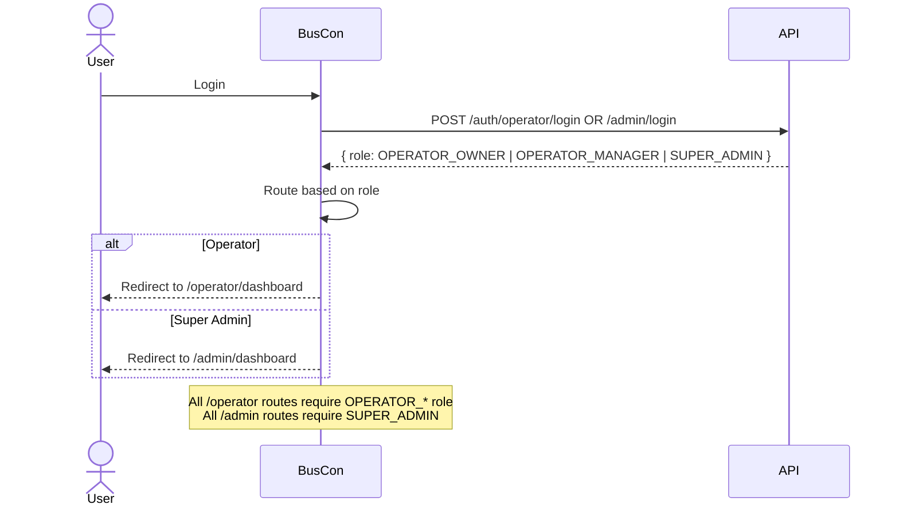

### 9.2 Role-routed routes

| Path pattern | Role required | Example |
|---|---|---|
| `/operator/*` | `OPERATOR_OWNER` or `OPERATOR_MANAGER` | `/operator/buses` |
| `/admin/*` | `SUPER_ADMIN` | `/admin/approvals` |
| `/login`, `/reset` | Public | — |

**Cross-role access:** Operator navigating to `/admin/*` → `403 Forbidden` (page-level error). Admin navigating to `/operator/*` → `403`. **No role can impersonate the other.**

### 9.3 Table density pattern

**Diagram: Table density**
*Every list view in BusCon uses the same table pattern — sortable headers, filter chips, row selection, bulk actions, pagination. This is different from BusVerse which has no tables. Full spec in `buscon/06-UI-SPEC` (pending §8.4).*

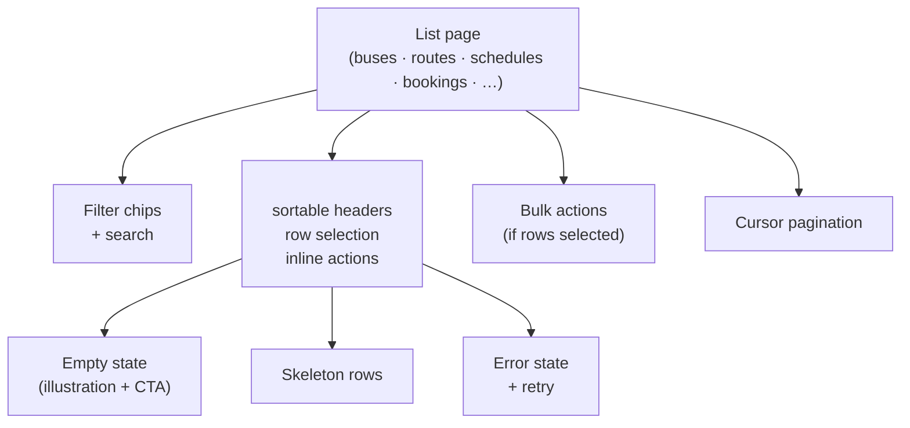

**Rules (introduced here, detailed in `06-UI-SPEC`):**

| Rule | Detail |
|---|---|
| Sort | Every column sortable (server-side sort) |
| Filter | Chips at top; search input filters visible columns |
| Selection | Checkbox per row; header checkbox selects page |
| Bulk actions | Appear in a toolbar when ≥1 row selected |
| Pagination | Cursor-based (matches API contract `07` §12) |
| Empty | Illustration + "Create {entity}" CTA |
| Loading | Skeleton rows (3–5) |
| Error | Inline banner + retry button |
| Column density | Compact (32px rows) — desktop only |
| Mobile | Read-only; tables stack to cards |

### 9.4 Auth-first model

Every screen is auth-gated. There is no guest route. Unauthenticated access to any `/operator/*` or `/admin/*` route redirects to `/login` with a `returnTo` query param (validation per `busverse/05` §21.4 rule).

**Reference:** `04` §7.2 (operator auth), §7.4 (admin auth), §14 (RBAC enforcement).

### 9.5 Desktop-first philosophy

BusVerse is mobile-first; BusCon is desktop-first (inverted per §4.4).

| Aspect | BusCon |
|---|---|
| Primary breakpoint | **≥1024px** |
| Page max-width | 1440px |
| Side nav | Vertical, expanded by default |
| Content area | Flex; tables consume width |
| Mobile | Read-only (Phase 2) |
| Tablet | Partial (Phase 2) |

**Rule:** BusCon web is designed on desktop first. Any mobile access is a phase-2 concern.

---

## 10. Operator App — Field Tool

### 10.1 Mobile-first philosophy

**Diagram: Mobile-first layout pattern**
*The Operator App is portrait-only, 360px minimum. No multi-column layouts. Every action is reachable with one thumb. The most-used action is at the bottom of the screen.*

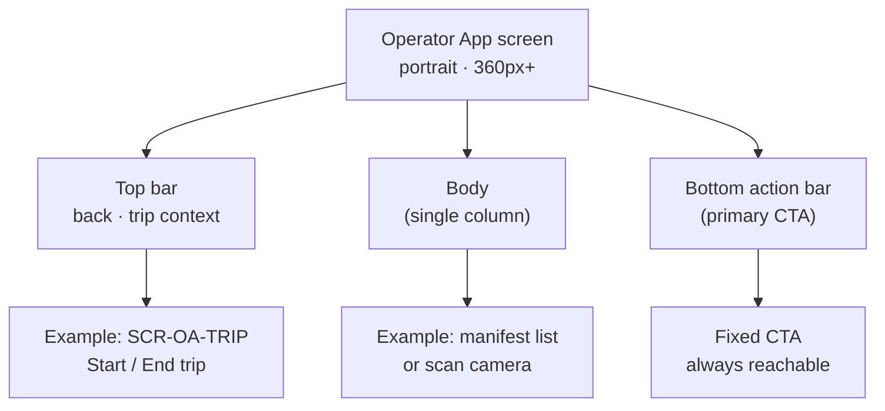

### 10.2 Single-device binding

Per `04` §7.3, driver sessions are single-device by default. Second login revokes the first. **Demo-mode override** (`DEMO_MULTI_DEVICE_DRIVER=true`) disables this for showcase / viva.

**Rule:** Never allow a driver to be logged in on two active devices with the override disabled. This prevents shared credentials and ghost trips.

### 10.3 Offline-capable behavior

**Diagram: Offline-capable flow**
*QR scan works without network. The app caches the QR public key + last 24h of assigned trips. Scans are queued in SQLite and synced when the network returns.*

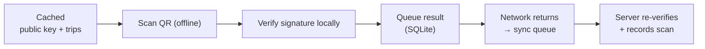

**What's cached:**

| Item | TTL | Refreshed |
|---|---|---|
| QR public key | 24h | On `/driver/config` fetch |
| Assigned trips (24h window) | 24h | On `/driver/trips` fetch |
| Last known manifest | 24h | On `/driver/trips/:id/manifest` fetch |

**Reference:** `09` §7 (QR verification offline), `busverse/04` §9 (offline cache strategy — same principles).

### 10.4 Screen simplicity

The Operator App has **6 screens** — the smallest surface in the entire BusVerse + BusCon system. Every screen fits one viewport. No tabs, no drawers, no nested navigation.

| Screen | Primary action | Secondary actions |
|---|---|---|
| SCR-OA-LOGIN | OTP verify | — |
| SCR-OA-TODAY | Start trip | View history |
| SCR-OA-TRIP | End trip | Scan, view manifest |
| SCR-OA-SCAN | Scan QR | Toggle flashlight |
| SCR-OA-MANIFEST | Refresh | Filter by stand |
| SCR-OA-SUMMARY | Done | View past trips |

### 10.5 Native capabilities

| Capability | Why native (not PWA) |
|---|---|
| Background GPS | PWA has iOS limitations on background location |
| Camera scan | Fast native camera; lower latency than web camera |
| SQLite offline queue | Reliable structured storage offline |
| Push notifications | Phase 2 — native push only |

**Reference:** `01-PLAN-AND-SCOPE.md` §3.3 (native rationale), `03` §5 (Expo choice).

---

## 11. Journey — Operator Setup to Revenue

### 11.1 The arc

**Diagram: Operator journey**
*The operator's lifecycle from signup to revenue — nine steps across BusCon web. Approval gates at steps 2 and 3 mean no listing goes live without admin sign-off.*

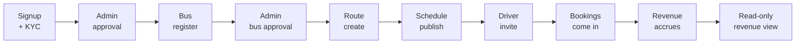

### 11.2 Step map

| # | Step | Screen | Workflow | Admin gate |
|:---:|---|---|---|---|
| 1 | Signup + KYC | SCR-BC-LOGIN + settings | WF-O-01 | — |
| 2 | Operator approval | — | WF-A-02 | ✅ Admin approves |
| 3 | Bus registration | SCR-BC-BUSES + BUSEDIT | WF-O-02 | ✅ Admin approves bus |
| 4 | Bus approval | — | WF-A-03 | ✅ |
| 5 | Route creation | SCR-BC-ROUTES | WF-O-03 | ✅ Admin approves route |
| 6 | Schedule creation + publish | SCR-BC-SCHEDULES | WF-O-04 | ✅ Admin approves schedule |
| 7 | Driver invite + assign | SCR-BC-DRIVERS | WF-O-05 | — (admin verifies KYC) |
| 8 | Bookings arrive | SCR-BC-BOOKINGS | (from BusVerse) | — |
| 9 | Revenue view | SCR-BC-REVENUE | WF-O-06 | — |

### 11.3 Journey timing targets

| Step | Target duration | Notes |
|---|---|---|
| Signup + KYC | ≤ 15 min | Document uploads can be async |
| Operator approval | ≤ 24h (SLA) | Manual admin review |
| Bus registration | ≤ 10 min | Grid builder included |
| Bus approval | ≤ 24h | Manual review |
| Route creation | ≤ 5 min | Depends on stand count |
| Schedule creation | ≤ 2 min | Template-based |
| Driver invite | ≤ 1 min | Phone + name |
| **Operator go-live total** | **≤ 2 days** | Includes 2 admin approval waits |

**Reference:** `08-WORKFLOWS.md` §5 (operator flows), `buscon/01-OPERATOR-WORKFLOWS.md` (detail).

---

## 12. Journey — Admin Oversight

### 12.1 The arc

**Diagram: Admin journey**
*The admin's lifecycle is a continuous oversight loop. Login → approve pending operators/buses/routes/schedules → monitor bookings → process refunds → audit. Never idle; always queue-driven.*

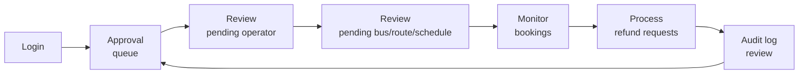

### 12.2 Step map

| # | Step | Screen | Workflow |
|:---:|---|---|---|
| 1 | Login | SCR-BC-LOGIN | WF-A-01 |
| 2 | Approval queue | SCR-BC-APPROVALS | WF-A-02, WF-A-03 |
| 3 | Booking oversight | SCR-BC-BOOKINGS | WF-A-04 (passive) |
| 4 | Refund handling | SCR-BC-REFUNDS | WF-A-04 |
| 5 | Audit | SCR-BC-AUDIT | WF-A-05 |

### 12.3 Admin cadence

| Activity | Frequency | Duration |
|---|---|---|
| Login | Daily | < 1 min |
| Approval queue | Daily (or on notification) | 5–15 min per item |
| Booking oversight | Weekly review | 10 min |
| Refund handling | On-demand | 2–5 min per refund |
| Audit review | Weekly | 15 min |

**Rule:** No admin action is auto-approved. Every approval, rejection, suspension, refund is manual + reason-required + audit-logged (`04` §10.3).

**Reference:** `08-WORKFLOWS.md` §6 (admin flows), `buscon/01-OPERATOR-WORKFLOWS.md` (detail).

---

## 13. Journey — Driver Trip Lifecycle

### 13.1 The arc

**Diagram: Driver journey**
*The driver's lifecycle is daily and repeatable. Login in the morning → see today's trip → start trip → stream GPS + scan passengers → end trip → see summary. GPS + scan happen in parallel during the trip.*

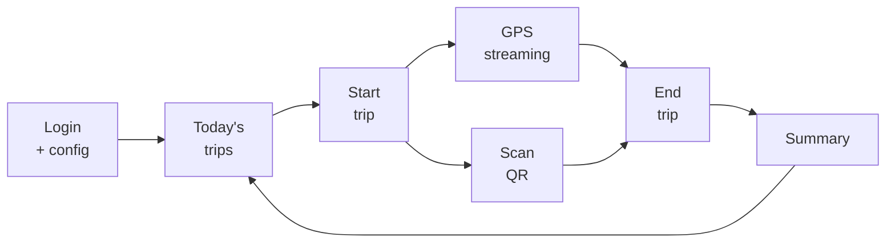

### 13.2 Step map

| # | Step | Screen | Workflow |
|:---:|---|---|---|
| 1 | Login + config fetch | SCR-OA-LOGIN | WF-D-01 |
| 2 | View today's trips | SCR-OA-TODAY | WF-D-02 |
| 3 | Start trip | SCR-OA-TRIP | WF-D-02 |
| 4a | GPS stream (background, parallel) | — | WF-D-03 |
| 4b | QR scan per boarding passenger | SCR-OA-SCAN | WF-D-04, WF-D-05 |
| 5 | View manifest | SCR-OA-MANIFEST | WF-D-04 |
| 6 | End trip | SCR-OA-TRIP | WF-D-06 |
| 7 | View summary | SCR-OA-SUMMARY | WF-D-06 |

### 13.3 Driver's ripple to passenger

**Rule:** Every driver scan ripples to the passenger's ticket instantly (per `busverse/04` §12, WF-X-05). The passenger's "Boarded" badge is a direct consequence of the driver's scan. This is the only cross-surface action the driver can trigger.

| Driver action | Passenger effect |
|---|---|
| `POST /driver/trips/:id/scan` | `boarding:verified` WebSocket → ticket flips to "Boarded" |
| `POST /driver/trips/:id/start` | `trip:started` WebSocket → tracking view activates |
| `POST /driver/trips/:id/end` | `trip:ended` WebSocket → tracking view becomes post-trip |
| Delay report | `trip:delayed` WebSocket → passenger sees delay banner |

**Reference:** `08-WORKFLOWS.md` §7 (driver flows), §8.5 (WF-X-05), `buscon/02` (detail), `05` (scan detail).

---

## 14. Technical Stack

### 14.1 Stack overview

**Diagram: Technical stack**
*Two frontends + one shared API. BusCon web on Next.js 15 (desktop-first). Operator App on Expo (mobile-first). Both use React Query + Context, and share `@busverse/ui` with token differentiation.*

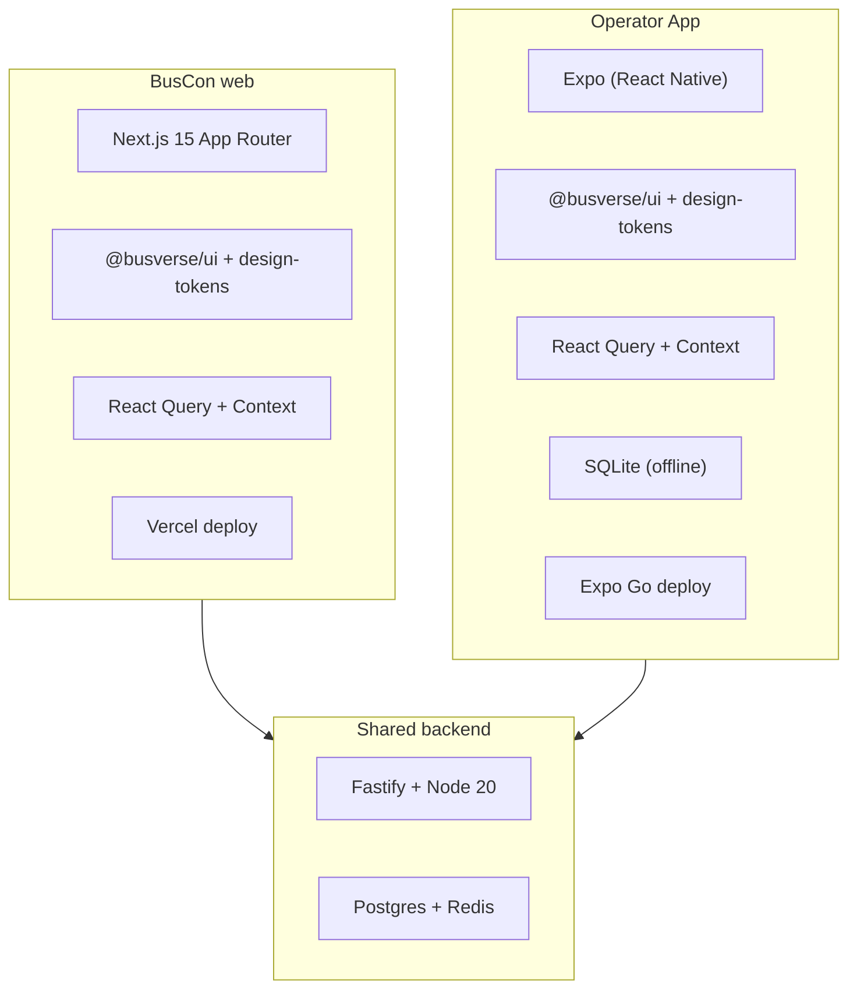

### 14.2 Stack details

| Surface | Layer | Tech | Reason |
|---|---|---|---|
| BusCon web | Framework | Next.js 15 App Router | ADR-003 |
| BusCon web | UI library | `@busverse/ui` + `@busverse/design-tokens` | Shared with BusVerse |
| BusCon web | State | React Query + Context | `03` §7.1 |
| BusCon web | Deploy | Vercel | ADR-013 |
| Operator App | Framework | Expo (React Native) | ADR-002 |
| Operator App | UI library | `@busverse/ui` + `@busverse/design-tokens` | Shared with BusVerse |
| Operator App | State | React Query + Context | `03` §7.1 |
| Operator App | Offline | SQLite | Native |
| Operator App | Deploy | Expo Go (Phase 1); native stores (Phase 2) | — |

### 14.3 Shared vs differentiated

| Concern | Shared | Differentiated |
|---|---|---|
| Components | `@busverse/ui` (12 primitives) | — |
| Tokens (structural) | `@busverse/design-tokens` | — |
| Tokens (primary color) | — | BusVerse Royal Blue · BusCon Emerald |
| State | React Query + Context | — |
| Auth client | Shared refresh logic | Per-surface token storage |
| Routes | — | Per-surface |
| Screens | — | Per-surface |

**Rule:** Never duplicate a primitive. If a component is needed in both BusVerse and BusCon, it lives in `@busverse/ui`. If it's needed only in one, it lives in `apps/{surface}/components/`.

**Reference:** `03` §5 (container), §21 (ADRs), `busverse/05` §6 (component library).

---

## 15. External Dependencies

### 15.1 Dependency map

**Diagram: External dependencies**
*BusCon web and Operator App call the API, which calls Razorpay (for refunds — not payments), R2 (for KYC docs), and OSM (for maps). Frontends never call Razorpay, R2, or MSG91 directly. Operator App calls OSM directly for map tiles.*

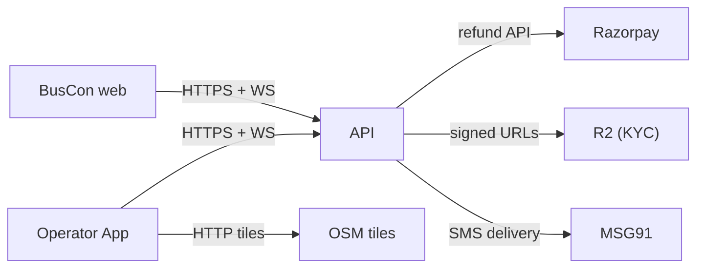

### 15.2 Dependency list

| Dependency | Used by | Purpose | Failure mode |
|---|---|---|---|
| API | Both surfaces | All data + auth | Full outage |
| Razorpay | API (refunds only) | Admin refunds | Retry with audit |
| R2 | API | KYC documents | Fallback to local FS |
| OSM tiles | Operator App (driver map) | Driver trip map | Static fallback |
| MSG91 | API | OTP + booking notifications | Retry via BullMQ |

**Note on Razorpay:** BusCon does **not** process passenger payments — those happen on BusVerse via Razorpay. BusCon admin initiates **refunds** only, and the Operator App has no payment involvement. This is why Razorpay's failure mode in BusCon is "retry with audit" rather than "full outage."

### 15.3 Fallback behavior

| Dependency | If unavailable |
|---|---|
| API | Show error + retry (full outage) |
| Razorpay (refunds) | Queue refund for retry via BullMQ; show "retry pending" in refund list |
| R2 (KYC uploads) | Fallback to local FS with warning; retry |
| OSM tiles | Static fallback image with markers |
| MSG91 | OTP via MOCK_OTP if enabled; else 503 with retry |

**Reference:** `02-REQUIREMENTS.md` §10.

---

## 16. Performance Targets

**Diagram: Performance targets**
*Different targets for each surface. BusCon web is desktop-optimized for table density — search/filter under 300ms. Operator App is field-optimized — GPS is the dominant concern, not page load.*

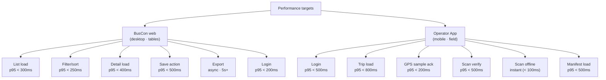

### 16.1 Target table

**BusCon web:**

| Target | Value | Source | Test |
|---|---|---|---|
| Login | p95 < 200 ms | Estimated | `perf_login` |
| List load (any) | p95 < 300 ms | Estimated | `contract_*` |
| Filter/sort | p95 < 250 ms | Estimated | `contract_*` |
| Detail load | p95 < 400 ms | Estimated | `contract_*` |
| Save action (create/update) | p95 < 500 ms | `02` §8.1 | `perf_*` |
| Export (CSV/JSON) | Async via BullMQ | — | `perf_*` |

**Operator App:**

| Target | Value | Source | Test |
|---|---|---|---|
| Login | p95 < 500 ms | Estimated | `perf_login` |
| Trip load | p95 < 800 ms | Estimated | `contract_*` |
| GPS sample ack | p95 < 200 ms | `02` §8.1 (5s interval) | `perf_gps` |
| Scan verify (online) | p95 < 500 ms | `02` §6.6 FR-OP-013 | `perf_scan` |
| Scan verify (offline) | < 100 ms (local) | Estimated | `perf_scan_offline` |
| Manifest load | p95 < 500 ms | Estimated | `contract_*` |

### 16.2 What this means in practice

| Scenario | Budget |
|---|---|
| Operator filters bookings | 250ms → filtered list visible |
| Operator approves an operator | 500ms → confirmation shown |
| Driver taps "Start trip" | 500ms → GPS begins streaming |
| Driver scans QR (online) | 500ms → result shown |
| Driver scans QR (offline) | Instant → result shown, queued for sync |

**Reference:** `02-REQUIREMENTS.md` §8.1.

---

## 17. Scope — In vs Out

**Diagram: Scope boundary**
*Phase 1 includes the full operator + admin + driver lifecycle. Phase 2 adds multi-user operator roles, support panel, feature flags, and native App Store distribution. Non-goals are permanent.*

```mermaid
flowchart TB
    SCOPE["Operations scope"]

    SCOPE --> IN["✅ Phase 1"]
    SCOPE --> P2["⏳ Phase 2"]
    SCOPE --> NG["❌ Non-goal"]

    IN --> I1["Operator: KYC, fleet, routes, schedules, drivers, revenue"]
    IN --> I2["Admin: approvals, oversight, refunds, audit"]
    IN --> I3["Driver: login, trips, GPS, scan (online + offline), manifest"]

    P2 --> O1["Multi-user operator roles (Owner + Manager + Fleet + Finance)"]
    P2 --> O2["Support panel"]
    P2 --> O3["Feature flags"]
    P2 --> O4["App Store + Play Store distribution"]
    P2 --> O5["Admin sub-roles (Ops, Finance, Auditor)"]
    P2 --> O6["Agent portal (Travel agent + wallet)"]
    P2 --> O7["Corporate portal"]
    P2 --> O8["Advanced analytics"]
    P2 --> O9["Push notifications"]

    NG --> N1["Operator sees passenger PII"]
    NG --> N2["Admin bypasses compliance"]
    NG --> N3["Driver sees other drivers' trips"]
    NG --> N4["Cross-operator data access"]
```

### 17.1 In scope (Phase 1)

| Surface | Feature | FRs |
|---|---|---|
| BusCon operator | Signup, KYC, fleet, routes, schedules, drivers, revenue | 33 |
| BusCon admin | Approvals, oversight, refunds, audit, dashboard | 18 |
| Operator App | Auth, trips, GPS, scan (online + offline), manifest, profile | 23 |

### 17.2 Out of scope (Phase 2)

| Feature | Reason |
|---|---|
| Multi-user operator roles (beyond Owner + Manager) | Not demo-critical |
| Support panel | Solo founder; escalations via admin |
| Feature flags | Not needed in Phase 1 |
| App Store / Play Store native distribution | Expo Go works for Phase 1 demo |
| Admin sub-roles (Ops, Finance, Auditor) | One Super Admin is enough |
| Agent portal | Not in Phase 1 |
| Corporate portal | Not in Phase 1 |
| Advanced analytics (cohorts, retention) | Basic revenue view is enough |
| Push notifications | SMS/WebSocket suffice Phase 1 |

### 17.3 Non-goals (never)

| Never built | Why |
|---|---|
| Operator sees passenger PII | Privacy — masked per `04` §11 |
| Admin bypasses compliance | Immutable rule per `04` §12 |
| Driver sees other drivers' trips | Row-level scope per `04` §5.5 |
| Cross-operator data access | Row-level scope per `04` §5.5 |

**Full list:** `01-PLAN-AND-SCOPE.md` §12, `04-ACTORS-ROLES-PERMISSIONS.md` §12.

---

## 18. Seven-Doc Navigation

**Diagram: Seven-doc navigation**
*How the seven BusCon docs relate. This overview (00) is the entry point. Six detail docs each cover one area. Every detail doc references foundational docs directly — this overview is not a bottleneck.*

```mermaid
flowchart TB
    OV["00-OVERVIEW<br/>you are here"]

    OV --> D1["01-OPERATOR-WORKFLOWS<br/>operator + admin flows"]
    OV --> D2["02-DRIVER-WORKFLOWS<br/>driver login · trips · profile"]
    OV --> D3["03-FLEET-ROUTES-SCHEDULES<br/>fleet · routes · schedules"]
    OV --> D4["04-TRIP-GPS-TELEMETRY<br/>GPS streaming"]
    OV --> D5["05-QR-SCAN-AND-BOARDING<br/>scan online + offline"]
    OV --> D6["06-UI-SPEC<br/>visual spec (pending §8.4)"]
```

### 18.1 Doc navigation table

| Doc | Answers | When to read |
|---|---|---|
| `00-OVERVIEW` (this) | "What is the operations ecosystem?" | First |
| `01-OPERATOR-WORKFLOWS` | "How do operators and admins work?" | For operator + admin flows |
| `02-DRIVER-WORKFLOWS` | "How does the driver trip lifecycle work?" | For login, trips, profile |
| `03-FLEET-ROUTES-SCHEDULES` | "How is a bus/route/schedule created?" | For fleet + route + schedule |
| `04-TRIP-GPS-TELEMETRY` | "How does GPS streaming work?" | For GPS pipeline |
| `05-QR-SCAN-AND-BOARDING` | "How does the driver scan a ticket?" | For scan flow |
| `06-UI-SPEC` | "What do the screens look like?" | For visual design (pending §8.4) |

### 18.2 Reading order for new contributors

1. **00-OVERVIEW** (this doc) — orientation
2. **06-UI-SPEC** — see what it looks like (once created)
3. **01-OPERATOR-WORKFLOWS** — operator + admin flows
4. **03-FLEET-ROUTES-SCHEDULES** — data-heavy path
5. **02-DRIVER-WORKFLOWS** — driver lifecycle
6. **04-TRIP-GPS-TELEMETRY** — GPS pipeline
7. **05-QR-SCAN-AND-BOARDING** — scan flow

### 18.3 What each detail doc owns

| Doc | Single source of truth for |
|---|---|
| `01-OPERATOR-WORKFLOWS` | Operator + admin flows (WF-O-*, WF-A-*) |
| `02-DRIVER-WORKFLOWS` | Driver login, trip start/end, profile |
| `03-FLEET-ROUTES-SCHEDULES` | Bus, seat layout, route, route stands, schedule |
| `04-TRIP-GPS-TELEMETRY` | GPS streaming (5s interval), Postgres persistence (30s) |
| `05-QR-SCAN-AND-BOARDING` | QR scan online + offline, boarding state |
| `06-UI-SPEC` | Design system, all screens, all components (pending §8.4) |

### 18.4 Note on `02-DRIVER-WORKFLOWS` + `05-QR-SCAN-AND-BOARDING` in the buscon folder

These two docs cover **driver-mobile** topics but live in the `buscon/` folder because the folder covers the entire **operations ecosystem** (§1.4). The alternative — creating a separate `driver/` folder — would fragment the ops docs and duplicate cross-references.

**Rule:** Reader should not be confused by "buscon" meaning "buscon folder" not "BusCon web." §1.4 resolves this.

---

## 19. Open Questions

| # | Question | Owner | Default |
|:---:|---|---|---|
| 1 | BusCon design guide — create `buscon-design-guide.html` (Path A), reuse `Design_guide.html` with emerald swap (Path B), or defer (Path C)? | Shaghaf | **Path A** — parallel to BusVerse; ~4–6 hrs; unlocks `06-UI-SPEC` and visual sections of `03`/`04`/`05` |
| 2 | BusCon icon pack — create `assets/brand/buscon-icon-pack.html`? | Shaghaf | Yes — parallel to `busverse-icon-pack.html` |
| 3 | Emerald primary `#047857` — confirmed vs alternative shades | Shaghaf | `#047857` (distinct from `--signal-emerald #059669`) |
| 4 | Desktop-first responsive confirmed? | Shaghaf | Yes — BusCon is desktop, mobile read-only Phase 2 |
| 5 | Table density pattern location — full spec in §9 here or in `06-UI-SPEC`? | Shaghaf | Pattern introduced here; full spec in `06-UI-SPEC` |
| 6 | Multi-user operator roles (Owner + Manager only Phase 1 vs add Fleet + Finance)? | Shaghaf | Owner + Manager only (per `04` §4.5) |
| 7 | Admin sub-roles (Ops / Finance / Auditor) Phase 1 or 2? | Shaghaf | Phase 2 — one Super Admin Phase 1 |
| 8 | Support panel Phase 1 or 2? | Shaghaf | Phase 2 (`01` §12 deferred) |
| 9 | Feature flags Phase 1 or 2? | Shaghaf | Phase 2 — no `feature_flags` table in `06` v1.2 |
| 10 | Operator self-service password reset via email OR OTP fallback? | Shaghaf | Both (per `04` §7.6) |
| 11 | Driver multi-device demo mode — when exactly to enable? | Shaghaf | Only for viva / showcase; config flag `DEMO_MULTI_DEVICE_DRIVER=true` |
| 12 | KYC document storage — R2 confirmed? | Shaghaf | Yes (`03` §21 ADR-012) |
| 13 | Notification channels for operator — email only or email + SMS + in-app? | Shaghaf | Email Phase 1; in-app + SMS Phase 2 |
| 14 | Native App Store / Play Store distribution Phase 1 or 2? | Shaghaf | Phase 2 — Expo Go works for Phase 1 viva demo |
| 15 | Stand dropdown sort pattern in BusCon routes editor — route sequence (like BusVerse) or alphabetical? | Shaghaf | Route sequence order (matches mental model) |
| 16 | Admin "reason required" minimum length | Shaghaf | 10 characters (per `busverse/05` §11.4 pattern) |
| 17 | BusCon mobile read-only — which screens Phase 2? | Shaghaf | Dashboard + Bookings + Revenue (the "check on the go" set) |
| 18 | Operator app icon library — Lucide + brand-svg (like BusVerse) or native icons? | Shaghaf | Same as BusVerse (§8.4 inherits) |
| 19 | Should BusCon web have a sidebar or top nav? | Shaghaf | Sidebar (desktop density); top nav on mobile Phase 2 |
| 20 | `buscon/06-UI-SPEC` — one doc for both BusCon web + Operator App, or split? | Shaghaf | One doc (both surfaces share token system); cross-refs per surface |

---

## 20. Checklist Against Master List

| Item | Included? | Section |
|---|:---:|---|
| Purpose and scope | ✅ | §1 |
| Doc hierarchy | ✅ | §1.2 |
| Scope clarification (BusCon vs folder) | ✅ | §1.4 |
| Positioning (3 actors, 2 surfaces) | ✅ | §2.1 |
| What ops is NOT | ✅ | §2.2 |
| Phase 1 placement | ✅ | §2.3 |
| 3 actors | ✅ | §3.1 |
| Login-first model | ✅ | §3.2 |
| Driver's dual footprint | ✅ | §3.3 |
| BusCon web route groups | ✅ | §4.1 |
| BusCon web surface rules | ✅ | §4.2 |
| Operator App screen groups | ✅ | §4.3 |
| Operator App surface rules | ✅ | §4.4 |
| What ops owns | ✅ | §4.5 |
| What ops does NOT own | ✅ | §4.6 |
| Feature inventory (74 FRs) | ✅ | §5.1 |
| FR ID ranges | ✅ | §5.2 |
| Workflow categories | ✅ | §6.0 |
| Full workflow catalog (23) | ✅ | §6.1 |
| Workflow → doc map | ✅ | §6.2 |
| Negative workflows | ✅ | §6.3 |
| Screen catalog (18) | ✅ | §7.1, §7.2 |
| State matrix per screen | ✅ | §7.3 |
| **Brand identity — Emerald (intent)** | ✅ | §8 |
| Color intent `#047857` | ✅ | §8.2 |
| Structural token inheritance | ✅ | §8.3 |
| **Design guide gap flagged** | ✅ | §8.4 |
| What overview establishes | ✅ | §8.5 |
| Role routing | ✅ | §9.1 |
| Role-routed routes | ✅ | §9.2 |
| Table density pattern | ✅ | §9.3 |
| Auth-first model | ✅ | §9.4 |
| Desktop-first philosophy | ✅ | §9.5 |
| Mobile-first philosophy | ✅ | §10.1 |
| Single-device binding | ✅ | §10.2 |
| Offline-capable behavior | ✅ | §10.3 |
| Screen simplicity | ✅ | §10.4 |
| Native capabilities | ✅ | §10.5 |
| Operator journey (9 steps) | ✅ | §11.1 |
| Operator step map | ✅ | §11.2 |
| Operator timing | ✅ | §11.3 |
| Admin journey (loop) | ✅ | §12.1 |
| Admin step map | ✅ | §12.2 |
| Admin cadence | ✅ | §12.3 |
| Driver journey (daily loop) | ✅ | §13.1 |
| Driver step map | ✅ | §13.2 |
| Driver's ripple to passenger | ✅ | §13.3 |
| Technical stack overview | ✅ | §14.1 |
| Stack details | ✅ | §14.2 |
| Shared vs differentiated | ✅ | §14.3 |
| External dependency map | ✅ | §15.1 |
| Dependency list | ✅ | §15.2 |
| Fallback behavior | ✅ | §15.3 |
| Performance targets | ✅ | §16.1 |
| Practical budgets | ✅ | §16.2 |
| Scope in/out/non-goals | ✅ | §17.1, §17.2, §17.3 |
| Seven-doc navigation | ✅ | §18 |
| Reading order | ✅ | §18.2 |
| Doc ownership | ✅ | §18.3 |
| Folder clarification | ✅ | §18.4 |
| Open questions (20) | ✅ | §19 |

**All items covered. 18 Mermaid diagrams. Every diagram described.**

---

## 21. Summary

**The operations ecosystem is the supply-side companion to BusVerse — two surfaces (BusCon web for operator + admin, Operator App for driver) sharing one backend with the passenger-facing BusVerse.** Three actor roles across two surfaces: **Operator Owner** and **Operator Manager** on BusCon web (desktop-first, L2 trust), **Super Admin** on BusCon web (L3 trust, platform-wide), and **Driver** on the Operator App (mobile-first, L1 trust, single-device). **Login-first model** — every operations screen requires authentication; there is no guest route, unlike BusVerse which has 3 public screens. **Surface boundary:** BusCon web is one Next.js 15 app with seven route groups (three auth, five operator, four admin) where auth middleware inspects the JWT `role` claim and routes into the correct surface — Operator roles see `/operator/*`, Super Admin sees `/admin/*`, and cross-role access returns `403`. Operator App is a single Expo app with six screens — login, today's trips, active trip, QR scanner, manifest, trip summary — portrait-only, 360px+, offline-capable via SQLite queue, single-device by default with a demo-mode override for viva. **74 FRs across three surfaces** — 33 operator (onboarding 4, fleet 7, routes 5, schedules 5, drivers 5, bookings + revenue 5, sessions 2), 18 admin (approvals 7, oversight 4, audit 2, dashboard 5), 23 driver (auth 3, trips 5, GPS 4, scan 5, delay + docs 3, profile 3) — orchestrated by **23 workflows** (7 operator, 5 admin, 6 driver, 5 cross-actor including the ⭐ WF-X-01 full demo flow that all surfaces participate in). **18 screens** across the two surfaces — 12 BusCon web screens (login, dashboard, buses, bus edit + layout, routes, schedules, drivers, bookings, revenue, approvals, refunds, audit) and 6 Operator App screens (login, today's trips, active trip, scan, manifest, summary) — with **key states per screen** documented. **Brand identity uses Emerald `#047857` as the primary color** — distinct from `--signal-emerald #059669` (success state), so a CTA never looks like a success message — while **all structural tokens are inherited verbatim from `Design_guide.html` §1** (spacing, radii, motion, fonts, elevation), establishing one design language across three surfaces. **A real gap is flagged in §8.4:** no BusCon design guide or icon pack currently exists, and `buscon/06-UI-SPEC` is blocked on it; three resolution paths are documented (Path A recommended — create `buscon-design-guide.html`, ~4–6 hrs, unlocks the full visual spec). **BusCon web role routing** is diagrammed as an auth-first middleware that inspects the JWT role and redirects to `/operator/dashboard` or `/admin/dashboard` — no role can impersonate the other. **Table density pattern** is introduced here (sortable columns, filter chips, row selection, bulk actions, cursor pagination, skeleton/empty/error states) — a new territory since BusVerse has no tables — with full spec deferred to `06-UI-SPEC`. **Three actor journeys:** Operator goes through 9 steps from signup → KYC → admin approval → bus register → admin approval → route → schedule → driver invite → revenue view (with two mandatory admin gates; operator go-live SLA ≤ 2 days including approvals); Admin runs a continuous oversight loop (login → approval queue → booking monitoring → refund processing → audit → back to queue); Driver runs a daily repeatable cycle (login → today's trips → start trip → GPS + scan in parallel → end trip → summary) where **every driver scan ripples to the passenger's ticket instantly** via the `boarding:verified` WebSocket (WF-X-05). **Technical stack** — BusCon web on Next.js 15 + React Query + Context + Vercel; Operator App on Expo (React Native) + React Query + SQLite + Expo Go — both sharing `@busverse/ui` (12 primitives) and `@busverse/design-tokens` (structural tokens), differentiated only by primary color (Royal Blue vs Emerald). **External dependencies:** the API, Razorpay (refunds only — no payment processing on BusCon), R2 (KYC documents), OSM tiles (driver map), MSG91 (OTP). Operator App calls OSM directly for map tiles. **Performance targets** differ by surface — BusCon web is table-optimized (list load p95 < 300ms, filter/sort p95 < 250ms, save p95 < 500ms) while Operator App is field-optimized (login p95 < 500ms, GPS ack p95 < 200ms, scan online p95 < 500ms, scan offline < 100ms). **Scope** — Phase 1 ships the full operator + admin + driver lifecycle across 3 surfaces; Phase 2 adds multi-user operator roles beyond Owner/Manager, admin sub-roles, support panel, feature flags, native App Store/Play Store distribution, agent portal, corporate portal, advanced analytics, push notifications; non-goals are permanent (operator cannot see passenger PII, admin cannot bypass compliance, driver cannot see other drivers' trips, cross-operator data access impossible via row-level scope). **The seven-doc navigation** frames the folder as the entire operations ecosystem — not just BusCon web — resolving the `00-INDEX.md` §4.2 title/listing ambiguity: `01-OPERATOR-WORKFLOWS` owns operator + admin flows, `02-DRIVER-WORKFLOWS` owns login + trips + profile, `03-FLEET-ROUTES-SCHEDULES` owns fleet + routes + schedules, `04-TRIP-GPS-TELEMETRY` owns GPS streaming, `05-QR-SCAN-AND-BOARDING` owns scan online + offline, `06-UI-SPEC` owns the visual layer (pending §8.4 design guide). **Twenty open questions remain**, all with Phase-1 defaults — most are Phase 2 deferrals (support panel, feature flags, admin sub-roles, native app distribution, push notifications), with the **most urgent being Q1 (design guide path) and Q2 (icon pack)** — both blockers for `buscon/06-UI-SPEC` and the visual sections of `buscon/03`/`04`/`05`.

---

**End of Document `buscon/00-OVERVIEW.md` v1.0.**