# `buscon/07-OPERATOR-EXPERIENCE.md` v1.0

**Document:** `buscon/07-OPERATOR-EXPERIENCE.md`
**Project:** BusVerse + BusCon
**Version:** 1.0
**Status:** Locked — Reference Document
**Owner:** Shaghaf
**Guide:** Mr. Mohit Srivastav
**Purpose:** The end-to-end operator journey consolidation. Where `buscon/00` §11 gives a 9-step high-level overview and `buscon/01`/`03` give individual workflow sequences, this doc shows the **interconnection** — the operator's actual experience from first signup to eventual deactivation, with all 9 workflows woven into one narrative. It fills the gap between discrete workflow specs (which describe "how to register a bus" but not "what does the first week feel like") and the admin's view of the same operator (which exists in `buscon/01` §9–§10 but not the operator's experience of waiting, being rejected, resubmitting). It consolidates four scattered surfaces — the operator's daily dashboard (`buscon/01` §6.7, `buscon/03` §17A), their error messages (`07` §9.2 operator subset), their notification triggers (`buscon/01` §5.9 + approval flows), and their self-service capabilities (`04` §9.2 permission grid) — into a single operator-facing reference.

> **Derives from:** `buscon/00-OVERVIEW.md` v1.0 §11 (9-step journey overview), `buscon/01-OPERATOR-WORKFLOWS.md` v1.0 §3.6 (login), §4 (signup + KYC), §5 (driver invite), §6 (revenue), §6.7 (dashboard landing), §9-§10 (admin approvals — operator's view of waiting), §11 (refunds), §13 (suspension), `buscon/02-DRIVER-WORKFLOWS.md` v1.0 §7.2 (trip start pre-checks — operator-facing consequences), `buscon/03-FLEET-ROUTES-SCHEDULES.md` v1.0 §4 (bus), §4.5 (bus_type A1), §5-§7 (grid builder), §8 (insurance), §10-§12 (routes), §13-§17 (schedules), §17A (dashboard), `buscon/04-TRIP-GPS-TELEMETRY.md` v1.0 §11 (provenance — operator sees gps_anomaly via `shared/05` §10.2), `buscon/06-UI-SPEC.md` v1.0 §12 (auth screens), §13 (dashboard), §14-§16 (fleet/routes/schedules/drivers/bookings/revenue/approvals/refunds/audit screens), §17 (grid builder visual), §18A (formatting), `04-ACTORS-ROLES-PERMISSIONS.md` v1.2 §3.3 (Operator identity), §4.5 (Owner vs Manager), §9.2 (BusCon permission grid), §10.1 (named operations), §17 (open questions), `07-API-AND-REALTIME-CONTRACTS.md` v1.2 §5 (operator endpoints), §9.2 (49 error codes), `08-WORKFLOWS.md` v1.1 §5 (7 operator workflows), §6 (admin workflows — operator sees results), §8.4 (suspension cascade), `shared/05-ADMIN-AND-SUPPORT.md` v1.0 §4 (what works), §6 (DPDP operator-side), §10 (trust & safety operator-side), §14.3 (SLA targets).

> **Referenced by:** `buscon/00-OVERVIEW.md` v1.1 (A1 — §11 reference), `buscon/01-OPERATOR-WORKFLOWS.md` v1.1 (A2 — §5.9 notification catalog reference), `buscon/06-UI-SPEC.md` v1.1 (A3 — §12.2 dashboard reference), `00-INDEX.md` v1.2 (A4 — new doc in folder tree; doc count 54 → 55), `report/14-MODULE_DESCRIPTION.md`, `viva/03-DEMO_SCRIPT.md`.

---

## 1. Purpose and Scope

### 1.1 What this document owns

| Owns here | Referenced from upstream |
|---|---|
| **Full operator lifecycle** (5 stages, 15+ transitions) | `buscon/00` §11 (1 diagram, 9 steps) |
| **Day-in-the-life narrative** (Sharma Ji) | — (no doc owns this) |
| **Approval wait experience** (4 approval types) | `buscon/01` §9–§10 (admin side only) |
| **Rejection + resubmit flows** (4 types) | `buscon/01` §4.10 (KYC only, brief) |
| **Operator dashboard consolidation** (5 card types) | `buscon/01` §6.7, `buscon/03` §17A (scattered) |
| **20 operator-facing errors** (with action) | `07` §9.2 (49 total, no operator filter) |
| **~17 notification triggers** (email + SMS + WS) | `buscon/01` §5.9 (partial) |
| **Operator self-service matrix** (17 capabilities) | `04` §9.2 (permission grid, no "self-service" view) |
| **Onboarding SLA timeline** (step-by-step) | `buscon/00` §11.3 (total only) |
| **Trust & safety operator-side** | `shared/05` §10 (admin actions, operator experience not shown) |
| **DPDP operator-side touchpoints** | `shared/05` §6 (user rights, operator-as-user not distinguished) |

### 1.2 Document hierarchy

**Diagram: Document hierarchy**
*This doc sits inside the buscon folder as the 8th and final doc. It consolidates the operator's experience across `buscon/01` (workflows), `buscon/03` (fleet/routes/schedules), `buscon/06` (screens), and `shared/05` (admin actions that affect operators). It fills a gap: workflow sequences exist, admin views exist, but the operator's own journey — including the waiting, rejections, and self-service limits — is undocumented.*

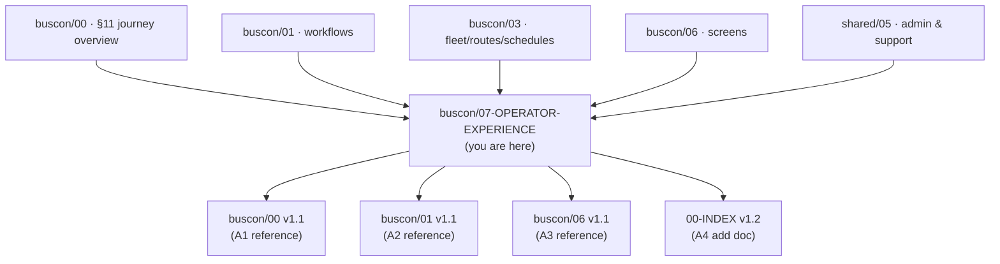

### 1.3 What this document does NOT cover

| Topic | Goes to |
|---|---|
| Workflow sequences (WF-O-01 to 07) | `buscon/01` §4–§7, `buscon/03` §5–§17 |
| Screen wireframes | `buscon/06` §12–§17 |
| Admin approval mechanics (admin side) | `buscon/01` §9–§10 |
| Full error catalog | `07` v1.2 §9.2 |
| Full notification infrastructure (delivery) | `09` v1.2 §18 |
| Permission grid | `04` v1.2 §9.2 |
| Grid builder UX | `buscon/03` §5–§7, `buscon/06` §17 |
| Admin trust & safety protocols (admin side) | `shared/05` §10 |
| DPDP workflows (admin side) | `shared/05` §6 |

### 1.4 Scope boundary

**This doc is a consolidation, not a source.** Every fact it states has a canonical source in another doc — this doc filters and connects what's scattered, from the **operator's perspective**.

| If you want to know… | Read §X | Then the canonical source |
|---|---|---|
| What's the operator's whole lifecycle | §2 | (new — this doc) |
| What does an operator's day look like | §4 | (new — this doc) |
| How do I know if my KYC is stuck | §6 | `buscon/01` §4.10 |
| What happens if my KYC is rejected | §7.1 | `buscon/01` §4.10 (partial) |
| How do I register a bus | §8 | `buscon/03` §4–§7 |
| What does my dashboard show | §12 | `buscon/01` §6.7, `buscon/03` §17A |
| What does this error mean | §13 | `07` v1.2 §9.2 |
| Why did I get this email | §14 | `buscon/01` §5.9 (partial) |
| What can I do without admin help | §15 | `04` v1.2 §9.2 (partial) |
| How long until I'm live | §16 | `buscon/00` §11.3 (total only) |
| What's a gps_anomaly for me | §17 | `shared/05` §10.2 |

### 1.5 What this doc solves

**The gap in one sentence:** BusCon has 9 operator workflows specified, 12 admin screens specified, and 21 operator endpoints specified — but no doc answers "what does being an operator actually feel like, day to day, week to week, from first signup to eventual account closure?"

**Why this matters:**

| Role | Pain point | Fix |
|---|---|---|
| **First-time operator** | "I signed up, uploaded KYC, now what do I do?" | §6, §16 |
| **Operator waiting for approval** | "Did my submission go through? How long?" | §6, §16 |
| **Rejected operator** | "Why was I rejected? What do I do?" | §7 |
| **Daily operator** | "What do I check every morning?" | §4, §12 |
| **Operator confused by error** | "What does `ROUTE_SAME_CITY` mean for me?" | §13 |
| **Operator wanting self-service** | "Can I change my bank account without admin?" | §15 |
| **Operator facing suspension** | "What happens to my buses/bookings/drivers?" | §10 |
| **Viva presenter** | "What's the story I tell about operators?" | §4 |

---

## 2. The Operator Lifecycle (hero diagram)

### 2.1 Five stages

**Diagram: Complete operator lifecycle**
*Five stages from signup to deactivation. Fifteen transitions. Each stage has its own work, waits, and failure modes. This is the doc's central contribution — the full arc that no other doc traces.*

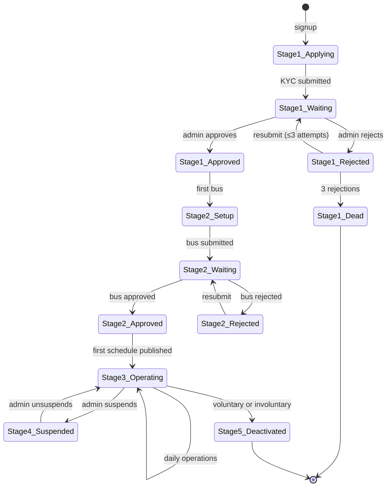

### 2.2 Stage summary

| # | Stage | Duration | Operator's feeling | Key actions |
|:---:|---|---|---|---|
| 1 | Applying + approval | 1–3 days | Anxious | Signup, email verify, KYC upload, wait |
| 2 | Setup | 1–3 days | Productive | Bus, layout, route, schedule, invite driver |
| 3 | Operating | Ongoing (weeks–years) | Steady | Daily bookings, driver management, revenue |
| 4 | Suspended (if triggered) | 1 day–weeks | Frustrated | Respond to suspension, remediation |
| 5 | Deactivated | Terminal | Ending | Voluntary request or policy decision |

### 2.3 The three "modes" of an operator

**Diagram: Three operator modes**
*Operators don't just have stages — they have modes based on what they're doing at any given moment. Most days an operator is in "operate" mode. Setup mode is occasional (new bus, new route). Approval mode is rare (waiting for admin).*

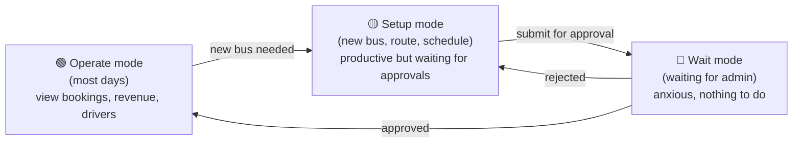

**Insight:** The operator's emotional state varies dramatically by mode. A first-time operator who submits KYC and waits 24 hours is in "wait mode" — they can't do anything except refresh. A daily operator with 5 buses running is in "operate mode" — steady rhythm, no waiting. This doc's §6 (approval wait) specifically addresses the anxiety of wait mode.

---

## 3. The 5 Lifecycle Stages — Detail

### 3.1 Stage 1 — Applying + Approval

**Diagram: Stage 1 detailed flow**
*Every operator starts here. Three sub-steps: signup, email verify, KYC upload. Then waiting. The waiting is the hard part.*

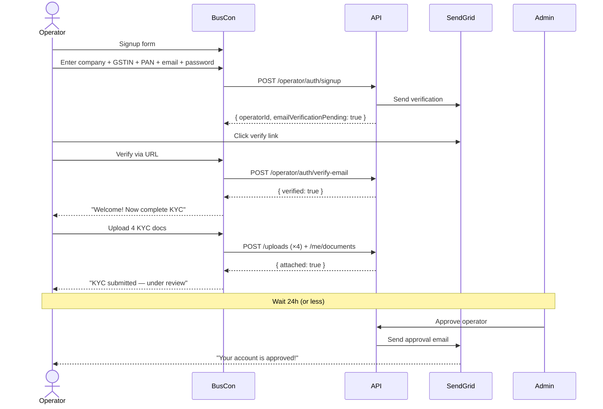

### 3.2 Stage 2 — Setup

**Diagram: Stage 2 detailed flow**
*Once approved, operator onboards their fleet. Each step (bus, route, schedule) may have its own approval. Schedule is the last step — after that, the operator is live.*

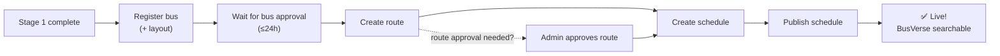

**Note:** Route and schedule approval status depends on final A2 resolution in `buscon/03` §1.7. Currently:
- Route: `approval_status = PENDING` → admin approves
- Schedule: operator publishes directly (per A2 resolution — no approval gate)

### 3.3 Stage 3 — Operating

**Diagram: Stage 3 daily rhythm**
*Once live, operator's day has a predictable rhythm. Morning check, midday adjustments, evening review.*

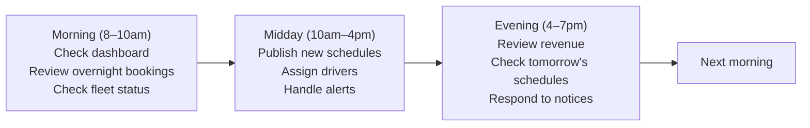

### 3.4 Stage 4 — Suspended

**Diagram: Stage 4 suspension experience**
*If suspended, operator's experience changes dramatically. Sessions revoked, buses hidden from search, new bookings blocked. Recovery is possible.*

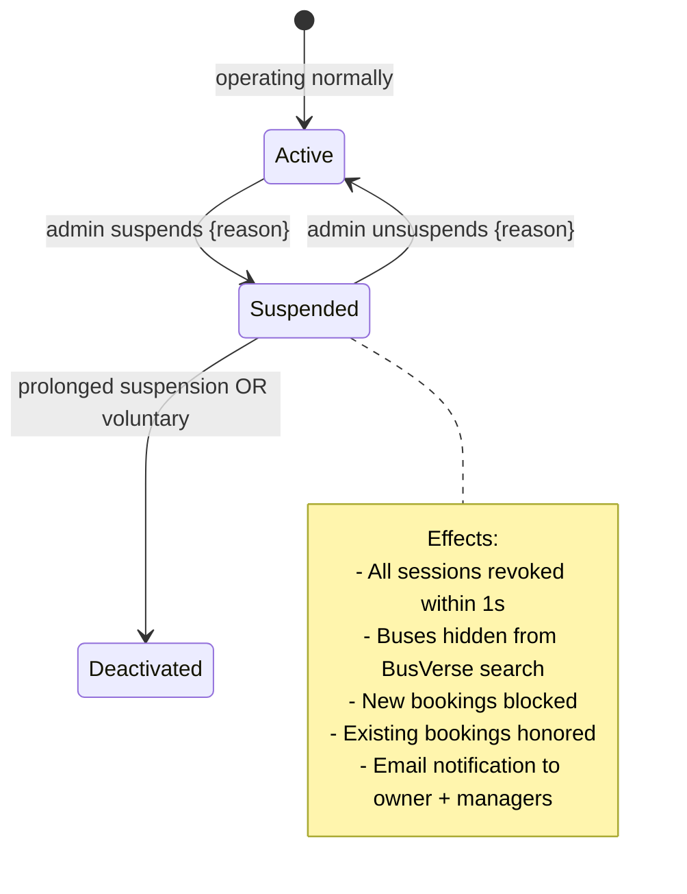

### 3.5 Stage 5 — Deactivated

**Diagram: Stage 5 deactivation paths**
*Three ways to reach deactivation. Only voluntary allows reversal (in theory — support ticket required).*

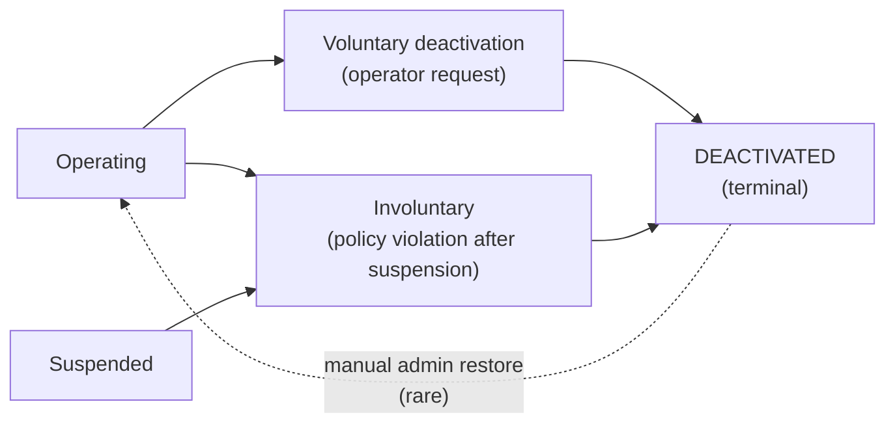

**Reference:** `05` v1.2 §8.4 (Operator SM).

---

## 4. Day-in-the-life Narrative

### 4.1 The persona

**Diagram: Sharma Ji persona**
*A concrete operator with a concrete business. Everything in this section is grounded in this persona.*

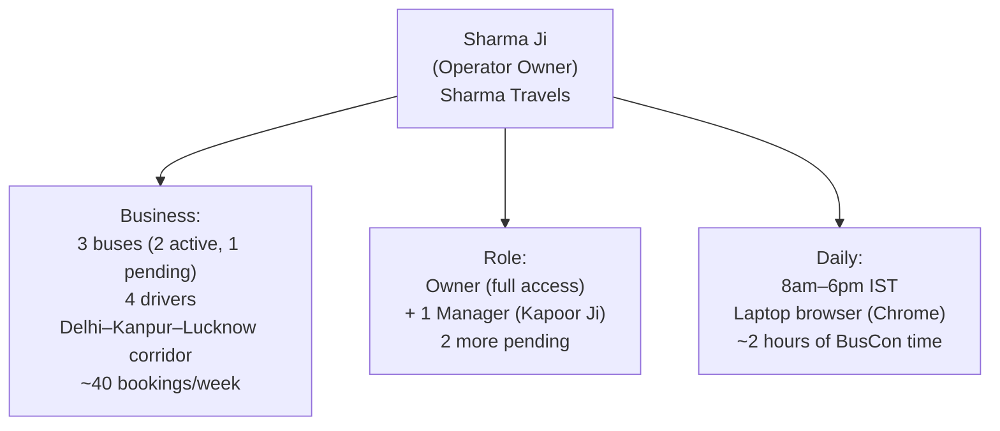

### 4.2 An 8-hour day

**Diagram: Sharma Ji's day**
*Realistic sequence of actions. Every action maps to a workflow or endpoint. This is what a mature operator's day looks like.*

```mermaid
timeline
    title Sharma Ji's day
    section Morning
        08:00 : Opens BusCon, logs in
              : Dashboard shows 3 overnight bookings
              : Notices 1 bus needs insurance renewal (badge)
        08:15 : Checks driver roster
              : Ravi is on Delhi→Lucknow 14:00
              : Suresh is off today
        08:30 : Reviews revenue dashboard for yesterday
              : ₹4,200 net (5 bookings, 1 refund)
    section Midday
        10:00 : Gets email — new bus registration approved
              : Publishes 3 new weekend schedules
        12:00 : Notices driver KYC verified for new hire
              : Assigns new driver to Saturday schedule
    section Afternoon
        14:00 : Watches Ravi's Delhi→Lucknow trip start
              : Live trip view shows 12 boarded of 14
        16:00 : Invites second manager (needs backup)
    section Evening
        17:30 : Reviews tomorrow's schedule
              : All 4 buses assigned
              : No action needed
        18:00 : Logs out
```

### 4.3 What each action maps to

| Time | Action | Workflow | Endpoint | Screen |
|---|---|---|---|---|
| 08:00 | Login | WF-O-01 (auth) | `POST /operator/auth/login` | `SCR-BC-LOGIN` |
| 08:00 | Dashboard load | — | `GET /operator/dashboard` | `SCR-BC-DASHBOARD` |
| 08:15 | View drivers | WF-O-05 | `GET /operator/drivers` | `SCR-BC-DRIVERS` |
| 08:30 | Revenue review | WF-O-06 | `GET /operator/revenue` | `SCR-BC-REVENUE` |
| 10:00 | Check email | — | — | — |
| 10:00 | Publish schedule | WF-O-04 | `POST /schedules/:id/publish` | `SCR-BC-SCHEDULES` |
| 12:00 | Assign driver | WF-O-05 | `POST /schedules/:id/assign-driver` | `SCR-BC-SCHEDULES` |
| 14:00 | Live trip view | (passive) | WS `trip:live:*` | (Phase 2 — no admin UI) |
| 16:00 | Invite manager | (Owner only) | `POST /operator/me/managers` | `SCR-BC-LOGIN` |
| 17:30 | View schedules | WF-O-04 | `GET /operator/schedules` | `SCR-BC-SCHEDULES` |

### 4.4 What's NOT in Sharma Ji's day

**Important for setting expectations:**

| Not in Phase 1 day | Why |
|---|---|
| Chat with passengers | No such feature (non-goal) |
| Real-time notification panel | Phase 2 (per `shared/04` §6.4) |
| Analytics beyond revenue | Phase 2 |
| Bulk schedule creation | Phase 2 (per `buscon/03` Q16) |
| Mobile app | Not in Phase 1 (BusCon web only) |
| Multi-user collaboration | Only Owner + Manager (Phase 2 adds Fleet Manager, Accountant) |

### 4.5 The narrative summary

**The most common operator sentence at end of day: "Nothing broke, bookings came in, I published tomorrow's schedules. Good day."**

The job is steady, not exciting. The tools (dashboard, revenue, live trip view) support the steady state. The complex workflows (bus registration, KYC, approvals) happen rarely — maybe 2-3 times per month. The bulk of the operator's experience is "operate mode" (§2.3).

**This insight shapes the doc:** Because operate mode dominates, the dashboard, error clarity, and self-service capabilities (§12–§15) matter more than the rarely-used workflows.

---

## 5. Stage 1 — Onboarding

### 5.1 Signup + email verification

**Diagram: Signup flow**
*Three input screens: signup form, email verify pending, KYC upload. Each has clear next-step feedback.*

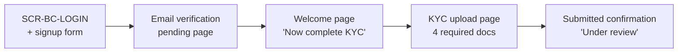

**Screen states:**

| State | What operator sees | Next action |
|---|---|---|
| Signup form | Company name, GSTIN, PAN, email, password fields | Fill + submit |
| Email verify pending | "Check your email for verification link" | Click email link |
| Email verified | "Welcome! Complete KYC to start operating" | Upload KYC |
| KYC upload | 4 required doc slots (GST cert, PAN copy, Company reg, Bank proof) | Upload + submit |
| Submitted | "Under review — we'll email you within 24h" | Wait |

**Reference:** `buscon/01` §4.3, `buscon/06` §12.1.

### 5.2 KYC document checklist

| # | Document | Format | Size | Why |
|:---:|---|---|---|---|
| 1 | GST certificate | PDF/JPG/PNG | ≤10MB | Verify GSTIN |
| 2 | PAN copy | PDF/JPG/PNG | ≤10MB | Verify PAN |
| 3 | Company registration certificate | PDF/JPG/PNG | ≤10MB | Legal entity |
| 4 | Bank proof (cancelled cheque or first page of statement) | PDF/JPG/PNG | ≤10MB | Settlement account |

**Rules:**

| Rule | Detail |
|---|---|
| All 4 required | Missing any → submission rejected |
| Replaceable | Re-upload before submission allowed |
| Max per upload | 20/day per operator |
| Magic byte validated | Server confirms file is real PDF/JPG/PNG |

### 5.3 The pre-submission validation

**Before operator clicks Submit:**

| Check | Error if fails |
|---|---|
| GSTIN regex passes | Field error |
| PAN regex passes | Field error |
| GSTIN not already registered | `GSTIN_ALREADY_REGISTERED` |
| Email not already used | `EMAIL_ALREADY_REGISTERED` |
| Password ≥12 chars | Field error |
| All 4 KYC docs uploaded | "Missing documents" |

**Rule:** Only the "already registered" checks are server-side; rest are client-side instant feedback.

### 5.4 What happens after Submit

**Diagram: Post-submission flow**
*Submitted → Under review → Approved OR Rejected. Approval → Activate. Rejection → Fix + resubmit.*

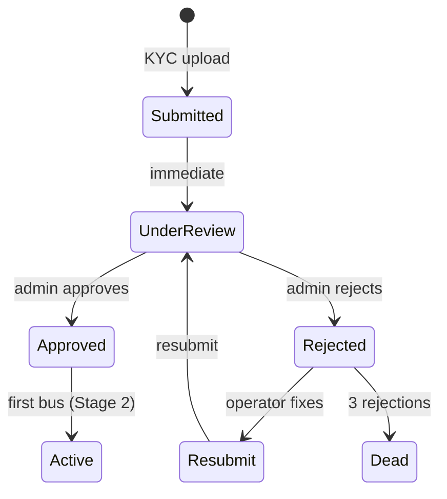

### 5.5 The "onboarding is real" checklist

**What must be working for operator to succeed:**

| # | Requirement | Test |
|:---:|---|---|
| 1 | Signup form accepts GSTIN regex | Manual test with valid/invalid |
| 2 | Email verification arrives <2 min | SendGrid test |
| 3 | KYC upload accepts PDF/JPG/PNG ≤10MB | Manual test |
| 4 | Server validates magic bytes | Test with wrong-type file |
| 5 | Admin queue shows operator within 1 min | Cross-test with admin account |
| 6 | Admin approval triggers email | Cross-test |
| 7 | Rejection sends reason (10+ chars) | Cross-test |

**Reference:** `buscon/01` §4.

---

## 6. Approval Wait Experience

### 6.1 The problem

**Operators spend time waiting for admin action.** Four different approval types. Currently `buscon/01` §9–§10 documents what the **admin** does during approval, but not what the **operator** experiences during the wait.

**The operator's questions during wait:**

| Question | Currently answered? | Where |
|---|---|---|
| Did my submission go through? | Partial (email ack) | `buscon/01` §4 |
| How long will this take? | No | — |
| Can I do anything else in the meantime? | No | — |
| What if it's rejected? | Partial (KYC only) | `buscon/01` §4.10 |
| Can I see the review status? | No | — |

### 6.2 The 4 approval types

**Diagram: Approval types and typical waits**
*Different approvals have different wait times and different downstream effects. Operator needs to know each.*

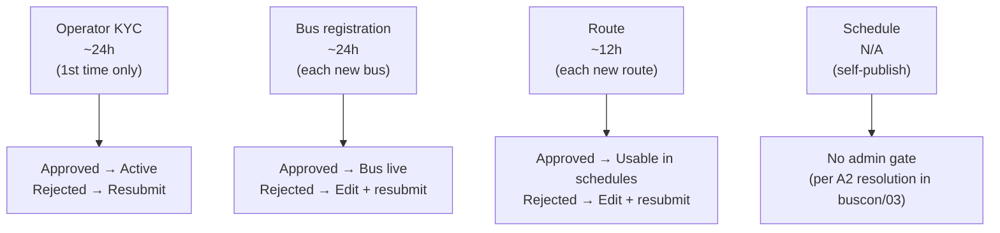

### 6.3 What the operator sees during wait

**Diagram: Wait mode UI**
*During any approval wait, the operator sees a specific state: a badge on the entity, disabled actions, a status message. No action possible except wait.*

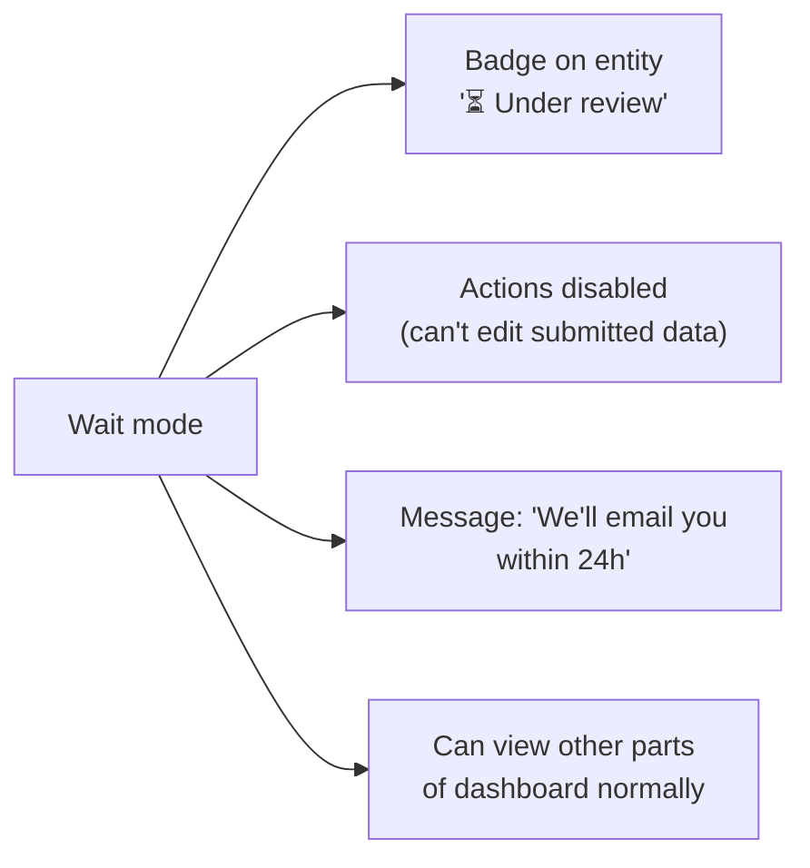

**What operator CAN do during wait:**
- Log in
- View dashboard, other entities
- Register additional buses (queued for approval)
- Build layouts (drafts)
- Create routes (queued)
- Respond to emails
- Contact support

**What operator CANNOT do during wait:**
- Edit the submitted entity
- Re-submit (until rejected)
- Assign drivers (until bus approved)
- Publish schedules (until route approved)
- See review progress (no partial review visible)

### 6.4 Wait mode anxiety mitigation

**The doc's contribution:** Even without building new features, `buscon/06`'s existing UI can be improved with clear wait messages.

| Current state | Improvement (Phase 1) |
|---|---|
| "Pending" badge | "Under review — usually ~24h" |
| Disabled actions | Tooltip: "Awaiting approval — you'll be notified" |
| No email countdown | Email says "within 24 hours" |
| No status visibility | Optional: "Submitted 3h ago" |

**Reference:** `buscon/06` §13 (dashboard), §14 (bus list), §15 (drivers), §16 (approvals).

### 6.5 SLA per approval type

**Diagram: SLA targets**
*Different approvals have different wait targets based on complexity.*

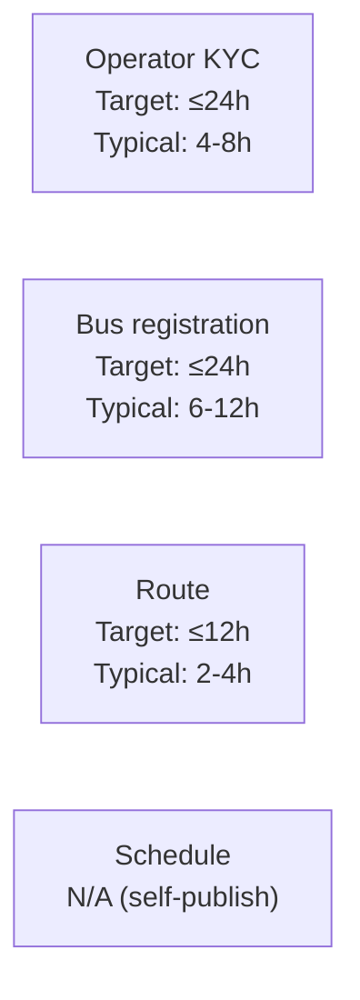

**Rule:** SLA is best-effort (solo founder). But if target slips, admin emails the operator with a revised ETA. Never leave operator in silence.

**Reference:** `buscon/00` §11.3 (existing SLA targets).

### 6.6 What to do during wait

**Best practices (documented for operator):**

| Approval | Can do during wait |
|---|---|
| Operator KYC | Explore UI (nothing else usable), review Terms & Conditions |
| Bus registration | Start building route (saved as draft), upload insurance if not done |
| Route | Nothing specific — the route needs approval before schedules can use it |
| Schedule | (no wait) |

### 6.7 Rejection notification flow

**Diagram: Rejection notification**
*When rejected, operator gets email + in-app banner with reason. Reason triggers next action.*

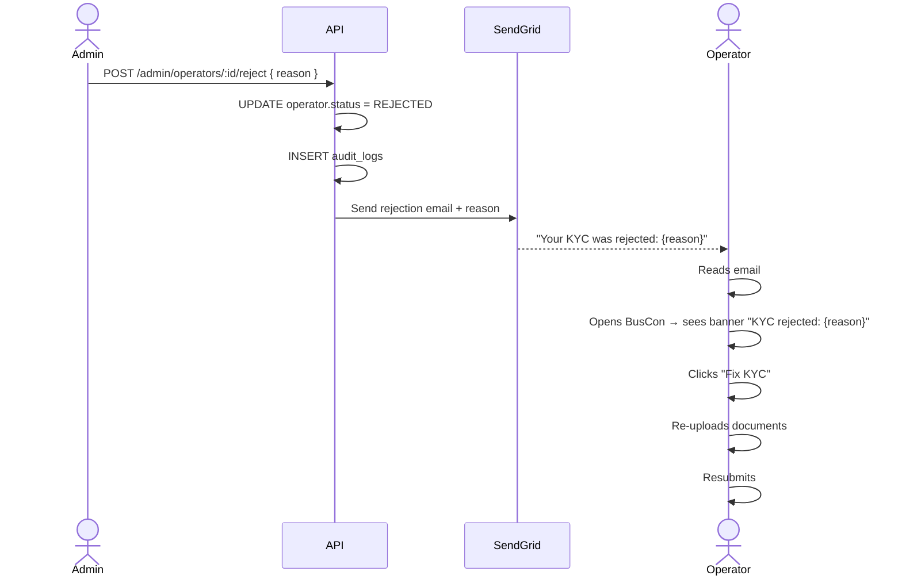

---

## 7. Rejection + Resubmit Flows

### 7.1 The 4 rejection categories

**Diagram: Rejection decision tree**
*Each rejection type has specific causes and specific fix paths.*

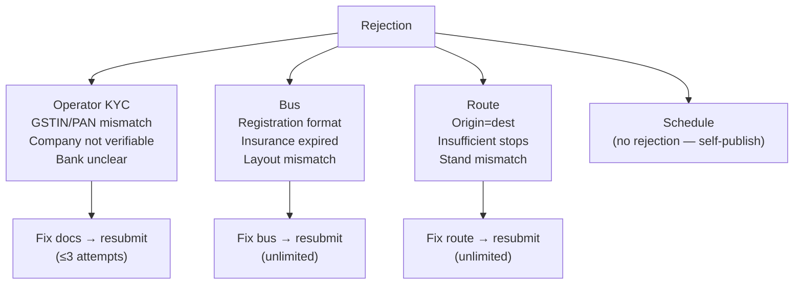

### 7.2 KYC rejection — the strict one

**Rules:**

| Rule | Detail |
|---|---|
| Max resubmissions | **3 total** |
| After 3 rejections | Status → `DEACTIVATED` (requires manual admin unlock) |
| Each rejection | 24h to respond before counted as abandoned |
| Category | Displayed to operator (e.g., "Invalid GSTIN", "Docs unclear") |
| Fix path | Re-upload affected documents |
| Notifications | Email + in-app banner |

**Resubmission counter (operator-visible):**

| After rejection # | Operator sees |
|---|---|
| 1 | "You have 2 resubmissions left" |
| 2 | "You have 1 resubmission left — final attempt" |
| 3 | "Account deactivated. Contact support to appeal." |

**The psychological reality:** 3 rejections is tight. Operators on their 3rd attempt are usually 90% there — one more doc fix would pass. The `DEACTIVATED` state is harsh but documented. Admin can unlock (manually) but the friction discourages bad-faith signups.

**Reference:** `buscon/01` §4.10.

### 7.3 Bus rejection — the fixable one

**Rules:**

| Rule | Detail |
|---|---|
| Max resubmissions | Unlimited (bus is a resource, not identity) |
| Each rejection | Email + in-app with reason |
| Fix path | Edit bus fields OR fix insurance |
| Layout locked | If bus was approved once before deactivation, layout locked forever (per `buscon/03` §8.4) |

**Common rejection reasons:**

| Reason | Fix |
|---|---|
| "Registration format invalid" | Enter correct RTO format (e.g., DL-1P-1234) |
| "Insurance expired" | Upload new insurance document |
| "Layout mismatch (38 seats ≠ 40 capacity)" | Edit layout in grid builder |
| "Capacity out of range" | Correct capacity (1–60) |

### 7.4 Route rejection — the fixable one

**Rules:**

| Rule | Detail |
|---|---|
| Max resubmissions | Unlimited |
| Each rejection | Email + in-app with reason |
| Fix path | Edit route stops, distances, or stand assignments |

**Common rejection reasons:**

| Reason | Fix |
|---|---|
| "Origin = destination" | Change origin or destination |
| "Insufficient stops" | Add more intermediate stands |
| "Stand city mismatch" | Fix stand to correct city |

### 7.5 The 3-strike flow for KYC

**Diagram: KYC 3-strike flow**
*Detailed view of the 3-attempt limit. Each attempt adds 24h wait. After the 3rd rejection, the operator is deactivated.*

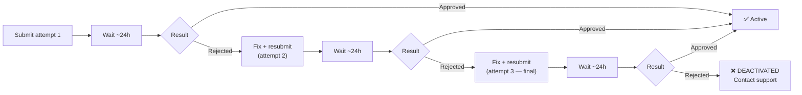

### 7.6 Resubmission UX

**Diagram: Resubmission screen**
*When rejected, the operator's KYC page shows: rejection reason, counter, fix instructions, upload slots pre-populated with previous docs (for editing).*

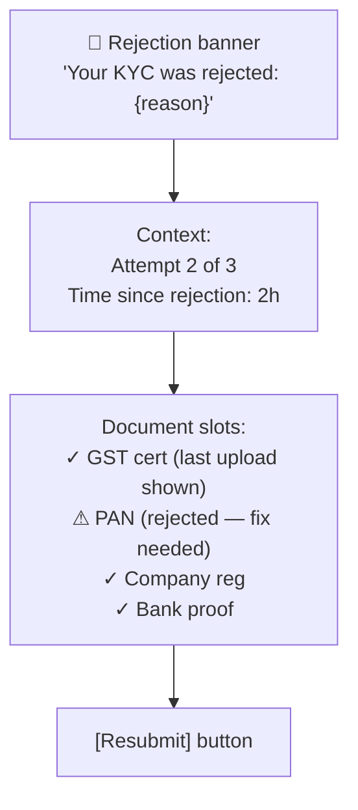

**Rules:**

| Rule | Detail |
|---|---|
| Previous docs visible | For reference (not locked) |
| Fix focus | Highlighted rejected doc(s) |
| Free editing | Any doc can be re-uploaded |
| Counter | Always visible |
| Cancel | Operator can cancel submission → still counts as attempt if 3-limit |
| Timing | 24h to respond, else counted as abandoned (attempt lost) |

### 7.7 Supporting the rejected operator

**Best practices documented for operator:**

| At rejection # | Recommended action |
|---|---|
| 1 | Read reason carefully; fix + resubmit; contact support if unsure |
| 2 | Double-check all docs; consider calling support before resubmitting |
| 3 | If accepted → done; if rejected → contact support immediately to appeal |

**Support email template for "I was rejected":**

```
Subject: [BusVerse Support] Your KYC rejection — next steps (ref: {REF})

Hi {name},

We've received your message about the KYC rejection (ref: {REF}).

Your rejection reason was: {reason}

What to do:
- If it's a document clarity issue: re-upload the specific document with better lighting/scan
- If it's a GSTIN/PAN mismatch: verify against your company records
- If you're unsure: reply to this email with the specific document you're questioning, and we'll clarify

You have {N} resubmission attempts remaining.

Best,
Shaghaf
Founder, BusVerse
```

**Reference:** `shared/05` §5.4 (template 1).

### 7.8 What "3 rejections" means in practice

**Reality check:** Sharma Ji's team (if he had one) would hit 3 rejections only if they repeatedly submit bad docs. Most rejections are typo or upload issues — fix on attempt 2 or 3. The `DEACTIVATED` state is rare in practice (Phase 1: maybe 1–2 operators per quarter).

**If a legit operator hits 3:**
- Admin can manually unlock (DB update + audit)
- Support explains the process
- Second chance is given if operator explains + fixes

**Rule:** `DEACTIVATED` is not "permanent ban" — it's "manual intervention required." Admin has full discretion.

---

## 8. Stage 2 — Setup

### 8.1 The setup journey

**Diagram: Setup journey**
*4 sub-workflows (bus, layout, route, schedule). Each with its own completion state.*

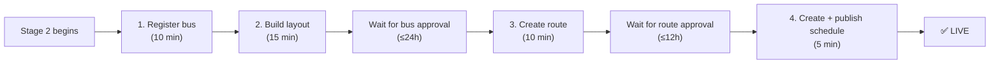

**Total time:** ~40 min of active work + ~36h of waits = ~2 days wall-clock.

### 8.2 Parallel setup allowed

**Rule:** Operator can register multiple buses before any are approved. Similarly for routes. This lets them batch submissions.

| Scenario | Allowed? |
|---|---|
| Register 3 buses before any approved | ✅ (all pending together) |
| Build 3 layouts in parallel | ✅ (drafts in localStorage) |
| Create 5 routes before bus approval | ✅ (routes don't depend on buses) |
| Publish schedule before bus approval | ❌ (schedule needs approved bus) |

### 8.3 The critical path

**Diagram: Critical path**
*From signup to first live schedule — 6 steps, 3 of which require admin action. The 2×24h waits dominate the elapsed time.*

```mermaid
flowchart LR
    S1["Signup<br/>2 min"] --> S2["Email verify<br/>5 min"]
    S2 --> S3["KYC upload<br/>15 min"]
    S3 --> W1["⏳ Admin approval<br/>≤24h"]
    W1 --> S4["Bus register + layout<br/>25 min"]
    S4 --> W2["⏳ Admin approval<br/>≤24h"]
    W2 --> S5["Route create<br/>10 min"]
    S5 --> W3["⏳ Admin approval<br/>≤12h"]
    W3 --> S6["Schedule publish<br/>5 min"]
    S6 --> LIVE["✅ LIVE<br/>Total: ~2-3 days"]
```

**Insight:** 90% of elapsed time is waiting for admin. Operator's actual work time is ~1 hour. This reinforces why §6 (approval wait) is critical UX.

### 8.4 What operator learns during setup

| Learning | First-time surprise |
|---|---|
| Buses need admin approval | Expects instant registration |
| Layouts must match capacity exactly | Discovers via validation error |
| Routes need ≥2 stops | Discovers via validation error |
| Schedules conflict if same bus + time | Discovers via conflict error |
| Insurance must be future-dated | Discovers via approval rejection |

**Best practice:** The onboarding flow should surface these rules **before** operator submits, via inline help.

**Reference:** `buscon/03` §4–§17.

### 8.5 Setup completion signals

| Milestone | Signal |
|---|---|
| First bus registered | Green toast: "Bus registered. Awaiting approval." |
| First bus approved | Email + badge turns green |
| First layout saved | Toast: "Layout saved. 40 of 40 seats assigned." |
| First route created | Toast: "Route created." |
| First schedule published | Toast: "Schedule live — visible to passengers." + Dashboard shows "0 bookings so far" |
| First booking received | Email notification (aggregated per `shared/04` §14) |

---

## 9. Stage 3 — Operating

### 9.1 The steady state

**Diagram: The operating rhythm**
*Three modes: morning check, midday adjust, evening review. Same rhythm every day.*

```mermaid
flowchart TB
    subgraph DAILY["Daily rhythm"]
        M["Morning check<br/>(15 min)"]
        A["Midday adjustments<br/>(30 min)"]
        E["Evening review<br/>(15 min)"]
    end

    subgraph WEEKLY["Weekly rhythm"]
        W1["Revenue review<br/>(30 min)"]
        W2["Schedule planning<br/>(1 hour)"]
        W3["Driver check-in<br/>(30 min)"]
    end

    subgraph MONTHLY["Monthly rhythm"]
        M1["Insurance check<br/>(15 min)"]
        M2["Driver KYC renewals<br/>(30 min)"]
        M3["Performance review<br/>(1 hour)"]
    end

    DAILY --> WEEKLY --> MONTHLY
```

### 9.2 What operator does daily

| Task | Frequency | Time | Endpoint |
|---|---|---|---|
| Check dashboard | Daily | 2 min | `GET /operator/dashboard` |
| View bookings | Daily | 5 min | `GET /operator/bookings` |
| Check revenue | Daily | 3 min | `GET /operator/revenue` |
| Publish schedules | 2-3 times/week | 10 min each | `POST /schedules/:id/publish` |
| Assign drivers | Weekly | 10 min | `POST /schedules/:id/assign-driver` |
| Check notices | Daily (email) | 5 min | — |
| Respond to alerts | As needed | varies | — |

### 9.3 What triggers operator attention

| Trigger | Channel | Priority |
|---|---|---|
| New booking | Dashboard count + email (aggregated) | Low |
| Refund processed | In-app | Low |
| Driver KYC verified | Email | Low |
| Bus approval | Email | Medium |
| Insurance expiring (30d) | Email + in-app banner | Medium |
| Schedule cancelled by operator | In-app confirmation | Medium |
| Passenger complaint (via support) | Email to `support@` → operator forwarded | High |
| `gps_anomaly` for driver | Email (via `shared/05` §10.2) | High |
| Suspension | Email + in-app | Critical |

### 9.4 Operating edge cases

| Scenario | What operator sees |
|---|---|
| Bus insurance expires | Bus hidden from BusVerse search; amber banner in fleet |
| Driver license expires | Driver cannot start trips; red banner in driver list |
| Schedule has no bookings | Schedule shows "0 bookings" (no action needed) |
| Operator wants to cancel a schedule | Confirm modal shows affected booking count; triggers refunds |
| Passenger cancels | Refund auto-processed; operator sees refund record |
| Duplicate booking attempt | (Not operator's concern — passenger sees `SEAT_ALREADY_BOOKED`) |

### 9.5 What operator CANNOT do during operate

**Enforcement rules (from `04` §12):**

| Never | Why |
|---|---|
| See passenger phone/email | Row-scoped masking (per `04` §11) |
| Access other operators' data | Tenant isolation |
| Modify a confirmed booking | Immutable per `05` §7.1 #4 |
| Redirect a refund | Refund to original method only |
| Approve own buses/routes | Admin-only action |

---

## 10. Stage 4 — Suspension

### 10.1 What triggers suspension

**Diagram: Suspension triggers**
*Suspension comes from admin action, not operator action. Operator is notified, then has a window to respond.*

```mermaid
flowchart LR
    T1["Policy violation<br/>(e.g., repeated cancellations)"]
    T2["KYC fraud suspicion"]
    T3["Financial anomaly<br/>(chargebacks, refund abuse)"]
    T4["Safety incident"]

    T1 --> SUSPEND["Admin suspends operator"]
    T2 --> SUSPEND
    T3 --> SUSPEND
    T4 --> SUSPEND

    SUSPEND --> N1["Email + in-app notice<br/>with reason"]
    N1 --> RESP["Operator responds<br/>(email to support@)"]
    RESP --> DECIDE{"Admin decision"}
    DECIDE -->|"Remedied"| UNSUSPEND["Unsuspend"]
    DECIDE -->|"Not remedied"| DEACT["Deactivate"]
```

### 10.2 The suspension experience

**Diagram: Suspension sequence**
*Full sequence from admin action to operator response. Every step visible to operator.*

```mermaid
sequenceDiagram
    actor A as Admin
    participant API as API
    participant WS as WebSocket
    actor O as Operator

    A->>API: Suspend operator { reason }
    API->>API: UPDATE operator.status
    API->>API: Revoke all sessions
    API->>WS: Close connections
    API->>API: INSERT audit_logs
    API->>O: Email + in-app notice

    O->>O: Tries to log in
    Note over O: Sees "Account suspended — {reason}. Contact support@busverse.app"
    O->>O: Emails support
    Note over O,A: Investigation
    A->>API: Unsuspend { reason }
    API->>O: Email: "Your account is reactivated"
    O->>O: Logs in fresh (previous sessions revoked)
```

### 10.3 What operator sees during suspension

| Action | State |
|---|---|
| Log in to BusCon | Redirected to suspension notice page |
| View dashboard | Not accessible |
| View fleet | Not accessible |
| View bookings | Not accessible |
| View revenue | Not accessible |
| Respond to support | Yes via `support@busverse.app` |
| Access audit log | No (admin only) |

### 10.4 What happens to operator's data

**Important for operator's state of mind:**

| Asset | During suspension | After unsuspend |
|---|---|---|
| Buses | Existing schedules remain valid; buses stay registered | Unchanged |
| Schedules | Existing stay PUBLISHED but hidden from BusVerse search | Reappear in search |
| Bookings | Existing bookings honored; trips continue | Unchanged |
| Drivers | Sessions revoked; drivers cannot start new trips | Drivers re-login |
| Revenue | Accrues from existing bookings; viewable after unsuspend | Unchanged |
| Payouts | On hold (Phase 1 = no automated payouts, so no change) | Unchanged |

**Rule (from `shared/03` §7.2):** Suspension does NOT cancel existing bookings. Operator has to honor them. Revenue accrues.

### 10.5 Recovery

**Diagram: Recovery paths**
*Three ways to resolve suspension.*

```mermaid
flowchart TB
    SUSPENDED["Suspended operator"] --> P1["Path 1: Admin unsuspends<br/>(remedied)"]
    SUSPENDED --> P2["Path 2: Admin deactivates<br/>(not remedied)"]
    SUSPENDED --> P3["Path 3: Operator requests<br/>voluntary deactivation"]

    P1 --> RECOVER["✅ Active again<br/>All sessions revoked — must re-login"]
    P2 --> DEAD["❌ Deactivated"]
    P3 --> DEAD2["✅ Voluntary deactivated"]
```

**Recovery rules:**

| Rule | Detail |
|---|---|
| Sessions revoked | Always (operator must re-login) |
| Existing bookings | Honored |
| Existing schedules | Stay published, become searchable again |
| New bookings | Resume immediately on unsuspend |
| Audit trail | Both suspend + unsuspend logged |

### 10.6 How long does suspension last?

**Typical timelines:**

| Scenario | Duration |
|---|---|
| Minor policy issue | 1–3 days (until operator responds) |
| Financial investigation | 1–2 weeks |
| Serious safety incident | 1–4 weeks or permanent deactivation |

**Rule:** Suspension is not intended as a punishment — it's a safety + investigation mechanism. Prolonged suspension is de facto deactivation.

---

## 11. Stage 5 — Deactivation

### 11.1 Three deactivation paths

| # | Path | Trigger | Reversible? |
|:---:|---|---|---|
| 1 | Voluntary | Operator requests via `support@` | Yes (manual admin restore) |
| 2 | Involuntary (post-suspension) | Admin decides after suspension | Rare (manual restore) |
| 3 | KYC 3-strike | 3rd rejection | Yes (manual admin unlock) |

### 11.2 What happens to the account

| Aspect | Behavior |
|---|---|
| Status | `DEACTIVATED` |
| Sessions | All revoked |
| Data | Retained per `06` v1.2 §16 (8 years for financial) |
| Bookings | Existing honored (if any active) |
| Buses | Hidden from search |
| Revenue | Viewable (Phase 2 = final settlement) |
| Re-signup | Can create new account (with new email/GSTIN) — old data preserved |

### 11.3 What operator can still access

| Access | After deactivation |
|---|---|
| Login to BusCon | No (account inactive) |
| Email support | Yes (same `support@` address) |
| Request account data (DPDP) | Yes (via `dpo@`, per `shared/05` §6) |
| Request deletion | Yes (via `dpo@`, per `shared/05` §6) |
| Reactivation | Via `support@` request |

### 11.4 Data retention post-deactivation

**Rule:** Account deactivation does NOT mean data deletion.

| Data | Retained | Legal basis |
|---|---|---|
| User + operator profile | 8 years | Financial record |
| Bookings + payments | 8 years | RBI + GST |
| Audit logs | Forever | Compliance |
| KYC documents | 8 years | DPDP + AML |
| Consent records | Forever | DPDP audit |

**For data deletion (user's right):** DPDP §13 erasure — subject to legal retention. Financial records cannot be deleted for 8 years even on request (per `shared/05` §6).

**Reference:** `06` v1.2 §16, `shared/05` §6.

### 11.5 What operator takes away

**Post-deactivation support:**

| Resource | Available |
|---|---|
| Final revenue report | Email on request |
| Final audit trail copy | DPDP request via `dpo@` |
| Booking records for tax | DPDP request via `dpo@` |
| Reopening | Support request; admin manual |

---

## 12. Operator Dashboard Consolidation

### 12.1 The dashboard's role

**Diagram: Dashboard as central hub**
*The dashboard is the operator's home base. Every other screen is reachable in 1 click. Every state is visible in 3 seconds.*

```mermaid
flowchart TB
    DASH["SCR-BC-DASHBOARD<br/>(operator home)"]

    DASH --> C1["Recent Bookings card"]
    DASH --> C2["Revenue card"]
    DASH --> C3["Fleet Status card"]
    DASH --> C4["Pending Actions card"]
    DASH --> C5["Active Trips card<br/>(Phase 2 live view)"]

    C1 --> S1["→ SCR-BC-BOOKINGS"]
    C2 --> S2["→ SCR-BC-REVENUE"]
    C3 --> S3["→ SCR-BC-BUSES"]
    C4 --> S4["→ SCR-BC-APPROVALS<br/>(only pending items)"]
    C5 --> S5["Phase 2 map"]
```

### 12.2 The 4 cards

**Reference:** `buscon/01` §6.7, `buscon/03` §17A, `buscon/06` §12.2.

**Card 1 — Recent Bookings:**

| Field | Value |
|---|---|
| Title | "Recent bookings" |
| Content | Last 5 bookings (masked: name + seat only) |
| Count | Total bookings today |
| Action | Click "View all" → bookings screen |

**Card 2 — Revenue:**

| Field | Value |
|---|---|
| Title | "Revenue" |
| Content | Today / This week / This month net |
| Comparison | vs previous period (optional Phase 2) |
| Action | Click "Details" → revenue screen |

**Card 3 — Fleet Status:**

| Field | Value |
|---|---|
| Title | "Fleet" |
| Content | Total buses, Approved, Pending, Expiring insurance |
| Alerts | Amber if any bus expiring <30 days |
| Action | Click any count → filtered fleet |

**Card 4 — Pending Actions:**

| Field | Value |
|---|---|
| Title | "Needs your attention" |
| Content | Pending bus approvals count, insurance expiring count, driver KYC pending, unread notices |
| Alerts | Red if any critical (expired insurance, suspended driver) |
| Action | Click → relevant screen |

### 12.3 What's NOT on the Phase 1 dashboard

| Not shown | Why |
|---|---|
| Live trip map (bus positions) | Phase 2 (per `buscon/04` §8.4) |
| Passenger names (full) | PII masking |
| Driver phone | PII masking |
| Revenue forecast | Phase 2 |
| Analytics (cohorts, retention) | Phase 2 |
| Notification center | Phase 2 (per `shared/04` §6.4) |

### 12.4 The dashboard's daily refresh

**Data freshness:**

| Data | Stale tolerance | Refresh |
|---|---|---|
| Recent bookings | 30s | Poll or on focus |
| Revenue today | 60s | Cached (per `03` §11) |
| Fleet status | On change | Refetch on focus |
| Pending actions | 30s | Poll |
| Insurance expiry | Daily | Computed at request |

**Rule:** No live WebSocket subscription for dashboard cards (Phase 1). Polling + refetch on focus. WebSocket subscriptions exist only for seat availability (`busverse/02`), trip live (`busverse/04`), and booking status (`busverse/04`). Dashboard shows aggregated counts via REST.

**Reference:** `shared/04` §2.2 (subscriber matrix).

### 12.5 Dashboard during different stages

| Stage | Dashboard emphasis |
|---|---|
| Stage 1 (applying) | Minimal — "KYC under review" banner |
| Stage 2 (setup) | Pending Actions card focused (bus approval, route approval) |
| Stage 3 (operating) | All 4 cards active |
| Stage 4 (suspended) | Dashboard inaccessible |
| Stage 5 (deactivated) | Dashboard inaccessible |

### 12.6 The "good day" test

**A well-functioning dashboard lets Sharma Ji answer "is today a good day?" in 3 seconds.** Three signals:

| Signal | Meaning | Card |
|---|---|---|
| Revenue card green | Money flowing | Revenue |
| Pending Actions card empty | Nothing urgent | Pending Actions |
| Fleet Status card green | All buses ready | Fleet |

**If all three are good:** Operator closes dashboard, does a few maintenance tasks, logs out. Typical 15-min morning check.

**If any are red:** Focus there. Typical 45-60 min morning.

---

## 13. Operator-Facing Error Taxonomy

### 13.1 Why this section exists

**The problem:** `07` v1.2 §9.2 lists 49 error codes. Most are admin-only or system-internal. The operator sees ~20 of them, but no doc filters the list or explains what the operator should **do** in each case.

**This section:** the 20 errors an operator sees, grouped by category, with the operator-facing action.

### 13.2 Errors by category

**Diagram: Error categories**
*20 errors split across 4 lifecycle areas.*

```mermaid
flowchart TB
    ERR["20 operator errors"]

    ERR --> AUTH["Auth (3)"]
    ERR --> SIGNUP["Signup/KYC (4)"]
    ERR --> SETUP["Setup (6)"]
    ERR --> OPS["Operations (7)"]
```

### 13.3 Auth errors (3)

| # | Code | Message | What operator does |
|:---:|---|---|---|
| 1 | `INVALID_CREDENTIALS` | "Email or password incorrect" | Retry; if repeated → password reset |
| 2 | `EMAIL_NOT_VERIFIED` | "Please verify your email first" | Check email; click link |
| 3 | `RATE_LIMITED` | "Too many attempts. Try again in {N}s" | Wait, then retry |

### 13.4 Signup/KYC errors (4)

| # | Code | Message | What operator does |
|:---:|---|---|---|
| 4 | `GSTIN_ALREADY_REGISTERED` | "This GSTIN is already registered" | Log in or contact support |
| 5 | `EMAIL_ALREADY_REGISTERED` | "Email already in use" | Reset password or use different email |
| 6 | `INVALID_FILE_TYPE` | "Only PDF, JPG, PNG accepted" | Convert file |
| 7 | `FILE_TOO_LARGE` | "File too large (max 10MB)" | Compress file |

### 13.5 Setup errors (6)

| # | Code | Message | What operator does |
|:---:|---|---|---|
| 8 | `BUS_REGISTRATION_EXISTS` | "Registration already in use" | Verify registration, contact support if legitimately yours |
| 9 | `CAPACITY_MISMATCH` | "Seat count must match capacity ({N} assigned, {M} required)" | Edit layout to match |
| 10 | `ROUTE_SAME_CITY` | "Origin and destination must differ" | Change origin or destination |
| 11 | `INSUFFICIENT_STOPS` | "Route needs at least 2 stops" | Add intermediate stand |
| 12 | `ROUTE_ALREADY_EXISTS` | "You already have this route" | View existing, don't duplicate |
| 13 | `INVALID_SCHEDULE_TIMES` | "Arrival must be after departure" | Correct times |

### 13.6 Operations errors (7)

| # | Code | Message | What operator does |
|:---:|---|---|---|
| 14 | `SCHEDULE_CONFLICT` | "Bus has another schedule at this time" | Change bus or time |
| 15 | `SCHEDULE_HAS_BOOKINGS` | "Cannot cancel — {N} bookings exist" | Cancel bookings first, or contact admin |
| 16 | `ROUTE_IN_USE` | "Schedules reference this route" | Cancel schedules first |
| 17 | `BUS_HAS_ACTIVE_SCHEDULES` | "Cannot deactivate — {N} active schedules" | Cancel schedules first |
| 18 | `DRIVER_NOT_VERIFIED` | "Driver KYC pending" | Wait for admin; or contact admin |
| 19 | `DRIVER_ALREADY_INVITED` | "Phone already in your fleet" | Check existing list |
| 20 | `REASON_REQUIRED` | "Please provide a reason (min 10 chars)" | Enter reason |

### 13.7 What operator does NOT see

**Errors that are admin-only (per `07` §9.2):**

| Code | Why hidden |
|---|---|
| `PAYMENT_NOT_REFUNDABLE` | Admin initiates refunds only |
| `REFUND_EXCEEDS_PAYMENT` | Admin only |
| `IDEMPOTENCY_KEY_REUSED` | Payment retries — passenger-initiated |
| `SEAT_LOCKED` | Passenger race condition |
| `SEAT_ALREADY_BOOKED` | Passenger race condition |
| `INVALID_OTP` | Passenger/driver OTP |
| `SESSION_REVOKED` | Session management |
| `BOOKING_IMMUTABLE` | Admin actions only |
| `PAYMENT_ALREADY_SUCCEEDED` | Webhook idempotency |
| `INVALID_CREDENTIALS` (admin) | Admin login only |

### 13.8 Escalation thresholds

**When does operator contact support vs fix themselves:**

| Error type | Self-fix possible? | Contact support at |
|---|:---:|---|
| Auth errors | Yes (reset password) | Same error 3+ times |
| Signup/KYC | Yes (fix file) | 2nd rejection |
| Setup errors | Yes (fix data) | Same error 3+ times |
| Operations errors | Yes (fix data) | `SCHEDULE_HAS_BOOKINGS` with refunds needed |
| Any error | Yes | Data lost / money involved |

### 13.9 The error message quality bar

**Every operator error must:**

| Rule | Detail |
|---|---|
| State what went wrong | Not just "Error 409" |
| State what to do | Actionable next step |
| Link to fix | Button or link if applicable |
| Preserve work | Don't discard operator's input on error |

**Reference:** `busverse/05` §19.6 (never-use list).

---

## 14. Operator Notification Catalog

### 14.1 The notification channels

**Diagram: Three notification channels**
*Email, SMS, WebSocket — different channels for different urgencies. Most Phase 1 operator notifications use email.*

```mermaid
flowchart LR
    EVENT["Event occurs"] --> Q{"Urgency"}
    Q -->|"Critical"| ALL["Email + SMS + WS"]
    Q -->|"Important"| EM["Email + WS"]
    Q -->|"Informational"| WS2["WS only (dashboard)"]
```

### 14.2 The 17 notifications

**Reference:** `buscon/01` §5.9 (driver notifications), §9-§10 (approval notifications), §11 (refund notifications), §13 (suspension notifications).

**Group 1 — Onboarding (5 notifications):**

| # | Trigger | Channel | Recipient | Template |
|:---:|---|---|---|---|
| 1 | Signup submitted | Email | Operator | Welcome + verify email |
| 2 | Email verified | Email | Operator | "Welcome — complete KYC" |
| 3 | KYC submitted | Email | Operator | "Under review" |
| 4 | KYC approved | Email + WS | Operator | "You're approved" |
| 5 | KYC rejected | Email + WS | Operator | "Rejected: {reason}" + counter |

**Group 2 — Fleet/Routes/Schedules (4 notifications):**

| # | Trigger | Channel | Recipient | Template |
|:---:|---|---|---|---|
| 6 | Bus approved | Email | Operator | "Bus {reg} approved" |
| 7 | Bus rejected | Email + WS | Operator | "Bus {reg} rejected: {reason}" |
| 8 | Route approved | Email | Operator | "Route {origin}→{dest} approved" |
| 9 | Schedule published | WS (dashboard) | Operator | In-app toast |

**Group 3 — Drivers (2 notifications):**

| # | Trigger | Channel | Recipient | Template |
|:---:|---|---|---|---|
| 10 | Driver invite accepted | Email | Operator | "Driver {name} has joined" |
| 11 | Driver KYC verified | Email | Operator | "Driver {name} verified" |

**Group 4 — Money (2 notifications):**

| # | Trigger | Channel | Recipient | Template |
|:---:|---|---|---|---|
| 12 | Refund initiated | WS (dashboard) | Operator | In-app badge |
| 13 | Refund processed | Email | Operator | "Refund to {passenger} completed" |

**Group 5 — Alerts (4 notifications):**

| # | Trigger | Channel | Recipient | Template |
|:---:|---|---|---|---|
| 14 | Insurance expiring (30d) | Email + WS | Operator | "Insurance for {bus} expires in {N} days" |
| 15 | Insurance expired | Email + WS | Operator | "Insurance for {bus} has expired — bus hidden from search" |
| 16 | Suspension notice | Email + SMS + WS | Owner + managers | "Account suspended: {reason}" |
| 17 | Suspension lifted | Email | Owner + managers | "Account reactivated" |

### 14.3 What's NOT notified

**Important for expectation-setting:**

| Not notified | Why |
|---|---|
| New bookings (individually) | Too noisy — aggregated on dashboard |
| Passenger cancellations | Aggregated on dashboard |
| Daily revenue summaries | Phase 2 (would need weekly digest) |
| Real-time live trip events | Phase 2 (no admin live UI) |
| `gps_anomaly` events | Phase 1 = admin only (per `shared/05` §10.2) |
| Audit log entries | Admin-only |

### 14.4 Notification preferences

**Phase 1 rules:**

| Rule | Detail |
|---|---|
| All notifications on by default | Cannot disable in Phase 1 |
| No per-category toggle | Phase 2 |
| Owner receives all | Manager receives subset (per `buscon/01` §4.5) |
| SMS only for critical | Suspension notices only |
| Quiet hours | None — notifications fire 24/7 (email is async anyway) |

### 14.5 Delivery SLAs

| Channel | Delivery target | Fallback |
|---|---|---|
| Email (SendGrid) | ≤60s | Retry 3× |
| SMS (MSG91) | ≤30s | Retry 3× |
| WebSocket | ≤100ms | Polling fallback |

**Rule:** Every notification is best-effort. Email unreliable? Log to `audit_logs` as audit trail.

---

## 15. Operator Self-Service Matrix

### 15.1 The grid

**Diagram: Self-service capability matrix**
*17 capabilities across 4 categories. Some operator-controlled; some require admin.*

```mermaid
flowchart TB
    MATRIX["Self-service matrix<br/>(17 capabilities)"]

    MATRIX --> A["Auth (4)"]
    MATRIX --> B["Profile (3)"]
    MATRIX --> C["Operations (6)"]
    MATRIX --> D["Admin-required (4)"]

    A --> A1["Change password ✅"]
    A --> A2["Reset password ✅"]
    A --> A3["Logout all sessions ✅"]
    A --> A4["Enable 2FA ❌ Phase 2"]

    B --> B1["View profile ✅"]
    B --> B2["Edit name ✅"]
    B --> B3["Edit bank account ❌"]

    C --> C1["Register bus ✅"]
    C --> C2["Build layout ✅"]
    C --> C3["Create route ✅"]
    C --> C4["Publish schedule ✅"]
    C --> C5["Invite driver ✅"]
    C --> C6["Assign driver ✅"]

    D --> D1["Change bank account ❌"]
    D --> D2["Add manager ✅ (Owner only)"]
    D --> D3["Request refund ❌"]
    D --> D4["Change KYC ❌"]
```

### 15.2 The full matrix

| # | Capability | Self-service? | Notes |
|:---:|---|:---:|---|
| 1 | Log in | ✅ | — |
| 2 | Change password | ✅ | Via settings |
| 3 | Reset password | ✅ | Via email link |
| 4 | Logout all sessions | ✅ | — |
| 5 | Enable 2FA | ❌ | Phase 2 (per `04` §17 Q1) |
| 6 | View own profile | ✅ | — |
| 7 | Edit own name | ✅ | — |
| 8 | Edit own email | ❌ | Requires support (Phase 2 adds self-service) |
| 9 | Register new bus | ✅ | Then admin approval |
| 10 | Edit bus (before approval) | ✅ | — |
| 11 | Edit bus insurance | ✅ | Then admin re-approval |
| 12 | Edit bus layout (after approval) | ❌ | Must deactivate + new bus |
| 13 | Create route | ✅ | Then admin approval |
| 14 | Create schedule | ✅ | — |
| 15 | Publish schedule | ✅ | Per A2 resolution |
| 16 | Cancel schedule | ✅ | With refunds if bookings |
| 17 | Invite driver | ✅ | Then admin KYC verification |
| 18 | Assign driver to schedule | ✅ | — |
| 19 | Deactivate driver | ✅ | Soft delete |
| 20 | View bookings | ✅ | Masked PII |
| 21 | View revenue | ✅ | Read-only |
| 22 | Change bank account | ❌ | Admin only |
| 23 | Add manager | ✅ (Owner only) | Manager cannot add manager |
| 24 | Deactivate manager | ✅ (Owner only) | — |
| 25 | Initiate refund | ❌ | Admin only |
| 26 | View audit log | ❌ | Admin only |
| 27 | Change KYC details | ❌ | Admin only (via support) |
| 28 | Deactivate own account | ⚠️ | Via support request |

### 15.3 The 8 admin-required actions

**What operator must request from admin:**

| # | Action | Why admin-required | How to request |
|:---:|---|---|---|
| 1 | Change bank account | Financial security | Email `support@` |
| 2 | Enable 2FA | Phase 2 | Not available Phase 1 |
| 3 | Change KYC details | Compliance | Email `support@` |
| 4 | Initiate refund | Money path | Email `support@` |
| 5 | View audit log | Data governance | Email `support@` (for incidents) |
| 6 | Change layout post-approval | Immutability | Deactivate + create new bus |
| 7 | Deactivate own account | Reversibility check | Email `support@` |
| 8 | Data rights (DPDP) | Legal workflow | Email `dpo@` (per `shared/05` §6) |

### 15.4 Self-service failure modes

**When self-service fails, what operator does:**

| Scenario | Admin fallback |
|---|---|
| Password reset email not arriving | Try again; if persists, contact `support@` (admin resets manually) |
| Bank account change rejected | Contact `support@` with new proof |
| Cannot publish schedule (conflict) | Fix conflict; if not solvable, contact `support@` |
| Cannot cancel schedule (has bookings) | Cancel via admin (email `support@`) |
| Driver cannot log in | Contact `support@` (admin checks session/status) |

---

## 16. Onboarding SLA Timeline

### 16.1 The full timeline

**Diagram: Onboarding SLA**
*From first click to first live schedule — the most important SLA for the operator.*

```mermaid
gantt
    title Onboarding SLA
    dateFormat X
    axisFormat %s

    section Active work
    Signup form            :a1, 0, 120
    Email verify           :a2, after a1, 300
    KYC upload             :a3, after a2, 900
    Bus register           :a4, after a3, 600
    Layout build           :a5, after a4, 900
    Route create           :a6, after a5, 600
    Schedule create        :a7, after a6, 300

    section Admin waits
    KYC approval           :crit, w1, after a3, 86400
    Bus approval           :crit, w2, after a5, 86400
    Route approval         :crit, w3, after a6, 43200
```

### 16.2 The SLA table

| Stage | Step | Duration | Cumulative |
|---|---|---:|---:|
| 1a | Signup form fill | 2 min | 2 min |
| 1b | Email verify | 5 min | 7 min |
| 1c | KYC upload (4 docs) | 15 min | 22 min |
| **1d** | **Wait for KYC approval** | **≤24h** | **≤24h 22min** |
| 2a | Register first bus | 10 min | ≤24h 32min |
| 2b | Build layout | 15 min | ≤24h 47min |
| **2c** | **Wait for bus approval** | **≤24h** | **≤48h 47min** |
| 2d | Create route | 10 min | ≤48h 57min |
| **2e** | **Wait for route approval** | **≤12h** | **≤60h 57min** |
| 2f | Create + publish schedule | 5 min | ≤61h 2min |
| **Total** | **Signup → first live schedule** | | **≤3 days** |

**Best case (fast admin):** ~2 hours of active work + ~8h of waits = **same day live**.
**Typical case:** ~1 hour active + ~36h waits = **2 days live**.
**Worst case:** 3 days (both approvals slip to 24h).

### 16.3 What can go wrong

| Step | Failure | Adds to timeline |
|---|---|---|
| KYC rejection | Resubmit | +24h per attempt (max +72h) |
| Bus rejection | Fix + resubmit | +24h per attempt |
| Route rejection | Fix + resubmit | +12h per attempt |
| Schedule conflict | Fix | No wait, immediate retry |
| Admin backlog | Any approval | +24h per day of delay |

### 16.4 SLA achievability

**Reference:** `shared/05` §14.3.

| SLA | Target | Achievability |
|---|---|---|
| KYC approval ≤24h | Yes | Usually 4-8h |
| Bus approval ≤24h | Yes | Usually 6-12h |
| Route approval ≤12h | Yes | Usually 2-4h |
| Total ≤3 days | Yes | Usually 2 days |

**Rule:** If any SLA slips, admin emails operator with revised ETA. Silence is not acceptable.

### 16.5 The FAQ operators ask

**From operators new to BusCon:**

| Question | Answer |
|---|---|
| "How long until I can sell tickets?" | Typically 2 days from signup |
| "Can I do anything while I wait?" | Explore UI, prepare bus/route data |
| "How do I know when approved?" | Email arrives + dashboard badge updates |
| "What if I'm rejected?" | Email explains reason; you can resubmit |
| "Can I bypass approval?" | No — admin review is required |
| "Can I get expedited approval?" | No automatic path; contact `support@` if urgent |

---

## 17. Trust & Safety Operator-Side

### 17.1 What trust & safety means for operators

**Reference:** `shared/05` §10.

**Operators experience trust & safety in three ways:**

| Way | Trigger | Operator sees |
|---|---|---|
| 1 | `gps_anomaly` event on their driver | Email from admin (per `shared/05` §10.2) |
| 2 | Suspicious operator KYC review | Admin requests more docs (per `shared/05` §10.3) |
| 3 | Refund abuse detection | Admin limits refunds + review (per `shared/05` §10.4) |

### 17.2 What operators must know

**Diagram: Operator trust & safety awareness**
*Three things operators need to understand about trust & safety.*

```mermaid
flowchart LR
    T1["gps_anomaly on your driver<br/>= admin is watching"]
    T2["Suspicious KYC review<br/>= extra doc requests"]
    T3["Refund abuse flag<br/>= limits on refunds"]

    T1 --> RESP1["Operator emails admin<br/>with context"]
    T2 --> RESP2["Operator provides docs<br/>within 7 days"]
    T3 --> RESP3["Operator explains if legit<br/>admin decides"]
```

### 17.3 The gps_anomaly experience

**When a driver has 5+ provenance failures in a trip:**

| Step | What admin does (per `shared/05` §10.2) | What operator sees |
|---|---|---|
| 1 | Admin detects via `gps_anomaly` event | Nothing yet |
| 2 | Admin queries driver's history | Nothing yet |
| 3 | Admin emails operator | "We noticed anomalies on driver {name}'s trip {tripId}. Please respond within 7 days." |
| 4 | Operator investigates driver | — |
| 5 | Operator responds via email | — |
| 6 | Admin decides (contact, suspend, no action) | Suspension or clearance |

**Operator's action:** Reply to email within 7 days with findings. If unclear, admin suspends driver pending investigation.

### 17.4 The suspicious KYC experience

**When admin sees suspicious KYC:**

| Step | Admin does | Operator sees |
|---|---|---|
| 1 | Requests additional docs | Email: "Please provide: {specific docs}" |
| 2 | Gives 7-day window | — |
| 3 | Reviews response | — |
| 4a | If resolved → approve | Email: "KYC approved" |
| 4b | If not resolved → reject | Email: "KYC rejected: {reason}" |
| 5 | If no response → reject | Email: "No response received — rejected" |

**Operator's action:** Provide specific docs within 7 days. Non-response = rejection.

### 17.5 The refund abuse experience

**When admin detects refund abuse:**

| Step | Admin does | Operator sees |
|---|---|---|
| 1 | Flags account | Email: "We've noticed a pattern. Please explain." |
| 2 | Applies rate limit | — |
| 3 | Reviews operator response | — |
| 4a | If legitimate → remove flag | Email: "Pattern resolved" |
| 4b | If pattern → suspend + investigate | Suspension email |

**Operator's action:** Explain legitimate cancellations. If booking/cancel patterns are legitimate (changing plans, real cancellations), admin removes flag.

### 17.6 Operator's data privacy

**When operator's own data is accessed:**

| Scenario | What operator sees |
|---|---|
| Admin views operator's PII | No notification (unless `pii_accessed` audit is made visible in Phase 2) |
| Admin exports operator's data (DPDP) | No notification unless requested by operator |
| Admin suspends operator | Notification |
| Admin deactivates operator | Notification |

**Operator's data rights as a user:**

| Right | Available? |
|---|---|
| Access own data (DSAR) | Yes (via `dpo@` per `shared/05` §6) |
| Correct own data | Partial (some via self-service, rest via `support@`) |
| Erase own data | No (financial records retained per `06` §16) |
| Grievance | Yes (via `dpo@` per `shared/05` §7) |

**Reference:** `shared/05` §6–§7.

### 17.7 Cross-operator trust

**Diagram: Cross-operator trust boundaries**
*Operators never see each other. Every query is row-scoped.*

```mermaid
flowchart LR
    OPA["Operator A"] -.->|"query"| API["API"]
    OPB["Operator B"] -.->|"query"| API
    API -->|"WHERE operator_id = A"| PG[("Postgres")]
    API -->|"WHERE operator_id = B"| PG
    PG -->|"only A's rows"| OPA
    PG -->|"only B's rows"| OPB
```

**Rule:** Operator A can never see Operator B's buses, routes, schedules, drivers, or revenue. Even if a leaked ID is known, the API returns 404 (not 403) per `04` §14.3.

---

## 18. Cross-Doc References

### 18.1 What SH-07 consolidates vs references

**Diagram: Consolidation map**
*What SH-07 (this doc) formalizes vs references.*

```mermaid
flowchart LR
    subgraph NEW["Consolidated (new)"]
        N1["Full lifecycle (§2)"]
        N2["Day-in-the-life (§4)"]
        N3["Approval wait experience (§6)"]
        N4["Rejection+resubmit (§7)"]
        N5["Error taxonomy (§13)"]
        N6["Notification catalog (§14)"]
        N7["Self-service matrix (§15)"]
        N8["SLA timeline (§16)"]
    end

    subgraph REF["Referenced (existing)"]
        R1["Workflow sequences<br/>(buscon/01, buscon/03)"]
        R2["Screen wireframes<br/>(buscon/06)"]
        R3["Admin approval mechanics<br/>(buscon/01 §9-§10)"]
        R4["Full error catalog<br/>(07 §9.2)"]
        R5["Permissions<br/>(04 §9.2)"]
        R6["Trust & safety protocols<br/>(shared/05 §10)"]
        R7["DPDP workflows<br/>(shared/05 §6)"]
    end

    NEW --> DOC["SH-07"]
    REF --> DOC
```

### 18.2 What SH-07 formalizes

| Aspect | Before | After |
|---|---|---|
| End-to-end lifecycle | `buscon/00` §11 (1 diagram) | §2 (5 stages, 15 transitions) |
| Day-in-the-life | Nowhere | §4 (8-hour narrative) |
| Approval wait UX | Nowhere | §6 (4 approval types) |
| Rejection+resubmit | `buscon/01` §4.10 (KYC only) | §7 (4 types) |
| Error taxonomy | `07` §9.2 (49 codes) | §13 (20 operator-relevant) |
| Notification catalog | `buscon/01` §5.9 (partial) | §14 (17 notifications) |
| Self-service | `04` §9.2 (permission grid) | §15 (17 capabilities) |
| SLA timeline | `buscon/00` §11.3 (total only) | §16 (step-by-step) |
| Trust & safety operator-side | `shared/05` §10 (admin side) | §17 (operator experience) |

### 18.3 Cross-doc references

| SH-07 section | Upstream source |
|---|---|
| §2 Lifecycle | `buscon/00` §11 (overview) |
| §3 Stage detail | `buscon/01` §4–§7, `buscon/03` §4–§17 |
| §4 Day-in-the-life | `buscon/01` §6.7 (dashboard), `buscon/06` (screens) |
| §5 Onboarding | `buscon/01` §4.3 |
| §6 Approval wait | `buscon/01` §9–§10 (admin side) |
| §7 Rejection+resubmit | `buscon/01` §4.10 (partial), `buscon/03` §8, §10, §13 |
| §8 Setup | `buscon/03` §4–§17 |
| §9 Operating | `buscon/01` §6, §5, `buscon/03` §17 |
| §10 Suspension | `buscon/01` §13 |
| §11 Deactivation | `05` v1.2 §8.4, `06` v1.2 §16 |
| §12 Dashboard | `buscon/01` §6.7, `buscon/03` §17A, `buscon/06` §12.2 |
| §13 Errors | `07` v1.2 §9.2 (filtered) |
| §14 Notifications | `buscon/01` §5.9, §9-§11, §13 |
| §15 Self-service | `04` v1.2 §9.2 (reorganized) |
| §16 SLA | `buscon/00` §11.3 |
| §17 Trust & safety | `shared/05` §10 |

---

## 19. Cross-Doc Amendment Flags

### 19.1 Four amendments

| # | Target doc | Amendment | Priority |
|:---:|---|---|---|
| **A1** | `buscon/00` v1.1 | §11 (operator journey) — reference `buscon/07` for full lifecycle instead of duplicating | Low (Wave 3) |
| **A2** | `buscon/01` v1.1 | §5.9 (driver invitation notifications) — reference `buscon/07` §14 for full catalog | Low (Wave 3) |
| **A3** | `buscon/06` v1.1 | §12.2 (dashboard) — reference `buscon/07` §12 for operator dashboard consolidation | Low (Wave 3) |
| **A4** | `00-INDEX.md` v1.2 | Add `buscon/07-OPERATOR-EXPERIENCE.md` to folder tree; update doc count 54 → 55 | Medium (Wave 2) |

### 19.2 Amendment categories

| Category | Amendments | Breaking? |
|---|---|---|
| Reference updates | A1, A2, A3 | No |
| Index update | A4 | No |

**All 4 amendments are non-breaking.** A4 is Medium (updates doc count); the rest are Low (reference updates).

### 19.3 No new contradictions introduced

**This doc introduces zero new contradictions.** It resolves several existing gaps without changing any existing behavior. The amendments are reference addenda — no schema changes, no priority changes, no new workflows.

---

## 20. Open Questions

| # | Question | Owner | Default |
|:---:|---|---|---|
| 1 | New doc in `buscon/` (07) or `shared/` (06)? | Shaghaf | **`buscon/07`** (operator-specific, not cross-surface) |
| 2 | Own the operator lifecycle or reference `buscon/00` §11? | Shaghaf | **Own** (deeper than §11) |
| 3 | Day-in-the-life narrative — 1 persona or 3 (Sharma/Rajdhani/Northern)? | Shaghaf | **1** (Sharma Ji as primary) |
| 4 | Approval wait UX spec'd here or `buscon/06`? | Shaghaf | **Here** (narrative) + `buscon/06` (visuals) |
| 5 | Rejection + resubmit covered fully or just referenced? | Shaghaf | **Full** (this is the gap being filled) |
| 6 | Error taxonomy — 20 or 15 errors? | Shaghaf | **20** (covers all operator-visible) |
| 7 | Notification catalog — 17 notifications enough? | Shaghaf | **Yes** |
| 8 | Self-service matrix — capability-level or action-level? | Shaghaf | **Capability** (coarser, more readable) |
| 9 | SLA timeline — stated as commitments or estimates? | Shaghaf | **Estimates** (realism) |
| 10 | Trust & safety operator-side — reference `shared/05` or duplicate? | Shaghaf | **Reference** (no duplication) |
| 11 | DPDP operator-side touchpoints (operator's own data rights as a user) — covered? | Shaghaf | **Yes**, §17.6 |
| 12 | Include test vectors or reference existing tests? | Shaghaf | **Reference** (`10` v1.2) |
| 13 | Update `00-INDEX` v1.2 doc count? | Shaghaf | **Yes** (A4) |
| 14 | Version as v1.0 in 8-doc buscon folder? | Shaghaf | **Yes** |
| 15 | Timeline — 4 weeks or 6 weeks to write? | Shaghaf | **4 weeks** (smaller scope, focused on consolidation) |

---

## 21. Checklist Against Master List

| Item | Included? | Section |
|---|:---:|---|
| Purpose and scope | ✅ | §1 |
| Doc hierarchy | ✅ | §1.2 |
| What this doc does NOT cover | ✅ | §1.3 |
| Scope boundary | ✅ | §1.4 |
| What this doc solves | ✅ | §1.5 |
| **Full operator lifecycle (hero)** | ✅ | §2 |
| 5 stages | ✅ | §2.1 |
| Stage summary | ✅ | §2.2 |
| Three operator modes | ✅ | §2.3 |
| Stage 1 detail | ✅ | §3.1 |
| Stage 2 detail | ✅ | §3.2 |
| Stage 3 detail | ✅ | §3.3 |
| Stage 4 detail | ✅ | §3.4 |
| Stage 5 detail | ✅ | §3.5 |
| **Day-in-the-life persona** | ✅ | §4.1 |
| **8-hour day narrative** | ✅ | §4.2 |
| Action → workflow map | ✅ | §4.3 |
| What's NOT in the day | ✅ | §4.4 |
| Narrative summary | ✅ | §4.5 |
| Signup flow | ✅ | §5.1 |
| KYC checklist | ✅ | §5.2 |
| Pre-submission validation | ✅ | §5.3 |
| Post-submission flow | ✅ | §5.4 |
| Onboarding readiness | ✅ | §5.5 |
| The wait problem | ✅ | §6.1 |
| 4 approval types | ✅ | §6.2 |
| Wait mode UI | ✅ | §6.3 |
| Anxiety mitigation | ✅ | §6.4 |
| SLA per approval | ✅ | §6.5 |
| During wait best practices | ✅ | §6.6 |
| Rejection notification flow | ✅ | §6.7 |
| 4 rejection categories | ✅ | §7.1 |
| KYC rejection (3-strike) | ✅ | §7.2 |
| Bus rejection | ✅ | §7.3 |
| Route rejection | ✅ | §7.4 |
| KYC 3-strike flow | ✅ | §7.5 |
| Resubmission UX | ✅ | §7.6 |
| Supporting rejected operator | ✅ | §7.7 |
| Reality check | ✅ | §7.8 |
| Setup journey | ✅ | §8.1 |
| Parallel setup allowed | ✅ | §8.2 |
| Critical path | ✅ | §8.3 |
| Setup learning surprises | ✅ | §8.4 |
| Setup completion signals | ✅ | §8.5 |
| Operating rhythm | ✅ | §9.1 |
| Daily tasks | ✅ | §9.2 |
| Attention triggers | ✅ | §9.3 |
| Operating edge cases | ✅ | §9.4 |
| What operator CANNOT do | ✅ | §9.5 |
| Suspension triggers | ✅ | §10.1 |
| Suspension sequence | ✅ | §10.2 |
| What operator sees | ✅ | §10.3 |
| Data during suspension | ✅ | §10.4 |
| Recovery paths | ✅ | §10.5 |
| Duration | ✅ | §10.6 |
| 3 deactivation paths | ✅ | §11.1 |
| What happens to account | ✅ | §11.2 |
| After deactivation | ✅ | §11.3 |
| Data retention | ✅ | §11.4 |
| What operator takes away | ✅ | §11.5 |
| Dashboard as hub | ✅ | §12.1 |
| 4 cards | ✅ | §12.2 |
| What's NOT on dashboard | ✅ | §12.3 |
| Daily refresh | ✅ | §12.4 |
| Dashboard per stage | ✅ | §12.5 |
| Good day test | ✅ | §12.6 |
| Error taxonomy scope | ✅ | §13.1 |
| Error categories | ✅ | §13.2 |
| Auth errors (3) | ✅ | §13.3 |
| Signup/KYC errors (4) | ✅ | §13.4 |
| Setup errors (6) | ✅ | §13.5 |
| Operations errors (7) | ✅ | §13.6 |
| What operator does NOT see | ✅ | §13.7 |
| Escalation thresholds | ✅ | §13.8 |
| Error quality bar | ✅ | §13.9 |
| 3 notification channels | ✅ | §14.1 |
| 17 notifications | ✅ | §14.2 |
| What's NOT notified | ✅ | §14.3 |
| Notification preferences | ✅ | §14.4 |
| Delivery SLAs | ✅ | §14.5 |
| Self-service grid | ✅ | §15.1 |
| Full matrix (28 rows) | ✅ | §15.2 |
| Admin-required actions | ✅ | §15.3 |
| Self-service failure modes | ✅ | §15.4 |
| Onboarding SLA (gantt) | ✅ | §16.1 |
| SLA table | ✅ | §16.2 |
| What can go wrong | ✅ | §16.3 |
| SLA achievability | ✅ | §16.4 |
| FAQ | ✅ | §16.5 |
| Trust & safety awareness | ✅ | §17.1 |
| What operators must know | ✅ | §17.2 |
| gps_anomaly experience | ✅ | §17.3 |
| Suspicious KYC experience | ✅ | §17.4 |
| Refund abuse experience | ✅ | §17.5 |
| Operator data privacy | ✅ | §17.6 |
| Cross-operator trust | ✅ | §17.7 |
| Consolidation map | ✅ | §18.1 |
| What SH-07 formalizes | ✅ | §18.2 |
| Cross-doc references | ✅ | §18.3 |
| **4 amendments** | ✅ | §19.1 |
| Amendment categories | ✅ | §19.2 |
| No new contradictions | ✅ | §19.3 |
| **15 open questions** | ✅ | §20 |

**All items covered. ~18 Mermaid diagrams. Every diagram described.**

---

## 22. Summary

**`buscon/07-OPERATOR-EXPERIENCE.md` is the operator's journey consolidation — the eighth and final buscon doc, closing the folder by filling the gap between discrete workflow sequences (which describe "how to register a bus") and the admin's view (which describes "how to approve a bus").** It documents the operator's actual experience from first signup to eventual deactivation, weaving all 9 workflows into one narrative arc. **The doc's central contribution is the lifecycle hero diagram (§2)** — 5 stages (Applying + Approval, Setup, Operating, Suspended, Deactivated) with 15+ transitions — that no other doc traces end-to-end. `buscon/00` §11 has a 9-step high-level overview; `buscon/01`/`03` have individual workflows; `buscon/06` has screens — but none show the operator's **arc** with its waits, its rejections, its recovery.

**The day-in-the-life narrative (§4) makes the operator real** — Sharma Ji (Owner, Sharma Travels, 3 buses, 4 drivers, Delhi–Kanpur–Lucknow corridor) runs through an 8-hour day: 08:00 login, dashboard shows 3 overnight bookings, notices insurance expiring; 10:00 publishes 3 weekend schedules; 14:00 watches a trip start; 16:00 invites a second manager; 18:00 logs out. Every action maps to a workflow + endpoint + screen. The section also documents what's NOT in the day (no passenger chat, no real-time notification panel, no analytics, no bulk operations — all Phase 2) to set operator expectations correctly. **The key insight:** a mature operator's day is ~2 hours of BusCon time; the bulk is "operate mode" (steady rhythm, no waiting), and the complex workflows (bus registration, approvals) happen rarely. This means the dashboard clarity, error handling, and self-service capabilities matter more than rarely-used workflows.

**The approval wait experience (§6) fills a specific gap** — operators submit → wait → approved/rejected. `buscon/01` §9–§10 documents what the ADMIN does during approval, but not what the OPERATOR experiences during the wait. Four approval types (KYC ≤24h, bus ≤24h, route ≤12h, schedule N/A per A2), four wait-mode UI states (badge, disabled actions, status message, dashboard accessible), wait-mode anxiety mitigation via clear messaging, and rejection notification flow with reason displayed.

**The rejection + resubmit flows (§7) are formalized for all 4 types** — KYC has **strict 3-strike rule** (3 rejections → `DEACTIVATED`, requires admin unlock), while bus/route have **unlimited resubmits** (they're resources, not identity). The 3-strike flow for KYC is diagrammed in detail with a clear "attempt 1/2/3" counter. Rejection reasons are categorized per type (GSTIN/PAN mismatch, docs unclear, insurance expired, insufficient stops) with specific fix paths.

**The setup journey (§8) makes the 2-day timeline concrete** — ~40 min of active work + ~36h of waits = ~2 days wall-clock. Critical path diagrammed as a Gantt-style flow. First-time setup surprises documented (buses need approval, layouts must match capacity exactly, routes need ≥2 stops, schedules conflict if same bus+time, insurance must be future-dated). Parallel setup allowed (multiple buses, multiple routes at once). Completion signals per milestone.

**The operating rhythm (§9) clarifies the steady state** — daily (check dashboard, view bookings, check revenue), weekly (publish schedules, assign drivers, check notices), monthly (insurance check, driver KYC renewals, performance review). What triggers attention with priority levels (booking notifications low, insurance alerts medium, gps_anomaly high, suspension critical). Operating edge cases (insurance expires, driver license expires, operator cancels schedule with refunds). What operator CANNOT do during operate (see passenger phone, access other operators, modify confirmed bookings, redirect refunds, approve own buses).

**The suspension experience (§10) covers the worst-case scenario** — 4 triggers, full sequence (admin suspends → all sessions revoked → BusVerse search hidden → operator tries to log in → sees "Account suspended — {reason}. Contact support@busverse.app"), what operator sees during suspension (limited to support), what happens to their data (existing bookings honored, revenue accrues, driver sessions revoked), recovery paths (unsuspend, deactivate, voluntary deactivate), typical timelines (1-3 days for minor issues, 1-4 weeks or permanent for serious).

**The deactivation paths (§11) have three routes** — voluntary request (reversible via support), involuntary post-suspension (rare restore), KYC 3-strike (unlock via support). Data retention post-deactivation documented (8 years for financial records, forever for audit, 8 years for KYC per DPDP + AML) — data deletion is subject to legal retention. What operator can still access (email support, DPDP request, reactivation).

**The dashboard consolidation (§12) is the operator's home base** — 4 cards (Recent Bookings, Revenue, Fleet Status, Pending Actions) with data freshness details (30-60s polling, refetch on focus) and per-stage emphasis (Stage 1: KYC under review banner; Stage 3: all 4 cards active; Stage 4: dashboard inaccessible). What's NOT on the Phase 1 dashboard (live trip map, passenger full names, driver phone, notification center — all Phase 2). **The "good day" test:** if Revenue green + Pending Actions empty + Fleet Status green → 15-min morning check; if any red → focus there, 45-60 min.

**The error taxonomy (§13) filters `07` §9.2's 49 codes to 20 operator-relevant errors** — Auth (3), Signup/KYC (4), Setup (6), Operations (7). Each has message + "what operator does" action. Errors operator does NOT see (10 codes are passenger/admin-only). Escalation thresholds per error (self-fix for most, support at 2nd rejection for KYC, support if money involved). Error quality bar — every error states what went wrong + what to do + link to fix + preserves work.

**The notification catalog (§14) has 17 operator notifications across 3 channels** — Onboarding (5: signup, email verify, KYC submitted, KYC approved, KYC rejected), Fleet/Routes/Schedules (4: bus approved, bus rejected, route approved, schedule published), Drivers (2: driver invite accepted, driver KYC verified), Money (2: refund initiated, refund processed), Alerts (4: insurance expiring 30d, insurance expired, suspension notice, suspension lifted). What's NOT notified (individual new bookings, individual cancellations, daily revenue, real-time live trips, gps_anomaly events, audit entries) — because they'd be too noisy or are admin-only. Notification preferences (all on by default Phase 1, no per-category toggle, owner receives all, manager receives subset, SMS only for critical, no quiet hours). Delivery SLAs per channel.

**The self-service matrix (§15) documents 28 capabilities** — 20 operator self-service, 8 admin-required (change bank account, enable 2FA, change KYC, initiate refund, view audit, change layout, deactivate account, DPDP requests). Self-service failure modes documented (password reset email not arriving → contact support, bank change rejected → contact support, etc.).

**The onboarding SLA timeline (§16) makes timing concrete** — Gantt-style flow from signup to first live schedule. Full SLA table (2 min signup, 5 min verify, 15 min KYC, ≤24h wait, 10 min bus, 15 min layout, ≤24h wait, 10 min route, ≤12h wait, 5 min schedule = ≤3 days total). Best/typical/worst cases. What can go wrong (rejection adds +24h, admin backlog adds +24h per day). SLA achievability per step. FAQ section answering common operator questions ("How long until I can sell tickets?", "Can I bypass approval?", "Can I get expedited approval?").

**The trust & safety operator-side (§17) shows the other side of `shared/05` §10** — operators experience trust & safety in 3 ways: gps_anomaly on their driver (admin emails operator, 7-day response window), suspicious KYC review (extra doc requests, 7-day window, non-response = rejection), refund abuse flag (rate limit + explanation request). Operator data privacy documented (operator's own data accessed by admin — no notification Phase 1; DSAR available via `dpo@`; can't erase financial records due to legal retention). Cross-operator trust boundaries — Operator A never sees Operator B's data, row-scoped at DB level, 404 not 403 on cross-tenant probes.

**Four cross-doc amendments (§19)** — all Low/Medium priority, all additive: A1 (`buscon/00` v1.1 §11 reference), A2 (`buscon/01` v1.1 §5.9 notification catalog reference), A3 (`buscon/06` v1.1 §12.2 dashboard reference), A4 (`00-INDEX` v1.2 add doc + count 54 → 55). **No new contradictions introduced** — this doc resolves several existing gaps without changing any existing behavior.

**Fifteen open questions** all confirmed by defaults — no blockers.

**The doc's central contribution is making the operator's experience real.** Other buscon docs describe individual workflows; this doc narrates the operator's life. The persona (Sharma Ji) turns abstract workflows into a believable operator's day. The 3-strike KYC flow makes the "rejection" experience concrete. The approval wait section gives operators realistic expectations. The dashboard consolidation gives operators a single mental model. The error taxonomy tells operators what to do, not just what went wrong. The notification catalog sets expectations for what arrives in their inbox. The self-service matrix answers "can I do this myself?" clearly. The SLA timeline gives operators a concrete "you'll be live in 2-3 days" answer. **The doc's pattern matches SH-00 and SH-05** — consolidate what's scattered, formalize what's implicit, fill gaps that no other doc covers, and label what's Phase 2. **The doc's audience is the founder-operator and the first cohort of real operators** — this is what you hand to a new operator when they say "I'm using BusCon for the first time, walk me through it." It's the operator-side complement to `shared/05`'s admin-side operational manual. **Together, SH-05 (admin side) and this doc (operator side) form the complete operational picture of the Phase 1 BusCon experience.** Every operator-facing question has an answer in either `buscon/01`–`06` (workflows, screens, fleet specifics) or this doc (experience, waits, errors, SLA).

---

**End of Document `buscon/07-OPERATOR-EXPERIENCE.md` v1.0.**

---

