# `buscon/02-DRIVER-WORKFLOWS.md` v1.0

**Document:** `buscon/02-DRIVER-WORKFLOWS.md`
**Project:** BusVerse + BusCon
**Version:** 1.0
**Status:** Locked — Product Document
**Owner:** Shaghaf
**Guide:** Mr. Mohit Srivastav
**Purpose:** The detailed driver-side workflow specification for the Operator App. Covers the driver's daily skeleton — login, config fetch, viewing assigned trips, starting a trip, ending a trip, seeing the post-trip summary, reviewing past trips, reporting a delay, viewing profile, and uploading documents. Owns the Operator App's four primary screens (LOGIN, TODAY, TRIP-shell, SUMMARY) plus the profile drawer, three of the six named driver workflows, and the entire screen-shell for the active trip. GPS streaming (WF-D-03) and QR scanning (WF-D-04, WF-D-05) are owned by `04-TRIP-GPS-TELEMETRY` and `05-QR-SCAN-AND-BOARDING` respectively — this doc specifies the shell that hosts them, their navigation entry points, and the start/end handoffs. Every Operator App implementation and every driver-facing test traces back to this document.

> **Derives from:** `buscon/00-OVERVIEW.md` §3 (actors), §4.3–§4.4 (Operator App surface), §5 (74 FRs), §6 (23 workflows), §7.2 (6 screens), §8 (Emerald intent), §10 (field tool philosophy), §13 (driver journey), `02-REQUIREMENTS.md` §6.6 (FR-OP-001–003, 004–008, 018–020, 021–023 — 14 FRs), `04-ACTORS-ROLES-PERMISSIONS.md` §3.4 (Driver), §7.3 (driver OTP, single-device), §8 (session model), §8.9 (cascade revocation), §9.3 (Operator App grid), §13.5 (on-duty), §17 (open questions), `05-DOMAIN-MODEL.md` v1.2 §8.3 (Trip SM), §8.5 (Driver SM), `06-DATABASE-SCHEMA.md` v1.2 §4.5 (`driver_profiles`), §8.2 (`trips`), §15 (`reset_stale_on_duty` cron), `07-API-AND-REALTIME-CONTRACTS.md` v1.2 §7 (driver endpoints — 12 listed), §8.7 (event catalog), §9.2 (49 error codes), `08-WORKFLOWS.md` v1.1 §7.1 (WF-D-01), §7.2 (WF-D-02), §7.6 (WF-D-06), §8.5 (WF-X-05), §9.3 (WF-N-03), §9.5 (WF-N-05), §10.3 (WF-R-03), `09-SECURITY-AND-PLATFORM-RULES.md` v1.2 §4 (JWT), §5.5 (isolation), §16 (rate limits), `10-TESTING-STRATEGY.md` v1.2 §7.6, §8, `busverse/05-UI-SPEC.md` v1.0 §8 (formatting), §16 (a11y patterns), §19 (microcopy), `buscon/01-OPERATOR-WORKFLOWS.md` v1.0 §5 (WF-O-05 driver invitation), §14 (PII access cross-ref).
>
> **Referenced by:** `buscon/04-TRIP-GPS-TELEMETRY.md` (GPS activation handoff), `buscon/05-QR-SCAN-AND-BOARDING.md` (scan/manifest navigation), `buscon/06-UI-SPEC.md` (screen visuals cross-ref), `report/14-MODULE_DESCRIPTION.md`, `report/15-SCREENSHOTS_UI.md`, `viva/03-DEMO_SCRIPT.md`.

---

## 1. Purpose and Scope

### 1.1 What this document owns

| Owns here | Referenced from upstream |
|---|---|
| WF-D-01 driver login + config fetch | `08` §7.1 |
| WF-D-02 trip start | `08` §7.2 |
| WF-D-06 trip end | `08` §7.6 |
| SCR-OA-LOGIN screen | `buscon/00` §7.2 |
| SCR-OA-TODAY screen | `buscon/00` §7.2 |
| **SCR-OA-TRIP screen shell** | `buscon/00` §7.2 — **this doc owns the container** |
| SCR-OA-SUMMARY screen | `buscon/00` §7.2 |
| Driver profile drawer (not a 7th screen — per Q1) | FR-OP-021–023 |
| Document upload UI | FR-OP-020 |
| Past trips history | FR-OP-019 |
| Delay report modal | FR-OP-018 |
| Single-device binding UI | `04` §7.3 |
| Config cache strategy | `07` §7.3 |
| Clock-skew handling | — |
| Session refresh timing | `04` §8.4 |
| Permission bootstrap | — |
| **07 v1.3 amendment flags** | (2 items — see §22 Q21, Q22) |

### 1.2 Document hierarchy

**Diagram: Document hierarchy**
*This doc sits inside the buscon folder. It consumes the driver invitation handoff from `buscon/01` WF-O-05, the design-guide intent from `buscon/00` §8, and the driver endpoint catalog from `07` v1.2 §7. It hands off GPS to `04` and scan/manifest to `05` at defined points. It establishes the SCR-OA-TRIP shell that both sibling docs plug into.*

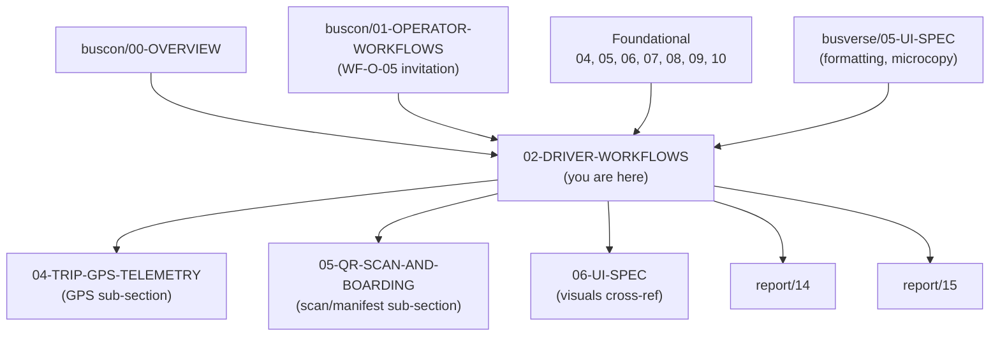

### 1.3 What this document does NOT cover

| Topic | Goes to |
|---|---|
| GPS streaming mechanics | `buscon/04-TRIP-GPS-TELEMETRY.md` |
| QR scan (online + offline) | `buscon/05-QR-SCAN-AND-BOARDING.md` |
| Manifest screen contents | `buscon/05-QR-SCAN-AND-BOARDING.md` |
| Full design tokens + visual spec | `buscon/06-UI-SPEC.md` (pending per `buscon/00` §8.4) |
| Operator-side driver invitation | `buscon/01-OPERATOR-WORKFLOWS.md` §5 |
| Admin driver KYC verification | `buscon/01-OPERATOR-WORKFLOWS.md` §10 (WF-A-03) |
| Money / date / reference formats | `busverse/05-UI-SPEC.md` §8 |
| Base microcopy | `busverse/05-UI-SPEC.md` §19 |
| Backend trip handling | `03-SYSTEM-ARCHITECTURE.md` §6 |

### 1.4 Screen and shell ownership

**Diagram: Screen ownership map**
*The Operator App has 6 named screens in `buscon/00` §7.2. This doc owns 4 of them fully (LOGIN, TODAY, SUMMARY) or partially (TRIP as the shell), plus a profile drawer that isn't a screen. `05` owns SCAN and MANIFEST. The SCR-OA-TRIP shell is split — this doc owns the container + start/end/delay actions; `04` adds a GPS status sub-region; `05` adds a scan/manifest entry point.*

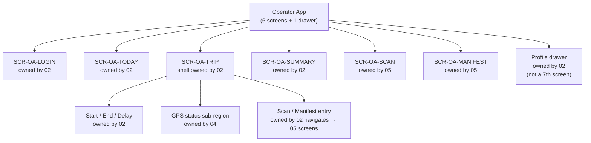

**Rule:** This doc owns the SCR-OA-TRIP **shell** — the top bar, trip summary header, action button layout, and navigation to sub-features. `04` adds a **status pill** showing GPS stream state. `05` adds **navigation buttons** to SCAN and MANIFEST screens. Neither sibling doc redefines the shell — they plug into this doc's layout.

### 1.5 Scope of this document

**Three owned workflows, four screens, one drawer:**

| # | Workflow / Surface | FRs | Screens | In | Out |
|:---:|---|---|---|---|---|
| 1 | WF-D-01 Login + config fetch | FR-OP-001–003 | SCR-OA-LOGIN | App open | Authenticated + config cached → TODAY |
| 2 | WF-D-02 Trip start | FR-OP-004–008 | SCR-OA-TODAY → SCR-OA-TRIP | Active trip selected | Trip `IN_PROGRESS`, GPS handoff to `04` |
| 3 | WF-D-06 Trip end | FR-OP-007, 008 | SCR-OA-TRIP → SCR-OA-SUMMARY | Trip `IN_PROGRESS` | Trip `COMPLETED`, summary → TODAY |
| 4 | Past trips history | FR-OP-019 | SCR-OA-TODAY (history tab) | — | — |
| 5 | Delay report | FR-OP-018 | SCR-OA-TRIP (modal) | Active trip | `trip:delayed` emitted |
| 6 | Profile drawer | FR-OP-021–023 | (drawer from TODAY) | — | — |
| 7 | Document upload | FR-OP-020 | (accessed from profile drawer) | KYC pending | Uploaded → admin review |

**FR mapping per surface:**

| FR | Workflow | Screen / Mechanism |
|---|---|---|
| FR-OP-001 | WF-D-01 | SCR-OA-LOGIN (phone OTP) |
| FR-OP-002 | WF-D-01 | Single-device binding (this doc §5) |
| FR-OP-003 | WF-D-01 | SCR-OA-LOGIN (config fetch) |
| FR-OP-004 | WF-D-02 | SCR-OA-TODAY (trip list) |
| FR-OP-005 | WF-D-02 | SCR-OA-TODAY → SCR-OA-TRIP (start) |
| FR-OP-006 | WF-D-02 | `driver_profiles.on_duty = true` (via WF-D-02) |
| FR-OP-007 | WF-D-06 | SCR-OA-TRIP → SCR-OA-SUMMARY (end) |
| FR-OP-008 | WF-D-06 | `driver_profiles.on_duty = false` (via WF-D-06) |
| FR-OP-018 | Delay modal | SCR-OA-TRIP modal |
| FR-OP-019 | Past trips | SCR-OA-TODAY (history tab) |
| FR-OP-020 | Document upload | Profile drawer → upload flow |
| FR-OP-021 | Profile drawer | View |
| FR-OP-022 | Profile drawer | Update name |
| FR-OP-023 | Profile drawer | Phone is immutable |

**Endpoints owned — 12:**

| # | Method | Path |
|:---:|---|---|
| 1 | POST | `/v1/driver/auth/otp/request` |
| 2 | POST | `/v1/driver/auth/otp/verify` |
| 3 | POST | `/v1/driver/auth/refresh` |
| 4 | POST | `/v1/driver/auth/logout` |
| 5 | GET | `/v1/driver/config` |
| 6 | GET | `/v1/driver/me` |
| 7 | GET | `/v1/driver/trips` |
| 8 | GET | `/v1/driver/trips/:id` |
| 9 | POST | `/v1/driver/trips/:id/start` |
| 10 | POST | `/v1/driver/trips/:id/end` |
| 11 | POST | `/v1/driver/trips/:id/delay` |
| 12 | GET | `/v1/driver/trips/history` |
| **13** | **POST** | **`/v1/driver/me/documents`** — **missing from `07` v1.2 §7.2; flag Q21** |

**Cross-referenced endpoints (owned by `05`):**
- `POST /v1/driver/trips/:id/scan`
- `GET /v1/driver/trips/:id/manifest`

**Cross-referenced endpoint (owned by `04`):**
- `POST /v1/driver/trips/:id/gps`

---

## 2. Workflow Map

**Diagram: Workflow map**
*Three owned workflows + four cross-referenced. Owned: login, trip start, trip end. Owned-but-modal: delay report. Owned-but-drawer: profile. Cross-referenced: GPS (04), scan online + offline (05).*

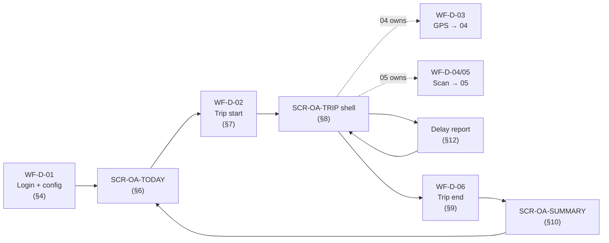

### 2.1 Coverage table

| Workflow | FRs | Screens | Entry | Exit |
|---|---|---|---|---|
| WF-D-01 | FR-OP-001–003 | SCR-OA-LOGIN | App opens (logged out) | Today (config cached) |
| WF-D-02 | FR-OP-004–008 | SCR-OA-TODAY → SCR-OA-TRIP | Logged in, trip selected | Trip `IN_PROGRESS`, GPS handoff |
| WF-D-06 | FR-OP-007, 008 | SCR-OA-TRIP → SCR-OA-SUMMARY | Trip active | Trip `COMPLETED`, summary shown |
| Delay (FR-OP-018) | FR-OP-018 | SCR-OA-TRIP modal | Trip active | `trip:delayed` emitted |
| History (FR-OP-019) | FR-OP-019 | SCR-OA-TODAY history tab | — | — |
| Profile (FR-OP-021–023) | FR-OP-021–023 | Drawer | Logged in | Drawer closed |
| Documents (FR-OP-020) | FR-OP-020 | Drawer → upload | KYC pending | Uploaded |

### 2.2 Cross-referenced workflows

| Workflow | Owned by | Handoff point |
|---|---|---|
| WF-D-03 GPS streaming | `04-TRIP-GPS-TELEMETRY` | After WF-D-02 success, GPS starts client-side |
| WF-D-04 QR scan (online) | `05-QR-SCAN-AND-BOARDING` | Entry from SCR-OA-TRIP "Scan" button |
| WF-D-05 QR scan (offline) | `05-QR-SCAN-AND-BOARDING` | Same entry; `05` handles offline queue |
| WF-X-05 Boarding → passenger | `05` (driver side), `busverse/04` §12 (passenger side) | After scan, WS emit |
| WF-N-03 Operator cancels trip | `08` §9.3 (operator side), this doc §8.4 (driver-side handling) | Driver sees `trip:cancelled` WS event |
| WF-N-05 Suspension mid-trip | `08` §9.5 (admin side), this doc §5.3 (driver-side handling) | Driver sees banner; can still end |
| WF-R-03 Session refresh | `04` §7.6 pattern, this doc §5.4 | On 401 or proactive timer |

---

## 3. App Philosophy and Screen Inventory

### 3.1 Five principles of the Operator App

**Diagram: App philosophy**
*The Operator App is the simplest surface in the system by design. Five principles derive from `buscon/00` §10 and constrain every screen in this doc.*

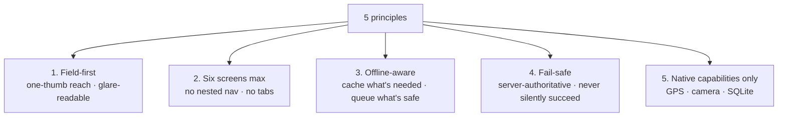

| # | Principle | How it shows in this doc |
|---|---|---|
| 1 | **Field-first** | Every action is one-handed; primary CTA at bottom; no hover-only interactions |
| 2 | **Six screens max** | No new screens added beyond `buscon/00` §7.2; profile is a drawer (§13), not a screen |
| 3 | **Offline-aware** | Config + today's trips cached in SQLite; trips list works offline; scan works offline (§14) |
| 4 | **Fail-safe** | Server is authoritative for trip state; no silent trip start/end; UI always shows confirmed state |
| 5 | **Native capabilities** | GPS + camera + SQLite; no PWA fallbacks (per `01` §3.3) |

### 3.2 Screen inventory

| Screen | Name | Owned by | Purpose |
|---|---|---|---|
| SCR-OA-LOGIN | Login | **02** | OTP + config fetch + forced update gate |
| SCR-OA-TODAY | Today's trips | **02** | List of assigned trips + history tab + profile drawer entry |
| SCR-OA-TRIP | Active trip | **02** (shell) + 04 + 05 | Trip summary · start/end · delay · scan/manifest · GPS pill |
| SCR-OA-SCAN | QR scanner | `05` | Camera · result feedback |
| SCR-OA-MANIFEST | Manifest | `05` | Passenger list per stand |
| SCR-OA-SUMMARY | Trip summary | **02** | Post-trip recap |
| *(drawer)* | Profile | **02** | View/edit · KYC status · logout |

**Note on screen count:** `buscon/00` §7.2 lists exactly 6. This doc honors that — profile is a drawer accessible from the TODAY top bar (avatar icon), not a 7th screen. Q1 flags this decision.

---

## 4. WF-D-01 — Login + Config Fetch

### 4.1 Flow narrative

**Narrative:** A driver who has been invited by an operator (per `buscon/01` WF-O-05) opens the Operator App for the first time. They enter their phone, receive a 6-digit OTP via SMS (MSG91), verify it, and the server issues an access token + refresh token bound to this device's fingerprint. On first successful verify, the app requests the config endpoint — which returns the QR public key, server time, and minimum app version — and caches it in SQLite. The app also fetches today's assigned trips and caches them. From this point the driver can go fully offline (scan, view manifest) until token expiry.

**Reference:** `08` §7.1; `04` §7.3.

### 4.2 Preconditions

| Table | State |
|---|---|
| `driver_profiles` | Row exists with `kyc_status = VERIFIED` (invited + admin-verified) |
| `users` | Row exists (created on first OTP verify) |
| App state | First launch OR after session expiry |

**Rule:** A driver whose KYC is `INVITED`, `SIGNED_UP`, or `KYC_PENDING` cannot reach the app past SCR-OA-LOGIN. The OTP verify succeeds but the subsequent `GET /driver/trips` returns `403 DRIVER_NOT_VERIFIED`. UI shows "Your KYC is pending. Contact your operator."

### 4.3 Sequence

**Diagram: Login + config fetch sequence**
*Six-step flow. OTP verify → single-device check → token issuance → config fetch → trips fetch → cache to SQLite. Every fetched item is cached so offline works afterward.*

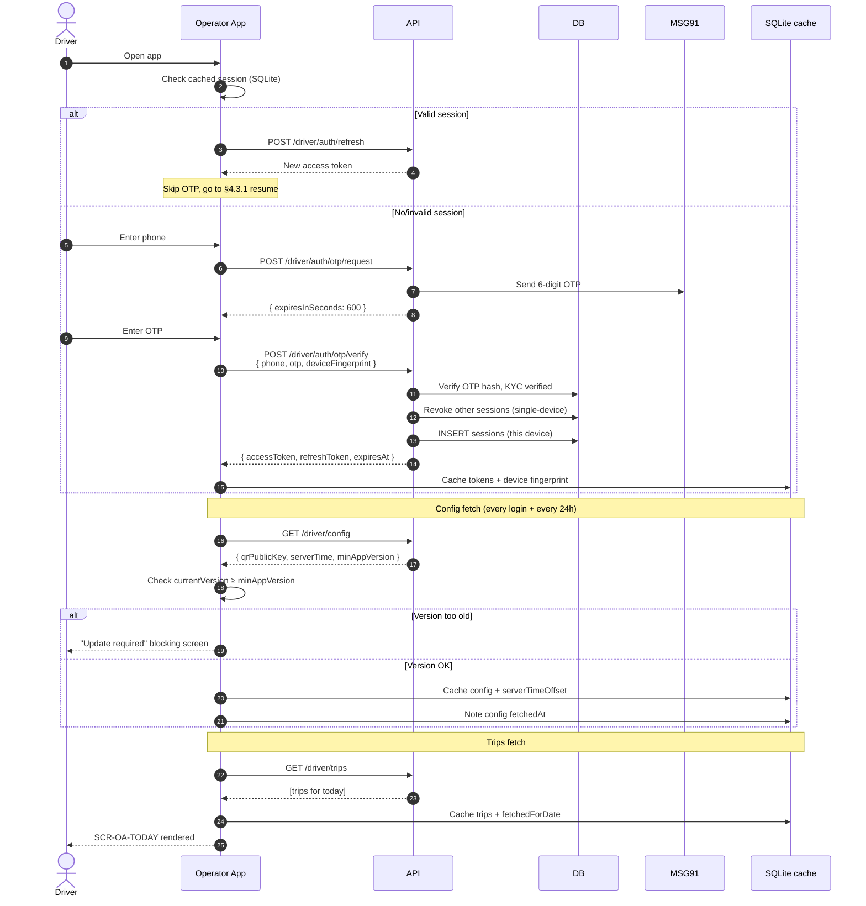

### 4.4 Config fetch and cache strategy

**Config response** (per `07` v1.2 §7.3):

```json
{
  "data": {
    "qrPublicKey": "base64-encoded-ed25519-public-key",
    "serverTime": "2026-10-25T09:15:00.000Z",
    "minAppVersion": "1.0.0",
    "featureFlags": { "offlineScan": true, "gpsTracking": true }
  }
}
```

**Caching rules:**

| Field | Storage | Refresh |
|---|---|---|
| `qrPublicKey` | SQLite `config` table | Every fetch; never expires (immutable until key rotation) |
| `serverTimeOffset` | SQLite (computed: `serverTime - clientTime`) | Every fetch; used for all trip-window checks |
| `minAppVersion` | SQLite | Every fetch; compared on foreground |
| `featureFlags` | SQLite | Every fetch; toggle features at runtime |

**Refresh cadence:**

| Trigger | Action |
|---|---|
| Login | Fetch fresh config |
| App foreground if cache >1h old | Fetch fresh config |
| App foreground if cache >24h old | Hard fetch (block UI until success) |
| Manual pull-to-refresh on TODAY | Fetch fresh |

**Clock-skew handling (resolves G8):** On every config fetch, compute `serverTimeOffset = serverTime - Date.now()`. Store in SQLite. All time comparisons (trip start window, expiry) use `Date.now() + serverTimeOffset`. Prevents a wrong phone clock from blocking trip start.

### 4.5 Force update gate (resolves G14)

**Diagram: Force update decision**
*If `currentVersion < minAppVersion`, the app shows a blocking screen with a store link. No other functionality is available. Q10 flags whether this should be a soft-nag or hard block.*

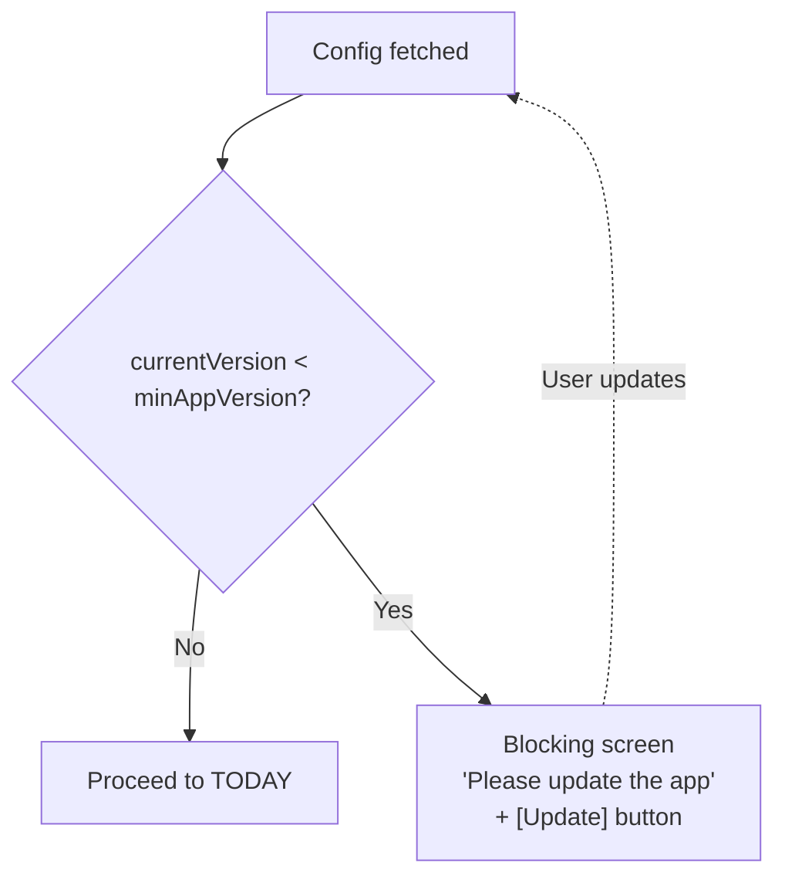

**Rule:** Force update is **hard blocking** in Phase 1. The rationale: offline scan requires the exact QR verification algorithm — an outdated app could fail to verify tickets, stranding passengers. Force update is preferable to a failed scan.

### 4.6 Offline login edge case (resolves G15)

**Diagram: Offline login gate**
*If the driver has never logged in on this device and opens the app offline, they cannot proceed. If they've logged in before, the cached session is used and they can access cached trips offline.*

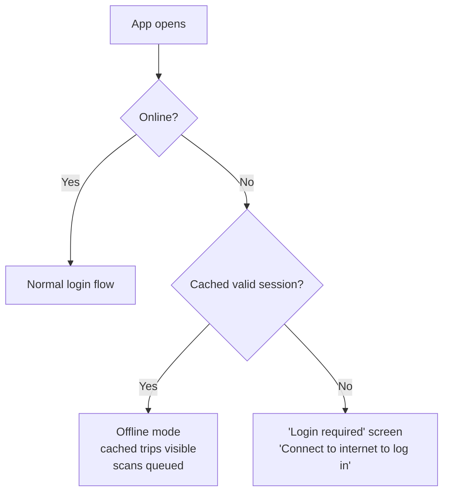

**Rule:** A cached session expires after refresh token TTL (30 days per `04` §8.4). Beyond that, offline login is impossible — driver must connect to internet.

### 4.7 Permission bootstrap (resolves gap #13)

On **first successful login**, the app requests OS permissions:

| Permission | When | Why | If denied |
|---|---|---|---|
| Location (GPS) | First trip start attempt | Required for WF-D-03 | Trip start blocked → "Enable location to start trips" |
| Camera | First scan attempt | Required for `05` QR scan | Scan button disabled → "Enable camera to scan" |
| Notifications | First app open | Phase 2 (push not in Phase 1) | Not requested |

**Rule:** Never request permissions on app launch. Request **just-in-time** when the feature is used. If denied → "Limited mode" banner with link to OS settings. This matches Apple and Google's UX guidance.

### 4.8 Deep link from SMS invite (resolves gap #19)

**Diagram: SMS deep link**
*Operator's SMS includes a deep link with the driver's phone pre-filled. If the app is installed, opening the link pre-fills the phone on SCR-OA-LOGIN; if not, it opens the App Store / Play Store.*

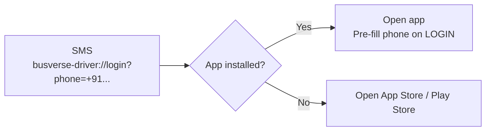

**Phase 1 status:** Deep link pre-fill is **Phase 2** (Q — flag in `buscon/01` §5.5 as well). In Phase 1, the SMS just contains a plain app download URL with no pre-fill.

### 4.9 Endpoint chain

| # | Method | Path | Auth | Notes |
|:---:|---|---|---|---|
| 1 | POST | `/v1/driver/auth/otp/request` | public | Rate limit 3/10min per phone |
| 2 | POST | `/v1/driver/auth/otp/verify` | public | Includes deviceFingerprint; single-device |
| 3 | POST | `/v1/driver/auth/refresh` | refresh cookie | For silent refresh on reopen |
| 4 | GET | `/v1/driver/config` | DRIVER | Fetched on login + foreground >1h |

**Reference:** `07` v1.2 §7.2, §7.3.

### 4.10 Screen — SCR-OA-LOGIN

**Diagram: Login screen states**
*Four states — phone input, OTP input, verifying, success-redirect. No dark/light toggle (Operator App inherits OS theme).*

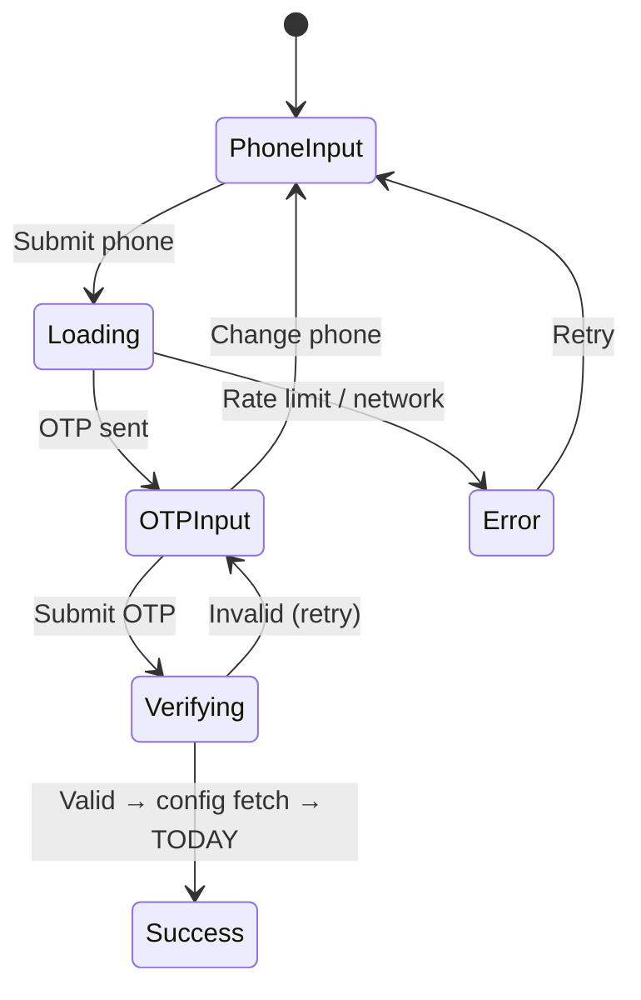

**Wireframe (mobile, phone input state):**

```
┌─────────────────────────────────┐
│                                 │
│         [BusCon mark]           │
│                                 │
│    Sign in to start driving     │
│                                 │
│                                 │
│    Phone number                 │
│    ┌─────────────────────────┐  │
│    │ +91 98765 43210         │  │
│    └─────────────────────────┘  │
│                                 │
│    ┌─────────────────────────┐  │
│    │      Continue           │  │
│    └─────────────────────────┘  │
│                                 │
│                                 │
│    Your operator invited you.   │
│    Contact them if you can't    │
│    sign in.                     │
│                                 │
└─────────────────────────────────┘
```

**Microcopy (per `busverse/05` §19 + driver additions in §19 of this doc):**

| Element | String |
|---|---|
| Heading | "Sign in to start driving" |
| Phone label | "Phone number" |
| Continue button | "Continue" |
| OTP heading | "Enter the code" |
| OTP helper | "Sent to +91 ••••••3210" |
| Resend link | "Resend code in {N}s" |
| Rate limit | "Too many attempts. Try again in {N} min." |
| Network error | "Check your connection and retry." |
| KYC pending | "Your KYC is pending. Contact your operator." |
| Version block | "Please update the Operator App to continue." |

---

## 5. Single-Device Binding and Session Lifecycle

### 5.1 Session state machine

**Diagram: Driver session states**
*Single-device by default. Newest login wins. Previous device shows "Session ended" and returns to login. Demo-mode override (env flag) allows multi-device.*

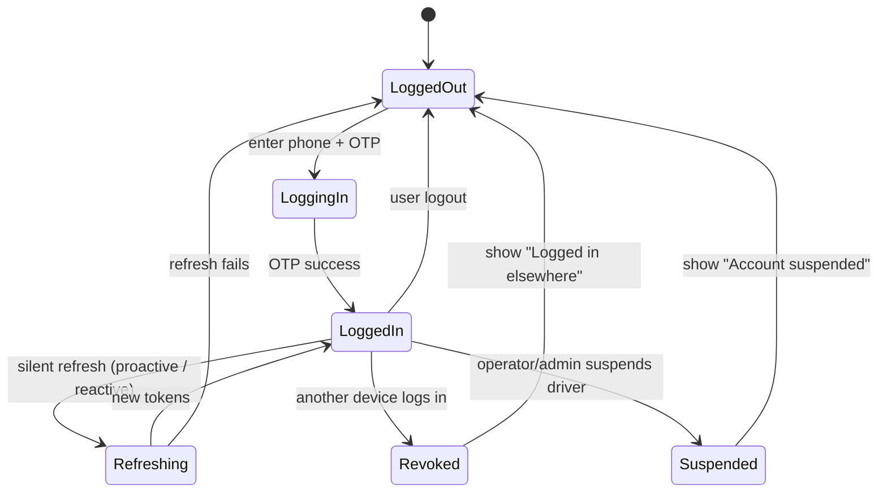

### 5.2 Single-device binding behavior

| Event | Behavior |
|---|---|
| Login on device A | Session A active |
| Login on device B | Session A revoked via WS close code 1008 + next A request → 401 → force logout |
| Device A next app open after revocation | Shows "You were logged in on another device. Sign in again." → LOGIN |
| `DEMO_MULTI_DEVICE_DRIVER=true` env | Both A and B coexist; used for viva / showcase only |
| `DEMO_MULTI_DEVICE_DRIVER=false` (default) | Strict single-device per `04` §7.3 |

**Reference:** `04` §7.3.

### 5.3 Suspension mid-session (resolves G12 / WF-N-05)

**Diagram: Suspension mid-trip**
*Admin suspends driver → cascade revocation → driver sees red banner on next interaction. The current trip remains IN_PROGRESS. Driver can still call `/end` to finish cleanly. After end, session dies.*

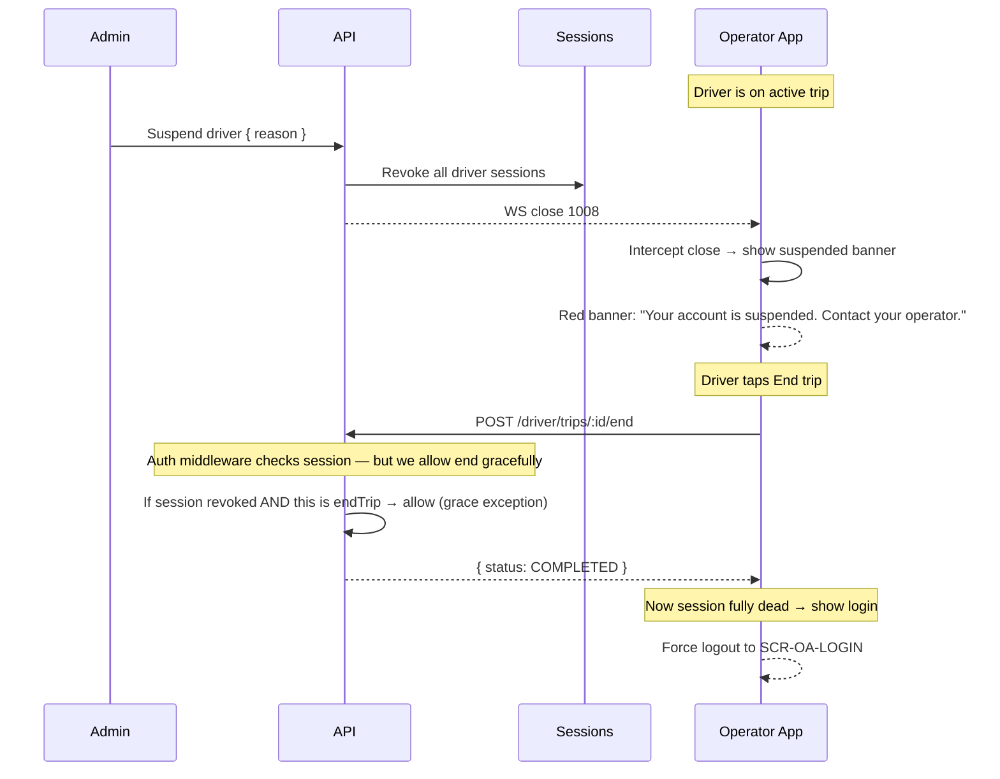

**Rules:**

| Rule | Detail |
|---|---|
| End-trip grace | Suspended drivers can still call `/end` (one-time grace) for a clean finish |
| Other endpoints blocked | All other API calls return 401 immediately after suspension |
| Banner shown | Red banner on TRIP screen: "Your account is suspended. Contact your operator." |
| After end | Session fully dead; app returns to LOGIN |
| Grace exception audit | The grace `/end` call is audited with reason `suspended_grace` |

**Reference:** `08` §9.5.

### 5.4 Session refresh timing (resolves G9 / Q22)

**Diagram: Refresh timing**
*Two triggers — proactive (25-min timer, before the 30-min access-token expiry) and reactive (on 401). Proactive reduces user-visible 401s during field use.*

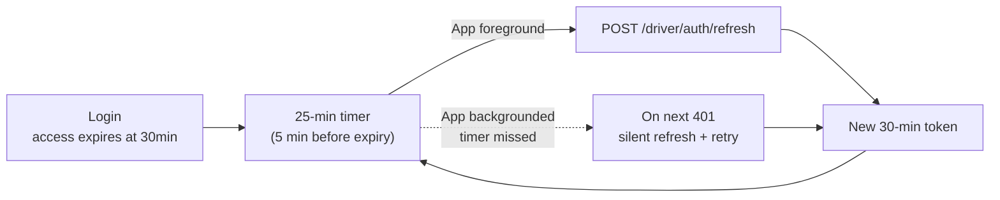

**Rules:**

| Trigger | Behavior |
|---|---|
| Proactive timer (25 min) | Fires if app is foreground; silent refresh; no user-visible interruption |
| Proactive timer missed (app backgrounded) | Next API call likely 401s → silent refresh + retry (single-flight lock) |
| Refresh succeeds | Token updated; timer reset |
| Refresh fails (401) | Force logout → LOGIN with "Session expired. Log in again." |
| Refresh network error | Retry 3x with backoff (1s, 3s, 9s); then fail → force logout |

**Rationale:** A driver streaming GPS + scanning passengers cannot tolerate a mid-scan 401. The 5-min buffer prevents this. This is a **Phase 1 must** — Q22 flags whether to enforce or leave reactive-only.

**Reference:** `04` §8.3, `04` §8.5.

### 5.5 Refresh token TTL and offline

| State | Behavior |
|---|---|
| Online, any session | Silent refresh as above |
| Offline, access token valid | Continue offline (scan queue, trip actions cached) |
| Offline, access token expired, refresh valid | Offline mode continues until network returns, then refresh |
| Offline, refresh token expired (>30 days) | Force logout; "Reconnect to log in" |

---

## 6. SCR-OA-TODAY — Trip List

### 6.1 Screen layout

**Diagram: TODAY screen composition**
*Header with avatar (profile drawer entry) + top action icons. Tabs (Today · History). List of trip cards. Empty or error states.*

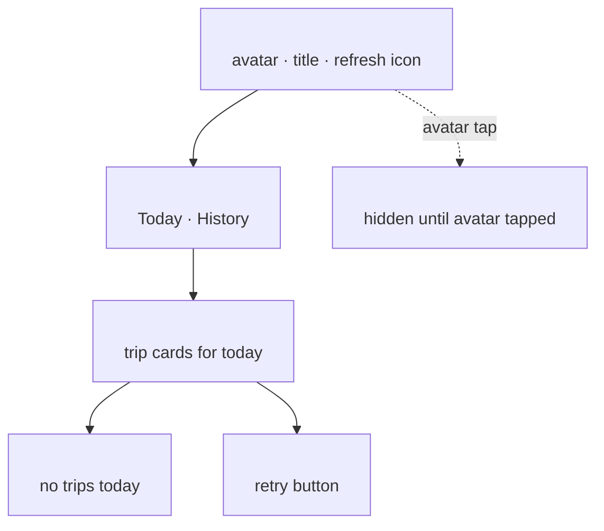

### 6.2 Trip card contents

| Row | Content |
|---|---|
| 1 | Route summary: Origin → Destination |
| 2 | Bus info: `{bus.model}` · `{bus.registrationNumber}` |
| 3 | Scheduled departure time (IST) · scheduled arrival |
| 4 | Trip status badge (`Ready to start` / `Not yet` / `Trip active` / `Completed` / `Cancelled`) |
| 5 | Passenger count: "Boarded {N}/{M}" (if trip `IN_PROGRESS`) |
| 6 | Action button (varies by status) |

### 6.3 Trip list ordering and multiple trips (resolves G16, G17)

| Rule | Detail |
|---|---|
| Ordering | Departure time **ascending** (soonest first) |
| Multiple trips same day | All shown; only one can be `IN_PROGRESS` at a time |
| Starting second while first active | `409 ACTIVE_TRIP_EXISTS` — "End current trip before starting a new one" |
| Empty | Empty state with "No trips assigned today. Contact your operator." |
| Retry | Pull-to-refresh OR retry button on error |

### 6.4 Midnight-while-offline edge case (resolves gap #10)

**Diagram: Midnight offline flow**
*If cached trips are from yesterday's date and the clock has passed midnight, show a banner but keep the cached trips visible. Once online, refresh loads the correct date.*

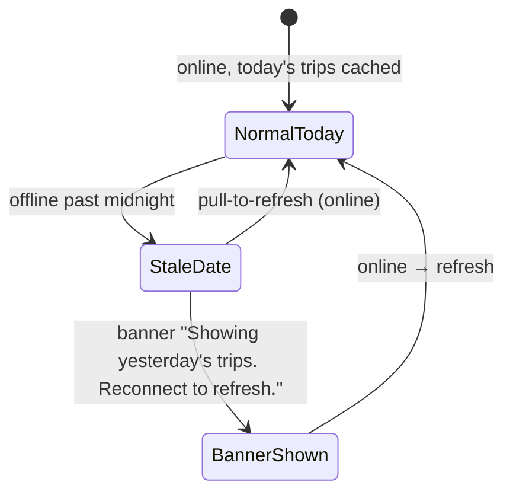

**Rule:** Never blank the list. Show what's cached with a clear staleness banner.

### 6.5 Data fetching and cache (resolves G24)

**React Query key:** `['driver', 'trips', { date }]`

**Cache:** SQLite; `fetchedForDate` stored alongside trip data.

**Refresh triggers:**
- App foreground
- Pull-to-refresh
- After successful trip start/end (invalidate + refetch)
- Every 5 min while on TODAY (background refresh)

**Offline:** Use SQLite cache; show "Offline — last updated at {time}" pill.

### 6.6 Today screen states

| State | UI |
|---|---|
| Loading | Skeleton cards × 2 |
| Loaded (trips) | List of trip cards |
| Empty | Empty illustration + "No trips assigned today" + retry |
| Offline cached | Cached trips + "Offline — last updated {time}" pill |
| Stale-date | Cached yesterday's trips + "Showing {date}" banner |
| Error | "Couldn't load trips" + retry button |
| Session expired | Force logout → LOGIN |

### 6.7 Screen — SCR-OA-TODAY wireframe

```
┌─────────────────────────────────┐
│ [Avatar]   Today        [↻]     │
├─────────────────────────────────┤
│ [ Today ] [ History ]           │
├─────────────────────────────────┤
│ ┌─────────────────────────────┐ │
│ │ Delhi → Lucknow             │ │
│ │ Volvo · DL-1P-1234          │ │
│ │ 14:00 → 22:30 IST           │ │
│ │ [ Ready to start ]          │ │
│ │ ┌─────────────────────────┐ │ │
│ │ │      Start trip         │ │ │
│ │ └─────────────────────────┘ │ │
│ └─────────────────────────────┘ │
│                                 │
│ ┌─────────────────────────────┐ │
│ │ Delhi → Kanpur              │ │
│ │ 18:00 → 23:00 IST           │ │
│ │ [ Not yet ]                 │ │
│ └─────────────────────────────┘ │
│                                 │
└─────────────────────────────────┘
```

---

## 7. WF-D-02 — Trip Start

### 7.1 Flow narrative

**Narrative:** The driver selects a scheduled trip from TODAY, taps "Start trip," and the server validates six pre-checks (driver verified, not blocked, license valid, bus approved, schedule not cancelled, no other active trip) before transitioning the trip from `SCHEDULED` to `IN_PROGRESS`. On success, the app navigates to SCR-OA-TRIP and begins streaming GPS (handoff to `04`). The driver's `on_duty` flag is set to `true` atomically with the trip status update. A `trip:started` WebSocket event is emitted for passengers and admin.

**Reference:** `08` §7.2; `05` v1.2 §8.3.

### 7.2 Preconditions and seven pre-checks (resolves G5, gap #14)

| # | Pre-check | Failure |
|:---:|---|---|
| 1 | Driver KYC status ∈ {VERIFIED, ACTIVE} | `403 DRIVER_NOT_VERIFIED` |
| 2 | Driver not BLOCKED or DEACTIVATED | `403 DRIVER_BLOCKED` |
| 3 | Driver license not expired | `403 LICENSE_EXPIRED` |
| 4 | Bus `approval_status = APPROVED` | `403 BUS_NOT_APPROVED` |
| 5 | Bus has a `seat_layouts` row (**gap #14**) | `403 BUS_LAYOUT_MISSING` |
| 6 | Schedule `status = PUBLISHED` (not CANCELLED) | `409 SCHEDULE_CANCELLED` |
| 7 | No other active trip for this driver | `409 ACTIVE_TRIP_EXISTS` |

**Rule:** All seven checks run server-side inside the start transaction. Client pre-checks are UX-only — never a substitute.

### 7.3 Time window (resolves G6)

**Diagram: Start window**
*Trip start is allowed within ±2 hours of scheduled departure. Outside this window, the client disables the Start button and shows a message. Server enforces the same rule.*

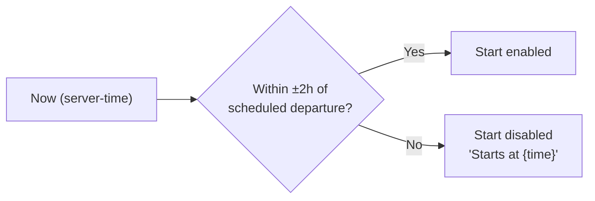

**Rule:** The start window is computed using `Date.now() + serverTimeOffset` (from §4.4). This makes the window authoritative regardless of the phone's clock.

**Q5 default:** ±2 hours. Rationale: drivers may need to start slightly early (boarding prep) or slightly late (traffic), but not hours away.

### 7.4 Sequence

**Diagram: Trip start sequence**
*Client pre-check → server transaction → `trip:started` WS emit → GPS handoff. Atomic: trip status + on_duty + session metadata in one DB transaction.*

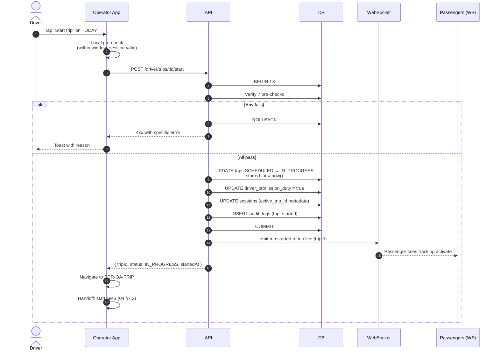

### 7.5 GPS activation handoff (resolves gap #4)

**Diagram: GPS activation**
*The `/start` HTTP response — not the WebSocket event — triggers client-side GPS activation. The WS event is for other subscribers (passenger, admin). This avoids a round-trip dependency where the client would have to wait for its own WS echo to start GPS.*

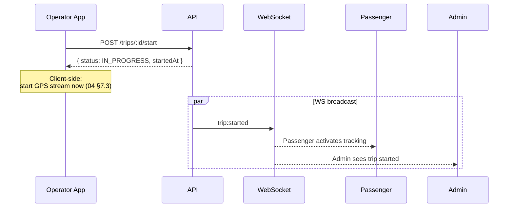

**Rule:** The HTTP response is the trigger for the client's own GPS. The WS event is a broadcast to others. **This rule is canonical for `04`.**

### 7.6 Endpoint chain

| # | Method | Path | Auth | Notes |
|:---:|---|---|---|---|
| 1 | POST | `/v1/driver/trips/:id/start` | DRIVER | Triggers GPS on success |

**Reference:** `07` v1.2 §7.2.

### 7.7 State changes

| Table | Before | After |
|---|---|---|
| `trips` | `SCHEDULED` | `IN_PROGRESS` (with `started_at = now()`) |
| `driver_profiles` | `on_duty = false` | `on_duty = true` |
| `sessions` | `metadata_json.active_trip_id = null` | `metadata_json.active_trip_id = {tripId}` |
| `audit_logs` | — | `trip_started` |

### 7.8 Error branches

| Error | Trigger | UI | Recovery |
|---|---|---|---|
| `DRIVER_NOT_VERIFIED` | KYC not verified | Toast + refresh | Contact operator |
| `DRIVER_BLOCKED` | Admin blocked | Toast | Contact operator |
| `LICENSE_EXPIRED` | License past date | Toast | Contact operator to renew |
| `BUS_NOT_APPROVED` | Bus not admin-approved | Toast | Contact operator |
| `BUS_LAYOUT_MISSING` | No seat layout | Toast | Contact operator |
| `SCHEDULE_CANCELLED` | Operator cancelled schedule | Toast + return to TODAY | Refresh list |
| `ACTIVE_TRIP_EXISTS` | Another trip already active | Toast | End the other trip first |
| `TRIP_OUTSIDE_WINDOW` | Time outside ±2h | Toast with window | Wait or contact operator |
| Network error | No connectivity | Toast + retry | Retry |

### 7.9 Postconditions

- `trips.status = IN_PROGRESS`
- `driver_profiles.on_duty = true`
- Driver on SCR-OA-TRIP
- GPS streaming (via `04`)
- Passenger tracking activated (via `busverse/04`)

---

## 8. SCR-OA-TRIP — Active Trip Shell

### 8.1 Screen layout (canonical)

**Diagram: SCR-OA-TRIP shell composition**
*Owned by this doc. Contains: top bar with end-trip button, trip summary header, GPS status pill (owned by `04`), primary actions (scan, manifest), delay button, and secondary trip info. Sub-regions are owned by siblings.*

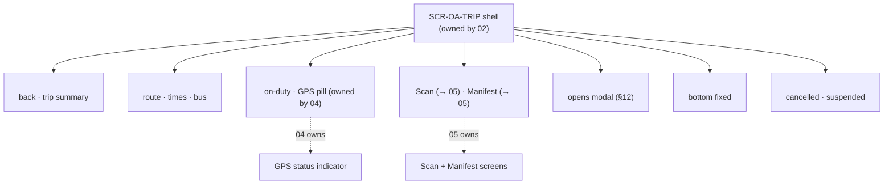

### 8.2 Screen contents (resolves gap #11)

| Region | Contents |
|---|---|
| **Top bar** | Back arrow (→ TODAY with confirm if trip active), trip reference (`TRP-2026-00187`), bus icon |
| **Trip summary** | Origin → Destination, bus model + registration, scheduled departure / arrival (IST) |
| **Status row** | On-duty pill (green dot "On duty"), GPS status pill (owned by `04`: streaming green / reconnecting amber / stopped red) |
| **Primary actions** | Two large buttons side-by-side: "Scan QR" (→ SCR-OA-SCAN) · "Manifest" (→ SCR-OA-MANIFEST) |
| **Delay action** | Small button "Report delay" → opens modal (§12) |
| **End trip** | Large fixed button at bottom: "End trip" → confirm modal |
| **Alert banner** | Conditional — `trip:cancelled` OR `suspended` OR `network lost` |

### 8.3 Navigation into TRIP screen

**From TODAY:** tap "Start trip" → WF-D-02 → success → navigate to SCR-OA-TRIP.
**From Today on active trip:** tap trip card with status "Trip active" → navigate to SCR-OA-TRIP (no start).
**From deep state (app reopened while trip active):** App checks `GET /driver/trips?date=today&status=IN_PROGRESS` on launch; if active trip found, navigate directly to SCR-OA-TRIP after login.

### 8.4 Trip cancelled mid-trip (resolves gap #5, WF-N-03)

**Diagram: Trip cancelled by operator**
*Operator cancels trip → server sets `trips.status = CANCELLED` → emits `trip:cancelled` → driver sees banner → can still tap "End shift" to go off-duty.*

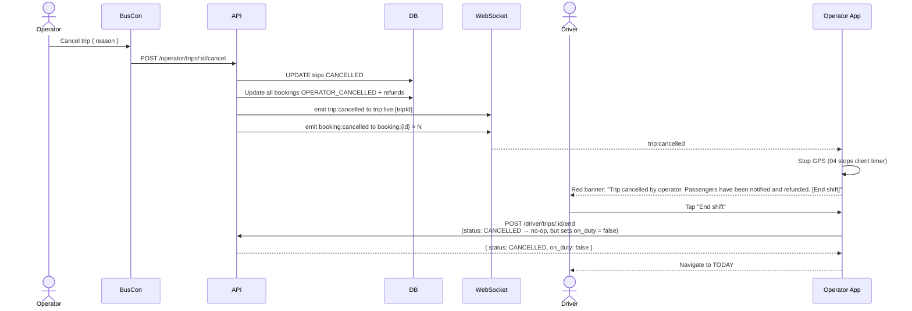

**Rules:**

| Rule | Detail |
|---|---|
| `trip:cancelled` WS event | Handled client-side; no polling needed |
| GPS stops | `04` observes `trip:cancelled` and stops the timer |
| Scan blocked | Further scans return `409 TRIP_CANCELLED` |
| End shift | Calls `/end` which sets `on_duty = false`; trip stays `CANCELLED` |
| Passenger notification | Handled by API (per `08` §9.3) — driver doesn't notify |

**Reference:** `08` §9.3 (WF-N-03).

### 8.5 Network loss on TRIP screen

**Diagram: Network loss**
*GPS continues buffering locally; scans queue in SQLite; UI shows amber "Reconnecting..." pill. On return, all queued data flushes. No user action needed.*

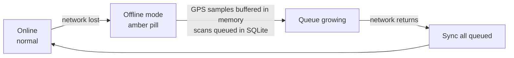

**Reference:** GPS buffering in `04`; scan queue in `05`.

### 8.6 Back navigation warning

**Diagram: Back navigation**
*Back arrow from TRIP requires confirmation because GPS is running. Driver can minimize (go to TODAY) without stopping trip, or end trip.*

```mermaid
stateDiagram-v2
    [*] --> Trip
    Trip --> BackPressed: tap back
    BackPressed --> ConfirmDialog: show "Trip is active. Back to today?"
    ConfirmDialog --> Minimized: "Go back" (trip continues)
    ConfirmDialog --> Trip: "Stay"
    Minimized --> Trip: tap active trip card
```

**Rule:** Going back does **not** stop the trip or GPS. Trip continues in background; driver can open TRIP again from TODAY. Only "End trip" stops the trip.

### 8.7 Display rules (formatting)

Per `busverse/05` §8:

| Field | Format | Example |
|---|---|---|
| Trip reference | `TRP-YYYY-NNNNN` | `TRP-2026-00187` |
| Departure / arrival time | `HH:mm IST` | `14:00 IST` |
| Duration | `Xh Ym` | `8h 30m` |
| Bus model | Free text | `Volvo Multi-Axle` |
| Registration | RTO format | `DL-1P-1234` |

**Rule:** No money shown to driver (per `04` §9.3). Fare amounts appear only to operator and admin.

---

## 9. WF-D-06 — Trip End

### 9.1 Flow narrative

**Narrative:** The driver taps "End trip" on SCR-OA-TRIP, confirms in a modal, and the server transitions `trips.status` from `IN_PROGRESS` to `COMPLETED`. The driver's `on_duty` flag resets to `false` atomically. A `trip:ended` WebSocket event is emitted. The app navigates to SCR-OA-SUMMARY. Unboarded passengers (if any) are not resolved by this workflow — they remain `CONFIRMED` per `05` v1.2 §8.1 (no auto-resolution for unboarded).

**Reference:** `08` §7.6; `05` v1.2 §8.3.

### 9.2 Sequence

**Diagram: Trip end sequence**
*Confirm modal → atomic transaction → WS emit → navigate to summary.*

```mermaid
sequenceDiagram
    autonumber
    actor D as Driver
    participant APP as Operator App
    participant API as API
    participant DB as DB
    participant WS as WebSocket
    participant P as Passengers

    D->>APP: Tap "End trip"
    APP->>APP: Show confirm modal
    D->>APP: Confirm
    APP->>API: POST /driver/trips/:id/end
    API->>DB: BEGIN TX
    API->>DB: Verify trip IN_PROGRESS
    API->>DB: UPDATE trips COMPLETED<br/>ended_at = now()
    API->>DB: UPDATE driver_profiles on_duty = false
    API->>DB: UPDATE sessions (active_trip_id = null)
    API->>DB: INSERT audit_logs (trip_ended)
    API->>DB: COMMIT
    API->>WS: emit trip:ended to trip:live:{tripId}
    WS-->>P: Passenger sees post-trip state
    API-->>APP: { status: COMPLETED, endedAt }
    APP->>APP: Stop GPS (04 observes)
    APP->>APP: Navigate to SCR-OA-SUMMARY
```

### 9.3 Unboarded passengers (resolves G8)

**Diagram: Unboarded passenger policy**
*Trip end does NOT block on unboarded passengers. They remain `CONFIRMED` and are visible in admin/operator views. This matches the booking SM in `05` v1.2 §8.1.*

```mermaid
flowchart LR
    END["Trip ends"] --> CHECK{"Any CONFIRMED<br/>passengers?"}
    CHECK -->|"No"| DONE["All boarded, trip done"]
    CHECK -->|"Yes"| NOTE["Unboarded remain CONFIRMED<br/>No auto-resolution"]
    NOTE --> OP["Operator/admin resolves manually<br/>(dispute / refund / no-show)"]
```

**Rationale:** A passenger who didn't board may have been a no-show (no refund per `03` §10 `TIER_NOT_ELIGIBLE`), or may have a dispute. The system does not make this decision automatically.

### 9.4 Pending offline scans (resolves G16, Q16)

**Diagram: End-trip with pending scans**
*If offline scans remain queued, show a warning but allow end. Scans flush later via `05` WF-R-02.*

```mermaid
flowchart TB
    TAP["Driver taps End trip"] --> CHECK{"Pending offline<br/>scans in queue?"}
    CHECK -->|"No"| CONFIRM["Standard confirm modal"]
    CHECK -->|"Yes"| WARN["Confirm modal:<br/>'You have {N} pending scans that will sync later. End trip?'"]
    WARN --> CONFIRM
    CONFIRM --> END["End trip"]
    END --> LATER["Queue syncs via 05 WF-R-02"]
```

**Rule:** End trip is not blocked on pending scans. Blocking would strand the driver. Scans flush on network return.

### 9.5 Atomicity rule

The end transaction updates **three tables** atomically:

| Table | Update |
|---|---|
| `trips` | `status = COMPLETED`, `ended_at = now()` |
| `driver_profiles` | `on_duty = false` |
| `sessions` | `metadata_json.active_trip_id = null` |

**Reference:** `06` v1.2 §3.5 (multi-table transactions).

### 9.6 Endpoint chain

| # | Method | Path | Auth | Notes |
|:---:|---|---|---|---|
| 1 | POST | `/v1/driver/trips/:id/end` | DRIVER | Idempotent if already `COMPLETED` (returns 200) |

### 9.7 State changes

| Table | Before | After |
|---|---|---|
| `trips` | `IN_PROGRESS` | `COMPLETED` (`ended_at = now()`) |
| `driver_profiles` | `on_duty = true` | `on_duty = false` |
| `sessions` | `active_trip_id = {tripId}` | `active_trip_id = null` |
| `audit_logs` | — | `trip_ended` |

### 9.8 Error branches

| Error | Trigger | Recovery |
|---|---|---|
| `TRIP_NOT_IN_PROGRESS` | Trip already completed or cancelled | Navigate to summary/TODAY |
| Network error | Offline at end | Retry when online (no queue — Q21 default) |
| Session expired mid-end | Refresh token failure | Re-login; retry end |
| `INTERNAL_ERROR` | Server issue | Retry |

**Note on offline end (resolves gap #21):** End-trip is **not queued offline** in Phase 1. Attempting to end while offline → `NETWORK_ERROR` → user retries when online. Q flags whether Phase 2 adds an offline queue for trip-end (more complex because `on_duty` state must reconcile with server).

### 9.9 Postconditions

- `trips.status = COMPLETED`
- `driver_profiles.on_duty = false`
- Driver on SCR-OA-SUMMARY
- Passengers see post-trip state (via `busverse/04` §11.3 `trip:ended`)

---

## 10. SCR-OA-SUMMARY — Trip Recap

### 10.1 Screen layout

**Diagram: Summary screen composition**
*Trip recap at top, stats grid, then either "Next trip" panel (if another trip today) or "All done for today" panel. No revenue shown (per `04` §9.3).*

```mermaid
flowchart TB
    PAGE["SCR-OA-SUMMARY"]

    PAGE --> HEADER["<SummaryHeader><br/>'Trip completed' + trip ref"]
    PAGE --> RECAP["<TripRecapCard><br/>route · times · bus"]
    PAGE --> STATS["<StatsGrid><br/>boarded · duration · distance"]
    PAGE --> NEXT["<NextTripPanel><br/>if another trip today"]
    PAGE --> DONE["<DonePanel><br/>if no more trips"]
    PAGE --> BACK["<BackToTodayButton>"]
```

### 10.2 Content (resolves G19)

| Section | Contents |
|---|---|
| **Header** | "Trip completed" + trip reference |
| **Recap card** | Origin → Destination, bus model, registration, scheduled departure / arrival |
| **Stats grid** | Boarded `{N}/{M}` · Actual duration `{Xh Ym}` · Distance `{N km}` (from GPS if available) |
| **Delay (if any)** | If `trip.delayReason` set: "Delay reported: {reason} · {minutes} min" |
| **Next trip panel** | If another trip same day: "Next: {route} at {time}" + "Start next" button |
| **Done panel** | If no more trips today: "All done for today." |
| **Back to today** | Button to SCR-OA-TODAY |

**Rule:** No fares, no revenue, no passenger PII beyond boarding count. Per `04` §9.3, driver cannot see passenger contact details or fare amounts.

### 10.3 Post-summary navigation (resolves gap #12)

**Diagram: Post-summary routing**
*Two destinations — next trip or today. Always has an explicit next action.*

```mermaid
flowchart LR
    SUM["SCR-OA-SUMMARY"] --> Q{"Another trip today?"}
    Q -->|"Yes"| NEXT["Tap 'Start next trip' →<br/>WF-D-02 on next trip"]
    Q -->|"No"| TODAY["Tap 'Back to today' →<br/>SCR-OA-TODAY (empty)"]
```

**Rules:**

| Scenario | Action |
|---|---|
| Next trip exists | Show "Start next" button; tapping navigates to TODAY with trip card focused; user taps "Start trip" from there (goes through WF-D-02 pre-checks) |
| No next trip | Show "Back to today" button |
| Both | Always show "Back to today" as secondary |

### 10.4 Summary data source

The summary reads from local state captured at trip end (returned by `POST /trips/:id/end`). No additional fetch is needed — the response includes all data needed. If the app is backgrounded and killed between end and summary display, on next launch the driver goes to TODAY, and can tap the completed trip card to reopen the summary.

**Q default:** Summary shows cached data; no re-fetch on open.

### 10.5 Wireframe

```
┌─────────────────────────────────┐
│         ✓ Trip completed        │
│         TRP-2026-00187          │
├─────────────────────────────────┤
│ Delhi → Lucknow                 │
│ Volvo Multi-Axle · DL-1P-1234   │
│ 14:00 → 22:30 IST               │
│                                 │
│ ┌───────────┬───────────────┐   │
│ │ Boarded   │ Duration      │   │
│ │ 12 / 14   │ 8h 42m        │   │
│ └───────────┴───────────────┘   │
│                                 │
│ Distance: 512 km                │
│                                 │
├─────────────────────────────────┤
│                                 │
│ Next trip:                      │
│ Delhi → Kanpur at 23:30         │
│                                 │
│ ┌─────────────────────────────┐ │
│ │      Start next trip        │ │
│ └─────────────────────────────┘ │
│                                 │
│ [ Back to today ]               │
│                                 │
└─────────────────────────────────┘
```

---

## 11. Past Trips History

### 11.1 Purpose

Per FR-OP-019, the driver can review past trips. This is a **tab** on SCR-OA-TODAY, not a separate screen.

**Reference:** `08` §7.2 (FR-OP-019 acceptance: view history).

### 11.2 Screen — SCR-OA-TODAY (history tab)

**Diagram: History tab**
*Same screen shell as TODAY. History tab shows completed/cancelled trips, cursor-paginated, filterable by date range.*

```mermaid
flowchart TB
    TABS["Today · History tab active"] --> FILTER["<DateRangeFilter><br/>default: last 30 days"]
    FILTER --> LIST["<PastTripsList><br/>cursor paginated, 20/page"]
    LIST --> EMPTY["<EmptyState><br/>no past trips in range"]
```

### 11.3 List contents (resolves G10)

| Field | Shown |
|---|---|
| Route | Origin → Destination |
| Date | Trip date (formatted per `busverse/05` §8.3) |
| Scheduled departure → arrival | `HH:mm IST` |
| Status badge | `Completed` / `Cancelled` |
| Boarded count | `{N}/{M}` |
| Tap to view | Trip summary (same as `SCR-OA-SUMMARY` layout but read-only, no "start next") |

### 11.4 Pagination and filter

| Aspect | Detail |
|---|---|
| Default range | Last 30 days |
| Available filter | Date range (start + end) |
| Page size | 20 |
| Pagination | Cursor-based (per `07` v1.2 §12) |
| Sort | `endedAt` descending (most recent first) |
| Max lookback | 1 year (server-enforced) |

### 11.5 Endpoint

| Method | Path | Auth |
|---|---|---|
| GET | `/v1/driver/trips/history?from=&to=&limit=20&cursor=` | DRIVER |

### 11.6 Offline behavior

| Scenario | Behavior |
|---|---|
| Online | Fetch fresh |
| Offline (cached) | Show last cached page + "Offline — last updated {time}" |
| Offline, no cache | Empty state "Connect to see past trips" |

**Rule:** History is not pre-cached on login (unlike today's trips). Cached lazily on first fetch of each page.

### 11.7 Error branches

| Error | Recovery |
|---|---|
| `UNAUTHORIZED` | Silent refresh → retry |
| Network error | Retry button |
| Empty date range | Show empty state |

---

## 12. Delay Report

### 12.1 Purpose

Per FR-OP-018, a driver can report a delay with reason. This is a **modal** accessed from SCR-OA-TRIP, not a separate screen.

**Reference:** `08` §7.2 (FR-OP-018).

### 12.2 Delay reason enum (resolves G9, Q5)

**Diagram: Delay reason categories**
*Six Phase 1 reason categories. Free-text notes are optional. Delay minutes is required.*

```mermaid
flowchart LR
    REASONS["Delay reasons"]
    REASONS --> R1["TRAFFIC"]
    REASONS --> R2["WEATHER"]
    REASONS --> R3["BREAKDOWN"]
    REASONS --> R4["ACCIDENT"]
    REASONS --> R5["ROAD_CLOSURE"]
    REASONS --> R6["OTHER"]
```

**Phase 1 enum:**

| Value | Display |
|---|---|
| `TRAFFIC` | Heavy traffic |
| `WEATHER` | Weather |
| `BREAKDOWN` | Vehicle breakdown |
| `ACCIDENT` | Accident |
| `ROAD_CLOSURE` | Road closure |
| `OTHER` | Other |

**Storage:** `trips.delay_reason` (the enum) + `trips.delay_minutes` (integer). Optional free-text notes go in `audit_logs.metadata_json` — not in `trips`. Q7 flags adding a CHECK constraint to `06` v1.3.

### 12.3 Sequence

**Diagram: Delay report sequence**
*Modal opens → driver picks reason + duration + optional note → server updates trip + emits WS → passenger sees delay banner.*

```mermaid
sequenceDiagram
    autonumber
    actor D as Driver
    participant APP as Operator App
    participant API as API
    participant DB as DB
    participant WS as WebSocket
    participant P as Passengers

    D->>APP: Tap "Report delay"
    APP-->>D: Modal opens
    D->>APP: Pick reason + delay minutes + optional note
    D->>APP: Submit
    APP->>API: POST /driver/trips/:id/delay<br/>{ reason, delayMinutes, notes? }
    API->>API: Validate reason in enum, minutes > 0
    API->>DB: UPDATE trips<br/>delay_reason = ?, delay_minutes = ?
    API->>DB: INSERT audit_logs (trip_delayed)<br/>metadata_json.notes = ?
    API->>WS: emit trip:delayed to trip:live:{tripId}
    WS-->>P: Passenger sees delay banner
    API-->>APP: { delayReason, delayMinutes }
    APP-->>D: Toast "Delay reported"
```

### 12.4 Modal fields

| Field | Type | Required | Validation |
|---|---|---|---|
| Reason | Select (6 options) | ✅ | Must be one of the enum |
| Delay minutes | Number input | ✅ | 1–180 minutes |
| Additional notes | Textarea | ❌ | ≤200 chars |

### 12.5 Rules

| Rule | Detail |
|---|---|
| One delay per report | Each submit updates the trip's delay fields |
| Multiple reports | Driver can update delay later by re-submitting (overwrites `delay_minutes`, updates `delay_reason`) |
| Notes storage | In `audit_logs.metadata_json`, not in `trips` (per G9) |
| Passenger notification | API emits `trip:delayed` — `busverse/04` §11.3 consumes |
| Endpoint | `POST /v1/driver/trips/:id/delay` |

### 12.6 Error branches

| Error | Recovery |
|---|---|
| `TRIP_NOT_IN_PROGRESS` | Trip ended; modal closes |
| `VALIDATION_ERROR` | Inline error |
| Network error | Retry button |
| `RATE_LIMITED` | Toast + wait |

---

## 13. Driver Profile Drawer

### 13.1 Drawer vs screen (resolves G2 / Q1)

**Diagram: Profile drawer**
*Profile is a drawer accessible from the TODAY header avatar. It is not a 7th screen — preserving the "6 screens max" principle from `buscon/00` §10.4.*

```mermaid
flowchart LR
    TODAY["SCR-OA-TODAY header"] -->|"avatar tap"| DRAWER["<ProfileDrawer><br/>slides in from right"]
    DRAWER --> INFO["<ProfileInfo><br/>name · phone · KYC"]
    DRAWER --> DOCS["<DocumentsLink><br/>→ upload flow (§14)"]
    DRAWER --> LOGOUT["<LogoutButton>"]
```

**Rule:** Drawer width 320px (mobile: full-width). Backdrop with tap-to-close.

### 13.2 Drawer contents

| Section | Content |
|---|---|
| **Avatar** | Initials (or default icon) |
| **Name** | Editable via PATCH |
| **Phone** | Read-only with lock icon (immutable per `04` §7.3 + `busverse/01` §6.4) |
| **KYC status badge** | `VERIFIED` / `PENDING` / `FAILED` — with reason if failed (resolves gap #3) |
| **Documents link** | "View/upload documents" (opens §14) |
| **Operator info** | Company name (read-only) |
| **Theme** | Light / Dark / System toggle |
| **App version** | `v1.0.0` |
| **Logout** | Destructive style |

### 13.3 Edit rules

| Field | Editable | Validation |
|---|---|---|
| Name | ✅ | 2–100 chars, no special chars except space/hyphen/apostrophe |
| Phone | ❌ | Immutable; contact operator to change (Phase 2: contact support) |
| Email | ❌ | Not collected for drivers in Phase 1 |

**Reference:** `04` §7.3.

### 13.4 Endpoints

| Method | Path | Auth |
|---|---|---|
| GET | `/v1/driver/me` | DRIVER |
| PATCH | `/v1/driver/me` | DRIVER |
| POST | `/v1/driver/auth/logout` | DRIVER |

### 13.5 KYC status display (resolves gap #3)

| Status | Badge | Action |
|---|---|---|
| `INVITED` | Gray "Invited" | — (rare if session exists) |
| `SIGNED_UP` | Amber "Pending docs" | "Upload documents" |
| `KYC_PENDING` | Amber "Under review" | "Update documents" (if rejected) |
| `VERIFIED` | Green "Verified" | — |
| `KYC_FAILED` | Red "Documents rejected" | "Re-upload" + reason |
| `BLOCKED` | Red "Blocked" | Contact operator |
| `DEACTIVATED` | Red "Inactive" | Contact operator |

### 13.6 Logout flow

**Diagram: Logout sequence**
*Confirm → API call → clear SQLite + session → navigate to LOGIN.*

```mermaid
sequenceDiagram
    actor D as Driver
    participant APP as Operator App
    participant API as API
    participant SQLITE as SQLite

    D->>APP: Tap logout
    APP->>APP: Confirm modal
    D->>APP: Confirm
    APP->>API: POST /driver/auth/logout
    API-->>APP: 204
    APP->>SQLITE: Clear tokens + config + trips
    APP-->>D: Navigate to SCR-OA-LOGIN
```

**Rules:**

| Rule | Detail |
|---|---|
| Confirm required | "Log out? You'll need to log in again." |
| API call | Best-effort (proceed even if it fails) |
| SQLite clear | All auth-adjacent data cleared |
| Cache retention | Config can survive (non-sensitive); trips cleared |
| Force logout after | Yes — no auto-login |

---

## 14. Document Upload (FR-OP-020)

### 14.1 Flow overview (resolves gap #6)

**Diagram: Document upload flow**
*Full driver-side upload flow. Triggered from profile drawer when KYC status is SIGNED_UP or KYC_FAILED. Uses the two-step R2 upload pattern from `07` v1.2 §5.4.*

```mermaid
flowchart LR
    DRAWER["Profile drawer"] -->|"Upload docs"| UPLOAD["Upload screen<br/>(modal)"]
    UPLOAD --> PICK["<DocumentPicker><br/>license · ID · photo"]
    PICK --> STEP1["POST /uploads<br/>→ signed URL"]
    STEP1 --> PUT["PUT to R2"]
    PUT --> STEP2["POST /me/documents<br/>{ uploadIds }"]
    STEP2 --> STATUS["KYC status → KYC_PENDING"]
    STATUS --> DRAWER
```

### 14.2 Required documents

| Document | Required | Format | Max size |
|---|:---:|---|---:|
| Driver license | ✅ | PDF, JPG, PNG | 10 MB |
| Government ID (Aadhaar/PAN) | ✅ | PDF, JPG, PNG | 10 MB |
| Profile photo | ✅ | JPG, PNG | 5 MB |

**Rule:** All three are required for admin to mark driver `VERIFIED` (per `buscon/01` §10.6).

### 14.3 Upload flow (two-step R2)

Per `07` v1.2 §5.4 pattern:

1. `POST /v1/driver/uploads { filename, contentType, purpose }` → `{ uploadId, uploadUrl, expiresAt }`
2. Client `PUT {uploadUrl}` to R2 with file bytes
3. `POST /v1/driver/me/documents { uploadIds: [...] }` → attaches to driver

**Note on endpoint `POST /v1/driver/me/documents`:** This endpoint is **not currently in `07` v1.2 §7.2** (which lists only 12 driver endpoints). Q21 flags this as a **`07` v1.3 amendment needed**. Until then, this doc treats it as a valid endpoint.

### 14.4 Client-side validation

| Check | Rule | Error |
|---|---|---|
| File type | PDF/JPG/PNG | "Only PDF, JPG, or PNG files" |
| File size | ≤10MB (license/ID) · ≤5MB (photo) | "File too large" |
| Magic bytes | Verify actual type (per `09` §14.3) | "File appears corrupted" |
| Network | Required during upload | "Connect to internet to upload" |

### 14.5 States

| State | UI |
|---|---|
| No documents | All three document slots empty + "Add" buttons |
| Some documents | Filled slots + "Replace" / "Add remaining" |
| Uploading | Progress bar per file |
| Submitted | "Under review" + KYC status badge |
| Rejected | "Rejected: {reason}" + "Re-upload" button |

### 14.6 Cross-reference

The state machine for KYC status (`SIGNED_UP → KYC_PENDING → VERIFIED/KYC_FAILED`) is owned by `buscon/01` §4.10 (resubmission path) and `buscon/01` §5 (WF-O-05 driver invitation). This doc only owns the **driver-side upload UI** — not the state machine.

### 14.7 Error branches

| Error | UI | Recovery |
|---|---|---|
| `UPLOAD_FAILED` | Toast + retry | Retry upload |
| `FILE_TOO_LARGE` | Toast | Compress file |
| `INVALID_FILE_TYPE` | Toast | Convert file |
| Network error | Toast + retry | Retry when online |
| `RATE_LIMITED` | Toast + wait | Wait (20 uploads/day limit) |

---

## 15. Ripple to Passenger (WF-X-05 Cross-Reference)

### 15.1 Event ripple map

**Diagram: Driver action → passenger effect**
*Three driver actions ripple to the passenger. Two more (`boarding:verified`) come from `05`, not `02`. This doc emits the trip-level events; `05` emits the boarding event.*

```mermaid
flowchart LR
    START["Driver starts trip<br/>(02 §7)"] -->|"trip:started"| PASSENGER1["Passenger: tracking activates"]
    DELAY["Driver reports delay<br/>(02 §12)"] -->|"trip:delayed"| PASSENGER2["Passenger: delay banner"]
    CANCEL["Operator cancels trip<br/>(via operator, not driver)"] -->|"trip:cancelled"| PASSENGER3["Passenger: cancellation notice"]
    END["Driver ends trip<br/>(02 §9)"] -->|"trip:ended"| PASSENGER4["Passenger: post-trip state"]
    SCAN["Driver scans QR<br/>(05 owned)"] -->|"boarding:verified"| PASSENGER5["Passenger: 'Boarded' badge"]
```

**Rule:** This doc does not implement the passenger UI. `busverse/04` §11.3 handles all four events. This doc just emits the three it owns.

### 15.2 Event contract

| Event | Emitted by | Topic | Payload |
|---|---|---|---|
| `trip:started` | This doc §7 | `trip:live:{tripId}` | `{ tripId, startedAt }` |
| `trip:delayed` | This doc §12 | `trip:live:{tripId}` | `{ tripId, delayReason, delayMinutes }` |
| `trip:cancelled` | Operator workflow | `trip:live:{tripId}` | `{ tripId, reason }` |
| `trip:ended` | This doc §9 | `trip:live:{tripId}` | `{ tripId, endedAt }` |
| `boarding:verified` | `05` | `booking:{bookingId}` | (per `07` §8.7) |

**Reference:** `07` v1.2 §8.7.

### 15.3 Timing guarantees

| Event | Latency target | Consistency |
|---|---|---|
| `trip:started` | < 100ms from `/start` response | Strong — emitted after DB commit |
| `trip:delayed` | < 100ms from `/delay` response | Strong |
| `trip:ended` | < 100ms from `/end` response | Strong |

**Rule:** Events are emitted **after** the DB transaction commits — never before. This guarantees subscribers can query the DB immediately.

---

## 16. Component Structure

### 16.1 Component tree

**Diagram: Full component tree**
*Four owned screens + one drawer. Composed from `@busverse/ui` primitives (per `busverse/05` §6) + driver-specific compositions.*

```mermaid
flowchart TB
    APP["Operator App"]

    APP --> LOGIN["SCR-OA-LOGIN"]
    LOGIN --> L1["<PhoneInput>"]
    LOGIN --> L2["<OtpInput>"]
    LOGIN --> L3["<ForceUpdateScreen>"]

    APP --> TODAY["SCR-OA-TODAY"]
    TODAY --> T1["<TodayHeader><br/>avatar · title · refresh"]
    TODAY --> T2["<TodayTabs><br/>Today · History"]
    TODAY --> T3["<TripCardList>"]
    TODAY --> T4["<ProfileDrawer> (drawer)"]
    TODAY --> T5["<PastTripsList> (history tab)"]

    APP --> TRIP["SCR-OA-TRIP (shell)"]
    TRIP --> TR1["<TripHeader>"]
    TRIP --> TR2["<TripSummaryCard>"]
    TRIP --> TR3["<StatusRow><br/>on-duty · GPS pill (04)"]
    TRIP --> TR4["<PrimaryActions><br/>scan · manifest"]
    TRIP --> TR5["<DelayButton>"]
    TRIP --> TR6["<EndTripButton>"]
    TRIP --> TR7["<AlertBanner>"]

    APP --> SUMMARY["SCR-OA-SUMMARY"]
    SUMMARY --> S1["<SummaryHeader>"]
    SUMMARY --> S2["<TripRecapCard>"]
    SUMMARY --> S3["<StatsGrid>"]
    SUMMARY --> S4["<NextTripPanel>"]
    SUMMARY --> S5["<BackToTodayButton>"]

    APP --> MODAL["<DelayModal>"]
    APP --> DOCS["<DocumentUploadModal>"]
    APP --> CONFIRM["<ConfirmDialog><br/>end · logout · back"]
```

### 16.2 Component contracts

| Component | Props | Emits |
|---|---|---|
| `<PhoneInput>` | `value, onChange, onSubmit, loading, error` | `onSubmit` |
| `<OtpInput>` | `phone, onSubmit, onResend, loading, error, resendSeconds` | `onSubmit`, `onResend` |
| `<ForceUpdateScreen>` | `currentVersion, minVersion, storeUrl` | — |
| `<TodayHeader>` | `onAvatarTap, onRefresh` | callbacks |
| `<TodayTabs>` | `active, onChange` | `onChange` |
| `<TripCardList>` | `trips[], onPress, loading, error` | `onPress(tripId)` |
| `<TripCard>` | `trip, onStart, onOpen` | callbacks |
| `<ProfileDrawer>` | `open, onClose, onLogout, onUploadDocs` | callbacks |
| `<TripHeader>` | `trip, onBack` | `onBack` |
| `<TripSummaryCard>` | `trip` | — |
| `<StatusRow>` | `onDuty, gpsStatus` | — |
| `<PrimaryActions>` | `onScan, onManifest` | callbacks |
| `<DelayButton>` | `onPress` | `onPress` |
| `<EndTripButton>` | `onPress` | `onPress` |
| `<AlertBanner>` | `type, message, action?` | `onAction` |
| `<SummaryHeader>` | `tripRef` | — |
| `<TripRecapCard>` | `trip` | — |
| `<StatsGrid>` | `boarded, total, duration, distance` | — |
| `<NextTripPanel>` | `nextTrip, onStart` | `onStart` |
| `<BackToTodayButton>` | `onPress` | `onPress` |
| `<DelayModal>` | `open, onSubmit, onClose, submitting` | `onSubmit(data)` |
| `<DocumentUploadModal>` | `open, onClose, onUploaded` | callbacks |
| `<ConfirmDialog>` | `open, title, message, confirmText, onConfirm, onCancel` | callbacks |

### 16.3 Ownership

| Component | Owner | Reuse |
|---|---|---|
| All driver-screen compositions | This doc | BusCon-specific |
| Primitives (`<Button>`, `<Input>`, `<Modal>`) | `@busverse/ui` | Shared with BusVerse + BusCon |
| `<ConfirmDialog>` | `@busverse/ui` | Shared |
| GPS pill sub-component | `04` | Plugged into `<StatusRow>` |

**Rule:** No primitive duplicated. Driver-specific compositions live in `apps/operator-app/components/`.

### 16.4 Native-specific considerations

| Concern | Approach |
|---|---|
| Safe area | `react-native-safe-area-context` |
| Keyboard avoidance | `KeyboardAvoidingView` on LOGIN |
| Status bar color | Per `buscon/00` §8 token (emerald, per theme) |
| Gesture back | iOS swipe-back enabled; Android system back |
| Haptics | Light haptic on trip start/end (Phase 2) |

---

## 17. State Management and Error Handling

### 17.1 React Query keys

| Query | Key | staleTime | Cache |
|---|---|---|---|
| Current driver | `['driver', 'me']` | 5 min | SQLite |
| Config | `['driver', 'config']` | 1h (24h hard) | SQLite |
| Today's trips | `['driver', 'trips', { date }]` | 0 (always fresh online) | SQLite |
| Trip detail | `['driver', 'trip', tripId]` | 0 | Memory only |
| Past trips | `['driver', 'trips', 'history', { range }]` | 5 min | SQLite (lazy) |

### 17.2 Mutations

| Mutation | Invalidates |
|---|---|
| Login | All (fresh state) |
| Logout | All (clear cache) |
| Trip start | `['driver', 'trips']`, `['driver', 'trip', id]` |
| Trip end | Same |
| Delay report | `['driver', 'trip', id]` |
| Document upload | `['driver', 'me']` |
| Profile update | `['driver', 'me']` |

### 17.3 WebSocket handling

**Diagram: WS event handling**
*Single WS connection; subscriptions per trip. Events update React Query cache directly. Reconnect with backoff.*

```mermaid
stateDiagram-v2
    [*] --> Disconnected
    Disconnected --> Connected: auth OK
    Connected --> Connected: subscribe trip:live:{id}
    Connected --> Reconnecting: disconnect
    Reconnecting --> Connected: reconnect success
    Reconnecting --> Polling: 5 retries fail
    Polling --> Connected: every 60s retry
```

**Events consumed (owned by other docs but received here):**

| Event | Handled by |
|---|---|
| `trip:started` (echo of own action) | This doc §7.5 — update cache |
| `trip:ended` (echo of own action) | This doc §9.2 — update cache |
| `trip:cancelled` (operator action) | This doc §8.4 — show banner |
| `trip:delayed` (echo of own action) | This doc §12.3 — update cache |
| `boarding:verified` (own scan) | `05` — this doc receives but lets `05` handle UI |

### 17.4 Error handling — native boundary (resolves gap #18)

**Diagram: Error boundaries**
*Top-level error boundary catches uncaught render errors. Per-screen error states handle API errors. Both show retry options.*

```mermaid
flowchart TB
    APP["App root"] --> BOUND["<ErrorBoundary>"]
    BOUND -->|"catch"| FALLBACK["<FallbackScreen><br/>'Something went wrong'<br/>+ reload button"]
    BOUND --> NAV["Navigator"]
    NAV --> SCREENS["Screens"]
    SCREENS -->|"API error"| SCREEN_ERR["<ScreenError><br/>inline or full-page"]
```

**Rules:**

| Error type | Handling |
|---|---|
| Render error | `<ErrorBoundary>` catches → full-screen fallback |
| API 4xx | Screen-level error state (retry button) |
| API 5xx | Screen-level error state (retry) + Sentry |
| Network error | Toast + retry (no auto-retry) |
| Session expired | Force logout → LOGIN |

### 17.5 Error decision tree

**Diagram: Error decision tree**
*Classify by status code and route to the right UI.*

```mermaid
flowchart TD
    ERR["Error caught"]
    ERR --> Q1{"401?"}
    Q1 -->|Yes| REFRESH["Silent refresh → retry<br/>or force logout"]
    Q1 -->|No| Q2{"403?"}
    Q2 -->|Yes| BANNER["Banner: not authorized<br/>contact operator"]
    Q2 -->|No| Q3{"409 (state)?"}
    Q3 -->|Yes| INLINE["Specific toast<br/>(ACTIVE_TRIP_EXISTS, etc.)"]
    Q3 -->|No| Q4{"422 validation?"}
    Q4 -->|Yes| FIELD["Field-level errors"]
    Q4 -->|No| Q5{"429?"}
    Q5 -->|Yes| COOLDOWN["Toast + cooldown"]
    Q5 -->|No| Q6{"5xx?"}
    Q6 -->|Yes| RETRY["Banner + retry + Sentry"]
    Q6 -->|No| TOAST["Specific toast"]
```

### 17.6 Confirmation dialogs

Destructive or state-changing actions require confirmation:

| Action | Dialog |
|---|---|
| End trip | "End this trip? You'll be marked off-duty." |
| Logout | "Log out? You'll need to log in again." |
| Back from TRIP (active trip) | "Trip is active. Back to today?" |
| Submit delay (if already reported) | "Update delay report?" |

---

## 18. Mobile-Specific Concerns

### 18.1 Permission and capability matrix (resolves gap #13, #16)

**Diagram: Permission bootstrap**
*Just-in-time permission requests. GPS on first trip start; camera on first scan attempt.*

```mermaid
flowchart LR
    LOGIN["First login"] -->|"no permission asked yet"| TODAY["TODAY"]
    TODAY -->|"tap Start trip"| GPSREQ{"GPS permission?"}
    GPSREQ -->|"Not granted"| GPSASK["Ask: location"]
    GPSASK -->|"Granted"| START["Start trip proceeds"]
    GPSASK -->|"Denied"| BLOCK1["Blocked: 'Enable location'"]
    START -->|"later"| SCAN["SCR-OA-TRIP scan tap"]
    SCAN --> CAMREQ{"Camera permission?"}
    CAMREQ -->|"Not granted"| CAMASK["Ask: camera"]
    CAMASK -->|"Granted"| SCAN_OK["Scan opens"]
    CAMASK -->|"Denied"| BLOCK2["Blocked: 'Enable camera'"]
```

### 18.2 Capability requirements

| Capability | Required for | Fallback if unavailable |
|---|---|---|
| GPS background location | Trip start, streaming | Trip start blocked |
| Camera | QR scan | Scan button disabled |
| Network (optional) | Config fetch, trip start/end | Offline mode (cached) |
| SQLite (built-in) | All caches | — |

### 18.3 Orientation lock (resolves gap #16)

| Aspect | Rule |
|---|---|
| Orientation | Portrait only (`app.json` config `orientation: "portrait"`) |
| Why | Field use; one-handed; prevents accidental rotation |
| Exceptions | None in Phase 1 |

### 18.4 Battery and background behavior

| Aspect | Detail |
|---|---|
| GPS background | Continues while trip is active (uses `expo-location` with background mode) |
| App backgrounded during trip | GPS continues (native background service) |
| App killed by OS | GPS stops; on next open, app detects active trip via `GET /driver/trips` and re-attaches |
| Battery considerations | GPS is heavy; not mitigated in Phase 1 (Phase 2: adaptive sampling) |

**Note:** `04-TRIP-GPS-TELEMETRY` covers GPS implementation; this doc owns the session-level policy.

### 18.5 Network modes

| Mode | Detection | Behavior |
|---|---|---|
| Online | `NetInfo.isConnected === true` | Full functionality |
| Offline | `false` | Cached data + queued scans; API calls fail with retry |
| Low quality | Timeouts/retries | Fallback to cached |

### 18.6 Deep link and cold start

**Diagram: Cold start with active trip**
*App killed mid-trip → reopen → login (if session valid, skip) → detect active trip → navigate to TRIP screen.*

```mermaid
flowchart LR
    OPEN["App cold start"] --> AUTH{"Session valid?"}
    AUTH -->|"No"| LOGIN["SCR-OA-LOGIN"]
    AUTH -->|"Yes"| FETCH["GET /driver/trips"]
    FETCH --> CHECK{"Active trip?"}
    CHECK -->|"Yes"| TRIP["Navigate to SCR-OA-TRIP"]
    CHECK -->|"No"| TODAY["SCR-OA-TODAY"]
```

---

## 19. Accessibility

### 19.1 Native accessibility baseline

**Diagram: Focus flow**
*Native focus follows screen order; VoiceOver (iOS) and TalkBack (Android) read elements per their `accessibilityLabel`.*

```mermaid
flowchart TB
    SCREEN["Screen renders"]
    SCREEN --> A["Header<br/>accessibilityRole='header'"]
    A --> B["Primary content"]
    B --> C["Actions"]
    C --> D["Screen end"]

    A -.->|"VO reads"| V["'Today screen. Tap avatar to open profile.'"]
    C -.->|"VO reads"| V2["'Start trip. Button. Enabled.'"]
```

### 19.2 Per-screen a11y requirements

| Screen | Requirements |
|---|---|
| SCR-OA-LOGIN | Labels on inputs; OTP announced; error `accessibilityLiveRegion="polite"` |
| SCR-OA-TODAY | Avatar `accessibilityLabel="Profile"`; trip cards focusable; status badge announced |
| SCR-OA-TRIP | GPS status announced when it changes; end button clearly labeled |
| SCR-OA-SUMMARY | Stats grid read as a group |
| Profile drawer | Focus trap; back button returns focus |

### 19.3 Native-specific a11y (resolves gap #17)

| Aspect | iOS | Android |
|---|---|---|
| Font scaling | iOS Dynamic Type supported via `allowFontScaling: true` | Android font scale supported via `allowFontScaling: true` |
| Voice | VoiceOver — `accessibilityLabel` on all interactive elements | TalkBack — same |
| Reduce motion | `AccessibilityInfo.isReduceMotionEnabled()` | Same API |
| Contrast | Sufficient per `buscon/00` §8 | Same |
| Touch targets | ≥ 44×44pt | ≥ 48×48dp |
| Focus visible | iOS shows focus ring automatically | Android shows focus highlight |

### 19.4 Reduce motion behavior

| Element | Default | Reduced motion |
|---|---|---|
| Drawer slide | 250ms slide | Instant open |
| Modal open | Fade + scale | Instant |
| Toasts | Slide up | Instant |
| Trip card tap feedback | Scale animation | No animation |
| GPS pulse indicator | Pulsing dot | Static dot |

### 19.5 Focus management

| Scenario | Behavior |
|---|---|
| Modal opens | Focus first field |
| Modal closes | Focus returns to trigger |
| Screen transition | Focus to header |
| Error appears | Announced to screen reader |

---

## 20. Test Coverage

### 20.1 Test suites (~55 tests)

| Suite | Count | Covers |
|---|---:|---|
| `e2e_login_happy` | 1 | Phone → OTP → config → today |
| `e2e_login_kyc_pending` | 1 | KYC not verified → blocked |
| `e2e_login_force_update` | 1 | Version too old → blocking screen |
| `e2e_login_offline_first` | 1 | No session + offline → login required |
| `e2e_login_offline_cached` | 1 | Session cached + offline → today works |
| `e2e_single_device` | 2 | Second login revokes first; demo mode allows both |
| `e2e_session_refresh` | 1 | Proactive 25-min timer refresh works |
| `e2e_suspended_grace` | 1 | Suspended mid-trip → end works → logout |
| `e2e_today_states` | 3 | Loaded, empty, error |
| `e2e_today_offline` | 2 | Cached, stale-date banner |
| `e2e_trip_start_happy` | 1 | Full flow |
| `e2e_trip_start_pre_check` | 7 | Each of 7 pre-checks fails with specific error |
| `e2e_trip_start_window` | 2 | Inside window OK; outside blocked |
| `e2e_trip_gps_activation` | 1 | `/start` response triggers GPS (not WS) |
| `e2e_trip_cancelled_banner` | 1 | `trip:cancelled` → banner + end works |
| `e2e_trip_end_happy` | 1 | Confirm → complete → summary |
| `e2e_trip_end_with_pending_scans` | 1 | Warning shown, still ends |
| `e2e_summary_next_trip` | 1 | Next trip panel shown if another today |
| `e2e_summary_done` | 1 | Done panel if no more |
| `e2e_history_list` | 1 | Paginated list works |
| `e2e_history_filter` | 1 | Date range applies |
| `e2e_delay_report` | 1 | Modal → submit → WS emits |
| `e2e_profile_drawer` | 2 | Open, edit name, logout |
| `e2e_docs_upload` | 3 | Happy, file too large, invalid type |
| `component_login_form` | 3 | Valid, error, rate limit |
| `component_trip_card` | 4 | Each status rendering |
| `component_trip_shell` | 3 | Layout, GPS pill slot, actions |
| `component_delay_modal` | 2 | Reason select, submit |
| `component_profile_drawer` | 3 | KYC badge per status, logout, edit |
| `component_docs_upload` | 3 | Each state |
| `contract_driver_endpoints` | 12 | Each driver endpoint |
| `integration_trip_sm` | 2 | Trip SM transitions valid |
| `integration_on_duty` | 2 | on_duty set/cleared correctly |
| **Total** | **~69** | |

### 20.2 Key assertions

| Test | Asserts |
|---|---|
| `e2e_login_happy` | OTP → config cached → today shown |
| `e2e_force_update` | Old version → cannot proceed |
| `e2e_single_device` | Second login → first session revoked → banner on first device |
| `e2e_session_refresh_proactive` | At 25 min, token refreshed silently |
| `e2e_suspended_grace` | Mid-trip suspension → banner + end works |
| `e2e_trip_start_pre_check_6` | Schedule cancelled → `409 SCHEDULE_CANCELLED` |
| `e2e_trip_gps_activation` | `/start` 200 → GPS timer starts (WS-independent) |
| `e2e_trip_cancelled` | `trip:cancelled` → banner + "End shift" → trip stays CANCELLED |
| `e2e_trip_end_with_pending_scans` | Warning shown; end succeeds |
| `e2e_delay_report` | Modal → submit → `trip.delay_reason` set + `trip:delayed` emitted |
| `e2e_profile_kyc_failed_badge` | `KYC_FAILED` → red badge + reason |
| `component_trip_card_statuses` | 5 statuses render correctly |
| `integration_on_duty_end` | `endTrip` sets `on_duty = false` |

### 20.3 Test infrastructure

| Tool | Purpose |
|---|---|
| Detox (or Maestro) | Native E2E |
| React Native Testing Library | Component tests |
| Jest | Unit |
| Contract tests | OpenAPI + SuperTest |

**Reference:** `10` v1.2 §7.6, §8. Native testing (Detox/Maestro) is Phase 1 — different tooling from web Playwright.

---

## 21. Cross-Doc Amendment Flags

### 21.1 `07` v1.3 amendments needed

| # | Issue | Resolution in this doc | Needs in `07` |
|---|---|---|---|
| **A1** | `/driver/me/documents` not in `07` v1.2 §7.2 (only 12 driver endpoints listed) | This doc uses it (§14) and flags Q21 | Add as 13th driver endpoint |
| **A2** | `GET /driver/trips/:id` response schema undefined in `07` v1.2 | This doc §6 defines the response schema inline | Canonicalize in `07` |

### 21.2 `buscon/00` v1.1 amendments needed

| # | Issue | Resolution in this doc | Needs in `buscon/00` |
|---|---|---|---|
| **A3** | Profile not in the 6-screen list (`§7.2`) but FR-OP-021–023 require it | This doc makes profile a drawer (§13) | Add note: "Profile is a drawer, not a screen" |

### 21.3 `buscon/01` v1.1 amendments needed

| # | Issue | Resolution in this doc | Needs in `buscon/01` |
|---|---|---|---|
| **A4** | `buscon/01` §5.4 uses `/driver/me/documents` — same missing-endpoint issue as A1 | This doc flags it | Once `07` v1.3 resolves, no change to `buscon/01` needed |

### 21.4 `busverse/05` v1.1 amendments needed

| # | Issue | Resolution in this doc | Needs in `busverse/05` |
|---|---|---|---|
| **A5** | Driver-specific microcopy not in `busverse/05` §19 (which is BusVerse-focused) | This doc adds ~20 driver strings in §19 | Add a "BusCon + Operator App" section to `05` v1.1 §19, or reference `buscon/02` §19 for driver strings |

---

## 22. Open Questions

| # | Question | Owner | Default |
|:---:|---|---|---|
| 1 | Profile as drawer from TODAY (no 7th screen) vs add SCR-OA-PROFILE? | Shaghaf | Drawer |
| 2 | `DEMO_MULTI_DEVICE_DRIVER` scope — only demo/viva, or any environment? | Shaghaf | Env var; prod `false` |
| 3 | If bus deactivated between assignment and start — block start or allow? | Shaghaf | Block start |
| 4 | Trip start window — ±2 hours confirmed? | Shaghaf | Yes |
| 5 | Delay reason enum — 6 categories (`TRAFFIC`, `WEATHER`, `BREAKDOWN`, `ACCIDENT`, `ROAD_CLOSURE`, `OTHER`)? | Shaghaf | Yes; Q7 flags `06` v1.3 CHECK |
| 6 | Past trips history — 30-day default, paginated? | Shaghaf | 30 days |
| 7 | Should `06` v1.3 add CHECK constraint on `trips.delay_reason`? | Shaghaf | Yes, but deferred |
| 8 | Driver KYC status visible in profile drawer? | Shaghaf | Yes |
| 9 | Suspension mid-trip — trip continues, driver can still end? | Shaghaf | Yes (grace exception) |
| 10 | Multiple trips per day — only one IN_PROGRESS at a time? | Shaghaf | Yes |
| 11 | Force update hard-block vs soft-nag? | Shaghaf | Hard block |
| 12 | Can driver cancel trip? | Shaghaf | No (per `04` §9.3) |
| 13 | Driver sees fare amounts? | Shaghaf | No |
| 14 | Offline login (never logged in) — block? | Shaghaf | Block |
| 15 | Refresh config — on foreground if >1h, hard every 24h? | Shaghaf | Yes |
| 16 | Push notifications Phase 1? | Shaghaf | No |
| 17 | Pending offline scan queue at trip end — block or warn? | Shaghaf | Warn |
| 18 | Session refresh on 401 — silent refresh, fail → force logout? | Shaghaf | Yes |
| 19 | Offline trip-end — fail-with-retry (no queue)? | Shaghaf | Yes |
| 20 | Server-time offset for clock skew — established at config fetch? | Shaghaf | Yes |
| **21** | **`/driver/me/documents` — canonicalize in `07` v1.3 or use alternative endpoint?** | Shaghaf | Canonicalize in `07` v1.3 |
| **22** | **Proactive 25-min session refresh — mandatory or optional?** | Shaghaf | Mandatory (§5.4) |
| **23** | **Deep link SMS invite with pre-filled phone — Phase 1 or Phase 2?** | Shaghaf | Phase 2 |
| **24** | **Trip start GPS activation — `/start` response triggers client, WS is for others?** | Shaghaf | Yes (§7.5) |

---

## 23. Checklist Against Master List

| Item | Included? | Section |
|---|:---:|---|
| Purpose and scope | ✅ | §1 |
| Doc hierarchy | ✅ | §1.2 |
| Screen ownership map | ✅ | §1.4 |
| Scope table (3 workflows, 4 screens, 1 drawer) | ✅ | §1.5 |
| FR mapping | ✅ | §1.5 |
| Endpoints owned (12 + 1 flagged) | ✅ | §1.5 |
| Workflow map | ✅ | §2 |
| Coverage table | ✅ | §2.1 |
| Cross-referenced workflows | ✅ | §2.2 |
| 5 principles | ✅ | §3.1 |
| Screen inventory | ✅ | §3.2 |
| WF-D-01 narrative | ✅ | §4.1 |
| WF-D-01 preconditions | ✅ | §4.2 |
| WF-D-01 sequence | ✅ | §4.3 |
| Config fetch and cache | ✅ | §4.4 |
| Clock-skew handling | ✅ | §4.4 |
| Force update gate | ✅ | §4.5 |
| Offline login | ✅ | §4.6 |
| Permission bootstrap | ✅ | §4.7 |
| Deep link SMS | ✅ | §4.8 |
| Endpoint chain | ✅ | §4.9 |
| Login screen | ✅ | §4.10 |
| Session SM | ✅ | §5.1 |
| Single-device binding | ✅ | §5.2 |
| Suspension mid-session | ✅ | §5.3 |
| Proactive refresh | ✅ | §5.4 |
| Refresh TTL and offline | ✅ | §5.5 |
| TODAY screen layout | ✅ | §6.1 |
| Trip card | ✅ | §6.2 |
| Ordering and multiple trips | ✅ | §6.3 |
| Midnight-offline | ✅ | §6.4 |
| Data fetching | ✅ | §6.5 |
| TODAY states | ✅ | §6.6 |
| TODAY wireframe | ✅ | §6.7 |
| WF-D-02 narrative | ✅ | §7.1 |
| Pre-checks (7) | ✅ | §7.2 |
| Time window | ✅ | §7.3 |
| Sequence | ✅ | §7.4 |
| **GPS activation handoff** | ✅ | §7.5 |
| Endpoint chain | ✅ | §7.6 |
| State changes | ✅ | §7.7 |
| Error branches | ✅ | §7.8 |
| Postconditions | ✅ | §7.9 |
| TRIP shell layout | ✅ | §8.1 |
| TRIP screen contents | ✅ | §8.2 |
| Navigation into TRIP | ✅ | §8.3 |
| **Trip cancelled mid-trip** | ✅ | §8.4 |
| Network loss | ✅ | §8.5 |
| Back navigation | ✅ | §8.6 |
| Display rules | ✅ | §8.7 |
| WF-D-06 narrative | ✅ | §9.1 |
| WF-D-06 sequence | ✅ | §9.2 |
| Unboarded passengers | ✅ | §9.3 |
| Pending offline scans | ✅ | §9.4 |
| Atomicity | ✅ | §9.5 |
| Endpoint chain | ✅ | §9.6 |
| State changes | ✅ | §9.7 |
| Error branches | ✅ | §9.8 |
| Postconditions | ✅ | §9.9 |
| SUMMARY layout | ✅ | §10.1 |
| SUMMARY content | ✅ | §10.2 |
| Post-summary navigation | ✅ | §10.3 |
| Data source | ✅ | §10.4 |
| Wireframe | ✅ | §10.5 |
| History purpose | ✅ | §11.1 |
| History tab | ✅ | §11.2 |
| History list contents | ✅ | §11.3 |
| History pagination | ✅ | §11.4 |
| History endpoint | ✅ | §11.5 |
| History offline | ✅ | §11.6 |
| History errors | ✅ | §11.7 |
| Delay modal purpose | ✅ | §12.1 |
| Delay reason enum | ✅ | §12.2 |
| Delay sequence | ✅ | §12.3 |
| Delay fields | ✅ | §12.4 |
| Delay rules | ✅ | §12.5 |
| Delay errors | ✅ | §12.6 |
| Profile drawer vs screen | ✅ | §13.1 |
| Drawer contents | ✅ | §13.2 |
| Edit rules | ✅ | §13.3 |
| Profile endpoints | ✅ | §13.4 |
| KYC status display | ✅ | §13.5 |
| Logout flow | ✅ | §13.6 |
| Doc upload flow | ✅ | §14.1 |
| Required docs | ✅ | §14.2 |
| Two-step R2 | ✅ | §14.3 |
| Client validation | ✅ | §14.4 |
| Doc states | ✅ | §14.5 |
| Doc cross-ref | ✅ | §14.6 |
| Doc errors | ✅ | §14.7 |
| Ripple map | ✅ | §15.1 |
| Event contract | ✅ | §15.2 |
| Timing guarantees | ✅ | §15.3 |
| Component tree | ✅ | §16.1 |
| Component contracts | ✅ | §16.2 |
| Ownership | ✅ | §16.3 |
| Native considerations | ✅ | §16.4 |
| React Query keys | ✅ | §17.1 |
| Mutations | ✅ | §17.2 |
| WS handling | ✅ | §17.3 |
| Error boundaries | ✅ | §17.4 |
| Error decision tree | ✅ | §17.5 |
| Confirmation dialogs | ✅ | §17.6 |
| Permission matrix | ✅ | §18.1 |
| Capability requirements | ✅ | §18.2 |
| Orientation | ✅ | §18.3 |
| Battery/background | ✅ | §18.4 |
| Network modes | ✅ | §18.5 |
| Cold start | ✅ | §18.6 |
| Native a11y focus flow | ✅ | §19.1 |
| Per-screen a11y | ✅ | §19.2 |
| Native a11y specifics | ✅ | §19.3 |
| Reduce motion | ✅ | §19.4 |
| Focus management | ✅ | §19.5 |
| Test suites | ✅ | §20.1 |
| Key assertions | ✅ | §20.2 |
| Test infrastructure | ✅ | §20.3 |
| `07` v1.3 amendments | ✅ | §21.1 |
| `buscon/00` v1.1 amendments | ✅ | §21.2 |
| `buscon/01` v1.1 amendments | ✅ | §21.3 |
| `busverse/05` v1.1 amendments | ✅ | §21.4 |
| Open questions (24) | ✅ | §22 |

**All items covered. 22 Mermaid diagrams. Every diagram described.**

---

## 24. Summary

**The driver-side workflows for the Operator App are specified across 24 sections and 22 diagrams, covering 3 owned workflows (WF-D-01 login, WF-D-02 trip start, WF-D-06 trip end), 14 FRs, 4 screens (LOGIN, TODAY, TRIP shell, SUMMARY) plus a profile drawer, and 12 driver endpoints (with 1 flagged for `07` v1.3 amendment).** This doc establishes the **SCR-OA-TRIP screen shell** — the container that `04-TRIP-GPS-TELEMETRY` plugs its GPS status pill into, and that `05-QR-SCAN-AND-BOARDING` plugs its Scan + Manifest navigation into. Neither sibling redefines the shell; both plug into this doc's layout. **Five principles drive every screen** — field-first (one-handed, glare-readable), six-screens-max (profile is a drawer, not a 7th screen), offline-aware (SQLite caches config + today's trips), fail-safe (server-authoritative state), native-only (GPS + camera + SQLite, no PWA). **WF-D-01 login + config fetch** flows OTP verify (with single-device binding revocation) → config fetch (QR public key, server time, min app version) → cached to SQLite → today's trips fetch → cached. **Clock-skew handling** computes `serverTimeOffset` at config fetch and uses it for all time comparisons — a wrong phone clock won't block trip start. **Force update gate** hard-blocks if `currentVersion < minAppVersion` (Phase 1 must — outdated app may fail QR verification). **Offline first-open** blocks (needs internet once); **offline cached session** works fully. **Permission bootstrap** is just-in-time — GPS requested at first trip start, camera at first scan; never at launch. **Session lifecycle** uses a **proactive 25-min refresh timer** (5 min before the 30-min access-token expiry) to prevent field-use 401s mid-scan; reactive 401-refresh is the fallback when the app was backgrounded. **Suspension mid-trip** (§5.3) has a **grace exception** — the driver can still call `/end` for a clean finish, then the session dies. **SCR-OA-TODAY** shows trips in departure-time order, disables starting a second trip while one is `IN_PROGRESS` (409 `ACTIVE_TRIP_EXISTS`), handles **midnight-while-offline** by showing cached yesterday trips with a stale-date banner (never blanks the list), and caches everything to SQLite for offline use. **WF-D-02 trip start** runs **7 pre-checks** server-side in one transaction — driver KYC verified, not blocked, license not expired, bus approved, **bus has a seat layout** (added per gap #14), schedule not cancelled, no other active trip — inside a **±2-hour window** from scheduled departure. The transaction updates `trips.status` + `driver_profiles.on_duty` + `sessions.metadata_json.active_trip_id` atomically and emits `trip:started` **after** commit. **GPS activation handoff (canonical for `04`):** the `/start` HTTP response triggers client-side GPS — the WS event is for other subscribers only. This avoids a round-trip dependency where the client would wait for its own WS echo. **SCR-OA-TRIP shell** has a top bar with end-trip, trip summary, GPS status pill (owned by `04`), primary actions (Scan → `05`, Manifest → `05`), delay button, and a fixed bottom "End trip" button. **Trip cancelled mid-trip** (resolves gap #5): `trip:cancelled` WS handler → red banner "Trip cancelled by operator. Passengers notified and refunded. [End shift]" → GPS stops → scans blocked → "End shift" calls `/end` which sets `on_duty = false` while preserving `trips.status = CANCELLED`. **Back navigation** from an active trip shows a confirm dialog (going back doesn't stop the trip — driver can minimize and reopen). **WF-D-06 trip end** shows a confirm modal (with a **pending-scans warning** if the offline queue is non-empty — warns but allows), runs an atomic 3-table transaction (trip status, `on_duty`, session metadata), emits `trip:ended`, and **does not block on unboarded passengers** (they remain `CONFIRMED` per `05` v1.2 §8.1 — no auto-resolution). **Offline trip end is not queued** in Phase 1 — network error → retry when online. **SCR-OA-SUMMARY** shows trip recap, stats grid (boarded `{N}/{M}` · duration · distance), delay info if any, and a **"Next trip" panel** if another trip exists today OR **"Done panel"** if not — always with an explicit next action so the screen has no dead-end. **No revenue is shown** (per `04` §9.3 driver cannot see fares). **Past trips history** is a **tab on TODAY** (not a separate screen) — 30-day default range, cursor-paginated, tap-to-view summary. **Delay report modal** has 6 reason categories (`TRAFFIC`, `WEATHER`, `BREAKDOWN`, `ACCIDENT`, `ROAD_CLOSURE`, `OTHER` — per Q5 default, flagged in `06` v1.3 for CHECK constraint), required minutes (1–180), optional notes stored in `audit_logs.metadata_json` (not in `trips`), one modal per submission with re-submit allowed. **Profile drawer** has view/edit name, immutable phone with lock icon, **KYC status badge** with reason if failed, documents link, operator info, theme toggle, and logout (with confirm). **Document upload** (§14) uses the two-step R2 pattern (POST `/uploads` → PUT to R2 → POST `/me/documents`) for driver license + government ID + photo, with client-side magic-byte validation and per-document size limits. **Ripple to passenger** (§15) cross-references `busverse/04` §11.3 — this doc emits `trip:started`, `trip:delayed`, `trip:ended`; `05` emits `boarding:verified`; `busverse/04` consumes all four. Events are emitted **after** DB commit, never before. **Component structure** has 24 primitives + compositions; shared primitives from `@busverse/ui`, driver-specific compositions in `apps/operator-app/components/`. **Native considerations** cover safe area, keyboard avoidance, status bar color, gesture back, haptics (Phase 2), orientation lock (portrait only), and battery/background behavior (GPS continues while active; on OS kill, re-attaches on reopen via `GET /driver/trips`). **Accessibility** covers iOS Dynamic Type + Android font scale, VoiceOver/TalkBack labels, `AccessibilityInfo.isReduceMotionEnabled()`, 44pt/48dp touch targets, focus trap in modals, and reduced-motion behavior (no animations). **Test coverage** spans ~69 tests across 32 suites — 22 E2E (login happy/kyc-pending/force-update/offline, single-device, session refresh, suspended grace, today states, trip start happy + 7 pre-check tests + window tests, GPS activation, trip cancelled banner, trip end happy + pending-scans warning, summary routing, history, delay, profile drawer, docs upload), 12 contract tests per driver endpoint, 3 integration (trip SM, on_duty), plus component tests per screen. **Four cross-doc amendment flags** (§21): `07` v1.3 needs to add `/driver/me/documents` (13th driver endpoint) and canonicalize `GET /driver/trips/:id` response schema; `buscon/00` v1.1 needs to note profile is a drawer not a screen; `busverse/05` v1.1 needs to add driver-specific microcopy section. **Twenty-four open questions remain**, all with Phase-1 defaults — the most material being Q21 (`/driver/me/documents` canonicalization), Q22 (proactive 25-min refresh — mandatory), Q23 (deep-link SMS pre-fill — Phase 2), and Q24 (GPS activation via `/start` response, not WS echo — canonical for `04`).

---

**End of Document `buscon/02-DRIVER-WORKFLOWS.md` v1.0.**