# `buscon/03-FLEET-ROUTES-SCHEDULES.md` v1.0

**Document:** `buscon/03-FLEET-ROUTES-SCHEDULES.md`
**Project:** BusVerse + BusCon
**Version:** 1.0
**Status:** Locked — Product Document
**Owner:** Shaghaf
**Guide:** Mr. Mohit Srivastav
**Purpose:** The detailed fleet, routes, and schedules specification for the BusCon operator surface. Covers the three remaining operator workflows — bus registration + seat layout grid builder, route creation + stands editor, schedule creation + publish + conflict detection. This document owns the four largest operator screens (`SCR-BC-BUSES`, `SCR-BC-BUSEDIT`, `SCR-BC-ROUTES`, `SCR-BC-SCHEDULES`), the grid builder (the most complex single UI in the entire system), and the cascade rules that link buses → routes → schedules → bookings. Every operator fleet, route, and schedule implementation and test traces back to this document.

> **Derives from:** `buscon/00-OVERVIEW.md` §3 (actors), §4 (surface), §5 (74 FRs), §6 (23 workflows), §7.1 (12 screens), §8 (Emerald intent), §9.3 (table density), §11 (operator journey), `buscon/01-OPERATOR-WORKFLOWS.md` v1.0 §6.7 (dashboard landing), §9 (approval queue — admin side of bus/route/schedule), `buscon/02-DRIVER-WORKFLOWS.md` v1.0 §7.2 (bus pre-check for trip start), `02-REQUIREMENTS.md` §6.4 (FR-BO-005–021 — 17 FRs), `04-ACTORS-ROLES-PERMISSIONS.md` §3.3 (Operator), §4.5 (Owner vs Manager), §7.2 (operator auth), §9.2 (BusCon grid), §10.1 (named operations — `approveBus`, `approveRoute`, `approveSchedule` → **replaced by `unpublishSchedule`** per §23 A2), §11 (field masking), `05-DOMAIN-MODEL.md` v1.2 §5.4 (Operator aggregate), §5.5 (Bus SM), §5.8 (Route SM), §5.10 (Schedule SM), §6.2.1 (SeatLayout creation flow — 6-step), §7.1 (invariants), §21 (immutability declarations), `06-DATABASE-SCHEMA.md` v1.2 §5.5 (`buses`), §5.6 (`seat_layouts`), §5.7 (`seats`), §5.8 (`routes`), §5.9 (`route_stands`), §5.10 (`schedules`), `07-API-AND-REALTIME-CONTRACTS.md` v1.2 §5.2 (operator endpoints — 33), §9.2 (49 error codes), `08-WORKFLOWS.md` v1.1 §5.2 (WF-O-02), §5.3 (WF-O-03), §5.4 (WF-O-04), §6.3 (WF-A-03), §9.3 (WF-N-03), `09-SECURITY-AND-PLATFORM-RULES.md` v1.2 §14 (upload security), `10-TESTING-STRATEGY.md` v1.2 §7.6, §8, `busverse/05-UI-SPEC.md` v1.0 §8 (formatting), §16 (a11y), §19 (microcopy).
>
> **Referenced by:** `buscon/06-UI-SPEC.md` (screens cross-ref), `report/14-MODULE_DESCRIPTION.md`, `report/15-SCREENSHOTS_UI.md`, `viva/03-DEMO_SCRIPT.md`.

---

## 1. Purpose and Scope

### 1.1 What this document owns

| Owns here | Referenced from upstream |
|---|---|
| WF-O-02 Bus registration + layout | `08` §5.2 |
| WF-O-03 Route creation | `08` §5.3 |
| WF-O-04 Schedule creation + publish | `08` §5.4 |
| SCR-BC-BUSES screen | `buscon/00` §7.1 |
| SCR-BC-BUSEDIT screen + **seat layout grid builder** | `buscon/00` §7.1, `05` v1.2 §6.2.1 |
| SCR-BC-ROUTES screen + stands editor | `buscon/00` §7.1 |
| SCR-BC-SCHEDULES screen + publish flow | `buscon/00` §7.1 |
| **Bus type + amenities** (new columns — §23 A1) | `busverse/00` §5.1 (search filters) |
| **Schedule approval resolution** (unpublish, not approve — §23 A2) | `04` §10.1, `08` §6.3 |
| Cascade rules (bus → schedule, route → schedule) | — |
| Schedule conflict detection | — |
| Schedule clone | — |
| Grid builder autosave | — |
| Dashboard navigation to fleet/routes/schedules | — |
| Consolidated validation rules | — |
| Per-screen error states | — |

### 1.2 Document hierarchy

**Diagram: Document hierarchy**
*This doc sits inside the buscon folder. It consumes the operator journey from `buscon/00`, the dashboard landing from `buscon/01`, and the schema/SM/API contracts from foundational docs. It hands off the admin approval queue entry to `buscon/01` §9 (WF-A-03). It feeds `06-UI-SPEC` for visual spec.*

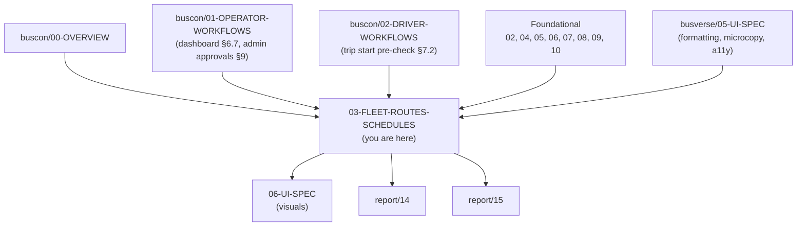

### 1.3 What this document does NOT cover

| Topic | Goes to |
|---|---|
| Admin approval queue for buses/routes/schedules | `buscon/01-OPERATOR-WORKFLOWS.md` §10 (WF-A-03) |
| Driver assignment to schedules | `buscon/01-OPERATOR-WORKFLOWS.md` §5 (WF-O-05) |
| Trip start/end, GPS, scan | `buscon/02-DRIVER-WORKFLOWS.md`, `04`, `05` |
| Full visual design (tokens, layout CSS) | `buscon/06-UI-SPEC.md` (pending per `buscon/00` §8.4) |
| Money / date / reference formats | `busverse/05-UI-SPEC.md` §8 |
| Base microcopy | `busverse/05-UI-SPEC.md` §19 |
| Passenger-side search rendering | `busverse/01-PASSENGER-WORKFLOWS.md` §4 |

### 1.4 Scope of this document

**Three workflows, four screens, 17 FRs:**

| # | Workflow | FRs | Screens | In | Out |
|:---:|---|---|---|---|---|
| 1 | WF-O-02 Bus registration + layout | FR-BO-005–011 | SCR-BC-BUSES, SCR-BC-BUSEDIT | Operator authenticated + APPROVED | Bus `PENDING` → admin review |
| 2 | WF-O-03 Route creation | FR-BO-012–016 | SCR-BC-ROUTES | Bus approved (typically) | Route `PENDING` → admin review |
| 3 | WF-O-04 Schedule creation + publish | FR-BO-017–021 | SCR-BC-SCHEDULES | Bus + route approved | Schedule `PUBLISHED` (searchable) |

### 1.5 FR ownership — 17 total

| Range | Area | Count |
|---|---|---:|
| FR-BO-005 to 011 | Fleet management | 7 |
| FR-BO-012 to 016 | Routes | 5 |
| FR-BO-017 to 021 | Schedules | 5 |
| **Total** | | **17** |

### 1.6 Endpoints owned — 18

| Resource | Endpoints | Count |
|---|---|---:|
| Buses | `POST`, `GET`, `GET/:id`, `PATCH`, `DELETE`, `GET/:id/layout`, `PUT/:id/layout` | 7 |
| Routes | `POST`, `GET`, `GET/:id`, `PATCH`, `POST/:id/stands`, `DELETE` | 6 |
| Schedules | `POST`, `GET`, `GET/:id`, `PATCH`, `POST/:id/publish` | 5 |
| **Total** | | **18** |

**New endpoints flagged for `07` v1.3 (§23 A4, A5):**
- `POST /v1/operator/schedules/:id/clone` — one-click clone (§13.8)
- `GET /v1/operator/stands?cityId=` — stands by city (§10.4, or use `GET /v1/public/cities/:id/stands` as workaround)

**Cross-referenced (not owned):**
- `POST /v1/operator/schedules/:id/assign-driver` — owned by `buscon/01` §5 (WF-O-05)
- `POST /v1/admin/buses/:id/approve`, `/reject` — owned by `buscon/01` §10 (WF-A-03)

### 1.7 Two critical amendments this doc requires

**A1 — Bus type + amenities fields.** `05` v1.2 §5.5's `Bus` entity has no `bus_type` and no `amenities`. `busverse/00` §5.1 lists both as search filters. This doc adds the fields:
- `bus_type varchar(20) NOT NULL` — enum: `AC_SEATER`, `AC_SLEEPER`, `NON_AC_SEATER`, `NON_AC_SLEEPER`, `AC_SEMI_SLEEPER`
- `amenities_json jsonb NOT NULL DEFAULT '{"_v": 1, "items": []}'` — array of `CHARGING`, `WIFI`, `WATER`, `BLANKET`, `CCTV`

Flags: `05` v1.3 + `06` v1.3 amendments.

**A2 — Replace `approveSchedule` with `unpublishSchedule`.** `04` §10.1 lists `approveSchedule` but `05` v1.2 §5.10's Schedule SM has no approval state (only `DRAFT` / `PUBLISHED` / `CANCELLED`). `08` §6.3 says admin "approves schedule". This doc resolves the conflict:
- Operator **publishes** schedules (per `08` §5.4)
- Admin **can unpublish** a published schedule with reason (oversight, not gate)
- Operation `unpublishSchedule` replaces `approveSchedule`

Flags: `04` v1.2 + `08` v1.2 amendments.

---

## 2. Workflow Map

**Diagram: Workflow and cascade**
*Three workflows + cascade rules. Bus feeds route; route feeds schedule; schedule cascades to bookings via WF-N-03. Admin approval (via `buscon/01` WF-A-03) gates buses and routes; schedules need only admin oversight.*

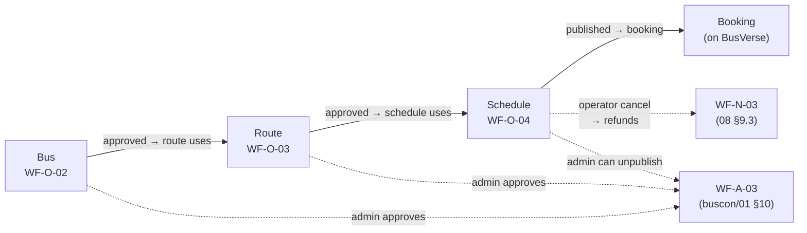

### 2.1 Coverage table

| Workflow | FRs | Screens | Entry | Exit |
|---|---|---|---|---|
| WF-O-02 | FR-BO-005–011 | SCR-BC-BUSES, SCR-BC-BUSEDIT | Operator APPROVED | Bus `PENDING` → approval queue |
| WF-O-03 | FR-BO-012–016 | SCR-BC-ROUTES | Bus approved (typically) | Route `PENDING` → approval queue |
| WF-O-04 | FR-BO-017–021 | SCR-BC-SCHEDULES | Bus + route approved | Schedule `PUBLISHED` (searchable) |

### 2.2 Cascade map

**Diagram: Cascade chain**
*The three entities form a dependency chain. Deleting or deactivating an upstream entity is blocked if downstream references exist. Schedule cancellation with future bookings triggers refunds (WF-N-03).*

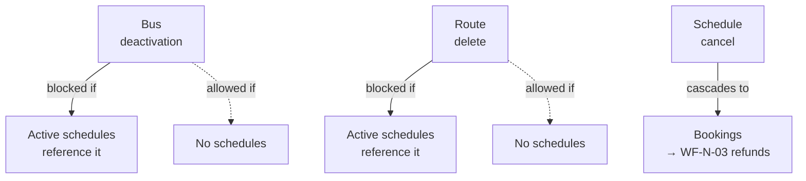

---

## 3. Prerequisites and Approval Gates

### 3.1 Operator state gate

**Diagram: Operator state gates**
*A pre-approval operator (`APPLIED` or `PENDING_REVIEW`) cannot create buses. An approved operator (`APPROVED` or `ACTIVE`) can create buses, routes, and schedules. A suspended operator cannot create anything.*

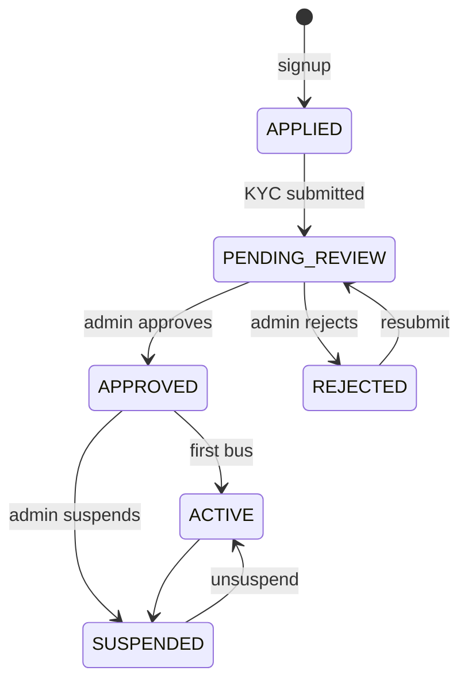

### 3.2 Per-workflow prerequisites

| Workflow | Operator status | Other prerequisites |
|---|---|---|
| WF-O-02 (bus) | `APPROVED` OR `ACTIVE` | — |
| WF-O-03 (route) | `APPROVED` OR `ACTIVE` | At least 1 bus (not required, but typical) |
| WF-O-04 (schedule) | `APPROVED` OR `ACTIVE` | Bus `APPROVED` + route `APPROVED` |

**Rules:**

| Rule | Error |
|---|---|
| Operator not approved | `403 OPERATOR_NOT_APPROVED` |
| Operator suspended | `403 OPERATOR_SUSPENDED` |
| Bus not approved (schedule) | `403 BUS_NOT_APPROVED` |
| Route not approved (schedule) | `403 ROUTE_NOT_APPROVED` |

---

## 4. WF-O-02a — Bus Registration (Create)

### 4.1 Flow narrative

**Narrative:** An approved operator registers a new bus by entering registration number, bus type, model, capacity, and amenities. The bus is created with `approval_status = PENDING`. Before submission, the operator must also build the seat layout via the grid builder (§5–§7). Once layout is saved, the bus enters the admin approval queue (via `buscon/01` WF-A-03).

**Reference:** `08` §5.2; `05` v1.2 §5.5.

### 4.2 Preconditions

| Table | State |
|---|---|
| `operators` | `status ∈ {APPROVED, ACTIVE}` |
| `users` | Authenticated as OPERATOR_OWNER or OPERATOR_MANAGER |
| `buses` | No row yet for this registration number |

### 4.3 Sequence

**Diagram: Bus registration sequence**
*Two-step creation. First: metadata (registration, model, capacity, type, amenities). Second: layout via grid builder (§5–§7). Both must complete before submission.*

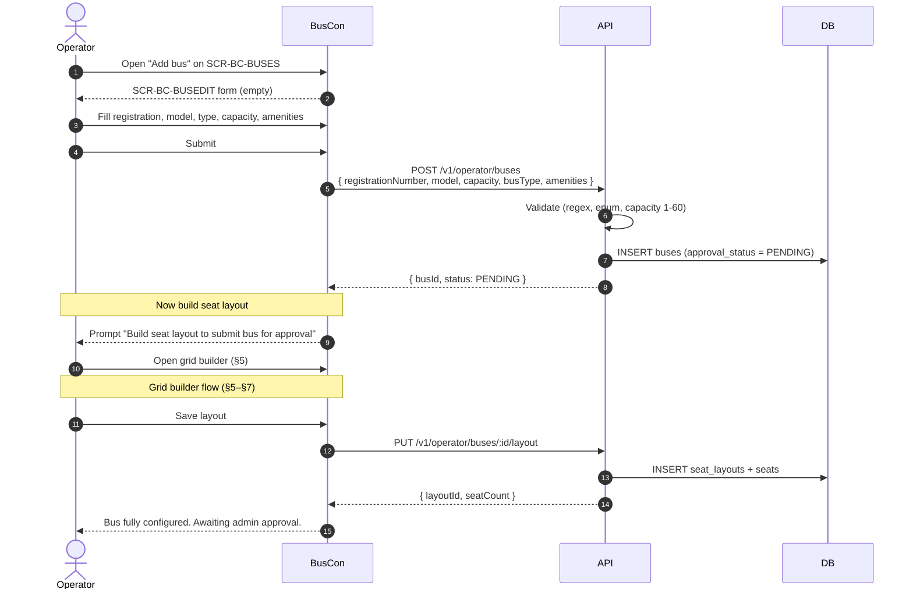

### 4.4 Form fields and validation

| Field | Type | Required | Validation | Error |
|---|---|:---:|---|---|
| Registration number | Text | ✅ | Regex `^[A-Z]{2}[-\s]?\d{1,2}[-\s]?[A-Z]{1,3}[-\s]?\d{4}$` (matches `DL-1P-1234`, `UP-32AB-5678`, `KA-01-AB-1234`) | `INVALID_REGISTRATION_FORMAT` |
| Bus type | Select | ✅ | One of 5 enum values | `INVALID_BUS_TYPE` |
| Model | Text | ✅ | 2–100 chars | `VALIDATION_ERROR` |
| Capacity | Number | ✅ | 1–60 | `INVALID_CAPACITY` |
| Amenities | Multi-select | ❌ | Subset of enum | `VALIDATION_ERROR` |

**Bus type enum (per §1.7 A1):**

| Value | Display |
|---|---|
| `AC_SEATER` | AC Seater |
| `AC_SLEEPER` | AC Sleeper |
| `NON_AC_SEATER` | Non-AC Seater |
| `NON_AC_SLEEPER` | Non-AC Sleeper |
| `AC_SEMI_SLEEPER` | AC Semi-Sleeper |

**Amenities enum:**

| Value | Display |
|---|---|
| `CHARGING` | Charging point |
| `WIFI` | WiFi |
| `WATER` | Bottled water |
| `BLANKET` | Blanket |
| `CCTV` | CCTV |

### 4.5 Endpoint chain

| # | Method | Path | Role | Notes |
|:---:|---|---|---|---|
| 1 | POST | `/v1/operator/buses` | OPERATOR_* | Creates bus PENDING |

### 4.6 State changes

| Table | Before | After |
|---|---|---|
| `buses` | Not exists | 1 row (`approval_status = PENDING`) |
| `audit_logs` | — | `bus_registered` |

### 4.7 Error branches

| Error | Trigger | UI |
|---|---|---|
| `BUS_REGISTRATION_EXISTS` | Duplicate registration | Inline error |
| `INVALID_REGISTRATION_FORMAT` | Bad regex | Field error |
| `INVALID_CAPACITY` | Out of range | Field error |
| `FORBIDDEN` | Operator not approved | Banner + redirect |

---

## 4.5. Bus Type and Amenities (A1 — new fields)

### 4.5.1 Rationale

**Diagram: Search filter alignment**
*BusVerse search filters by type and amenities (`busverse/00` §5.1). This requires `Bus` to carry those fields so the search API can filter on them. Adding two columns to `Bus` aligns the schema with the search contract.*

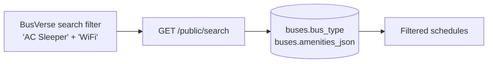

### 4.5.2 Schema additions (flagged for `05` v1.3, `06` v1.3)

**`05` v1.2 §5.5 Bus entity additions:**

| Attribute | Type |
|---|---|
| `bus_type` | enum (`AC_SEATER`, `AC_SLEEPER`, `NON_AC_SEATER`, `NON_AC_SLEEPER`, `AC_SEMI_SLEEPER`) |
| `amenities_json` | JSONB `{ "_v": 1, "items": [...] }` |

**`06` v1.2 §5.5 `buses` table additions:**

```sql
ALTER TABLE buses ADD COLUMN bus_type varchar(20) NOT NULL DEFAULT 'AC_SEATER'
  CHECK (bus_type IN ('AC_SEATER','AC_SLEEPER','NON_AC_SEATER','NON_AC_SLEEPER','AC_SEMI_SLEEPER'));
ALTER TABLE buses ADD COLUMN amenities_json jsonb NOT NULL DEFAULT '{"_v":1,"items":[]}'::jsonb;
```

### 4.5.3 Migration strategy (for `06` v1.3)

Zero-downtime migration per `06` v1.2 §16:

1. Add `bus_type` nullable with default `AC_SEATER`
2. Backfill: no-op (default catches existing rows)
3. Add `NOT NULL` + `CHECK` constraint in a second migration
4. `amenities_json`: add nullable with default `{"_v":1,"items":[]}`; backfill not needed

### 4.5.4 Search filter behavior (BusVerse side, informational)

Reference only — implementation in `busverse/01` §4.8. The BusVerse search API (`GET /v1/public/search`) will accept `?busType=AC_SLEEPER&amenities=WIFI,CHARGING` and filter server-side via `buses.bus_type` + `buses.amenities_json` JSONB containment.

---

## 5. Seat Layout Grid Builder — Setup

### 5.1 Purpose and entry

**Diagram: Grid builder entry**
*The grid builder is opened from SCR-BC-BUSEDIT after the bus metadata is saved. It is a three-step wizard: setup (rows × columns), cells (type assignment), preview + save.*

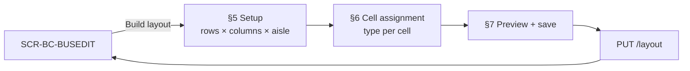

### 5.2 Step 1 — Grid dimensions

**Diagram: Grid dimension inputs**
*Three inputs: rows (1-20), columns (1-8), aisle column position. A live preview shows the grid immediately as the operator changes values.*

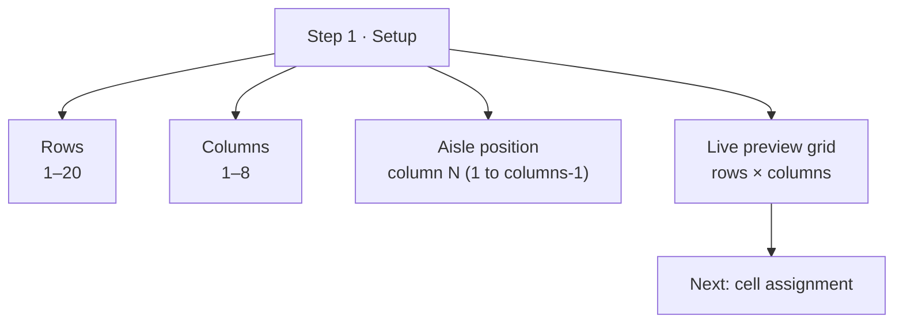

### 5.3 Capacity target and constraint

**Diagram: Capacity target**
*The bus capacity (from §4) is the target seat count. Every non-aisle cell counts toward capacity. Save is blocked until `seatCount === capacity`.*

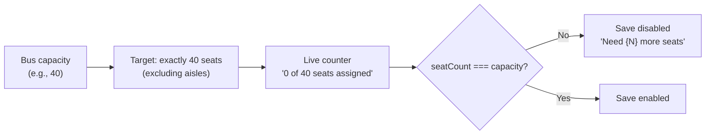

**Rules:**

| Rule | Detail |
|---|---|
| Grid size | Rows 1–20, columns 1–8 |
| Aisle position | Between column `N` and `N+1` (1-indexed); renders as 24px spacer |
| Total cells | `rows × columns` — all start as `EMPTY` |
| Max seats | `rows × columns` (if no aisles) |
| Min seats | 1 |
| Capacity target | Must equal `bus.capacity` |
| Aisle cells | Do not count toward capacity |

### 5.4 Standard layout presets (Phase 2 — flagged in Q15)

Not in Phase 1 — operator always builds from scratch. Presets like "40-seat standard 10×4" or "30-seat sleeper 15×2" are Phase 2. Rationale: Phase 1 demo has only 6–8 buses; preset templates add complexity without demo value.

### 5.5 Endpoint chain

None in this step — the grid is client-side until save (§7).

### 5.6 Error branches

| Error | Trigger | Recovery |
|---|---|---|
| Rows > 20 | Input | Clamp to 20 |
| Columns > 8 | Input | Clamp to 8 |
| Aisle at column 0 or = columns | Input | Invalid; auto-correct |

---

## 6. Seat Layout Grid Builder — Cell Assignment

### 6.1 Purpose

**Diagram: Cell assignment flow**
*After Setup (§5), the operator assigns a type to every cell. Click a cell → type picker opens → select SEATER/SLEEPER/SEMI_SLEEPER/EMPTY/AISLE. Labels auto-generate. Female-only is a per-seat toggle.*

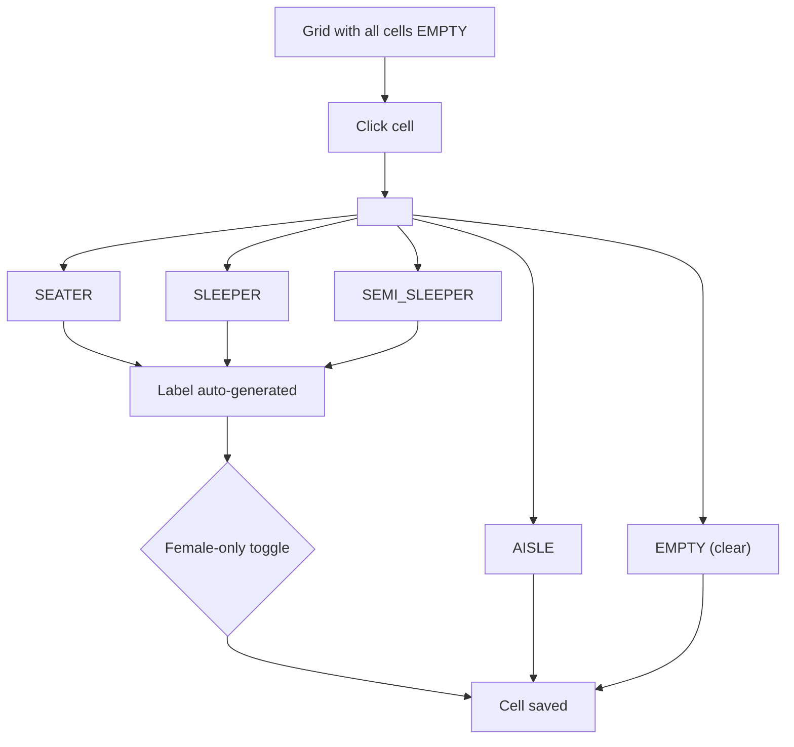

### 6.2 Cell states

| Cell state | Color (design guide §5 tokens) | Counts toward capacity | Clickable |
|---|---|:---:|:---:|
| `EMPTY` | `--surface-sunken` | ❌ | ✅ (assigns type) |
| `SEATER` | `--seat-available-bg/border` (emerald) | ✅ | ✅ (opens picker) |
| `SLEEPER` | Same, taller | ✅ | ✅ |
| `SEMI_SLEEPER` | Same, medium | ✅ | ✅ |
| `AISLE` | `--surface-sunken` with diagonal stripes | ❌ | ✅ |
| `FEMALE_ONLY` (tinted) | `--seat-female-bg/border` (rose magenta) | ✅ | ✅ (opens picker) |

### 6.3 Cell dimensions per type

| Type | Width | Height | Preview |
|---|---:|---:|---|
| SEATER | 40px | 44px | Square seat icon |
| SLEEPER | 40px | 70px | Tall sleeper icon |
| SEMI_SLEEPER | 40px | 60px | Medium icon |
| AISLE | 24px wide | Full row height | Striped |
| EMPTY | 40px | 44px | Dashed outline |

**Reference:** `busverse/02-SEAT-MATRIX-UI.md` §17 (seat types) — the grid builder mirrors the passenger-side rendering so operators see what passengers will see.

### 6.4 Seat label generation

**Diagram: Label generation**
*Labels auto-generate as `{row_letter}{column_number}` — row 1 = A, row 2 = B, ..., row 10 = J. Columns count 1 to N. When cells change type, labels regenerate. Operator cannot override labels (ensures uniqueness).*

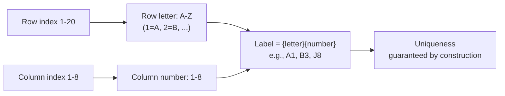

**Rules:**

| Rule | Detail |
|---|---|
| Format | `{row_letter}{column_number}` — e.g., `A1`, `B3` |
| Row letters | `A` through `T` (max 20 rows) |
| Column numbers | 1 through 8 |
| Aisle cells | No label |
| EMPTY cells | No label |
| Uniqueness | Guaranteed by row+column arithmetic |

**Note on `05` v1.2 §4.4 `SeatLabel` value object:** the format `A1` matches the example in `05`. No schema change needed.

### 6.5 Female-only toggle

**Diagram: Female-only assignment**
*On a `SEATER`/`SLEEPER`/`SEMI_SLEEPER` cell, an additional toggle marks it `is_female_only = true`. Renders with `.seat-fem` styling per design guide §5 (rose magenta).*

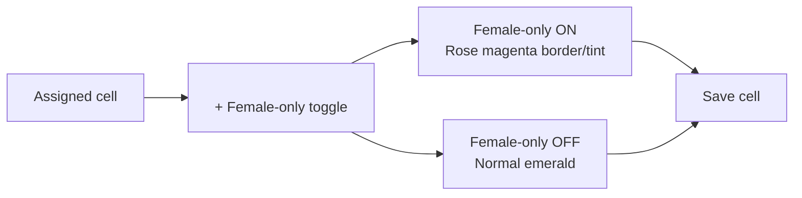

**Phase 1 behavior (per `busverse/02` §18):** visual only — passengers see the indicator but no enforcement. Q14 confirms deferral.

### 6.6 Bulk actions

**Diagram: Bulk actions**
*The grid builder supports three bulk operations to save time on repetitive layouts: fill row, fill column, clear all.*

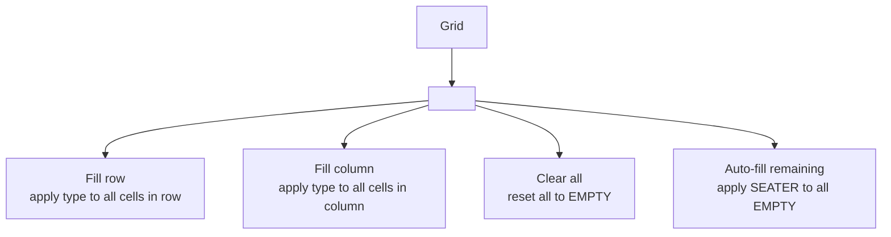

**Rules:**

| Action | Detail |
|---|---|
| Fill row | Applies selected type to all cells in a row (skips aisle) |
| Fill column | Applies selected type to all cells in a column (skips aisle) |
| Clear all | Confirmation required if any cells assigned |
| Auto-fill remaining | Only fills EMPTY cells; doesn't touch assigned |

### 6.7 Grid builder UI layout

```
┌─────────────────────────────────────────────────┐
│  Build layout · 40-seat target  · 0 of 40 seats │ ← header + counter
├─────────────────────────────────────────────────┤
│                                                  │
│   ┌───┬───┬───┬───┐                             │
│   │ A1│ A2│AIS│A3 │  ← cell grid                 │
│   ├───┼───┼───┼───┤                             │
│   │ B1│ B2│AIS│B3 │                             │
│   ├───┼───┼───┼───┤                             │
│   │ C1│ C2│AIS│C3 │                             │
│   └───┴───┴───┴───┘                             │
│                                                  │
│   [Fill row ▾] [Fill column ▾] [Auto-fill]      │
│   [Clear all]                                    │
│                                                  │
├─────────────────────────────────────────────────┤
│  <CellTypePicker> (visible when cell selected)   │
│  ● SEATER  ● SLEEPER  ● SEMI_SLEEPER             │
│  ● AISLE   ● EMPTY                               │
│  □ Female-only                                   │
├─────────────────────────────────────────────────┤
│  [ Cancel ]                      [ Next: Preview]│
└─────────────────────────────────────────────────┘
```

### 6.8 Error branches

| Error | Trigger | UI |
|---|---|---|
| None — this step is client-only | — | — |

**Rule:** All errors surface at Preview (§7) or Save (§7.6).

---

## 7. Seat Layout Grid Builder — Preview + Save

### 7.1 Purpose

**Diagram: Preview and save**
*Final step. Shows two side-by-side views: builder view (operator's working grid) and passenger preview (what passengers see in BusVerse). Runs validation checklist. Save is enabled only when all checks pass.*

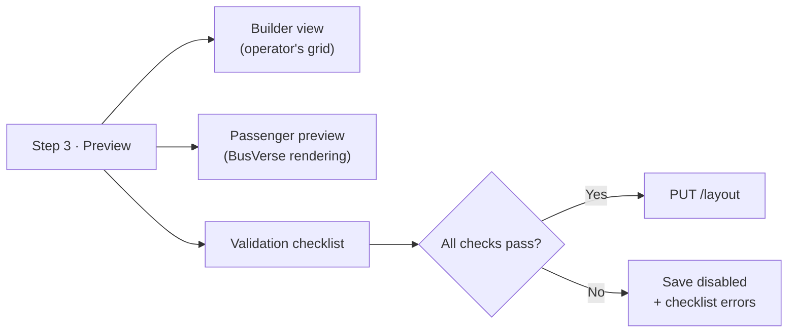

### 7.2 Validation checklist

**Diagram: Validation checklist**
*Six checks. All must pass to enable save.*

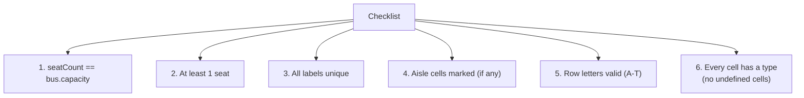

| # | Check | Rule | Failure message |
|:---:|---|---|---|
| 1 | Capacity match | `count(SEATER + SLEEPER + SEMI_SLEEPER) === bus.capacity` | "Assign exactly {capacity} seats ({assigned} currently)" |
| 2 | At least 1 seat | `count(seats) >= 1` | "Add at least one seat" |
| 3 | Labels unique | No duplicate `{row}{col}` labels | Auto-guaranteed by construction |
| 4 | Aisles marked | If `layout.aisle_map_json.aisle_cells.length > 0`, aisle positions must match grid | "Aisle configuration invalid" |
| 5 | Row letters | All rows used have valid `A-T` letters | Auto-guaranteed |
| 6 | No undefined cells | Every cell ∈ {SEATER, SLEEPER, SEMI_SLEEPER, AISLE, EMPTY} | "Some cells not assigned" |

### 7.3 Passenger preview

**Diagram: Passenger preview**
*Shows the layout using `busverse/02` §7's rendering — same colors, same seat states. This is a static preview — all seats shown as AVAILABLE (there's no booking context in the builder).*

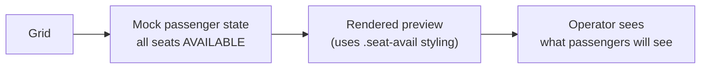

**Reference:** `busverse/02-SEAT-MATRIX-UI.md` §7 (seat cell rendering).

### 7.4 Layout JSON generation

**Diagram: JSON generation**
*On save, the grid is serialized to the `seat_layouts` + `seats` rows. `aisle_map_json` captures aisle positions per `06` v1.2 §5.6.*

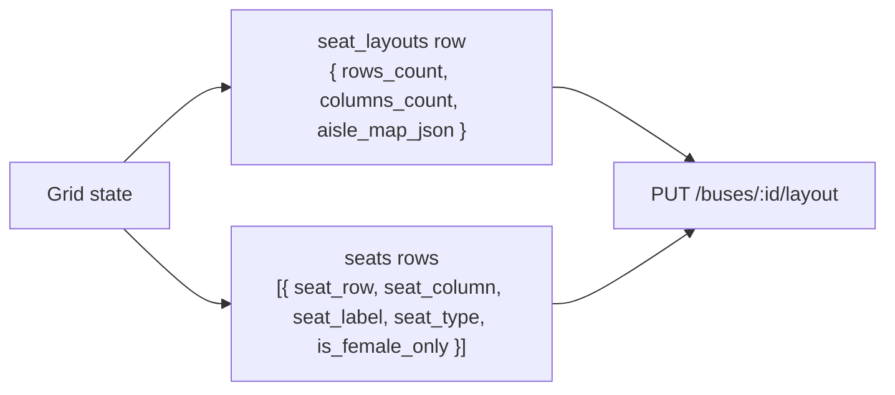

**Layout JSON shape (matches `06` v1.2 §5.6 `aisle_map_json`):**

```json
{
  "_v": 1,
  "aisle_cells": [
    { "row": 1, "column": 2 },
    { "row": 2, "column": 2 }
  ]
}
```

**Seats payload shape (array):**

```json
[
  { "seatRow": "A", "seatColumn": 1, "seatLabel": "A1", "seatType": "SEATER", "isFemaleOnly": false },
  { "seatRow": "A", "seatColumn": 3, "seatLabel": "A3", "seatType": "SEATER", "isFemaleOnly": false }
]
```

### 7.5 Save flow

**Diagram: Save sequence**
*Atomic operation. Server validates capacity match, labels unique, bus exists + PENDING. Layout + seats inserted in one transaction. Bus remains PENDING until admin approval (§8).*

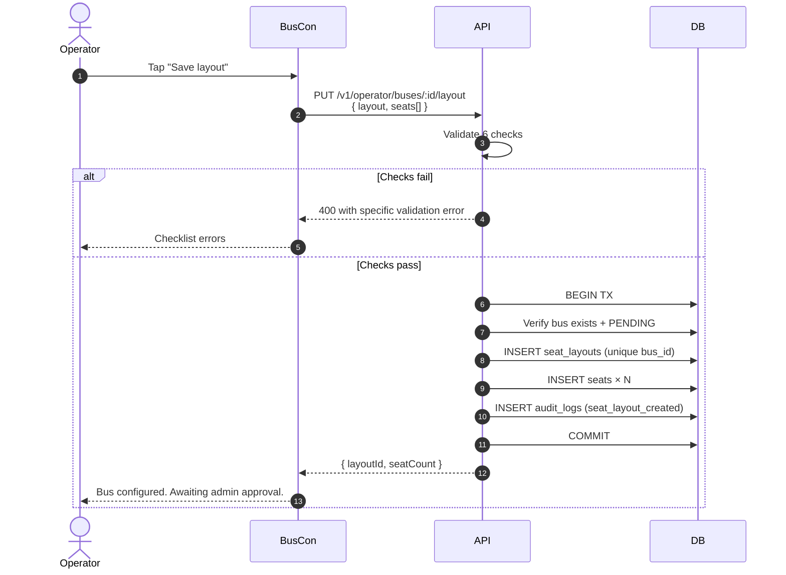

### 7.6 Autosave (resolves M8)

**Diagram: Autosave flow**
*Every 30 seconds and on tab blur, the grid state autosaves to local SQLite (or IndexedDB for web). On page reopen, prompt to resume.*

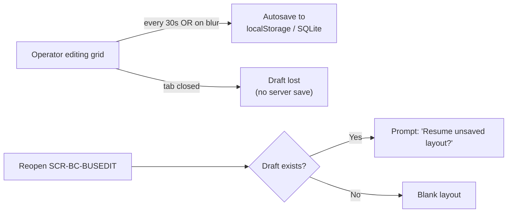

**Rules:**

| Rule | Detail |
|---|---|
| Storage | `localStorage` key `buscon:draft:layout:{busId}` (web) |
| Frequency | Every 30s + on visibility change |
| Payload | Full grid state (rows, columns, aisle, cells) |
| Expiry | 24h (auto-purged after) |
| Resume prompt | On reopen, if draft exists → "Resume unsaved layout?" with Resume/Discard |
| Server save | Only on explicit "Save layout" button |

### 7.7 Endpoint chain

| # | Method | Path | Role | Notes |
|:---:|---|---|---|---|
| 1 | PUT | `/v1/operator/buses/:id/layout` | OPERATOR_* | Idempotent — replaces existing layout |
| 2 | GET | `/v1/operator/buses/:id/layout` | OPERATOR_* | Fetches current layout |

**Reference:** `07` v1.2 §5.2.

### 7.8 State changes

| Table | Before | After |
|---|---|---|
| `seat_layouts` | 0 | 1 (or updated) |
| `seats` | 0 | N (or updated) |
| `buses` | `PENDING` | `PENDING` (unchanged — awaiting admin) |
| `audit_logs` | — | `seat_layout_created` |

### 7.9 Error branches

| Error | Trigger | UI |
|---|---|---|
| `CAPACITY_MISMATCH` | `seatCount != capacity` | Checklist error, save disabled |
| `INVALID_LAYOUT` | Malformed cells | Field error |
| `BUS_NOT_FOUND` | Bus deleted | Toast + redirect |
| `BUS_ALREADY_APPROVED` | Layout edit post-approval (§8.4) | Blocked |
| `LAYOUT_EXISTS` | Attempting to re-add (only if not PUT) | N/A (PUT replaces) |

---

## 8. Bus Edit, Insurance Upload, and Cascade

### 8.1 Post-approval edit rules

**Diagram: Post-approval edit rules**
*After a bus is APPROVED, most fields are locked. Insurance can be re-uploaded (reverts bus to PENDING for re-approval). Layout is immutable forever per `05` v1.2 §21.*

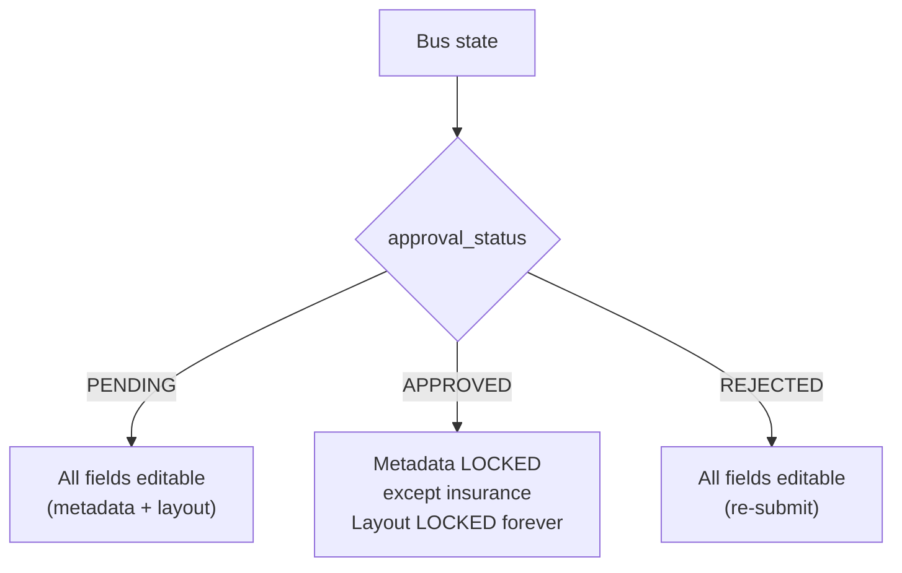

**Reference:** `05` v1.2 §21 (immutability declarations).

### 8.2 Editable fields by approval state

| Field | PENDING | APPROVED | REJECTED |
|---|:---:|:---:|:---:|
| Registration number | ✅ | ❌ | ✅ |
| Bus type | ✅ | ❌ | ✅ |
| Model | ✅ | ❌ | ✅ |
| Capacity | ✅ | ❌ | ✅ |
| Amenities | ✅ | ❌ | ✅ |
| Insurance doc + expiry | ✅ | ✅ (reverts to PENDING) | ✅ |
| Seat layout | ✅ | ❌ | ✅ |

**Rule:** Any change to locked fields after `APPROVED` returns `403 BUS_IMMUTABLE_AFTER_APPROVAL`. To change a locked field, operator must **deactivate the bus + create a new one** (§8.4).

### 8.3 Insurance upload flow (resolves G5)

**Diagram: Insurance upload**
*Two-step R2 upload reusing the upload pattern from `07` v1.2 §5.4. Insurance expiry is a separate field (date). Upload + expiry are set together. Post-approval upload reverts bus to PENDING.*

```mermaid
sequenceDiagram
    autonumber
    actor O as Operator
    participant BC as BusCon
    participant API as API
    participant R2 as R2
    participant DB as DB

    O->>BC: Open insurance section
    O->>BC: Upload PDF/image
    BC->>API: POST /v1/operator/uploads<br/>{ filename, contentType, purpose: BUS_INSURANCE, sizeBytes }
    API-->>BC: { uploadId, uploadUrl, expiresAt }
    BC->>R2: PUT (file bytes)
    R2-->>BC: 200

    O->>BC: Enter expiry date
    O->>BC: Save
    BC->>API: PATCH /v1/operator/buses/:id<br/>{ insuranceDocUploadId, insuranceExpiresAt }
    API->>R2: HEAD verify
    API->>DB: UPDATE buses<br/>insurance_doc_ref, insurance_expires_at
    alt Bus was APPROVED
        API->>DB: UPDATE buses.approval_status = PENDING
    end
    API->>DB: INSERT audit_logs (insurance_uploaded)
    API-->>BC: { updated }
```

**Rules:**

| Rule | Detail |
|---|---|
| File type | PDF, JPG, PNG |
| File size | ≤ 5 MB |
| Expiry date | Required; must be future date |
| First upload | Sets `insurance_doc_ref` + `insurance_expires_at` |
| Re-upload | Replaces both fields |
| Post-approval | Reverts `approval_status` to `PENDING` (re-review required) |

### 8.4 Bus deactivation (resolves M3)

**Diagram: Bus deactivation gate**
*Deactivation is a soft delete (sets `deleted_at`). Blocked if any active schedules reference the bus. Operator must cancel all schedules first.*

```mermaid
flowchart TB
    DEL["Operator taps 'Deactivate bus'"] --> CHECK{"Active schedules?"}
    CHECK -->|"Yes"| BLOCK["409 BUS_HAS_ACTIVE_SCHEDULES<br/>'Cancel {N} schedules first'"]
    CHECK -->|"No"| CONFIRM["Confirm dialog:<br/>'Deactivate {bus}?'"]
    CONFIRM --> SOFT["Soft delete<br/>deleted_at set"]
    SOFT --> AUDIT["Audit log"]
```

**Reference:** `05` v1.2 §6.2 (bus cannot be deleted if any schedule references).

### 8.5 Insurance expiry flag in UI

| Status | Badge | Action |
|---|---|---|
| No insurance | Red "No insurance" | Upload now |
| Expiring < 30 days | Amber "Expires in {N} days" | Re-upload |
| Expired | Red "Expired {N} days ago" | Upload (bus becomes unbokable) |
| Valid | None (default) | — |

**Rule:** An expired insurance does not block existing schedules, but BusVerse search hides the bus (per `05` v1.2 §5.5's `insurance_expires_at` — expiry check on search).

### 8.6 Cascade rules (resolves M3, M4, M5; see also §12, §16)

**Diagram: Bus cascade**
*Bus deactivation blocked by schedules. Bus edit post-approval allowed for insurance only. Layout immutable forever.*

```mermaid
flowchart LR
    DEACT["Deactivate bus"] -->|"blocked if"| SCH["Active schedules reference bus"]
    EDIT["Edit bus"] -->|"if APPROVED"| LOCKED["Only insurance<br/>(reverts to PENDING)"]
    LAYOUT["Layout"] -->|"after APPROVED"| NEVER["Immutable forever"]
```

---

## 9. Bus List Screen (SCR-BC-BUSES)

### 9.1 Screen layout

**Diagram: Bus list composition**
*DataTable (per `buscon/00` §9.3) with filters, "+ Add bus" CTA, per-row actions.*

```mermaid
flowchart TB
    PAGE["SCR-BC-BUSES"]

    PAGE --> HEADER["<PageHeader><br/>title · + Add bus"]
    PAGE --> FILTERS["<BusFilters><br/>status · bus type"]
    PAGE --> TABLE["<BusTable><br/>(DataTable)"]
    TABLE --> EMPTY["<EmptyState><br/>no buses"]
    TABLE --> DETAIL["<BusDetailDrawer><br/>opens on row click"]
```

### 9.2 Bus list columns

| Column | Content | Sortable |
|---|---|---|
| Registration | `DL-1P-1234` | ✅ |
| Bus type | `AC Sleeper` badge | ✅ |
| Model | Free text | ✅ |
| Capacity | `40` | ✅ |
| Approval status | Badge (Pending / Approved / Rejected / Deactivated) | ✅ |
| Insurance | Status badge (§8.5) | ✅ |
| Actions | View · Edit · Deactivate | ❌ |

### 9.3 Filters

| Filter | Options |
|---|---|
| Approval status | All · PENDING · APPROVED · REJECTED · (DEACTIVATED hidden by default) |
| Bus type | All · each of the 5 types |

### 9.4 Empty state

| State | UI |
|---|---|
| No buses at all | Illustration + "No buses yet" + "Add your first bus" CTA |
| Filter empty | "No buses match these filters" + clear filters link |
| Loading | Skeleton rows × 5 |
| Error | Inline banner + retry |

### 9.5 Actions

| Action | Behavior |
|---|---|
| Add bus | Navigate to SCR-BC-BUSEDIT (create mode) |
| View | Open drawer with all details + layout preview |
| Edit | Navigate to SCR-BC-BUSEDIT (edit mode) |
| Deactivate | Confirmation → soft delete (§8.4) |

### 9.6 Data fetching

**React Query key:** `['operator', 'buses', { filter }]`

**Cache:** staleTime 30s.

**Refresh:** On focus + after any bus mutation.

---

## 10. WF-O-03 — Route Creation

### 10.1 Flow narrative

**Narrative:** An approved operator creates a route by selecting origin city and destination city, then adding ordered intermediate stops (stands). Each stop (except the first) has a `distance_from_prev_km` and `duration_from_prev_min`. The route is created with `approval_status = PENDING`. Validation ensures origin city matches first stop's city and destination matches last stop's city.

**Reference:** `08` §5.3; `05` v1.2 §5.8.

### 10.2 Preconditions and validation

| Table | State |
|---|---|
| `operators` | `status ∈ {APPROVED, ACTIVE}` |
| `routes` | No identical route per operator |

**Route identity rule (resolves G10):** two routes are identical if `(operator_id, origin_city_id, destination_city_id, ordered_stand_ids)` match. Duplicate → `409 ROUTE_ALREADY_EXISTS`.

### 10.3 Sequence

**Diagram: Route creation sequence**
*Create route (origin + destination) → add ordered stops (2 minimum, unlimited max) → PENDING → admin review.*

```mermaid
sequenceDiagram
    autonumber
    actor O as Operator
    participant BC as BusCon
    participant API as API
    participant DB as DB

    O->>BC: Open "Add route"
    BC-->>O: Form (origin + destination)

    O->>BC: Select origin city, destination city
    O->>BC: Submit
    BC->>API: POST /v1/operator/routes<br/>{ originCityId, destinationCityId }
    API->>API: Validate origin ≠ destination
    API->>API: Check duplicate per operator
    API->>DB: INSERT routes (PENDING)
    API-->>BC: { routeId }

    Note over O,BC: Now add stops
    O->>BC: Add stands in order
    Note over O,BC: Stands editor (§11)
    O->>BC: Save stands
    BC->>API: POST /v1/operator/routes/:id/stands<br/>{ stands: [{ standId, distanceKm, durationMin }] }
    API->>API: Validate (≥2 stops, origin/dest city matches, sequence unique)
    API->>DB: INSERT route_stands
    API-->>BC: { routeId, stopCount }
    BC-->>O: Route configured. Awaiting admin approval.
```

### 10.4 Endpoint chain

| # | Method | Path | Role |
|:---:|---|---|---|
| 1 | POST | `/v1/operator/routes` | OPERATOR_* |
| 2 | POST | `/v1/operator/routes/:id/stands` | OPERATOR_* |

**Stands lookup** (resolves M7): the operator needs to pick stands per city. `07` v1.2 §5.2 has **no endpoint** for stands — flag `07` v1.3 to add `GET /v1/operator/stands?cityId=` OR reuse `GET /v1/public/cities/:id/stands`.

**Workaround (Phase 1):** call `GET /v1/public/cities` (already exists per `07` v1.2 §4.2) → then a stands sub-endpoint that needs confirmation. Q flags.

### 10.5 State changes

| Table | Before | After |
|---|---|---|
| `routes` | Not exists | 1 row (`approval_status = PENDING`) |
| `route_stands` | 0 | ≥ 2 rows |
| `audit_logs` | — | `route_created` |

### 10.6 Error branches

| Error | Trigger | UI |
|---|---|---|
| `ROUTE_SAME_CITY` | Origin = destination | Inline field error |
| `ROUTE_ALREADY_EXISTS` | Duplicate per operator | Toast + "View existing route" |
| `VALIDATION_ERROR` | Missing field | Field error |
| `FORBIDDEN` | Operator not approved | Banner |

---

## 11. Route Stands Editor

### 11.1 Purpose

**Diagram: Stands editor**
*Ordered list of stands with distance + duration from previous stop. First stop auto-0/0. Reorder via up/down arrows (a11y-friendly, not drag-drop).*

```mermaid
flowchart TB
    EDITOR["<StandsEditor>"]

    EDITOR --> LIST["<StandsList><br/>ordered rows"]
    LIST --> R1["1. Kashmere Gate<br/>0 km · 0 min (auto)"]
    LIST --> R2["2. Ghaziabad<br/>45 km · 60 min"]
    LIST --> R3["3. Kanpur<br/>380 km · 300 min"]
    LIST --> R4["4. Lucknow<br/>80 km · 90 min"]

    EDITOR --> ADD["<AddStandButton>"]
    EDITOR --> REORDER["Up/Down arrows<br/>per row"]
    EDITOR --> REMOVE["Remove button<br/>per row (except first/last)"]
```

### 11.2 Reorder UX (resolves M15, Q6)

**Diagram: Reorder via arrows**
*Up/down arrow buttons (not drag-drop). Keyboard accessible. Distance/duration adjustments prompt when reordering.*

```mermaid
flowchart LR
    ROW["Row 2: Ghaziabad"] -->|"⬆ tap"| MOVE["Row becomes 1"]
    MOVE --> PROMPT["Prompt: re-enter distance<br/>and duration"]
```

**Rules:**

| Rule | Detail |
|---|---|
| Reorder | Up/down arrow per row |
| First stop | Cannot be moved up; no distance/duration fields |
| Last stop | Cannot be moved down |
| After reorder | All affected rows' distance/duration reset; operator re-enters |
| Keyboard | Arrow keys navigate; Enter to trigger reorder |

### 11.3 Distance and duration input (resolves G7)

**Diagram: Per-stop fields**
*First stop is 0/0 (auto). Each subsequent stop requires distance from previous + duration from previous. Operator enters manually — no auto-calculation from lat/lng in Phase 1.*

```mermaid
flowchart TB
    ROW["Stand row (position > 1)"]
    ROW --> DIST["Distance from prev<br/>1–2000 km"]
    ROW --> DUR["Duration from prev<br/>1–1440 min"]
    ROW --> SUM["Auto-computed total<br/>(display only)"]
```

**Rules:**

| Rule | Detail |
|---|---|
| Distance | `numeric(7,2)`, 0.1–2000 km |
| Duration | `integer`, 1–1440 min |
| First stop | 0/0 auto-filled, readonly |
| Total | Sum of all distances + durations displayed at bottom |
| Validation | Both required for stops ≥ 2 |

**Rationale (G7):** Phase 1 has no routing API. Auto-calc from lat/lng requires Google Routes or OSRM integration — Phase 2. Manual input is acceptable because operators know their corridor.

### 11.4 Origin/destination city consistency (resolves M6)

**Diagram: City consistency validation**
*The first stop's city must equal `route.origin_city_id`; the last stop's city must equal `route.destination_city_id`. This is enforced client-side (warning) and server-side (hard block).*

```mermaid
flowchart LR
    FIRST["First stop city"] --> CHECK1{"= route.origin_city_id?"}
    LAST["Last stop city"] --> CHECK2{"= route.destination_city_id?"}
    CHECK1 -->|"No"| ERR1["400 ORIGIN_MISMATCH"]
    CHECK2 -->|"No"| ERR2["400 DESTINATION_MISMATCH"]
    CHECK1 -->|"Yes"| OK1["OK"]
    CHECK2 -->|"Yes"| OK2["OK"]
```

### 11.5 Stand discovery (resolves G6)

**Diagram: Stand selection**
*Operator picks from the global `stands` list. If a needed stand is missing, operator must contact admin — no operator-side stand creation in Phase 1.*

```mermaid
flowchart LR
    ADD["+ Add stand"] --> SEARCH["Search stands in<br/>(prev stand's city) or any city"]
    SEARCH --> PICK["Pick from dropdown"]
    PICK --> MISSING{"Stand missing?"}
    MISSING -->|"Yes"| CONTACT["Contact admin to add stand<br/>(no Phase 1 self-service)"]
    MISSING -->|"No"| ADDED["Stand added to route"]
```

**Q4 confirms Phase 2 for operator-created stands.**

### 11.6 Endpoint chain

| # | Method | Path | Role |
|:---:|---|---|---|
| 1 | POST | `/v1/operator/routes/:id/stands` | OPERATOR_* |

**Note:** Stands are replaced wholesale on each call (idempotent PUT semantics, though declared as POST per `07` v1.2 §5.2).

### 11.7 State changes

| Table | Before | After |
|---|---|---|
| `route_stands` | 0 | ≥ 2 rows |
| `audit_logs` | — | `route_stands_updated` |

### 11.8 Error branches

| Error | Trigger | UI |
|---|---|---|
| `ROUTE_ORIGIN_MISMATCH` | First stop city ≠ origin | Inline error |
| `ROUTE_DESTINATION_MISMATCH` | Last stop city ≠ destination | Inline error |
| `INVALID_STAND_SEQUENCE` | Sequence not 1..N | Auto-fixed client-side |
| `INSUFFICIENT_STOPS` | < 2 stops | Field error |

---

## 12. Route Screen (SCR-BC-ROUTES) + Route Cascade

### 12.1 Screen layout

**Diagram: Route list**
*DataTable with route list, filters, per-row actions.*

```mermaid
flowchart TB
    PAGE["SCR-BC-ROUTES"]

    PAGE --> HEADER["<PageHeader><br/>title · + Add route"]
    PAGE --> FILTERS["<RouteFilters><br/>status"]
    PAGE --> TABLE["<RouteTable><br/>(DataTable)"]
    TABLE --> EDITOR["<RouteEditorDrawer><br/>with stands editor"]
```

### 12.2 Route list columns

| Column | Content | Sortable |
|---|---|---|
| Origin → Destination | `Delhi → Lucknow` | ✅ |
| Stops | `4` | ✅ |
| Total distance | `505 km` | ✅ |
| Total duration | `450 min` | ✅ |
| Approval status | Badge | ✅ |
| Actions | View · Edit · Delete | ❌ |

### 12.3 Route edit rules

| State | Edit allowed? |
|---|---|
| PENDING | ✅ Full edit |
| APPROVED | ❌ Immutable |
| REJECTED | ✅ Full edit |

**Reference:** `05` v1.2 §21.

### 12.4 Route delete (resolves M4)

**Diagram: Route delete cascade**
*Route delete blocked if any schedules reference it. Operator must cancel schedules first.*

```mermaid
flowchart TB
    DEL["Delete route"] --> CHECK{"Active schedules?"}
    CHECK -->|"Yes"| BLOCK["409 ROUTE_IN_USE<br/>'Cancel {N} schedules first'"]
    CHECK -->|"No"| SOFT["Soft delete"]
    SOFT --> AUDIT["Audit log"]
```

**Reference:** `05` v1.2 §6.2, `07` v1.2 §5.2.

### 12.5 Data fetching

**React Query key:** `['operator', 'routes', { filter }]`

**Cache:** staleTime 30s.

---

## 13. WF-O-04 — Schedule Creation

### 13.1 Flow narrative

**Narrative:** An approved operator creates a schedule by selecting an approved bus, an approved route, setting departure date + time, arrival date + time (explicitly, to support overnight trips), and a single fare amount. The schedule is created as `DRAFT`. Conflicts are detected before creation (same bus + overlapping time window). If clean, operator publishes (§14).

**Reference:** `08` §5.4; `05` v1.2 §5.10.

### 13.2 Preconditions

| Table | State |
|---|---|
| `buses` | `approval_status = APPROVED` |
| `routes` | `approval_status = APPROVED` |
| `schedules` | No conflicting schedule for this bus |

### 13.3 Sequence

**Diagram: Schedule creation sequence**
*Create DRAFT → check conflicts (client + server) → optionally clone from existing (Phase 1) → save. Publish is a separate step (§14).*

```mermaid
sequenceDiagram
    autonumber
    actor O as Operator
    participant BC as BusCon
    participant API as API
    participant DB as DB

    O->>BC: Open "Add schedule"
    BC-->>O: Form

    O->>BC: Select bus, route, departure, arrival, fare
    Note over O,BC: Optional: clone from existing

    O->>BC: Submit
    BC->>API: POST /v1/operator/schedules<br/>{ busId, routeId, departureTime, arrivalTime, fareAmountPaise }
    API->>API: Validate bus/route approved
    API->>API: Validate arrival > departure (allow overnight)
    API->>API: Check conflicts (same bus + overlapping window)
    alt Conflict
        API-->>BC: 409 SCHEDULE_CONFLICT with conflicting schedule
        BC-->>O: Show conflict + suggested alternatives
    else Clean
        API->>DB: INSERT schedules (DRAFT)
        API-->>BC: { scheduleId, status: DRAFT }
        BC-->>O: Schedule created. Publish to make it visible.
    end
```

### 13.4 Form fields

| Field | Type | Required | Validation |
|---|---|:---:|---|
| Bus | Select (approved buses) | ✅ | `approval_status = APPROVED` |
| Route | Select (approved routes) | ✅ | `approval_status = APPROVED` |
| Departure date + time | Date + time picker | ✅ | Future date |
| Arrival date + time | Date + time picker | ✅ | After departure (any date) |
| Fare | Currency | ✅ | ₹1–₹5000 |
| Confirm departure = arrival? | Checkbox | ❌ | If checked, arrival auto = departure (invalid — rejected) |

### 13.5 Overnight trips (resolves M2, Q3)

**Diagram: Overnight handling**
*Departure and arrival each carry their own date. For trips like 23:00 → 06:00 next day, operator explicitly picks both dates. UI shows "arrives {date} (next day)" prominently.*

```mermaid
flowchart LR
    DEP["Departure<br/>2026-10-25 23:00"] --> ARR["Arrival<br/>2026-10-26 06:00"]
    ARR --> CHECK{"arrival > departure?"}
    CHECK -->|"Yes (next day)"| OK["Overnight trip · UI shows 'arrives Oct 26'"]
    CHECK -->|"No"| ERR["400 INVALID_SCHEDULE_TIMES"]
```

**Rules:**

| Rule | Detail |
|---|---|
| Date format | Both departure and arrival have explicit dates |
| Overnight | Allowed if `arrival_date > departure_date` |
| Same day | Allowed if `arrival_time > departure_time` |
| Cross-midnight check | Server compares `arrival_datetime > departure_datetime` |
| UI display | If `arrival_date != departure_date`: prominent badge "arrives {next day date}" |

### 13.6 Single fare limitation (resolves M1, Q4)

**Diagram: Single fare per schedule**
*One fare per schedule. Passengers boarding at any stop to any later stop pay the same fare. This is a Phase 1 limitation — Phase 2 adds per-segment fare matrix.*

```mermaid
flowchart LR
    SCH["Schedule"] --> FARE["fare_amount_paise (single)"]
    FARE --> PAX1["Passenger from stop 1 → last: ₹450"]
    FARE --> PAX2["Passenger from stop 2 → last: ₹450"]
    FARE --> PAX3["Passenger from stop 1 → stop 3: ₹450"]
```

**Phase 1 limitation acknowledged:**

- Same fare regardless of boarding/dropping stops
- Cannot implement distance-based or segment-based fares in Phase 1
- Phase 2: `fare_matrix` per `RouteStand` pairs
- **Demo implication:** Operators should price for the full route

**Q4 confirms deferral.**

### 13.7 Duration consistency warning (resolves M11)

**Diagram: Duration warning**
*Client computes `arrival - departure`. If it differs from `route.total_duration` (sum of `duration_from_prev_min`) by > 30 min, show a warning (not block).*

```mermaid
flowchart LR
    DIFF["Arrival - departure<br/>e.g., 480 min"] --> CMP["Compare to<br/>route total<br/>e.g., 450 min"]
    CMP --> CHECK{"Diff > 30 min?"}
    CHECK -->|"Yes"| WARN["Warning banner:<br/>'Trip duration 480 min vs route duration 450 min. Continue?'"]
    CHECK -->|"No"| OK["Silent"]
```

**Rules:**

| Rule | Detail |
|---|---|
| Comparison | `arrival - departure` vs `route.total_duration` |
| Threshold | > 30 min difference → warning |
| Action | Warning shown but allows proceed |
| Rationale | Operators may intend longer (rest stops) or may have made a typo |

### 13.8 Schedule clone (resolves M9, Q5)

**Diagram: Clone flow**
*Clone an existing schedule to save time. Copies bus, route, fare; resets departure/arrival dates. Operator edits times. Creates a new DRAFT.*

```mermaid
sequenceDiagram
    autonumber
    actor O as Operator
    participant BC as BusCon
    participant API as API
    participant DB as DB

    O->>BC: On schedule list, tap "Clone"
    BC->>BC: Open clone dialog:<br/>new departure date, new arrival date
    O->>BC: Enter new dates
    O->>BC: Confirm
    BC->>API: POST /v1/operator/schedules/:id/clone<br/>{ newDepartureTime, newArrivalTime }
    API->>API: Validate new times (conflict check)
    API->>DB: INSERT new schedule (DRAFT, copied fields)
    API-->>BC: { newScheduleId }
    BC-->>O: New schedule created. Publish to activate.
```

**New endpoint (flag `07` v1.3 A4):** `POST /v1/operator/schedules/:id/clone`

**Clone copies:**
- `bus_id`, `route_id`, `fare_amount_paise`
- Does NOT copy: `driver_id`, `status` (new = DRAFT)

**Confirms Q5 (Phase 1).**

### 13.9 Endpoint chain

| # | Method | Path | Role |
|:---:|---|---|---|
| 1 | POST | `/v1/operator/schedules` | OPERATOR_* |
| 2 | POST | `/v1/operator/schedules/:id/clone` | OPERATOR_* (new — flag A4) |

### 13.10 State changes

| Table | Before | After |
|---|---|---|
| `schedules` | Not exists | 1 row (`status = DRAFT`) |
| `audit_logs` | — | `schedule_created` |

### 13.11 Error branches

| Error | Trigger | UI |
|---|---|---|
| `INVALID_SCHEDULE_TIMES` | Arrival ≤ departure | Field error |
| `SCHEDULE_CONFLICT` | Overlapping bus window | Toast + conflict details |
| `BUS_NOT_APPROVED` | Bus not approved | Field error |
| `ROUTE_NOT_APPROVED` | Route not approved | Field error |
| `VALIDATION_ERROR` | Missing field | Field error |

---

## 14. Schedule Publish Flow

### 14.1 Flow narrative

**Narrative:** Once a schedule is `DRAFT`, the operator publishes it. Publishing makes the schedule searchable on BusVerse immediately. Per §1.7 A2, admin oversight is via **`unpublishSchedule`** — admin can unpublish a published schedule with a reason (returning it to `DRAFT`); the operator is notified and can fix + re-publish.

**Reference:** `08` §5.4; resolution of `08` §6.3.

### 14.2 Publish sequence

**Diagram: Publish sequence**
*Publish transitions DRAFT → PUBLISHED. Admin oversight is via unpublish (not pre-approval).*

```mermaid
sequenceDiagram
    autonumber
    actor O as Operator
    participant BC as BusCon
    participant API as API
    participant DB as DB

    O->>BC: Tap "Publish" on DRAFT schedule
    BC->>API: POST /v1/operator/schedules/:id/publish
    API->>API: Validate bus + route still approved
    API->>API: Validate no conflicts
    API->>DB: UPDATE schedules PUBLISHED
    API->>DB: INSERT audit_logs (schedule_published)
    API-->>BC: { status: PUBLISHED }
    BC-->>O: Schedule is live. Visible in BusVerse search.
```

### 14.3 Publish preconditions

| Condition | Error |
|---|---|
| Schedule is `DRAFT` | `409 INVALID_TRANSITION` |
| Bus approved | `403 BUS_NOT_APPROVED` |
| Route approved | `403 ROUTE_NOT_APPROVED` |
| No time conflicts | `409 SCHEDULE_CONFLICT` |

### 14.4 Admin oversight — unpublish (resolution of A2)

**Diagram: Admin unpublish**
*Admin can unpublish a published schedule with a reason. The schedule returns to `DRAFT` and disappears from BusVerse search. Existing bookings are NOT cancelled — admin must separately handle via WF-N-03 if needed.*

```mermaid
sequenceDiagram
    autonumber
    actor A as Admin
    participant BC as BusCon
    participant API as API
    participant DB as DB
    participant Email as SendGrid

    A->>BC: On approval queue, unpublish schedule { reason }
    BC->>API: POST /v1/admin/schedules/:id/unpublish<br/>{ reason }
    API->>API: Validate reason ≥ 10 chars
    API->>DB: UPDATE schedules DRAFT
    API->>DB: INSERT audit_logs (schedule_unpublished, reason)
    API->>Email: Notify operator owner + managers
    API-->>BC: { status: DRAFT }
```

**Rules:**

| Rule | Detail |
|---|---|
| Reason | Required, ≥ 10 chars |
| Existing bookings | **Not affected** — remain valid |
| BusVerse search | Schedule disappears immediately |
| Re-publish | Operator fixes + re-publishes |
| Endpoint | `POST /v1/admin/schedules/:id/unpublish` (replaces `approveSchedule` — §23 A2) |

**Reference:** `buscon/01` §10 (WF-A-03 unified approval queue — this doc adds the schedule-specific behavior to the operator side; admin UI is in `buscon/01`).

### 14.5 Endpoint chain

| # | Method | Path | Role |
|:---:|---|---|---|
| 1 | POST | `/v1/operator/schedules/:id/publish` | OPERATOR_* |

**Cross-referenced (admin side):** `POST /v1/admin/schedules/:id/unpublish` — flagged `07` v1.3.

### 14.6 State changes

| Table | Before | After |
|---|---|---|
| `schedules` | `DRAFT` | `PUBLISHED` |
| `audit_logs` | — | `schedule_published` |

### 14.7 Error branches

| Error | Trigger | UI |
|---|---|---|
| `INVALID_TRANSITION` | Not DRAFT | Toast |
| `BUS_NOT_APPROVED` | Bus deactivated | Field error |
| `SCHEDULE_CONFLICT` | Conflict since draft | Toast |

---

## 15. Schedule Conflict Detection

### 15.1 Conflict rule (resolves G8, Q13)

**Diagram: Conflict rule**
*A conflict exists when the same bus is booked on two schedules with overlapping [departure, arrival] time windows (on the same calendar day, or overlapping into next day).*

```mermaid
flowchart TB
    NEW["New schedule<br/>bus B · 14:00→22:30"] --> CHECK["Check all other schedules<br/>for same bus B"]
    CHECK --> CMP["Compare time windows"]
    CMP --> OVER{"Overlap?"}
    OVER -->|"Yes"| CONFLICT["409 SCHEDULE_CONFLICT"]
    OVER -->|"No"| OK["No conflict"]
```

### 15.2 Overlap definition

**Diagram: Overlap examples**
*Two windows overlap if `[depA, arrA]` intersects `[depB, arrB]`. Overnight trips handled by comparing full datetime (with dates).*

```mermaid
flowchart LR
    A["Schedule A<br/>Oct 25 14:00 → 22:30"] --> B{"vs B"}
    B -->|"Oct 25 23:00 → Oct 26 06:00"| OK1["NO overlap<br/>(23:00 > 22:30)"]
    B -->|"Oct 25 21:00 → Oct 26 05:00"| CONFLICT1["OVERLAP<br/>(21:00 < 22:30)"]
    B -->|"Oct 25 10:00 → 15:00"| CONFLICT2["OVERLAP<br/>(14:00 within window)"]
```

**Algorithm:** For any two schedules `A` and `B` with the same `bus_id`:
- `overlap = (A.departure < B.arrival) AND (B.departure < A.arrival)`
- If `overlap = true` → conflict

### 15.3 Client-side pre-check

**Diagram: Client pre-check**
*Before submitting, the client fetches conflicting schedules for the selected bus + date range and shows a warning if any overlap exists. This is UX — the server enforces the hard block.*

```mermaid
flowchart LR
    FORM["Form filled"] --> FETCH["GET /schedules?busId=&date="]
    FETCH --> CHECK["Client overlap check"]
    CHECK -->|"Conflict"| WARN["Warning banner<br/>'Bus has a schedule 14:00-22:30'"]
    CHECK -->|"No conflict"| SUBMIT["Allow submit"]
    WARN --> SUBMIT2["Submit anyway<br/>(server will block)"]
```

### 15.4 Server enforcement

Server-side conflict check runs inside the create/publish transaction. If conflict detected → `409 SCHEDULE_CONFLICT` with `details: { conflictingScheduleId, conflictStart, conflictEnd }`.

---

## 16. Schedule Edit and Cancel Rules

### 16.1 Edit rules by state (resolves G13, M5, Q14)

**Diagram: Edit rules**
*DRAFT and unpublished-with-0-bookings are editable. Published schedules with bookings are immutable (per `05` v1.2 §21).*

```mermaid
flowchart TB
    SCH["Schedule state"] --> Q{"status + bookings"}
    Q -->|"DRAFT"| EDIT["✅ Full edit"]
    Q -->|"PUBLISHED + 0 bookings"| EDIT2["✅ Full edit<br/>(republish)"]
    Q -->|"PUBLISHED + ≥1 booking"| LOCK["❌ IMMUTABLE_AFTER_BOOKING"]
    Q -->|"CANCELLED"| NOPE["❌ Terminal"]
```

| Field | DRAFT | PUBLISHED (0 bkgs) | PUBLISHED (≥1) | CANCELLED |
|---|:---:|:---:|:---:|:---:|
| Bus | ✅ | ✅ | ❌ | ❌ |
| Route | ✅ | ✅ | ❌ | ❌ |
| Departure time | ✅ | ✅ | ❌ | ❌ |
| Arrival time | ✅ | ✅ | ❌ | ❌ |
| Fare | ✅ | ✅ | ❌ | ❌ |

**Reference:** `05` v1.2 §21 ("Schedule is mutable before first booking; immutable after").

### 16.2 Schedule cancellation

**Diagram: Cancel flow**
*Cancel from `DRAFT` or `PUBLISHED`. If published + bookings exist, WF-N-03 triggers refunds. Cancel is terminal.*

```mermaid
sequenceDiagram
    actor O as Operator
    participant BC as BusCon
    participant API as API
    participant DB as DB
    participant WS as WebSocket

    O->>BC: Cancel schedule
    BC->>API: POST /v1/operator/schedules/:id/cancel<br/>{ reason }
    API->>DB: Load schedule + booking count
    alt Bookings exist
        API->>BC: 200 with warning:<br/>'{N} bookings will be refunded. Confirm?'
        O->>BC: Confirm
        BC->>API: POST /v1/operator/schedules/:id/cancel<br/>{ reason, confirmed: true }
    end
    API->>DB: UPDATE schedules CANCELLED
    API->>DB: (if bookings) Update all bookings + refunds (WF-N-03)
    API->>WS: emit events to passengers
    API-->>BC: { status: CANCELLED, refundsInitiated: N }
```

**Reference:** `08` §9.3 (WF-N-03 operator cancels trip).

### 16.3 Cascade rules (resolves M5)

**Diagram: Schedule cancel cascade**
*Cancelling a PUBLISHED schedule with future bookings triggers a refund cascade. Each affected booking goes through WF-N-03 (per `08` §9.3).*

```mermaid
flowchart LR
    CANCEL["Cancel schedule"] --> Q1{"Bookings?"}
    Q1 -->|"None"| DONE["Status = CANCELLED"]
    Q1 -->|"Some"| REFUND["For each booking:<br/>booking → OPERATOR_CANCELLED<br/>refund → TIER_FULL"]
    REFUND --> NOTIFY["Notify all passengers<br/>(email + SMS + WS)"]
    NOTIFY --> DONE
```

### 16.4 Cancel from DRAFT

Simple cancel — no cascade. Status: `DRAFT → CANCELLED`.

---

## 17. Schedule Screen (SCR-BC-SCHEDULES)

### 17.1 Screen layout

**Diagram: Schedule list**
*DataTable with schedule list, filters, "+ Add schedule" CTA, publish button per row.*

```mermaid
flowchart TB
    PAGE["SCR-BC-SCHEDULES"]

    PAGE --> HEADER["<PageHeader><br/>title · + Add schedule"]
    PAGE --> FILTERS["<ScheduleFilters><br/>date range · route · status · bus"]
    PAGE --> TABLE["<ScheduleTable><br/>(DataTable)"]
    TABLE --> EMPTY["<EmptyState>"]
```

### 17.2 Schedule list columns (resolves Q18)

| Column | Content | Sortable |
|---|---|---|
| Route | `Delhi → Lucknow` | ✅ |
| Departure | `Sat, 25 Oct 14:00 IST` | ✅ |
| Arrival | `Sat, 25 Oct 22:30 IST` (or "Sun, 26 Oct" if overnight) | ✅ |
| Bus | `DL-1P-1234` | ✅ |
| Fare | `₹450` | ✅ |
| Bookings | `5 confirmed` | ✅ |
| Status | Badge (DRAFT / PUBLISHED / CANCELLED) | ✅ |
| Actions | View · Edit · Publish · Cancel · Clone | ❌ |

### 17.3 Filters

| Filter | Type |
|---|---|
| Date range | Start + end (default: next 30 days) |
| Route | Select |
| Status | All / DRAFT / PUBLISHED / CANCELLED |
| Bus | Select |

### 17.4 Data fetching

**React Query key:** `['operator', 'schedules', { filter }]`

**Cache:** staleTime 30s.

**Refresh:** On focus + after any schedule mutation + after admin unpublish action.

### 17.5 Empty state

| State | UI |
|---|---|
| No schedules at all | "No schedules yet" + "Create your first schedule" CTA |
| Filter empty | "No schedules match" + clear filters |
| Loading | Skeleton rows × 5 |
| Error | Banner + retry |

---

## 17A. Dashboard Navigation

### 17A.1 Entry points from SCR-BC-DASHBOARD

**Diagram: Dashboard navigation**
*Per `buscon/01` §6.7, the operator dashboard has cards linking to fleet, routes, schedules, drivers, revenue. This doc establishes the fleet/routes/schedules cards.*

```mermaid
flowchart LR
    DASH["SCR-BC-DASHBOARD<br/>(per buscon/01 §6.7)"]
    DASH -->|"Fleet card"| BUS["SCR-BC-BUSES"]
    DASH -->|"Routes card"| ROUTE["SCR-BC-ROUTES"]
    DASH -->|"Schedules card"| SCH["SCR-BC-SCHEDULES"]
    DASH -->|"Drivers card"| DRV["SCR-BC-DRIVERS<br/>(buscon/01 §5)"]
```

### 17A.2 Card contents

**Fleet status card:**
- Total buses: `{N}`
- Approved: `{N_approved}` · Pending approval: `{N_pending}`
- Insurance expiring soon: `{N_expiring}`
- Action: "Manage fleet" →

**Routes card:**
- Total routes: `{N}`
- Approved: `{N_approved}` · Pending: `{N_pending}`
- Action: "Manage routes" →

**Schedules card:**
- Published today: `{N}`
- DRAFT: `{N}`
- Bookings today: `{N}`
- Action: "Manage schedules" →

**Rule:** Card data is fetched from `GET /v1/operator/dashboard` (`buscon/01` §6.3) which already aggregates.

---

## 18. Component Structure

### 18.1 Component tree

**Diagram: Full component tree**
*Four screens + the grid builder. Composed from `@busverse/ui` primitives per `busverse/05` §6.*

```mermaid
flowchart TB
    APP["BusCon · fleet/routes/schedules"]

    APP --> BUSES["SCR-BC-BUSES"]
    BUSES --> B1["<PageHeader>"]
    BUSES --> B2["<BusFilters>"]
    BUSES --> B3["<DataTable> (buses)"]
    BUSES --> B4["<BusDetailDrawer>"]

    APP --> BUSEDIT["SCR-BC-BUSEDIT"]
    BUSEDIT --> BE1["<BusMetadataForm>"]
    BUSEDIT --> BE2["<InsuranceSection>"]
    BUSEDIT --> BE3["<GridBuilderWizard>"]
    BE3 --> GB1["<GridSetup> (§5)"]
    BE3 --> GB2["<GridCells> (§6)"]
    BE3 --> GB3["<GridPreview> (§7)"]
    BE3 --> GB4["<CellTypePicker>"]
    BE3 --> GB5["<BulkToolbar>"]

    APP --> ROUTES["SCR-BC-ROUTES"]
    ROUTES --> R1["<RouteTable> (DataTable)"]
    ROUTES --> R2["<RouteEditorDrawer>"]
    R2 --> R3["<RouteMetadataForm>"]
    R2 --> R4["<StandsEditor>"]
    R4 --> R5["<StandRow> × N"]
    R4 --> R6["<AddStandButton>"]

    APP --> SCHED["SCR-BC-SCHEDULES"]
    SCHED --> S1["<ScheduleTable> (DataTable)"]
    SCHED --> S2["<ScheduleEditorDrawer>"]
    S2 --> S3["<ScheduleForm>"]
    S2 --> S4["<ConflictWarning>"]
    S2 --> S5["<CloneDialog>"]
```

### 18.2 Component contracts (grid builder core)

```typescript
type GridBuilderProps = {
  busId: string;
  capacity: number;
  initialLayout?: SeatLayout;
  onSave: (layout: SeatLayout) => Promise<void>;
  onCancel: () => void;
};

type GridState = {
  rows: number;           // 1-20
  columns: number;        // 1-8
  aisleColumn: number;    // 1 to columns-1
  cells: Record<string, CellDef>;  // key: "A1", "B2", etc.
};

type CellDef = {
  type: 'SEATER' | 'SLEEPER' | 'SEMI_SLEEPER' | 'AISLE' | 'EMPTY';
  isFemaleOnly?: boolean;
};
```

### 18.3 Ownership

| Component | Owner |
|---|---|
| All fleet/route/schedule compositions | This doc |
| `<DataTable>` | `buscon/01` (shared) |
| `<PageHeader>`, `<FilterChips>` | `@busverse/ui` |
| Primitives | `@busverse/ui` |

---

## 19. State Management

### 19.1 React Query keys

| Query | Key | staleTime |
|---|---|---|
| Buses list | `['operator', 'buses', { filter }]` | 30s |
| Bus detail | `['operator', 'bus', busId]` | 0 (fresh for editing) |
| Bus layout | `['operator', 'bus', busId, 'layout']` | 0 |
| Routes list | `['operator', 'routes', { filter }]` | 30s |
| Route detail | `['operator', 'route', routeId]` | 0 |
| Route stands | `['operator', 'route', routeId, 'stands']` | 0 |
| Schedules list | `['operator', 'schedules', { filter }]` | 30s |
| Schedule detail | `['operator', 'schedule', scheduleId]` | 0 |
| Conflicting schedules | `['operator', 'schedules', 'conflicts', { busId, date }]` | 0 |
| Operator dashboard | `['operator', 'dashboard']` | 60s |

### 19.2 Mutations and invalidation

| Mutation | Invalidates |
|---|---|
| Create bus | `['operator', 'buses']`, `['operator', 'dashboard']` |
| Edit bus (post-insurance) | `['operator', 'bus', id]`, `['operator', 'buses']` |
| Deactivate bus | Same |
| Save layout | `['operator', 'bus', id, 'layout']` |
| Create route | `['operator', 'routes']` |
| Save route stands | `['operator', 'route', id, 'stands']` |
| Delete route | `['operator', 'routes']` |
| Create schedule | `['operator', 'schedules']` |
| Publish schedule | `['operator', 'schedule', id]`, `['operator', 'schedules']` |
| Cancel schedule | Same |
| Clone schedule | `['operator', 'schedules']` |

### 19.3 Local state (grid builder)

| State | Storage |
|---|---|
| Current cells | React state (in-memory) |
| Autosave draft | `localStorage` per §7.6 |
| Selected cell | React state |
| Picker open | React state |
| Validation errors | React state |

### 19.4 Form state

React Hook Form + Zod per `busverse/05` §8.4.

---

## 19A. Validation Rules Table (consolidated)

### 19A.1 Bus fields

| Field | Regex / Rule | Error code |
|---|---|---|
| Registration | `^[A-Z]{2}[-\s]?\d{1,2}[-\s]?[A-Z]{1,3}[-\s]?\d{4}$` | `INVALID_REGISTRATION_FORMAT` |
| Bus type | 5-enum membership | `INVALID_BUS_TYPE` |
| Model | 2–100 chars | `VALIDATION_ERROR` |
| Capacity | 1–60 int | `INVALID_CAPACITY` |
| Amenities | Subset of 5-enum | `VALIDATION_ERROR` |
| Insurance expiry | Future date | `INVALID_INSURANCE_EXPIRY` |

### 19A.2 Grid builder

| Rule | Error code |
|---|---|
| `seatCount == bus.capacity` | `CAPACITY_MISMATCH` |
| At least 1 seat | `INVALID_LAYOUT` |
| All labels unique | `DUPLICATE_LABEL` |
| Rows 1–20 | `INVALID_GRID_DIMENSIONS` |
| Columns 1–8 | `INVALID_GRID_DIMENSIONS` |

### 19A.3 Route fields

| Rule | Error code |
|---|---|
| Origin ≠ destination | `ROUTE_SAME_CITY` |
| ≥ 2 stands | `INSUFFICIENT_STOPS` |
| First stand city = origin | `ROUTE_ORIGIN_MISMATCH` |
| Last stand city = destination | `ROUTE_DESTINATION_MISMATCH` |
| Sequence 1..N unique | Auto-guaranteed |
| No duplicate route per operator | `ROUTE_ALREADY_EXISTS` |

### 19A.4 Schedule fields

| Rule | Error code |
|---|---|
| Arrival > departure (with dates) | `INVALID_SCHEDULE_TIMES` |
| Departure future | `INVALID_SCHEDULE_TIMES` |
| Bus approved | `BUS_NOT_APPROVED` |
| Route approved | `ROUTE_NOT_APPROVED` |
| No bus time conflict | `SCHEDULE_CONFLICT` |
| Fare ₹1–₹5000 | `VALIDATION_ERROR` |

---

## 20. Error Handling + Per-Screen Error Matrix

### 20.1 Error decision tree

**Diagram: Error handling**
*Same pattern as `buscon/01` §17.1 — silent refresh, inline, toast, or banner based on error class.*

```mermaid
flowchart TB
    ERR["Error"]
    ERR --> Q1{"401?"}
    Q1 -->|Yes| REFRESH["Silent refresh → retry"]
    Q1 -->|No| Q2{"403?"}
    Q2 -->|Yes| BANNER["Banner: not authorized"]
    Q2 -->|No| Q3{"400/422?"}
    Q3 -->|Yes| INLINE["Field-level errors"]
    Q3 -->|No| Q4{"409?"}
    Q4 -->|Yes| SPECIFIC["Specific toast<br/>(conflict, exists)"]
    Q4 -->|No| Q5{"429?"}
    Q5 -->|Yes| WAIT["Cooldown toast"]
    Q5 -->|No| Q6{"5xx?"}
    Q6 -->|Yes| RETRY["Banner + retry + Sentry"]
    Q6 -->|No| TOAST["Specific toast"]
```

### 20.2 Per-screen error states (resolves M20)

**SCR-BC-BUSES:**

| State | UI |
|---|---|
| Loading | Skeleton rows × 5 |
| Loaded | DataTable |
| Empty | Empty state with "Add bus" CTA |
| Error (list) | Inline banner + retry |
| Action error (deactivate) | Toast + refresh |

**SCR-BC-BUSEDIT:**

| State | UI |
|---|---|
| Loading | Skeleton form |
| Loaded (create) | Empty form |
| Loaded (edit) | Pre-filled form |
| Validation error | Field errors + submit disabled |
| Save error | Toast + field highlighting |
| Grid builder error | Modal-level error |

**SCR-BC-ROUTES:**

| State | UI |
|---|---|
| Loading | Skeleton rows × 5 |
| Loaded | DataTable |
| Empty | Empty state |
| Error | Banner + retry |
| Stands editor error | Inline field errors |

**SCR-BC-SCHEDULES:**

| State | UI |
|---|---|
| Loading | Skeleton rows × 5 |
| Loaded | DataTable |
| Empty | Empty state |
| Conflict | Warning banner with conflicting schedule |
| Publish error | Toast + refresh |
| Cancel error | Modal stays open with error |

### 20.3 Confirmation dialogs

| Action | Modal |
|---|---|
| Deactivate bus | Confirmation + blocked if schedules exist |
| Delete route | Confirmation + blocked if schedules exist |
| Publish schedule | Confirmation with "Live immediately" notice |
| Cancel schedule (with bookings) | Confirmation with "{N} bookings will be refunded" |
| Clear all grid cells | Confirmation |

---

## 21. Accessibility

### 21.1 Grid builder a11y (critical)

**Diagram: Grid builder keyboard nav**
*Cells are focusable with arrow keys. Enter opens picker. Escape closes picker. Status announced.*

```mermaid
flowchart LR
    FOCUS["Cell focused"] --> ARROWS["Arrow keys navigate<br/>between cells"]
    ARROWS --> ENTER["Enter opens picker"]
    ENTER --> ESC["Escape closes"]
    ESC --> FOCUS
```

**Requirements:**

| Aspect | Implementation |
|---|---|
| Focus | Visible ring on focused cell |
| Keyboard nav | Arrow keys move focus (grid layout) |
| Role | `role="grid"` + `role="gridcell"` per cell |
| Label | `aria-label="Seat A1, available, SEATER"` |
| Enter/Space | Opens picker |
| Escape | Closes picker, returns focus to cell |
| Counter | `aria-live="polite"` announces "3 of 40 seats assigned" |
| Bulk actions | Standard buttons, keyboard accessible |

### 21.2 DataTable a11y

Standard per `buscon/01` §18.2.

### 21.3 Form a11y

Standard per `busverse/05` §18.

### 21.4 Screen-level a11y

| Screen | Key requirement |
|---|---|
| SCR-BC-BUSES | Table keyboard nav, drawer focus trap |
| SCR-BC-BUSEDIT | Form labels, grid builder grid pattern |
| SCR-BC-ROUTES | Table nav, stands editor with arrow reorder |
| SCR-BC-SCHEDULES | Table nav, conflict banner `role="alert"` |

---

## 22. Test Coverage

### 22.1 Test suites (~80 tests)

| Suite | Count | Covers |
|---|---:|---|
| `e2e_bus_create` | 3 | Happy, duplicate, validation |
| `e2e_bus_type_amenities` | 2 | 5 types render; amenities multi-select |
| `e2e_grid_setup` | 3 | Rows/cols/aisle; invalid dims |
| `e2e_grid_cells` | 4 | Assign types, female-only, bulk fill, clear |
| `e2e_grid_preview` | 3 | 6 validation checks pass/fail |
| `e2e_grid_autosave` | 2 | Resume prompt; lost on expiry |
| `e2e_bus_insurance` | 3 | Upload, expiry date, revert to PENDING |
| `e2e_bus_edit_locked` | 2 | Post-approval locked fields |
| `e2e_bus_deactivate` | 2 | Blocked by schedules; allowed when clean |
| `e2e_route_create` | 3 | Happy, duplicate, same city |
| `e2e_route_stands` | 4 | Add, reorder, distance/duration, city consistency |
| `e2e_route_delete` | 2 | Blocked by schedules; allowed |
| `e2e_schedule_create` | 3 | Happy, overnight, invalid times |
| `e2e_schedule_conflict` | 3 | No conflict, overlap same day, overlap overnight |
| `e2e_schedule_clone` | 2 | Clone copies; new times validated |
| `e2e_schedule_publish` | 2 | Publish; precondition fails |
| `e2e_schedule_unpublish` | 1 | Admin unpublish → DRAFT + operator notified |
| `e2e_schedule_edit` | 3 | DRAFT editable; PUBLISHED+bookings immutable; republish |
| `e2e_schedule_cancel` | 3 | No bookings (simple); with bookings (cascade); confirm dialog |
| `e2e_dashboard_nav` | 1 | Dashboard cards navigate |
| `component_grid_builder` | 6 | Setup, cells, picker, bulk, preview, save |
| `component_stand_editor` | 4 | Add, reorder, distance, remove |
| `component_schedule_form` | 3 | Overnight date handling, conflict warning, fare |
| `component_conflict_warning` | 2 | Shows conflicting schedule; dismissal |
| `contract_buses` | 7 | Each bus endpoint |
| `contract_routes` | 6 | Each route endpoint |
| `contract_schedules` | 5 | Each schedule endpoint |
| `integration_capacity` | 2 | Capacity rule enforced |
| `integration_conflict` | 3 | Overlap detection |
| `integration_immutability` | 3 | Fare locked, layout locked, schedule immutable |
| `integration_cascade` | 4 | Bus/route/schedule cascade rules |
| **Total** | **~92** | |

### 22.2 Key assertions

| Test | Asserts |
|---|---|
| `e2e_bus_create_happy` | Registration + type + amenities saved PENDING |
| `e2e_bus_type_enum` | 5 types shown in dropdown |
| `e2e_grid_setup_40seat` | 10 rows × 4 cols → 40-seat target |
| `e2e_grid_preview_capacity` | `seatCount === capacity` required to save |
| `e2e_grid_autosave_resume` | Draft restored on reopen |
| `e2e_bus_insurance_revert` | Insurance upload on APPROVED → PENDING |
| `e2e_bus_deactivate_blocked` | 409 when schedules reference bus |
| `e2e_route_stands_city_mismatch` | First stand city ≠ origin → 400 |
| `e2e_schedule_overnight` | 23:00 → 06:00 next day accepted |
| `e2e_schedule_conflict_overlap` | Overlapping windows → 409 |
| `e2e_schedule_conflict_overnight` | Overlap into next day → 409 |
| `e2e_schedule_clone` | New DRAFT with copied bus/route/fare |
| `e2e_schedule_unpublish` | Admin unpublish → DRAFT + email sent |
| `e2e_schedule_edit_locked` | PUBLISHED+bookings → 403 IMMUTABLE |
| `e2e_schedule_cancel_with_bookings` | Confirm dialog shows refund count |
| `component_grid_a11y` | Arrow keys navigate cells; Enter opens picker |

### 22.3 Test infrastructure

| Tool | Purpose |
|---|---|
| Playwright | E2E |
| Vitest + Testing Library | Component |
| Contract tests | OpenAPI + SuperTest |
| Concurrency | `Promise.all` (conflict, capacity race) |

**Reference:** `10` v1.2 §7.6, §8.

---

## 23. Cross-Doc Amendment Flags

### 23.1 `05` v1.3 amendments

| # | Issue | Resolution |
|---|---|---|
| **A1** | `Bus` has no `bus_type` or `amenities_json` but `busverse/00` §5.1 lists both as search filters | Add both fields (§4.5) |

### 23.2 `06` v1.3 amendments

| # | Issue | Resolution |
|---|---|---|
| **A1b** | Schema needs `buses.bus_type` + `buses.amenities_json` columns | Add columns + migration (§4.5.2) |

### 23.3 `04` v1.2 amendments

| # | Issue | Resolution |
|---|---|---|
| **A2** | `approveSchedule` operation conflicts with `05` v1.2 §5.10 Schedule SM (no approval state) | Replace with `unpublishSchedule` (§1.7 A2, §14.4) |

### 23.4 `08` v1.2 amendments

| # | Issue | Resolution |
|---|---|---|
| **A2b** | §6.3 says "admin approves schedule" — no approval state exists | Rename to "admin can unpublish schedule with reason" (§14.4) |

### 23.5 `07` v1.3 amendments

| # | Issue | Resolution |
|---|---|---|
| **A4** | `POST /v1/operator/schedules/:id/clone` missing | Add endpoint (§13.8) |
| **A5** | No endpoint for `GET /operator/stands?cityId=` | Add endpoint OR use `GET /v1/public/cities/:id/stands` (§10.4) |
| **A6** | `POST /v1/admin/schedules/:id/unpublish` missing (replaces approve) | Add endpoint (§14.4) |

### 23.6 `buscon/00` v1.1 amendments

| # | Issue | Resolution |
|---|---|---|
| **A7** | §6.1 workflow-to-doc mapping matches this doc's scope | Confirmed, no change |

---

## 24. Open Questions

| # | Question | Owner | Default |
|:---:|---|---|---|
| 1 | Q1 (D1) — Bus type + amenities added via `05` v1.3 + `06` v1.3? | Shaghaf | Yes (A1) |
| 2 | Q2 (D2) — Replace `approveSchedule` with `unpublishSchedule`? | Shaghaf | Yes (A2) |
| 3 | Bus type enum — 5 values confirmed? | Shaghaf | Yes |
| 4 | Amenities enum — 5 values confirmed? | Shaghaf | Yes |
| 5 | Overnight trips — explicit arrival date confirmed? | Shaghaf | Yes |
| 6 | Single fare per schedule — Phase 1 limitation accepted? | Shaghaf | Yes (Q4) |
| 7 | Schedule clone in Phase 1? | Shaghaf | Yes |
| 8 | Grid builder autosave to localStorage? | Shaghaf | Yes |
| 9 | Bus deactivation blocked by active schedules? | Shaghaf | Yes (409) |
| 10 | Route delete blocked by schedules? | Shaghaf | Yes (409) |
| 11 | Schedule cancel with future bookings → WF-N-03 refunds? | Shaghaf | Yes |
| 12 | Dashboard navigation cards added to this doc? | Shaghaf | Yes (§17A) |
| 13 | Validation rules consolidated table added? | Shaghaf | Yes (§19A) |
| 14 | Cascade rules section added? | Shaghaf | Yes (§8.6, §12.4, §16.3) |
| 15 | Per-screen error states matrix added? | Shaghaf | Yes (§20.2) |
| 16 | Bulk schedule creation — Phase 2? | Shaghaf | Deferred |
| 17 | Bus layout templates — Phase 2? | Shaghaf | Deferred |
| 18 | Route templates — Phase 2? | Shaghaf | Deferred |
| 19 | Operator-created stands — Phase 2? | Shaghaf | Deferred |
| 20 | `07` v1.3 flags — clone + stands + unpublish endpoints | Shaghaf | Yes (A4, A5, A6) |
| 21 | Bus photo — Phase 2? | Shaghaf | Deferred |
| 22 | Bus type affects search only, no behavioral effect? | Shaghaf | Yes (info only) |
| 23 | Layout immutable forever after bus approval — even for typos? | Shaghaf | Yes (per `05` v1.2 §21); must deactivate + new bus |
| 24 | Female-only seat enforcement — Phase 2 (visual only Phase 1)? | Shaghaf | Yes (per `busverse/02` §18) |

---

## 25. Checklist Against Master List

| Item | Included? | Section |
|---|:---:|---|
| Purpose and scope | ✅ | §1 |
| Doc hierarchy | ✅ | §1.2 |
| Scope table | ✅ | §1.4 |
| FR ownership (17) | ✅ | §1.5 |
| Endpoints owned (18) | ✅ | §1.6 |
| Critical amendments A1, A2 | ✅ | §1.7 |
| Workflow map | ✅ | §2 |
| Cascade map | ✅ | §2.2 |
| Prerequisites | ✅ | §3 |
| Operator state gates | ✅ | §3.1 |
| Bus registration narrative | ✅ | §4.1 |
| Bus preconditions | ✅ | §4.2 |
| Bus sequence | ✅ | §4.3 |
| Bus form fields | ✅ | §4.4 |
| Bus endpoint chain | ✅ | §4.5 |
| Bus state changes | ✅ | §4.6 |
| Bus error branches | ✅ | §4.7 |
| **Bus type + amenities (A1)** | ✅ | §4.5 |
| Schema additions | ✅ | §4.5.2 |
| Migration strategy | ✅ | §4.5.3 |
| Search filter alignment | ✅ | §4.5.4 |
| Grid builder entry | ✅ | §5.1 |
| Grid dimensions | ✅ | §5.2 |
| Capacity target | ✅ | §5.3 |
| Presets (Phase 2) | ✅ | §5.4 |
| Cell assignment flow | ✅ | §6.1 |
| Cell states | ✅ | §6.2 |
| Cell dimensions | ✅ | §6.3 |
| Label generation | ✅ | §6.4 |
| Female-only toggle | ✅ | §6.5 |
| Bulk actions | ✅ | §6.6 |
| Grid builder UI | ✅ | §6.7 |
| Preview + save | ✅ | §7.1 |
| Validation checklist | ✅ | §7.2 |
| Passenger preview | ✅ | §7.3 |
| Layout JSON | ✅ | §7.4 |
| Save flow | ✅ | §7.5 |
| **Autosave** | ✅ | §7.6 |
| Save endpoint | ✅ | §7.7 |
| Save state changes | ✅ | §7.8 |
| Save error branches | ✅ | §7.9 |
| Post-approval edit rules | ✅ | §8.1, §8.2 |
| Insurance upload | ✅ | §8.3 |
| **Bus deactivation** | ✅ | §8.4 |
| Insurance expiry flag | ✅ | §8.5 |
| **Cascade rules** | ✅ | §8.6 |
| Bus list layout | ✅ | §9.1 |
| Bus list columns | ✅ | §9.2 |
| Bus filters | ✅ | §9.3 |
| Bus empty state | ✅ | §9.4 |
| Bus actions | ✅ | §9.5 |
| Bus data fetching | ✅ | §9.6 |
| Route narrative | ✅ | §10.1 |
| Route preconditions | ✅ | §10.2 |
| Route sequence | ✅ | §10.3 |
| Route endpoint chain | ✅ | §10.4 |
| Route state changes | ✅ | §10.5 |
| Route error branches | ✅ | §10.6 |
| Stands editor layout | ✅ | §11.1 |
| Reorder UX | ✅ | §11.2 |
| Distance/duration input | ✅ | §11.3 |
| **City consistency** | ✅ | §11.4 |
| Stand discovery | ✅ | §11.5 |
| Stands endpoint | ✅ | §11.6 |
| Stands state changes | ✅ | §11.7 |
| Stands error branches | ✅ | §11.8 |
| Route list layout | ✅ | §12.1 |
| Route list columns | ✅ | §12.2 |
| Route edit rules | ✅ | §12.3 |
| **Route delete cascade** | ✅ | §12.4 |
| Route data fetching | ✅ | §12.5 |
| Schedule narrative | ✅ | §13.1 |
| Schedule preconditions | ✅ | §13.2 |
| Schedule sequence | ✅ | §13.3 |
| Schedule form fields | ✅ | §13.4 |
| **Overnight trips** | ✅ | §13.5 |
| **Single fare limitation** | ✅ | §13.6 |
| Duration warning | ✅ | §13.7 |
| **Schedule clone** | ✅ | §13.8 |
| Schedule endpoint chain | ✅ | §13.9 |
| Schedule state changes | ✅ | §13.10 |
| Schedule error branches | ✅ | §13.11 |
| Publish narrative | ✅ | §14.1 |
| Publish sequence | ✅ | §14.2 |
| Publish preconditions | ✅ | §14.3 |
| **Admin unpublish (A2)** | ✅ | §14.4 |
| Publish endpoint chain | ✅ | §14.5 |
| Publish state changes | ✅ | §14.6 |
| Publish error branches | ✅ | §14.7 |
| Conflict rule | ✅ | §15.1 |
| Overlap examples | ✅ | §15.2 |
| Client pre-check | ✅ | §15.3 |
| Server enforcement | ✅ | §15.4 |
| Edit rules by state | ✅ | §16.1 |
| Schedule cancellation | ✅ | §16.2 |
| **Cancel cascade** | ✅ | §16.3 |
| Cancel from DRAFT | ✅ | §16.4 |
| Schedule list layout | ✅ | §17.1 |
| Schedule list columns | ✅ | §17.2 |
| Schedule filters | ✅ | §17.3 |
| Schedule data fetching | ✅ | §17.4 |
| Schedule empty state | ✅ | §17.5 |
| **Dashboard navigation** | ✅ | §17A |
| Component tree | ✅ | §18.1 |
| Grid builder contracts | ✅ | §18.2 |
| Ownership | ✅ | §18.3 |
| React Query keys | ✅ | §19.1 |
| Mutations | ✅ | §19.2 |
| Local state | ✅ | §19.3 |
| Form state | ✅ | §19.4 |
| **Validation rules table** | ✅ | §19A |
| Error decision tree | ✅ | §20.1 |
| **Per-screen error matrix** | ✅ | §20.2 |
| Confirmation dialogs | ✅ | §20.3 |
| Grid builder a11y | ✅ | §21.1 |
| Table a11y | ✅ | §21.2 |
| Form a11y | ✅ | §21.3 |
| Screen a11y | ✅ | §21.4 |
| Test suites (~92) | ✅ | §22.1 |
| Key assertions | ✅ | §22.2 |
| Test infrastructure | ✅ | §22.3 |
| `05` v1.3 amendments | ✅ | §23.1 |
| `06` v1.3 amendments | ✅ | §23.2 |
| `04` v1.2 amendments | ✅ | §23.3 |
| `08` v1.2 amendments | ✅ | §23.4 |
| `07` v1.3 amendments | ✅ | §23.5 |
| `buscon/00` v1.1 amendments | ✅ | §23.6 |
| Open questions (24) | ✅ | §24 |

**All items covered. ~30 Mermaid diagrams. Every diagram described.**

---

## 26. Summary

**BusCon's fleet, routes, and schedules surface is specified across 26 sections and 30 diagrams, covering 3 workflows (WF-O-02, WF-O-03, WF-O-04), 17 FRs, 4 screens, 18 owned endpoints, and the most complex single UI in the system — the seat layout grid builder.** The doc opens with **two critical amendments** that require `05`/`06`/`04`/`08`/`07` v1.2/v1.3 changes: (A1) `Bus` needs `bus_type` + `amenities_json` fields because `busverse/00` §5.1 lists both as search filters but `05` v1.2 §5.5 has neither; (A2) `approveSchedule` (from `04` §10.1 and `08` §6.3) conflicts with `05` v1.2 §5.10's Schedule SM (no approval state) — resolved by replacing it with **`unpublishSchedule`** — preserving operator publish and admin oversight without adding a schema state. **The seat layout grid builder** is split into three sections (§5 Setup, §6 Cell Assignment, §7 Preview + Save) because it's the operator's most error-prone flow: **§5** takes rows (1–20) × columns (1–8) + aisle position with a live preview, and the bus capacity from §4 becomes the target seat count — save is blocked until `seatCount === capacity`. **§6** has per-cell type assignment (`SEATER`/`SLEEPER`/`SEMI_SLEEPER`/`AISLE`/`EMPTY` — colors match `busverse/02` §6 design guide), auto-generated labels (`{row_letter}{column_number}` → `A1`, `B3` — uniqueness guaranteed by construction), per-seat female-only toggle (visual only Phase 1 per `busverse/02` §18), and bulk actions (fill row, fill column, clear all, auto-fill remaining) to speed up repetitive layouts. **§7** preview + save shows a side-by-side of the operator's working grid and the passenger-POV preview (matching `busverse/02` §7's seat cell rendering), runs a 6-item validation checklist (capacity match, ≥1 seat, unique labels, valid aisles, valid rows, no undefined cells — all passing enables save), serializes to `seat_layouts` + `seats` rows matching `06` v1.2 §5.6/§5.7, and **autosaves to localStorage every 30s + on tab blur** with a resume prompt on reopen (48h expiry). **Bus registration** (§4) validates registration regex `^[A-Z]{2}[-\s]?\d{1,2}[-\s]?[A-Z]{1,3}[-\s]?\d{4}$` (matches `DL-1P-1234`, `UP-32AB-5678`), 5-value bus type enum, free-text model 2–100 chars, capacity 1–60, amenities multi-select. **Bus edit** (§8) locks most fields post-approval, allows only insurance re-upload (which reverts to `PENDING` for re-approval), keeps layout immutable forever per `05` v1.2 §21, blocks deactivation when active schedules reference the bus (409 `BUS_HAS_ACTIVE_SCHEDULES`), and shows insurance expiry status (no insurance red / <30 days amber / expired red — expired hides bus from BusVerse search). **Route creation** (§10) needs origin + destination cities (validated different), 2+ ordered stands, per-stop distance + duration entered manually (no auto-calc from lat/lng — Phase 1 has no routing API), and **blocks duplicates per operator** (same origin/destination/ordered stands → 409 `ROUTE_ALREADY_EXISTS`). **Stands editor** (§11) uses up/down arrows (not drag-drop — a11y concern), has first-stop-auto-0/0, requires distance/duration for every subsequent stop, **enforces first-stop-city == origin AND last-stop-city == destination** (client warning + server hard-block), and picks from the global `stands` list (operators cannot create stands Phase 1 — Q4 defers). **Route delete** (§12) is blocked by schedules (409 `ROUTE_IN_USE`), routes are immutable after approval. **Schedule creation** (§13) needs approved bus + approved route, validates arrival > departure with **explicit dates on both fields to support overnight trips** (23:00 → 06:00 next day works; UI prominently shows "arrives {next date}"), has a **single fare per schedule** — this is a Phase 1 limitation explicitly acknowledged (passengers boarding at any stop to any later stop pay the same fare; Phase 2 adds per-segment fare matrix per Q4), shows a **duration warning** if `arrival - departure` differs from `route.total_duration` by > 30 min, and supports **one-click clone** via new endpoint `POST /operator/schedules/:id/clone` (flagged `07` v1.3) which copies bus/route/fare and resets times. **Publish flow** (§14) transitions DRAFT → PUBLISHED with prechecks (bus + route still approved, no conflict) making the schedule immediately visible in BusVerse search; **admin oversight is via `unpublishSchedule`** (with reason, reverts to DRAFT, existing bookings remain valid) per A2 resolution — not pre-approval. **Conflict detection** (§15) defines overlap as `(A.departure < B.arrival) AND (B.departure < A.arrival)` on the same `bus_id`, works for overnight trips, runs client-side as UX warning and server-side as hard block (409 `SCHEDULE_CONFLICT` with details). **Schedule edit rules** (§16) allow full edit on DRAFT + PUBLISHED-with-0-bookings, block on PUBLISHED-with-bookings (`IMMUTABLE_AFTER_BOOKING` per `05` v1.2 §21), and **cancellation cascades via WF-N-03** — confirm dialog shows "{N} bookings will be refunded" → status CANCELLED → all affected bookings → OPERATOR_CANCELLED with `TIER_FULL` refunds → all passengers notified. **Dashboard navigation** (§17A) adds the fleet/routes/schedules cards to `SCR-BC-DASHBOARD` (per `buscon/01` §6.7) with counts (total, approved, pending, expiring insurance, today's schedules, today's bookings) — resolving what was previously an undefined handoff. **Component structure** (§18) has 4 screen trees + the grid builder's nested component tree (`<GridBuilderWizard>` → `<GridSetup>` + `<GridCells>` + `<GridPreview>` + `<CellTypePicker>` + `<BulkToolbar>`), with typed contracts for `GridBuilderProps` and `GridState`. **State management** (§19) uses 10 React Query keys + 11 mutations with invalidation rules; the grid builder's cells are React state with localStorage autosave (server save is explicit). **Validation rules** (§19A) consolidate every field rule for bus, grid, route, and schedule into one table — no longer scattered across 4 sections. **Error handling** (§20) has the standard 4-way decision tree + **per-screen error matrix** (each of 4 screens × loading/loaded/empty/error/action-error states) + 5 confirmation dialogs. **Accessibility** (§21) is critical for the grid builder — arrow-key navigation between cells, Enter opens picker, Escape closes and returns focus, `role="grid"` + `role="gridcell"`, `aria-label` per cell, live region announces "3 of 40 seats assigned". **Test coverage** spans ~92 tests across 31 suites — 24 E2E (bus CRUD, type/amenities, grid setup/cells/preview/autosave, insurance revert, edit locks, deactivate block, route create/stands/delete, schedule create/overnight/conflict/clone/publish/unpublish/edit/cancel-with-cascade, dashboard nav), 4 component (grid builder, stands editor, schedule form, conflict warning), 18 contract (7 bus + 6 route + 5 schedule), 4 integration (capacity, conflict, immutability, cascade), plus 3 race-condition tests. **Cross-doc amendment flags** (§23) are substantial: `05` v1.3 (bus type + amenities), `06` v1.3 (columns + migration), `04` v1.2 (`approveSchedule` → `unpublishSchedule`), `08` v1.2 (schedule oversight renamed), `07` v1.3 (clone endpoint, stands-by-city endpoint, unpublish endpoint) — six amendment flags across five docs, all material. **Twenty-four open questions remain**, all with Phase-1 defaults — the most material being Q1 (bus type + amenities A1 confirmed), Q2 (`approveSchedule` → `unpublishSchedule` A2 confirmed), and Q6 (single fare limitation accepted — Phase 2 adds segment fares). Phase 2 deferrals: bus layout templates, route templates, bulk schedule creation, operator-created stands, bus photos. Bus type has no behavioral effect in Phase 1 — it's a search filter only. Layout is immutable forever after bus approval — even for typos, the operator must deactivate and create a new bus. Female-only seats are visual only (Phase 2 enforces).

---

**End of Document `buscon/03-FLEET-ROUTES-SCHEDULES.md` v1.0.**