# `buscon/04-TRIP-GPS-TELEMETRY.md` v1.0

**Document:** `buscon/04-TRIP-GPS-TELEMETRY.md`
**Project:** BusVerse + BusCon
**Version:** 1.0
**Status:** Locked — Product Document
**Owner:** Shaghaf
**Guide:** Mr. Mohit Srivastav
**Purpose:** The complete GPS telemetry pipeline specification for the Operator App and the server-side composition that feeds passenger live tracking. Covers one workflow (WF-D-03 GPS streaming), one driver endpoint (`POST /driver/trips/:id/gps`), one server-composed endpoint (`GET /passenger/trips/:id/live`), and the entire pipeline that carries a driver's location from their phone through Redis, Postgres, and WebSocket to a passenger's map. Owns the sampling cadence, the client acquisition flow, the 5 provenance checks, the ETA algorithm, the distance computation, and the platform-specific background GPS configuration. This is a **pipeline doc** — it creates no new screens (the GPS status pill is a sub-region of `SCR-OA-TRIP`, owned by `buscon/02` §8.1) and consumes the driver session and trip lifecycle from `buscon/02` and the passenger tracking UI from `busverse/04`.

> **Derives from:** `buscon/00-OVERVIEW.md` §10.3 (offline cache), §10.5 (native capabilities), §16 (performance targets), `buscon/02-DRIVER-WORKFLOWS.md` v1.0 §7.5 (GPS activation handoff — canonical for this doc), §8.1 (SCR-OA-TRIP shell hosts the GPS pill), §8.2 (GPS pill slot), §9.2 (trip end stops GPS), §14.4 (background GPS), §15 (event ripple), `02-REQUIREMENTS.md` §6.6 (FR-OP-009 to 012 — 4 FRs), §8.1 (p95 targets), `05-DOMAIN-MODEL.md` v1.2 §6.5.1 (GPS sampling decision — 5s Redis / 30s Postgres), §8.3 (Trip SM), `06-DATABASE-SCHEMA.md` v1.2 §8.3 (`gps_samples` partitioned table), `07-API-AND-REALTIME-CONTRACTS.md` v1.2 §7.2 (driver endpoints), §7.4 (GPS streaming cadence), §4.7 (passenger trip live/map), §8.1 (WebSocket topics), §8.7 (`bus:position` event — payload flagged for v1.3 A5), §9.2 (49 error codes), `08-WORKFLOWS.md` v1.1 §7.3 (WF-D-03), §8.1 (WF-X-01 full demo), `09-SECURITY-AND-PLATFORM-RULES.md` v1.2 §19.2 T6 (GPS spoofing — checks flagged for v1.3 A3), `10-TESTING-STRATEGY.md` v1.2 §7.6, §8, `busverse/04-TICKET-AND-TRACKING.md` v1.0 §10.4 (live rendering, interpolation), §10.5 (telemetry stats grid), §10.6 (map rendering), §10.9 (edge cases incl. GPS stale >30s), §11.3 (event handling matrix), §11.6 (out-of-order `bus:position`), `busverse/05-UI-SPEC.md` v1.0 §8 (formatting conventions).
>
> **Referenced by:** `buscon/06-UI-SPEC.md` (GPS pill cross-ref), `report/14-MODULE_DESCRIPTION.md`, `report/15-SCREENSHOTS_UI.md`, `viva/03-DEMO_SCRIPT.md`.

---

## 1. Purpose and Scope

### 1.1 What this document owns

| Owns here | Referenced from upstream |
|---|---|
| WF-D-03 GPS streaming | `08` §7.3 |
| FR-OP-009 to 012 | `02` §6.6 |
| **`POST /driver/trips/:id/gps`** endpoint contract | `07` v1.2 §7.2, §7.4 |
| **`GET /passenger/trips/:id/live`** server-side composition | `07` v1.2 §4.7 |
| **GPS pill state machine** (4 states) | `buscon/02` §8.2 (renders the pill) |
| Sampling cadence (5s / 3s / 30s) | `06` v1.2 §6.5.1, `07` v1.2 §7.4, §8.7 |
| **Timestamp authority** (`recorded_at` vs `received_at`) | — |
| **Server-computed speed** (authoritative) | — |
| **Client interpolation** split (server emits raw, client dead-reckons) | `busverse/04` §10.4 |
| **5 provenance checks** (GPS spoofing defense) | `09` v1.2 §19.2 T6 |
| **ETA computation algorithm** | `busverse/04` §10.5 (server-computed) |
| **Distance computation** at `/end` | `buscon/02` §10.2 (shows distance) |
| Offline buffer (memory, capped 500) | `buscon/00` §10.3 |
| Platform config (iOS + Android) | `buscon/00` §10.5 |
| GPS failure modes matrix | `buscon/00` §16 |
| **9 cross-doc amendments** | (A1–A9, §20) |

**No new screens created.** The GPS status pill is a sub-region of `SCR-OA-TRIP` (`buscon/02` §8.1). This doc defines the pill's **states and transitions**; `buscon/02` defines the **pixel rendering**.

### 1.2 Document hierarchy

**Diagram: Document hierarchy**
*This doc sits inside the buscon folder. It consumes the GPS activation handoff from `buscon/02` §7.5 (the `/start` HTTP response triggers client GPS), the schema from `06` §8.3, the WebSocket contract from `07` §8.7, and the passenger rendering contract from `busverse/04` §10. It hands off the GPS pill state machine to `buscon/02` §8.1's shell, and the `/trips/:id/live` response shape to `07` v1.3 (A8).*

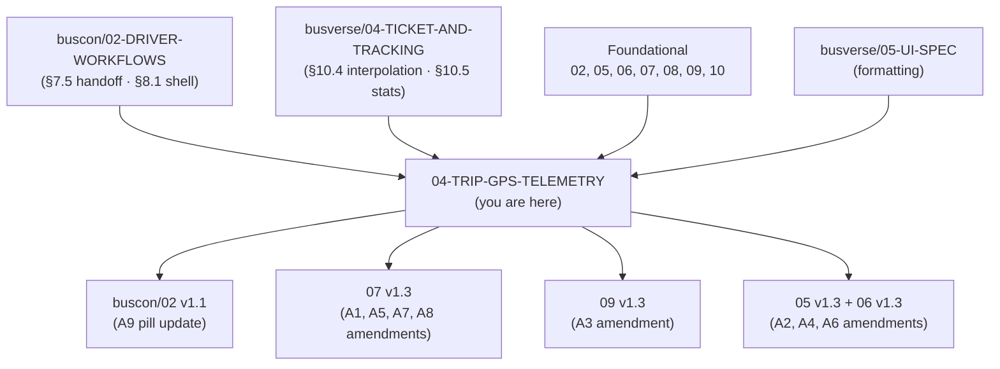

### 1.3 What this document does NOT cover

| Topic | Goes to |
|---|---|
| SCR-OA-TRIP shell layout | `buscon/02-DRIVER-WORKFLOWS.md` §8.1 |
| Trip start/end lifecycle | `buscon/02-DRIVER-WORKFLOWS.md` §7, §9 |
| Passenger tracking UI rendering | `busverse/04-TICKET-AND-TRACKING.md` §10 |
| Passenger client-side interpolation | `busverse/04-TICKET-AND-TRACKING.md` §10.4 |
| Passenger client-side route progress | `busverse/04-TICKET-AND-TRACKING.md` §10.4 (computed from GPS + stops) |
| WebSocket transport and auth | `07-API-AND-REALTIME-CONTRACTS.md` §8.1–§8.6 |
| Seat lock, ticket signing | `09-SECURITY-AND-PLATFORM-RULES.md` §7–§8 |
| Admin live-trips map UI (Phase 2) | — |

### 1.4 Endpoints owned — 2

| # | Method | Path | Role | Ownership |
|:---:|---|---|---|---|
| 1 | POST | `/v1/driver/trips/:id/gps` | DRIVER | Endpoint contract owned here |
| 2 | GET | `/v1/passenger/trips/:id/live` | REGISTERED | **Server-side composition owned here** (contract canonicalization flagged for `07` v1.3 A8) |

**Note on endpoint #2:** `07` v1.2 §4.7 lists this endpoint but doesn't specify the response schema in field-level detail. `busverse/04` §10.4 consumes it and §10.5 extracts `speed`, `nextStand`, `occupancy` from it. This doc **owns the canonical response shape** (§8B) and flags it for `07` v1.3 A8.

### 1.5 FR ownership — 4 total

| FR | Description |
|---|---|
| FR-OP-009 | Driver app streams GPS every 5 seconds during active trip |
| FR-OP-010 | GPS samples written to Redis (5s TTL 6h) and Postgres (30s) |
| FR-OP-011 | GPS broadcast to passenger WebSocket subscribers |
| FR-OP-012 | GPS streaming stops when trip ends |

### 1.6 The pipeline in one page

**Diagram: End-to-end GPS pipeline**
*A driver's GPS position flows from phone hardware → client buffer → 5s HTTP POST → server validation → parallel write (Redis live + Postgres historical) → 3s-throttled WebSocket broadcast → passenger client → interpolated marker on map. Two endpoints compose the passenger view: WebSocket for updates, `/trips/:id/live` for full state.*

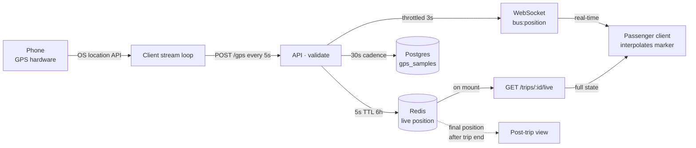

### 1.7 Scope boundary

| In scope | Out of scope |
|---|---|
| Client GPS acquisition loop | Phone hardware behavior |
| Client → server POST contract | Phone OS location API internals |
| Server-side validation pipeline | API framework mechanics |
| Redis + Postgres write strategy | Postgres partitioning internals |
| WebSocket broadcast throttle | Socket.io transport |
| Server-side `/trips/:id/live` composition | Passenger UI rendering |
| Server-side ETA + distance computation | Client-side display of ETA + distance |
| Platform config for background GPS | App store submission |
| 5 provenance checks | Full anti-fraud ML (Phase 2) |
| GPS pill state machine | GPS pill CSS (owned by `buscon/02` §8.1) |

---

## 2. Workflow Map

**Diagram: Workflow map**
*One owned workflow (WF-D-03) + five cross-references. The driver's `/start` response triggers GPS (handoff at `buscon/02` §7.5). GPS stops on `/end` or `trip:cancelled`. The passenger sees it via WS + polling fallback. Admin receives events but has no live UI in Phase 1.*

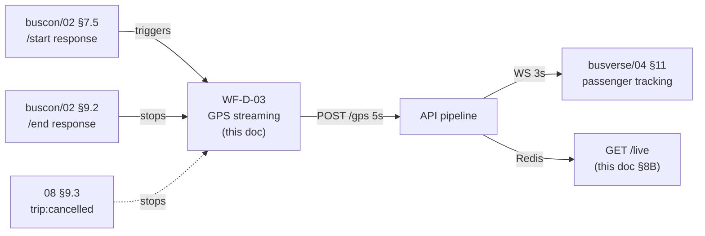

### 2.1 Coverage table

| Workflow / Mechanism | FRs | Owner | Entry | Exit |
|---|---|---|---|---|
| WF-D-03 GPS streaming | FR-OP-009–012 | **This doc** | `/start` 200 response | `/end`, `trip:cancelled`, or `STOPPED` |
| WF-X-01 full demo | (participates) | `08` §8.1 | — | — |
| WF-N-05 suspension mid-trip | (grace continues) | `08` §9.5 + §15 | — | — |

### 2.2 Cross-references

| From | What it establishes | Where used here |
|---|---|---|
| `buscon/02` §7.5 | GPS activation = `/start` response, **not** WS echo | §5.1 |
| `buscon/02` §8.2 | GPS pill slot in SCR-OA-TRIP | §9.1 |
| `buscon/02` §9.2 | `/end` stops GPS | §15.2 |
| `buscon/02` §5.3 | Suspension grace — `/end` still works | §15.3 |
| `busverse/04` §10.4 | Client interpolates between samples | §12.3 |
| `busverse/04` §10.9 | GPS stale threshold = **30s** | §9.3 |
| `busverse/04` §11.6 | Client drops out-of-order `bus:position` | §8.3 |
| `07` v1.2 §8.7 | `bus:position` broadcast throttled to 3s | §8.2 |

---

## 3. GPS Data Model

### 3.1 The sample object

**Diagram: GPS sample shape**
*Every GPS sample carries position, accuracy, reported speed, and the device timestamp. Server adds received timestamp, authoritative speed, and provenance flags. Full sample stored in Redis (6h) and Postgres (30s cadence).*

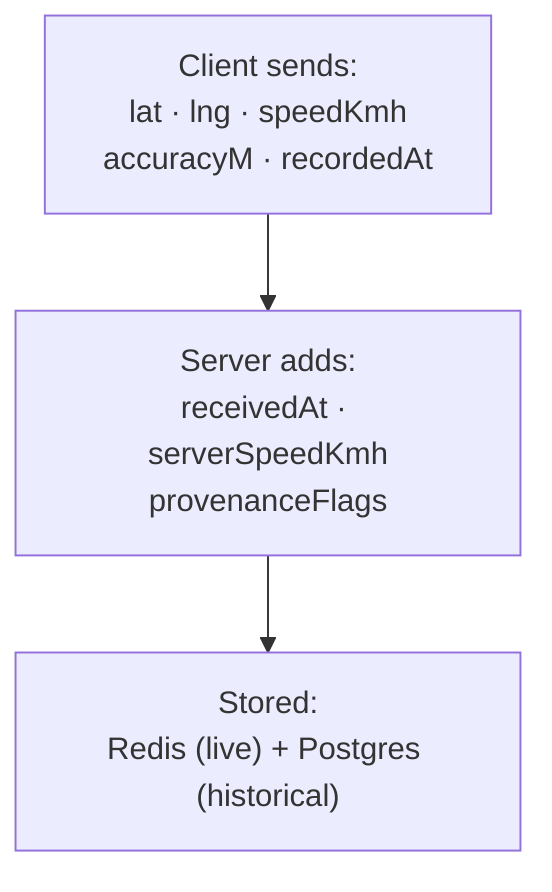

### 3.2 Client → server request payload

`POST /v1/driver/trips/:id/gps`:

```json
{
  "lat": 26.8467,
  "lng": 80.9462,
  "speedKmh": 62.5,
  "accuracyM": 12.4,
  "recordedAt": "2026-10-25T14:32:00.000Z"
}
```

| Field | Type | Required | Range | Purpose |
|---|---|:---:|---|---|
| `lat` | number | ✅ | -90 to 90 | Latitude (WGS84) |
| `lng` | number | ✅ | -180 to 180 | Longitude (WGS84) |
| `speedKmh` | number | ✅ | 0 to 300 | Device-reported speed |
| `accuracyM` | number | ✅ | 0 to 1000 | Horizontal accuracy estimate |
| `recordedAt` | ISO 8601 | ✅ | within ±5 min of `received_at` | Device timestamp when sample was taken |

**Note on `recordedAt`:** Client sends device time; server validates against `received_at` (see §12.1). If beyond ±5 min, `recorded_at` is overridden with `received_at` and a provenance flag set.

### 3.3 Server-side sample (stored)

**Stored in Redis** (`gps:trip:{tripId}` — JSON array, latest at index 0):

```json
{
  "lat": 26.8467,
  "lng": 80.9462,
  "serverSpeedKmh": 62.5,
  "accuracyM": 12.4,
  "recordedAt": "2026-10-25T14:32:00.000Z",
  "receivedAt": "2026-10-25T14:32:00.180Z"
}
```

**Stored in Postgres** (`gps_samples` — 30s cadence, per `06` v1.2 §8.3 + A2/A4 amendments):

| Column | Notes |
|---|---|
| `trip_id` | FK to `trips` (soft — partitioned) |
| `lat`, `lng` | Position |
| `speed_kmh` | Server-computed speed |
| `accuracy_m` | **New** (A4) |
| `recorded_at` | Sample time (client-reported or fallback) |
| `received_at` | **New** (A2) — server received time |

**Reference:** `06` v1.2 §8.3, §21 (partitioning); A2 + A4 amendments add `received_at`, `accuracy_m`.

### 3.4 Accuracy threshold (resolves G8)

**Diagram: Accuracy gate**
*Samples with accuracy > 100m are rejected — they indicate indoor, tunnel, or poor sky-view conditions that corrupt route rendering.*

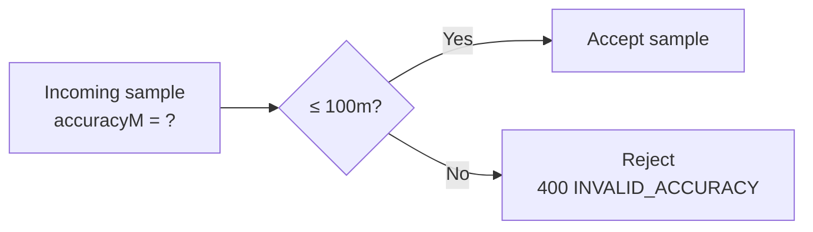

| Range | Behavior |
|---|---|
| 0–30m | Excellent — accept |
| 30–100m | Acceptable — accept |
| 100–500m | Poor — **reject** with `400 INVALID_ACCURACY` |
| > 500m | Junk — **reject** with `400 INVALID_ACCURACY` |

**Rule:** Client sends all samples; server rejects samples > 100m. Rejected samples are counted in a per-trip rejection rate metric (visible to admin via audit log aggregates if rate exceeds 10%). Q-B5 confirms.

### 3.5 Invalid coordinate handling (resolves N11 — both layers)

| Layer | Rule |
|---|---|
| **Client** | Skips sending if `lat`/`lng` out of range OR both `0, 0` (GPS fix not yet acquired) |
| **Server** | Returns `400 INVALID_COORDINATES` if `lat ∉ [-90, 90]` OR `lng ∉ [-180, 180]` OR `(0, 0)` |

**Rationale:** Both layers validate — client to save bandwidth, server to prevent malicious/garbage samples.

---

## 4. Sampling Cadence

### 4.1 Three cadences

**Diagram: Three-tier cadence**
*Client samples at 5s. Server writes Redis on every valid sample (5s). Server writes Postgres at 30s (every 6th sample). Server broadcasts WebSocket at most every 3s (defensive cap).*

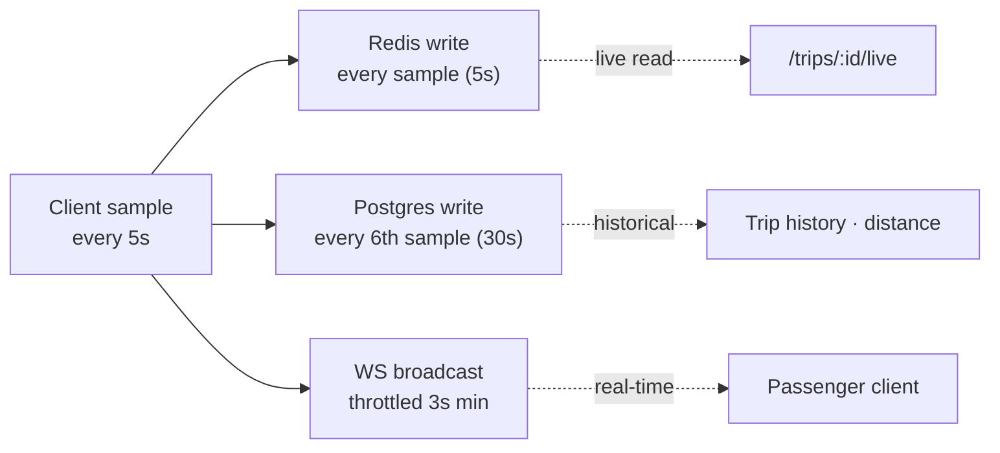

### 4.2 Cadence table

| Layer | Cadence | Source | Why |
|---|---|---|---|
| **Client samples** | Every 5s | `02` §6.6 FR-OP-009; `buscon/02` §14.4 | Frequent enough for smooth tracking; low enough for battery |
| **Redis write** | Every sample (5s) | `06` v1.2 §6.5.1 | Live position must be current |
| **Postgres write** | Every 6th sample (30s) | `06` v1.2 §6.5.1 | Historical accuracy; Postgres size explosion prevention |
| **WebSocket broadcast** | Throttled 3s min | `07` v1.2 §8.7 | Defensive — even if client sends more, passengers see at most one update per 3s |

**Note on the contradiction (resolves G1):** `07` v1.2 §8.7 says "throttled to 3s" while the sample rate is 5s. This means:
- Client sends at 5s cadence
- Server broadcasts every sample it receives **unless** two samples arrive <3s apart (defensive — discards the older)
- In practice, every sample is broadcast (5s > 3s min)
- The 3s floor is a **defensive cap against malicious/rogue clients** that try to spam

Flags `07` v1.3 A1 to clarify the language.

### 4.3 Why 5s, not 10s, not 1s

| Rate | Passenger UX | Battery | DB size |
|---|---|---|---|
| 1s | Very smooth | Battery killer | 5x explosion |
| **5s** | **Smooth with interpolation** | **Acceptable** | **Baseline** |
| 10s | Jerky even with interpolation | Great | Half size |

**Note on design guide §6 (10s claim):** `Design_guide.html` §6 says 10s. Every other doc (`02`, `06`, `07`, `08`, `09`) says 5s. Per `busverse/05` §2.2 C1 conflict resolution, **5s wins**. The design guide example is illustrative only.

### 4.4 Stop conditions (FR-OP-012)

**Diagram: Streaming stop triggers**
*Three triggers stop the client's streaming loop — normal end, cancellation, or an unrecoverable error.*

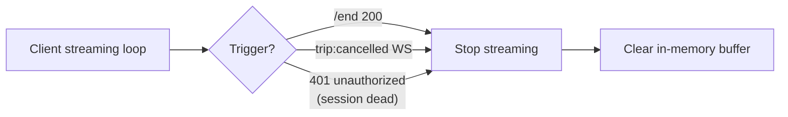

| Trigger | Detection | Stop delay |
|---|---|---|
| `/end` 200 response | Direct in caller | Immediate |
| `trip:cancelled` WS | Event handler | Immediate |
| Session 401 (unrecoverable) | Refresh fails | After retry budget |
| App killed | OS | Buffer lost (§10.5) |

**Reference:** FR-OP-012.

---

## 5. Client Acquisition Flow

### 5.1 Activation handoff (canonical from `buscon/02` §7.5)

**Diagram: GPS activation**
*The `/start` HTTP response triggers the client's streaming loop. NOT the WS echo. This avoids a round-trip dependency. Canonical per `buscon/02` §7.5.*

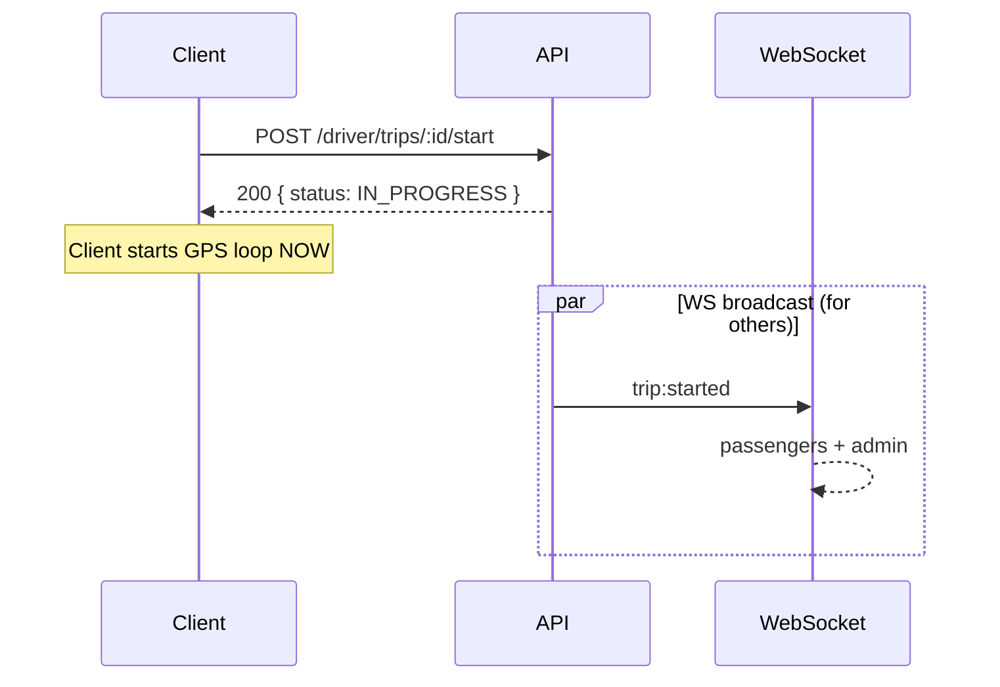

**Rule:** The client **does not wait** for its own `trip:started` WS echo. The HTTP response is the trigger. If the WS echo never arrives (rare), GPS still streams correctly.

### 5.2 Client acquisition state machine

**Diagram: Client acquisition states**
*Six client-side states from activation to streaming. First GPS fix can take 5–30s (hardware warm-up).*

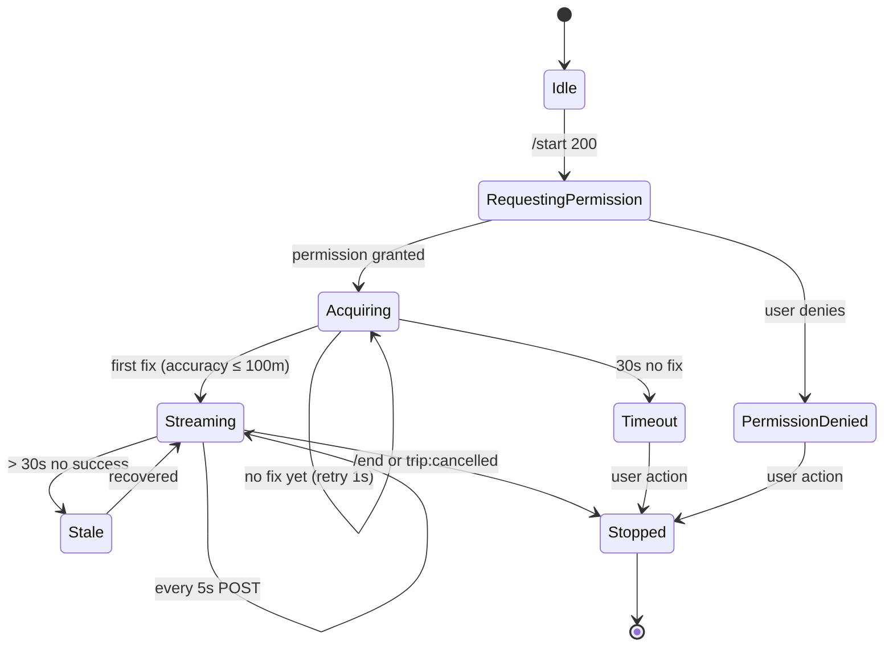

### 5.3 Acquisition details

| Phase | Duration | Behavior |
|---|---|---|
| Permission request | User-dependent | iOS/Android permission prompt |
| Acquiring | 5–30s typical | `navigator.geolocation` / `expo-location` with `enableHighAccuracy: true` |
| First fix → streaming | Instant | Start 5s POST loop |
| Timeout (30s no fix) | — | Show "Unable to acquire GPS. [Retry]" banner in pill |

**Rule:** The GPS pill (§9) shows `ACQUIRING` state during the 5–30s window — not a blank slot.

### 5.4 Streaming loop

**Diagram: Streaming loop**
*Simple 5s loop: read location → validate locally → POST → handle response. Errors are non-fatal (log + continue).*

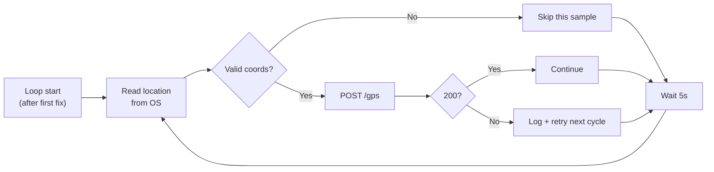

### 5.5 Client-side validation

| Check | Action |
|---|---|
| `lat ∈ [-90, 90]` | Skip if not |
| `lng ∈ [-180, 180]` | Skip if not |
| `(lat, lng) == (0, 0)` | Skip (GPS not acquired yet) |
| `accuracyM > 100` | Skip (poor signal — server would reject anyway) |

**Reference:** `buscon/02` §18.1 (permission bootstrap).

### 5.6 Permission denial handling

**Diagram: Permission denied flow**
*If GPS permission denied at trip start, trip start is **blocked** — cannot legitimately track the bus without GPS. Driver must enable permission.*

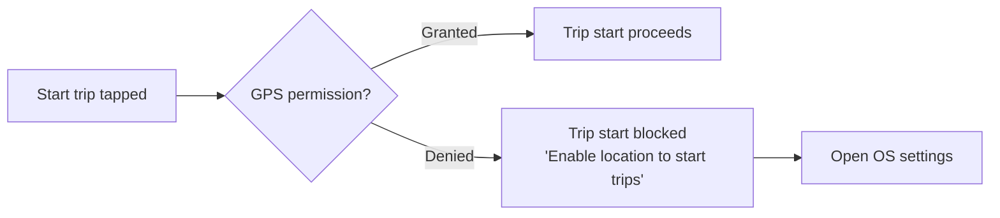

**Reference:** `buscon/02` §18.1.

---

## 6. Server Pipeline

### 6.1 Pipeline stages

**Diagram: Server-side pipeline**
*Six stages. Each sample passes through in order. Failure at any stage returns an error to the client; client retries next cycle (5s later).*

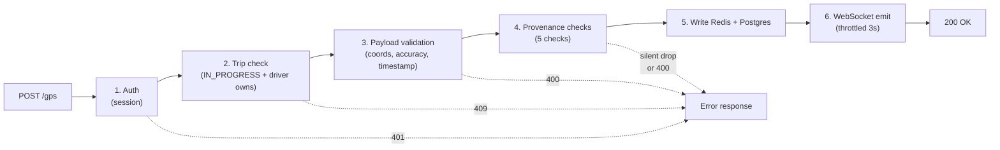

### 6.2 Stage-by-stage

| # | Stage | Checks | Failure |
|:---:|---|---|---|
| 1 | **Auth** | JWT valid, session active, role = DRIVER | `401 UNAUTHORIZED` |
| 2 | **Trip check** | Trip exists, `status = IN_PROGRESS`, trip's `driver_id` = session's driver_id | `409 TRIP_NOT_IN_PROGRESS` or `403 TRIP_NOT_ASSIGNED` |
| 3 | **Payload validation** | Zod schema: coords, speed 0–300, accuracy 0–1000, `recordedAt` parseable | `400 VALIDATION_ERROR` |
| 4 | **Provenance** | 5 checks (§11) | varies — some drop silently, some 400 |
| 5 | **Write** | Redis write (non-fatal on fail); Postgres write if 6th sample (30s cadence) | Redis fail → log + continue; Postgres fail → 500 |
| 6 | **Emit** | WS if last emit > 3s ago | Non-fatal — log |

### 6.3 Pipeline latency budget

| Stage | p95 budget |
|---|---|
| Auth | 2ms |
| Trip check | 5ms |
| Payload validation | 1ms |
| Provenance | 3ms |
| Redis write | 2ms |
| Postgres write (every 6th) | 10ms (only on write sample) |
| WS emit | 2ms |
| **Total p95** | **< 200ms** (per `buscon/00` §16) |

### 6.4 Response contract

**Success (200):**
```json
{ "data": { "accepted": true, "serverSpeedKmh": 62.5 } }
```

**Error responses:**

| Error | HTTP |
|---|---|
| `UNAUTHORIZED` | 401 |
| `TRIP_NOT_IN_PROGRESS` | 409 |
| `TRIP_NOT_ASSIGNED` | 403 |
| `INVALID_COORDINATES` | 400 |
| `INVALID_ACCURACY` | 400 |
| `STALE_TIMESTAMP` | 400 (reserved — recorded_at >5 min off) |

**Reference:** `07` v1.2 §7.2, §9.2.

---

## 7. Storage Tiers

### 7.1 Two storage tiers

**Diagram: Storage tiers**
*Redis holds the last 6h of live samples (JSON array). Postgres holds partitioned historical samples at 30s cadence (90-day retention). Both indexed by `trip_id`. Distance computed at `/end` (see §18).*

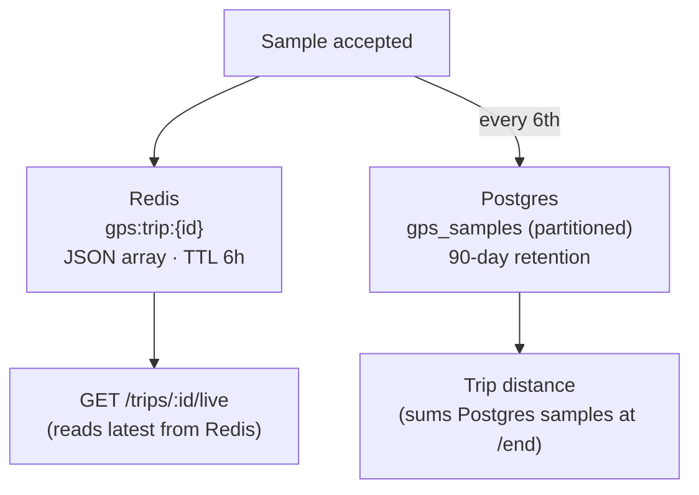

### 7.2 Redis tier

| Aspect | Detail |
|---|---|
| Key | `gps:trip:{tripId}` |
| Value | JSON array of last N samples (newest first) |
| Max samples | 720 (6h at 5s cadence) |
| TTL | 6 hours |
| Write cadence | Every valid sample |
| Read | On `/trips/:id/live`, on trip end (final position) |
| Fail mode | Non-fatal — log + continue |

### 7.3 Postgres tier

| Aspect | Detail |
|---|---|
| Table | `gps_samples` (partitioned by `recorded_at` per `06` v1.2 §8.3) |
| Cadence | Every 6th sample (30s) |
| Retention | 90 days (per `06` v1.2 §16) |
| Partition | Daily (`gps_samples_YYYY_MM_DD`) |
| New columns | `received_at`, `accuracy_m` (per A2, A4) |
| Fail mode | Fatal — returns 500 to client (client retries next cycle) |

### 7.4 Distance from storage

- **Live display** (during trip) — distance not shown to driver (per `04` §9.3)
- **Summary display** (after `/end`) — distance computed from Postgres samples (§18)
- **Passenger view** — no distance shown; route progress % computed client-side from GPS + stops

---

## 8. WebSocket Broadcast

### 8.1 Event contract

**Diagram: Event emission**
*`bus:position` is emitted to `trip:live:{tripId}` after each successful write (subject to 3s throttle). Payload is the full sample + context. Consumed by passenger tracking (per `busverse/04` §11.3) and by admin (no UI Phase 1).*

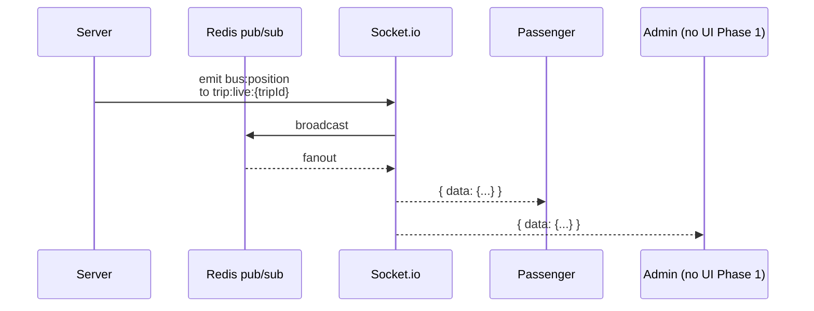

### 8.2 Full payload (resolves G12, N2, N7)

**`bus:position` event payload (canonical — flags `07` v1.3 A5):**

```json
{
  "tripId": "trp_abc",
  "scheduleId": "sch_def",
  "lat": 26.8467,
  "lng": 80.9462,
  "speedKmh": 62.5,
  "bearing": null,
  "accuracyM": 12.4,
  "recordedAt": "2026-10-25T14:32:00.000Z",
  "receivedAt": "2026-10-25T14:32:00.180Z",
  "nextStandId": "stand_456",
  "etaMinutes": 18
}
```

| Field | Type | Notes |
|---|---|---|
| `tripId` | string | Opaque ID |
| `scheduleId` | string | Opaque ID |
| `lat`, `lng` | number | WGS84 |
| `speedKmh` | number | **Server-computed** (per §12.2) |
| `bearing` | number \| null | Phase 2 — always `null` in Phase 1 |
| `accuracyM` | number | From client |
| `recordedAt` | ISO 8601 | Sample time |
| `receivedAt` | ISO 8601 | Server received time |
| `nextStandId` | string \| null | Nearest upcoming stand (§16) |
| `etaMinutes` | number \| null | Minutes to next stand (§16) |

**Note:** `07` v1.2 §8.7 currently shows only `{ lat, lng }` — this is a **partial example**, not the full schema. A5 amendment canonicalizes.

**Note:** Polyline (route path) is **NOT** in the payload — client renders from `route.stops` (§8B N7).

**Note:** Route progress **is NOT** in the payload — client computes from `lat/lng` + `route.stops` (§8B N7).

### 8.3 Throttle and out-of-order handling (resolves G1, N8)

**Diagram: Throttle logic**
*Server tracks `lastEmitAt` per trip. If a sample arrives within 3s of last emit, skip broadcast (but still write Redis/Postgres). Client drops out-of-order by `recordedAt` comparison.*

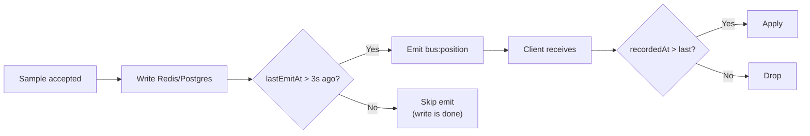

**Rules:**

| Rule | Detail |
|---|---|
| Server throttle | Skip emit if `now - lastEmitAt < 3s` |
| Client reorder guard | Drop if `recordedAt <= lastRecordedAt` |
| Rationale | Server throttle prevents broadcast storms (defensive); client reorder guard handles rare out-of-order delivery (network reordering) |
| Redis write | Every sample (not throttled) — live endpoint must be current |
| Postgres write | Every 6th sample (not throttled) |

### 8.4 Subscribers

| Subscriber | Phase | Notes |
|---|---|---|
| Passenger (`busverse/04` §11.3) | Phase 1 | Real-time map |
| Admin | Phase 1 | **Receives events but no live-trips UI** (Phase 2 adds map) |
| Operator | Phase 1 | Not a subscriber (operator doesn't need live GPS) |

**Reference:** `07` v1.2 §8.1 (topic authorization).

### 8.5 Fallback: `/trips/:id/live` polling

**Reference:** `busverse/04` §10.4 polls `/trips/:id/live` every 5s in parallel with WS (belt-and-braces). Server-side response composition is owned here (§8B).

---

## 8B. `/trips/:id/live` Contract (NEW — resolves N1, N2, N6, N7)

### 8B.1 Purpose

`busverse/04` §10.4 polls `GET /v1/passenger/trips/:id/live` every 5s in parallel with the WebSocket subscription. This endpoint must be **cheap** (Redis-only), **fast** (p95 < 30ms), and **complete** (all fields needed by `busverse/04` §10.5's stats grid).

`07` v1.2 §4.7 lists the endpoint but shows only `{ "tripId", "status", "currentPosition": { lat, lng }, "lastUpdatedAt", "eta": [{ standId, etaMinutes }] }` — which doesn't match `busverse/04` §10.5's needs (occupancy, speed). **This doc owns the canonical response.**

### 8B.2 Response schema (canonical)

**Diagram: `/live` response composition**
*Server assembles from three sources: Redis (GPS position + speed), Postgres (occupancy count), and ETA computation (§16). Response is cached 1s in Redis to prevent polling storms.*

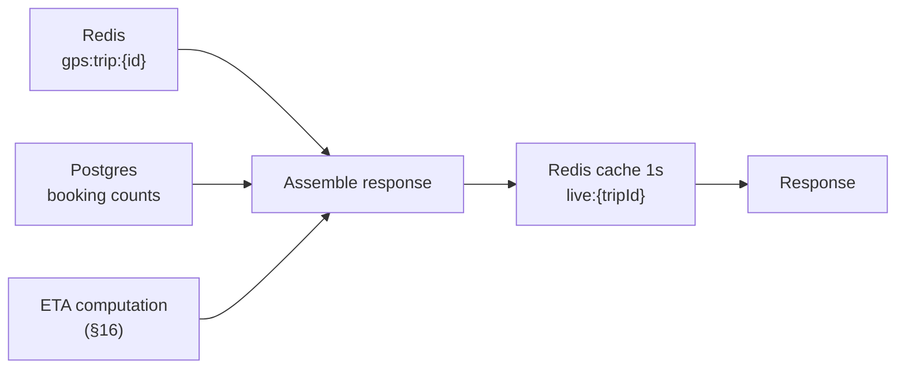

```json
{
  "data": {
    "tripId": "trp_abc",
    "status": "IN_PROGRESS",
    "currentPosition": {
      "lat": 26.8467,
      "lng": 80.9462,
      "recordedAt": "2026-10-25T14:32:00.000Z"
    },
    "speedKmh": 62.5,
    "lastUpdatedAt": "2026-10-25T14:32:00.180Z",
    "isStale": false,
    "eta": [
      { "standId": "stand_456", "standName": "Mathura Junction", "etaMinutes": 18 },
      { "standId": "stand_789", "standName": "Kanpur", "etaMinutes": 240 }
    ],
    "occupancy": { "occupied": 38, "total": 44 },
    "nextStandId": "stand_456"
  }
}
```

### 8B.3 Field sources

| Field | Source | Notes |
|---|---|---|
| `tripId`, `status` | Postgres `trips` | Cached in Redis `trip:state:{id}` (per `05` v1.2 §17) |
| `currentPosition` | Redis `gps:trip:{id}[0]` | Latest sample |
| `speedKmh` | Same sample's `serverSpeedKmh` | Server-computed |
| `lastUpdatedAt` | Sample's `receivedAt` | Server-authoritative |
| `isStale` | `now - receivedAt > 30s` | Per `busverse/04` §10.9 |
| `eta[]` | Computed (§16) | Per remaining stand |
| `occupancy` | Postgres `booking_passengers` count for trip's schedule | `{ occupied: boarded, total: confirmed }` |
| `nextStandId` | Computed (§16) | First stand in `eta[]` |

### 8B.4 Caching strategy (resolves N6)

| Aspect | Detail |
|---|---|
| Cache key | `live:{tripId}` |
| TTL | 1 second |
| Invalidation | Natural TTL — polling at 5s, cache at 1s ensures <1s staleness |
| Why 1s | Prevent 100 passengers polling every 5s from hammering Postgres for occupancy; combined with WS events every 5s, 1s staleness is invisible |
| Reads | Redis-only on cache hit; Postgres on cache miss (once per second max) |

### 8B.5 Performance target

| Metric | Target |
|---|---|
| p50 latency | < 10ms (cache hit) |
| p95 latency | < 30ms (cache hit) |
| Cache hit rate | > 95% (5s polling × 100 passengers = 20 QPS, cache serves most) |

### 8B.6 Stale and degraded states

| Scenario | Response |
|---|---|
| No GPS samples yet | `currentPosition: null`, `isStale: true` |
| Trip not started | `status: SCHEDULED`, `currentPosition: null` |
| Trip completed | `status: COMPLETED`, `currentPosition: last known` |
| GPS stale (> 30s) | `isStale: true`, `currentPosition: last known` |
| Redis down | `503 SERVICE_UNAVAILABLE` |
| Postgres down (occupancy) | `occupancy: null` — other fields still served |

### 8B.7 Amendment flag

**Flags `07` v1.3 A8:** Replace current partial schema in `07` §4.7 with the full schema from §8B.2. Behavior contract unchanged; field additions are additive.

---

## 9. GPS Status Pill States (resolves G6, N3, N4)

### 9.1 Purpose

**Diagram: Pill states and transitions**
*Four states owned here. Rendered by `buscon/02` §8.1's shell. Colors below are semantic; `buscon/02` v1.1 will render per design tokens (A9).*

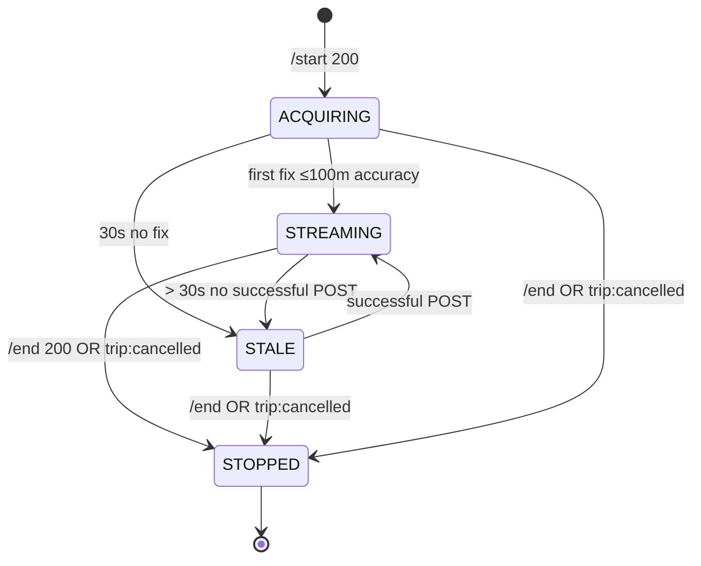

### 9.2 State table

| State | Color | Label | Trigger |
|---|---|---|---|
| `ACQUIRING` | Amber (pulsing) | "Acquiring GPS…" | Just after `/start`, no fix yet |
| `STREAMING` | Green (pulse) | "GPS active" | First fix + first successful POST |
| `STALE` | Amber | "GPS stale — {n}s ago" | > 30s since last successful POST |
| `STOPPED` | **Grey** | "Trip ended" | `/end` or `trip:cancelled` |

**Note on N4 conflict:** `buscon/02` §8.2 currently defines 3 states (streaming green, reconnecting amber, stopped red). This doc:
- **Adds ACQUIRING** (4th state) — missing from `buscon/02`
- **Changes STOPPED color** from red → grey (red implies error; grey implies normal end)

**Flags `buscon/02` v1.1 A9** — update §8.2 from 3 states to 4 states, change STOPPED color.

### 9.3 Stale threshold (resolves N3)

**Diagram: Stale threshold alignment**
*`busverse/04` §10.9 already documents "> 30s stale". This doc aligns to 30s for passenger/driver symmetry. Server-side admin alert fires at 60s (defense-in-depth).*

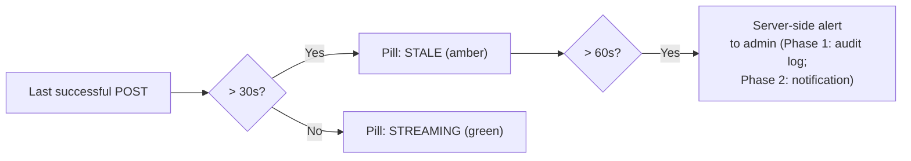

| Threshold | Effect |
|---|---|
| 30s | Client pill flips to `STALE` (amber) |
| 60s | Server logs `gps_stale` to audit; admin sees in audit review |

**Reference:** `busverse/04` §10.9 (30s stale).

### 9.4 State ownership

| Aspect | Owner |
|---|---|
| States and transitions | **This doc** (§9.1, §9.2) |
| Pixel rendering (colors, animation) | `buscon/02` §8.1 (shell) |
| Placement | `buscon/02` §8.1 (StatusRow) |
| Reconcile 3→4 states | `buscon/02` v1.1 A9 amendment |

---

## 10. Offline Buffer & Sync (resolves G5, N9)

### 10.1 Client-side buffer

**Diagram: In-memory buffer**
*Samples are buffered **in memory** (not SQLite) when POST fails. Buffer is a ring: capped at 500. On reconnect, flushed FIFO. Lost on app kill.*

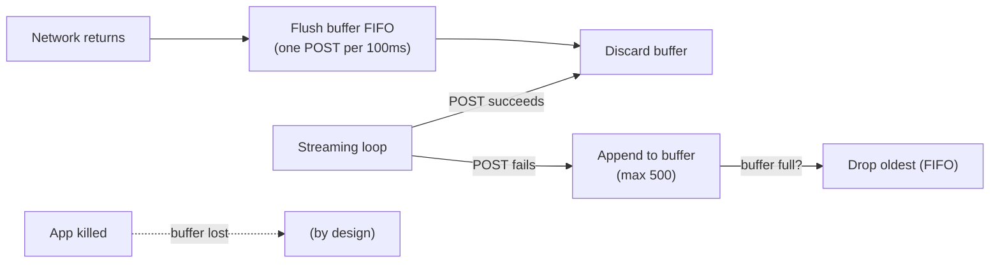

### 10.2 Buffer parameters

| Aspect | Value | Source |
|---|---|---|
| Storage | **In-memory ring buffer** | (not SQLite — resolves N9) |
| Max size | **500 samples** (~42 min at 5s) | (resolves G5) |
| Full behavior | Drop oldest (FIFO) | — |
| Flush rate | One POST per 100ms (10/sec) | — |
| Flush order | FIFO (oldest first) | — |
| Lost on app kill | ✅ By design | — |
| Lost on OS kill | ✅ By design | — |

**Rationale (N9):** `buscon/00` §10.3 caches only QR key + trips + manifest — GPS is **not** in SQLite. This is deliberate: boarding is critical (persisted), GPS is nice-to-have (not persisted). If the app crashes and restarts mid-trip, the passenger tracking will have a gap. This is acceptable because:
1. GPS is a convenience feature, not contractual
2. SQLite write per sample at 5s cadence would burn disk + battery
3. On restart, the app re-attaches to the active trip (per `buscon/02` §18.6) and resumes streaming fresh

### 10.3 Flush behavior

**Diagram: Flush sequence**
*On network return, buffered samples POST one at a time. Server timestamps with `receivedAt = now` (buffered samples are old); provenance rejects by timestamp (>5 min old → `recorded_at` overridden).*

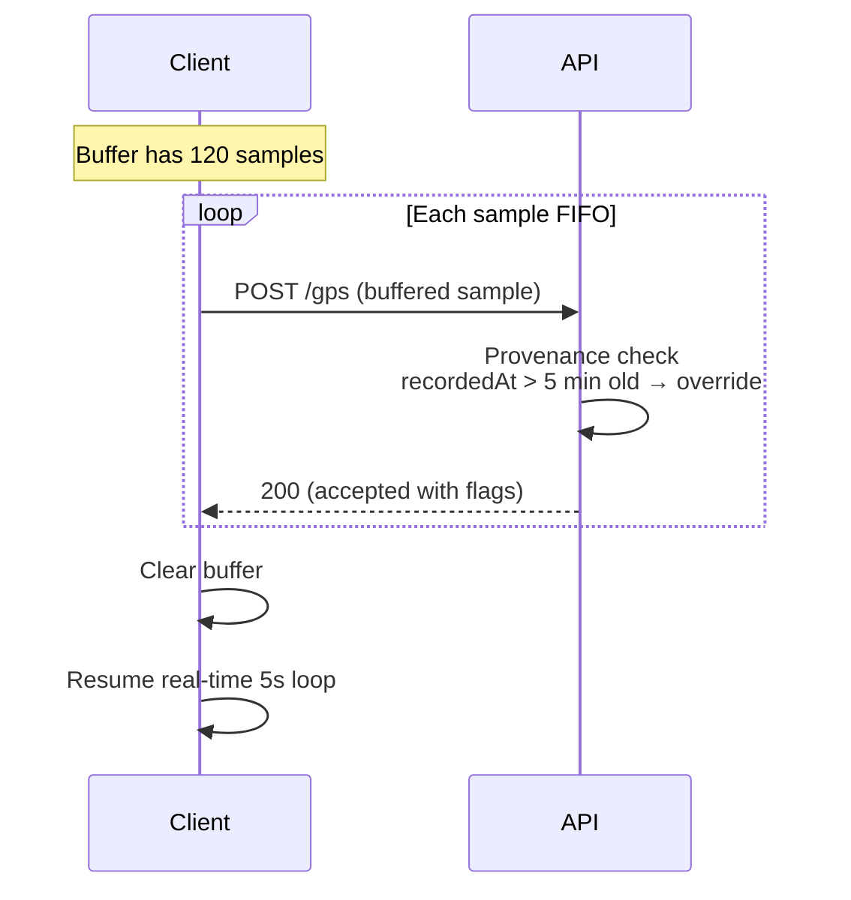

**Note:** Buffered samples >5 min old get `recorded_at` overridden to `received_at` per §12.1. Their positions are still historically useful (they were real positions), but the timestamp provenance is captured for audit.

### 10.4 Buffer loss

| Scenario | Behavior |
|---|---|
| App killed (user force-quit) | Buffer lost — no recovery |
| OS killed (memory pressure) | Buffer lost — no recovery |
| Network returns during trip | Buffer flushes normally |
| Network returns after trip end | Buffer dropped — trip no longer accepts samples |

**Rule:** Buffer loss on app kill is **accepted risk** — documented as a known limitation. If admins see gaps in trip history, they know a driver's app crashed. Phase 2 could add SQLite persistence for GPS on critical corridors if gap detection matters.

---

## 11. Provenance & Anti-Spoofing (resolves G3)

### 11.1 The 5 checks

**Diagram: Provenance pipeline**
*Five checks in sequence. Some fail silently (drop sample, don't return error — prevents attackers from learning what to fix); some fail loudly (400). Failure flags increment per-trip counters; any 2 failures in 10 consecutive samples triggers admin alert.*

```mermaid
flowchart LR
    SAMPLE["Sample received"] --> C1["1. Timestamp window<br/>±5 min from received_at"]
    C1 --> C2["2. Coordinate plausibility<br/>valid lat/lng, not (0,0)"]
    C2 --> C3["3. Accuracy gate<br/>≤ 100m"]
    C3 --> C4["4. Speed consistency<br/>server vs client ≤ 30 km/h"]
    C4 --> C5["5. Teleport detection<br/>implied speed ≤ 200 km/h"]
    C5 --> OK["Accept + write + emit"]
```

### 11.2 Check details

| # | Check | Rule | Failure |
|:---:|---|---|---|
| 1 | **Timestamp window** | `abs(recordedAt - receivedAt) ≤ 5 min` | Override `recordedAt = receivedAt`; set flag `timestamp_drift`; **accept sample** |
| 2 | **Coordinate plausibility** | `lat ∈ [-90, 90]` AND `lng ∈ [-180, 180]` AND `not (0, 0)` | `400 INVALID_COORDINATES` (loud — no spoof-fix signal) |
| 3 | **Accuracy gate** | `accuracyM ≤ 100` | `400 INVALID_ACCURACY` (loud — but benign; poor GPS) |
| 4 | **Speed consistency** | `abs(serverSpeed - clientSpeed) ≤ 30 km/h` OR `≤ 2x` | Silent drop; set flag `speed_mismatch` |
| 5 | **Teleport detection** | Implied speed from last sample ≤ 200 km/h | `400 TELEPORT_DETECTED` (loud — likely spoof) |

### 11.3 Additional check (device fingerprint)

| # | Check | Rule | Failure |
|:---:|---|---|---|
| 6 | **Device fingerprint match** | Session's `device_fingerprint_hash` matches trip's driver's active session's hash | **Silent drop** + SEV2 alert |

**Note on count:** Six checks total. §11.1 diagram shows 5 for simplicity (device fingerprint is baked into Auth pipeline stage 1). The doc names 6 checks and flags `09` v1.3 A3.

### 11.4 Failure accumulation

| Rule | Detail |
|---|---|
| Per-trip counter | `{timestamp_drift, speed_mismatch, teleport, coords_invalid, accuracy_poor}` |
| Alert threshold | Any 2 failures in 10 consecutive samples → SEV2 alert to admin |
| Alert mechanism | Writes `gps_anomaly` to `audit_logs` with metadata |
| Review | Admin reviews `gps_anomaly` entries in `buscon/01` §12 WF-A-05 audit log |

### 11.5 Amendment flag

**Flags `09` v1.3 A3:** Replace `09` v1.2 §19.2 T6's vague "server-side validation, GPS provenance" with a cross-reference to this section's 6 checks.

---

## 12. Timestamp, Speed, Interpolation (resolves G2, G10, N5)

### 12.1 Timestamp authority

**Diagram: Timestamp decision**
*`recorded_at` (client time) is primary for "when the bus was here". If within ±5 min of `received_at` (server time), use as-is. Beyond that, override with `received_at` and flag.*

```mermaid
flowchart LR
    C["recordedAt (client)"] --> DIFF{"abs(recorded - received)<br/>≤ 5 min?"}
    R["receivedAt (server)"] --> DIFF
    DIFF -->|"Yes"| USE_C["Use recordedAt<br/>(client time)"]
    DIFF -->|"No"| USE_R["Use receivedAt<br/>+ flag timestamp_drift"]
```

**Rationale (G2):** The client knows when it *took* the sample. Trusting that is correct for the happy path. But if the clock is off by >5 min, the sample's temporal accuracy is compromised — server-time is the safer fallback.

**Reference:** `buscon/02` §4.4 (clock skew handling for trip-window validation).

### 12.2 Speed authority (resolves G10)

**Diagram: Server-computed speed**
*Server computes authoritative speed from position deltas: `distance(prev, current) / (recordedAt_current - recordedAt_prev)`. Client-reported speed is stored as provenance only; mismatch >30 km/h triggers flag.*

```mermaid
flowchart LR
    PREV["Prev sample<br/>(lat, lng, recordedAt)"] --> DELTA["Distance / Δt"]
    CURR["Current sample<br/>(lat, lng, recordedAt)"] --> DELTA
    DELTA --> SRV["Server-computed<br/>speedKmh"]
    CLIENT["Client-reported<br/>speedKmh"] --> CMP{"abs diff<br/>≤ 30 km/h?"}
    SRV --> CMP
    CMP -->|"Yes"| USE["Use server speed"]
    CMP -->|"No"| FLAG["Use server speed<br/>+ flag speed_mismatch"]
```

**Rules:**

| Aspect | Detail |
|---|---|
| Source of truth | Server-computed |
| Computation | Haversine distance / time delta (ms → s → km/h) |
| Client speed | Stored as `client_reported_speed_kmh` (new column, A4) for provenance |
| Mismatch threshold | > 30 km/h difference triggers `speed_mismatch` flag (but sample still accepted) |
| Display | All UI (`/live`, `bus:position`) shows server speed |

**First sample edge case:** No previous sample → server uses client-reported speed as-is; no mismatch flag.

### 12.3 Interpolation split (resolves N5)

**Diagram: Interpolation ownership**
*Server emits raw samples at 5s. Client dead-reckons between them via `requestAnimationFrame` for smooth marker motion. Server does NOT interpolate.*

```mermaid
flowchart LR
    T0["t=0s · sample A"] -->|"server emits A"| CLIENT["Client"]
    T5["t=5s · sample B"] -->|"server emits B"| CLIENT
    CLIENT -->|"0-5s: interpolate<br/>lat = lerp(A.lat, B.lat, t/5)"| RENDER["Marker moves smoothly"]
```

**Rules:**

| Rule | Detail |
|---|---|
| Server | Emits **raw samples only** — no interpolation |
| Client (`busverse/04` §10.4) | Dead-reckons between samples via `requestAnimationFrame` |
| Interpolation duration | 5s (matches sample cadence) |
| Easing | Linear (matches travel) |
| Reset on new sample | Client snaps to new sample, interpolates to next |
| Long gaps (offline) | Client shows stale position; no interpolation across gaps |

**Reference:** `busverse/04` §10.4.

### 12.4 Zero-speed collapse (resolves G9)

**Diagram: Zero-speed collapse**
*When the bus is stationary, GPS jitters cause map flicker. Server collapses 3+ consecutive low-speed samples within 20m into one centroid sample per 30s.*

```mermaid
flowchart LR
    S1["Sample 1<br/>speed < 3 km/h"] --> COLLECT["Collect 3+ consecutive"]
    S2["Sample 2"] --> COLLECT
    S3["Sample 3"] --> COLLECT
    COLLECT --> CENTROID["Compute centroid<br/>lat = avg, lng = avg"]
    CENTROID --> EMIT["Emit one centroid<br/>sample (30s cadence)"]
```

| Parameter | Value |
|---|---|
| Speed threshold | < 3 km/h (server-computed) |
| Distance threshold | All 3+ samples within 20m radius |
| Collapse cadence | One sample per 30s (aggregated) |
| Revert | If 3+ samples exceed thresholds, resume normal |

**Note:** Client still sends every 5s — this is server-side aggregation only. Redis and Postgres both store the aggregated result for stationary periods.

---

## 13. Failure Modes

### 13.1 Failure matrix (resolves N10)

**Diagram: Failure routing**
*Six failure modes with defined behavior. Silent failures preserve the trip; loud failures surface to the client for retry.*

```mermaid
flowchart TB
    F["Failure"]
    F --> F1["Redis down"]
    F --> F2["Postgres down"]
    F --> F3["WS down"]
    F --> F4["Network lost (client)"]
    F --> F5["Invalid payload"]
    F --> F6["Provenance fail"]

    F1 --> R1["Log + continue<br/>5s live read stale"]
    F2 --> R2["500 to client<br/>client retries"]
    F3 --> R3["Events not delivered<br/>polling fallback"]
    F4 --> R4["Buffer (500 cap)"]
    F5 --> R5["400 + drop sample"]
    F6 --> R6["Silent drop or 400<br/>varies per check"]
```

### 13.2 Failure behavior table

| Failure | Detection | Client sees | Recovery |
|---|---|---|---|
| Redis down | Connection refused | 200 (write logged as failed) | Continues to Postgres; live read stale until Redis up |
| Postgres down | Connection refused | 500 | Retry next 5s |
| WebSocket down | Connection close | Events not received | Client polling fallback (`busverse/04` §11.4) |
| Network lost (client) | fetch rejects | Local buffer (max 500) | Buffer flush on reconnect |
| Invalid payload | Zod schema | 400 specific code | Client fixes (rare) |
| Provenance fail | Check fails | 400 or silent drop | Some flag accumulation → admin alert |
| Auth failure | JWT invalid | 401 | Refresh + retry, else force logout |
| Trip not in progress | Status check | 409 | Client stops streaming |

### 13.3 Performance targets (resolves N10)

| Target | Value | Source |
|---|---|---|
| GPS ack p95 | **< 200ms** | `buscon/00` §16 |
| GPS ack p99 | < 400ms | Estimated |
| `/trips/:id/live` p95 | **< 30ms** | §8B.5 |
| WS broadcast latency | < 100ms | `07` v1.2 §8.5 |
| Postgres write p95 | < 50ms | Estimated |

### 13.4 Backpressure

| Layer | Backpressure behavior |
|---|---|
| Client buffer | Ring cap 500 (drop oldest) |
| Server queue (Postgres) | BullMQ queue cap 10K samples; drop oldest over cap |
| WS emit | Throttled 3s min |
| Postgres write | Every 6th sample (30s cadence) |

---

## 14. Platform Configuration (resolves G7, G14)

### 14.1 iOS configuration

**Diagram: iOS background GPS**
*iOS requires explicit background location mode. Without it, GPS pauses when the app is backgrounded.*

```mermaid
flowchart LR
    APP["Operator App (iOS)"] --> PLIST["Info.plist:<br/>UIBackgroundModes = ['location']"]
    PLIST --> PERM["Permission: 'Always'<br/>(not 'While using')"]
    PERM --> BG["Background GPS works<br/>(trip continues, app closed)"]
```

**Required config:**

| Key | Value | Why |
|---|---|---|
| `UIBackgroundModes` | `["location"]` | Enables background location updates |
| `NSLocationWhenInUseUsageDescription` | "BusVerse uses your location to show passengers where the bus is." | Permission prompt (when in use) |
| `NSLocationAlwaysAndWhenInUseUsageDescription` | "BusVerse needs your location throughout your trip to keep passengers updated." | Permission prompt (always) |
| Permission request | `requestForegroundPermissionsAsync` then `requestBackgroundPermissionsAsync` | Just-in-time (first trip start) |

**iOS behavior notes:**

- "While using" permission: GPS pauses when app backgrounded
- "Always" permission: GPS continues in background
- **Phase 1 requests "Always"** — required for the driver use case (app in pocket while driving)
- iOS shows a blue status bar when background GPS is active

### 14.2 Android configuration

**Diagram: Android foreground service**
*Android requires a foreground service with a persistent notification for continuous background GPS.*

```mermaid
flowchart LR
    APP["Operator App (Android)"] --> PERM["Permissions:<br/>ACCESS_FINE_LOCATION<br/>FOREGROUND_SERVICE<br/>FOREGROUND_SERVICE_LOCATION"]
    PERM --> SERVICE["Foreground service<br/>(started on /start)"]
    SERVICE --> NOTIF["Persistent notification:<br/>'BusVerse — tracking your trip'"]
    NOTIF --> BG["Background GPS works"]
```

**Required config:**

| Config | Value |
|---|---|
| `AndroidManifest.xml` | `ACCESS_FINE_LOCATION`, `ACCESS_BACKGROUND_LOCATION`, `FOREGROUND_SERVICE`, `FOREGROUND_SERVICE_LOCATION` |
| Foreground service | Started on `/start`, stopped on `/end` |
| Notification | Persistent: "BusVerse — tracking your trip" |
| `targetSdkVersion` | 34 (Android 14+) |
| Battery optimization | Request exemption on first login |

**Android behavior notes:**

- Foreground service keeps GPS alive when app is backgrounded
- Notification is required (Android 14+ requires foreground service type)
- Without battery optimization exemption, some OEMs (Xiaomi, Samsung) kill background service anyway
- Request exemption on first login with explanation

### 14.3 Expo configuration

**Diagram: Expo config**
*Expo abstracts most native config. `app.json` specifies permissions and plugins. `expo-location` and `expo-task-manager` handle background updates.*

```mermaid
flowchart LR
    APPJSON["app.json"] --> PERM["ios.infoPlist<br/>android.permissions"]
    APPJSON --> PLUG["plugins:<br/>expo-location"]
    PLUG --> LOC["expo-location API"]
    LOC --> BG["Background GPS"]
```

**`app.json` excerpts:**

```json
{
  "expo": {
    "plugins": [
      [
        "expo-location",
        {
          "locationAlwaysAndWhenInUsePermission": "BusVerse needs your location throughout your trip.",
          "isIosBackgroundLocationEnabled": true,
          "isAndroidBackgroundLocationEnabled": true
        }
      ]
    ],
    "ios": {
      "infoPlist": {
        "UIBackgroundModes": ["location"]
      }
    },
    "android": {
      "permissions": [
        "ACCESS_FINE_LOCATION",
        "ACCESS_BACKGROUND_LOCATION",
        "FOREGROUND_SERVICE",
        "FOREGROUND_SERVICE_LOCATION"
      ]
    }
  }
}
```

### 14.4 Screen-off and low-power mode

| Scenario | iOS | Android |
|---|---|---|
| Screen off, trip active | GPS continues (Always permission) | GPS continues (foreground service) |
| App in background | GPS continues | GPS continues |
| App killed by OS | GPS stops — re-attaches on reopen (`buscon/02` §18.6) | Same |
| Low power mode | May reduce GPS frequency — documented limitation | Doze may delay — battery optimization request helps |

**Reference:** `buscon/02` §18.4.

---

## 15. Session & Trip Edge Cases (resolves G4, G11, N12)

### 15.1 Trip end stops GPS

**Diagram: `/end` stops streaming**
*`/end` 200 response triggers client to stop the streaming loop. Any in-flight sample completes; buffered samples flush within 60s grace.*

```mermaid
sequenceDiagram
    participant APP as Client
    participant API as API

    APP->>API: POST /driver/trips/:id/end
    API-->>APP: 200 { status: COMPLETED }
    APP->>APP: Stop streaming loop
    APP->>APP: Flush any buffered samples (60s grace)
    API->>API: Accept samples for 60s post-end
    API->>API: Post 60s: reject with 409
```

### 15.2 Post-trip grace (resolves G11)

| Window | Server behavior |
|---|---|
| `[ended_at, ended_at + 60s]` | **Accept** samples (network lag buffer) |
| `> ended_at + 60s` | `409 TRIP_NOT_IN_PROGRESS` |

**Rule:** 60s is generous for network lag without allowing indefinite post-trip spoofing.

### 15.3 Suspension grace (resolves G4)

**Diagram: Suspension grace**
*Per `buscon/02` §5.3, a suspended driver can still call `/end` for a clean finish. This doc extends: GPS continues until `/end` completes. Post-end, session dies.*

```mermaid
sequenceDiagram
    participant A as Admin
    participant API as API
    participant APP as Client

    Note over APP: Trip in progress, streaming
    A->>API: Suspend driver
    API->>API: Revoke sessions (except /end grace)
    Note over APP: GPS continues

    APP->>API: POST /gps (session revoked)
    API->>API: Grace check: this trip IN_PROGRESS?
    API-->>APP: 200 (grace exception logged)

    APP->>API: POST /end
    API-->>APP: 200
    Note over APP: Session dead → force logout
```

| Rule | Detail |
|---|---|
| GPS continues | Samples accepted with grace exception (session revoked but trip IN_PROGRESS) |
| Audit | Each grace sample logged |
| After `/end` | Session fully dead; samples rejected |

### 15.4 Trip cancelled by operator

**Reference:** `buscon/02` §8.4.

| Trigger | Client behavior |
|---|---|
| `trip:cancelled` WS | Stop streaming; clear buffer; show cancellation banner |

### 15.5 Final position after trip

**Diagram: Final position source**
*After trip end, `/trips/:id/live` returns the **last Redis sample** as `currentPosition`. Redis TTL 6h keeps it available for the post-trip view (`busverse/04` §10.7).*

```mermaid
flowchart LR
    END["/end 200"] --> REDIS["Last Redis sample<br/>(gps:trip:{id}[0])"]
    REDIS --> LIVE["/trips/:id/live<br/>currentPosition = last"]
    LIVE --> PAX["Passenger post-trip view<br/>(busverse/04 §10.7)"]
```

**Rule (resolves N12):** Final position = last Redis sample. Redis TTL 6h means passengers can see it for 6h after end (sufficient for post-trip view). After Redis TTL, `/trips/:id/live` returns `currentPosition: null` and passenger view falls back to "trip completed" static state.

---

## 16. ETA Computation (NEW — resolves N1)

### 16.1 Purpose

`busverse/04` §10.5 shows ETA per upcoming stand on the passenger tracking screen. This doc owns the **server-side algorithm** — neither `07` nor `busverse/04` specify how ETA is computed.

### 16.2 Algorithm

**Diagram: ETA computation**
*Three inputs: current GPS position, remaining stands on the route, average speed over last 5 minutes. Output: ETA in minutes per upcoming stand.*

```mermaid
flowchart LR
    GPS["Current position<br/>(from Redis)"] --> MATCH["Match to route<br/>(find next stand)"]
    ROUTE["Route stops<br/>(route_stands)"] --> MATCH
    MATCH --> REMAIN["Compute remaining<br/>distance per stand"]
    SPEED["Avg speed<br/>last 5 min"] --> REMAIN
    REMAIN --> ETA["eta[i] = remaining_km[i] / speed_kmh * 60"]
```

### 16.3 Step-by-step

| Step | Description |
|---|---|
| 1 | Load route stands from trip's `schedule.route_id` (cached in Redis) |
| 2 | Find **next stand**: closest stand ahead of current position in the route sequence |
| 3 | Compute **avg speed** from last 5 min of samples (or full-trip avg if trip started < 5 min ago) |
| 4 | For each upcoming stand: `remaining_km = sum of distance_from_prev_km from current position to that stand` |
| 5 | `eta_minutes[i] = ceil(remaining_km[i] / avg_speed_kmh * 60)` |
| 6 | Return `eta[]` in `/trips/:id/live` and `nextStandId` + `etaMinutes` in `bus:position` |

### 16.4 Average speed window (resolves B16)

**Diagram: Speed window**
*Server uses last 5 minutes of samples. Rationale: responsive to current traffic (last 5 min reflects current conditions) while smoothing momentary stops.*

```mermaid
flowchart LR
    SAMPLES["Samples in last 5 min"] --> AVG["Average speed<br/>= sum(distances) / sum(times)"]
    AVG --> ETA["Used for ETA"]
```

| Window | Rationale |
|---|---|
| 1 min | Too responsive (traffic light = 0 speed = infinite ETA) |
| **5 min** | **Responsive to current traffic; smooths momentary stops** |
| 15 min | Too slow (doesn't reflect recent traffic) |
| Full trip | Ignores recent changes |

**Fallback:** If trip has < 5 min of samples, use full-trip average.

### 16.5 Distance calculation

**Diagram: Distance to stands**
*For each stand ahead of current position, sum `distance_from_prev_km` from the next stand up to that stand.*

```mermaid
flowchart LR
    POS["Current position"] --> NEXT["Next stand<br/>(first ahead)"]
    NEXT --> S2["Stand 2 distance"]
    S2 --> S3["Stand 3 distance"]
    S3 --> SN["Stand N distance"]

    POS --> D2["distance to stand 2<br/>= stand2.distance_from_prev"]
    D2 --> D3["distance to stand 3<br/>= stand2.distance + stand3.distance_from_prev"]
    D3 --> DN["distance to stand N<br/>= cumulative"]
```

**Simplification:** Distance from current position to next stand is approximated as `stand[N+1].distance_from_prev_km`. The current position is somewhere between stand N and stand N+1; we don't attempt sub-segment interpolation (would need route polyline + projection math). Acceptable approximation — for a 40 km highway segment, being 10 km in gives ETA off by ~5 min. Phase 2 could improve with sub-segment interpolation.

### 16.6 Zero-speed handling

**Diagram: Zero-speed ETA**
*If avg speed over last 5 min < 5 km/h (traffic jam), ETA would be infinite. Server caps ETA at some max.*

```mermaid
flowchart LR
    AVG["Avg speed < 5 km/h?"] -->|"Yes"| CAP["ETA capped at 120 min<br/>for the next stand"]
    AVG -->|"No"| CALC["Normal ETA computation"]
```

| Rule | Detail |
|---|---|
| Speed threshold | 5 km/h (traffic jam) |
| ETA cap | 120 min per stand (2 hours) |
| Client display | "Delayed — ETA > 2 hours" |

### 16.7 Next stand determination

**Diagram: Next stand**
*Find the first stand in the route sequence whose distance from trip origin is greater than current position's projected distance. Without polyline projection, use "first stand whose cumulative distance > trip.samples' total distance so far".*

```mermaid
flowchart LR
    POS["Current position"] --> TRIPDIST["Compute trip distance so far<br/>(sum of all samples)"]
    TRIPDIST --> MATCH["Find first route stand with<br/>cumulative_dist ≥ trip distance so far"]
    MATCH --> NEXT["Next stand"]
```

**Edge cases:**

| Scenario | Behavior |
|---|---|
| Before first stand | Next stand = first (source) |
| Past last stand | `nextStandId = null`, `etaMinutes = null` |
| Reversed position (spoofing) | Skip — teleport detection catches |

### 16.8 Client-side route progress

**Diagram: Progress ownership**
*Progress percentage is computed **client-side** by `busverse/04` §10.4 — server does not compute progress. Client uses `route.stops` cumulative distances + GPS position.*

```mermaid
flowchart LR
    CLIENT["Passenger client"] --> STOPS["route.stops<br/>(cumulative distances)"]
    CLIENT --> GPS["GPS position<br/>(from bus:position)"]
    STOPS --> PROGRESS["progress% = trip_distance / total_distance"]
    GPS --> PROGRESS
    PROGRESS --> RENDER["Progress bar fill %"]
```

**Rationale (resolves N7):** Client already has both inputs (stops are in `GET /bookings/:id` response; GPS is in `bus:position`). Server-side progress would add zero value and require parsing route geometry server-side.

### 16.9 ETA in `/trips/:id/live` response

Per §8B.2, ETA is returned as:

```json
"eta": [
  { "standId": "stand_456", "standName": "Mathura Junction", "etaMinutes": 18 },
  { "standId": "stand_789", "standName": "Kanpur", "etaMinutes": 240 }
]
```

**Note:** `standName` field is included for client convenience; the source is `stands.name` from Postgres (cached alongside the route).

---

## 17. Component Structure

### 17.1 Client-side components

**Diagram: Client GPS hook tree**
*A single hook (`useGpsStream`) manages the streaming loop. The GPS pill (`<GpsStatusPill>`) is a display component owned by `buscon/02` §8.1 that reads state from the hook.*

```mermaid
flowchart TB
    TRIP["SCR-OA-TRIP<br/>(buscon/02 §8.1)"]

    TRIP --> HOOK["useGpsStream()<br/>(client hook)"]
    TRIP --> PILL["<GpsStatusPill><br/>(owned by buscon/02)"]

    HOOK --> STATE["State:<br/>'idle' | 'acquiring' | 'streaming' | 'stale' | 'stopped'"]
    HOOK --> BUFFER["In-memory buffer<br/>(max 500)"]
    HOOK --> TIMER["5s interval"]

    PILL --> STATE
```

### 17.2 Hook contract

```typescript
type GpsStreamState = 'idle' | 'acquiring' | 'streaming' | 'stale' | 'stopped';

type UseGpsStreamOptions = {
  tripId: string;
  enabled: boolean;        // true after /start success
  onStateChange?: (state: GpsStreamState) => void;
};

type UseGpsStreamReturn = {
  state: GpsStreamState;
  lastSample: GpsSample | null;
  lastError: string | null;
  bufferSize: number;
  stop: () => void;        // manual stop (called on /end)
};
```

### 17.3 Component contracts

| Component | Props | Owner |
|---|---|---|
| `useGpsStream` | `{ tripId, enabled, onStateChange }` | **This doc** |
| `<GpsStatusPill>` | `{ state }` | `buscon/02` §8.1 |
| `<TripHeader>` | (from `buscon/02`) | `buscon/02` |
| `<StatusRow>` | (contains pill) | `buscon/02` |

### 17.4 Server-side structure

**Diagram: Server pipeline modules**
*Four server modules. `gpsHandler` → `provenance` → `storage` → `broadcast`. Each is a pure function or service call.*

```mermaid
flowchart LR
    ROUTE["POST /gps route"] --> HANDLER["gpsHandler"]
    HANDLER --> PROV["provenance.check()"]
    PROV --> STORE["storage.write()<br/>(Redis + Postgres)"]
    STORE --> BCAST["broadcast.emit()"]
    BCAST --> WS["WS emit"]

    LIVE["GET /live route"] --> LIVEH["liveHandler"]
    LIVEH --> ETA["eta.compute()"]
    ETA --> RESP["response"]
```

### 17.5 Ownership

| Module | Owner |
|---|---|
| `useGpsStream` (client hook) | **This doc** |
| `gpsHandler`, `provenance`, `storage.write`, `broadcast.emit` (server) | **This doc** |
| `liveHandler`, `eta.compute` (server) | **This doc** |
| `<GpsStatusPill>` (client component) | `buscon/02` §8.1 |
| WS transport, auth | `07` v1.2 §8 |

---

## 18. Distance Computation (resolves G13)

### 18.1 Purpose

`buscon/02` §10.2 shows "Distance {N km}" on the trip summary. This doc owns the computation.

### 18.2 Algorithm

**Diagram: Distance computation**
*At `/end`, server loads all Postgres samples for the trip (30s cadence, so up to 720 samples for a 6h trip). Sums haversine distances between consecutive samples. Stores in `trips.distance_km`.*

```mermaid
flowchart LR
    END["/end request"] --> LOAD["Load all Postgres samples<br/>for trip"]
    LOAD --> SUM["Sum haversine between<br/>consecutive samples"]
    SUM --> STORE["UPDATE trips.distance_km"]
    STORE --> RESP["Return in /end response"]
```

### 18.3 Details

| Aspect | Detail |
|---|---|
| Source data | Postgres `gps_samples` (30s cadence) |
| Samples per trip | 120 per hour → 720 for 6h trip |
| Computation | Sum of haversine distance between consecutive samples |
| Precision | `numeric(8,2)` — km with 10m precision |
| Storage | New column `trips.distance_km` (A6) |
| Transaction | Same transaction as `UPDATE trips SET status='COMPLETED'` (per `06` v1.2 §3.5) |
| Response | Returned in `/end` response so client doesn't need second fetch |

### 18.4 Edge cases

| Scenario | Behavior |
|---|---|
| < 2 samples | `distance_km = 0` |
| Duplicate positions | Contribute 0 to distance |
| Invalid samples (accuracy > 100m — already rejected at write) | Not in Postgres — no impact |
| Buffered samples flushed post-end | **Not included** — samples after `ended_at` are rejected (§15.2) |

### 18.5 Amendment flag

**Flags `05` v1.3 A6 + `06` v1.3 A6:** Add `trips.distance_km numeric(8,2) NULL` column; canonical `Trip` attribute in `05`.

### 18.6 Approximate accuracy

Distance computed from 30s samples misses sub-30s deviations (e.g., a brief detour within one sampling window). Acceptable for Phase 1 — displayed as "approximately {N} km" if accuracy matters. Not enforced in Phase 1 (summary shows exact number with no qualifier).

---

## 19. Test Coverage

### 19.1 Test suites (~50 tests)

| Suite | Count | Covers |
|---|---:|---|
| `e2e_gps_activation` | 2 | GPS starts on `/start` 200; stops on `/end` |
| `e2e_gps_streaming` | 3 | 5s cadence; samples accepted; accuracy gate |
| `e2e_gps_acquiring` | 2 | ACQUIRING → STREAMING; 30s timeout → STALE |
| `e2e_gps_stale` | 2 | 30s stale → amber; recovery → green |
| `e2e_gps_offline_buffer` | 3 | Buffer fill on offline; flush on reconnect; cap at 500 |
| `e2e_gps_trip_cancelled` | 1 | `trip:cancelled` → streaming stops |
| `e2e_gps_suspension_grace` | 2 | Suspended → GPS continues; `/end` → streaming stops |
| `e2e_gps_post_trip_grace` | 1 | 60s window accepts; beyond 60s rejects |
| `e2e_gps_pill_states` | 4 | Each of 4 states renders |
| `e2e_live_endpoint` | 3 | Fresh data; stale flag; post-trip final position |
| `e2e_live_caching` | 1 | Cache hit rate > 95% under 20 QPS |
| `e2e_distance_computed` | 2 | Computed at `/end`; matches sample sum |
| `e2e_eta_computed` | 3 | Per stand; zero-speed cap; < 5 min samples |
| `unit_provenance_timestamp` | 3 | Within window; drift override; flag |
| `unit_provenance_coords` | 3 | Valid; invalid; (0,0) |
| `unit_provenance_accuracy` | 2 | Accept ≤100m; reject >100m |
| `unit_provenance_speed` | 3 | Match; mismatch flag; first sample |
| `unit_provenance_teleport` | 3 | Normal; >200 km/h; boundary |
| `unit_provenance_fingerprint` | 2 | Match; mismatch silent drop |
| `unit_speed_computation` | 3 | Haversine; first sample; zero delta |
| `unit_zero_speed_collapse` | 2 | 3 samples low-speed; revert |
| `unit_eta_algorithm` | 4 | Avg speed window; distance sum; zero-speed cap; next stand |
| `contract_gps_endpoint` | 5 | Happy, invalid coords, invalid accuracy, trip not started, unauth |
| `contract_live_endpoint` | 4 | Happy, unauth, not-booked, stale |
| `integration_pipeline` | 3 | Auth → trip check → provenance → write → emit |
| `integration_ws_throttle` | 2 | <3s drop; >3s emit |
| `integration_client_interpolation` | 2 | Server emits raw; client dead-reckons |
| `integration_out_of_order` | 2 | Server emits in order; client drops older |
| `perf_gps_ack` | 1 | p95 < 200ms |
| `perf_live_endpoint` | 1 | p95 < 30ms |
| **Total** | **~72** | |

### 19.2 Key assertions

| Test | Asserts |
|---|---|
| `e2e_gps_activation` | `/start` 200 → streaming begins within 1s |
| `e2e_gps_streaming_cadence` | 5s between POSTs |
| `e2e_gps_stale_30s` | 30s no POST → pill amber |
| `e2e_gps_offline_cap` | 501st sample drops oldest |
| `e2e_gps_suspension_grace` | Suspended driver's samples accepted during grace |
| `e2e_gps_post_trip_60s` | Sample at +59s accepted; +61s rejected |
| `e2e_live_caching` | 20 QPS × 5s poll → <1 Postgres occupancy read/sec |
| `unit_provenance_teleport` | 3 samples 500km apart in 5s → 400 TELEPORT_DETECTED |
| `unit_speed_computation` | Sample at [26.8, 80.9] → [26.9, 81.0] over 5s → 14.4 km/h (haversine) |
| `unit_zero_speed_collapse` | 3 samples <3 km/h within 20m → 1 centroid sample emitted |
| `unit_eta_algorithm` | Last 5 min avg speed used (not full trip) |
| `integration_ws_throttle` | Two samples 2s apart → 1 emit |

### 19.3 Test infrastructure

| Tool | Purpose |
|---|---|
| Detox / Maestro | Native E2E (client GPS) |
| Vitest | Server unit + integration |
| Playwright | Passenger `/live` E2E |
| k6 | Performance (GPS ack, `/live`) |

**Reference:** `10` v1.2 §7.6, §8.

---

## 20. Cross-Doc Amendment Flags

### 20.1 Nine amendment flags

| # | Doc | Amendment |
|---|---|---|
| **A1** | `07` v1.3 | §8.7: clarify "throttled to 3s" — client sends every 5s; server broadcasts at most every 3s (defensive cap) |
| **A2** | `06` v1.3 | `gps_samples`: add `received_at timestamptz NOT NULL` |
| **A3** | `09` v1.3 | §19.2 T6: cross-reference this doc's §11's 6 provenance checks |
| **A4** | `06` v1.3 | `gps_samples`: add `accuracy_m numeric(5,2)`, `client_reported_speed_kmh numeric(5,2)` |
| **A5** | `07` v1.3 | §8.7: full `bus:position` payload schema per §8.2 |
| **A6** | `05` v1.3 + `06` v1.3 | `trips.distance_km numeric(8,2)` new column |
| **A7** | `07` v1.3 | §16: add rate limit for `/gps` endpoint (20/min per driver) |
| **A8** | `07` v1.3 | §4.7: canonical `/trips/:id/live` response schema per §8B.2 |
| **A9** | `buscon/02` v1.1 | §8.2: update GPS pill from 3 states to 4 states (add `ACQUIRING`); change `STOPPED` color from red → grey |

### 20.2 Amendment categories

| Category | Amendments | Breaking? |
|---|---|---|
| Additive schema | A2, A4, A6 | No — new columns, nullable during migration |
| Additive endpoint/contract | A5, A7, A8 | No — canonicalization + rate limit |
| Clarification | A1, A3 | No |
| Consumer update | A9 | No — UI color change only |

**All 9 amendments are non-breaking.** They add columns, canonicalize contracts, clarify language, and update one UI color. None require schema migrations that break existing rows.

---

## 21. Open Questions

| # | Question | Owner | Default |
|:---:|---|---|---|
| 1 | Sampling cadence 5s confirmed (design guide §6 says 10s)? | Shaghaf | **5s** (per `02` §6.6, `06` §6.5.1, `07` §7.4, `08` WF-D-03, `09` §8.4) |
| 2 | Server broadcast throttle 3s min confirmed? | Shaghaf | Yes |
| 3 | `recorded_at` primary, `received_at` fallback within ±5 min? | Shaghaf | Yes |
| 4 | Server-computed speed authoritative (client speed provenance only)? | Shaghaf | Yes |
| 5 | Accuracy threshold 100m (reject >100m)? | Shaghaf | Yes |
| 6 | Zero-speed collapse: 3 samples <3 km/h within 20m → centroid per 30s? | Shaghaf | Yes |
| 7 | Offline buffer cap 500 samples (~42 min)? | Shaghaf | Yes |
| 8 | Offline buffer in-memory only (not SQLite — lost on app kill)? | Shaghaf | Yes |
| 9 | Post-trip-end grace 60s? | Shaghaf | Yes |
| 10 | GPS continues during suspension grace? | Shaghaf | Yes |
| 11 | 6 provenance checks confirmed (5 in diagram + device fingerprint)? | Shaghaf | Yes |
| 12 | Distance computed at `/end`, stored in `trips.distance_km`? | Shaghaf | Yes |
| 13 | iOS/Android platform config in this doc's scope? | Shaghaf | Yes |
| 14 | Admin GPS UI Phase 2 (receives events, no UI Phase 1)? | Shaghaf | Yes |
| 15 | Bearing/heading Phase 2 (always null Phase 1)? | Shaghaf | Yes |
| 16 | ETA avg speed window — last 5 min? | Shaghaf | Yes |
| 17 | `/trips/:id/live` cached 1s in Redis (occupancy queried ≤1/sec)? | Shaghaf | Yes |
| 18 | Route progress computed **client-side** (not in `/live` response)? | Shaghaf | Yes |
| 19 | 30s stale threshold (aligns `busverse/04` §10.9)? | Shaghaf | Yes |
| 20 | GPS pill: 4 states (add ACQUIRING; STOPPED grey not red)? | Shaghaf | Yes (A9) |
| 21 | Sub-segment interpolation for ETA (within-stand distance) — Phase 2? | Shaghaf | Deferred — Phase 1 uses `stand.distance_from_prev` simplification |
| 22 | Client interpolation duration 5s (matches sample cadence)? | Shaghaf | Yes |
| 23 | `/gps` rate limit 20/min per driver (leeway over 12/min base)? | Shaghaf | Yes |
| 24 | Distance accuracy — show as "approximately N km" or exact? | Shaghaf | Exact (Phase 1) |
| 25 | GPS buffer with SQLite persistence for critical corridors — Phase 2? | Shaghaf | Deferred |

---

## 22. Checklist Against Master List

| Item | Included? | Section |
|---|:---:|---|
| Purpose and scope | ✅ | §1 |
| Doc hierarchy | ✅ | §1.2 |
| Endpoints owned (2) | ✅ | §1.4 |
| FR ownership (4) | ✅ | §1.5 |
| Pipeline overview | ✅ | §1.6 |
| Scope boundary | ✅ | §1.7 |
| Workflow map | ✅ | §2 |
| Coverage table | ✅ | §2.1 |
| Cross-references | ✅ | §2.2 |
| GPS data model | ✅ | §3 |
| Client → server payload | ✅ | §3.2 |
| Server-side stored shape | ✅ | §3.3 |
| **Accuracy threshold** | ✅ | §3.4 |
| Invalid coord handling (both layers) | ✅ | §3.5 |
| Sampling cadence | ✅ | §4 |
| Three-tier cadence | ✅ | §4.2 |
| Why 5s | ✅ | §4.3 |
| Stop conditions | ✅ | §4.4 |
| **Activation handoff (§7.5 canonical)** | ✅ | §5.1 |
| Client acquisition SM | ✅ | §5.2 |
| Streaming loop | ✅ | §5.4 |
| Client validation | ✅ | §5.5 |
| Permission denial | ✅ | §5.6 |
| Server pipeline | ✅ | §6 |
| Stage-by-stage | ✅ | §6.2 |
| Latency budget | ✅ | §6.3 |
| Response contract | ✅ | §6.4 |
| Storage tiers | ✅ | §7 |
| Redis tier | ✅ | §7.2 |
| Postgres tier | ✅ | §7.3 |
| WS broadcast | ✅ | §8 |
| **Full `bus:position` payload** | ✅ | §8.2 |
| **Throttle + out-of-order** | ✅ | §8.3 |
| Subscribers | ✅ | §8.4 |
| **`/trips/:id/live` contract (NEW)** | ✅ | §8B |
| Response schema | ✅ | §8B.2 |
| Field sources | ✅ | §8B.3 |
| **Caching (1s Redis)** | ✅ | §8B.4 |
| Performance target | ✅ | §8B.5 |
| Degraded states | ✅ | §8B.6 |
| **GPS pill states (4)** | ✅ | §9 |
| State table | ✅ | §9.2 |
| **Stale threshold 30s** | ✅ | §9.3 |
| State ownership | ✅ | §9.4 |
| **Offline buffer (memory only)** | ✅ | §10 |
| Buffer parameters | ✅ | §10.2 |
| Flush behavior | ✅ | §10.3 |
| Buffer loss | ✅ | §10.4 |
| **6 provenance checks** | ✅ | §11 |
| Check details | ✅ | §11.2 |
| Device fingerprint | ✅ | §11.3 |
| Failure accumulation | ✅ | §11.4 |
| **Timestamp authority** | ✅ | §12.1 |
| **Server-computed speed** | ✅ | §12.2 |
| **Interpolation split** | ✅ | §12.3 |
| Zero-speed collapse | ✅ | §12.4 |
| Failure matrix | ✅ | §13.2 |
| **Performance targets (<200ms ack)** | ✅ | §13.3 |
| Backpressure | ✅ | §13.4 |
| **iOS config** | ✅ | §14.1 |
| **Android config** | ✅ | §14.2 |
| Expo config | ✅ | §14.3 |
| Screen-off | ✅ | §14.4 |
| `/end` stops GPS | ✅ | §15.1 |
| **Post-trip 60s grace** | ✅ | §15.2 |
| **Suspension grace** | ✅ | §15.3 |
| Trip cancelled | ✅ | §15.4 |
| **Final position (Redis)** | ✅ | §15.5 |
| **ETA computation (NEW)** | ✅ | §16 |
| ETA algorithm | ✅ | §16.2 |
| Step-by-step | ✅ | §16.3 |
| Avg speed window | ✅ | §16.4 |
| Distance to stands | ✅ | §16.5 |
| Zero-speed cap | ✅ | §16.6 |
| Next stand | ✅ | §16.7 |
| Client-side progress | ✅ | §16.8 |
| ETA in `/live` | ✅ | §16.9 |
| Client hook tree | ✅ | §17.1 |
| Hook contract | ✅ | §17.2 |
| Component contracts | ✅ | §17.3 |
| Server structure | ✅ | §17.4 |
| Ownership | ✅ | §17.5 |
| **Distance computation (NEW)** | ✅ | §18 |
| Algorithm | ✅ | §18.2 |
| Details | ✅ | §18.3 |
| Edge cases | ✅ | §18.4 |
| Amendment | ✅ | §18.5 |
| Test suites (~72) | ✅ | §19.1 |
| Key assertions | ✅ | §19.2 |
| Test infra | ✅ | §19.3 |
| **9 amendments** | ✅ | §20 |
| Amendment categories | ✅ | §20.2 |
| **25 open questions** | ✅ | §21 |

**All items covered. 26 Mermaid diagrams. Every diagram described.**

---

## 23. Summary

**The GPS telemetry pipeline for the Operator App and the passenger live-tracking composition is specified across 23 sections and 26 diagrams, covering 1 workflow (WF-D-03), 4 FRs (FR-OP-009–012), 2 owned endpoints (driver POST + passenger live GET server-side composition), and the entire path from phone hardware through Redis, Postgres, and WebSocket to a passenger's map.** This is a **pipeline doc** — it creates no new screens; the GPS status pill is a sub-region of `SCR-OA-TRIP` shell owned by `buscon/02` §8.1, and this doc owns the pill's **states and transitions** (4 states: `ACQUIRING` 0–30s, `STREAMING` green pulse, `STALE` >30s amber, `STOPPED` grey — replacing `buscon/02` v1.0's 3 states, flagged as A9 amendment). **Sampling cadence** is locked at three tiers: client sends every **5 seconds** (per `02` §6.6, `06` §6.5.1, `07` §7.4, `08` WF-D-03, `09` §8.4 — despite `Design_guide.html` §6's "10s" claim which is overridden per `busverse/05` §2.2 C1 conflict resolution), server writes Redis on **every sample** (5s live position), Postgres on **every 6th sample** (30s historical), and WebSocket broadcasts at most **every 3 seconds** (defensive throttle against rogue clients — flagged A1 amendment to `07` v1.3 clarifying the current §8.7 ambiguity). **GPS activation handoff** (canonical for `buscon/02` §7.5): the `/start` HTTP 200 response triggers the client's GPS streaming loop — **not** the `trip:started` WS echo — avoiding a round-trip dependency; if the WS echo never arrives, GPS still streams correctly. **Client acquisition** has a 6-state machine from `Idle` → `RequestingPermission` → `Acquiring` (5–30s hardware warm-up) → `Streaming` (first fix at ≤100m accuracy) → `Stale` (if >30s no successful POST) → `Stopped` (on `/end` or `trip:cancelled`), with permission denial blocking trip start entirely (cannot legally track a bus without GPS). **Server pipeline** is 6 stages — auth (JWT + session + role=DRIVER), trip check (`IN_PROGRESS` + driver owns trip), payload validation (Zod: coords, speed 0–300, accuracy 0–1000, `recordedAt` parseable), provenance (6 checks, below), write (Redis always + Postgres every 6th), and WS emit (throttled 3s) — with a **p95 latency budget of 200ms** (per `buscon/00` §16). **Storage tiers:** Redis `gps:trip:{tripId}` holds up to 720 samples (6h at 5s) with TTL 6h, used for live reads; Postgres `gps_samples` is partitioned daily by `recorded_at`, retained 90 days, used for historical + distance computation, with **two new columns** (`received_at`, `accuracy_m` per A2 + A4). **`bus:position` event** has a full payload (§8.2) — `{ tripId, scheduleId, lat, lng, speedKmh, bearing: null (Phase 2), accuracyM, recordedAt, receivedAt, nextStandId, etaMinutes }` — flagged A5 to replace `07` v1.2 §8.7's partial `{ lat, lng }` example; server emits in commit order, client drops out-of-order by `recordedAt` comparison; polyline is **NOT** in the payload (client renders from `route.stops`), route progress is **NOT** in the payload (client computes client-side per `busverse/04` §10.4). **`/trips/:id/live` endpoint** (§8B, NEW) has its **canonical response schema owned by this doc** — `{ tripId, status, currentPosition: { lat, lng, recordedAt } | null, speedKmh, lastUpdatedAt, isStale, eta: [{ standId, standName, etaMinutes }], occupancy: { occupied, total }, nextStandId }` — composed from Redis (GPS) + Postgres (occupancy) + ETA computation, **cached 1s in Redis** to prevent 100 passengers polling 5s each (20 QPS) from hammering Postgres for occupancy; target **p95 < 30ms**, cache hit rate >95%; flagged A8 to canonicalize in `07` v1.3 §4.7. **The 6 provenance checks** (resolves `09` v1.2 §19.2 T6's vague "server-side validation, GPS provenance" — flagged A3) are: (1) **timestamp window** (`recordedAt` within ±5 min of `receivedAt`; beyond → override with `receivedAt` + `timestamp_drift` flag), (2) **coordinate plausibility** (valid lat/lng, not (0,0) → 400 `INVALID_COORDINATES`), (3) **accuracy gate** (>100m → 400 `INVALID_ACCURACY`), (4) **speed consistency** (server-computed vs client-reported within 30 km/h — silent drop on fail with `speed_mismatch` flag), (5) **teleport detection** (implied speed from last sample >200 km/h → 400 `TELEPORT_DETECTED`), (6) **device fingerprint match** (session's fingerprint matches trip's driver's active device — silent drop + SEV2 alert on mismatch). Any 2 failures in 10 consecutive samples triggers admin alert written to `audit_logs` as `gps_anomaly`, reviewable in `buscon/01` §12 WF-A-05. **Timestamp authority:** `recorded_at` is primary (client knows when the sample was taken); if within ±5 min of `received_at`, use as-is; beyond, override with `received_at` — prevents malicious back-dating and honest clock drift. **Speed authority:** server-computed from haversine deltas between consecutive samples is authoritative; client-reported speed stored as `client_reported_speed_kmh` for provenance comparison. **Interpolation split:** server emits raw 5s samples; client (`busverse/04` §10.4) dead-reckons between them via `requestAnimationFrame` — server does **not** interpolate. **Zero-speed collapse:** when 3+ consecutive samples are <3 km/h AND within 20m radius (stationary vehicle GPS jitter), server aggregates to one centroid sample per 30s to prevent map flicker. **Offline buffer** is **in-memory only** (not SQLite — resolves the fact that `buscon/00` §10.3 caches only QR key + trips + manifest, not GPS), capped at **500 samples (~42 min)**, drop-oldest FIFO, flushed on reconnect at 1 POST per 100ms; **lost on app kill** by design (accepted risk — GPS is nice-to-have, not contractual; Phase 2 could add SQLite for critical corridors). **Distance computation** happens at `/end` in the same transaction as `trips.status = COMPLETED`, sums haversine between all Postgres samples, stores in new `trips.distance_km numeric(8,2)` column (flagged A6 for `05` v1.3 + `06` v1.3), returns in `/end` response — `buscon/02` §10.2 shows it on summary without needing a second fetch. **ETA computation** (§16, NEW) is the canonical algorithm — `busverse/04` §10.5 shows ETA per stand but no doc owns the computation; this doc specifies: find next stand (first in route sequence ahead of current position by cumulative distance), average speed over **last 5 minutes** (responsive to current traffic), `eta_minutes[i] = ceil(remaining_km[i] / avg_speed_kmh * 60)`, capped at 120 min for zero-speed cases, sub-segment interpolation deferred to Phase 2 (Phase 1 uses `stand.distance_from_prev_km` approximation which is ±5 min for highway segments), returned in both `bus:position` (`nextStandId` + `etaMinutes`) and `/trips/:id/live` (`eta[]`). **Session/trip edge cases** (resolves `buscon/02` and `08` ambiguities): `/end` 200 stops streaming; post-trip 60s grace accepts in-flight samples (network lag buffer); **suspension grace** — suspended driver's samples still accepted until `/end` completes (the trip including finish is legitimate per `buscon/02` §5.3 grace exception), after which session fully dies; trip cancelled by operator → immediate streaming stop. **Platform config** (§14) is explicit for both iOS and Android — iOS requires `UIBackgroundModes: ["location"]` + "Always" permission; Android requires foreground service + persistent notification + `FOREGROUND_SERVICE_LOCATION` permission + battery optimization exemption — without these native configs, background GPS silently fails and passengers see frozen markers. **Failure modes** have a 6-row matrix — Redis down is non-fatal (log + continue, live read stale until recovery); Postgres down is fatal (500 to client, client retries next cycle); WS down triggers client polling fallback; network lost buffers in-memory; invalid payload 400s; provenance fail either drops silently or 400s based on check. **Client-side components:** `useGpsStream` hook owns the streaming loop state, buffer, and timer, returning `{ state, lastSample, lastError, bufferSize, stop }`; `<GpsStatusPill>` (owned by `buscon/02` §8.1) reads state via prop. **Test coverage:** ~72 tests across 31 suites — 18 E2E (activation, streaming cadence, acquiring, stale, offline buffer, cancelled, suspension grace, post-trip grace, pill states × 4, live endpoint × 3, live caching, distance computed, ETA computed), 15 unit (each provenance check, speed computation, zero-speed collapse, ETA algorithm), 9 contract (gps + live endpoints), 6 integration (pipeline, WS throttle, client interpolation, out-of-order), 2 performance (GPS ack p95 <200ms, `/live` p95 <30ms). **Nine cross-doc amendments** (§20) are all additive: A1 (`07` — clarify throttle language), A2 (`06` — `received_at` column), A3 (`09` — provenance check cross-ref), A4 (`06` — `accuracy_m` + `client_reported_speed_kmh` columns), A5 (`07` — full `bus:position` payload), A6 (`05` + `06` — `trips.distance_km` column), A7 (`07` — rate limit for `/gps`), A8 (`07` — `/trips/:id/live` schema), A9 (`buscon/02` — pill update to 4 states + STOPPED grey). **Twenty-five open questions remain**, all Phase-1 defaults — the most material being Q1 (5s cadence confirmed), Q3 (`recorded_at` primary), Q4 (server speed authoritative), Q11 (6 provenance checks confirmed), Q16 (ETA last 5 min window), Q20 (4 pill states), and Q25 (Phase 2 SQLite persistence for critical corridors). Phase 2 deferrals include sub-segment ETA interpolation, bearing/heading, admin live-trips map UI, and GPS buffer persistence.

---

**End of Document `buscon/04-TRIP-GPS-TELEMETRY.md` v1.0.**