# `buscon/05-QR-SCAN-AND-BOARDING.md` v1.0

**Document:** `buscon/05-QR-SCAN-AND-BOARDING.md`
**Project:** BusVerse + BusCon
**Version:** 1.0
**Status:** Locked — Product Document
**Owner:** Shaghaf
**Guide:** Mr. Mohit Srivastav
**Purpose:** The complete QR scan and boarding specification for the Operator App. Covers the boarding moment — the point where a driver scans a passenger's QR ticket and the booking transitions from `CONFIRMED` to `CHECKED_IN`. Owns two screens (`SCR-OA-SCAN`, `SCR-OA-MANIFEST`), two workflows (WF-D-04 online, WF-D-05 offline), the offline replay recovery (WF-R-02), the invalid-scan negative path (WF-N-04), the client-side Ed25519 verification flow, the SQLite offline queue, and the boarding-state propagation to passengers. This is a **pipeline + screen doc** — it creates two new screens, extends the QR payload for multi-passenger bookings, and closes the loop between driver scan and passenger "Boarded" badge.

> **Derives from:** `buscon/00-OVERVIEW.md` §5 (74 FRs), §6 (23 workflows), §7.2 (6 screens), §10.3 (offline cache), `buscon/01-OPERATOR-WORKFLOWS.md` v1.0 §5 (WF-O-05 driver invitation), `buscon/02-DRIVER-WORKFLOWS.md` v1.0 §8.1 (SCR-OA-TRIP shell — hosts Scan + Manifest buttons), §8.2 (primary actions), §8.4 (`trip:cancelled` handler), §15 (event ripple), `buscon/04-TRIP-GPS-TELEMETRY.md` v1.0 §8 (event broadcast), `02-REQUIREMENTS.md` §6.6 (FR-OP-013–017 — 5 FRs), `04-ACTORS-ROLES-PERMISSIONS.md` §3.4 (Driver), §9.3 (Operator App grid), `05-DOMAIN-MODEL.md` v1.2 §7.1 (booking/ticket invariants #1, #17, #18), §8.1 (Booking SM), §8.3 (Trip SM), §8.6 (Ticket SM), `06-DATABASE-SCHEMA.md` v1.2 §6.3 (`bookings`), §6.4 (`booking_passengers`), §6.5 (`tickets`), §8.2 (`trips`), §8.4 (`boarding_scans`), `07-API-AND-REALTIME-CONTRACTS.md` v1.2 §7.2 (driver endpoints), §7.5 (scan), §7.6 (manifest), §8.7 (`boarding:verified` event), §9.2 (49 error codes), `08-WORKFLOWS.md` v1.1 §7.4 (WF-D-04 online scan), §7.5 (WF-D-05 offline scan), §8.5 (WF-X-05 boarding ripple), §9.4 (WF-N-04 invalid scan), §10.2 (WF-R-02 offline replay), `09-SECURITY-AND-PLATFORM-RULES.md` v1.2 §7 (QR sign/verify), §10.1 (Ed25519), §11.5 (log scrub), §19.2 (T2 forged QR), `10-TESTING-STRATEGY.md` v1.2 §7.6, §8, `busverse/04-TICKET-AND-TRACKING.md` v1.0 §5.3 (QR payload from passenger view), §8 (QR rendering), §12 (boarding status consumer), `busverse/05-UI-SPEC.md` v1.0 §8 (formatting), §16 (a11y), §19 (microcopy).
>
> **Referenced by:** `buscon/06-UI-SPEC.md` (screens cross-ref), `report/14-MODULE_DESCRIPTION.md`, `report/15-SCREENSHOTS_UI.md`, `viva/03-DEMO_SCRIPT.md`.

---

## 1. Purpose and Scope

### 1.1 What this document owns

| Owns here | Referenced from upstream |
|---|---|
| WF-D-04 online scan | `08` §7.4 |
| WF-D-05 offline scan | `08` §7.5 |
| WF-R-02 offline replay | `08` §10.2 |
| WF-N-04 invalid scan | `08` §9.4 |
| WF-X-05 boarding ripple (driver side) | `08` §8.5 (passenger side in `busverse/04` §12) |
| SCR-OA-SCAN screen | `buscon/00` §7.2 |
| SCR-OA-MANIFEST screen | `buscon/00` §7.2 |
| **QR payload v2 extension** (multi-passenger — A1) | `09` v1.2 §7.2 (extends) |
| **Client-side Ed25519 verification** | `09` v1.2 §7.5 (server-side) |
| **SQLite offline queue** | `buscon/00` §10.3 (cache infra) |
| **Offline replay failure modes** | — |
| **`boarding:verified` payload** (A3) | `07` v1.2 §8.7 (extends) |
| **`/trips/:id/manifest` response schema** (A6) | `07` v1.2 §7.6 (extends) |
| **Scan allowed in SCHEDULED state** (A5) | `buscon/02` v1.0 §7 (assumes IN_PROGRESS) |
| **Manual entry fallback** | — |
| **Boarding state propagation** | `busverse/04` §12 (consumer) |

**No new workflow owned** — the four scan workflows are `08` workflows cross-referenced here. This doc **specifies the client implementation**.

### 1.2 Document hierarchy

**Diagram: Document hierarchy**
*This doc sits inside the buscon folder. It consumes the QR signing contract from `09` v1.2 §7, the schema from `06` v1.2 §6/§8, the endpoints from `07` v1.2 §7.5/§7.6, the SCR-OA-TRIP shell from `buscon/02` §8.1 (which hosts the Scan and Manifest buttons), and the passenger-side consumer contract from `busverse/04` §12. It extends the QR payload (A1) and the boarding event (A3).*

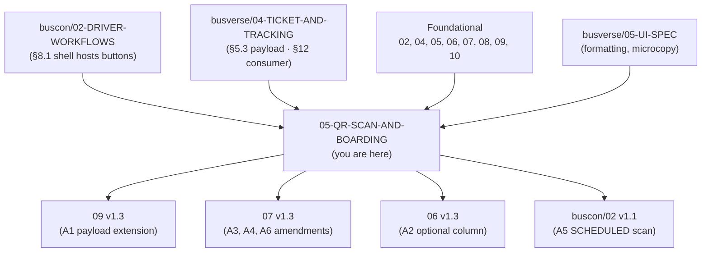

### 1.3 What this document does NOT cover

| Topic | Goes to |
|---|---|
| SCR-OA-TRIP shell layout | `buscon/02-DRIVER-WORKFLOWS.md` §8.1 |
| QR signing (server-side) | `09-SECURITY-AND-PLATFORM-RULES.md` §7 |
| QR rendering (passenger side) | `busverse/04-TICKET-AND-TRACKING.md` §8 |
| Passenger "Boarded" badge rendering | `busverse/04-TICKET-AND-TRACKING.md` §12 |
| Trip start/end lifecycle | `buscon/02-DRIVER-WORKFLOWS.md` §7, §9 |
| GPS activation | `buscon/04-TRIP-GPS-TELEMETRY.md` |
| Admin booking oversight | `buscon/01-OPERATOR-WORKFLOWS.md` §12 (WF-A-05) |
| Full visual design | `buscon/06-UI-SPEC.md` (pending per `buscon/00` §8.4) |

### 1.4 Endpoints owned — 2

| # | Method | Path | Role |
|:---:|---|---|---|
| 1 | POST | `/v1/driver/trips/:id/scan` | DRIVER |
| 2 | GET | `/v1/driver/trips/:id/manifest` | DRIVER |

**Both endpoints exist in `07` v1.2 §7.2.** The scan response schema (A4) and manifest response schema (A6) are extended by this doc.

### 1.5 FR ownership — 5 total

| FR | Description |
|---|---|
| FR-OP-013 | Driver can scan QR ticket online |
| FR-OP-014 | Scan verifies Ed25519 signature against cached public key |
| FR-OP-015 | Scan returns VALID / DUPLICATE / INVALID_* result |
| FR-OP-016 | Scan works offline (queued for sync when network returns) |
| FR-OP-017 | Driver can view live passenger manifest per boarding stand |

### 1.6 Screens owned — 2

| Screen | Purpose |
|---|---|
| SCR-OA-SCAN | Camera scan UI + result overlay + manual entry fallback |
| SCR-OA-MANIFEST | Passenger list grouped by stand with boarding status |

**Navigation entry:** Both screens are entered from `SCR-OA-TRIP` shell (`buscon/02` §8.1). **Available in both `SCHEDULED` and `IN_PROGRESS` trip states** per §14 (resolves G2).

### 1.7 The boarding moment in one page

**Diagram: End-to-end boarding flow**
*A passenger boards. Driver scans QR. Client verifies locally. If online: server verifies + updates booking → CHECKED_IN → emits `boarding:verified` → passenger badge flips. If offline: scan queued → replayed when online. Manifest updates either way.*

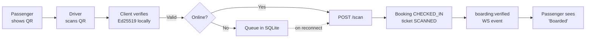

---

## 2. Workflow Map

**Diagram: Workflow map**
*Four owned workflows + one consumer cross-ref. WF-D-04 (online) is the happy path. WF-D-05 (offline) diverges at client queue. WF-R-02 (replay) reconciles. WF-N-04 (invalid) handles every failure case. WF-X-05 is the passenger ripple.*

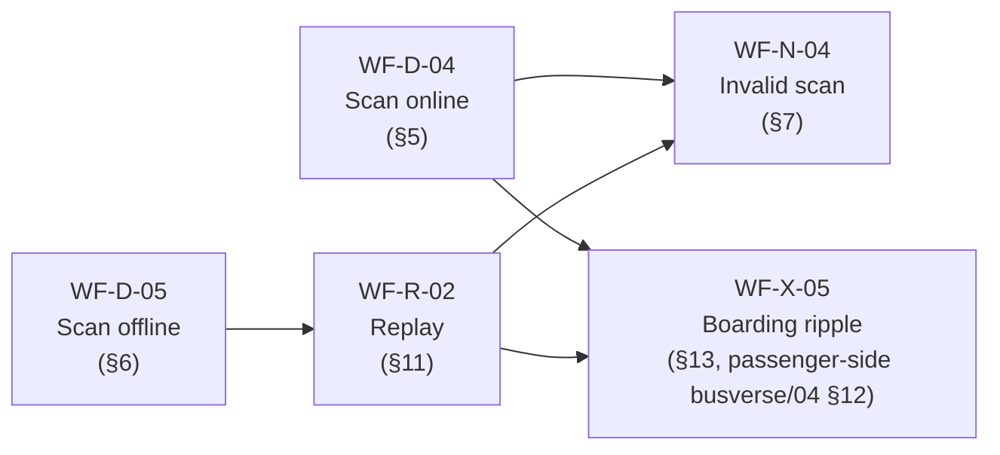

### 2.1 Coverage table

| Workflow | FRs | Screens | Entry | Exit |
|---|---|---|---|---|
| WF-D-04 online scan | FR-OP-013, 014, 015, 017 | SCR-OA-SCAN | Tap "Scan QR" on TRIP | Booking `CHECKED_IN`, ticket `SCANNED` |
| WF-D-05 offline scan | FR-OP-016 | SCR-OA-SCAN | Tap "Scan QR" on TRIP (offline) | Scan queued in SQLite |
| WF-R-02 offline replay | — | (background) | Network returns | All queued scans synced |
| WF-N-04 invalid scan | FR-OP-015 | SCR-OA-SCAN | Bad QR or booking state | No state change + error shown |
| WF-X-05 boarding ripple (driver side) | — | — | Scan success | `boarding:verified` WS event |

### 2.2 Cross-references

| From | What it establishes | Where used here |
|---|---|---|
| `09` v1.2 §7.4 | `qr_content = v1:{payload_b64}:{sig_b64}` format | §4.2 |
| `09` v1.2 §7.5 | Server-side verify algorithm | §4.3 (client mirrors) |
| `buscon/02` §8.1 | Scan and Manifest buttons on TRIP shell | §3.1 |
| `buscon/02` §4.4 | Public key cached in SQLite from `/driver/config` | §6.1 |
| `busverse/04` §12 | Passenger "Boarded" badge from `boarding:verified` | §13 |
| `busverse/04` §10.9 | Stale threshold 30s (pattern reuse) | §12.3 |

---

## 3. Prerequisites and Entry Points

### 3.1 Navigation from SCR-OA-TRIP

**Diagram: Entry points**
*Two entry points from the SCR-OA-TRIP shell. Both become available the moment the trip is in `SCHEDULED` or `IN_PROGRESS` state. GPS is NOT required for scan.*

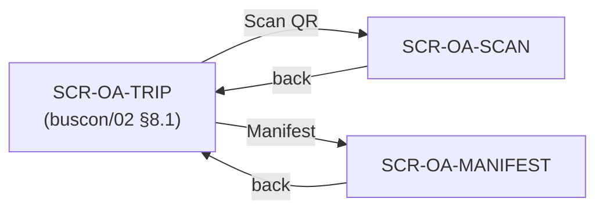

**Availability rules (resolves G2):**

| Trip state | Scan available? | Manifest available? |
|---|---|---|
| `SCHEDULED` | ✅ | ✅ |
| `IN_PROGRESS` | ✅ | ✅ |
| `COMPLETED` | ❌ | ❌ |
| `CANCELLED` | ❌ | ❌ |

**Why SCHEDULED allows scanning:** Real buses board passengers at the origin stand before departure. Boarding at origin stand may occur 15–30 min before `/start`. Without this, the driver has no way to track boarding at origin. Flags `buscon/02` v1.1 A5.

### 3.2 Prerequisites

| Prerequisite | Enforced by |
|---|---|
| Driver authenticated | Auth guard on TRIP screen |
| Driver assigned to this trip | Session's `driver_id` matches trip's `driver_id` |
| Trip in `SCHEDULED` or `IN_PROGRESS` | Server-side check |
| Camera permission (scan only) | OS permission at first scan attempt |
| QR public key cached | Fetched on login (`buscon/02` §4.4); if missing, refetch on scan screen mount |

**Rule:** GPS is not required for scan. Driver can scan even if GPS permission is denied (though trip start requires GPS per `buscon/02` §18.1).

### 3.3 Entry checks

**SCR-OA-SCAN:**

| Check | Action if failed |
|---|---|
| Camera permission granted | Fall back to manual entry (§9) |
| QR public key cached | Refetch config; show spinner until ready |
| Trip active | Redirect to TODAY with toast |
| Active trip exists | Redirect to TODAY |

**SCR-OA-MANIFEST:**

| Check | Action if failed |
|---|---|
| Trip active | Redirect to TODAY |
| Online OR cached manifest exists | Show offline banner with cached data |

---

## 4. QR Contract (Signing + Verification)

### 4.1 The QR string format (from `09` v1.2 §7.4)

**Diagram: QR string anatomy**
*Three parts separated by colons. Version marker, base64-encoded payload, base64-encoded Ed25519 signature. The client never generates this — it only parses it.*

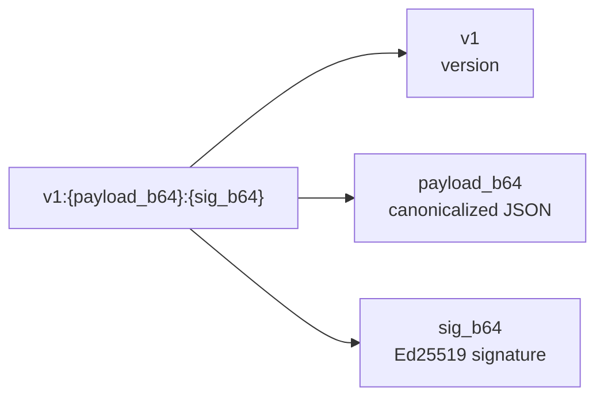

**Exact format:** `v1:{payload_b64}:{sig_b64}` where:
- `v1` — literal version marker
- `payload_b64` — base64 of canonical JSON (sorted keys, no whitespace, UTF-8)
- `sig_b64` — base64 of Ed25519 signature over `payload_b64.decode()` bytes

**Reference:** `09` v1.2 §7.4.

### 4.2 Payload v2 — multi-passenger extension (resolves G1 / A1)

**Diagram: Payload v2 shape**
*Extends the v1.2 payload with `passengerCount` and `allSeatLabels` to support multi-passenger bookings under one QR. Renames `seatId`/`seatLabel`/`passengerName` to `primary*` for clarity. Since no tickets exist pre-launch, this is a clean break — no version bump needed.*

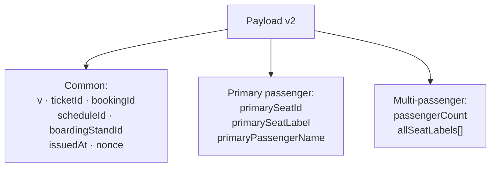

**Canonical payload v2:**

```json
{
  "v": 1,
  "ticketId": "tkt_abc",
  "bookingId": "bkg_xyz",
  "scheduleId": "sch_def",
  "primarySeatId": "seat_123",
  "primarySeatLabel": "A1",
  "primaryPassengerName": "Alice",
  "passengerCount": 3,
  "allSeatLabels": ["A1", "A2", "A3"],
  "boardingStandId": "stand_456",
  "issuedAt": "2026-10-25T10:00:00.000Z",
  "nonce": "base64-random-16-bytes"
}
```

| Field | Type | Purpose |
|---|---|---|
| `v` | integer | Payload version (1) |
| `ticketId` | string | Ticket opaque ID |
| `bookingId` | string | Booking opaque ID |
| `scheduleId` | string | Schedule opaque ID |
| `primarySeatId` | string | First passenger's seat ID |
| `primarySeatLabel` | string | First passenger's seat label (e.g., "A1") |
| `primaryPassengerName` | string | First passenger's name |
| `passengerCount` | integer | **NEW** — total passengers in this booking |
| `allSeatLabels` | string[] | **NEW** — all seat labels in this booking |
| `boardingStandId` | string | Boarding stand ID |
| `issuedAt` | ISO 8601 | Issuance timestamp |
| `nonce` | base64 | 16 random bytes |

**Renames from v1.2 (pre-launch, no migration):**
- `seatId` → `primarySeatId`
- `seatLabel` → `primarySeatLabel`
- `passengerName` → `primaryPassengerName`

**Flags `09` v1.3 A1.** Reference: `09` v1.2 §7.2.

### 4.3 Client-side verification algorithm (resolves G3)

**Diagram: Client verification flow**
*Six-step verification. Any failure → INVALID_* result, do NOT queue. All pass → VALID result, submit to server (online) or queue (offline).*

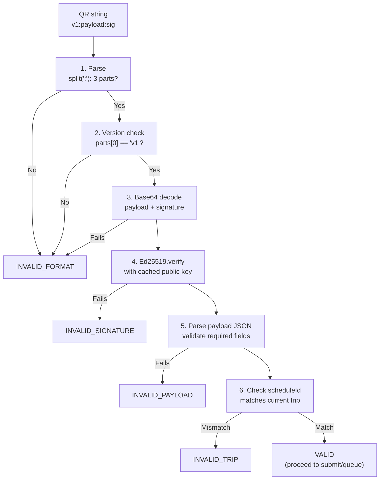

**Client cannot verify:**
- Booking status (ACTIVE vs CANCELLED) — server-only
- Whether ticket already scanned — server-only
- Whether trip is truly `IN_PROGRESS` — client trusts cached trip state

**Rule:** Client verifies **what it can**; server re-verifies **everything** including client-verified items (defense in depth — prevents malicious client bypass).

### 4.4 Local verify → server verify handoff

| What | Client | Server |
|---|:---:|:---:|
| Signature valid (Ed25519) | ✅ Local | ✅ Re-verify |
| Version marker (`v1`) | ✅ | ✅ |
| Payload parses | ✅ | ✅ |
| Schedule matches trip | ✅ | ✅ (server has trip's `schedule_id`) |
| Booking status `CONFIRMED` | ❌ | ✅ |
| Ticket status `ACTIVE` | ❌ | ✅ |
| Not already scanned | ❌ | ✅ |
| Driver owns trip | ❌ | ✅ |

**Rationale:** Client verification prevents queueing garbage, gives instant feedback offline. Server verification is authoritative — protects against malicious tampered clients.

---

## 5. Scan Flow — Online

### 5.1 Sequence

**Diagram: Online scan sequence**
*Camera capture → local verify → POST /scan → server verifies + updates booking/ticket → returns result + emits WS. Client shows result overlay for 3s.*

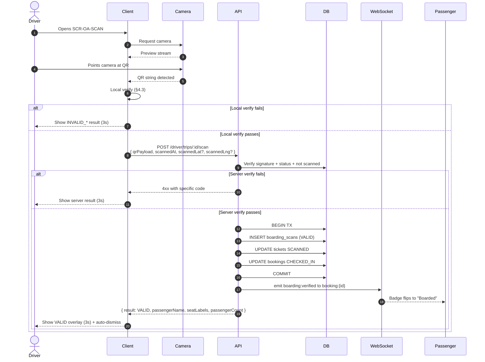

### 5.2 Endpoint contract

**Request:**

```json
POST /v1/driver/trips/:id/scan
{
  "qrPayload": "v1:eyJ...:MEUCIQ...",
  "scannedAt": "2026-10-25T14:32:00.000Z",
  "scannedLat": 26.8467,
  "scannedLng": 80.9462
}
```

| Field | Required | Notes |
|---|:---:|---|
| `qrPayload` | ✅ | Raw QR string |
| `scannedAt` | ✅ | Client timestamp of scan |
| `scannedLat` | ❌ | GPS at scan (best effort) |
| `scannedLng` | ❌ | GPS at scan (best effort) |

**Response (v1.3 A4 extension):**

```json
{
  "data": {
    "result": "VALID",
    "ticketId": "tkt_abc",
    "bookingId": "bkg_xyz",
    "primaryPassengerName": "Alice",
    "seatLabels": ["A1", "A2", "A3"],
    "passengerCount": 3,
    "bookingStatus": "CHECKED_IN",
    "scannedAt": "2026-10-25T14:32:00.180Z"
  }
}
```

**Reference:** `07` v1.2 §7.5; A4 extends with `passengerCount`, `seatLabels[]`, `bookingStatus`.

### 5.3 Result handling

| Server result | HTTP | UI |
|---|---|---|
| `VALID` | 200 | ✅ Green overlay — "Boarded · Alice + 2 (A1–A3)" |
| `DUPLICATE` | 200 | ⚠️ Amber overlay — "Already scanned at {time}" |
| `INVALID_SIGNATURE` | 400 | ❌ Red overlay — "Invalid ticket. Ask for physical ID." |
| `INVALID_BOOKING` | 400 | ❌ Red overlay — "Booking cancelled or invalid." |
| `INVALID_TRIP` | 400 | ❌ Red overlay — "Ticket not for this trip." |
| `SCAN_EXPIRED` | 400 | ❌ Red overlay — "Scan too old (>6h)." |
| `TRIP_NOT_ACTIVE` | 409 | ❌ Red overlay — "Trip not active." |
| `TRIP_CANCELLED` | 409 | ❌ Red overlay — "Trip cancelled." |
| `UNAUTHORIZED` | 401 | ❌ Silent refresh + retry, else force logout |
| `RATE_LIMITED` | 429 | ⚠️ Amber overlay — "Too many scans. Wait {N}s." |
| Network error | — | ❌ Amber overlay — "Offline. Queuing scan." |
| `SERVICE_UNAVAILABLE` | 503 | ⚠️ Amber overlay — "Server unavailable. Retry?" |

### 5.4 Continuous scan mode

**Diagram: Continuous scan mode**
*By default, scanning is continuous: after result displays 3s, camera reopens for next scan. Single-shot mode available via overflow menu.*

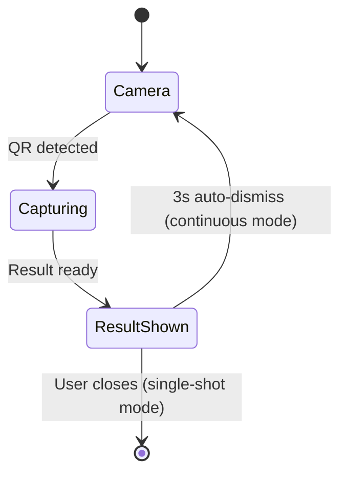

**Default: continuous mode** — matches real-world loading (dozens of passengers boarding in sequence).

---

## 6. Scan Flow — Offline

### 6.1 Sequence

**Diagram: Offline scan sequence**
*Camera capture → local verify → queue in SQLite → show "Queued" overlay. Replay happens later (§11).*

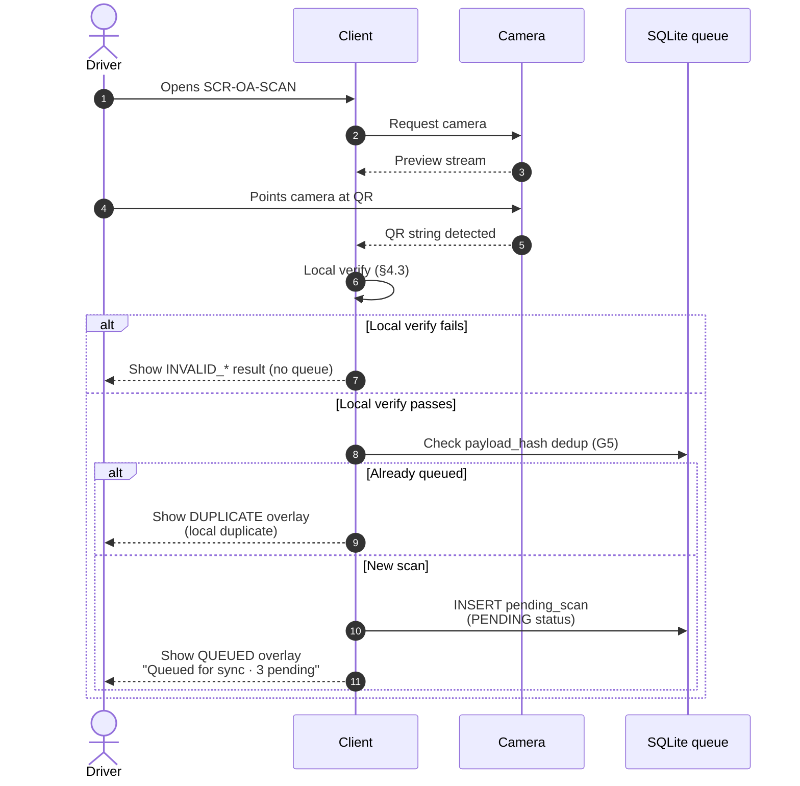

### 6.2 Local verification gate

**Reference:** §4.3 client verification.

**Rule:** Only locally-VALID scans are queued. Local INVALID_* results are shown but never queued — the scan will never succeed even with server re-verification.

### 6.3 Client-side duplicate detection (resolves G5)

**Diagram: Local dedup**
*Before inserting into the queue, compute `sha256(qrPayload)` and check if a row with that hash already exists for this trip. Prevents accidental double-scan of the same QR.*

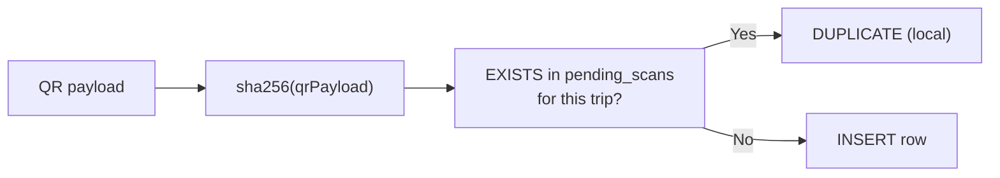

**Rationale:** Without this, a driver scanning the same passenger's QR twice (e.g., phone screen lag) would queue two entries; replay would return `DUPLICATE` on the second. Local dedup catches it earlier, saving the queue slot and giving faster feedback.

### 6.4 Queue overlay UX

| Overlay | Text | Duration |
|---|---|---|
| VALID (online) | "Boarded · Alice + 2 (A1–A3) ✓" | 3s |
| QUEUED (offline) | "Queued for sync · 3 pending ⏳" | 3s |
| DUPLICATE (local) | "Already scanned this ticket" | 3s |
| INVALID_* | "Invalid — {reason}" | 5s (longer — driver needs to read) |

---

## 7. Scan Result Taxonomy

### 7.1 The 5 result types

**Diagram: Result taxonomy**
*Five top-level results: VALID, DUPLICATE, QUEUED, INVALID_*, EXCEPTION. Each maps to a distinct UI treatment.*

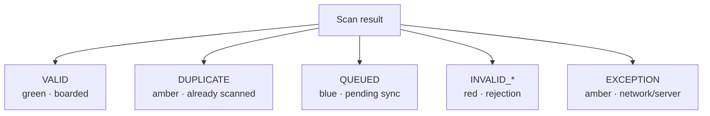

### 7.2 Full result table

| Result | Color | Icon | Sound | Haptic | Example message |
|---|---|---|---|---|---|
| `VALID` | Green | ✓ | Beep (success) | Short vibration | "Boarded · Alice (A1)" |
| `DUPLICATE` | Amber | ⚠ | Two beeps | Short vibration | "Already scanned at 14:32" |
| `QUEUED` | Blue | ⏳ | Soft beep | Short vibration | "Queued · 3 pending sync" |
| `INVALID_SIGNATURE` | Red | ✗ | Buzz | Long vibration | "Invalid ticket" |
| `INVALID_BOOKING` | Red | ✗ | Buzz | Long vibration | "Booking cancelled" |
| `INVALID_TRIP` | Red | ✗ | Buzz | Long vibration | "Not for this trip" |
| `INVALID_FORMAT` | Red | ✗ | Buzz | Long vibration | "Can't read QR. Try again." |
| `INVALID_PAYLOAD` | Red | ✗ | Buzz | Long vibration | "Ticket data invalid" |
| `SCAN_EXPIRED` | Red | ✗ | Buzz | Long vibration | "Scan too old" |
| `TRIP_NOT_ACTIVE` | Red | ✗ | Buzz | Long vibration | "Trip not active" |
| `TRIP_CANCELLED` | Red | ✗ | Buzz | Long vibration | "Trip cancelled" |
| Network error | Amber | ⏳ | Soft beep | Short vibration | "Offline · queued" |
| `RATE_LIMITED` | Amber | ⏳ | Soft beep | Short vibration | "Wait {N}s" |

### 7.3 Sound and haptic feedback

| Result class | Sound | Haptic (ms) |
|---|---|---|
| Success | High beep, 100ms | 50ms |
| Queued / duplicate | Soft beep, 100ms | 30ms |
| Invalid | Buzz, 300ms | 200ms |

**Rule:** Respect device silent mode for sound; haptics fire regardless (unless system haptics disabled).

---

## 8. Camera Scan UI (SCR-OA-SCAN)

### 8.1 Screen layout

**Diagram: Scan screen composition**
*Full-screen camera preview with overlay. QR viewfinder box in center. Result overlay replaces viewfinder briefly. Top bar has back, torch toggle. Bottom has manual entry link.*

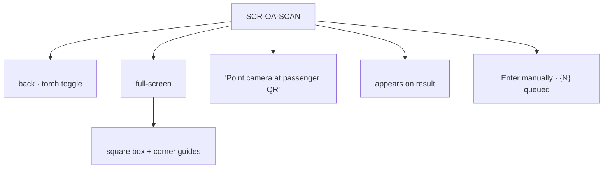

### 8.2 States

**Diagram: Scan screen states**
*Six states. Camera permission gate, live preview, scanning, result, permission denied, manual entry.*

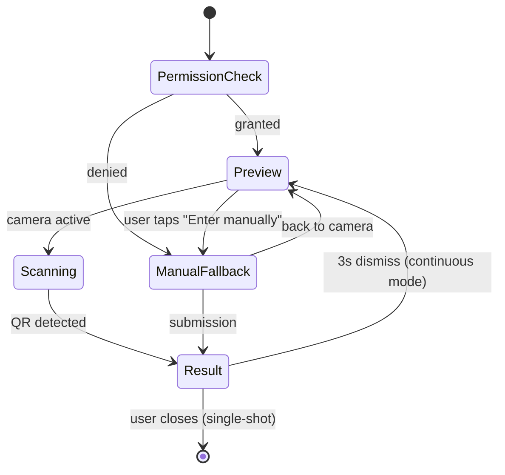

### 8.3 Wireframe

```
┌─────────────────────────────────┐
│ [←]                     [🔦]    │
│                                 │
│                                 │
│    ┌─────────────────────┐      │
│    │                     │      │
│    │                     │      │
│    │    [QR viewfinder]  │      │
│    │                     │      │
│    │                     │      │
│    └─────────────────────┘      │
│                                 │
│    Point camera at passenger QR │
│                                 │
│                                 │
│         🔵 3 pending sync       │
│                                 │
│    [ Enter manually ]           │
└─────────────────────────────────┘
```

### 8.4 Result overlay wireframe

```
┌─────────────────────────────────┐
│                                 │
│                                 │
│              ✓                  │
│                                 │
│         Boarded                 │
│                                 │
│       Alice + 2                 │
│      Seats A1–A3                │
│                                 │
│                                 │
│                                 │
└─────────────────────────────────┘
```

### 8.5 Torch toggle

| Behavior | Detail |
|---|---|
| Toggle | Top-right icon |
| Default | Off (on if app detects low light via ambient sensor if available) |
| Persistence | Remembers last setting per session |

**Phase 1 confirms: yes, torch available** (Q14).

---

## 9. Manual Entry Fallback

### 9.1 Purpose

When camera is unavailable (permission denied, damaged, dirty lens) or QR won't render (passenger's dead phone), driver enters booking reference + primary passenger name to manually board.

### 9.2 Screen layout

**Diagram: Manual entry screen**
*Two inputs + submit button. Submission calls the same `/scan` endpoint but with manual verification fields instead of `qrPayload`.*

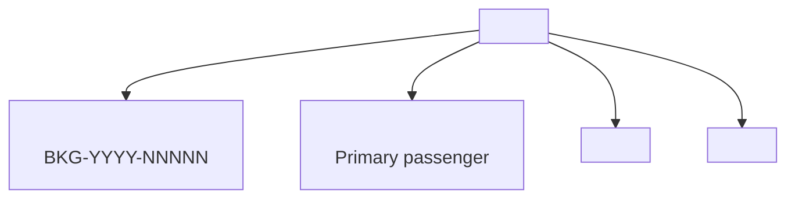

### 9.3 Request contract

**Manual entry sends a different payload shape to the same endpoint (A4 flags):**

```json
POST /v1/driver/trips/:id/scan
{
  "manualEntry": true,
  "bookingReference": "BKG-2026-00042",
  "primaryPassengerName": "Alice",
  "scannedAt": "2026-10-25T14:32:00.000Z"
}
```

**Note:** Either `qrPayload` OR (`manualEntry` + `bookingReference` + `primaryPassengerName`) is required. Mixing → 400 `INVALID_REQUEST`.

### 9.4 Verification

Server verifies:
1. `booking_reference` exists AND belongs to trip's schedule
2. `primaryPassengerName` matches `booking_passengers.name` for seat 1 (case-insensitive, whitespace-normalized)
3. Booking status `CONFIRMED` (not already `CHECKED_IN`)
4. Ticket status `ACTIVE`

**If any check fails → INVALID_BOOKING or DUPLICATE.**

### 9.5 Rate limit

Manual entry: **10 attempts per minute per driver**. Prevents brute-force guessing.

### 9.6 Audit trail

Manual entries create a `boarding_scans` row with:
- `result = VALID` (if matched) OR `INVALID_BOOKING` (if no match)
- `metadata_json = { manualEntry: true, enteredBy: driverId }`
- `scanned_lat` / `scanned_lng` (if GPS available)

**Rule:** Manual entries are more suspicious than QR scans — logged with `manualEntry: true` for admin audit.

**Reference:** `04` §11.5 (log security).

---

## 10. Offline Queue Schema (SQLite)

### 10.1 Schema

**Diagram: Pending scans table**
*Single SQLite table. Primary key on `id`, unique constraint on `(trip_id, payload_hash)` prevents duplicate queue entries. Sync status tracks lifecycle.*

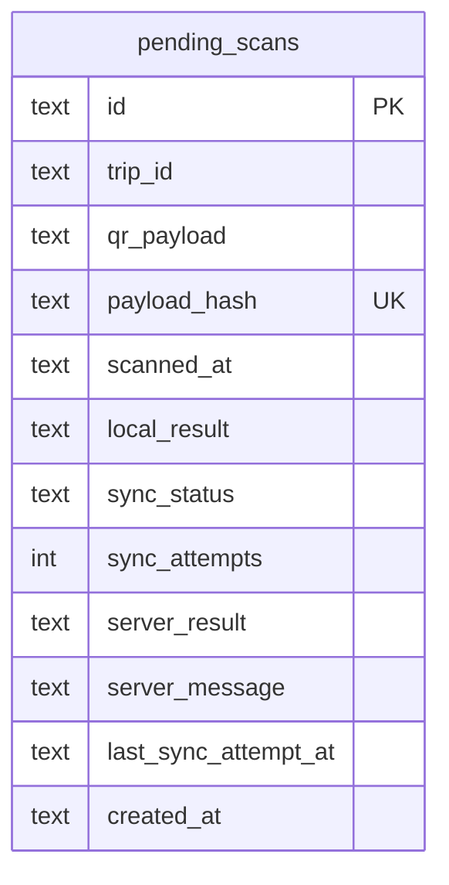

**DDL:**

```sql
CREATE TABLE pending_scans (
  id TEXT PRIMARY KEY,
  trip_id TEXT NOT NULL,
  qr_payload TEXT NOT NULL,
  payload_hash TEXT NOT NULL,
  scanned_at TEXT NOT NULL,
  local_result TEXT NOT NULL CHECK (local_result IN ('VALID', 'INVALID_SIGNATURE', 'INVALID_FORMAT', 'INVALID_TRIP')),
  sync_status TEXT NOT NULL DEFAULT 'PENDING' CHECK (sync_status IN ('PENDING', 'SYNCING', 'SYNCED', 'FAILED')),
  sync_attempts INTEGER NOT NULL DEFAULT 0,
  server_result TEXT,
  server_message TEXT,
  last_sync_attempt_at TEXT,
  created_at TEXT NOT NULL
);

CREATE UNIQUE INDEX uniq_pending_scans_trip_payload ON pending_scans(trip_id, payload_hash);
CREATE INDEX idx_pending_scans_status ON pending_scans(sync_status) WHERE sync_status IN ('PENDING', 'FAILED');
```

### 10.2 Why SQLite (not memory — unlike GPS)

| Data type | Storage | Reason |
|---|---|---|
| GPS buffer | In-memory (`buscon/04` §10.2) | GPS is nice-to-have; loss is acceptable |
| **Scan queue** | **SQLite** | **Boarding is contractual — every valid scan must reach server** |

**Reference:** `buscon/00` §10.3 (SQLite cache infra) + `buscon/04` §10.2 (GPS is in-memory only).

### 10.3 Queue size limit (resolves gap 13)

**Diagram: Queue size behavior**
*Cap at 200 rows per trip. When full, drop oldest PENDING (FIFO). Show banner to driver.*

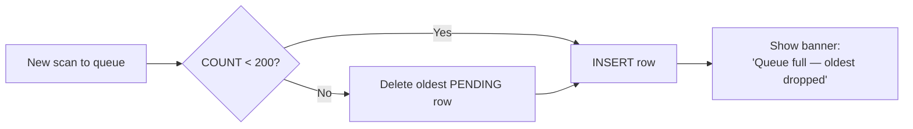

| Parameter | Value | Rationale |
|---|---|---|
| Max rows per trip | 200 | ~1 full 40-seat bus × 5 scans; covers long outages |
| Full behavior | Drop oldest `PENDING` | Preserves recency (recent boarding more important) |
| Warning | Banner on scan screen | Driver knows data may be lost |

### 10.4 Queue retention (resolves gap 14)

| Status | Retention |
|---|---|
| `PENDING` | Until synced |
| `SYNCING` | Until synced or attempt fails |
| `SYNCED` | Deleted immediately on success |
| `FAILED` | Kept 7 days, then purged |

**Reference:** §11.4.

---

## 11. Offline Replay (WF-R-02)

### 11.1 Trigger

**Diagram: Replay triggers**
*Four triggers — app foreground, network reconnect, trip end, and manual pull-to-refresh on the scan screen footer.*

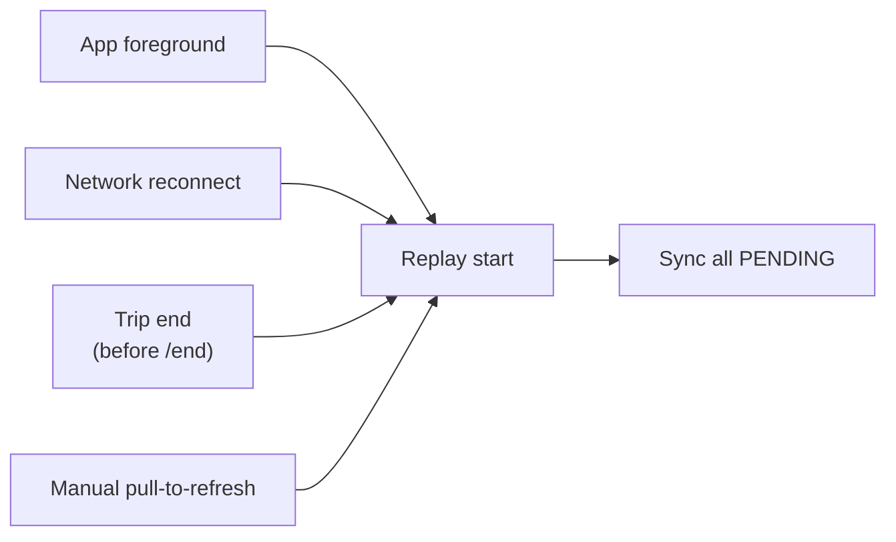

**Rule:** Replay always runs in FIFO order by `scanned_at` (oldest first) — preserves boarding chronology for audit.

### 11.2 Batch replay sequence

**Diagram: Replay sequence**
*Fetch all PENDING scans for trip, mark each SYNCING, POST to server, update status. Rate-limited to 10 scans/sec to avoid overwhelming server. On server DUPLICATE, marks as SYNCED with server_result DUPLICATE — data integrity preserved.*

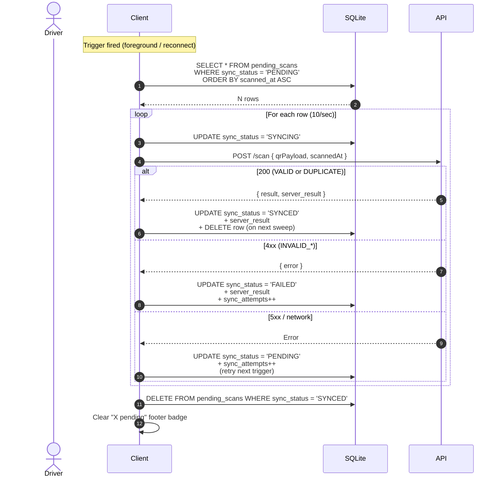

### 11.3 Idempotency (resolves gap 15)

**Server-side idempotency:** `POST /scan` is idempotent via `boarding_scans` unique constraint on `(ticket_id, trip_id)`.

- First scan → `INSERT` succeeds → `boarding_scans.result = VALID`
- Replay of same scan → `INSERT` fails on unique → handler returns `DUPLICATE` with original `scanned_at`
- Client on `SYNCING` crash → on next trigger, row still `SYNCING`; replay resets to `PENDING` and retries (server dedups)

**Rule:** Client does NOT need its own idempotency — server's unique constraint is authoritative.

**Reference:** `06` v1.2 §8.4 (`boarding_scans`); A6 flags `boarding_scans` unique constraint check.

### 11.4 Failure handling (resolves G4)

**Diagram: Replay failure classification**
*Three buckets — SYNCED (delete), FAILED (keep 7 days for review), RETRY (pending).*

```mermaid
flowchart TB
    RESULT["Replay result"]

    RESULT -->|"200 VALID"| SYNCED["SYNCED<br/>delete row"]
    RESULT -->|"200 DUPLICATE"| SYNCED2["SYNCED<br/>server_result = DUPLICATE"]
    RESULT -->|"400 INVALID_*"| FAILED["FAILED<br/>keep 7 days"]
    RESULT -->|"400 SCAN_EXPIRED"| FAILED2["FAILED<br/>keep 7 days"]
    RESULT -->|"4xx INVALID_BOOKING"<br/>(booking cancelled)| FAILED3["FAILED<br/>keep 7 days"]
    RESULT -->|"5xx / network"| RETRY["PENDING<br/>retry next trigger"]
```

| Server response | Client status | Retention | UI banner |
|---|---|---|---|
| `VALID` | `SYNCED` | Delete | — |
| `DUPLICATE` | `SYNCED` | Delete | — |
| `INVALID_BOOKING` | `FAILED` | 7 days | ⚠️ "1 scan needs review" |
| `INVALID_TRIP` | `FAILED` | 7 days | Same |
| `INVALID_SIGNATURE` | `FAILED` | 7 days | Same |
| `SCAN_EXPIRED` (>6h old) | `FAILED` | 7 days | Same |
| 5xx, network | `PENDING` | Until synced | — |

**Rule:** `FAILED` rows are never auto-retried. Driver sees a banner on the scan screen footer "X scan{?s} need review" — tapping opens a read-only list. Admin can resolve via `buscon/01` §12 (audit log review).

### 11.5 Audit trail for failed replays

Every `FAILED` scan writes to `audit_logs` on the server with:
- `action = 'offline_scan_failed'`
- `metadata_json = { tripId, qrPayloadHash, serverResult, attempts }`

**Reference:** `04` §11.5 (log security).

### 11.6 Expiry — 24h cutoff (resolves gap 21)

| Age | Behavior |
|---|---|
| < 24h | Normal replay — server accepts if valid |
| 24h–72h | Replay attempted; server returns `SCAN_EXPIRED` if `scannedAt` > 6h old (per `07` v9.2 `SCAN_EXPIRED`) |
| > 72h | Client refuses to replay; marks `FAILED` locally |

**Rule:** Server-side `SCAN_EXPIRED` is 6h per `09` §12.3. Client's 24h/72h cutoffs are guardrails — the server is authoritative.

---

## 12. Manifest Screen (SCR-OA-MANIFEST)

### 12.1 Screen layout

**Diagram: Manifest composition**
*Stand-grouped passenger list. Filter chip per stand. Boarded vs not-boarded status per passenger. Pull-to-refresh + background poll.*

```mermaid
flowchart TB
    PAGE["SCR-OA-MANIFEST"]

    PAGE --> HEADER["<ManifestHeader><br/>back · '{boarded}/{total} boarded'"]
    PAGE --> FILTER["<StandFilterChips><br/>All · Stand 1 · Stand 2 ..."]
    PAGE --> LIST["<PassengerList><br/>grouped by stand"]
    LIST --> STAND["<StandGroup><br/>standName · {N} passengers"]
    STAND --> ROW["<PassengerRow> × N<br/>name · seats · status"]
    PAGE --> REFRESH["<PullToRefresh>"]
```

### 12.2 Response schema (resolves G8 / A6)

**Request:** `GET /v1/driver/trips/:id/manifest`

**Response:**

```json
{
  "data": {
    "tripId": "trp_abc",
    "scheduleId": "sch_def",
    "totalPassengers": 40,
    "totalBoarded": 12,
    "lastUpdatedAt": "2026-10-25T14:32:00.000Z",
    "byStand": [
      {
        "standId": "stand_456",
        "standName": "Kashmere Gate",
        "sequence": 1,
        "passengers": [
          {
            "bookingId": "bkg_xyz",
            "bookingReference": "BKG-2026-00042",
            "seatLabels": ["A1", "A2"],
            "passengerNames": ["Alice", "Carol"],
            "boardingStatus": "BOARDED",
            "boardedAt": "2026-10-25T14:32:00.000Z"
          },
          {
            "bookingId": "bkg_abc",
            "bookingReference": "BKG-2026-00043",
            "seatLabels": ["A5"],
            "passengerNames": ["Bob"],
            "boardingStatus": "CONFIRMED",
            "boardedAt": null
          }
        ]
      }
    ]
  }
}
```

**Flags `07` v1.3 A6.**

### 12.3 Refresh cadence (resolves G6)

**Diagram: Refresh triggers**
*Four triggers — mount, pull-to-refresh, background poll 30s, WebSocket `boarding:verified` in-place update.*

```mermaid
flowchart LR
    MOUNT["Screen mount"] --> FETCH["GET /manifest"]
    PULL["Pull-to-refresh"] --> FETCH
    POLL["Background poll 30s"] --> FETCH
    WS["WS boarding:verified"] --> UPDATE["Update row in place<br/>(no full refetch)"]
    FETCH --> RENDER["Render list"]
```

| Trigger | Behavior |
|---|---|
| Screen mount | Fetch full manifest |
| Pull-to-refresh | Fetch full manifest |
| Background poll | Every 30s while screen visible |
| `boarding:verified` WS | Update matching passenger row to BOARDED (no refetch) |
| Network offline | Show cached manifest (from SQLite) + offline banner |

### 12.4 Stand filter (resolves gap 16)

| Default | Nearest stand by GPS | If GPS unavailable → first stand |
| Persistence | Last-used filter saved in localStorage per trip |
| Chips | "All" + one per stand + "Other" (passengers on cancelled stands) |

### 12.5 Passenger row content

| Element | Content |
|---|---|
| Name(s) | Full name(s) from `booking_passengers.name` |
| Seat(s) | Label(s) — "A1" or "A1, A2" |
| Status | Badge: `BOARDED` (green) / `CONFIRMED` (grey) |
| Boarded time | If `BOARDED`, show timestamp ("14:32") |

**Rule (resolves gap 19):** Passenger full names are shown — driver needs to verify identity/seat. This is not PII leakage because the driver is running the trip.

### 12.6 Empty states

| State | UI |
|---|---|
| No passengers booked on trip | "No passengers on this trip yet" |
| Filter stand empty | "No passengers at {stand} yet" |
| Load error | Banner + retry |
| Offline | Cached manifest + "Offline — last updated {time}" banner |

---

## 13. Boarding Status Propagation

### 13.1 The `boarding:verified` event

**Diagram: Event emission**
*One event per booking (not per passenger). Emitted after transaction commit. Consumed by passenger WebSocket subscriber → badge flips to "Boarded".*

```mermaid
sequenceDiagram
    participant API as API
    participant DB as DB
    participant WS as WebSocket
    participant PAX as Passenger

    Note over API: POST /scan transaction
    API->>DB: INSERT boarding_scans (VALID)
    API->>DB: UPDATE tickets SCANNED
    API->>DB: UPDATE bookings CHECKED_IN
    API->>DB: COMMIT

    API->>WS: emit boarding:verified<br/>to booking:{bookingId}
    WS-->>PAX: { event, data }
    PAX->>PAX: Badge → "Boarded"
```

### 13.2 Payload (resolves G7 / A3)

**Canonical payload (flags `07` v1.3 A3):**

```json
{
  "bookingId": "bkg_xyz",
  "ticketId": "tkt_abc",
  "passengerCount": 3,
  "allSeatLabels": ["A1", "A2", "A3"],
  "boardedAt": "2026-10-25T14:32:00.180Z"
}
```

| Field | Notes |
|---|---|
| `bookingId` | Required — topic is `booking:{bookingId}` |
| `ticketId` | Required — for passenger UI correlation |
| `passengerCount` | NEW (A3) — number of passengers boarded |
| `allSeatLabels` | NEW (A3) — array of seat labels |
| `boardedAt` | Server-authoritative timestamp |

**Reference:** `07` v1.2 §8.7; `busverse/04` §12.2 consumes.

### 13.3 Consumer contract (from `busverse/04` §12)

| Consumer behavior | Requirement |
|---|---|
| Badge flip | "Ready to board" → "Boarded" |
| QR dimming | QR watermarked "Boarded" + boarded timestamp |
| Toast | "You're boarded! Have a safe trip." |
| Idempotency | Duplicate `boarding:verified` — no double-badge-flip |

**Reference:** `busverse/04` §12.2–§12.4.

### 13.4 Late/missed WS handling

| Scenario | Behavior |
|---|---|
| Passenger WS disconnected at scan time | On reconnect, `GET /bookings/:id` returns `CHECKED_IN` — badge flips |
| Passenger WS reconnects during trip | Same |
| Passenger app closed | Badge shows `Boardeded` on next open |

**Reference:** `busverse/04` §12.3 (fallback via poll).

---

## 14. Timing — Before vs During Trip

### 14.1 The SCHEDULED boarding window (resolves G2 / A5)

**Diagram: Trip state scan matrix**
*Scan allowed in SCHEDULED and IN_PROGRESS. Boarding at origin stand happens while trip is still SCHEDULED. Intermediate stands board during IN_PROGRESS.*

```mermaid
stateDiagram-v2
    [*] --> SCHEDULED: schedule published
    SCHEDULED --> IN_PROGRESS: driver /start
    IN_PROGRESS --> COMPLETED: driver /end
    IN_PROGRESS --> CANCELLED: operator cancels
    SCHEDULED --> CANCELLED: operator cancels

    note right of SCHEDULED
        Scan allowed ✅
        Manifest allowed ✅
    end note

    note right of IN_PROGRESS
        Scan allowed ✅
        Manifest allowed ✅
    end note

    note right of COMPLETED
        Scan blocked ❌
        Manifest read-only
    end note

    note right of CANCELLED
        Scan blocked ❌
        Manifest read-only
    end note
```

### 14.2 Server-side check

| Trip state | Scan response |
|---|---|
| `SCHEDULED` | ✅ Accept scan |
| `IN_PROGRESS` | ✅ Accept scan |
| `COMPLETED` | ❌ `409 TRIP_NOT_ACTIVE` |
| `CANCELLED` | ❌ `409 TRIP_CANCELLED` |

### 14.3 UX implications

| Element | Behavior in SCHEDULED |
|---|---|
| "Scan QR" button on TRIP shell | Enabled |
| "Manifest" button on TRIP shell | Enabled |
| Boarding status badge in manifest | Shows `CONFIRMED` / `BOARDED` |
| Boarding count on TRIP shell summary | Shows "0/40 boarded" if none yet |

**Flags `buscon/02` v1.1 A5:** TRIP shell must render Scan + Manifest buttons in SCHEDULED state too.

### 14.4 Stand boarding order (informational)

| Stand sequence | Boarding timing |
|---|---|
| Source stand (seq 1) | While `SCHEDULED` (before `/start`) |
| Intermediate stands (seq 2..N-1) | While `IN_PROGRESS` (after `/start`, before `/end`) |
| Destination stand (seq N) | Not used for boarding — passengers drop here |

**Rule:** Boarding stand is set on the booking (`boardingStandId` in QR payload). Passengers boarding at intermediate stands must be scanned at those stands, but the server accepts any stand on the route — no stand-specific enforcement.

---

## 15. Multi-Passenger Handling (resolves G1)

### 15.1 The multi-passenger problem

**Diagram: Multi-passenger booking**
*One booking has 3 passengers (3 seats). One QR (per `06` v1.2 §6.5 — one ticket per booking). Scanning the QR boards all 3.*

```mermaid
flowchart LR
    BOOKING["Booking bkg_xyz<br/>3 passengers · A1, A2, A3"] --> TICKET["1 ticket"]
    TICKET --> QR["1 QR"]
    QR -->|"scan"| BOARD["All 3 → CHECKED_IN<br/>All 3 → SCANNED"]
```

### 15.2 Scan → boarding semantics

| Scan | Update |
|---|---|
| Valid scan of QR | `bookings.status` → `CHECKED_IN` (atomic) |
| | All 3 `booking_passengers` effectively boarded |
| | 1 `boarding_scans` row with `ticket_id` |
| | 1 `boarding:verified` event |

**Note:** `boarding_scans` has one row per booking-scan, not per passenger. The count is derivable from `booking.passengerCount`.

### 15.3 Driver UX

| Case | Overlay text |
|---|---|
| 1 passenger | "Boarded · Alice (A1) ✓" |
| 2–6 passengers | "Boarded · Alice + {N-1} (A1–A{N}) ✓" |

**Rule:** Driver sees a summary, not per-passenger confirmation. If a passenger is missing at the seat, driver reports via operator (Phase 2 adds per-seat scan).

### 15.4 Manifest display

| Row | Content |
|---|---|
| Booking | "Alice, Carol · A1, A2 · Boarded ✓" |

**Rule:** Manifest groups by booking, not individual passenger — matches the QR granularity.

### 15.5 Partial-boarding edge case (Phase 2)

**Not in Phase 1:** A booking of 3 passengers where only 2 board. Phase 1 boards all 3 with one scan. If partial boarding is real, operator/admin must handle separately (cancel remaining seat, partial refund). Phase 2 could add per-seat scan.

**Flags Q-B19** (partial boarding Phase 2).

---

## 16. Component Structure

### 16.1 Component tree

**Diagram: Full component tree**
*Two screens + shared components. Scan screen has camera + overlay + manual entry. Manifest screen has stand filter + grouped list.*

```mermaid
flowchart TB
    APP["QR scan + boarding"]

    APP --> SCAN["SCR-OA-SCAN"]
    SCAN --> S1["<ScanHeader><br/>back · torch toggle"]
    SCAN --> S2["<CameraPreview>"]
    SCAN --> S3["<QrViewfinder>"]
    SCAN --> S4["<ScanResultOverlay>"]
    SCAN --> S5["<ScanFooter><br/>queue count · manual entry"]
    SCAN --> S6["<ManualEntryModal>"]

    APP --> MANIFEST["SCR-OA-MANIFEST"]
    MANIFEST --> M1["<ManifestHeader>"]
    MANIFEST --> M2["<StandFilterChips>"]
    MANIFEST --> M3["<PassengerList>"]
    M3 --> M4["<StandGroup> × N"]
    M4 --> M5["<PassengerRow> × N"]
    MANIFEST --> M6["<PullToRefresh>"]

    APP --> SHARED["<ResultBadge><br/><QueueBadge><br/><StatusIndicator>"]
```

### 16.2 Component contracts

| Component | Props | Emits |
|---|---|---|
| `<ScanHeader>` | `onBack`, `torchOn`, `onTorchToggle` | callbacks |
| `<CameraPreview>` | `onQrDetected`, `torchOn` | `onQrDetected(qrString)` |
| `<QrViewfinder>` | `state` | — |
| `<ScanResultOverlay>` | `result`, `message`, `detail`, `onDismiss` | `onDismiss()` |
| `<ScanFooter>` | `queueCount`, `onManualEntry` | callbacks |
| `<ManualEntryModal>` | `onSubmit`, `onClose` | `onSubmit({ ref, name })` |
| `<ManifestHeader>` | `boarded`, `total`, `onBack` | `onBack` |
| `<StandFilterChips>` | `stands[]`, `active`, `onChange` | `onChange(standId)` |
| `<PassengerList>` | `byStand[]`, `standFilter`, `onRowTap?` | callbacks |
| `<PassengerRow>` | `passenger` | `onTap?` |
| `<ResultBadge>` | `status` | — |
| `<QueueBadge>` | `count`, `failed` | — |

### 16.3 Ownership

| Component | Owner |
|---|---|
| All scan + manifest compositions | **This doc** |
| `<CameraPreview>` (native module wrapper) | **This doc** (wraps `expo-camera`) |
| `<ResultBadge>` (badge styles) | This doc |
| Primitives (`<Button>`, `<Modal>`) | `@busverse/ui` |

**Rule:** `<CameraPreview>` wraps `expo-camera` (or `react-native-vision-camera` if performance demands — Q-B15). Interface unchanged either way.

### 16.4 Native modules

| Module | Purpose | Package |
|---|---|---|
| Camera | QR scanning | `expo-camera` (with barcode scanning) |
| SQLite | Offline queue | `expo-sqlite` (already used for trips/manifest cache) |
| Ed25519 | Signature verification | `@noble/ed25519` (same as server) |
| Haptics | Scan feedback | `expo-haptics` |
| Sound | Beeps/buzz | `expo-av` |

---

## 17. State Management

### 17.1 React Query keys

| Query | Key | staleTime |
|---|---|---|
| Manifest | `['driver', 'manifest', tripId]` | 30s |
| Scan result (transient) | (not in React Query — local state) | — |
| Queue count | (local state — SQLite-derived) | — |

### 17.2 Mutations

| Mutation | Side effect |
|---|---|
| Scan (online) | Invalidate `['driver', 'manifest', tripId]` |
| Scan (offline queued) | Update local queue count |
| Manual entry | Same as scan |

### 17.3 Local state

**Scan screen:**

```typescript
type ScanLocalState = {
  cameraPermission: 'granted' | 'denied' | 'prompt';
  torchOn: boolean;
  scanState: 'preview' | 'scanning' | 'result' | 'manual-entry';
  lastResult: ScanResult | null;
  queueCount: number;
  failedCount: number;
};
```

**Manifest screen:**

```typescript
type ManifestLocalState = {
  activeStandFilter: string | 'all';
  lastRefreshedAt: string | null;
};
```

### 17.4 SQLite operations

| Operation | Trigger |
|---|---|
| `INSERT pending_scan` | Offline scan |
| `SELECT COUNT(*) WHERE status = 'PENDING'` | Screen mount, after each sync batch |
| `SELECT COUNT(*) WHERE status = 'FAILED'` | Screen mount |
| `UPDATE status = 'SYNCING'` | Replay begins |
| `UPDATE status = 'SYNCED'` | Server accepts |
| `UPDATE status = 'FAILED'` | Server rejects |
| `DELETE WHERE status = 'SYNCED'` | After successful sync batch |
| `DELETE WHERE status = 'FAILED' AND created_at < now - 7 days` | Nightly cleanup on app open |

### 17.5 Queue sync state machine

**Diagram: Queue row lifecycle**
*Six states — PENDING is initial, SYNCING is transient, SYNCED is terminal (deleted), FAILED is terminal (kept 7 days).*

```mermaid
stateDiagram-v2
    [*] --> PENDING: scan queued
    PENDING --> SYNCING: replay begins
    SYNCING --> SYNCED: server 200 (VALID/DUPLICATE)
    SYNCING --> FAILED: server 4xx (INVALID_*)
    SYNCING --> PENDING: server 5xx or network error (retry)
    SYNCED --> [*]: deleted
    FAILED --> [*]: purged after 7 days
```

---

## 18. Error Handling

### 18.1 Error decision tree

**Diagram: Scan error routing**
*Result class → UI color/sound. Same tree as §7, shown as routing.*

```mermaid
flowchart TB
    ERR["Scan error"]
    ERR --> Q1{"Local verify fail?"}
    Q1 -->|"Yes"| LOCAL["INVALID_* overlay<br/>red · buzz"]
    Q1 -->|"No"| Q2{"Network?"}
    Q2 -->|"No internet"| QUEUE["QUEUED overlay<br/>blue · beep"]
    Q2 -->|"Online"| Q3{"POST response?"}
    Q3 -->|"200 VALID"| OK["VALID overlay<br/>green · beep"]
    Q3 -->|"200 DUPLICATE"| DUP["DUPLICATE overlay<br/>amber · beep"]
    Q3 -->|"4xx INVALID_*"| BAD["INVALID_* overlay<br/>red · buzz"]
    Q3 -->|"4xx/409 trip"| TRIP["TRIP_NOT_ACTIVE<br/>red · buzz"]
    Q3 -->|"401"| REFRESH["Silent refresh + retry<br/>then force logout"]
    Q3 -->|"429"| WAIT["RATE_LIMITED overlay<br/>amber · beep"]
    Q3 -->|"5xx"| SVC["SERVICE_UNAVAILABLE<br/>amber · retry button"]
```

### 18.2 Per-screen error matrix

**SCR-OA-SCAN:**

| State | UI |
|---|---|
| Loading (config fetch) | Spinner overlay |
| Camera permission prompt | Native permission UI |
| Camera permission denied | Manual entry fallback active + banner "Enable camera in settings" |
| Camera active | Preview stream |
| Network offline | Amber banner "Offline — scans will queue" |
| Scanning QR | Viewfinder animating |
| Result VALID | Green overlay 3s |
| Result INVALID_* | Red overlay 5s |
| Result QUEUED | Blue overlay 3s |
| Queue FAILED count > 0 | Banner "X scan{?s} need review" |
| Queue > 190 pending | Warning banner "Queue nearly full" |

**SCR-OA-MANIFEST:**

| State | UI |
|---|---|
| Loading | Skeleton rows × 5 |
| Loaded | Grouped list |
| Empty (no passengers) | "No passengers yet" |
| Empty (filter) | "No passengers at this stand" |
| Offline | Cached + banner |
| Error | Banner + retry |
| WS update arrives | Row smoothly animates to `BOARDED` |

### 18.3 Confirmation dialogs

| Action | Confirmation |
|---|---|
| Manual entry submit | No confirm (immediate submit) |
| Clear queue (dev only) | Not in production |
| Force logout on 401 | Silent — no prompt |

**Rule:** No confirmations on the scan path — boarding needs to be fast. Confirmations are only on destructive admin actions (per `buscon/01` §20.3).

### 18.4 Retry budget

| Endpoint | Retries | Backoff |
|---|---|---|
| `POST /scan` (online) | 3 | 1s, 3s, 9s |
| `POST /scan` (replay) | 3 per batch attempt; batch retried on next trigger | — |
| `GET /manifest` | 3 | 1s, 3s, 9s |

### 18.5 Silent failures

| Scenario | Behavior |
|---|---|
| WS `boarding:verified` for ticket on another trip | Client ignores (topic is scoped per booking) |
| Manifest WS update for passenger not in list | Client logs warning; refetches |
| Duplicate queue insert (race) | SQLite unique constraint catches; client skips |

---

## 19. Test Coverage

### 19.1 Test suites (~54 tests)

| Suite | Count | Covers |
|---|---:|---|
| `e2e_scan_online` | 3 | Happy, invalid, duplicate |
| `e2e_scan_offline` | 3 | Queued, local dup, local invalid |
| `e2e_scan_replay` | 4 | Valid sync, duplicate sync, invalid → FAILED, network error → retry |
| `e2e_scan_replay_crash` | 2 | SYNCING crash recovery, idempotency via payload_hash |
| `e2e_scan_manual_entry` | 3 | Happy, wrong name, wrong ref |
| `e2e_scan_scheduled_state` | 2 | Scan works before /start (SCHEDULED); blocked after /end |
| `e2e_manifest_load` | 3 | Happy, empty, error |
| `e2e_manifest_refresh` | 3 | Pull-to-refresh, WS update, 30s poll |
| `e2e_manifest_filter` | 2 | Stand filter, all filter |
| `e2e_multi_passenger` | 2 | 3-passenger scan boards all; overlay shows count |
| `e2e_boarding_ripple` | 2 | `boarding:verified` → passenger badge flips |
| `component_camera_preview` | 3 | Permission, scanning, torch |
| `component_result_overlay` | 5 | VALID, DUPLICATE, QUEUED, INVALID_*, EXCEPTION |
| `component_manual_entry` | 3 | Validation, submit, error |
| `component_queue_badge` | 3 | Count, failed count, empty |
| `component_manifest_row` | 4 | Confirmed, boarded, multi-passenger, WS update |
| `unit_local_verify` | 6 | Format, version, base64, signature, payload, schedule |
| `unit_local_dedup` | 2 | Hash match, hash miss |
| `unit_queue_schema` | 3 | Insert, unique constraint, retention |
| `unit_result_taxonomy` | 2 | Result → UI mapping |
| `contract_scan_endpoint` | 6 | Happy, invalid signature, invalid booking, invalid trip, expired, unauthorized |
| `contract_manifest_endpoint` | 3 | Happy, unauthorized, not-booked |
| `contract_scan_manual_entry` | 4 | Happy, wrong name, wrong ref, rate limit |
| `integration_boarding_sm` | 3 | Booking SM, ticket SM, trip SM |
| `integration_ws_emit` | 2 | boarding:verified emitted, payload correct |
| `perf_scan` | 1 | p95 < 500ms |
| **Total** | **~77** | |

### 19.2 Key assertions

| Test | Asserts |
|---|---|
| `e2e_scan_online_happy` | Valid QR → VALID overlay, booking CHECKED_IN |
| `e2e_scan_offline_queued` | Valid QR offline → QUEUED overlay, row in SQLite |
| `e2e_scan_replay_valid` | Reconnect → row SYNCED → deleted |
| `e2e_scan_replay_invalid` | Booking cancelled → row FAILED, banner shown |
| `e2e_scan_scheduled_state` | Scan before /start works (server accepts) |
| `e2e_multi_passenger_scan` | 3-passenger QR → "Alice + 2 (A1–A3)" overlay |
| `e2e_boarding_ripple` | WS event → passenger badge flips within 100ms |
| `unit_local_verify_signature` | Tampered QR → INVALID_SIGNATURE (no server call) |
| `unit_local_verify_schedule` | Wrong schedule QR → INVALID_TRIP locally |
| `unit_queue_unique` | Duplicate insert → SQLite constraint error |
| `contract_scan_duplicate` | Second scan of same ticket → 200 DUPLICATE |

### 19.3 Test infrastructure

| Tool | Purpose |
|---|---|
| Detox / Maestro | Native E2E (camera mock) |
| Vitest | Unit + integration |
| SQLite in-memory | Queue tests |
| Ed25519 test keypair | Local verify tests |
| Mock WebSocket | Ripple tests |

**Reference:** `10` v1.2 §7.6, §8.

---

## 20. Cross-Doc Amendment Flags

### 20.1 Six amendments

| # | Doc | Amendment |
|---|---|---|
| **A1** | `09` v1.3 | §7.2: extend QR payload — add `passengerCount`, `allSeatLabels[]`; rename `seatId`/`seatLabel`/`passengerName` to `primarySeatId`/`primarySeatLabel`/`primaryPassengerName`. Pre-launch break — no migration needed. |
| **A2** | `06` v1.3 | `tickets` table: add `passenger_count integer NOT NULL DEFAULT 1` (denormalized for query convenience). Optional — can derive from `booking_passengers` count. |
| **A3** | `07` v1.3 | §8.7: `boarding:verified` payload extended with `passengerCount`, `allSeatLabels[]` |
| **A4** | `07` v1.3 | §7.5: `/scan` response extended with `passengerCount`, `seatLabels[]`, `bookingStatus`; add manual entry variant (`manualEntry` + `bookingReference` + `primaryPassengerName`) |
| **A5** | `buscon/02` v1.1 | §8.2: Scan + Manifest buttons available in `SCHEDULED` state (not just `IN_PROGRESS`) |
| **A6** | `07` v1.3 | §7.6: `/trips/:id/manifest` full response schema per §12.2; also check `boarding_scans` unique constraint on `(ticket_id, trip_id)` in `06` v1.3 |

### 20.2 Amendment categories

| Category | Amendments | Breaking? |
|---|---|---|
| Payload shape | A1 | Yes — but pre-launch, no tickets exist |
| Schema additive | A2 | No — new nullable column |
| Event payload | A3, A4, A6 | No — additive fields |
| Consumer update | A5 | No — UI availability only |

**A1 is the only "breaking" change** — but since no tickets have been issued (Phase 1 pre-launch), there are no signatures to invalidate. All existing docs `01`–`11` are consistent with the new payload once amended.

---

## 21. Open Questions

| # | Question | Owner | Default |
|:---:|---|---|---|
| 1 | Multi-passenger QR — extend payload with `passengerCount` + `allSeatLabels[]`? | Shaghaf | **Yes (A1)** |
| 2 | Scan allowed in `SCHEDULED` state (before `/start`)? | Shaghaf | **Yes (A5)** |
| 3 | Client-side Ed25519 verification before queueing? | Shaghaf | **Yes** |
| 4 | Replay failure handling — mark FAILED, keep 7 days, banner? | Shaghaf | **Yes** |
| 5 | Client-side duplicate detection via `payload_hash`? | Shaghaf | **Yes** |
| 6 | Manifest refresh — pull-to-refresh + 30s poll + WS updates? | Shaghaf | **Yes** |
| 7 | `boarding:verified` per booking (not per passenger)? | Shaghaf | **Yes (A3)** |
| 8 | Manual entry — booking ref + primary passenger name? | Shaghaf | **Yes** |
| 9 | Scan queue size limit — 200 rows? | Shaghaf | **Yes** |
| 10 | Queue retention — SYNCED deleted; FAILED 7 days? | Shaghaf | **Yes** |
| 11 | Scan result auto-dismiss — 3s? | Shaghaf | **Yes** |
| 12 | Continuous scan mode — default on? | Shaghaf | **Yes** |
| 13 | Sound + haptic feedback — yes? | Shaghaf | **Yes** |
| 14 | Torch toggle available? | Shaghaf | **Yes** |
| 15 | Camera library — `expo-camera` vs `react-native-vision-camera`? | Shaghaf | `expo-camera` (Q-B15) |
| 16 | Manifest stand filter default — nearest by GPS? | Shaghaf | **Yes** |
| 17 | Passenger names shown in manifest (full name)? | Shaghaf | **Yes** |
| 18 | Print/share manifest — Phase 2? | Shaghaf | Deferred |
| 19 | Scan history on screen — Phase 2? | Shaghaf | Deferred |
| 20 | Offline scan >72h old — reject on replay? | Shaghaf | **Yes** |
| 21 | Partial boarding (2 of 3 passengers board) — Phase 2 per-seat scan? | Shaghaf | Deferred |
| 22 | Scan works without GPS enabled (camera + internet only)? | Shaghaf | **Yes** |
| 23 | Manual entry rate limit — 10/min/driver? | Shaghaf | **Yes** |
| 24 | `boarding_scans` unique on `(ticket_id, trip_id)` — verified? | Shaghaf | Yes, per `06` v1.2 §8.4 |
| 25 | `tickets.passenger_count` column additive (A2) or derive from bookings? | Shaghaf | **Derive** (skip A2 unless query perf demands) |

---

## 22. Checklist Against Master List

| Item | Included? | Section |
|---|:---:|---|
| Purpose and scope | ✅ | §1 |
| Doc hierarchy | ✅ | §1.2 |
| Endpoints owned (2) | ✅ | §1.4 |
| FR ownership (5) | ✅ | §1.5 |
| Screens owned (2) | ✅ | §1.6 |
| Pipeline overview | ✅ | §1.7 |
| Workflow map | ✅ | §2 |
| Coverage table | ✅ | §2.1 |
| Cross-references | ✅ | §2.2 |
| Entry points | ✅ | §3.1 |
| Availability rules (G2) | ✅ | §3.1 |
| Prerequisites | ✅ | §3.2 |
| Entry checks | ✅ | §3.3 |
| QR format | ✅ | §4.1 |
| **Payload v2 (G1 / A1)** | ✅ | §4.2 |
| **Client verify algorithm (G3)** | ✅ | §4.3 |
| Client vs server verify matrix | ✅ | §4.4 |
| Online scan sequence | ✅ | §5.1 |
| Endpoint contract (A4) | ✅ | §5.2 |
| Result handling | ✅ | §5.3 |
| Continuous mode | ✅ | §5.4 |
| Offline scan sequence | ✅ | §6.1 |
| Local verify gate | ✅ | §6.2 |
| **Client dup detection (G5)** | ✅ | §6.3 |
| Queue overlay UX | ✅ | §6.4 |
| Result taxonomy | ✅ | §7.1 |
| Full result table | ✅ | §7.2 |
| Sound + haptic | ✅ | §7.3 |
| Scan screen layout | ✅ | §8.1 |
| Scan screen states | ✅ | §8.2 |
| Wireframe | ✅ | §8.3 |
| Result overlay | ✅ | §8.4 |
| Torch toggle | ✅ | §8.5 |
| Manual entry purpose | ✅ | §9.1 |
| Manual entry layout | ✅ | §9.2 |
| Manual entry contract | ✅ | §9.3 |
| Manual entry verify | ✅ | §9.4 |
| Manual entry rate limit | ✅ | §9.5 |
| Manual entry audit | ✅ | §9.6 |
| SQLite schema | ✅ | §10.1 |
| Why SQLite | ✅ | §10.2 |
| Queue cap (200) | ✅ | §10.3 |
| Queue retention | ✅ | §10.4 |
| Replay triggers | ✅ | §11.1 |
| Replay sequence | ✅ | §11.2 |
| Replay idempotency | ✅ | §11.3 |
| **Replay failure (G4)** | ✅ | §11.4 |
| Failed replay audit | ✅ | §11.5 |
| Replay expiry | ✅ | §11.6 |
| Manifest layout | ✅ | §12.1 |
| **Manifest schema (G8 / A6)** | ✅ | §12.2 |
| **Refresh cadence (G6)** | ✅ | §12.3 |
| Stand filter | ✅ | §12.4 |
| Passenger row content | ✅ | §12.5 |
| Manifest empty states | ✅ | §12.6 |
| Boarding event emission | ✅ | §13.1 |
| **`boarding:verified` payload (G7 / A3)** | ✅ | §13.2 |
| Consumer contract | ✅ | §13.3 |
| Late/missed WS | ✅ | §13.4 |
| **SCHEDULED scan (G2 / A5)** | ✅ | §14.1 |
| Server-side check | ✅ | §14.2 |
| UX implications | ✅ | §14.3 |
| Stand boarding order | ✅ | §14.4 |
| Multi-passenger problem | ✅ | §15.1 |
| Scan → boarding semantics | ✅ | §15.2 |
| Driver UX | ✅ | §15.3 |
| Manifest display | ✅ | §15.4 |
| Partial boarding (Phase 2) | ✅ | §15.5 |
| Component tree | ✅ | §16.1 |
| Component contracts | ✅ | §16.2 |
| Ownership | ✅ | §16.3 |
| Native modules | ✅ | §16.4 |
| React Query keys | ✅ | §17.1 |
| Mutations | ✅ | §17.2 |
| Local state | ✅ | §17.3 |
| SQLite operations | ✅ | §17.4 |
| Queue state machine | ✅ | §17.5 |
| Error decision tree | ✅ | §18.1 |
| Per-screen error matrix | ✅ | §18.2 |
| Confirmation dialogs | ✅ | §18.3 |
| Retry budget | ✅ | §18.4 |
| Silent failures | ✅ | §18.5 |
| Test suites (~77) | ✅ | §19.1 |
| Key assertions | ✅ | §19.2 |
| Test infrastructure | ✅ | §19.3 |
| **6 amendments (A1–A6)** | ✅ | §20 |
| Amendment categories | ✅ | §20.2 |
| **25 open questions** | ✅ | §21 |

**All items covered. ~26 Mermaid diagrams. Every diagram described.**

---

## 23. Summary

**BusCon's QR scan and boarding surface is specified across 23 sections and 26 diagrams, covering 4 workflows (WF-D-04 online, WF-D-05 offline, WF-R-02 replay, WF-N-04 invalid) + 1 consumer cross-ref (WF-X-05 boarding ripple), 5 FRs (FR-OP-013–017), 2 owned endpoints (`POST /scan` + `GET /manifest`), and 2 owned screens (`SCR-OA-SCAN` and `SCR-OA-MANIFEST`).** This is the doc that closes the loop between a driver's field action and a passenger seeing "Boarded" on their phone. **Three material extensions to the QR contract:** (A1) The QR payload is extended to v2 with `passengerCount` + `allSeatLabels[]` — resolving a real inconsistency between `06` v1.2 §6.5's one-ticket-per-booking and `09` v1.2 §7.2's singular `seatId`; a 3-passenger booking generates **one QR that boards all 3 passengers** (pre-launch, no migration needed). (A3) `boarding:verified` is one event **per booking** (not per passenger) with extended payload including passenger count + seat labels — matching `busverse/04` §12.2's single badge flip. (A4) `/scan` response is extended with `passengerCount`, `seatLabels[]`, `bookingStatus`. **Client-side Ed25519 verification** is fully specified — the client parses `v1:{payload_b64}:{sig_b64}`, verifies signature with the **cached public key** (from `buscon/02` §4.4), validates payload shape, and checks `scheduleId` matches current trip — **all before queueing or calling the server**. Six distinct local failure results (`INVALID_FORMAT`, `INVALID_SIGNATURE`, `INVALID_PAYLOAD`, `INVALID_TRIP`, `INVALID_*`) never reach the queue; only locally-VALID scans are queued. **Client cannot verify** booking status, ticket status, or already-scanned — server re-verifies all of these (defense in depth). **The offline SQLite queue** is fully specified — schema with `(trip_id, payload_hash)` unique constraint prevents duplicate queue entries, capped at **200 rows per trip** (FIFO drop oldest), with **client-side duplicate detection via `sha256(qrPayload)`** so scanning the same QR twice doesn't burn a queue slot. **Replay (WF-R-02)** triggers on app foreground, network reconnect, trip end, and manual pull-to-refresh — syncs FIFO at 10/sec, marks `SYNCING` → `SYNCED` (delete) or `FAILED` (keep 7 days) or back to `PENDING` (retry on network error); server idempotency comes from `boarding_scans` unique constraint on `(ticket_id, trip_id)` — no client-side idempotency key needed. **Failed replay** (booking cancelled, ticket expired) sets `sync_status = 'FAILED'` for 7 days and surfaces a **banner "X scans need review"** on the scan screen; each failure writes `offline_scan_failed` to server audit for admin review via `buscon/01` §12. **Camera scan UI** has six states (permission check, preview, scanning, result, manual entry, permission denied) with continuous scan mode by default (3s auto-dismiss between scans) + single-shot mode in overflow menu; torch toggle with low-light auto-on; result overlay with **green/amber/blue/red color + beep/buzz sound + short/long haptic** (respects silent mode for sound, haptics always fire). **Manual entry fallback** (permission denied, damaged QR) uses booking reference + primary passenger name — verified server-side, rate-limited to 10/min/driver, audited with `manualEntry: true` flag. **Manifest screen** is stand-grouped with 4 refresh triggers (mount, pull-to-refresh, 30s poll, WS update in-place) and full response schema `{ tripId, scheduleId, totalPassengers, totalBoarded, byStand: [{ standId, standName, sequence, passengers: [{ bookingId, bookingReference, seatLabels[], passengerNames[], boardingStatus, boardedAt }] }] }` — flagged A6 for `07` v1.3. Stand filter defaults to nearest by GPS, falls back to first stand if no GPS, persists last-used via localStorage. **Boarding status propagation** — `boarding:verified` emitted after DB commit with extended payload `{ bookingId, ticketId, passengerCount, allSeatLabels, boardedAt }` — passenger client (`busverse/04` §12.2) flips badge, dims QR with "Boarded" watermark, shows toast; missed WS is caught via `GET /bookings/:id` returning `CHECKED_IN`. **The SCHEDULED scan allowance** (A5) is a real workflow fix — `buscon/02` v1.0 §7 assumed IN_PROGRESS, but real buses board at origin stand before departure; **server now accepts scan in both SCHEDULED and IN_PROGRESS** (blocked in COMPLETED/CANCELLED); flags `buscon/02` v1.1 to enable Scan + Manifest buttons in SCHEDULED state. **Multi-passenger semantics** — one QR scan boards all passengers in a booking atomically (booking → CHECKED_IN, ticket → SCANNED, one `boarding_verified` event, one `boarding_scans` row); overlay shows "Alice + 2 (A1–A3)" for multi-passenger bookings; manifest groups by booking, not by individual passenger; **partial boarding** (2 of 3 passengers board) is deferred to Phase 2 with per-seat scan. **Component structure** has 12 components — `<ScanHeader>`, `<CameraPreview>` (wraps expo-camera), `<QrViewfinder>`, `<ScanResultOverlay>`, `<ScanFooter>`, `<ManualEntryModal>` for scan; `<ManifestHeader>`, `<StandFilterChips>`, `<PassengerList>`, `<StandGroup>`, `<PassengerRow>`, `<PullToRefresh>` for manifest; plus shared `<ResultBadge>`, `<QueueBadge>`. **State management** — React Query key `['driver', 'manifest', tripId]` (30s stale); local state for `scanState`, `torchOn`, `queueCount`, `failedCount`; SQLite table `pending_scans` with lifecycle PENDING → SYNCING → SYNCED (deleted) / FAILED (kept 7 days) / PENDING (retry). **Error handling** routes 15+ result codes to 4 UI classes (green/amber/blue/red) with corresponding sound + haptic; **no confirmation dialogs on the scan path** (boarding must be fast); retry budget 3 attempts with 1s/3s/9s backoff for online scans; silent failures (WS for another trip, manifest WS for unknown passenger, duplicate queue insert race) all have defined handling. **Test coverage** spans ~77 tests across 26 suites — 25 E2E (online, offline, replay, replay-crash, manual entry, scheduled-state, manifest load/refresh/filter, multi-passenger, boarding-ripple), 18 component (camera, overlay, manual entry, badge, manifest row), 13 unit (local verify × 6, dedup × 2, queue schema × 3, result mapping), 13 contract (scan × 6, manifest × 3, manual entry × 4), 5 integration (boarding SM, WS emit), 1 performance (scan p95 < 500ms). **Six cross-doc amendments** (§20) are mostly additive: A1 (payload v2 — the only breaking change, pre-launch), A2 (optional `tickets.passenger_count` — Q25 defaults to skip), A3 (`boarding:verified` payload extension), A4 (`/scan` response extension), A5 (`buscon/02` SCHEDULED scan), A6 (`/manifest` schema + `boarding_scans` unique constraint check). **Twenty-five open questions remain**, all Phase-1 defaults — the most material being Q1 (payload v2 confirmed), Q2 (SCHEDULED scan confirmed), Q3 (client local verify confirmed), Q21 (partial boarding Phase 2), and Q25 (`tickets.passenger_count` — skip if query perf allows). Phase 2 deferrals: partial boarding per-seat scan, print/share manifest, on-screen scan history.

---

**End of Document `buscon/05-QR-SCAN-AND-BOARDING.md` v1.0.**