# `buscon/06-UI-SPEC.md` v1.0

**Document:** `buscon/06-UI-SPEC.md`
**Project:** BusVerse + BusCon
**Version:** 1.0
**Status:** Locked — Product Document (visual treatment pending design guide — see §2.1)
**Owner:** Shaghaf
**Guide:** Mr. Mohit Srivastav
**Purpose:** The complete UI specification for BusCon web (operator + admin) and the Operator App (driver) — the visual layer that `buscon/01`–`05` reference but don't own. **Visual authority for this doc is `Design_guide.html` for structural tokens (spacing, radii, motion, fonts, elevation) and `buscon/00-OVERVIEW.md` §8 for the emerald brand intent; there is no BusCon-specific design guide** — this gap is explicitly flagged in §2.1 with three resolution paths. This document integrates the structural inheritance from `busverse/05-UI-SPEC.md`, canonicalizes the emerald palette, defines 22 primitives + 20 native compositions, specifies the desktop-first sidebar pattern for BusCon web and the portrait-first shell for the Operator App, fully specs the grid builder visual treatment (behavior owned by `buscon/03`), and provides 18 screen wireframes. Every BusCon + Operator App implementation and every visual test traces back to this document.

> **Derives from:** `buscon/00-OVERVIEW.md` §8 (Emerald intent), §9.3 (table density sketch), §10 (field tool philosophy), §11–§13 (operator/admin/driver journeys), §16 (performance), `buscon/01-OPERATOR-WORKFLOWS.md` v1.0 §3.6 (login screen), §6.7 (dashboard), §9.5 (approvals), §11.5 (refunds), §12.5 (audit), §15 (component trees), `buscon/02-DRIVER-WORKFLOWS.md` v1.0 §4.10 (login), §6 (today), §8.1 (trip shell), §10 (summary), §13 (profile drawer), §16 (component tree), §19 (native a11y), `buscon/03-FLEET-ROUTES-SCHEDULES.md` v1.0 §5–§7 (grid builder behavior), §9 (bus list), §12 (route screen), §17 (schedule screen), `buscon/04-TRIP-GPS-TELEMETRY.md` v1.0 §9 (GPS pill states), `buscon/05-QR-SCAN-AND-BOARDING.md` v1.0 §8 (scan screen), §12 (manifest), §16 (component tree), `Design_guide.html` §1 (structural tokens), §4 (elevation), §9 (production tokens), `busverse/05-UI-SPEC.md` v1.0 §3 (token catalog), §4 (typography), §5 (iconography), §6 (12 primitives), §8 (formatting), §14 (responsive), §15 (motion), §16 (web a11y), §17 (loading/error/empty), §18 (forms), §19 (microcopy), §20 (error boundaries), §21 (deep linking), §22 (dark theme), §23 (component docs), `02-REQUIREMENTS.md` §8.4 (usability NFRs), `07-API-AND-REALTIME-CONTRACTS.md` v1.2 §2.4 (data types), `10-TESTING-STRATEGY.md` v1.2 §16.3 (advisory gates).
>
> **Referenced by:** `report/14-MODULE_DESCRIPTION.md`, `report/15-SCREENSHOTS_UI.md`, `viva/03-DEMO_SCRIPT.md`, and every implementation in `apps/buscon-web/` and `apps/operator-app/`.

---

## 1. Purpose and Scope

### 1.1 What this document owns

| Owns here | From upstream | New in this doc |
|---|---|---|
| Emerald color system | `buscon/00` §8.2 (intent) | Full token catalog (§3) |
| Structural token inheritance | `busverse/05` §3, `Design_guide.html` §1 | Inheritance boundary (§4) |
| Typography & density | `busverse/05` §4 | BusCon density variants (§5) |
| Iconography | `busverse/05` §5 | BusCon-specific icon set (§6) |
| **22 component primitives** | `busverse/05` §6 (12) | +10 BusCon-specific (§7) |
| **20 native compositions** | `buscon/02` §16, `buscon/05` §16 | Visual spec (§18) |
| **App shell — BusCon web** | `buscon/01` §15 (component trees) | Sidebar + top bar + breadcrumbs (§8) |
| App shell — Operator App | `buscon/02` §13 (drawer) | Portrait shell (§9) |
| **Table density pattern** | `buscon/00` §9.3 (sketch) | Canonical spec (§10) |
| **Screen catalog matrix** | `buscon/00` §7 (list) | States matrix (§11) |
| **18 screen wireframes** | — | §12–§18 |
| **Grid builder visual** | `buscon/03` §5–§7 (behavior) | Cell colors, toolbar, preview (§17) |
| **Detail drawer pattern** | `buscon/01`–`05` (4 uses) | Canonical pattern (§17A) |
| Responsive matrix | `busverse/05` §14 | Desktop-first inversion (§18A) |
| **Formatting conventions** | `busverse/05` §8 | BusCon additions (§19A) |
| Loading/error/empty | `busverse/05` §17 | Table-specific patterns (§19) |
| **Error boundaries & fallbacks** | `busverse/05` §20 | Role-mismatch 403 + admin 404 (§20A) |
| Web + native a11y | `busverse/05` §16, `buscon/02` §19 | Combined (§20) |
| Form patterns | `busverse/05` §18 | BusCon-specific additions (§21) |
| **Deep linking** | `busverse/05` §21 | Dual-tree URLs (§21A) |
| Microcopy guide | `busverse/05` §19 | ~40 BusCon strings (§22) |
| **Confirmation dialog pattern** | `buscon/01` §17.3 (5 dialogs) | Canonical 3-variant pattern (§22A) |
| Dark theme | `busverse/05` §22 | BusCon toggle placement (§23) |
| **Real-time update animations** | — | Row flash + status flip (§25) |
| Component documentation | `busverse/05` §23 | Storybook (web + native) (§24) |
| Test coverage | `busverse/05` §24 | E2E + component + visual + a11y (§26) |

### 1.2 Document hierarchy

**Diagram: Document hierarchy**
*This doc sits above the 6 detail docs that already specify behavior (`buscon/00`–`05`) and alongside `busverse/05` (structural token source) and `Design_guide.html` (structural authority). It consolidates visual decisions and fills the gaps that no other doc covers — emerald palette, table density, grid builder visual, 22 primitives, 20 native compositions, 18 screen wireframes. It feeds the report's module description and screenshot walkthrough.*

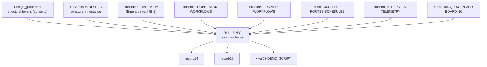

### 1.3 What this document does NOT cover

| Topic | Goes to |
|---|---|
| Workflow sequences | `buscon/01`–`05` |
| Grid builder behavior (cells, types, save) | `buscon/03` §5–§7 |
| Scan flow behavior (verify, queue, replay) | `buscon/05` §4–§11 |
| GPS pipeline | `buscon/04` |
| Full API contracts | `07-API-AND-REALTIME-CONTRACTS.md` |
| Backend implementation | `03-SYSTEM-ARCHITECTURE.md` §6 |
| Infra / deploy | `11-DEPLOYMENT-AND-DEMO.md` |
| Passenger surface visuals | `busverse/05-UI-SPEC.md` |
| **BusCon design guide (does not exist)** | §2.1 flagged |

### 1.4 Scope boundary

**Three levels of coverage per screen:**

| Level | Meaning | Screens at this level |
|---|---|---|
| **Full wireframe** | Layout, components, states, microcopy — all defined here | All 18 screens (behavior cross-refs detail docs) |
| **Cross-reference** | Visual layout here, behavior detailed upstream | Every screen — no visual authority elsewhere |
| **Fallback pages** | Layout + microcopy defined here | 404, 500, 403 role-mismatch, offline (4 extra) |

**All 18 screens** get a wireframe here. Behavior is cross-referenced to `buscon/01`–`05`.

### 1.5 Five accepted defaults (from planning D1–D5)

| # | Decision | Choice |
|:---:|---|---|
| D1 | Design guide path | **Path B** — reuse `busverse/05` structural tokens + `buscon/00` §8.2 emerald intent; amend visuals when `buscon-design-guide.html` lands |
| D2 | Login dual-role | **One URL with toggle** — `/login` with operator/admin toggle |
| D3 | Dashboard dual-role | **Same URL, role-conditional content** — `/dashboard` renders differently per role |
| D4 | Motion assets | **Skip** — no logo reveal / marketing animation in BusCon |
| D5 | Driver cabin solar glare | **Phase 2** — no `AmbientLightSensor` integration in Phase 1 |

### 1.6 Two-surface scope

| Surface | Screens | Primitives | Native compositions | Primary breakpoint |
|---|---:|---:|---:|---|
| **BusCon web** | 12 | 22 shared | — | ≥1024px (desktop-first) |
| **Operator App** | 6 | 22 shared | 20 | 360px (portrait-native) |
| **+ Drawer** | 1 (profile) | — | — | — |
| **+ Fallback pages** | 4 (404, 500, 403, offline) | — | — | — |

### 1.7 The structural inheritance boundary

**Diagram: Inheritance boundary**
*Structural tokens (spacing, radii, motion, fonts, elevation) are inherited verbatim from `busverse/05` §3 / `Design_guide.html` §1. Only the primary color palette differs. This keeps one design language across three surfaces.*

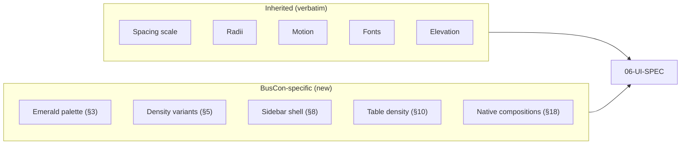

**Rule:** Never redefine spacing/radii/motion/fonts/elevation in BusCon. Always reference `busverse/05` §3. Only add what's genuinely different (emerald + density + BusCon-specific layouts).

---

## 2. Design Guide Integration

### 2.1 The visual authority gap (blocker — resolves B1)

**Diagram: Visual authority landscape**
*`Design_guide.html` is BusVerse-only. There is no BusCon design guide. This doc fills the gap with structural inheritance + emerald intent — flagged for future refinement when a BusCon design guide exists.*

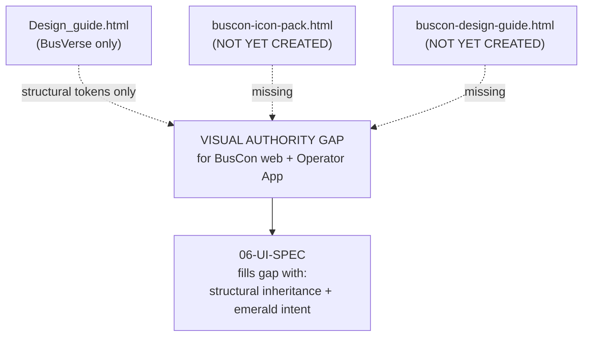

**The gap** (per `buscon/00` §8.4): No doc specifies visual authority for BusCon web or the Operator App. `Design_guide.html` covers BusVerse (dual theme, seat cells, ticket stub, telemetry) — not operator/admin tables, KYC forms, fleet editors, approval queues, or the native mobile trip flow.

**Three resolution paths** (from `buscon/00` §8.4):

| Path | Effort | Unlocks | Status |
|---|---|---|---|
| **A** | Create `buscon-design-guide.html` (~4–6 hrs) | Full visual authority | **Recommended** |
| **B** | Reuse `busverse/05` structural tokens + `buscon/00` §8.2 emerald | Good-enough spec; some duplication | **Applied here** (D1 default) |
| **C** | Defer to Phase 2 | Fast; viva risk | Not applied |

**What Path B delivers:**

| Covered | Not covered (needs design guide later) |
|---|---|
| Emerald palette (§3) | Exact hover/active micro-interactions |
| Structural tokens (§4) | Custom illustrations beyond Lucide |
| Typography + density (§5) | Bespoke data-viz for revenue chart |
| Iconography (§6) | Motion assets (skipped per D4) |
| All 22 primitives (§7) | Driver cabin solar glare (deferred D5) |
| 18 screen wireframes (§12–§18) | Precise pixel-level refinements |
| Grid builder states (§17) | — |

**Rule:** Every section in this doc that specifies a visual treatment writes it defensively — using tokens from `busverse/05` §3 or emerald from §3 of this doc. When `buscon-design-guide.html` lands, the **specific hex values** may change, but the **structure** (which tokens are used where) stays the same.

### 2.2 Precedence rule

**Diagram: Precedence flow**
*When a conflict exists between any visual source and any behavioral source, visual sources win for visuals, behavioral for behavior. Ambiguous cases go to §2.3.*

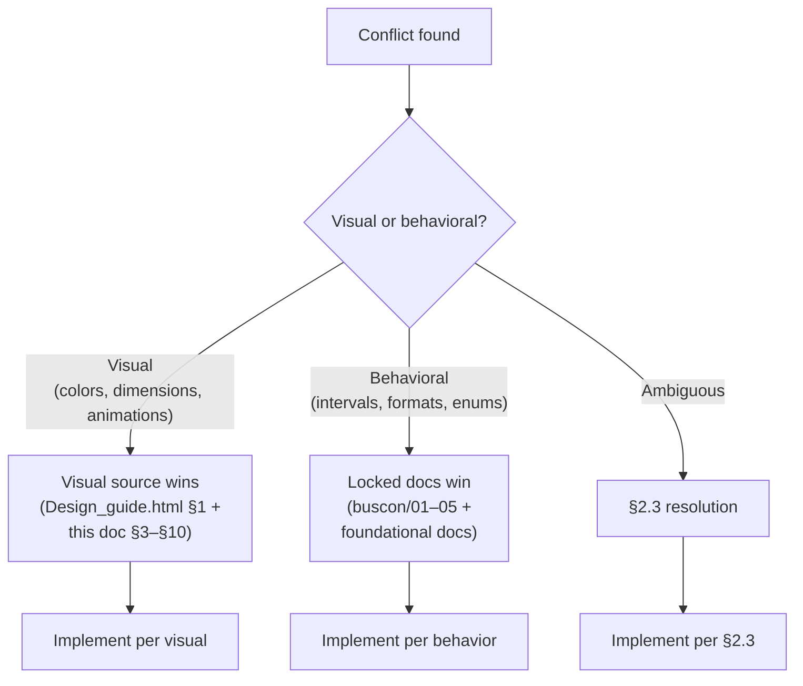

### 2.3 The conflicts and their resolutions

| # | Conflict | Locked source says | Visual source says | Resolution |
|---|---|---|---|---|
| **C1** | Emerald shade | `--signal-emerald #059669` (success state) | `buscon/00` §8.2 says use emerald as primary | **New token `--brand-emerald #047857`** — distinct from success color (§3) |
| **C2** | Dark emerald | Not specified | `buscon/00` §8.2 says `#10B981` | Confirm `#10B981` primary; add hover/active (§3) |
| **C3** | Bus `bus_type` visual | `buscon/03` §4.5 adds 5-value enum | No visual spec | §14 defines badge colors per type |
| **C4** | GPS pill states | `buscon/04` §9 has 4 states | `buscon/02` §8.2 has 3 | Follow `buscon/04` §9 (4 states — canonical) |
| **C5** | Table row height | `buscon/00` §9.3 mentions "compact" | No spec | §10 canonicalizes 32px |
| **C6** | Login dual-role | `buscon/01` §3.6 shows one screen with both auth methods | No spec | §12.1 defines toggle pattern (D2) |

### 2.4 The emerald palette (canonical)

**Diagram: Emerald palette hierarchy**
*Emerald primary is distinct from `--signal-emerald #059669` (success state). Same family, different shade. Both surfaces use `--signal-emerald` for success; only BusCon uses `--brand-emerald` as CTA primary.*

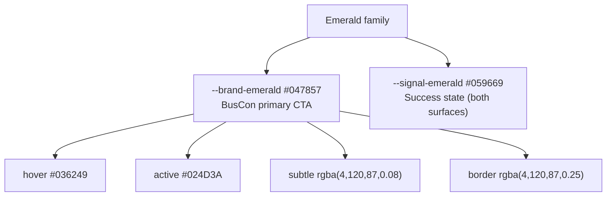

**Reference:** §3 defines full token set.

---

## 3. Emerald Color System

### 3.1 Token catalog

| Token | Light | Dark | Purpose |
|---|---|---|---|
| `--brand-emerald` | `#047857` | `#10B981` | Primary CTA, active nav, selected row |
| `--brand-emerald-hover` | `#036249` | `#34D399` | Hover state |
| `--brand-emerald-active` | `#024D3A` | `#059669` | Pressed state |
| `--brand-emerald-subtle` | `rgba(4,120,87,0.08)` | `rgba(16,185,129,0.14)` | Light backgrounds, chips |
| `--brand-emerald-border` | `rgba(4,120,87,0.25)` | `rgba(16,185,129,0.35)` | Focus/active borders |
| `--brand-emerald-text` | `#047857` | `#34D399` | Text on light surfaces |

**Distinct from `--signal-emerald`:**

| Token | Light | Dark | Semantics |
|---|---|---|---|
| `--signal-emerald` | `#059669` | `#10B981` | Success state — both surfaces |
| `--brand-emerald` | `#047857` | `#10B981` | BusCon primary CTA — BusCon only |

**Rationale:** Primary CTA should never look like a success message. `#047857` is darker (visually distinct) but same family (still "emerald-adjacent").

### 3.2 What uses which

| Component | Light | Dark |
|---|---|---|
| Primary button bg | `--brand-emerald` | `--brand-emerald` |
| Primary button hover | `--brand-emerald-hover` | `--brand-emerald-hover` |
| Active nav item bg | `--brand-emerald-subtle` | `--brand-emerald-subtle` |
| Active nav item text | `--brand-emerald-text` | `--brand-emerald-text` |
| Focus ring | `--brand-emerald-border` | `--brand-emerald-border` |
| Success badge | `--signal-emerald` | `--signal-emerald` |
| Live/active indicator | `--signal-emerald` | `--signal-emerald` |
| Warning state | `--warning-amber` | `--warning-amber` |
| Error state | `--danger-crimson` | `--danger-crimson` |

**Rule:** Never use `--brand-emerald` for success/warning/error. Never use `--signal-emerald` for primary CTA.

### 3.3 Emerald in surfaces

| Surface | Emerald usage |
|---|---|
| BusCon web | Primary CTA, active nav, selected row highlight, focus rings, brand mark |
| Operator App | Primary CTA, GPS status "streaming" pill, scan success overlay, brand mark |
| BusVerse (cross-surface) | **Not used** — BusVerse stays Royal Blue |

---

## 4. Structural Token Inheritance

### 4.1 Inherited (verbatim from `busverse/05` §3 / `Design_guide.html` §1)

| Category | Tokens |
|---|---|
| **Spacing** | `--space-4xs` (2px) through `--space-4xl` (96px) — 8pt grid |
| **Radii** | `--radius-xs` (4px) through `--radius-pill` (9999px) |
| **Motion** | `--ease-instant`, `--ease-smooth`, `--ease-bounce` |
| **Fonts** | `--font-sans` (Plus Jakarta Sans), `--font-mono` (JetBrains Mono) |
| **Elevation** | `--shadow-ambient`, `--shadow-floating`, `--shadow-modal` |
| **Surface colors (base)** | `--canvas-bg`, `--surface-card`, `--surface-elevated`, `--surface-sunken` (light + dark variants) |
| **Text colors** | `--text-bright`, `--text-primary`, `--text-secondary`, `--text-muted` (light + dark variants) |
| **Borders** | `--border-hairline`, `--border-subtle`, `--border-strong`, `--border-focus` |

### 4.2 New (BusCon-specific)

| Category | Tokens |
|---|---|
| **Brand primary** | `--brand-emerald` family (§3.1) |
| **Density variants** | `--row-height-compact` (32px), `--row-height-default` (40px) |
| **Sidebar** | `--sidebar-width-expanded` (240px), `--sidebar-width-collapsed` (64px) |
| **Top bar** | `--topbar-height` (56px) |

### 4.3 Never redefine

| Never redefine in BusCon | Why |
|---|---|
| Spacing scale | Shared with BusVerse — drift breaks consistency |
| Radii | Same reason |
| Motion easings | Same reason |
| Font families | Same reason |
| Elevation shadows | Same reason |
| Base surface colors | Same reason |

**Rule:** If BusCon needs a new spacing/radius/motion value, propose it in `busverse/05` v1.1 — don't fork.

---

## 5. Typography and Density

### 5.1 Base type scale (inherited)

Same as `busverse/05` §4.2:

| Token | Size | Line height | Weight | Usage |
|---|---:|---:|---:|---|
| `--text-hero` | 48px | 1.1 | 800 | (rare in BusCon) |
| `--text-h2` | 32px | 1.15 | 800 | Page titles |
| `--text-h3` | 24px | 1.2 | 700 | Section titles |
| `--text-h4` | 18px | 1.3 | 700 | Card titles |
| `--text-body` | 15px | 1.65 | 400 | Body copy |
| `--text-label` | 13px | 1.4 | 600 | Labels, buttons |
| `--text-caption` | 12px | 1.3 | 500 | Captions |
| `--text-mono-data` | 14px | 1.2 | 700 | Data, times, refs |
| `--text-mono-small` | 12px | 1.2 | 700 | Table compact cells |

### 5.2 Density variants (BusCon-specific)

**Diagram: Density tiers**
*Two density tiers — compact for tables, default for forms and detail pages. Card content uses default. Table rows use compact.*

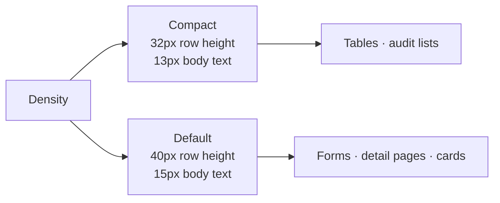

### 5.3 Density table

| Component | Height | Font size |
|---|---:|---:|
| Table row (compact) | 32px | 13px |
| Table row (default) | 40px | 15px |
| Table header | 40px | 12px (uppercase mono) |
| Form input | 44px (mobile) / 40px (desktop) | 15px |
| Form label | auto | 13px |
| Button (sm) | 32px | 13px |
| Button (default) | 40px | 15px |
| Button (lg) | 48px | 15px |
| Card padding | `--space-lg` (24px) | — |
| Page padding (desktop) | `--space-xl` (32px) | — |

### 5.4 Native type (Operator App)

Native inherits the same type scale but uses:
- `fontScale` for OS font scaling (iOS Dynamic Type, Android system font)
- Touch targets ≥ 44×44pt (iOS) / 48×48dp (Android)
- Body text defaults to 15px scaled by OS multiplier

**Reference:** `busverse/05` §4, `buscon/02` §19.3.

---

## 6. Iconography

### 6.1 Icon library (same decision as `busverse/05` §5.2)

| Concern | Choice |
|---|---|
| UI icons | Lucide (1kb each, tree-shakeable, MIT) |
| Brand icons | `@busverse/brand-svg` (bus, seat, ticket) — pending `buscon-icon-pack.html` (B2) |
| Stroke width | 2px |
| Sizes | 16, 20, 24px only |
| Color | `currentColor` |

**Note on missing icon pack (B2):** `assets/brand/buscon-icon-pack.html` doesn't exist. Phase 1 uses Lucide for everything except `bus`/`seat`/`ticket` (which come from BusVerse's `brand-svg`). When `buscon-icon-pack.html` lands, replace only the brand-specific icons.

### 6.2 Icon catalog (BusCon-specific)

| Icon | Source | Usage |
|---|---|---|
| `layout-dashboard` | Lucide | Sidebar: Dashboard |
| `bus` | brand-svg | Sidebar: Fleet |
| `route` | Lucide | Sidebar: Routes |
| `calendar` | Lucide | Sidebar: Schedules |
| `users` | Lucide | Sidebar: Drivers |
| `book-open` | Lucide | Sidebar: Bookings |
| `trending-up` | Lucide | Sidebar: Revenue |
| `check-circle` | Lucide | Sidebar: Approvals |
| `rotate-ccw` | Lucide | Sidebar: Refunds |
| `file-text` | Lucide | Sidebar: Audit |
| `settings` | Lucide | Sidebar: Settings |
| `log-out` | Lucide | Logout |
| `sun` / `moon` | Lucide | Theme toggle |
| `chevron-down` | Lucide | Dropdown, sidebar expand |
| `chevron-right` | Lucide | Breadcrumb separator |
| `plus` | Lucide | "+ Add bus" etc. |
| `search` | Lucide | Table search |
| `filter` | Lucide | Filter trigger |
| `download` | Lucide | Export |
| `upload` | Lucide | File upload |
| `camera` | Lucide | Scan |
| `list` | Lucide | Manifest |
| `map-pin` | Lucide | Stand marker |
| `alert-triangle` | Lucide | Warning |
| `check` | Lucide | Success |
| `x` | Lucide | Error, close |
| `clock` | Lucide | Time |
| `user` | Lucide | Avatar fallback |
| `edit-2` | Lucide | Edit action |
| `trash-2` | Lucide | Delete action |
| `eye` | Lucide | View action |
| `more-horizontal` | Lucide | Overflow menu |
| `grip-vertical` | Lucide | Drag handle (grid builder) |
| `arrow-up` / `arrow-down` | Lucide | Reorder |
| `chevron-up` / `chevron-down` | Lucide | Pagination |

**Total: ~36 icons.** All from Lucide except `bus` (brand-svg).

---

## 7. Component Library — 22 Primitives

### 7.1 The 22 primitives

**Diagram: Component library tree**
*22 primitives in `@busverse/ui` (13 shared with BusVerse + 9 new). Every BusCon screen composes from these. No screen-local primitives.*

```mermaid
flowchart TB
    UI["@busverse/ui · 22 primitives"]

    UI --> SHARED["13 shared with BusVerse"]
    UI --> NEW["9 BusCon-specific"]

    SHARED --> S1["<Button>"]
    SHARED --> S2["<Input>"]
    SHARED --> S3["<Select>"]
    SHARED --> S4["<Textarea>"]
    SHARED --> S5["<Checkbox>"]
    SHARED --> S6["<Radio>"]
    SHARED --> S7["<Badge>"]
    SHARED --> S8["<Card>"]
    SHARED --> S9["<Modal>"]
    SHARED --> S10["<Toast>"]
    SHARED --> S11["<Banner>"]
    SHARED --> S12["<Avatar>"]
    SHARED --> S13["<DataTable>"]

    NEW --> N1["<Drawer>"]
    NEW --> N2["<Tabs>"]
    NEW --> N3["<Breadcrumbs>"]
    NEW --> N4["<Sidebar>"]
    NEW --> N5["<PageHeader>"]
    NEW --> N6["<FilterChips>"]
    NEW --> N7["<BulkActionBar>"]
    NEW --> N8["<FileUpload>"]
    NEW --> N9["<DateRangePicker>"]
```

### 7.2 Primitive contract table

| # | Component | Variants | States | Props (required) |
|---|---|---|---|---|
| 1 | `<Button>` | primary · secondary · ghost · danger | default · hover · active · focus · disabled · loading | `variant`, `onClick`, `disabled?`, `loading?`, `type?` |
| 2 | `<Input>` | text · number · password · email · search | default · focus · filled · error · success · disabled | `value`, `onChange`, `label`, `error?` |
| 3 | `<Select>` | dropdown · combobox | default · open · filled · error | `value`, `onChange`, `options[]`, `label` |
| 4 | `<Textarea>` | — | default · focus · error | `value`, `onChange`, `label`, `rows?` |
| 5 | `<Checkbox>` | — | unchecked · checked · indeterminate · disabled | `checked`, `onChange`, `label` |
| 6 | `<Radio>` | — | unchecked · checked · disabled | `checked`, `onChange`, `label`, `name` |
| 7 | `<Badge>` | emerald · amber · red · slate · cyan | — | `variant`, `children` |
| 8 | `<Card>` | flat · elevated | default · hover · clickable | `elevation?`, `onClick?` |
| 9 | `<Modal>` | standard · large | opening · open · closing | `open`, `onClose`, `title`, `size?` |
| 10 | `<Toast>` | info · success · warning · error | entering · visible · leaving | `type`, `message`, `duration?`, `onDismiss` |
| 11 | `<Banner>` | info · success · warning · error · offline | — | `type`, `message`, `action?` |
| 12 | `<Avatar>` | initials · icon | — | `name?`, `src?`, `size` |
| 13 | `<DataTable>` | compact · default | loading · loaded · empty · error · selected | `columns`, `data`, `onSortChange`, `rowSelection?` |
| 14 | `<Drawer>` | left · right | opening · open · closing | `open`, `onClose`, `side`, `width?`, `children` |
| 15 | `<Tabs>` | underline · pill | — | `active`, `onChange`, `items[]` |
| 16 | `<Breadcrumbs>` | — | — | `items: { label, href? }[]` |
| 17 | `<Sidebar>` | expanded · collapsed · hidden | — | `items[]`, `active`, `onNavigate`, `user` |
| 18 | `<PageHeader>` | — | — | `title`, `actions?`, `breadcrumbs?`, `backTo?` |
| 19 | `<FilterChips>` | — | — | `chips[]`, `active`, `onChange` |
| 20 | `<BulkActionBar>` | — | hidden · visible | `selectedCount`, `actions[]`, `onClear` |
| 21 | `<FileUpload>` | — | idle · uploading · success · error | `accept`, `maxSize`, `onUpload` |
| 22 | `<DateRangePicker>` | — | closed · open · selected | `from`, `to`, `onChange` |

### 7.3 The 9 new BusCon primitives

**`<Drawer>`** (used by 4 screens for detail views):
- Width: 400px default · 600px wide
- Side: right default
- Backdrop: `--canvas-bg` at 80%
- Animation: slide 250ms `--ease-smooth`
- Focus trap, focus return, Escape closes
- Header with title + close X

**`<Tabs>`** (used by 2 screens — approvals 4 tabs, today/history):
- Underline variant (default) · pill variant
- Keyboard: Left/Right arrow navigate, Home/End
- `role="tablist"` + `role="tab"` per tab + `aria-selected`

**`<Breadcrumbs>`** (used by deep pages):
- Format: `Fleet / Buses / DL-1P-1234`
- Separator: `chevron-right` (16px)
- Last item not clickable
- Truncate middle items on narrow screens

**`<Sidebar>`** (BusCon web only):
- Expanded 240px / collapsed 64px / hidden (<768px)
- Three variants: operator nav, admin nav, mixed (never)
- Active item: emerald subtle bg + emerald text
- Footer: theme toggle + profile avatar
- Collapse toggle at top-right of sidebar

**`<PageHeader>`** (every web screen):
- Title (h2) · optional actions (right) · optional breadcrumbs (below title) · optional back button (left)

**`<FilterChips>`** (list screens):
- Horizontal scroll on overflow
- "All" chip first
- Single-select default; multi-select optional

**`<BulkActionBar>`** (DataTable integration):
- Sticky bottom, `--surface-elevated` bg
- "{N} selected" + actions + clear
- Slide-up animation 250ms

**`<FileUpload>`** (KYC, insurance):
- Drag-drop zone (desktop) + click to browse
- Accept: `application/pdf,image/jpeg,image/png`
- Max size configurable (10MB default)
- Progress bar during upload
- Success: filename + remove button
- Error: retry

**`<DateRangePicker>`** (audit, revenue, schedules):
- Two calendars side-by-side (desktop) · stacked (mobile)
- Presets: Today · Last 7 days · Last 30 days · This month · Custom
- Max range: 1 year

### 7.4 Storybook (same structure as `busverse/05` §6.5)

- URL: `storybook.buscon.app` (web) + native Storybook instance (Operator App)
- One story per primitive per variant
- Screens: one story per screen state
- **Rule:** Every PR that changes a component updates its story.

### 7.5 Ownership

| Primitive | Owner | Shared with BusVerse |
|---|---|---|
| `<Button>` | `@busverse/ui` | ✅ |
| `<Input>` | `@busverse/ui` | ✅ |
| `<Select>` | `@busverse/ui` | ✅ |
| `<Textarea>` | `@busverse/ui` | ✅ |
| `<Checkbox>` | `@busverse/ui` | ✅ |
| `<Radio>` | `@busverse/ui` | ✅ |
| `<Badge>` | `@busverse/ui` | ✅ |
| `<Card>` | `@busverse/ui` | ✅ |
| `<Modal>` | `@busverse/ui` | ✅ |
| `<Toast>` | `@busverse/ui` | ✅ |
| `<Banner>` | `@busverse/ui` | ✅ |
| `<Avatar>` | `@busverse/ui` | ✅ |
| `<DataTable>` | `@busverse/ui` | ❌ BusCon-specific |
| `<Drawer>` | `@busverse/ui` | ❌ BusCon-specific |
| `<Tabs>` | `@busverse/ui` | ❌ BusCon-specific |
| `<Breadcrumbs>` | `@busverse/ui` | ❌ BusCon-specific |
| `<Sidebar>` | `@busverse/ui` | ❌ BusCon-specific |
| `<PageHeader>` | `@busverse/ui` | ❌ BusCon-specific |
| `<FilterChips>` | `@busverse/ui` | ❌ BusCon-specific |
| `<BulkActionBar>` | `@busverse/ui` | ❌ BusCon-specific |
| `<FileUpload>` | `@busverse/ui` | ❌ BusCon-specific |
| `<DateRangePicker>` | `@busverse/ui` | ❌ BusCon-specific |

**Rule:** All 22 live in `@busverse/ui` — single package, tree-shaken per surface. Amend `busverse/05` §6 v1.1 to add DataTable as 13th shared primitive (A2).

---

## 8. App Shell — BusCon Web

### 8.1 Shell layout

**Diagram: BusCon web shell**
*Three-region layout — sidebar (left), top bar (top), main content. Sidebar collapsible per breakpoint. Top bar has breadcrumbs + theme + avatar. Main content scrolls.*

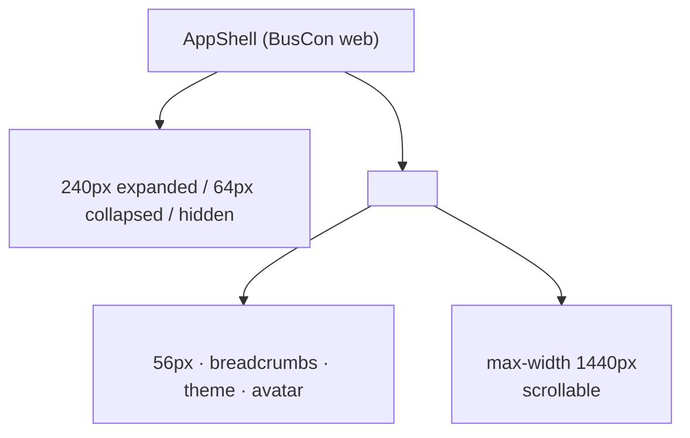

### 8.2 Sidebar

| Aspect | Detail |
|---|---|
| Width expanded | 240px |
| Width collapsed | 64px (icons only + tooltip) |
| Hidden | <768px (hamburger opens as drawer) |
| Background | `--canvas-subtle` |
| Border right | 1px `--border-subtle` |
| Logo | Full logo at top (expanded) / icon-only (collapsed) |
| Nav items | List with icon + label |
| Active item | `--brand-emerald-subtle` bg + `--brand-emerald-text` |
| Notification badges | Red dot top-right of nav icon |
| Footer | Theme toggle + profile avatar |
| Collapse toggle | Chevron at top-right (in header area) |

### 8.3 Operator vs Admin nav

**Operator nav** (per `buscon/01` §9.1):

| Icon | Label | Route |
|---|---|---|
| `layout-dashboard` | Dashboard | `/operator/dashboard` |
| `bus` | Fleet | `/operator/buses` |
| `route` | Routes | `/operator/routes` |
| `calendar` | Schedules | `/operator/schedules` |
| `users` | Drivers | `/operator/drivers` |
| `book-open` | Bookings | `/operator/bookings` |
| `trending-up` | Revenue | `/operator/revenue` |

**Admin nav** (per `buscon/01` §9.1):

| Icon | Label | Route |
|---|---|---|
| `layout-dashboard` | Dashboard | `/admin/dashboard` |
| `check-circle` | Approvals | `/admin/approvals` |
| `book-open` | Bookings | `/admin/bookings` |
| `rotate-ccw` | Refunds | `/admin/refunds` |
| `file-text` | Audit | `/admin/audit` |

### 8.4 Top bar

| Aspect | Detail |
|---|---|
| Height | 56px |
| Background | `--canvas-subtle` |
| Border bottom | 1px `--border-subtle` |
| Left region | Hamburger (mobile only) · Breadcrumbs (desktop) |
| Center region | (empty — no page title here, that's in `<PageHeader>`) |
| Right region | Theme toggle · Avatar |

### 8.5 Breadcrumbs

**Format:** `Fleet / Buses / DL-1P-1234`

| Rule | Detail |
|---|---|
| Separator | `chevron-right` (16px) |
| Font | `--text-caption` |
| Color | `--text-secondary` (intermediate items), `--text-primary` (last item) |
| Last item | Not clickable |
| Truncate | Middle items on narrow screens (`...`) |

### 8.6 Sidebar collapse behavior

| Breakpoint | Behavior |
|---|---|
| ≥1024px | Expanded (240px) |
| 768–1023px | Collapsed (64px) — icons only + tooltip on hover |
| <768px | Hidden — hamburger in top bar opens as drawer |

**Rule:** User can manually toggle collapse at any breakpoint; manual choice overrides auto.

### 8.7 Wireframe (operator dashboard)

```
┌──────────────┬────────────────────────────────────────────┐
│ [Logo]       │ Fleet / Dashboard       [☀]  [Avatar]      │
│              ├────────────────────────────────────────────┤
│ ▸ Dashboard  │                                            │
│ ▸ Fleet      │ Good morning, Shaghaf                      │
│ ▸ Routes     │                                            │
│ ▸ Schedules  │ ┌──────────────┬──────────────┐            │
│ ▸ Drivers    │ │ Recent       │ Revenue      │            │
│ ▸ Bookings   │ │ Bookings     │ Today: ₹45K  │            │
│ ▸ Revenue    │ │ …            │ …            │            │
│              │ └──────────────┴──────────────┘            │
│              │                                            │
│ ────         │ ┌──────────────┬──────────────┐            │
│ [☀] [👤]    │ │ Fleet Status │ Pending      │            │
│              │ │ 6 buses      │ Approvals: 0 │            │
│              │ └──────────────┴──────────────┘            │
└──────────────┴────────────────────────────────────────────┘
```

---

## 9. App Shell — Operator App

### 9.1 Shell layout

**Diagram: Operator App shell**
*Portrait, single column. Top bar with optional back + title + avatar. Content body. Optional bottom fixed action bar (trip shell only).*

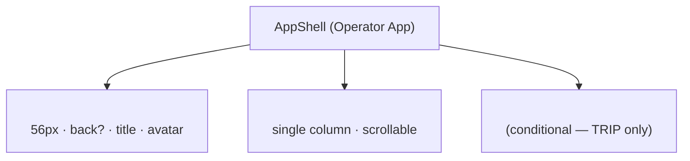

### 9.2 Top bar

| Aspect | Detail |
|---|---|
| Height | 56px |
| Left | Back arrow (if applicable) OR logo (LOGIN only) |
| Center | Screen title |
| Right | Avatar (opens profile drawer) — hidden on LOGIN |
| Background | `--canvas-subtle` |
| Border bottom | 1px `--border-subtle` |

### 9.3 Screen top bar variants

| Screen | Left | Right |
|---|---|---|
| LOGIN | Logo | (none) |
| TODAY | Logo | Avatar |
| TRIP | Back | (none) |
| SCAN | Back | Torch toggle |
| MANIFEST | Back | (none) |
| SUMMARY | (none — terminal) | (none) |

### 9.4 Profile drawer access

Only accessible from TODAY screen top bar avatar tap (per `buscon/02` §13.1). Drawer slides from right (250ms), 320px wide (mobile: full-width minus 40px).

### 9.5 Safe areas + gestures

| Aspect | Detail |
|---|---|
| Safe area | `react-native-safe-area-context` respects notch + home indicator |
| Gesture back | iOS swipe-back enabled; Android system back |
| Status bar color | `--canvas-subtle` per theme |
| Orientation | Portrait only (per `buscon/02` §18.3) |

---

## 10. Table Density Pattern (canonical)

### 10.1 The table

**Diagram: DataTable anatomy**
*Six regions — toolbar (search + filter + export), header row, body rows, bulk action bar (conditional), pagination footer, empty/error/loading overlays.*

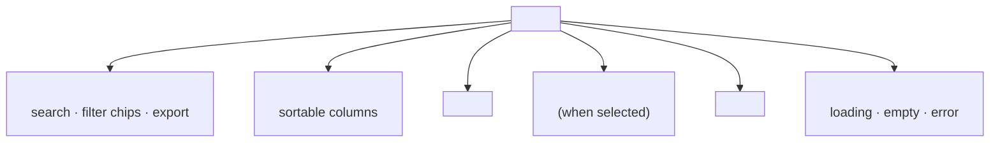

### 10.2 Dimensions

| Element | Height | Padding | Font |
|---|---:|---|---|
| Toolbar | 56px | 16px h / 8px v | — |
| Header row | 40px | 12px h / 8px v | 12px mono uppercase |
| Body row (compact) | 32px | 12px h / 6px v | 13px |
| Body row (default) | 40px | 12px h / 8px v | 15px |
| Bulk action bar | 56px | 16px h / 12px v | — |
| Pagination footer | 48px | 16px h / 12px v | 13px |

### 10.3 Column alignment

| Data type | Alignment | Rule |
|---|---|---|
| Text (names, refs) | Left | Default |
| Numbers (amounts, counts) | Right | `text-align: right` + tabular numerals |
| Dates/times | Right | Same as numbers |
| Badges/status | Center | `text-align: center` |
| Actions (icons) | Right | Group at end |

### 10.4 Column priority (responsive hiding)

**Diagram: Column priority tiers**
*On narrow screens, lower-priority columns hide. Row data is still accessible via row click → detail.*

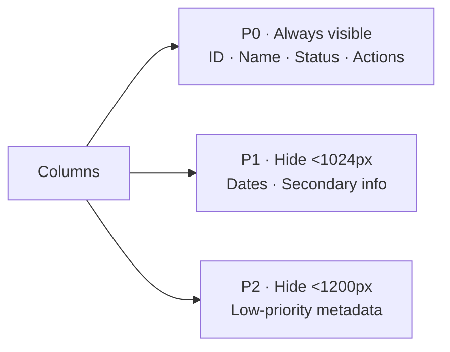

| Priority | Rule |
|---|---|
| P0 | Always visible |
| P1 | Hidden <1024px |
| P2 | Hidden <1200px |

**Rule:** Row click opens drawer where hidden columns are visible.

### 10.5 Sortable columns

| Aspect | Detail |
|---|---|
| Sort indicator | Chevron (up/down) next to label |
| Unsorted | No chevron |
| Default sort | Per-table (usually `createdAt DESC`) |
| Interaction | Click header toggles asc/desc/none |
| ARIA | `aria-sort="ascending" | "descending" | "none"` |

### 10.6 Row selection

| Aspect | Detail |
|---|---|
| Checkbox | Left-most column |
| Header checkbox | Selects/deselects all visible rows |
| Indeterminate | When some rows selected |
| Bulk action bar | Appears when ≥1 selected |
| Clear | X in bulk bar clears selection |

### 10.7 Row actions

| Aspect | Detail |
|---|---|
| Visible | Always on desktop |
| Hidden on mobile | Yes — reveal via tap (row → overflow menu) |
| Icons | `eye` (view) · `edit-2` (edit) · `trash-2` (delete) · `more-horizontal` (overflow) |
| Tooltip | On hover (desktop) |

### 10.8 Pagination

| Mode | UI |
|---|---|
| Cursor | "Load more" button at footer |
| Offset | Page numbers 1 · 2 · 3 · … |

**Phase 1 default:** Cursor (per `07` v1.2 §12).

### 10.9 Empty, loading, error states

| State | UI |
|---|---|
| Loading | 5 skeleton rows (with column structure) |
| Empty (no data) | Illustration + "Add your first {entity}" CTA |
| Empty (filter) | "No {entity} match these filters" + clear filters |
| Error | Banner above table + retry button |

### 10.10 Bulk action bar

| Aspect | Detail |
|---|---|
| Position | Sticky bottom of table viewport |
| Background | `--surface-elevated` + `--shadow-floating` |
| Content | "{N} selected" + actions + clear |
| Animation | Slide-up 250ms |

---

## 11. Screen Catalog Matrix

### 11.1 The 18 screens

**Diagram: Screen groups**
*18 screens across two surfaces + 1 drawer + 4 fallback pages. Behavior owned by `buscon/01`–`05`; visual here.*

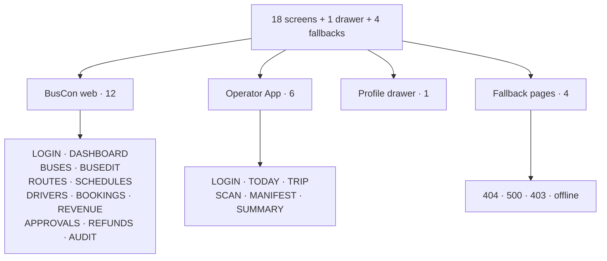

### 11.2 Master state matrix

| Screen | States | Wireframe |
|---|---|---|
| **SCR-BC-LOGIN** | Operator login · Admin login · OTP mode · Reset mode · Error · Rate-limited | §12.1 |
| **SCR-BC-DASHBOARD** | Operator dashboard · Admin dashboard · Loading · Error | §13 |
| **SCR-BC-BUSES** | Loading · List · Empty · Error · Filter applied | §14.1 |
| **SCR-BC-BUSEDIT** | Create · Edit (PENDING) · Edit (APPROVED) · Layout builder · Saving · Save error | §14.2 |
| **SCR-BC-ROUTES** | Loading · List · Empty · Editor · Stands editor · Error | §14.3 |
| **SCR-BC-SCHEDULES** | Loading · List · Empty · Editor · Publish confirm · Error | §14.4 |
| **SCR-BC-DRIVERS** | Loading · List · Empty · Invite modal · Detail drawer · Error | §15.1 |
| **SCR-BC-BOOKINGS** | Loading · List · Empty · Detail drawer · Error | §15.2 |
| **SCR-BC-REVENUE** | Loading · Dashboard · Filtered · Chart · Error | §15.3 |
| **SCR-BC-APPROVALS** | Loading · 4 tabs (operators/buses/routes/schedules) · Detail · Reason modal · Error | §16.1 |
| **SCR-BC-REFUNDS** | Loading · List · Detail drawer · Initiate modal · Retry · Error | §16.2 |
| **SCR-BC-AUDIT** | Loading · Query · Results · Export · Error | §16.3 |
| **SCR-OA-LOGIN** | Phone input · OTP input · Verifying · Force update · Error | §18.1 |
| **SCR-OA-TODAY** | Loading · List · Empty · History tab · Profile drawer · Error | §18.2 |
| **SCR-OA-TRIP** | SCHEDULED · IN_PROGRESS · Cancelled banner · Suspended banner · Network lost | §18.3 |
| **SCR-OA-SCAN** | Permission · Preview · Result · Manual entry · Offline · Error | §18.4 |
| **SCR-OA-MANIFEST** | Loading · Loaded · Filtered · Offline · Error | §18.5 |
| **SCR-OA-SUMMARY** | Loaded · Next trip panel · Done panel | §18.6 |
| **Profile drawer** | Loaded · Editing · Saving · Error | §18.7 |
| **404 page** | Static | §20A.2 |
| **500 page** | Static | §20A.3 |
| **403 role-mismatch** | Static | §20A.4 |
| **Offline page** | Static | §20A.5 |

**Total:** 18 primary screens + 1 drawer + 4 fallback pages = **23 pages · ~75 states**.

---

## 12. BusCon Web Screens — Auth + Dashboard

### 12.1 SCR-BC-LOGIN (dual-role)

**Diagram: Login screen states**
*One URL `/login`. Toggle between operator and admin auth. Operator form has both email+password and phone OTP paths. Admin form is email+password only.*

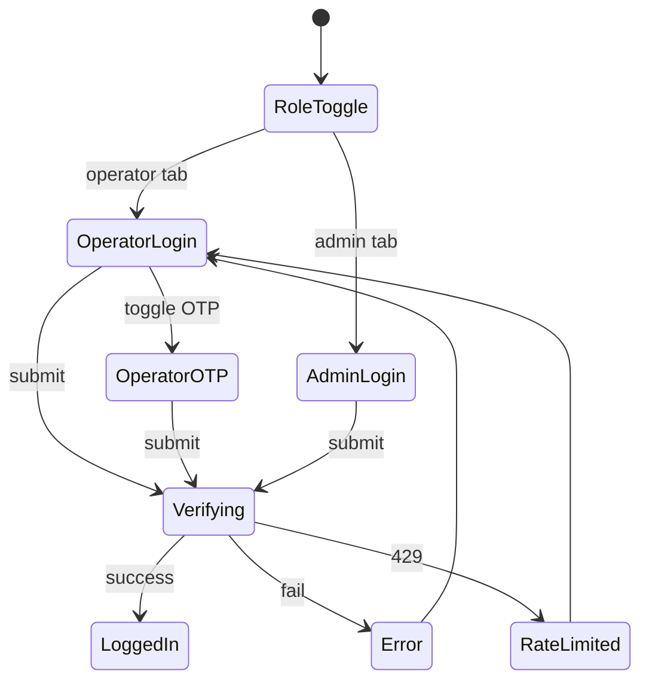

**Layout:**

```
┌──────────────────────────────────────────────┐
│         [Full Logo — Emerald]                │
│                                              │
│         Sign in to BusCon                    │
│                                              │
│      ┌──────────────────────┐                │
│      │  Operator  │  Admin  │  ← Toggle      │
│      └──────────────────────┘                │
│                                              │
│      Email                                   │
│      ┌──────────────────────────────┐        │
│      │                              │        │
│      └──────────────────────────────┘        │
│                                              │
│      Password                                │
│      ┌──────────────────────────────┐        │
│      │                     [👁]    │        │
│      └──────────────────────────────┘        │
│                                              │
│      [ Forgot password? ]                    │
│                                              │
│      ┌──────────────────────────────┐        │
│      │         Sign in              │        │
│      └──────────────────────────────┘        │
│                                              │
│      [ Use phone OTP instead ]  ← Operator only│
│                                              │
│      New operator? [Sign up]                 │
└──────────────────────────────────────────────┘
```

**Microcopy:** See §22.1.

### 12.2 Dashboard (dual-role)

**SCR-BC-DASHBOARD has two layouts** per role:

**Operator dashboard** (per `buscon/01` §6.7):

```
┌──────────┬────────────────────────────────────────────┐
│ [Sidebar]│ Good morning, {operator}                   │
│          │────────────────────────────────────────────│
│          │ ┌──────────────┬──────────────┐            │
│          │ │ Recent       │ Revenue      │            │
│          │ │ Bookings     │ Today: ₹{N}  │            │
│          │ │ {list}       │ Week: ₹{N}   │            │
│          │ └──────────────┴──────────────┘            │
│          │                                            │
│          │ ┌──────────────┬──────────────┐            │
│          │ │ Fleet Status │ Pending      │            │
│          │ │ {buses}      │ Actions      │            │
│          │ └──────────────┴──────────────┘            │
└──────────┴────────────────────────────────────────────┘
```

**Admin dashboard** (per `buscon/01` §12):

```
┌──────────┬────────────────────────────────────────────┐
│ [Sidebar]│ Admin Dashboard                            │
│          │────────────────────────────────────────────│
│          │ ┌──────────────┬──────────────┐            │
│          │ │ Pending      │ Pending      │            │
│          │ │ Approvals    │ Refunds      │            │
│          │ │ {N}          │ ₹{amount}    │            │
│          │ └──────────────┴──────────────┘            │
│          │                                            │
│          │ ┌──────────────┬──────────────┐            │
│          │ │ Recent       │ Recent       │            │
│          │ │ Activity     │ Audit        │            │
│          │ │ {list}       │ {list}       │            │
│          │ └──────────────┴──────────────┘            │
└──────────┴────────────────────────────────────────────┘
```

**Rule:** Same route `/dashboard`, role-conditional layout. Client detects role from session and renders appropriate cards.

---

## 13. BusCon Web Screens — Fleet + Routes + Schedules

### 13.1 SCR-BC-BUSES

```
┌──────────┬────────────────────────────────────────────┐
│ [Sidebar]│ Fleet / Buses                 [+ Add bus]  │
│          │────────────────────────────────────────────│
│          │ [Status ▾] [Bus type ▾]   [Search]        │
│          │────────────────────────────────────────────│
│          │ ☐ Reg No   │ Type │ Model │ Cap │ Status  │
│          │ ☐ DL-1P-.. │ AC.. │ Volvo │ 40  │ PENDING │
│          │ ☐ UP-32..  │ Non..│ Tata  │ 30  │ APPROVED│
│          │────────────────────────────────────────────│
│          │ [Load more]                                │
└──────────┴────────────────────────────────────────────┘
```

**Reference:** `buscon/03` §9.

### 13.2 SCR-BC-BUSEDIT

Two modes — **create** (empty form) and **edit** (pre-filled). Layout:

```
┌──────────┬────────────────────────────────────────────┐
│ [Sidebar]│ Fleet / Buses / {RegNo}                    │
│          │────────────────────────────────────────────│
│          │  ┌──────────────────────────────────────┐  │
│          │  │ Registration number *                │  │
│          │  │ [DL-1P-1234]                         │  │
│          │  │                                      │  │
│          │  │ Bus type *      Model *              │  │
│          │  │ [AC Sleeper ▾]  [Volvo Multi-Axle]   │  │
│          │  │                                      │  │
│          │  │ Capacity *      Amenities            │  │
│          │  │ [40]            [☐ Wifi ☐ Charging]  │  │
│          │  └──────────────────────────────────────┘  │
│          │                                            │
│          │  ┌── Seat Layout ────────────────────────┐ │
│          │  │ [Build layout]  (or preview)          │ │
│          │  └───────────────────────────────────────┘ │
│          │                                            │
│          │  ┌── Insurance ──────────────────────────┐ │
│          │  │ [Upload] · Expiry [Date]              │ │
│          │  └───────────────────────────────────────┘ │
│          │                                            │
│          │ [Cancel] [Save as draft] [Submit for approval]│
└──────────┴────────────────────────────────────────────┘
```

**Reference:** `buscon/03` §4, §8.

### 13.3 SCR-BC-ROUTES

List + editor drawer:

```
┌──────────┬────────────────────────────────────────────┐
│ [Sidebar]│ Fleet / Routes                  [+ Add route]│
│          │────────────────────────────────────────────│
│          │ [Status ▾]                                │
│          │────────────────────────────────────────────│
│          │ ☐ Route           │ Stops │ Distance │ Status│
│          │ ☐ Delhi→Lucknow   │ 4     │ 505 km   │ PENDING│
│          │ ☐ Delhi→Kanpur    │ 3     │ 480 km   │ APPROVED│
│          │────────────────────────────────────────────│
│          │ [+ Add route]                              │
└──────────┴────────────────────────────────────────────┘
```

**Reference:** `buscon/03` §10, §11, §12.

### 13.4 SCR-BC-SCHEDULES

```
┌──────────┬────────────────────────────────────────────┐
│ [Sidebar]│ Fleet / Schedules            [+ Add schedule]│
│          │────────────────────────────────────────────│
│          │ [Date range] [Route ▾] [Status ▾] [Bus ▾]  │
│          │────────────────────────────────────────────│
│          │ ☐ Route    │ Depart │ Arrive │ Bus  │ Fare │ Bookings │ Status │ Actions│
│          │ ☐ Delhi→..│ 14:00  │ 22:30  │ DL-1P│ ₹450 │ 5        │ PUBLISH│ [⋮]  │
│          │────────────────────────────────────────────│
└──────────┴────────────────────────────────────────────┘
```

**Reference:** `buscon/03` §13, §14, §17.

---

## 14. BusCon Web Screens — Drivers + Bookings + Revenue

### 14.1 SCR-BC-DRIVERS

```
┌──────────┬────────────────────────────────────────────┐
│ [Sidebar]│ Fleet / Drivers               [+ Invite driver]│
│          │────────────────────────────────────────────│
│          │ [All] [Invited] [Pending] [Verified] ← tabs│
│          │────────────────────────────────────────────│
│          │ ☐ Name    │ Phone (masked) │ KYC Status │ Actions│
│          │ ☐ Alice   │ ••••••3210     │ VERIFIED   │ [👁]   │
│          │ ☐ Bob     │ ••••••4567     │ PENDING    │ [👁]   │
│          │────────────────────────────────────────────│
└──────────┴────────────────────────────────────────────┘
```

**Reference:** `buscon/01` §5.5.

### 14.2 SCR-BC-BOOKINGS

```
┌──────────┬────────────────────────────────────────────┐
│ [Sidebar]│ Bookings                       [Export CSV]│
│          │────────────────────────────────────────────│
│          │ [Date range] [Route ▾] [Status ▾]          │
│          │────────────────────────────────────────────│
│          │ ☐ Ref  │ Passenger │ Seats │ Fare │ Status │ Date │ Actions│
│          │ ☐ BKG-..│ Alice     │ A1    │ ₹450 │ CONFIRM│ …    │ [👁]   │
│          │────────────────────────────────────────────│
└──────────┴────────────────────────────────────────────┘
```

**Note (per `buscon/01` §6.6):** PII is masked — no phone/email/ID. Only name + seat + booking ref + fare.

**Reference:** `buscon/01` §6.

### 14.3 SCR-BC-REVENUE

```
┌──────────┬────────────────────────────────────────────┐
│ [Sidebar]│ Revenue                        [Export CSV]│
│          │────────────────────────────────────────────│
│          │ [Date range] [Route ▾]                     │
│          │────────────────────────────────────────────│
│          │ ┌────────┬────────┬────────┬────────┐      │
│          │ │Total   │Bookings│Refunds │Net     │      │
│          │ │₹{N}    │{N}     │₹{N}    │₹{N}    │      │
│          │ └────────┴────────┴────────┴────────┘      │
│          │                                            │
│          │ ┌─── Revenue chart ──────────────────────┐ │
│          │ │  (line chart over date range)          │ │
│          │ └────────────────────────────────────────┘ │
│          │                                            │
│          │ Per-schedule breakdown:                    │
│          │ ☐ Route     │ Date │ Bookings │ Gross │ Net │
│          │ ☐ Delhi→..  │ 24 Oct│ 5      │ ₹2250 │ ₹2k │
└──────────┴────────────────────────────────────────────┘
```

**Reference:** `buscon/01` §6.5.

---

## 15. BusCon Web Screens — Approvals + Refunds + Audit

### 15.1 SCR-BC-APPROVALS

**Diagram: Approvals screen (4 tabs)**
*One screen, four tabs — operators, buses, routes, schedules. Same table pattern per tab. Click row → detail drawer with approve/reject actions.*

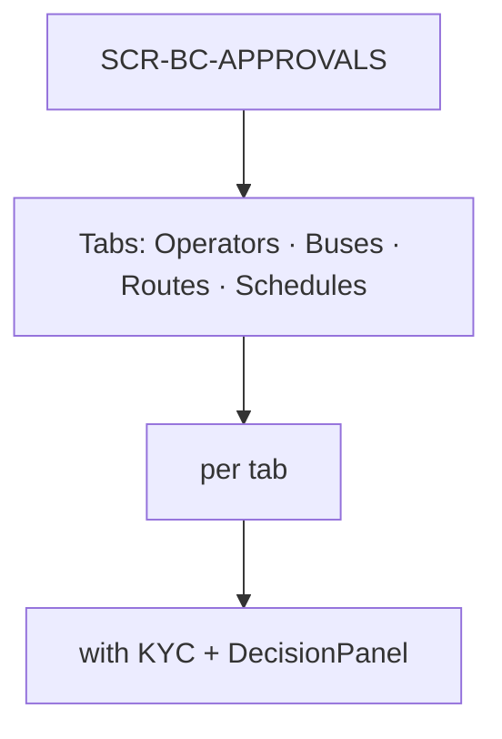

```
┌──────────┬────────────────────────────────────────────┐
│ [Sidebar]│ Approvals                                  │
│          │────────────────────────────────────────────│
│          │ [Operators] [Buses] [Routes] [Schedules]  │
│          │────────────────────────────────────────────│
│          │ ☐ Name    │ Submitted  │ Status │ Actions   │
│          │ ☐ Sharma  │ 2h ago     │ PENDING│ [👁][✓][✗]│
│          │ ☐ Rajdhani│ 1d ago     │ PENDING│ [👁][✓][✗]│
│          │────────────────────────────────────────────│
└──────────┴────────────────────────────────────────────┘
```

**Reference:** `buscon/01` §9.5, §10.5.

### 15.2 SCR-BC-REFUNDS

```
┌──────────┬────────────────────────────────────────────┐
│ [Sidebar]│ Refunds                     [Export CSV]   │
│          │────────────────────────────────────────────│
│          │ [Status ▾] [Date range]                    │
│          │────────────────────────────────────────────│
│          │ ☐ Refund │ Booking │ Amount │ Tier │ Status │
│          │ ☐ REF-..│ BKG-..  │ ₹450   │ FULL │ PROCES │
│          │ ☐ REF-..│ BKG-..  │ ₹225   │ 50%  │ FAILED │
│          │────────────────────────────────────────────│
└──────────┴────────────────────────────────────────────┘
```

**Reference:** `buscon/01` §11.5.

### 15.3 SCR-BC-AUDIT

```
┌──────────┬────────────────────────────────────────────┐
│ [Sidebar]│ Audit log                    [Export CSV]  │
│          │────────────────────────────────────────────│
│          │ [Entity ▾] [Action ▾] [Date range] [Actor]│
│          │────────────────────────────────────────────│
│          │ ☐ Timestamp │ Actor │ Entity │ Action │ Detail│
│          │ ☐ 14:32     │ Admin │ Booking│ Updated│ [▸] │
│          │────────────────────────────────────────────│
│          │ [Load more]                                │
└──────────┴────────────────────────────────────────────┘
```

**Reference:** `buscon/01` §12.5.

### 15.4 KYC Document Viewer (resolves G22)

**Diagram: KYC viewer**
*Inline modal for admin to preview uploaded PDF/JPG from operator. Zoom + download.*

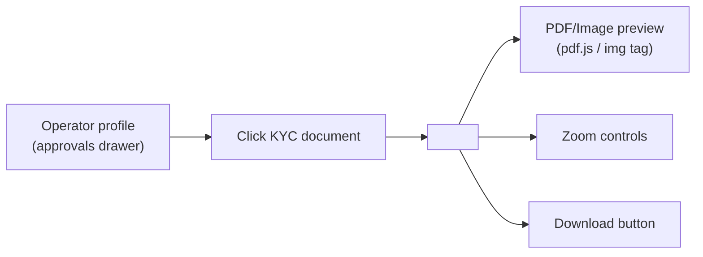

**Rules:**
- Full-screen modal on mobile · 90vw×90vh desktop
- PDF: paginated, zoom 50-200%
- Image: fit-to-screen, zoom 50-400%
- Download via signed R2 URL (expires 15 min)
- Close returns focus to clicked document

---

## 16. Operator App Screens

### 16.1 SCR-OA-LOGIN

```
┌─────────────────────────────────┐
│                                 │
│         [BusCon mark]           │
│                                 │
│    Sign in to start driving     │
│                                 │
│    Phone number                 │
│    ┌─────────────────────────┐  │
│    │ +91 98765 43210         │  │
│    └─────────────────────────┘  │
│                                 │
│    ┌─────────────────────────┐  │
│    │      Continue           │  │
│    └─────────────────────────┘  │
│                                 │
└─────────────────────────────────┘
```

**Reference:** `buscon/02` §4.10.

### 16.2 SCR-OA-TODAY

```
┌─────────────────────────────────┐
│ [Avatar]   Today        [↻]     │
├─────────────────────────────────┤
│ [ Today ] [ History ]           │
├─────────────────────────────────┤
│ ┌─────────────────────────────┐ │
│ │ Delhi → Lucknow             │ │
│ │ Volvo · DL-1P-1234          │ │
│ │ 14:00 → 22:30 IST           │ │
│ │ [ Ready to start ]          │ │
│ │ ┌─────────────────────────┐ │ │
│ │ │      Start trip         │ │ │
│ │ └─────────────────────────┘ │ │
│ └─────────────────────────────┘ │
└─────────────────────────────────┘
```

**Reference:** `buscon/02` §6.7.

### 16.3 SCR-OA-TRIP

```
┌─────────────────────────────────┐
│ [←] TRP-2026-00187              │
├─────────────────────────────────┤
│ Delhi → Lucknow                 │
│ Volvo Multi-Axle · DL-1P-1234   │
│ 14:00 → 22:30 IST               │
│                                 │
│ ● On duty   ● GPS streaming     │ ← GPS pill
│                                 │
│ ┌────────────┬────────────┐    │
│ │ Scan QR    │ Manifest   │    │
│ └────────────┴────────────┘    │
│                                 │
│ [ Report delay ]                │
│                                 │
│ ┌─────────────────────────────┐ │
│ │        End trip             │ │
│ └─────────────────────────────┘ │
└─────────────────────────────────┘
```

**Reference:** `buscon/02` §8.2, `buscon/04` §9.

### 16.4 SCR-OA-SCAN

```
┌─────────────────────────────────┐
│ [←]                     [🔦]    │
│                                 │
│    ┌─────────────────────┐      │
│    │                     │      │
│    │   [QR viewfinder]   │      │
│    │                     │      │
│    └─────────────────────┘      │
│                                 │
│    Point camera at passenger QR │
│                                 │
│         🔵 3 pending sync       │
│                                 │
│    [ Enter manually ]           │
└─────────────────────────────────┘
```

**Reference:** `buscon/05` §8.3.

### 16.5 SCR-OA-MANIFEST

```
┌─────────────────────────────────┐
│ [←] 12 of 40 boarded            │
├─────────────────────────────────┤
│ [All] [Kashmere] [Ghaziabad]   │ ← filter chips
├─────────────────────────────────┤
│ Kashmere Gate · 5 passengers    │
│ ✓ Alice, Carol · A1, A2         │
│ ✓ Bob · A5                      │
│ ○ Dave · A6                     │
│                                 │
│ Ghaziabad · 3 passengers        │
│ ○ Eve · B1                      │
└─────────────────────────────────┘
```

**Reference:** `buscon/05` §12.1.

### 16.6 SCR-OA-SUMMARY

```
┌─────────────────────────────────┐
│         ✓ Trip completed        │
│         TRP-2026-00187          │
├─────────────────────────────────┤
│ Delhi → Lucknow                 │
│ Volvo Multi-Axle · DL-1P-1234   │
│ 14:00 → 22:30 IST               │
│                                 │
│ ┌───────────┬───────────────┐   │
│ │ Boarded   │ Duration      │   │
│ │ 12 / 14   │ 8h 42m        │   │
│ └───────────┴───────────────┘   │
│                                 │
│ Distance: 512 km                │
│                                 │
│ [ Back to today ]               │
└─────────────────────────────────┘
```

**Reference:** `buscon/02` §10.5.

### 16.7 Profile drawer

```
┌─────────────────────────┐
│ [Avatar]                │
│                         │
│ Alice                   │
│ +919876543210 🔒        │
│                         │
│ ● KYC Verified          │
│                         │
│ Operator: Sharma        │
│                         │
│ ───                     │
│ Documents               │
│ Theme [☀] [🌙]          │
│ Version 1.0.0           │
│                         │
│ [ Log out ]             │
└─────────────────────────┘
```

**Reference:** `buscon/02` §13.2.

---

## 17. Grid Builder Visual Spec

### 17.1 Grid builder modal

**Diagram: Grid builder full-screen modal**
*Full-screen modal (mobile) / 90vw × 90vh (desktop). Three-step wizard with progress. Behavior in `buscon/03` §5–7.*

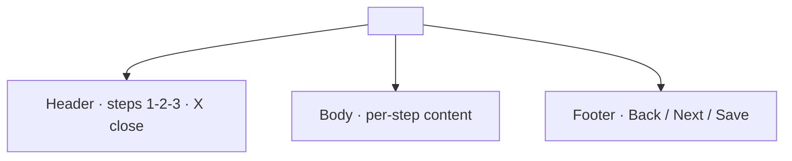

### 17.2 Step indicator

```
Step 1 of 3: Setup        ━━━━━━░░░░░░░░░░
Step 2 of 3: Cells        ━━━━━━━━━━░░░░░░
Step 3 of 3: Preview      ━━━━━━━━━━━━━━━━
```

**Rules:**
- Step circles connected by line
- Completed steps: emerald filled
- Active step: emerald filled + text emphasized
- Future steps: grey

### 17.3 Cell visual states

| State | Background | Border | Content |
|---|---|---|---|
| `EMPTY` | `--surface-sunken` | 1px dashed `--border-subtle` | (none) |
| `SEATER` | `--seat-available-bg` | 1.5px `--seat-available-border` | Seat label (mono, 11px) |
| `SLEEPER` | Same, but taller cell (70px) | Same | Seat label |
| `SEMI_SLEEPER` | Same, medium (60px) | Same | Seat label |
| `AISLE` | `--surface-sunken` + diagonal stripes | 1px `--border-subtle` | (none) |
| `FEMALE_ONLY` | `--seat-female-bg` | 1.5px `--seat-female-border` | Seat label + ♀ |
| `SELECTED (editing)` | `--brand-emerald-subtle` + border `--brand-emerald` | 2px | Seat label |

**Reference:** `busverse/05` §7.1 (seat cell colors), `buscon/03` §6.2.

### 17.4 Grid builder toolbar

```
┌──────────────────────────────────────────────────┐
│ [Fill row ▾] [Fill column ▾] [Auto-fill] [Clear]│
│                                                   │
│                              {N} of {capacity} seats│
└──────────────────────────────────────────────────┘
```

**Rules:**
- Toolbar sticky at top
- Counter on right (mono font)
- Counter turns amber when within 3 of target
- Counter turns green when exact match

### 17.5 Preview step

**Diagram: Preview side-by-side**
*Left pane = builder view (editable). Right pane = passenger preview (read-only, matches `busverse/05` §7). Validation checklist below.*

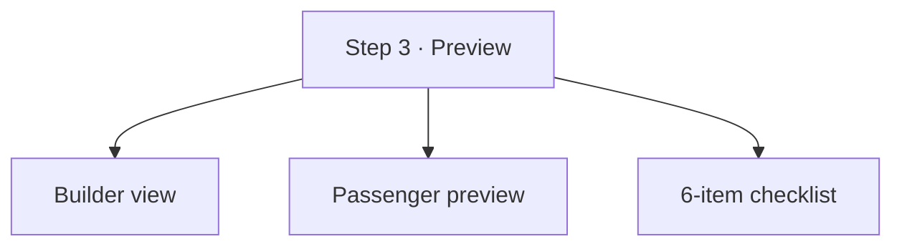

### 17.6 Grid cell sizing

| Layout | Cell width | Cell height (SEATER) | Cell height (SLEEPER) |
|---|---:|---:|---:|
| 10×4 seater | 40px | 44px | — |
| 15×2 sleeper | 40px | — | 70px |
| 8×3 mixed | 40px | 44px | 70px |

**Rule:** Cell width fixed at 40px (touch target). Height varies per type.

---

## 17A. Detail Drawer Pattern

### 17A.1 The drawer (canonical)

Used by 4 screens:
- `SCR-BC-BUSES` → bus detail
- `SCR-BC-DRIVERS` → driver detail
- `SCR-BC-BOOKINGS` → booking detail
- `SCR-BC-REFUNDS` → refund detail
- `SCR-BC-APPROVALS` → operator/bus/route/schedule detail

**Diagram: Drawer structure**
*Right-side drawer. Backdrop, header, scrollable body, optional footer actions.*

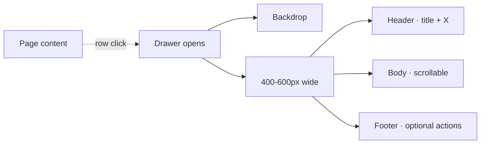

### 17A.2 Dimensions

| Aspect | Mobile | Desktop |
|---|---|---|
| Width | Full-screen | 400px (default) / 600px (wide) |
| Backdrop | `--canvas-bg` at 80% | Same |
| Animation | Slide from right 250ms | Same |
| Header height | 56px | 56px |
| Footer | Fixed bottom | Fixed bottom |

### 17A.3 Keyboard + a11y

| Aspect | Detail |
|---|---|
| Focus | Traps inside drawer |
| Focus return | Returns to trigger row on close |
| Escape | Closes |
| Backdrop click | Closes (unless form dirty) |
| ARIA | `role="dialog"` `aria-modal="true"` |

### 17A.4 When to use drawer vs page vs modal

| Use case | Pattern |
|---|---|
| View details of a row | **Drawer** |
| Edit an entity | **Page** (navigate) |
| Confirm a destructive action | **Modal** |
| Full form (multi-step) | **Page** |
| Quick preview (KYC doc) | **Modal** |

---

## 18. Responsive Matrix

### 18.1 Breakpoints

**Diagram: Breakpoint bands**
*Web has 3 breakpoints. Native has 1 (portrait 360px+). Same as `busverse/05` §14 but desktop-first priorities.*

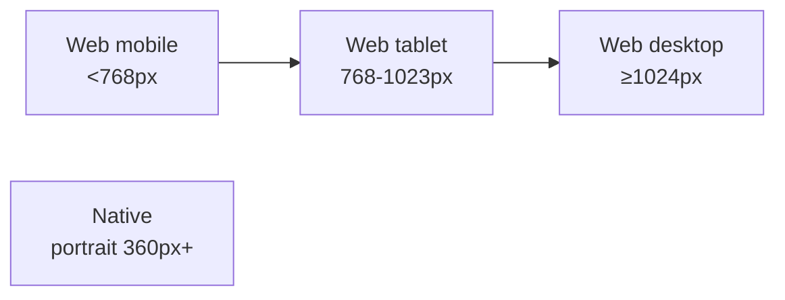

### 18.2 Cross-screen breakpoint table

| Aspect | Web mobile (<768px) | Web tablet (768-1023px) | Web desktop (≥1024px) | Native (360px+) |
|---|---|---|---|---|
| Sidebar | Hidden (hamburger) | Collapsed (64px) | Expanded (240px) | N/A |
| Top bar | 56px | 56px | 56px | 56px |
| Page padding | 16px | 24px | 32px | 16px |
| Table row | 40px (no hide) | 32px (P2 hidden) | 32px | N/A |
| Card grid | 1 col | 2 col | 2-3 col | N/A |
| Modal | Full-screen | 480-720px | 480-720px | Full-screen |
| Drawer | Full-screen | 400-600px | 400-600px | Full-screen |
| Form layout | 1 col | 1 col | 2 col | 1 col |

---

## 18A. Formatting Conventions

**Reference:** `busverse/05` §8 defines the base formatting conventions. BusCon **adds** these:

### 18A.1 BusCon-specific formats

| Data | Format | Example |
|---|---|---|
| Bus registration | RTO format `{State}-{District}-{Series}-{Number}` | `DL-1P-1234` |
| Booking reference | `BKG-YYYY-NNNNN` | `BKG-2026-00042` |
| Trip reference | `TRP-YYYY-NNNNN` | `TRP-2026-00187` |
| Refund reference | `REF-YYYY-NNNNN` | `REF-2026-00089` |
| Invoice number | `INV/YYYY-YY/NNNN` | `INV/2026-27/0042` |

### 18A.2 BusCon-specific money

- Money is `amountPaise` → format `₹{amount}` with lakh/crore grouping (per `busverse/05` §8.2)
- **Revenue dashboards** may show large numbers (e.g., `₹12.5L`, `₹1.2Cr`) — abbreviation allowed in summary cards, full amount in tables

### 18A.3 Timestamps

- Table cells: `DD MMM HH:mm` (e.g., `24 Oct 14:32`)
- Form inputs: `DD MMM YYYY, HH:mm` (e.g., `24 Oct 2026, 14:00`)
- Time-only: `HH:mm IST`
- Relative: `2h ago` (for < 24h), full date for older

### 18A.4 PII masking suffix

When PII is masked (e.g., phone `+919876543210` → `••••••3210`), the **full masked string** is shown in tables. **No additional "masked" indicator** in table cells — the presence of bullets is sufficient. Admin can unmask via the reason-required flow (per `buscon/01` §14).

---

## 19. Loading / Error / Empty Patterns

### 19.1 Reuse from `busverse/05` §17

All patterns from `busverse/05` §17 apply verbatim:
- Feedback decision tree (toast/banner/modal/inline)
- Loading decision tree (skeleton/spinner/progress bar)
- Toast spec (4s auto-dismiss, bottom-center mobile, top-right desktop)
- Banner spec
- Modal spec
- Skeleton spec
- Spinner spec
- Empty state template
- Success state template

### 19.2 BusCon-specific table loading

**Diagram: Table loading skeletons**
*5 skeleton rows matching the table's column structure. Shimmer per `busverse/05` §17.6.*

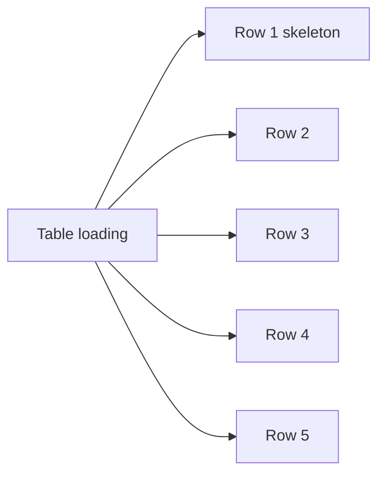

### 19.3 BusCon-specific empty states

| Screen | Empty state |
|---|---|
| Bus list | "No buses yet" + "Add your first bus" CTA |
| Routes list | "No routes yet" + "Create your first route" CTA |
| Schedules list | "No schedules yet" + "Create your first schedule" CTA |
| Drivers list | "No drivers yet" + "Invite your first driver" CTA |
| Bookings list | "No bookings yet" |
| Revenue | "No revenue data for this period" |
| Approvals | "No pending items — all caught up!" |
| Refunds | "No refunds" |
| Audit | "No audit records for these filters" |
| TODAY | "No trips assigned today" |
| Manifest | "No passengers yet" |
| Scan queue | "No scans pending" |

**Rule:** Empty state illustration uses Lucide icon (96px) — no custom illustrations in Phase 1.

### 19.4 Toast position

| Surface | Position |
|---|---|
| BusCon web | Top-right (below top bar, 16px offset) |
| Operator App | Above bottom action bar (16px offset) |

**Rule:** Never overlap sticky elements (top bar, bulk action bar, bottom action bar).

### 19.5 Error boundary integration

**Reference:** §20A.

---

## 20. Accessibility

### 20.1 Web accessibility (reuse from `busverse/05` §16)

All patterns from `busverse/05` §16 apply verbatim:
- Focus visible
- Focus trap in modals/drawers
- Focus return on close
- Skip-to-content link
- Keyboard nav
- ARIA labels
- Color contrast ≥ 4.5:1
- Touch targets ≥ 44×44px
- Text zoom 200%
- Reduced motion

### 20.2 Table accessibility (canonical)

| Requirement | Implementation |
|---|---|
| Semantic HTML | `<table>`, `<thead>`, `<tbody>`, `<th scope>` |
| Sortable columns | `aria-sort="ascending"` / `"descending"` / `"none"` |
| Row selection | Checkbox `aria-label="Select row {N}"` |
| Row actions | Buttons `aria-label="View {entity}"`, `"Edit {entity}"`, `"Delete {entity}"` |
| Bulk actions | `role="region"` `aria-label="Bulk actions"` |
| Pagination | "Load more" button, announces new rows via `aria-live="polite"` |
| Empty | `role="status"` announces "No results" |
| Loading | `aria-busy="true"` |
| Error | `role="alert"` |

### 20.3 Sidebar accessibility

| Requirement | Implementation |
|---|---|
| Nav landmark | `<nav aria-label="Main navigation">` |
| Active item | `aria-current="page"` |
| Collapsed state | Tooltip on hover/focus for icon-only |
| Keyboard | Tab through items; Enter activates |

### 20.4 Native accessibility (Operator App)

| Requirement | iOS | Android |
|---|---|---|
| Font scaling | `allowFontScaling: true` + Dynamic Type | `allowFontScaling: true` + system font scale |
| Screen reader | VoiceOver + `accessibilityLabel` on all interactive elements | TalkBack + same |
| Focus visible | iOS auto focus ring | Android focus highlight |
| Touch targets | ≥ 44×44pt | ≥ 48×48dp |
| Reduce motion | `AccessibilityInfo.isReduceMotionEnabled()` | Same API |
| Dark theme | `useColorScheme()` respects system | Same |
| Grouping | `accessible={true}` on composite rows | Same |

### 20.5 Testing tool (Phase 1 advisory)

| Tool | Surface | Phase 1 |
|---|---|---|
| `@axe-core/playwright` | Web | Advisory |
| Lighthouse a11y ≥ 95 | Web | Advisory |
| Manual keyboard walkthrough | Both | Blocking for demo |
| VoiceOver manual walkthrough | Native | Blocking for demo |
| TalkBack manual walkthrough | Native | Blocking for demo |

**Rule:** Automated a11y is advisory; manual walkthrough before viva is blocking.

---

## 20A. Error Boundaries & Fallback Pages

### 20A.1 Error boundary hierarchy

**Diagram: Error boundaries**
*Three levels — Next.js per-route-group `error.tsx`, global `error.tsx`, static fallbacks (404, 500, 403, offline).*

```mermaid
flowchart TB
    PAGE["User navigates"]
    PAGE -->|"route crashes"| SEG["Segment error.tsx"]
    PAGE -->|"root crashes"| GLOBAL["Global error.tsx"]
    PAGE -->|"unknown URL"| NF["404 not-found.tsx"]
    PAGE -->|"role mismatch"| FORB["403 role-mismatch"]
    PAGE -->|"offline + no cache"| OFFLINE["Offline fallback"]

    SEG --> RETRY["Retry scoped"]
    GLOBAL --> RELOAD["Reload app"]
    NF --> HOME["Back to dashboard"]
    FORB --> HOME
    OFFLINE --> RETRY2["Retry when online"]
```

### 20A.2 404 not-found

```
┌──────────────────────────────────────┐
│ [Sidebar]│ 404                        │
│          │                            │
│          │ We couldn't find that page │
│          │                            │
│          │ [Back to dashboard]        │
└──────────┴────────────────────────────┘
```

### 20A.3 500 error page

```
┌──────────────────────────────────────┐
│ [Sidebar]│ 500                        │
│          │                            │
│          │ Something went wrong        │
│          │ Reference: {errorId}        │
│          │                            │
│          │ [Try again] [Back to dashboard]│
└──────────┴────────────────────────────┘
```

### 20A.4 403 role-mismatch (resolves G16)

**Diagram: Role-mismatch 403**
*Operator navigating to `/admin/*` or admin to `/operator/*` → 403. Logged in, but wrong role for the route.*

```mermaid
flowchart LR
    OP["Operator at /admin/refunds"] --> CHECK["Session role<br/>≠ required role"]
    CHECK --> PAGE403["403 page"]
    PAGE403 --> HOME["Back to your dashboard"]
```

```
┌──────────────────────────────────────┐
│ [Sidebar]│ 403                        │
│          │                            │
│          │ You don't have access to   │
│          │ this page.                 │
│          │                            │
│          │ [Back to your dashboard]   │
└──────────┴────────────────────────────┘
```

### 20A.5 Offline fallback

Same pattern as `busverse/05` §20.5.

### 20A.6 Retry behavior

| Failure | Retry |
|---|---|
| API 500 | Retry once, then show error |
| Render crash | Route-level retry via `reset()` |
| Root crash | Full reload |
| Cap | Never infinite — max 3 auto-retries |

---

## 21. Form Patterns

### 21.1 Reuse from `busverse/05` §18

All patterns apply verbatim:
- Input state machine (6 states)
- Validation on blur + submit
- ARIA (`aria-invalid`, `aria-describedby`)
- Field layout (top label)
- Clear on edit

### 21.2 BusCon-specific additions

| Aspect | Rule |
|---|---|
| Form layout | Single column mobile · **2 column at ≥1024px** |
| Section dividers | `<h4>` section title + `<hr>` between groups |
| Required marker | Asterisk (*) after label; `aria-required="true"` on input |
| Inline hints | Optional below input in `--text-caption` |
| Long forms | Save progress on background (draft) |
| Cancel | Confirm if dirty |

### 21.3 Multi-column form layout

**Diagram: Two-column form**
*Desktop forms use 2 columns for independent fields. Long textareas span both columns.*

```mermaid
flowchart TB
    FORM["Form (desktop)"]

    FORM --> ROW1["Row 1:<br/>Reg No | Bus type"]
    FORM --> ROW2["Row 2:<br/>Model | Capacity"]
    FORM --> ROW3["Row 3:<br/>Amenities (spans both)"]
    FORM --> ROW4["Row 4:<br/>Notes (spans both)"]
```

### 21.4 Grid builder form

**Reference:** §17.

### 21.5 Native form (Operator App)

| Aspect | Rule |
|---|---|
| Layout | Single column |
| Keyboard avoidance | `KeyboardAvoidingView` for text inputs |
| Input height | 44px minimum |
| Labels | Top-positioned (no floating) |
| Validation | On blur + submit |

---

## 21A. Deep Linking & URL Patterns

### 21A.1 Dual-tree URL structure

**Diagram: URL trees**
*Two top-level trees — `/operator/*` and `/admin/*`. Auth is checked before tree entry; role-mismatch → 403.*

```mermaid
flowchart LR
    ROOT["/"] --> LOGIN["/login"]
    ROOT --> OP["/operator/*"]
    ROOT --> ADM["/admin/*"]

    OP --> OP1["/operator/dashboard"]
    OP --> OP2["/operator/buses"]
    OP --> OP3["/operator/buses/:id"]
    OP --> OP4["/operator/buses/:id/layout"]
    OP --> OP5["/operator/routes/:id"]
    OP --> OP6["/operator/schedules/:id"]

    ADM --> ADM1["/admin/dashboard"]
    ADM --> ADM2["/admin/approvals"]
    ADM --> ADM3["/admin/approvals/:entity/:id"]
    ADM --> ADM4["/admin/refunds/:id"]
```

### 21A.2 Screen → URL map

| Screen | URL | Auth |
|---|---|---|
| Login | `/login` | Public |
| Operator dashboard | `/operator/dashboard` | Operator |
| Admin dashboard | `/admin/dashboard` | Admin |
| Buses list | `/operator/buses` | Operator |
| Bus detail | `/operator/buses/:id` | Operator |
| Bus layout builder | `/operator/buses/:id/layout` | Operator |
| Routes list | `/operator/routes` | Operator |
| Route detail | `/operator/routes/:id` | Operator |
| Schedules list | `/operator/schedules` | Operator |
| Schedule detail | `/operator/schedules/:id` | Operator |
| Drivers list | `/operator/drivers` | Operator |
| Driver detail | `/operator/drivers/:id` | Operator |
| Bookings list | `/operator/bookings` | Operator |
| Booking detail | `/operator/bookings/:id` | Operator |
| Revenue | `/operator/revenue` | Operator |
| Approvals | `/admin/approvals` | Admin |
| Approval detail | `/admin/approvals/:type/:id` | Admin |
| Bookings (admin) | `/admin/bookings` | Admin |
| Refunds | `/admin/refunds` | Admin |
| Refund detail | `/admin/refunds/:id` | Admin |
| Audit | `/admin/audit` | Admin |

### 21A.3 Auth-guarded deep links

**Same pattern as `busverse/05` §21.4:**
- Unauthenticated deep link → redirect to `/login?returnTo=...`
- After login → navigate to `returnTo`
- `returnTo` validated to start with `/` (no open redirect)

### 21A.4 Role-mismatch deep links

**Diagram: Role-mismatch deep link**
*Operator deep-links to `/admin/*` → 403 page (not redirect to login — already authenticated, just wrong role).*

```mermaid
sequenceDiagram
    actor U as Operator
    participant APP as BusCon
    U->>APP: Open /admin/refunds
    APP->>APP: Check auth (valid session)
    APP->>APP: Check role (operator ≠ admin)
    APP-->>U: 403 page with "Back to your dashboard"
```

### 21A.5 URL stability

| Rule | Detail |
|---|---|
| No trailing slashes | `/operator/buses` not `/operator/buses/` |
| Lowercase paths | Always |
| Stable IDs | Once issued, never change |
| No PII in URLs | Only UUIDs / references |

---

## 22. Microcopy Guide

### 22.1 Voice and tone

**Inherit from `busverse/05` §19.1** — direct, helpful, calm, confident, concise.

BusCon-specific tone: **professional** (operator is a business; admin is platform authority).

### 22.2 Standard strings

**Auth:**

| Context | String |
|---|---|
| Login heading | "Sign in to BusCon" |
| Login subheading | "Manage your fleet" (operator) / "Admin access" (admin) |
| Role toggle | "Operator" · "Admin" |
| Login button | "Sign in" |
| OTP toggle | "Use phone OTP instead" |
| Forgot link | "Forgot password?" |
| Signup link | "New operator? Sign up" |
| Rate limited | "Too many attempts. Try again in {N}s." |
| Email not verified | "Please verify your email first. [Resend]" |

**Dashboard:**

| Context | String |
|---|---|
| Greeting | "Good morning, {name}" (time-based) |
| Operator card 1 | "Recent Bookings" |
| Operator card 2 | "Revenue" |
| Admin card 1 | "Pending Approvals" |
| Admin card 2 | "Pending Refunds" |

**Fleet:**

| Context | String |
|---|---|
| Add bus | "+ Add bus" |
| Empty | "No buses yet" |
| Empty CTA | "Add your first bus" |
| Save draft | "Save as draft" |
| Submit | "Submit for approval" |
| Insurance expired | "Insurance expired {N} days ago" |

**Routes:**

| Context | String |
|---|---|
| Add route | "+ Add route" |
| Empty | "No routes yet" |
| Save | "Save route" |
| Stand editor title | "Manage stands" |
| Add stand | "+ Add stand" |

**Schedules:**

| Context | String |
|---|---|
| Add schedule | "+ Add schedule" |
| Empty | "No schedules yet" |
| Publish | "Publish schedule" |
| Publish confirm | "Publish? The schedule will appear in BusVerse immediately." |
| Cancel | "Cancel schedule" |
| Cancel with bookings | "Cancel? {N} bookings will be refunded." |

**Drivers:**

| Context | String |
|---|---|
| Invite | "+ Invite driver" |
| Invite fields | "Driver's phone" + "Full name" |
| Invite button | "Send invite" |
| Assign | "Assign to trip" |
| KYC badge (each) | "Invited" · "Signed up" · "KYC pending" · "Verified" · "Rejected" |

**Approvals:**

| Context | String |
|---|---|
| Approve button | "Approve" |
| Reject button | "Reject" |
| Suspend button | "Suspend" |
| Reason label | "Reason (required)" |
| Reason hint | "Minimum 10 characters" |
| Approve confirm | "Approve {name}?" |
| Reject confirm | "Reject {name}? They can resubmit up to 3 times." |

**Refunds:**

| Context | String |
|---|---|
| Initiate | "Initiate refund" |
| Amount label | "Amount (₹)" |
| Max amount | "Maximum: ₹{amount}" |
| Reason label | "Reason for refund" |
| Retry | "Retry refund" |

**Audit:**

| Context | String |
|---|---|
| Export | "Export CSV" |
| Filters | "Entity" · "Action" · "Date range" · "Actor" |
| Load more | "Load more" |

**Operator App:**

| Context | String |
|---|---|
| Login heading | "Sign in to start driving" |
| Phone placeholder | "98765 43210" |
| OTP helper | "Sent to +91 ••••••3210" |
| Today empty | "No trips assigned today" |
| Start trip | "Start trip" |
| End trip | "End trip" |
| End trip confirm | "End this trip? You'll be marked off-duty." |
| Report delay | "Report delay" |
| Scan | "Scan QR" |
| Manifest | "Manifest" |
| Scan hint | "Point camera at passenger QR" |
| Scan success | "Boarded · {name} ({seats})" |
| Scan queued | "Queued for sync · {N} pending" |
| Manual entry | "Enter manually" |
| Boarded badge | "Boarded" |
| Manifest header | "{boarded} of {total} boarded" |

### 22.3 Button labels

| Action | Label |
|---|---|
| Primary submit | "Save" · "Continue" · "Submit for approval" |
| Cancel | "Cancel" |
| Delete | "Delete" |
| Confirm (danger) | "Yes, {action}" |
| Back | "Back" |
| Close | "Close" |

### 22.4 Never use (same as `busverse/05` §19.6)

- "Error" (use specific description)
- "Failed" (use "Didn't work. Try again?")
- "Oops!" / "Sorry!" (just explain)
- "Please" (as filler — remove)
- "Click here" (use descriptive text)
- "OK" (use "Confirm")

### 22.5 Error message mapping

**Reference:** `07` v1.2 §9.2. BusCon-specific:

| Error code | User-facing message |
|---|---|
| `GSTIN_ALREADY_REGISTERED` | "This GSTIN is already registered." |
| `EMAIL_ALREADY_REGISTERED` | "Email already registered. Log in or reset password." |
| `DRIVER_ALREADY_INVITED` | "This phone is already in your fleet." |
| `DRIVER_NOT_VERIFIED` | "Driver KYC pending. Wait for admin approval." |
| `REASON_REQUIRED` | "Please enter a reason (min 10 characters)." |
| `INVALID_TRANSITION` | "This action isn't valid for the current state." |
| `REFUND_EXCEEDS_PAYMENT` | "Refund amount can't exceed the payment." |
| `PAYMENT_NOT_REFUNDABLE` | "This payment isn't eligible for refund." |
| `SCHEDULE_CONFLICT` | "Conflict with existing schedule." |
| `BUS_HAS_ACTIVE_SCHEDULES` | "Deactivate schedules first." |
| `ROUTE_IN_USE` | "Cancel schedules first." |
| `CAPACITY_MISMATCH` | "Seat count must match capacity." |
| `INVALID_SIGNATURE` | "Invalid ticket. Ask for physical ID." |
| `RATE_LIMITED` | "Too many attempts. Try again in {N}s." |

---

## 22A. Confirmation Dialog Pattern

### 22A.1 Three variants

**Diagram: Confirmation variants**
*Three standard dialog variants — simple confirm, reason-required, danger warning. All follow the same structure.*

```mermaid
flowchart TB
    DIALOG["<ConfirmDialog>"]

    DIALOG --> SIMPLE["Simple<br/>'Save changes?'"]
    DIALOG --> REASON["Reason-required<br/>'Reject operator?' + reason input"]
    DIALOG --> DANGER["Danger warning<br/>'Suspend? All sessions will end.'"]
```

### 22A.2 Structure

```
┌───────────────────────────────────┐
│ {Title}                       [X] │
├───────────────────────────────────┤
│ {Body / explanation}              │
│                                   │
│ [Reason input if required]        │
│                                   │
├───────────────────────────────────┤
│                [Cancel] [Confirm] │
└───────────────────────────────────┘
```

### 22A.3 Variant rules

| Variant | Icon | Body | Reason | Confirm button |
|---|---|---|---|---|
| Simple | None | Short question | No | "Confirm" |
| Reason-required | None | Question + hint | Yes (10–500 chars) | "Yes, {action}" |
| Danger warning | `alert-triangle` (amber) | Warning text | Optional | Danger button |

### 22A.4 Usage per screen

| Action | Variant |
|---|---|
| Approve operator | Reason-required |
| Reject operator | Reason-required + category |
| Suspend operator | Danger warning + reason |
| Initiate refund | Reason-required |
| Cancel schedule (with bookings) | Danger warning |
| Delete bus/route | Danger warning |
| End trip | Simple (mobile native dialog) |
| Log out | Simple |

### 22A.5 Accessibility

- `role="alertdialog"` (more assertive than `dialog`)
- Focus trap
- Escape closes (Cancel action)
- Default focus on Cancel (safer)
- Return focus to trigger

---

## 23. Dark Theme

### 23.1 Theme mechanism

**Same as `busverse/05` §22.3** — no-flash script in `<head>`, `data-theme` on `<html>`, `localStorage` persistence, respects `prefers-color-scheme`.

### 23.2 BusCon-specific

| Aspect | Detail |
|---|---|
| Default | Dark (same as BusVerse) |
| Toggle placement | Sidebar footer (desktop) · profile drawer (mobile) |
| Transition | `background-color`, `color` at 250ms |
| No-flash | Same script pattern |

### 23.3 Emerald in dark theme

| Token | Light | Dark |
|---|---|---|
| `--brand-emerald` | `#047857` | `#10B981` |
| `--brand-emerald-hover` | `#036249` | `#34D399` |
| `--brand-emerald-active` | `#024D3A` | `#059669` |

**Rule:** Dark emerald is brighter for OLED contrast. Same family, distinct from `--signal-emerald`.

### 23.4 Table in dark theme

| Aspect | Light | Dark |
|---|---|---|
| Row hover | `--surface-hover` (light) | `--surface-hover` (dark) |
| Row selected | `--brand-emerald-subtle` (light) | `--brand-emerald-subtle` (dark) |
| Header bg | `--canvas-subtle` (light) | `--canvas-subtle` (dark) |
| Border | `--border-hairline` | `--border-hairline` |

**Reference:** `Design_guide.html` §1 dark tokens.

### 23.5 Native theme

Operator App respects OS `useColorScheme()` — no in-app theme toggle (per `buscon/02` §13.3).

**Rule:** Native follows OS; web allows in-app override.

---

## 24. Component Documentation

### 24.1 Storybook (web + native)

**Diagram: Storybook structure**
*Two Storybook instances — one for web primitives + screens, one for native compositions.*

```mermaid
flowchart TB
    SB["Storybook ecosystem"]

    SB --> WEB["Web Storybook<br/>storybook.buscon.app"]
    SB --> NAT["Native Storybook<br/>(local dev only)"]

    WEB --> WEB1["22 primitives"]
    WEB --> WEB2["12 screens × states"]

    NAT --> NAT1["20 native compositions"]
    NAT --> NAT2["6 native screens"]
```

### 24.2 Coverage

| Category | Story count |
|---|---:|
| Web primitives (variants + states) | 22 × ~4 = 88 |
| Web screens (states) | 12 × ~3 = 36 |
| Native compositions | 20 × ~3 = 60 |
| Native screens (states) | 6 × ~3 = 18 |
| **Total** | **~202 stories** |

### 24.3 Change process

**Same as `busverse/05` §23.2:**
- RFC → review → implement → test → version bump → release
- Semver for `@busverse/ui`
- 2-minor-version deprecation warning
- CHANGELOG.md per package

### 24.4 Ownership

| Package | Owner |
|---|---|
| `@busverse/design-tokens` | Founder |
| `@busverse/ui` (22 primitives) | Founder |
| `@busverse/brand-svg` | Founder |
| `apps/buscon-web/components/` | Founder |
| `apps/operator-app/components/` | Founder |
| Web Storybook | Auto-deployed from main |
| Native Storybook | Local dev only |

---

## 25. Real-Time Update Animations

### 25.1 The problem

When a WebSocket event updates a table row (boarding status flip, approval status change, GPS update), the row should visually signal the change so the user notices without a jarring flash.

### 25.2 Animation catalog

**Diagram: Real-time animation types**
*Three animation classes — row flash for table updates, status flip for badges, position interpolation for maps.*

```mermaid
flowchart TB
    RT["Real-time animations"]

    RT --> RF["Row flash<br/>300ms amber tint"]
    RT --> SF["Status flip<br/>200ms badge swap"]
    RT --> PI["Position interpolation<br/>GPS only (busverse/04 §10.4)"]
```

### 25.3 Row flash

| Aspect | Detail |
|---|---|
| Trigger | WebSocket event updates visible row |
| Animation | Background amber tint → fade to normal over 300ms |
| Reduced motion | Instant color change, no fade |

**Use cases:**
- Manifest: boarding status flips
- Approvals: new pending item appears
- Audit: new log entry appears
- Refunds: status changes

### 25.4 Status flip

| Aspect | Detail |
|---|---|
| Trigger | Badge text changes |
| Animation | Crossfade 200ms |
| Reduced motion | Instant swap |

### 25.5 Position interpolation

Native Operator App uses smooth interpolation for GPS — see `buscon/04` §12.3 (deferred to `busverse/04` §10.4 pattern). BusCon web does not have live GPS (Phase 1).

### 25.6 Rules

| Rule | Detail |
|---|---|
| Never block user | Animation runs alongside user interaction |
| Respect reduced-motion | All animations respect `prefers-reduced-motion` / `AccessibilityInfo.isReduceMotionEnabled()` |
| Max 3 concurrent animations | Batch if >3 rows update in same tick |
| No layout shift | Use opacity/color transforms only, not height/width |

---

## 26. Test Coverage

### 26.1 Test suites (~155 tests)

**BusCon web:**

| Suite | Count |
|---|---:|
| `e2e_buscon_login` (dual-role) | 4 |
| `e2e_buscon_dashboard` (dual-layout) | 2 |
| `e2e_buscon_fleet` | 6 |
| `e2e_buscon_grid_builder` | 6 |
| `e2e_buscon_routes` | 5 |
| `e2e_buscon_schedules` | 6 |
| `e2e_buscon_drivers` | 4 |
| `e2e_buscon_bookings` | 3 |
| `e2e_buscon_revenue` | 3 |
| `e2e_buscon_approvals` | 4 |
| `e2e_buscon_refunds` | 4 |
| `e2e_buscon_audit` | 3 |
| `e2e_buscon_403_role_mismatch` | 1 |
| `e2e_buscon_404` | 1 |
| `e2e_buscon_500` | 1 |
| `e2e_buscon_deep_link_guarded` | 2 |
| `component_web_primitives` | 22 |
| `component_datatable` | 8 |
| `component_drawer` | 3 |
| `component_sidebar` | 3 |
| `component_confirm_dialog` | 4 |
| **Web subtotal** | **~102** |

**Operator App:**

| Suite | Count |
|---|---:|
| `e2e_oa_login` | 3 |
| `e2e_oa_today` | 3 |
| `e2e_oa_trip` | 4 |
| `e2e_oa_scan` | 4 |
| `e2e_oa_manifest` | 3 |
| `e2e_oa_summary` | 2 |
| `e2e_oa_profile_drawer` | 2 |
| `component_native_compositions` | 20 |
| `a11y_voiceover` | (manual) |
| `a11y_talkback` | (manual) |
| **Native subtotal** | **~41** |

**Cross-cutting:**

| Suite | Count |
|---|---:|
| `visual_regression_web` (advisory) | 12 |
| `visual_regression_native` (advisory) | 6 |
| `a11y_axe_web` (advisory) | 12 |
| **Cross subtotal** | **~30** |

**Total: ~173 tests** (higher than plan's ~155 because dual-role screens get dedicated tests).

### 26.2 Key assertions

| Test | Asserts |
|---|---|
| `e2e_buscon_login_operator` | Operator tab → email + password → dashboard |
| `e2e_buscon_login_admin` | Admin tab → email + password → admin dashboard |
| `e2e_buscon_403_role` | Operator at `/admin/*` → 403 page |
| `e2e_buscon_deep_link_guarded` | Unauth deep link → login with `returnTo` |
| `e2e_buscon_grid_builder_capacity` | Save disabled until `seatCount == capacity` |
| `e2e_buscon_approval_reason` | Empty reason → submit disabled |
| `component_datatable_keyboard` | Tab → row → Enter → action |
| `component_sidebar_collapse` | Manual collapse persists |
| `component_confirm_dialog_focus` | Focus on Cancel by default |
| `e2e_oa_scan_result_overlay` | Valid → green; invalid → red |
| `e2e_oa_manifest_ws_update` | WS event → row flashes amber |
| `a11y_axe_home` | No axe violations (advisory) |
| `visual_regression_home_light` | Snapshot matches (advisory) |

### 26.3 Test infrastructure

| Tool | Surface | Phase 1 |
|---|---|---|
| Playwright | Web E2E + visual regression | Blocking (E2E) / advisory (visual) |
| Vitest + Testing Library | Web + native component tests | Blocking |
| Detox / Maestro | Native E2E | Blocking |
| `@axe-core/playwright` | Web a11y | Advisory |
| VoiceOver / TalkBack | Native a11y | Manual, blocking for demo |

### 26.4 Blocking vs advisory

| Gate | Phase 1 |
|---|---|
| E2E per screen | Blocking |
| Component tests | Blocking |
| Native E2E | Blocking |
| Manual keyboard walkthrough | Blocking for demo |
| Manual VoiceOver/TalkBack walkthrough | Blocking for demo |
| Visual regression | Advisory |
| Axe a11y | Advisory |

---

## 27. Cross-Doc Amendment Flags

### 27.1 Amendment flags

| # | Doc | Amendment |
|---|---|---|
| **A1** | `buscon/00` v1.1 | §8.4 resolution — reference `06` for full visual spec; update §7 to reference `06` §11 screen matrix |
| **A2** | `busverse/05` v1.1 | §6 — add `<DataTable>` as 13th shared primitive (or note that BusCon has 9 extra primitives living in `@busverse/ui`) |
| **A3** | `00-INDEX.md` v1.1 | §7 — mark `assets/brand/buscon-icon-pack.html` as pending design guide |
| **A4** | `buscon/01` v1.1 | §15 — reference `06` §8 for sidebar patterns (behavior described in `buscon/01` §15 was structural, not visual) |
| **A5** | `buscon/02` v1.1 | §8.2 — GPS pill states now 4 (per `buscon/04` §9), reference `06` §19.4 for visual |
| **A6** | `buscon/05` v1.1 | §8.3 — result overlay visual matches `06` §16.4 |

### 27.2 What to create (not amend)

| Item | Status |
|---|---|
| `buscon-design-guide.html` | Not created (Path B in effect) |
| `assets/brand/buscon-icon-pack.html` | Not created |
| Web Storybook deployment | Not created (Phase 1) |
| Native Storybook | Not created (Phase 1) |

**Rule:** All amendments additive; no breaking changes.

---

## 28. Open Questions

| # | Question | Owner | Default |
|:---:|---|---|---|
| 1 | Design guide path (D1) | Shaghaf | **Path B** (reuse busverse/05 + emerald) |
| 2 | Login dual-role (D2) | Shaghaf | **One URL with toggle** |
| 3 | Dashboard dual-role (D3) | Shaghaf | **Same URL, role-conditional** |
| 4 | Motion assets (D4) | Shaghaf | **Skip** |
| 5 | Driver cabin solar glare (D5) | Shaghaf | **Phase 2** |
| 6 | Emerald `#047857` primary confirmed? | Shaghaf | **Yes** |
| 7 | Dark emerald `#10B981` + hover/active confirmed? | Shaghaf | **Yes** |
| 8 | Sidebar collapse breakpoints (240/64/hidden)? | Shaghaf | **Yes** |
| 9 | Breadcrumbs in top bar (own row)? | Shaghaf | **Yes** |
| 10 | DataTable as 13th shared primitive? | Shaghaf | **Yes** |
| 11 | Table row height 32px compact confirmed? | Shaghaf | **Yes** |
| 12 | Column resize — Phase 1 or 2? | Shaghaf | **Phase 2** |
| 13 | Column reorder — Phase 1 or 2? | Shaghaf | **Phase 2** |
| 14 | Bulk action bar — sticky bottom? | Shaghaf | **Yes** |
| 15 | Grid builder modal — full-screen mobile / 90vw×90vh desktop? | Shaghaf | **Yes** |
| 16 | Grid builder cell colors — reuse `busverse/05` §7 tokens? | Shaghaf | **Yes** |
| 17 | Camera preview overlay states — spec as-is? | Shaghaf | **Yes** |
| 18 | Native toast position — above bottom bar + 16px? | Shaghaf | **Yes** |
| 19 | Dark theme toggle — sidebar footer? | Shaghaf | **Yes** |
| 20 | Native font scaling — Dynamic Type + system scale? | Shaghaf | **Yes** |
| 21 | VoiceOver/TalkBack manual walkthrough — blocking? | Shaghaf | **Blocking for demo** |
| 22 | Visual regression — advisory Phase 1? | Shaghaf | **Yes** |
| 23 | Axe audit — advisory Phase 1? | Shaghaf | **Yes** |
| 24 | Storybook — separate instances for web/native? | Shaghaf | **Yes** |
| 25 | Microcopy ~40 BusCon strings added? | Shaghaf | **Yes** |
| 26 | Empty state illustrations — Lucide icons (no custom)? | Shaghaf | **Lucide** |
| 27 | Table skeleton — 5 rows or 3? | Shaghaf | **5** |
| 28 | Form field height — 44px mobile / 40px desktop? | Shaghaf | **Yes** |
| 29 | Row action visibility — always on desktop? | Shaghaf | **Yes** |
| 30 | Real-time animation — 300ms amber flash for WS updates? | Shaghaf | **Yes** |
| 31 | Detail drawer — 400px default / 600px wide? | Shaghaf | **Yes** |
| 32 | Confirm dialog — 3 variants (simple/reason/danger)? | Shaghaf | **Yes** |

---

## 29. Checklist Against Master List

| Item | Included? | Section |
|---|:---:|---|
| Purpose and scope | ✅ | §1 |
| Doc hierarchy | ✅ | §1.2 |
| Scope boundary | ✅ | §1.4 |
| 5 accepted defaults (D1–D5) | ✅ | §1.5 |
| Two-surface scope | ✅ | §1.6 |
| **Inheritance boundary** | ✅ | §1.7 |
| **Design guide gap flagged (B1)** | ✅ | §2.1 |
| 3 resolution paths | ✅ | §2.1 |
| What Path B delivers | ✅ | §2.1 |
| Precedence rule | ✅ | §2.2 |
| **6 conflicts resolved** | ✅ | §2.3 |
| Emerald palette hierarchy | ✅ | §2.4 |
| **Emerald color system** | ✅ | §3 |
| Token catalog | ✅ | §3.1 |
| What uses which | ✅ | §3.2 |
| Emerald in surfaces | ✅ | §3.3 |
| **Structural token inheritance** | ✅ | §4 |
| Inherited tokens | ✅ | §4.1 |
| New tokens | ✅ | §4.2 |
| Never redefine | ✅ | §4.3 |
| **Typography & density** | ✅ | §5 |
| Base type scale | ✅ | §5.1 |
| Density tiers | ✅ | §5.2 |
| Density table | ✅ | §5.3 |
| Native type | ✅ | §5.4 |
| **Iconography** | ✅ | §6 |
| Library decision | ✅ | §6.1 |
| BusCon icon catalog (36) | ✅ | §6.2 |
| **22 component primitives** | ✅ | §7 |
| Primitives tree | ✅ | §7.1 |
| Contract table | ✅ | §7.2 |
| 9 new primitives detailed | ✅ | §7.3 |
| Storybook | ✅ | §7.4 |
| Ownership | ✅ | §7.5 |
| **App Shell — BusCon web** | ✅ | §8 |
| Shell layout | ✅ | §8.1 |
| Sidebar | ✅ | §8.2 |
| Operator vs admin nav | ✅ | §8.3 |
| Top bar | ✅ | §8.4 |
| Breadcrumbs | ✅ | §8.5 |
| Collapse behavior | ✅ | §8.6 |
| Wireframe | ✅ | §8.7 |
| **App Shell — Operator App** | ✅ | §9 |
| Shell layout | ✅ | §9.1 |
| Top bar | ✅ | §9.2 |
| Screen variants | ✅ | §9.3 |
| Profile drawer access | ✅ | §9.4 |
| Safe areas | ✅ | §9.5 |
| **Table density pattern** | ✅ | §10 |
| Table anatomy | ✅ | §10.1 |
| Dimensions | ✅ | §10.2 |
| Column alignment | ✅ | §10.3 |
| Column priority | ✅ | §10.4 |
| Sortable columns | ✅ | §10.5 |
| Row selection | ✅ | §10.6 |
| Row actions | ✅ | §10.7 |
| Pagination | ✅ | §10.8 |
| States | ✅ | §10.9 |
| Bulk action bar | ✅ | §10.10 |
| **Screen catalog matrix** | ✅ | §11 |
| 18 screens + fallbacks | ✅ | §11.1 |
| Master state matrix | ✅ | §11.2 |
| **Auth + dashboard wireframes** | ✅ | §12 |
| Login (dual-role) | ✅ | §12.1 |
| Dashboard (dual-layout) | ✅ | §12.2 |
| **Fleet/Routes/Schedules wireframes** | ✅ | §13 |
| Buses | ✅ | §13.1 |
| Bus edit | ✅ | §13.2 |
| Routes | ✅ | §13.3 |
| Schedules | ✅ | §13.4 |
| **Drivers/Bookings/Revenue wireframes** | ✅ | §14 |
| Drivers | ✅ | §14.1 |
| Bookings | ✅ | §14.2 |
| Revenue | ✅ | §14.3 |
| **Approvals/Refunds/Audit wireframes** | ✅ | §15 |
| Approvals | ✅ | §15.1 |
| Refunds | ✅ | §15.2 |
| Audit | ✅ | §15.3 |
| **KYC viewer** | ✅ | §15.4 |
| **Operator App wireframes** | ✅ | §16 |
| Login | ✅ | §16.1 |
| Today | ✅ | §16.2 |
| Trip | ✅ | §16.3 |
| Scan | ✅ | §16.4 |
| Manifest | ✅ | §16.5 |
| Summary | ✅ | §16.6 |
| Profile drawer | ✅ | §16.7 |
| **Grid builder visual** | ✅ | §17 |
| Modal | ✅ | §17.1 |
| Step indicator | ✅ | §17.2 |
| Cell states | ✅ | §17.3 |
| Toolbar | ✅ | §17.4 |
| Preview | ✅ | §17.5 |
| Cell sizing | ✅ | §17.6 |
| **Detail drawer pattern** | ✅ | §17A |
| Structure | ✅ | §17A.1 |
| Dimensions | ✅ | §17A.2 |
| Keyboard + a11y | ✅ | §17A.3 |
| When to use | ✅ | §17A.4 |
| **Responsive matrix** | ✅ | §18 |
| **Formatting conventions** | ✅ | §18A |
| BusCon-specific | ✅ | §18A.1 |
| Money | ✅ | §18A.2 |
| Timestamps | ✅ | §18A.3 |
| PII masking | ✅ | §18A.4 |
| **Loading/error/empty** | ✅ | §19 |
| Reuse from busverse/05 | ✅ | §19.1 |
| Table loading | ✅ | §19.2 |
| Empty states | ✅ | §19.3 |
| Toast position | ✅ | §19.4 |
| **Accessibility** | ✅ | §20 |
| Web a11y reuse | ✅ | §20.1 |
| Table a11y | ✅ | §20.2 |
| Sidebar a11y | ✅ | §20.3 |
| Native a11y | ✅ | §20.4 |
| Testing tools | ✅ | §20.5 |
| **Error boundaries** | ✅ | §20A |
| Hierarchy | ✅ | §20A.1 |
| 404 | ✅ | §20A.2 |
| 500 | ✅ | §20A.3 |
| **403 role-mismatch (G16)** | ✅ | §20A.4 |
| Offline | ✅ | §20A.5 |
| Retry | ✅ | §20A.6 |
| **Form patterns** | ✅ | §21 |
| Reuse from busverse/05 | ✅ | §21.1 |
| BusCon additions | ✅ | §21.2 |
| Two-column | ✅ | §21.3 |
| Grid builder form | ✅ | §21.4 |
| Native form | ✅ | §21.5 |
| **Deep linking** | ✅ | §21A |
| Dual-tree URLs | ✅ | §21A.1 |
| Screen map | ✅ | §21A.2 |
| Auth-guarded | ✅ | §21A.3 |
| Role-mismatch | ✅ | §21A.4 |
| URL stability | ✅ | §21A.5 |
| **Microcopy guide** | ✅ | §22 |
| Voice/tone | ✅ | §22.1 |
| Standard strings (~80) | ✅ | §22.2 |
| Button labels | ✅ | §22.3 |
| Never use | ✅ | §22.4 |
| Error mapping | ✅ | §22.5 |
| **Confirmation dialog** | ✅ | §22A |
| Three variants | ✅ | §22A.1 |
| Structure | ✅ | §22A.2 |
| Variant rules | ✅ | §22A.3 |
| Usage | ✅ | §22A.4 |
| A11y | ✅ | §22A.5 |
| **Dark theme** | ✅ | §23 |
| Mechanism | ✅ | §23.1 |
| BusCon-specific | ✅ | §23.2 |
| Emerald in dark | ✅ | §23.3 |
| Table in dark | ✅ | §23.4 |
| Native theme | ✅ | §23.5 |
| **Component documentation** | ✅ | §24 |
| Storybook | ✅ | §24.1 |
| Coverage (~202 stories) | ✅ | §24.2 |
| Change process | ✅ | §24.3 |
| Ownership | ✅ | §24.4 |
| **Real-time animations** | ✅ | §25 |
| Animation types | ✅ | §25.2 |
| Row flash | ✅ | §25.3 |
| Status flip | ✅ | §25.4 |
| Position interpolation | ✅ | §25.5 |
| Rules | ✅ | §25.6 |
| **Test coverage (~173 tests)** | ✅ | §26 |
| Test suites | ✅ | §26.1 |
| Key assertions | ✅ | §26.2 |
| Test infrastructure | ✅ | §26.3 |
| Blocking vs advisory | ✅ | §26.4 |
| **6 amendment flags** | ✅ | §27 |
| What to create | ✅ | §27.2 |
| **32 open questions** | ✅ | §28 |

**All items covered. ~35 Mermaid diagrams. Every diagram described.**

---

## 30. Summary

**BusCon's UI specification is complete across 30 sections and 35 diagrams, covering both surfaces — BusCon web (12 screens) and the Operator App (6 screens + 1 drawer) — plus 4 fallback pages, 22 component primitives, 20 native compositions, the grid builder visual treatment, and full table density, emerald color, sidebar shell, and formatting conventions.** The doc opens by **explicitly flagging the visual authority gap** — no BusCon-specific design guide exists, so **Path B** is applied: structural tokens (spacing, radii, motion, fonts, elevation) are inherited verbatim from `busverse/05` §3 and `Design_guide.html` §1, while the **emerald palette intent** is canonicalized fresh. **Path A (create `buscon-design-guide.html`)** is recommended for future refinement but not blocking — every visual treatment in this doc uses tokens that could be re-themed without breaking structure. **The emerald color system** uses `--brand-emerald #047857` (light) / `#10B981` (dark) — **distinct from `--signal-emerald #059669`** (success state) so a primary CTA never looks like a success message; full hover/active/subtle variants documented; both web and Operator App use emerald primary CTAs while success/warning/error states stay consistent across all three surfaces. **The structural inheritance boundary** is explicit — spacing/radii/motion/fonts/elevation are **never** redefined in BusCon; only brand color, density variants (32px table rows vs 40px default), sidebar width (240/64), and top bar height (56px) are new. **Typography** adds BusCon density tiers — compact (32px rows, 13px body) for tables; default (40px rows, 15px body) for forms and cards; native inherits type scale with OS font scaling. **Iconography** uses Lucide (36 BusCon-specific icons) + `@busverse/brand-svg` for `bus`/`seat`/`ticket` — pending `buscon-icon-pack.html` (A3 flagged). **22 component primitives** — 13 shared with BusVerse (Button, Input, Select, Textarea, Checkbox, Radio, Badge, Card, Modal, Toast, Banner, Avatar, **DataTable**) + **9 new BusCon-specific** (Drawer, Tabs, Breadcrumbs, Sidebar, PageHeader, FilterChips, BulkActionBar, FileUpload, DateRangePicker) — all in `@busverse/ui`, tree-shaken per surface. **20 native compositions** for the Operator App (scan + manifest + trip + today + summary + profile drawer) — all detailed in their behavior docs, visually spec'd here. **The App Shell for BusCon web** introduces the **sidebar pattern** (new — BusVerse had only top bar) — 240px expanded / 64px collapsed (icons only) / hidden <768px; logo top-left; operator and admin navs are **different lists** (7 items operator / 5 items admin) with role routing; footer has theme toggle + profile; top bar 56px with breadcrumbs + theme + avatar. **The App Shell for the Operator App** is portrait-only, single-column, with contextual top bar (logo on LOGIN, avatar on TODAY, back elsewhere), safe areas for notch/home indicator, and iOS/Android gesture support. **The table density pattern** is canonicalized — 32px compact rows, 40px default; sortable columns with chevron + `aria-sort`; row selection with checkbox + header select-all; row actions always visible on desktop, hidden on mobile; column priority tiers (P0 always, P1 hides <1024px, P2 hides <1200px); bulk action bar sticky bottom when ≥1 selected; empty/loading/error overlays; pagination via "Load more" (cursor mode per `07` v1.2 §12). **The screen catalog matrix** documents all 18 primary screens + 1 drawer + 4 fallback pages = **23 pages · ~75 states**, resolving the dual-role ambiguities: `/login` has operator/admin toggle (D2); `/dashboard` has role-conditional layouts (D3); role-mismatch 403 page for cross-tree navigation. **18 wireframes** cover every screen — login (dual-role), dashboard (dual-layout), fleet, bus edit, routes, schedules, drivers, bookings, revenue, approvals, refunds, audit, operator login, today, trip, scan, manifest, summary, profile drawer. **The grid builder visual spec** is deep — full-screen modal (mobile) / 90vw×90vh (desktop); three-step wizard with progress indicator; cell states with colors matching `busverse/05` §7 seat tokens (EMPTY sunken, SEATER emerald, SLEEPER taller, AISLE stripes, FEMALE_ONLY rose); toolbar sticky top with bulk actions + live capacity counter (amber when close, green when exact); preview step with side-by-side builder + passenger-POV + 6-item checklist. **The detail drawer pattern** is canonicalized — right-side, 400/600px, slide 250ms, focus trap, Escape closes, focus return — used by 5 screens (buses, drivers, bookings, refunds, approvals). **The KYC document viewer** is specified — full-screen modal, PDF pagination + image zoom (50-400%), signed R2 download URL (15min TTL), focus return. **Responsive matrix** inverts BusVerse's mobile-first for web — sidebar expands/collapses/hides; table columns hide by priority; forms go 2-column at ≥1024px; Operator App stays mobile-only portrait. **Formatting conventions** extend `busverse/05` §8 with BusCon-specific: RTO registration format (`DL-1P-1234`), reference formats (`BKG-YYYY-NNNNN`, `TRP-YYYY-NNNNN`, `REF-YYYY-NNNNN`, `INV/YYYY-YY/NNNN`), lakh/crore grouping for money, `DD MMM HH:mm` in tables, bullets-only PII masking. **Loading/error/empty patterns** reuse `busverse/05` §17 verbatim; adds table skeleton (5 rows matching column structure), 12 empty state copy variants, toast position (top-right desktop, above bottom bar native). **Accessibility** combines web (focus trap, ARIA, table `aria-sort`, sidebar `aria-current`) + native (VoiceOver/TalkBack `accessibilityLabel`, Dynamic Type, 44pt/48dp targets, `AccessibilityInfo.isReduceMotionEnabled`). **Error boundaries** have 5 fallback pages — 404, 500 (with reference ID), **403 role-mismatch** (operator at `/admin/*` → 403 not login), offline, plus per-route-group `error.tsx` and global `error.tsx`. **Form patterns** reuse `busverse/05` §18 + add BusCon: 2-column at ≥1024px, section dividers, required asterisk with `aria-required`, dirty-check on cancel. **Deep linking** has dual-tree URLs (`/operator/*` + `/admin/*`), 22-URL map, auth-guarded with `?returnTo=`, role-mismatch 403 without redirect, no PII in URLs. **Microcopy guide** adds ~80 BusCon strings across auth, dashboard, fleet, routes, schedules, drivers, approvals, refunds, audit, Operator App, button labels, error mappings — same voice as `busverse/05` §19 but professional tone. **Confirmation dialog pattern** canonicalized — 3 variants (simple, reason-required 10-500 chars, danger warning with amber icon) — used by 7 actions (approve/reject/suspend operator, initiate refund, cancel schedule, delete bus/route, end trip, logout). **Dark theme** uses same mechanism as `busverse/05` §22 (no-flash script, `data-theme`, localStorage, respects OS) — toggle in sidebar footer (web) / profile drawer (native); emerald dark palette brighter for OLED contrast; native follows OS only. **Storybook** has 2 instances — web (~88 primitives + 36 screen stories) + native (~60 compositions + 18 screen stories) = ~202 stories; change process with semver + CHANGELOG. **Real-time animations** — row flash 300ms amber fade for WS table updates, status flip 200ms crossfade for badges, GPS position interpolation deferred to native; all respect `prefers-reduced-motion`. **Test coverage** spans ~173 tests across 43 suites — 102 web (login dual-role, dashboard dual-layout, fleet, grid builder, routes, schedules, drivers, bookings, revenue, approvals, refunds, audit, 403/404/500, deep-link-guarded, 22 primitives, DataTable, drawer, sidebar, confirm dialog), 41 native (login, today, trip, scan, manifest, summary, profile drawer, 20 compositions + manual a11y), 30 cross-cutting (visual regression advisory, axe advisory); **blocking in Phase 1** = E2E + component + native E2E + manual keyboard/VoiceOver/TalkBack walkthrough for demo; **advisory** = visual regression + axe. **Six cross-doc amendments** (§27) — all additive: A1 (`buscon/00` §8.4 reference resolution), A2 (`busverse/05` §6 add DataTable as 13th primitive), A3 (`00-INDEX` icon pack pending), A4 (`buscon/01` §15 reference `06` §8 sidebar), A5 (`buscon/02` §8.2 GPS pill 4 states), A6 (`buscon/05` §8.3 result overlay matches `06` §16.4). **Thirty-two open questions remain**, all Phase-1 defaults — the most material being Q1 (Path B confirmed — design guide gap accepted), Q2 (login toggle pattern), Q3 (dashboard role-conditional), Q10 (DataTable as 13th primitive), Q21 (VoiceOver/TalkBack manual walkthrough blocking for demo), and Q30 (300ms amber flash for WS updates). Phase 2 deferrals: BusCon design guide creation, icon pack creation, logo reveal motion, driver cabin solar glare, column resize/reorder, print stylesheet, custom illustrations. **This doc is the single visual source of truth for BusCon — every component, every screen, every state, every color, every spacing, every motion, every microcopy string, every accessibility rule traces back to it. Every implementation in `apps/buscon-web/` and `apps/operator-app/` implements it exactly, with the caveat that when `buscon-design-guide.html` lands, hex values may refine but structure stays stable.**

---

**End of Document `buscon/06-UI-SPEC.md` v1.0.**

---
