# `busverse/00-OVERVIEW.md`

**Document:** `busverse/00-OVERVIEW.md`
**Project:** BusVerse + BusCon
**Version:** 1.0
**Status:** Locked — Product Document
**Owner:** Shaghaf
**Guide:** Mr. Mohit Srivastav
**Purpose:** The map for the BusVerse passenger surface. Explains what BusVerse is, who uses it, what it does, what it doesn't do, and how the six BusVerse docs fit together. This doc is a navigation aid — it points to foundational docs and product detail docs rather than duplicating them. If you are new to BusVerse, start here.

> **Derives from:** `01-PLAN-AND-SCOPE.md` (scope), `02-REQUIREMENTS.md` §6.3 (48 FRs), `03-SYSTEM-ARCHITECTURE.md` §5 (container), `04-ACTORS-ROLES-PERMISSIONS.md` §3.2 (Passenger), `08-WORKFLOWS.md` §4 (7 workflows), `docs/assets/brand/busverse-icon-pack.html` (brand).
>
> **Referenced by:** `busverse/01-PASSENGER-WORKFLOWS.md`, `busverse/02-SEAT-MATRIX-UI.md`, `busverse/03-PAYMENT-REFUND-FLOW.md`, `busverse/04-TICKET-AND-TRACKING.md`, `busverse/05-UI-SPEC.md`, `report/14-MODULE_DESCRIPTION.md`, `report/15-SCREENSHOTS_UI.md`, `viva/03-DEMO_SCRIPT.md`.

---

## 1. Purpose and Scope

### 1.1 What this document owns

| Owns here | Referenced from upstream |
|---|---|
| Positioning statement | `01` §2, §3 |
| Actor summary (passenger only) | `04` §3.2 |
| Surface boundary | `01` §3, `03` §5 |
| Feature inventory (48 FRs) | `02` §6.3 |
| Workflow map (7 workflows) | `08` §4 |
| Screen catalog (11 screens) | `08` §3.5 |
| Brand identity (Royal Blue) | Brand icon pack |
| Technical stack summary | `03` §5, §21 |
| External dependency list | `02` §10 |
| Performance targets | `02` §8.1 |
| **Navigation across six docs** | — |

### 1.2 Document hierarchy

**Diagram: BusVerse docs and their sources**
*The six BusVerse docs sit below the foundational docs and above the actual product. This overview (00) is the entry point. It references foundational docs for context and points to five detail docs for depth. Every detail doc references foundational docs directly — this overview is not a bottleneck.*

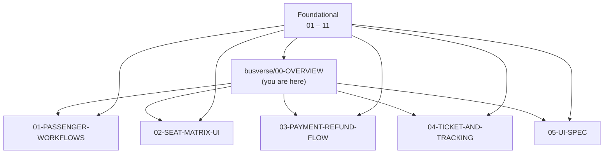

### 1.3 What this document does NOT cover

| Topic | Goes to |
|---|---|
| Detailed API contracts | `07-API-AND-REALTIME-CONTRACTS.md` |
| Workflow sequences | `08-WORKFLOWS.md` §4, `busverse/01`–`04` |
| Domain entities | `05-DOMAIN-MODEL.md` |
| Database schema | `06-DATABASE-SCHEMA.md` |
| Security controls | `09-SECURITY-AND-PLATFORM-RULES.md` |
| Tests | `10-TESTING-STRATEGY.md` |
| Full UI component specs | `busverse/05-UI-SPEC.md` |
| Full seat deck UX | `busverse/02-SEAT-MATRIX-UI.md` |
| Full payment flow | `busverse/03-PAYMENT-REFUND-FLOW.md` |
| Full ticket + tracking | `busverse/04-TICKET-AND-TRACKING.md` |

---

## 2. What BusVerse Is

### 2.1 Positioning

**Diagram: BusVerse position**
*BusVerse is the passenger-facing frontend. It sits between passengers and the API. Behind the API are BusCon (operator + admin) and the Operator App (driver). Passengers only ever see BusVerse.*

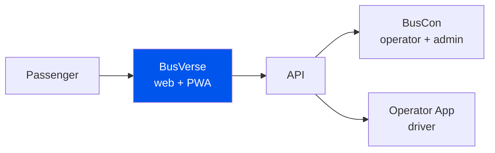

**Positioning statement:**

> BusVerse is the passenger-facing web application and Progressive Web App for booking intercity bus tickets in India. It is the demand side of a two-sided marketplace, connecting travelers with verified operators. BusVerse handles the full passenger journey — from search and seat selection through payment, ticketing, and live trip tracking.

### 2.2 What BusVerse is NOT

| Not | Why |
|---|---|
| A native mobile app | PWA only, for Phase 1 (Phase 2: native) |
| An operator panel | That's BusCon |
| A driver app | That's Operator App |
| A booking aggregator | Only lists operators on BusVerse |
| A payment processor | Uses Razorpay |
| A content site | Single-purpose product |

### 2.3 Where BusVerse sits in Phase 1

| Element | Value |
|---|---|
| Form factor | Next.js 15 web app + PWA |
| Deploy target | Vercel |
| Primary device | Mobile (360px+) |
| Secondary device | Desktop |
| Launch region | Delhi–Kanpur–Lucknow corridor |
| Users | Passenger (Guest + Registered) |

**Reference:** `01-PLAN-AND-SCOPE.md` §3 (surfaces), `03-SYSTEM-ARCHITECTURE.md` §5 (container).

---

## 3. Actor Context

**Diagram: BusVerse actors**
*Two passenger roles use BusVerse — Guest and Registered Passenger. No operator, driver, or admin uses BusVerse. Guests can browse; registered passengers get full functionality.*

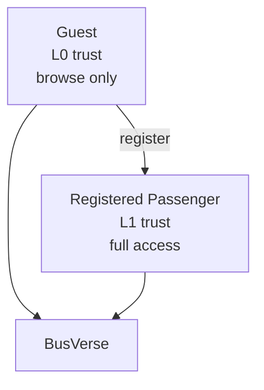

### 3.1 Passenger roles

| Role | Trust level | Access |
|---|---|---|
| **Guest** | L0 (public) | Browse, search, view schedules, see seat availability |
| **Registered Passenger** | L1 (own) | Book, pay, view tickets, track, cancel, view history, profile |

### 3.2 What each role can do in BusVerse

| Action | Guest | Registered |
|---|:---:|:---:|
| Search | ✅ | ✅ |
| View seat availability | ✅ | ✅ |
| Lock a seat | ❌ | ✅ |
| Create booking | ❌ | ✅ |
| Pay | ❌ | ✅ |
| View ticket | ❌ | ✅ |
| Track trip | ❌ | ✅ |
| Cancel booking | ❌ | ✅ |
| View booking history | ❌ | ✅ |
| Update profile | ❌ | ✅ |

**Reference:** `04-ACTORS-ROLES-PERMISSIONS.md` §3.2 (Passenger identity), §9.1 (BusVerse permission grid).

---

## 4. Surface Boundary

**Diagram: BusVerse route groups**
*BusVerse is one Next.js app with six route groups. Each group covers one feature area. Groups map to product docs.*

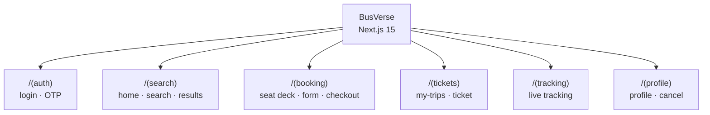

### 4.1 Surface boundary rules

| Rule | Enforcement |
|---|---|
| Only Passenger and Guest can use BusVerse | Auth middleware in Next.js |
| No operator or admin features | No routes exist |
| No driver features | No routes exist |
| API-only communication with backend | No direct DB access from browser |
| WebSocket for real-time updates | Polling only as fallback |

### 4.2 What BusVerse owns in the system

| Owns | Where specified |
|---|---|
| Passenger UI | This doc, `05-UI-SPEC` |
| Passenger session management | `04` §8, `07` §3 |
| PWA offline cache for tickets | `04` §4 |
| Live tracking UI | `04` §4, `07` §8 |

### 4.3 What BusVerse does NOT own

| Not owned | Owned by |
|---|---|
| Backend business logic | API (`03` §6) |
| Seat lock atomicity | API + Redis (`03` §10) |
| Payment processing | Razorpay (`03` §12, `09` §13) |
| QR ticket signing | API (`09` §7) |
| Operator permissions | BusCon (`04` §9) |

---

## 5. Feature Inventory

**Diagram: Feature inventory**
*48 functional requirements from `02` §6.3 grouped by nine feature areas. Each area maps to a workflow and primary doc.*

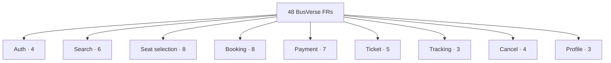

### 5.1 Feature area breakdown

| Area | FRs | Must | Should | Primary doc | Workflow |
|---|---:|---:|---:|---|---|
| Auth | 4 | 3 | 1 | `01-PASSENGER-WORKFLOWS` | WF-P-01 |
| Search | 6 | 4 | 2 | `01-PASSENGER-WORKFLOWS` | WF-P-02 |
| Seat selection | 8 | 6 | 2 | `02-SEAT-MATRIX-UI` | WF-P-03 |
| Booking | 8 | 7 | 1 | `01-PASSENGER-WORKFLOWS` | WF-P-04 |
| Payment | 7 | 6 | 1 | `03-PAYMENT-REFUND-FLOW` | WF-P-04 |
| Ticket | 5 | 4 | 1 | `04-TICKET-AND-TRACKING` | WF-P-05 |
| Tracking | 3 | 2 | 1 | `04-TICKET-AND-TRACKING` | WF-P-06 |
| Cancel | 4 | 3 | 1 | `03-PAYMENT-REFUND-FLOW` | WF-P-07 |
| Profile | 3 | 2 | 1 | `01-PASSENGER-WORKFLOWS` | — |
| **Total** | **48** | **37** | **11** | | |

### 5.2 FR ID ranges

| Range | Area |
|---|---|
| FR-BV-001 to FR-BV-004 | Auth |
| FR-BV-005 to FR-BV-010 | Search |
| FR-BV-011 to FR-BV-018 | Seat selection |
| FR-BV-019 to FR-BV-026 | Booking |
| FR-BV-027 to FR-BV-033 | Payment |
| FR-BV-034 to FR-BV-038 | Ticket |
| FR-BV-039 to FR-BV-041 | Tracking |
| FR-BV-042 to FR-BV-045 | Cancel |
| FR-BV-046 to FR-BV-048 | Profile |

**Reference:** Full FR list with acceptance criteria in `02-REQUIREMENTS.md` §6.3.

---

## 6. Workflow Map

**Diagram: Passenger workflow flow**
*Seven passenger workflows from `08` §4. They flow linearly from register → search → lock → book + pay → ticket → track. Cancel is a side branch. Each workflow covers a set of FRs.*

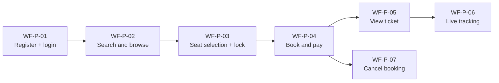

### 6.1 Workflow → doc map

| Workflow | Covers FRs | Primary doc | Detail location |
|---|---|---|---|
| WF-P-01 Register + login | FR-BV-001 to FR-BV-004 | `01-PASSENGER-WORKFLOWS` | `08` §4.1 |
| WF-P-02 Search and browse | FR-BV-005 to FR-BV-010 | `01-PASSENGER-WORKFLOWS` | `08` §4.2 |
| WF-P-03 Seat selection + lock | FR-BV-011 to FR-BV-018 | `02-SEAT-MATRIX-UI` | `08` §4.3 |
| WF-P-04 Book and pay | FR-BV-019 to FR-BV-033 | `03-PAYMENT-REFUND-FLOW` | `08` §4.4 |
| WF-P-05 View ticket | FR-BV-034 to FR-BV-038 | `04-TICKET-AND-TRACKING` | `08` §4.5 |
| WF-P-06 Live tracking | FR-BV-039 to FR-BV-041 | `04-TICKET-AND-TRACKING` | `08` §4.6 |
| WF-P-07 Cancel booking | FR-BV-042 to FR-BV-045 | `03-PAYMENT-REFUND-FLOW` | `08` §4.7 |

### 6.2 Negative workflows affecting BusVerse

| Workflow | When triggered | Detail |
|---|---|---|
| WF-N-01 Payment fails → retry | Razorpay returns failure | `08` §9.1 |
| WF-N-02 Lock expires during checkout | 5 min TTL exceeded | `08` §9.2 |

**Reference:** `08-WORKFLOWS.md` §4 (7 workflows), §9 (negative).

---

## 7. Screen Catalog

**Diagram: Screen flow**
*The 11 screens in BusVerse and how users move between them. Solid arrows = primary flow. Dashed = secondary actions. Screen names come from `08` §3.5.*

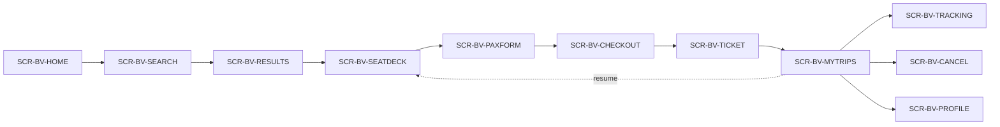

### 7.1 Screen catalog

| ID | Screen | Purpose | Primary workflow | Doc |
|---|---|---|---|---|
| SCR-BV-HOME | Home + login | Entry point, auth | WF-P-01 | `01-PASSENGER-WORKFLOWS` |
| SCR-BV-SEARCH | Search form | City + date input | WF-P-02 | `01-PASSENGER-WORKFLOWS` |
| SCR-BV-RESULTS | Results list | Schedule list with filters | WF-P-02 | `01-PASSENGER-WORKFLOWS` |
| SCR-BV-SEATDECK | 2D seat deck | Seat selection + lock | WF-P-03 | `02-SEAT-MATRIX-UI` |
| SCR-BV-PAXFORM | Passenger details | Per-passenger fields | WF-P-04 | `01-PASSENGER-WORKFLOWS` |
| SCR-BV-CHECKOUT | Razorpay checkout | Payment initiation | WF-P-04 | `03-PAYMENT-REFUND-FLOW` |
| SCR-BV-TICKET | QR ticket | Ticket display | WF-P-05 | `04-TICKET-AND-TRACKING` |
| SCR-BV-MYTRIPS | Trip list | Booking history | WF-P-05 | `01-PASSENGER-WORKFLOWS` |
| SCR-BV-TRACKING | Live map | Real-time bus tracking | WF-P-06 | `04-TICKET-AND-TRACKING` |
| SCR-BV-CANCEL | Cancel + refund preview | Cancel flow | WF-P-07 | `03-PAYMENT-REFUND-FLOW` |
| SCR-BV-PROFILE | Profile | User details | — | `01-PASSENGER-WORKFLOWS` |

### 7.2 Screen states

Each screen has multiple states to design for:

| Screen | States |
|---|---|
| SCR-BV-HOME | Logged out · logged in · OTP sent · OTP verified |
| SCR-BV-SEARCH | Empty · typed · autocomplete open · validation error |
| SCR-BV-RESULTS | Loading · results · empty · error |
| SCR-BV-SEATDECK | Loading · loaded · seat selected · lock acquired · lock expiring · lock expired |
| SCR-BV-PAXFORM | Empty · filled · validation error |
| SCR-BV-CHECKOUT | Razorpay loading · Razorpay open · payment success · payment failure |
| SCR-BV-TICKET | QR rendering · QR scanned · offline view |
| SCR-BV-MYTRIPS | Loading · list · empty · error |
| SCR-BV-TRACKING | Loading · map · connection lost · stale position |
| SCR-BV-CANCEL | Preview · confirmation · success · error |
| SCR-BV-PROFILE | Loaded · editing |

**Reference:** Detailed wireframes and states in `busverse/05-UI-SPEC.md`.

---

## 8. Brand Identity — Royal Blue

**Diagram: Brand identity**
*BusVerse brand identity. Royal Blue as primary color. Motion assets from the icon pack. All UI inherits from `@busverse/design-tokens`.*

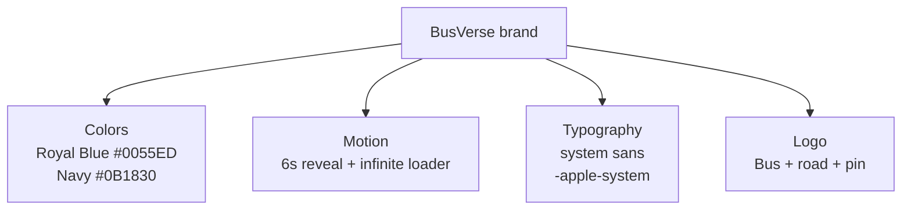

### 8.1 Brand tokens

| Token | Light mode | Dark mode |
|---|---|---|
| `--brand-primary` | `#0055ED` | `#3B82F6` |
| `--brand-navy` | `#0B1830` | `#F1F5F9` |
| `--bg` | `#F3F6FA` | `#060A12` |
| `--surface` | `#FFFFFF` | `#0C121E` |
| `--surface-elevated` | `#FFFFFF` | `#111A2B` |
| `--border` | `#E2E8F0` | `#1A2638` |
| `--border-focus` | `#0055ED` | `#2B75FF` |
| `--text-primary` | `#0A1120` | `#F8FAFC` |
| `--text-secondary` | `#5A6A85` | `#8294AD` |
| `--btn-bg` | `#F1F5F9` | `#141F33` |
| `--btn-text` | `#0F172A` | `#F8FAFC` |

### 8.2 Motion assets

| Asset | Purpose | Duration |
|---|---|---|
| Logo reveal | Landing page hero | 6 seconds (looping) |
| Infinite loader | Loading state | Infinite |

### 8.3 Brand references

| Reference | Location |
|---|---|
| Canonical icon pack | `docs/assets/brand/busverse-icon-pack.html` |
| Design tokens package | `packages/design-tokens/src/busverse.css` |
| Brand SVG package | `packages/brand-svg/src/busverse/` |
| Full UI spec | `busverse/05-UI-SPEC.md` |

**Rule:** All BusVerse UI components use tokens from `@busverse/design-tokens`. No hardcoded colors, no hardcoded spacing.

---

## 9. Journey from Search to Boarding

**Diagram: Passenger journey**
*The full passenger journey from opening the app to boarding the bus. This is the narrative summary of the 7 workflows. Maps directly to the 9 demo steps from `11` §10.*

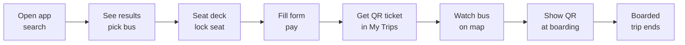

### 9.1 Journey step → workflow → demo mapping

| # | Step | Screen | Workflow | Demo step (`11` §10) |
|:---:|---|---|---|---|
| 1 | Open app, search Delhi → Lucknow | SCR-BV-SEARCH | WF-P-02 | Demo 1 |
| 2 | See results, pick 14:00 departure | SCR-BV-RESULTS | WF-P-02 | Demo 1 |
| 3 | View seat deck, tap seat A1 | SCR-BV-SEATDECK | WF-P-03 | Demo 2 |
| 4 | Fill passenger form, tap Pay | SCR-BV-PAXFORM → CHECKOUT | WF-P-04 | Demo 3 |
| 5 | View QR ticket in My Trips | SCR-BV-TICKET | WF-P-05 | Demo 4 |
| 6 | Track bus on map | SCR-BV-TRACKING | WF-P-06 | Demo 7 |
| 7 | Show QR at boarding | (ticket display) | (driver-side WF-D-04) | Demo 8 |
| 8 | Passenger sees "Boarded" | SCR-BV-MYTRIPS | — | Demo 8 |

### 9.2 Journey timing targets

| Step | Target duration | Notes |
|---|---|---|
| Search | ≤ 30 sec | Fast if user knows route |
| Results → seat lock | ≤ 60 sec | Includes comparison |
| Form + pay | ≤ 120 sec | Includes Razorpay checkout |
| Ticket view | ≤ 5 sec | Immediate after payment |
| Total booking flow | ≤ 5 min | End-to-end from search to ticket |

**Reference:** Full journey with narration in `11-DEPLOYMENT-AND-DEMO.md` §10.

---

## 10. Technical Stack

**Diagram: BusVerse stack**
*BusVerse is a Next.js 15 app. Consumes the shared API via HTTPS + WebSocket. Uses React Query for server state. PWA-capable. Deployed to Vercel.*

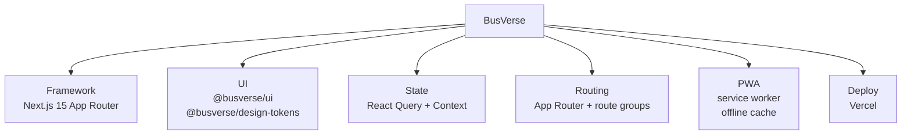

### 10.1 Stack details

| Layer | Tech | Reason (ADR) |
|---|---|---|
| Framework | Next.js 15 App Router | ADR-003 — SSR, PWA, Vercel |
| UI library | `@busverse/ui` + `@busverse/design-tokens` | Shared with BusCon |
| State | React Query + Context | `03` §7.1 — no Redux |
| Styling | Tailwind v4 | Reads design tokens |
| Icons | `@busverse/brand-svg` | Shared brand assets |
| PWA | Next.js built-in | Offline ticket view |
| Deploy | Vercel | ADR-013 |

### 10.2 Frontend architecture

| Concern | Implementation |
|---|---|
| Server state | React Query cache (5s staleTime) |
| Auth state | Context provider (JWT + user) |
| UI state | `useState` / `useReducer` (component-scoped) |
| WebSocket | Custom hook wrapping Socket.io client |
| PWA offline | Service worker + IndexedDB for ticket cache |
| API client | Typed fetch wrapper + React Query |

**Reference:** `03-SYSTEM-ARCHITECTURE.md` §5 (container), §7 (components), §21 (ADRs).

---

## 11. External Dependencies

**Diagram: External dependencies**
*BusVerse talks directly to the API and to OSM tiles. It opens Razorpay checkout directly (via redirect) but that's a one-time navigation, not a data dependency. All other external services are proxied via the API.*

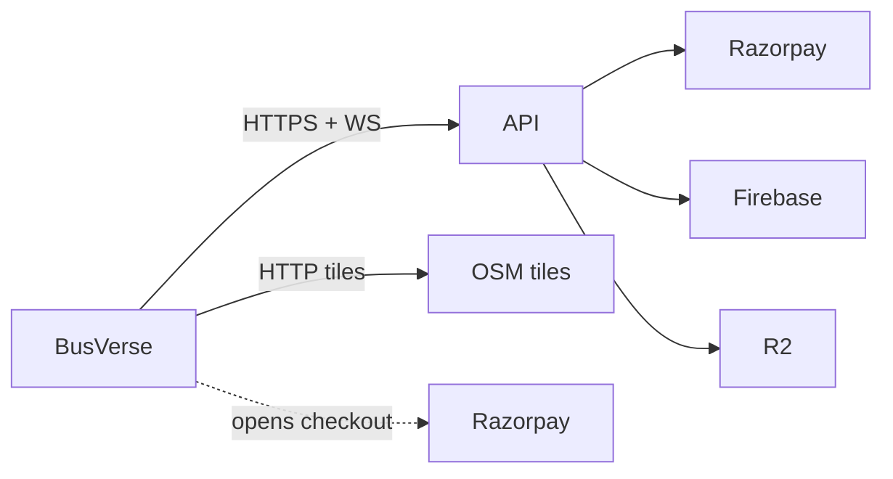

### 11.1 Dependency list

| Dependency | Purpose | Failure mode |
|---|---|---|
| API | All data + auth | Full outage |
| OSM tiles | Map rendering | Static fallback |
| Razorpay checkout | Payment UI | Error message |
| `@busverse/design-tokens` | Brand tokens | Build failure |

### 11.2 Fallback behavior

| Dependency | If unavailable |
|---|---|
| API | Show "service unavailable" — full outage |
| OSM tiles | Static fallback image with markers |
| Razorpay | Show "payments unavailable, try again" |
| WebSocket | Fall back to HTTP polling |

**Reference:** `02-REQUIREMENTS.md` §10.

---

## 12. Performance Targets

**Diagram: Performance targets**
*Six performance targets applied to BusVerse screens. Search is the most latency-sensitive (p95 < 200ms). Initial page load is 2s.*

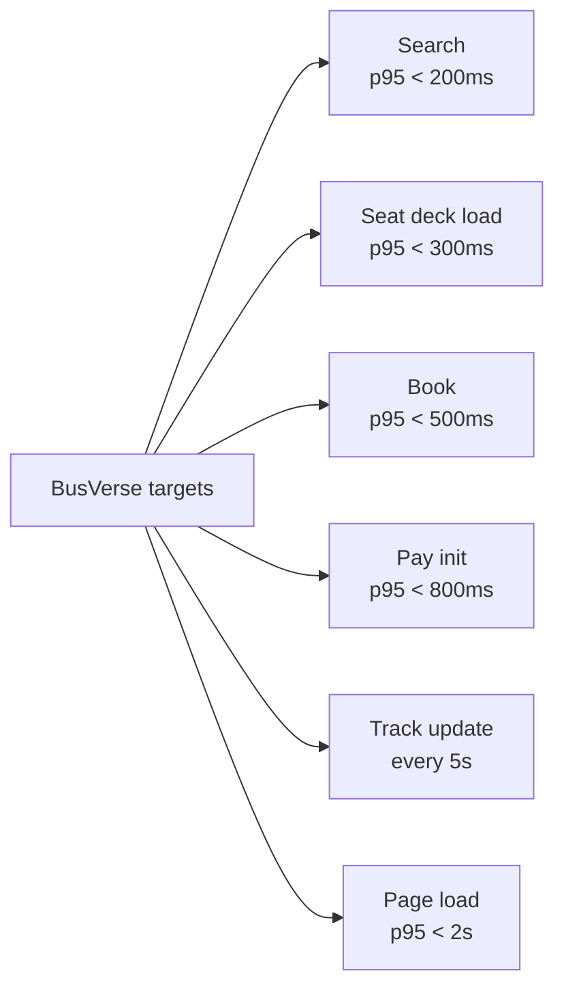

### 12.1 Target table

| Target | Value | Source | Test |
|---|---|---|---|
| Search response | p95 < 200 ms | `02` §8.1 | `perf_search` |
| Seat deck load | p95 < 300 ms | Estimated | `contract_availability` |
| Booking creation | p95 < 500 ms | `02` §8.1 | `perf_booking` |
| Payment initiation | p95 < 800 ms | `02` §8.1 | `contract_payments` |
| GPS position update | Every 5 sec | `07` §8.6 | `ws_security_*` |
| Initial page load (SSR) | p95 < 2 sec | Estimated | Lighthouse |

### 12.2 What this means in practice

| Scenario | Budget |
|---|---|
| User taps search | 200ms → results visible |
| User picks seat | 300ms → seat deck renders |
| User pays | 800ms → Razorpay checkout opens |
| User books | 500ms → booking confirmed state |

**Reference:** `02-REQUIREMENTS.md` §8.1.

---

## 13. Scope — In vs Out

**Diagram: Scope boundary**
*Phase 1 BusVerse includes the full booking lifecycle. Phase 2 adds growth features. Non-goals are permanent.*

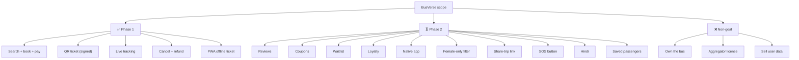

### 13.1 In scope (Phase 1)

| Feature | FR |
|---|---|
| Search schedules | FR-BV-005 |
| 2D seat deck | FR-BV-011 |
| Seat lock (5 min) | FR-BV-013 |
| Booking | FR-BV-019 |
| Razorpay payment | FR-BV-027 |
| Signed QR ticket | FR-BV-034 |
| Live tracking | FR-BV-039 |
| Cancel + refund | FR-BV-043 |
| PWA offline ticket | FR-BV-035 |

### 13.2 Out of scope (Phase 2)

| Feature | Reason |
|---|---|
| Reviews and ratings | Not demo-critical |
| Coupons | Growth feature |
| Waitlist | Growth feature |
| Loyalty | Growth feature |
| Native app | Phase 2 launch |
| Female-only filter | Phase 2 |
| Share-trip link | Phase 2 |
| SOS button | Phase 2 |
| Hindi language | Phase 2 |
| Saved passengers | Phase 2 |

### 13.3 Non-goals (never)

| Never built | Why |
|---|---|
| Owning buses | Marketplace model |
| Aggregator license | Not in scope |
| Selling user data | Immutable rule |
| Raw card storage | Immutable rule |

**Full list:** `01-PLAN-AND-SCOPE.md` §12, `02-REQUIREMENTS.md` §19.

---

## 14. Six-Doc Navigation

**Diagram: Six-doc navigation**
*How the six BusVerse docs relate. This overview (00) is the entry point. Five detail docs each cover one area. Every detail doc references foundational docs directly — this overview is not a bottleneck.*

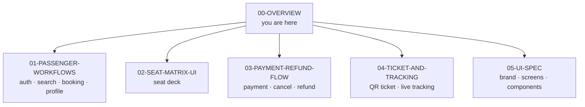

### 14.1 Doc navigation table

| Doc | Answers | When to read |
|---|---|---|
| `00-OVERVIEW` (this) | "What is BusVerse?" | First |
| `01-PASSENGER-WORKFLOWS` | "How does the passenger flow work?" | For auth, search, book, profile |
| `02-SEAT-MATRIX-UI` | "How does the seat deck work?" | For seat selection UX |
| `03-PAYMENT-REFUND-FLOW` | "How do payments and refunds work?" | For money path |
| `04-TICKET-AND-TRACKING` | "How do tickets and tracking work?" | For QR + live tracking |
| `05-UI-SPEC` | "What do screens look like?" | For visual design |

### 14.2 Reading order for new contributors

1. **00-OVERVIEW** (this doc) — orientation
2. **05-UI-SPEC** — see what it looks like
3. **01-PASSENGER-WORKFLOWS** — understand the flow
4. **02-SEAT-MATRIX-UI** — deepest UI component
5. **03-PAYMENT-REFUND-FLOW** — money path
6. **04-TICKET-AND-TRACKING** — post-booking

### 14.3 What each detail doc owns

| Doc | Single source of truth for |
|---|---|
| `01-PASSENGER-WORKFLOWS` | Auth, search, booking, profile flows |
| `02-SEAT-MATRIX-UI` | Seat deck rendering, seat states, lock countdown |
| `03-PAYMENT-REFUND-FLOW` | Razorpay integration, refund policy, cancellation |
| `04-TICKET-AND-TRACKING` | QR ticket display, live tracking, PWA offline |
| `05-UI-SPEC` | Design system, all screens, all components |

---

## 15. Open Questions

| # | Question | Owner | Default |
|:---:|---|---|---|
| 1 | Should PWA cache the full ticket for offline use? | Shaghaf | Yes (FR-BV-035) |
| 2 | Hindi localization timing? | Shaghaf | Phase 2 |
| 3 | Native app vs PWA in Phase 2? | Shaghaf | Native (post-viva) |
| 4 | Saved passengers in Phase 1? | Shaghaf | No (Phase 2) |
| 5 | Reviews after trip? | Shaghaf | No (Phase 2) |
| 6 | Female-only filter? | Shaghaf | No (Phase 2) |
| 7 | Share trip link? | Shaghaf | No (Phase 2) |
| 8 | SOS button? | Shaghaf | No (Phase 2) |
| 9 | Multiple passengers per booking? | Shaghaf | Yes (Phase 1) |
| 10 | Coupon codes? | Shaghaf | No (Phase 2) |

---

## 16. Checklist Against Master List

| Item | Included? | Section |
|---|:---:|---|
| Purpose and scope | ✅ | §1 |
| Doc hierarchy | ✅ | §1.2 |
| Positioning | ✅ | §2 |
| What BusVerse is NOT | ✅ | §2.2 |
| Phase 1 placement | ✅ | §2.3 |
| Actors | ✅ | §3 |
| Role comparison | ✅ | §3.2 |
| Surface boundary | ✅ | §4 |
| Route groups | ✅ | §4.1 |
| Feature inventory | ✅ | §5 |
| 48 FR breakdown | ✅ | §5.1 |
| FR ID ranges | ✅ | §5.2 |
| Workflow map | ✅ | §6 |
| Workflow → doc mapping | ✅ | §6.1 |
| Negative workflows | ✅ | §6.2 |
| Screen catalog | ✅ | §7 |
| Screen flow | ✅ | §7.1 |
| Screen states | ✅ | §7.2 |
| Brand identity | ✅ | §8 |
| Brand tokens | ✅ | §8.1 |
| Motion assets | ✅ | §8.2 |
| Journey map | ✅ | §9 |
| Journey → demo mapping | ✅ | §9.1 |
| Journey timing | ✅ | §9.2 |
| Stack summary | ✅ | §10 |
| Frontend architecture | ✅ | §10.2 |
| External dependencies | ✅ | §11 |
| Fallback behavior | ✅ | §11.2 |
| Performance targets | ✅ | §12 |
| Scope in/out | ✅ | §13 |
| Six-doc navigation | ✅ | §14 |
| Reading order | ✅ | §14.2 |
| Doc ownership | ✅ | §14.3 |
| Open questions (10) | ✅ | §15 |

**All items covered. 14 Mermaid diagrams. Every diagram described.**

---

## 17. Summary

**BusVerse is the passenger-facing web app and PWA for booking intercity bus tickets in India.** It is one of three codebases in the BusVerse + BusCon system, deployed on Vercel, built with Next.js 15, and serving the demand side of a two-sided marketplace. Only two actor roles use BusVerse — Guest (browse, search, view availability) and Registered Passenger (full access — book, pay, track, cancel, history, profile). Operators, drivers, and admins use BusCon or the Operator App instead; BusVerse has no routes for them. The surface spans six Next.js route groups: `/(auth)`, `/(search)`, `/(booking)`, `/(tickets)`, `/(tracking)`, `/(profile)`. It implements 48 functional requirements (37 Must-Have, 11 Should-Have) across nine feature areas — auth (4), search (6), seat selection (8), booking (8), payment (7), ticket (5), tracking (3), cancel (4), profile (3). These 48 FRs are orchestrated by seven workflows (WF-P-01 through WF-P-07) — register + login, search + browse, seat selection + lock, book + pay, view ticket, live tracking, cancel booking — each with its own primary detail doc. The 11 screens (SCR-BV-HOME through SCR-BV-PROFILE) each have multiple states to design for — loading, loaded, error, plus feature-specific states like lock countdown, seat selected, QR rendering, connection lost. Brand identity uses Royal Blue (`#0055ED` light, `#3B82F6` dark) with 11 design tokens shared across all BusVerse UI via `@busverse/design-tokens`. The passenger journey runs 8 steps — open app, search, seat deck, fill form + pay, get ticket, watch map, show QR at boarding, boarded — with a total booking flow target of ≤5 minutes and each step mapped to a workflow and to a demo step in `11-DEPLOYMENT-AND-DEMO.md` §10. Technical stack is Next.js 15 App Router, React Query for server state, Context for auth, Tailwind v4 for styling, `@busverse/ui` + `@busverse/design-tokens` + `@busverse/brand-svg` for shared components, PWA with service worker for offline ticket cache. BusVerse talks directly to the API (HTTPS REST + WebSocket) and OSM tiles (for map rendering); it opens Razorpay checkout directly but all payment state flows back through the API. Six performance targets apply — search p95 < 200ms, seat deck p95 < 300ms, booking p95 < 500ms, payment init p95 < 800ms, GPS update every 5s, initial page load p95 < 2s. Scope is strict — Phase 1 ships the full booking lifecycle (search, book, pay, ticket, track, cancel, PWA offline); Phase 2 adds reviews, coupons, waitlist, loyalty, native app, female-only filter, share-trip link, SOS button, Hindi, saved passengers; non-goals (owning buses, aggregator license, selling user data, raw card storage) are permanent. This overview is the entry point to a six-doc series — `00-OVERVIEW` (this), `01-PASSENGER-WORKFLOWS` (auth, search, booking, profile), `02-SEAT-MATRIX-UI` (seat deck), `03-PAYMENT-REFUND-FLOW` (Razorpay + cancellation), `04-TICKET-AND-TRACKING` (QR + live tracking), `05-UI-SPEC` (design system + wireframes). Recommended reading order for new contributors: 00 → 05 → 01 → 02 → 03 → 04. Ten open questions remain, all with Phase-2 defaults.**

---

**End of Document `busverse/00-OVERVIEW.md` v1.0.**