# `busverse/01-PASSENGER-WORKFLOWS.md`

**Document:** `busverse/01-PASSENGER-WORKFLOWS.md`
**Project:** BusVerse + BusCon
**Version:** 1.0
**Status:** Locked — Product Document
**Owner:** Shaghaf
**Guide:** Mr. Mohit Srivastav
**Purpose:** The detailed passenger-side workflow specification for BusVerse. Covers authentication, search, booking form, and profile — the four workflows that live outside the seat deck, payment execution, QR ticket, and live tracking. Defines every screen, every component, every state, every API call, every error case. Every UI implementation and every frontend test for these four workflows traces back to this document.

> **Derives from:** `busverse/00-OVERVIEW.md` (navigation), `02-REQUIREMENTS.md` §6.3 (18 FRs), `03-SYSTEM-ARCHITECTURE.md` §7 (frontend architecture), `04-ACTORS-ROLES-PERMISSIONS.md` §3.2 (Passenger), `07-API-AND-REALTIME-CONTRACTS.md` §3, §4 (auth + passenger endpoints), `08-WORKFLOWS.md` §4.1, §4.2, §4.4 (booking half), `09-SECURITY-AND-PLATFORM-RULES.md` §4 (auth), §12 (transport), `10-TESTING-STRATEGY.md` §7 (contract tests).
>
> **Referenced by:** `busverse/02-SEAT-MATRIX-UI.md`, `busverse/03-PAYMENT-REFUND-FLOW.md`, `busverse/05-UI-SPEC.md`, `report/14-MODULE_DESCRIPTION.md`, `report/15-SCREENSHOTS_UI.md`, `viva/03-DEMO_SCRIPT.md`.

---

## 1. Purpose and Scope

### 1.1 What this document owns

| Owns here | Referenced from upstream |
|---|---|
| WF-P-01 auth flow sequence | `08` §4.1 |
| WF-P-02 search flow sequence | `08` §4.2 |
| WF-P-04 booking-half sequence | `08` §4.4 (partial) |
| Profile flow (no WF in `08`) | `02` §6.3 FR-BV-046 to 048 |
| Component structure per screen | — |
| State management patterns | `03` §7.1 |
| React Query key structure | — |
| Form handling per screen | — |
| Error handling patterns | `07` §9 |
| Accessibility requirements | `02` §8.4 |
| Session storage + refresh | `04` §8 |
| Search URL state | — |

### 1.2 Document hierarchy

**Diagram: Document hierarchy**
*This doc sits inside the BusVerse folder. It derives from the overview, foundational docs, and API contract. It feeds the UI spec and report chapters. Other BusVerse detail docs (seat deck, payment, ticket) are siblings — this doc hands off to them at defined points.*

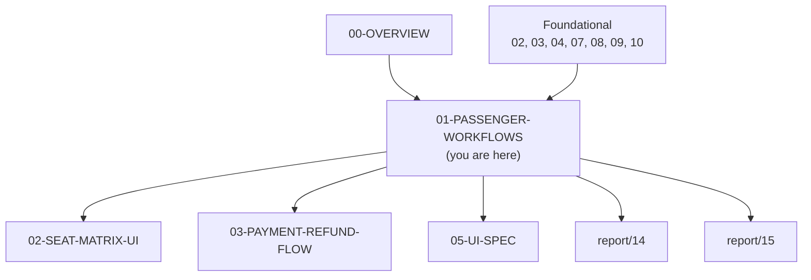

### 1.3 What this document does NOT cover

| Topic | Goes to |
|---|---|
| Seat deck UI and interactions | `busverse/02-SEAT-MATRIX-UI.md` |
| Payment execution (Razorpay integration) | `busverse/03-PAYMENT-REFUND-FLOW.md` |
| Cancel and refund flow | `busverse/03-PAYMENT-REFUND-FLOW.md` |
| QR ticket display | `busverse/04-TICKET-AND-TRACKING.md` |
| Live tracking UI | `busverse/04-TICKET-AND-TRACKING.md` |
| Full design tokens | `packages/design-tokens/src/busverse.css` |
| Full wireframes | `busverse/05-UI-SPEC.md` |
| API contracts | `07-API-AND-REALTIME-CONTRACTS.md` |
| Backend implementation | `03-SYSTEM-ARCHITECTURE.md` §6 |

### 1.4 Scope of this document

**Five flows** (with defined handoffs):

| # | Flow | FRs | Screens | Handoff |
|:---:|---|---|---|---|
| 1 | Auth (WF-P-01) | FR-BV-001 to 004 | SCR-BV-HOME | → Search |
| 2 | Search (WF-P-02) | FR-BV-005 to 010 | SCR-BV-SEARCH, SCR-BV-RESULTS | → Seat deck (`02`) |
| 3 | Booking form (WF-P-04a) | FR-BV-019 to 026 | SCR-BV-PAXFORM | → Payment (`03`) |
| 4 | Payment handoff (WF-P-04b) | FR-BV-027 to 033 | SCR-BV-CHECKOUT | → Ticket (`04`) |
| 5 | Profile | FR-BV-046 to 048 | SCR-BV-PROFILE | — |

**Rule:** Every handoff names the doc where the next step lives. No handoff is left implicit.

---

## 2. Workflow Map

**Diagram: Workflow coverage**
*Five flows in this doc. Solid arrows = primary navigation. Dashed = secondary. Each flow has a defined boundary — where it starts, where it hands off.*

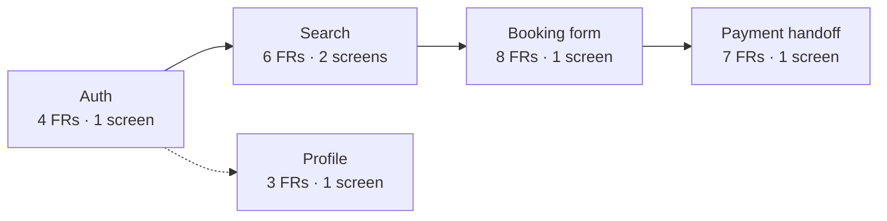

### 2.1 Coverage table

| Flow | FRs | Screens | Entry | Exit |
|---|---|---|---|---|
| Auth | 4 | SCR-BV-HOME | App open (guest) | Home (logged in) |
| Search | 6 | SCR-BV-SEARCH, SCR-BV-RESULTS | Home | Seat deck (`02`) |
| Booking form | 8 | SCR-BV-PAXFORM | Seat deck (lock acquired) | Payment (`03`) |
| Payment handoff | 7 | SCR-BV-CHECKOUT | Booking form | Ticket (`04`) |
| Profile | 3 | SCR-BV-PROFILE | My trips or Home | Home |

### 2.2 FR mapping per flow

| Flow | FR-BV IDs |
|---|---|
| Auth | 001, 002, 003, 004 |
| Search | 005, 006, 007, 008, 009, 010 |
| Booking form | 019, 020, 021, 022, 023, 024, 025, 026 |
| Payment handoff | 027, 028, 029, 030, 031, 032, 033 |
| Profile | 046, 047, 048 |

**Reference:** Full FR text with acceptance criteria in `02-REQUIREMENTS.md` §6.3.

---

## 3. Auth Flow (WF-P-01)

### 3.1 Flow sequence

**Diagram: Auth flow sequence**
*Passenger enters phone → OTP sent via Firebase → user enters OTP → server verifies → access + refresh tokens issued → session stored → redirect to home. Six-digit OTP auto-advances. Paste fills all 6 digits. Resend timer 30 seconds.*

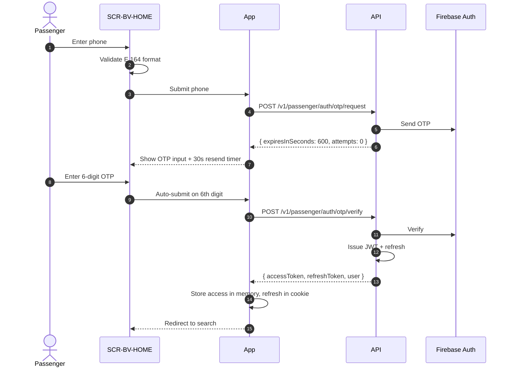

### 3.2 Auth state machine

**Diagram: Auth state machine**
*Auth flow has five states. Each state has defined transitions and error exits. User can back out at any point.*

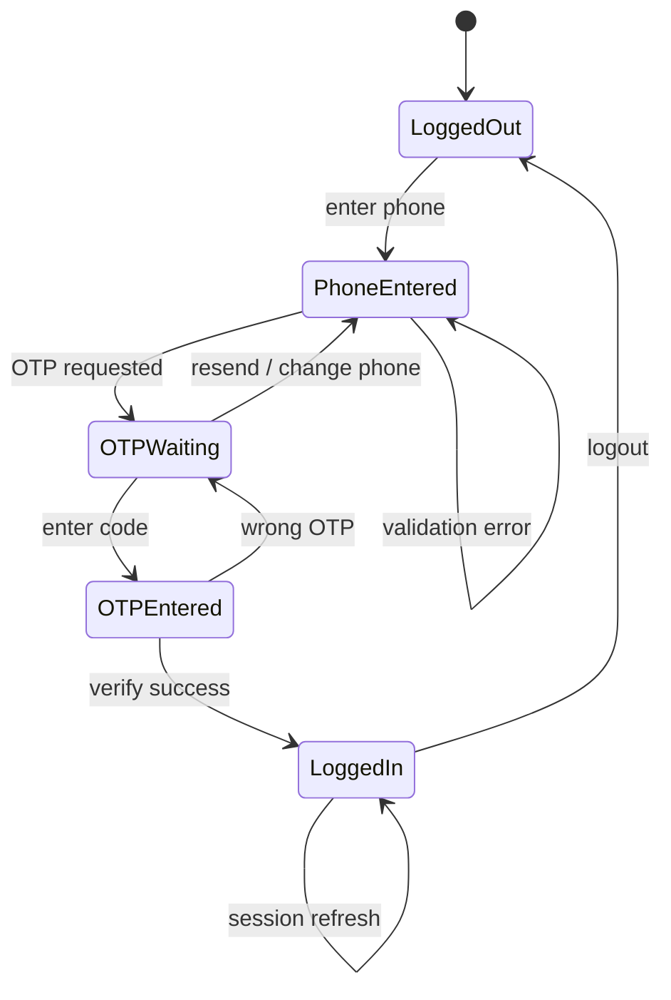

**State details:**

| State | UI | Available actions |
|---|---|---|
| LoggedOut | Phone input | Enter phone, browse search |
| PhoneEntered | Phone input + validation | Submit phone, edit phone |
| OTPWaiting | OTP input + resend button | Enter OTP, resend, back |
| OTPEntered | Loading state | — |
| LoggedIn | Home / search | Full access |

### 3.3 Screen — SCR-BV-HOME

**Screen purpose:** Entry point for BusVerse. Doubles as auth and home landing.

**Layout:**

| Region | Content (logged out) | Content (logged in) |
|---|---|---|
| **Top bar** | BusVerse logo | BusVerse logo · profile avatar |
| **Hero** | "Every bus. One platform." | "Search buses" |
| **Auth / Search** | Phone input + Continue button | Search form (from/from/to/date) |
| **Below** | Trust signals (verified operators, live tracking) | Popular routes (Phase 2) |
| **Bottom** | Login link | My trips link |

### 3.4 Auth components

**Diagram: Auth component structure**
*Home screen decomposed into components. AuthForm is the top-level auth component. It renders PhoneInput or OTPInput depending on state. Both share primitives from `@busverse/ui`.*

```mermaid
flowchart TB
    HOME["<HomeScreen>"]
    HOME --> HERO["<Hero>"]
    HOME --> AUTH["<AuthForm>"]

    AUTH --> PHONE["<PhoneInput><br/>state: logged_out"]
    AUTH --> OTP["<OTPInput><br/>state: otp_waiting"]
    AUTH --> SUCCESS["<RedirectToSearch><br/>state: logged_in"]

    OTP --> RESEND["<ResendTimer>"]
    OTP --> EDIT["<EditPhoneButton>"]

    PHONE --> UI["Shared primitives<br/><Button> · <Input> · <FormError>"]
    OTP --> UI
```

**Component contracts:**

| Component | Props | Emits |
|---|---|---|
| `<AuthForm>` | `initialPhone?` | `onLoginSuccess(user)` |
| `<PhoneInput>` | `value`, `onChange`, `onSubmit`, `isLoading`, `error` | `onSubmit(phone)` |
| `<OTPInput>` | `phone`, `onVerify`, `onResend`, `isLoading`, `error`, `resendSeconds` | `onVerify(otp)`, `onResend()` |
| `<ResendTimer>` | `seconds` | `onExpire` |

### 3.5 Auth API calls

| Endpoint | When | Request | Response |
|---|---|---|---|
| `POST /v1/passenger/auth/otp/request` | Phone submitted | `{ phone, intent }` | `{ expiresInSeconds: 600 }` |
| `POST /v1/passenger/auth/otp/verify` | OTP submitted | `{ phone, otp }` | `{ accessToken, refreshToken, user }` |
| `POST /v1/passenger/auth/refresh` | Access token expired | `{}` (cookie sent) | `{ accessToken, refreshToken }` |
| `POST /v1/passenger/auth/logout` | Logout clicked | `{}` | `204 No Content` |

**Reference:** Full contracts in `07-API-AND-REALTIME-CONTRACTS.md` §3.3.

### 3.6 Validation rules

**Phone:**

| Rule | Regex / check | Error message |
|---|---|---|
| E.164 format | `/^\+\d{10,15}$/` | "Enter a valid phone number" |
| Indian number | `/^\+91[6-9]\d{9}$/` | "Enter a valid Indian mobile" |
| Required | Not empty | "Phone number required" |

**OTP:**

| Rule | Check | Error message |
|---|---|---|
| Length | 6 digits | "OTP must be 6 digits" |
| Numeric | `/^\d{6}$/` | "OTP must be numeric" |
| Required | Not empty | "OTP required" |

### 3.7 Session storage

**Diagram: Session storage**
*Access token in memory (React state). Refresh token in httpOnly secure cookie. On page reload, silently refresh to get new access token. Logout clears both.*

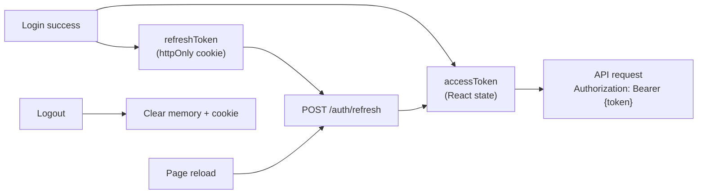

**Storage rules:**

| Token | Storage | Why |
|---|---|---|
| Access token | React memory (never localStorage) | XSS-resistant |
| Refresh token | httpOnly, Secure, SameSite=Lax cookie | XSS-resistant, CSRF-resistant |
| User object | React memory | Refetched on reload |

**Rule:** Never store JWT in `localStorage` or `sessionStorage`. Both are XSS-vulnerable.

### 3.8 Session refresh

**Diagram: Session refresh flow**
*On 401 response, client triggers silent refresh. If refresh succeeds, retries original request. If refresh fails, redirects to login with return URL. Single-flight lock prevents multiple simultaneous refreshes.*

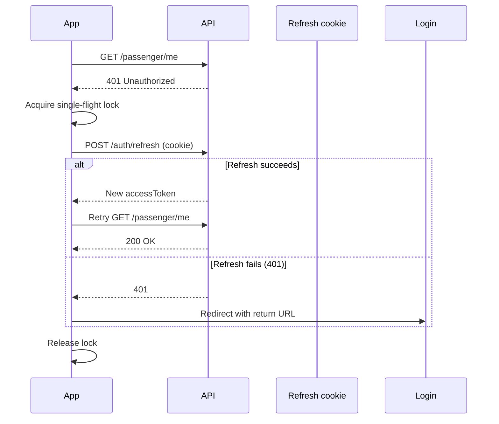

**Refresh rules:**

| Rule | Detail |
|---|---|
| Trigger | Any 401 response |
| Single-flight | Only one refresh in flight at a time |
| Retry | Original request retried after refresh |
| Return URL | Save current URL, restore after login |
| Fail behavior | Clear session, redirect to home |

### 3.9 Error states

| Error | UI | Recovery |
|---|---|---|
| `INVALID_OTP` (400) | "Incorrect code. {attempts}/5" | Re-enter OTP |
| `OTP_EXPIRED` (400) | "Code expired. Request new code." | Tap resend |
| `OTP_ATTEMPTS_EXCEEDED` (429) | "Too many attempts. Try again in 15 min." | Wait |
| `RATE_LIMITED` (429) | "Please wait {seconds}s before retrying." | Wait |
| Network error | Toast: "Network unavailable. Retry?" | Tap retry |
| 500 | Toast: "Something went wrong. Retry." | Tap retry |

### 3.10 Edge cases

| Scenario | Behavior |
|---|---|
| User closes tab during OTP | Session restored on reopen (refresh token) |
| User switches device | Old sessions remain (multi-device allowed) |
| User logs in on second tab | New session issued; both tabs work |
| Session expires during form fill | Return URL preserved; redirected to login; session restored after |

---

## 4. Search Flow (WF-P-02)

### 4.1 Flow sequence

**Diagram: Search flow sequence**
*Passenger types origin → debounced autocomplete → selects from suggestions → destination → date picker → search. Results rendered on separate page with URL state. Filters and sort update URL.*

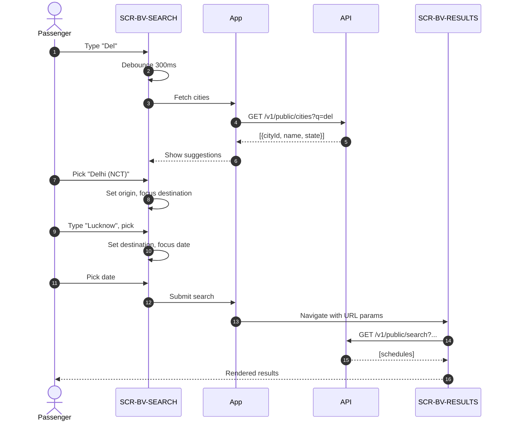

### 4.2 Search state flow

**Diagram: Search state flow**
*Search state is URL-first. Every filter, sort, or search change updates the URL. Browser back/forward works. Refresh preserves results.*

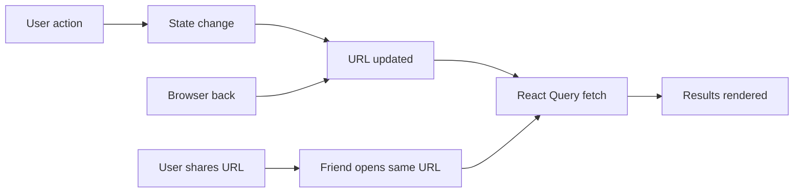

**URL state structure:**

```
/busverse/search
  ?from=cty_delhi
  &to=cty_lucknow
  &date=2026-10-24
  &sort=departure_time
  &busType=AC_SEATER,SLEEPER
  &page=1
```

### 4.3 Screen — SCR-BV-SEARCH

**Layout:**

| Region | Content |
|---|---|
| **Top bar** | Logo · profile avatar (if logged in) |
| **Search card** | Origin · destination · date · Search button |
| **Recent searches** | Last 3 searches (localStorage) |
| **Popular routes** | Phase 2 |

**Search card components:**

| Component | Behavior |
|---|---|
| `<CityAutocomplete>` | Origin field, debounced search, keyboard nav |
| `<CityAutocomplete>` | Destination field, disabled if origin not set |
| `<DatePicker>` | Default today, min today, max +90 days |
| `<SearchButton>` | Disabled until all 3 filled |

### 4.4 Screen — SCR-BV-RESULTS

**Layout:**

| Region | Content |
|---|---|
| **Top bar** | Logo · profile avatar · edit search |
| **Filter bar** | Sort by time/price/duration · filters |
| **Results list** | Schedule cards |
| **Empty state** | "No buses found" + try different date |
| **Loading state** | Skeleton cards |

**Schedule card contents:**

| Row | Contents |
|---|---|
| 1 | Operator name · bus type badge |
| 2 | Departure time → Arrival time · duration |
| 3 | Origin stand · destination stand |
| 4 | Fare (from `{amountPaise}`) · Seats available |
| 5 | Select button |

### 4.5 Search components

**Diagram: Search component structure**
*Search and Results pages decomposed. Search page uses CityAutocomplete + DatePicker. Results page uses ScheduleCard, FilterBar, and sort controls.*

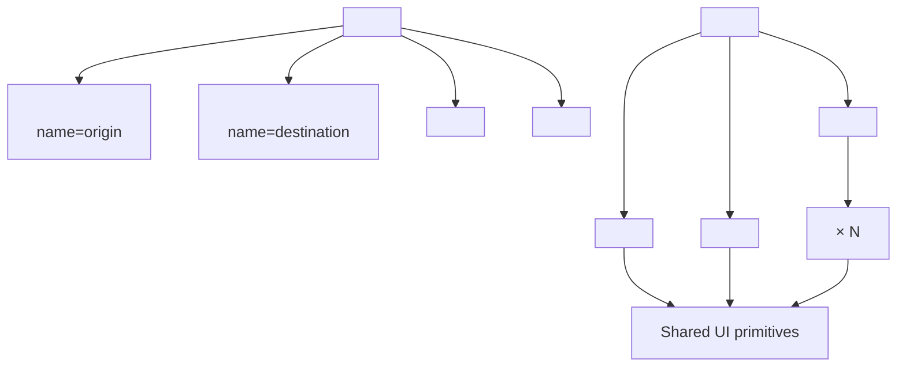

### 4.6 City autocomplete

**Diagram: Autocomplete behavior**
*Typing triggers debounced API call. Suggestions shown in dropdown. Keyboard navigable. Selection fills input and moves focus to next field.*

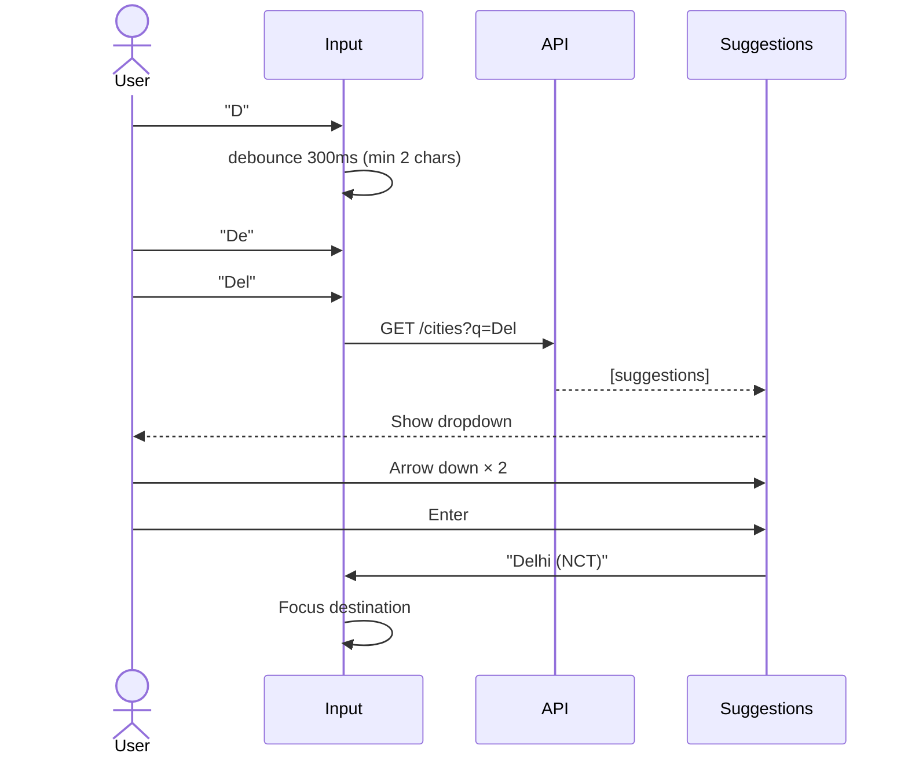

**Autocomplete rules:**

| Rule | Detail |
|---|---|
| Trigger | After 300ms pause, min 2 chars |
| Abort | New keystroke aborts previous request |
| Cache | Same query cached for 60s |
| Keyboard | ↑↓ navigate, Enter selects, Esc closes |
| Mobile | Touch to select |
| Accessibility | ARIA combobox pattern |

### 4.7 Search API calls

| Endpoint | When | Request | Response |
|---|---|---|---|
| `GET /v1/public/cities?q=` | Autocomplete typing | Query param | Array of cities |
| `GET /v1/public/search` | Search submitted | Query params | Array of schedules |
| `GET /v1/public/schedules/:id` | Schedule clicked | Path param | Schedule detail |

**Reference:** Full contracts in `07-API-AND-REALTIME-CONTRACTS.md` §4.2.

### 4.8 Results handling

**Sort options:**

| Option | Default | Behavior |
|---|---|---|
| Departure time | ✅ | Earliest first |
| Price | ❌ | Cheapest first |
| Duration | ❌ | Shortest first |

**Filters (Phase 1):**

| Filter | Options |
|---|---|
| Bus type | AC Seater, AC Sleeper, Non-AC Seater |
| Amenities | Charging, WiFi, Water, Blanket |

**Empty state:**

When search returns 0 results:
- Message: "No buses found for this route on {date}"
- Actions: "Try next day", "Try different route"
- Show alternative dates with availability

**Loading state:**

- 3 skeleton cards with shimmers
- Filter bar shown (skeleton)
- Sort control shown (skeleton)

### 4.9 Search state management

**React Query keys:**

```
['cities', query]              // autocomplete
['search', { from, to, date, sort, filters }]  // search results
['schedule', scheduleId]       // individual schedule
```

**Cache rules:**

| Data | staleTime | gcTime |
|---|---|---|
| Cities list | 5 min | 10 min |
| Search results | 60 sec | 5 min |
| Schedule detail | 5 min | 10 min |

**Rule:** Search results cached by URL params. Back button returns cached results instantly, then refetches in background.

### 4.10 Search edge cases

| Scenario | Behavior |
|---|---|
| No cities match query | Show "No cities found. Try another spelling." |
| Same origin and destination | Error: "Origin and destination must be different" |
| Past date selected | Date picker blocks selection |
| No results | Empty state with suggestions |
| Network error | Toast: "Couldn't search. Retry?" |
| Search while logged out | Works — search is public |

---

## 5. Booking Form Flow (WF-P-04a)

### 5.1 Prerequisites

**This flow requires:**

| Prerequisite | Enforced by |
|---|---|
| Active seat lock from `02-SEAT-MATRIX-UI` | `lockId` in navigation state |
| User authenticated | Auth guard on route |
| Lock not expired | Checked on mount + submit |

**Rule:** If any prerequisite missing, redirect to seat deck with toast.

### 5.2 Flow sequence

**Diagram: Booking form sequence**
*Passenger lands on form with lock context. Fills passenger details. Form validates. Submits. Server verifies lock still active. Server creates PENDING booking. Redirect to payment.*

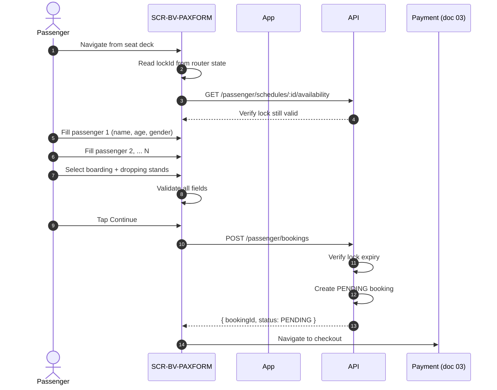

### 5.3 Screen — SCR-BV-PAXFORM

**Layout:**

| Region | Content |
|---|---|
| **Top bar** | Back to seat deck · lock countdown |
| **Route summary** | Delhi → Lucknow · 14:00 → 22:30 · 24 Oct |
| **Boarding stand** | Stand selector (from route stops) |
| **Dropping stand** | Stand selector (from route stops) |
| **Passenger 1** | Name, age, gender (required) |
| **Passenger 2..N** | Same, one card per seat |
| **Fare summary** | Per-seat fares + total |
| **Continue button** | Disabled until valid + lock active |

### 5.4 Multi-passenger design

**Diagram: Multi-passenger layout**
*One card per seat. Cards stacked vertically. Progress indicator shows which card is active. Each card independently validates.*

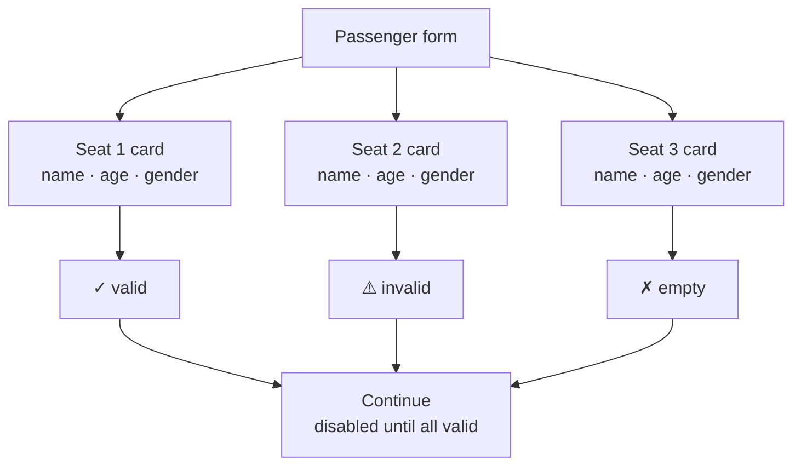

**Multi-passenger rules:**

| Rule | Detail |
|---|---|
| Max passengers | 6 per booking |
| Min passengers | 1 |
| Each card | Independent fields |
| Progress | "Passenger 1 of 3" indicator |
| Active card | Auto-focus on load |
| Validation | Per-card, on blur |
| Same-as-first (Phase 2) | Not in Phase 1 |

### 5.5 Stand selection

**Boarding stand dropdown:**

| Source | Options |
|---|---|
| Route stands | From `08` WF-P-04 boarding stand selection |
| Default | Origin stand (first in route) |
| Constraint | Must be before dropping stand |

**Dropping stand dropdown:**

| Source | Options |
|---|---|
| Route stands | Same list |
| Default | Destination stand (last in route) |
| Constraint | Must be after boarding stand |

**Rule:** If user changes boarding to after dropping, dropping auto-advances to next stand.

### 5.6 Passenger fields

| Field | Type | Validation |
|---|---|---|
| Name | Text | 2–100 chars, no numbers |
| Age | Number | 1–120 |
| Gender | Select | MALE / FEMALE / OTHER |

**Field rules:**

| Rule | Detail |
|---|---|
| Required | All fields required |
| Trim | Leading/trailing spaces removed |
| Name | No special characters beyond space, hyphen, apostrophe |
| Age | Numeric only |
| Gender | Required select |

### 5.7 Lock countdown

**Diagram: Lock countdown states**
*Countdown visible at top of screen. Color changes based on time remaining. Submit blocked below 10 seconds.*

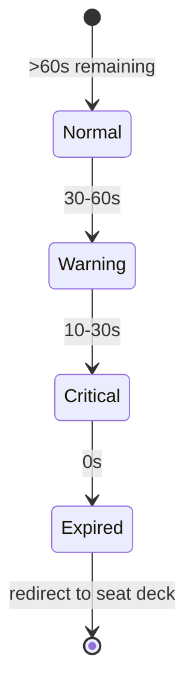

**Countdown behavior:**

| State | Color | Message | Submit |
|---|---|---|---|
| Normal | Neutral | "5:00 left" | Enabled |
| Warning | Yellow | "45s left" | Enabled |
| Critical | Red | "10s left" | Disabled |
| Expired | Red | "Lock expired" | Redirected |

### 5.8 Booking form API calls

| Endpoint | When | Request | Response |
|---|---|---|---|
| `GET /v1/passenger/schedules/:id/availability` | On mount | Path param | Availability + lock check |
| `POST /v1/passenger/bookings` | Submit | `{ lockId, boardingStandId, droppingStandId, passengers[] }` | `{ bookingId, status: PENDING }` |
| `GET /v1/passenger/bookings/:id` | On mount if resuming | Path param | Booking if exists |

**Reference:** Full contracts in `07-API-AND-REALTIME-CONTRACTS.md` §4.5.

### 5.9 Handoff to payment

**Diagram: Handoff to payment doc**
*Booking form completes → creates PENDING booking → navigates to checkout. Payment flow (Razorpay integration) is owned by `03`. This doc defines the entry point only.*

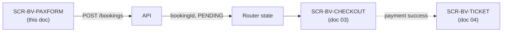

**Router state contract:**

```typescript
{
  bookingId: string,
  scheduleId: string,
  lockId: string,        // for potential release
  totalFarePaise: number
}
```

**Rule:** If `bookingId` not in router state, checkout page redirects to home. Prevents deep-linking to checkout without a booking.

### 5.10 Booking form edge cases

| Scenario | Behavior |
|---|---|
| Lock expires while filling | Banner appears, submit disabled, redirect after 30s |
| Lock expires on submit | `400 LOCK_EXPIRED` → toast → redirect to seat deck |
| Network fails on submit | Retry button, form state preserved |
| User navigates back | Form state preserved in memory (not localStorage) |
| User refreshes page | Lock ID from URL, form reset, warning shown |
| Duplicate submit | Button disabled during submit |

---

## 6. Profile Flow

### 6.1 Flow sequence

**Diagram: Profile flow**
*Passenger views profile → optionally edits name or email → saves. Phone is immutable. Logout clears session.*

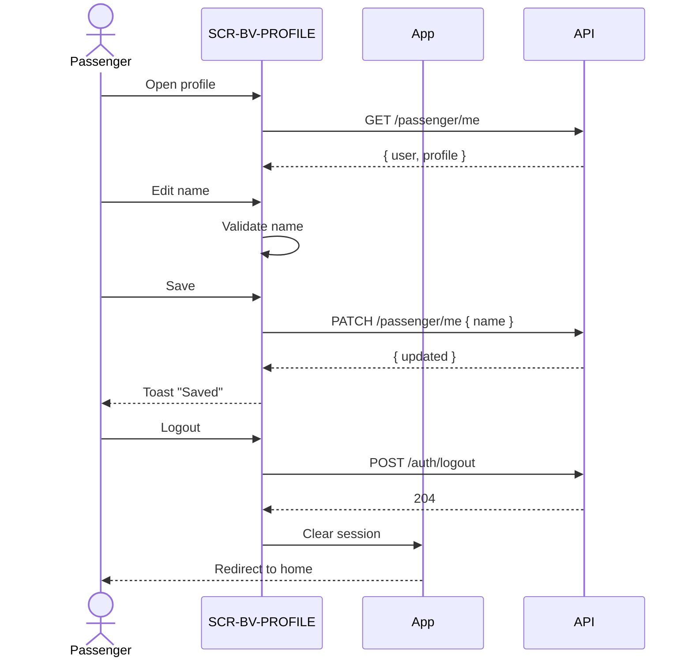

### 6.2 Screen — SCR-BV-PROFILE

**Layout:**

| Region | Content |
|---|---|
| **Top bar** | Back · Edit toggle |
| **Avatar** | Initials or placeholder |
| **Name** | Editable input |
| **Phone** | Read-only with lock icon |
| **Email** | Editable input |
| **My trips link** | Navigate to My trips |
| **Support link** | Email link to support |
| **Logout button** | Destructive style |
| **App version** | Footer |

### 6.3 Profile API calls

| Endpoint | When | Request | Response |
|---|---|---|---|
| `GET /v1/passenger/me` | On mount | — | `{ user, profile }` |
| `PATCH /v1/passenger/me` | Save | `{ name?, email? }` | `{ user }` |
| `POST /v1/passenger/auth/logout` | Logout | — | `204` |

### 6.4 Profile field rules

| Field | Editable | Validation |
|---|---|---|
| Name | ✅ | 2–100 chars |
| Email | ✅ | Valid email, lowercased |
| Phone | ❌ | Immutable — locked at signup |

**Phone immutability:**

- Input has lock icon
- Tooltip: "Phone number can't be changed. Contact support to update."
- If user really needs to change → contact support (Phase 2: self-service)

### 6.5 Logout flow

**Diagram: Logout sequence**
*Logout clears both memory and cookie. Redirects to home. Back button doesn't restore session.*

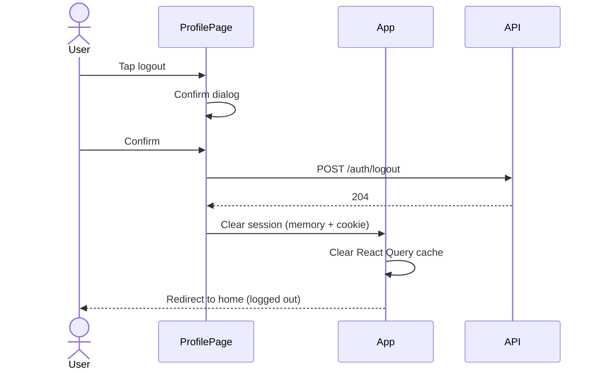

**Logout rules:**

| Rule | Detail |
|---|---|
| Confirm dialog | "Log out? You'll need to log in again." |
| Server call | Fire and forget (best effort) |
| Client cleanup | Clear memory + cookie + React Query cache |
| Redirect | Home page, logged out state |
| Back button | Does not restore session |

---

## 7. Component Structure

### 7.1 App component tree

**Diagram: App component tree**
*Full component tree for all BusVerse screens covered in this doc. Shared UI primitives at the bottom. Feature components above.*

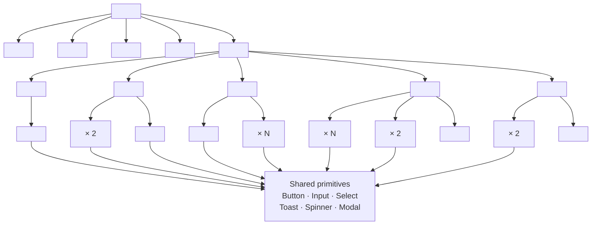

### 7.2 Component ownership

| Component | Owner | Used in |
|---|---|---|
| `<AppShell>` | This doc | All screens |
| `<SessionProvider>` | This doc | All screens |
| `<AuthForm>` | This doc | Home |
| `<CityAutocomplete>` | This doc | Search |
| `<ScheduleCard>` | This doc | Results |
| `<PassengerCard>` | This doc | Booking form |
| `<LockCountdown>` | `02-SEAT-MATRIX-UI` | Booking form |
| `<SeatDeck>` | `02-SEAT-MATRIX-UI` | Seat deck |
| `<PaymentGate>` | `03-PAYMENT-REFUND-FLOW` | Checkout |
| `<TicketQR>` | `04-TICKET-AND-TRACKING` | Ticket |
| Shared primitives | `@busverse/ui` | Everywhere |

### 7.3 Shared UI primitives

**Reference:** `packages/ui/src/index.ts`

| Primitive | Purpose |
|---|---|
| `<Button>` | Primary, secondary, ghost variants |
| `<Input>` | Text, number, password |
| `<Select>` | Dropdown |
| `<FormError>` | Field-level error display |
| `<Toast>` | Non-blocking notification |
| `<Spinner>` | Loading indicator |
| `<Modal>` | Blocking dialog |
| `<Card>` | Container |
| `<Badge>` | Status badge |
| `<Avatar>` | User initials |

**Rule:** Never build a primitive that already exists in `@busverse/ui`.

---

## 8. State Management

### 8.1 State layering

**Diagram: State layering**
*Three layers of state. Server state in React Query. Auth state in Context. UI state in local hooks. Each layer has a defined owner and lifecycle.*

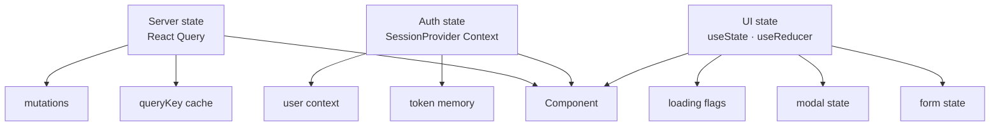

### 8.2 React Query key structure

| Query | Key | staleTime |
|---|---|---|
| Current user | `['user']` | 5 min |
| Cities | `['cities', query]` | 5 min |
| Search results | `['search', { from, to, date, sort, filters }]` | 60 sec |
| Schedule detail | `['schedule', scheduleId]` | 5 min |
| Booking by ID | `['booking', bookingId]` | 30 sec |

### 8.3 Mutation → invalidation rules

| Mutation | Invalidates |
|---|---|
| Login | `['user']` |
| Logout | All queries (clear cache) |
| Create booking | `['booking', bookingId]`, `['bookings']` |
| Update profile | `['user']` |

### 8.4 Form state

**Library:** React Hook Form + Zod.

| Rule | Detail |
|---|---|
| Validation | Zod schema per form |
| Validation trigger | On blur + on submit |
| Error display | Field-level + form-level |
| Dirty state | Block navigation if unsaved changes |
| Reset | Clear on submit success |

---

## 9. Error Handling

### 9.1 Error classification

**Diagram: Error handling flow**
*Every error is classified then routed to the right UI response. Network errors are retryable. Auth errors redirect. Validation errors highlight fields. Server errors show generic message.*

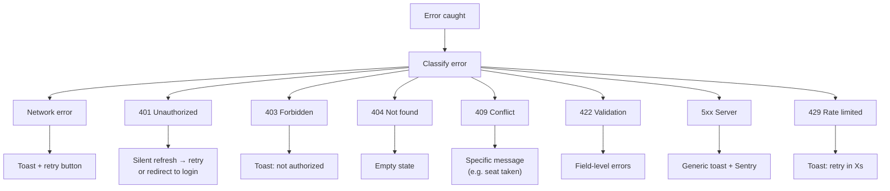

### 9.2 Error message rules

| Rule | Example |
|---|---|
| User-friendly | "Payments unavailable, please try again" |
| Actionable | Include next step |
| No stack traces | Never show internal details |
| Stable codes | `error.code` for logging |
| Sentry logged | Every 5xx + auth failures |

**Rule:** Full error code catalog in `07-API-AND-REALTIME-CONTRACTS.md` §9. Client maps codes to human messages in `errors.ts`.

### 9.3 Redirect rules

**Diagram: Redirect decision tree**
*When to redirect vs. show error inline. Auth issues redirect. Validation issues inline. Network issues retry.*

```mermaid
flowchart TD
    ERR["Error"]
    ERR --> Q1{"401?"}
    Q1 -->|Yes| Q2{"Refresh<br/>succeeds?"}
    Q2 -->|Yes| RETRY["Retry request"]
    Q2 -->|No| LOGIN["Redirect to login<br/>+ return URL"]

    Q1 -->|No| Q3{"422?"}
    Q3 -->|Yes| FORM["Inline field errors"]

    Q3 -->|No| Q4{"5xx?"}
    Q4 -->|Yes| TOAST["Toast + log"]

    Q4 -->|No| Q5{"Network?"}
    Q5 -->|Yes| RETRY2["Retry button"]
    Q5 -->|No| SHOW["Show error message"]
```

### 9.4 Error logging

| Error type | Logged to | Contains |
|---|---|---|
| 4xx (validation) | Not logged | — |
| 4xx (auth failure) | Server only | `requestId`, `userId` |
| 5xx | Sentry | Full context |
| Network error | Not logged | — |
| Rate limited | Server only | `requestId`, `userId` |

**Rule:** Never log PII. Sentry filters PII before shipping. `09` §11.5 defines scrubber.

---

## 10. Accessibility

### 10.1 Phase 1 requirements

| Requirement | Implementation |
|---|---|
| Keyboard navigation | All interactive elements reachable via Tab |
| Focus visible | Visible focus ring on all elements |
| Focus trap | Modals trap focus until closed |
| Focus return | Focus returns to trigger on modal close |
| Screen reader labels | Every input has `<label>` or `aria-label` |
| ARIA live | Toast announcements via `role="alert"` |
| Color contrast | ≥ 4.5:1 for text |
| Touch targets | ≥ 44×44px |
| Reduced motion | Respect `prefers-reduced-motion` |
| Form errors | `aria-invalid` on failed fields + `aria-describedby` |

### 10.2 Phase 2 deferrals

| Item | Phase 2 |
|---|---|
| Full WCAG 2.1 AA compliance | Phase 2 |
| Screen reader testing (VoiceOver, NVDA) | Phase 2 |
| High contrast mode | Phase 2 |
| Font size toggle | Phase 2 |

### 10.3 Accessibility patterns per component

| Component | Accessibility |
|---|---|
| `<Button>` | `aria-pressed` for toggles, `aria-disabled` when disabled |
| `<Input>` | Associated `<label>`, `aria-invalid`, `aria-describedby` |
| `<CityAutocomplete>` | `role="combobox"`, `aria-expanded`, `aria-activedescendant` |
| `<Modal>` | `role="dialog"`, `aria-modal`, focus trap |
| `<Toast>` | `role="alert"`, `aria-live="polite"` |
| `<LockCountdown>` | `role="timer"`, `aria-live="polite"` |

---

## 11. Test Coverage

### 11.1 Test suites

| Suite | Count | Covers |
|---|---:|---|
| `e2e_auth_*` | 3 | WF-P-01 (login, logout, session restore) |
| `e2e_search_*` | 3 | WF-P-02 (autocomplete, search, empty state) |
| `e2e_booking_*` | 3 | WF-P-04 booking half (form, submit, lock expiry) |
| `e2e_profile_*` | 2 | View, edit, logout |
| `component_auth_*` | 5 | AuthForm, PhoneInput, OTPInput |
| `component_search_*` | 6 | CityAutocomplete, DatePicker, ScheduleCard, FilterBar |
| `component_booking_*` | 5 | PassengerCard, StandSelect, LockCountdown |
| `component_profile_*` | 3 | EditableField, ImmutableField |
| **Total** | **30** | |

### 11.2 Key assertions

| Test | Asserts |
|---|---|
| `e2e_auth_login` | Phone → OTP → home (logged in) |
| `e2e_auth_logout` | Logout clears session |
| `e2e_auth_session_restore` | Refresh page → still logged in |
| `e2e_search_autocomplete` | Type "Del" → suggestions appear |
| `e2e_search_empty` | Search invalid route → empty state |
| `e2e_booking_submit` | Fill form → POST booking → PENDING |
| `e2e_booking_lock_expiry` | Wait 5 min → banner appears |
| `component_auth_otp_auto_advance` | 6 digits → auto-submit |
| `component_search_keyboard_nav` | Arrow keys work in autocomplete |
| `component_booking_validation` | Invalid age → field error |

### 11.3 Reference

Full test strategy in `10-TESTING-STRATEGY.md` §7 (contract) and §8 (E2E). Contract tests in `07` §15.5.

---

## 12. Open Questions

| # | Question | Owner | Default |
|:---:|---|---|---|
| 1 | Session persistence across browser tabs? | Shaghaf | Yes (shared cookie) |
| 2 | Autocomplete cache TTL? | Shaghaf | 60 seconds |
| 3 | Search results cache time? | Shaghaf | 60 seconds |
| 4 | Multi-passenger limit? | Shaghaf | 6 |
| 5 | Block navigation on unsaved form? | Shaghaf | Yes with confirm |
| 6 | Show "Same as first" (Phase 2)? | Shaghaf | No |
| 7 | Preserve form on refresh? | Shaghaf | No (memory only) |
| 8 | Show recent searches? | Shaghaf | Yes (last 3, localStorage) |
| 9 | Autocomplete on 1 char? | Shaghaf | No (min 2) |
| 10 | Logout confirmation? | Shaghaf | Yes |

---

## 13. Checklist Against Master List

| Item | Included? | Section |
|---|:---:|---|
| Purpose and scope | ✅ | §1 |
| Doc hierarchy | ✅ | §1.2 |
| Scope table | ✅ | §1.4 |
| Workflow map | ✅ | §2 |
| FR mapping | ✅ | §2.2 |
| Auth sequence | ✅ | §3.1 |
| Auth state machine | ✅ | §3.2 |
| Home screen | ✅ | §3.3 |
| Auth components | ✅ | §3.4 |
| Auth API calls | ✅ | §3.5 |
| Validation rules | ✅ | §3.6 |
| Session storage | ✅ | §3.7 |
| Session refresh | ✅ | §3.8 |
| Error states | ✅ | §3.9 |
| Auth edge cases | ✅ | §3.10 |
| Search sequence | ✅ | §4.1 |
| Search state flow | ✅ | §4.2 |
| Search screen | ✅ | §4.3 |
| Results screen | ✅ | §4.4 |
| Search components | ✅ | §4.5 |
| Autocomplete behavior | ✅ | §4.6 |
| Search API calls | ✅ | §4.7 |
| Results handling | ✅ | §4.8 |
| Search state | ✅ | §4.9 |
| Search edge cases | ✅ | §4.10 |
| Booking prerequisites | ✅ | §5.1 |
| Booking sequence | ✅ | §5.2 |
| Paxform screen | ✅ | §5.3 |
| Multi-passenger | ✅ | §5.4 |
| Stand selection | ✅ | §5.5 |
| Passenger fields | ✅ | §5.6 |
| Lock countdown | ✅ | §5.7 |
| Booking API calls | ✅ | §5.8 |
| Payment handoff | ✅ | §5.9 |
| Booking edge cases | ✅ | §5.10 |
| Profile sequence | ✅ | §6.1 |
| Profile screen | ✅ | §6.2 |
| Profile API calls | ✅ | §6.3 |
| Profile field rules | ✅ | §6.4 |
| Logout flow | ✅ | §6.5 |
| App component tree | ✅ | §7.1 |
| Component ownership | ✅ | §7.2 |
| Shared UI primitives | ✅ | §7.3 |
| State layering | ✅ | §8.1 |
| React Query keys | ✅ | §8.2 |
| Mutation invalidation | ✅ | §8.3 |
| Form state | ✅ | §8.4 |
| Error classification | ✅ | §9.1 |
| Error messages | ✅ | §9.2 |
| Redirect rules | ✅ | §9.3 |
| Error logging | ✅ | §9.4 |
| Accessibility requirements | ✅ | §10 |
| Test coverage | ✅ | §11 |
| Open questions (10) | ✅ | §12 |

**All items covered. 18 Mermaid diagrams. Every diagram described.**

---

## 14. Summary

**BusVerse passenger workflows — auth, search, booking form, and profile — are specified across 14 sections and 18 diagrams.** The auth flow (WF-P-01) uses phone OTP via Firebase with a 6-digit auto-advancing input and 30-second resend timer; access token stored in React memory, refresh token in httpOnly secure cookie; single-flight silent refresh on 401 with return URL preservation; CAPTCHA after 3 failures; logout clears both tokens and React Query cache. The search flow (WF-P-02) is URL-first — every search, filter, sort updates URL so results are shareable and back-button works; city autocomplete with 300ms debounce, min 2 chars, keyboard navigation, and abortable requests; results rendered with skeleton loading, empty state with suggestions, and server-side sorting; works for logged-out guests. The booking form flow (WF-P-04a) requires an active seat lock and authenticated session; supports 1–6 passengers per booking with stacked passenger cards (name, age, gender); boarding and dropping stand selection from route stops with ordering constraints; visible lock countdown in four color states (normal, warning, critical, expired); form blocks submit below 10 seconds; on submit, creates PENDING booking and hands off to `03-PAYMENT-REFUND-FLOW` with `bookingId` in router state; lock expiry during fill shows banner and eventually redirects to seat deck. The profile flow allows editing name and email but phone is immutable with a lock icon and tooltip; logout requires confirmation and clears all session state. All flows share React Query for server state (with key structure defined — `['user']`, `['cities', query]`, `['search', {from,to,date,sort,filters}]`, `['booking', id]`), SessionProvider Context for auth, and local `useState` for UI state. Error handling classifies every error into 7 categories (network, 401, 403, 404, 409, 422, 5xx, 429) and routes to the appropriate UI response (retry button, silent refresh, inline field errors, toast, empty state, or specific message). Accessibility ships Phase 1 basics — keyboard nav, focus visible, focus trap in modals, screen reader labels, ARIA live regions, ≥4.5:1 contrast, ≥44×44px touch targets, `prefers-reduced-motion`; full WCAG 2.1 AA deferred to Phase 2. Component structure is defined per screen — HomeScreen with AuthForm and PhoneInput/OTPInput, SearchPage with 2× CityAutocomplete + DatePicker + SearchButton, ResultsPage with FilterBar + SortControl + ResultsList + ScheduleCard, BookingFormPage with PassengerCard × N + StandSelect × 2 + LockCountdown, ProfilePage with EditableField × 2 + ImmutableField. All UI primitives come from `@busverse/ui` (Button, Input, Select, Toast, Spinner, Modal, Card, Badge, Avatar, FormError). Thirty tests cover this doc — 11 E2E (3 auth, 3 search, 3 booking, 2 profile) and 19 component tests (5 auth, 6 search, 5 booking, 3 profile). Ten open questions remain, all with Phase-1 defaults.** This doc hands off to `busverse/02-SEAT-MATRIX-UI.md` for the seat deck, `busverse/03-PAYMENT-REFUND-FLOW.md` for payment execution and cancellation, `busverse/04-TICKET-AND-TRACKING.md` for QR tickets and live tracking, and `busverse/05-UI-SPEC.md` for full wireframes and design tokens.

---

**End of Document `busverse/01-PASSENGER-WORKFLOWS.md` v1.0.**