# `busverse/02-SEAT-MATRIX-UI.md`

**Document:** `busverse/02-SEAT-MATRIX-UI.md`
**Project:** BusVerse + BusCon
**Version:** 1.0
**Status:** Locked — Product Document
**Owner:** Shaghaf
**Guide:** Mr. Mohit Srivastav
**Purpose:** The detailed seat matrix specification for BusVerse. Covers the entire seat selection surface — rendering, real-time updates, lock acquisition, countdown, multi-seat selection, error handling, and mobile responsiveness. The **visual layer is authoritative from `Design_guide.html`** (dual theme, seat cells, fuselage, animations). This document specifies the **behavior layer** that the design guide doesn't cover — WebSocket subscription, lock API flow, countdown lifecycle, error states, fallback polling, and 40-seat scaling. Every UI implementation and every frontend test for the seat deck traces back to this document.

> **Derives from:** `busverse/00-OVERVIEW.md` (navigation), `busverse/01-PASSENGER-WORKFLOWS.md` (handoff from results), `Design_guide.html` §1 (dual themes), §5 (seat states + fuselage), §8 (token implementation), `02-REQUIREMENTS.md` §6.3 (FR-BV-011 to FR-BV-018), `05-DOMAIN-MODEL.md` §8 (seat states), `07-API-AND-REALTIME-CONTRACTS.md` §4.3 (availability), §4.4 (seat-locks), §8 (WebSocket), `08-WORKFLOWS.md` §4.3 (WF-P-03), §8.2 (WF-X-02 concurrency), `09-SECURITY-AND-PLATFORM-RULES.md` §8 (seat lock atomicity), `10-TESTING-STRATEGY.md` §7 (contract tests).
>
> **Referenced by:** `busverse/01-PASSENGER-WORKFLOWS.md` (booking handoff), `busverse/05-UI-SPEC.md`, `report/14-MODULE_DESCRIPTION.md`, `report/15-SCREENSHOTS_UI.md`, `viva/03-DEMO_SCRIPT.md`.

---

## 1. Purpose and Scope

### 1.1 What this document owns

| Owns here | From design guide | From upstream |
|---|---|---|
| WF-P-03 sequence | Dual theme tokens | `08` §4.3 |
| Seat cell rendering (behavior) | Seat state CSS | `05` §8 |
| Fuselage container behavior | Fuselage CSS | — |
| Lock flow (optimistic UI, API) | — | `07` §4.4 |
| Real-time updates | — | `07` §8.1 |
| Lock countdown lifecycle | — | `09` §8.4 |
| Multi-seat selection (no limit) | — | Q3 = C |
| Fallback polling | — | `07` §8.6 |
| Error states | — | `07` §9 |
| Seat types & 40-seat scaling | — | Q = A |
| Female-only seats (behavior) | Rose Magenta CSS | `05` §4.3 |
| Mobile responsiveness | — | — |
| Font loading strategy | Font stack + preconnect | — |

**Rule:** For any visual concern, `Design_guide.html` is authoritative. This doc adds behavior, API integration, error handling, and mobile scaling. Where the design guide and this doc conflict, **the design guide wins for visuals** and this doc wins for behavior.

### 1.2 Document hierarchy

**Diagram: Document hierarchy**
*This doc sits inside the BusVerse folder. It derives from the design guide (visuals), the API contract (behavioral endpoints), and the domain model (seat states). It feeds the UI spec and report chapters.*

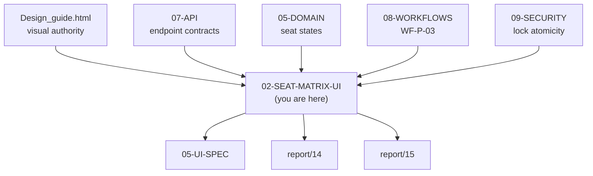

### 1.3 What this document does NOT cover

| Topic | Goes to |
|---|---|
| Full design tokens | `Design_guide.html` §1, §9 |
| Seat cell CSS (visual) | `Design_guide.html` §5 |
| Fuselage CSS (visual) | `Design_guide.html` §5 |
| Full app UI spec | `busverse/05-UI-SPEC.md` |
| Passenger form | `busverse/01-PASSENGER-WORKFLOWS.md` §5 |
| Payment execution | `busverse/03-PAYMENT-REFUND-FLOW.md` |
| API contracts | `07-API-AND-REALTIME-CONTRACTS.md` §4 |
| Backend lock implementation | `09-SECURITY-AND-PLATFORM-RULES.md` §8 |

---

## 2. Prerequisites

**Diagram: Prerequisites flow**
*Seat deck is reached from results. Requires: scheduleId from URL, user authenticated, availability loaded. Hands off to booking form when lock acquired.*

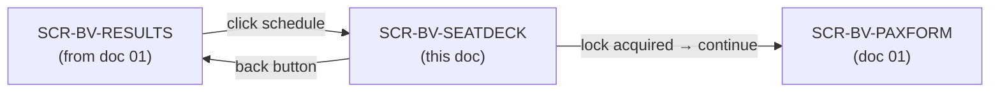

### 2.1 Prerequisites table

| Requirement | Enforced by |
|---|---|
| User authenticated | Auth guard on route (`01` §3) |
| `scheduleId` in URL | Route validation |
| Availability loaded | Skeleton until API responds |
| Schedule still `PUBLISHED` | API returns `404` if cancelled → redirect |
| No existing PENDING booking | `GET /seat-locks/active` on mount (WF-R-01) |

### 2.2 Resumption prerequisite

On mount, call `GET /v1/passenger/seat-locks/active`. If an active lock exists for this schedule, show resume banner (§14.4). If lock exists for a different schedule, ignore.

**Rule:** Never silently restore a lock. Always prompt.

---

## 3. Design Guide Reference

**Diagram: Design guide integration**
*Every visual concern traces to a specific section of `Design_guide.html`. This section maps the integration. Implementation reads both this doc (behavior) and the design guide (visual).*

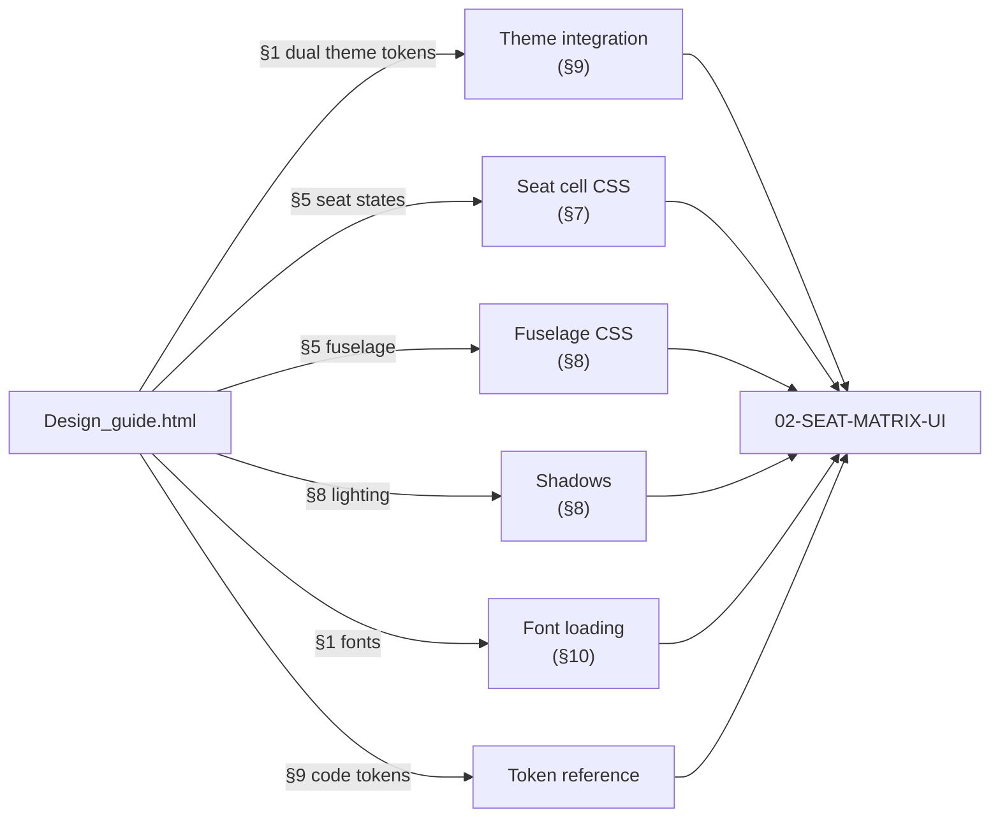

### 3.1 Reference table

| Visual concern | Design guide section | Where used in this doc |
|---|---|---|
| Dual theme tokens | §1 | §9 |
| Seat state colors | §5 | §7 |
| Seat cell dimensions | §5 | §7 |
| Seat "shadow" pseudo-element | §5 | §7 |
| Locked breathing animation | §5 | §7 |
| Selected lift animation | §5 | §7 |
| Bus fuselage | §5 | §8 |
| Front shield | §5 | §8 |
| Aisle spacer | §5 | §8 |
| Font stack | §1 | §10 |
| Google Fonts preconnect | §1 | §10 |
| Shadows (ambient, floating, modal) | §4 | §8 |
| Full token block | §9 | §9 |

**Rule:** When implementing, always reference the design guide section. This doc does not duplicate CSS — it specifies behavior around the design guide's CSS.

---

## 4. Seat Data Model

**Diagram: Seat data flow**
*Layout JSON → parsed seat grid → rendered components → state updates via WebSocket. Every seat has a stable ID, position, type, and dynamic state. State is client-managed but derived from API + WebSocket.*

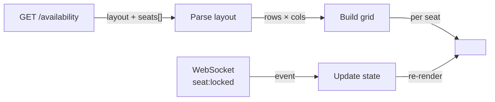

### 4.1 Seat object shape

```json
{
  "id": "seat_abc",
  "label": "1A",
  "row": 1,
  "column": 1,
  "type": "SEATER",
  "isFemaleOnly": false,
  "state": "AVAILABLE",
  "lockedUntil": null
}
```

| Field | Type | Meaning |
|---|---|---|
| `id` | UUID | Stable identifier, used in API calls |
| `label` | string | Display label (e.g., "1A") |
| `row` | integer | Row number (1-indexed) |
| `column` | integer | Column number (1-indexed) |
| `type` | enum | `SEATER` / `SLEEPER` / `SEMI_SLEEPER` |
| `isFemaleOnly` | boolean | Whether seat is preferred for female passengers |
| `state` | enum | `AVAILABLE` / `LOCKED` / `BOOKED` / `MINE` / `BLOCKED` |
| `lockedUntil` | ISO 8601 | For `LOCKED` state, when lock expires |

### 4.2 Layout object shape

```json
{
  "rowsCount": 10,
  "columnsCount": 4,
  "aisleCells": [
    { "row": 1, "column": 2 },
    { "row": 2, "column": 2 }
  ]
}
```

| Field | Type | Meaning |
|---|---|---|
| `rowsCount` | integer | Total rows |
| `columnsCount` | integer | Total columns |
| `aisleCells` | array | Cells that are aisle (rendered as spacer) |

### 4.3 State derivation

Client state is derived, not authoritative. Each seat's `state` field is determined by:

```
1. If API says BOOKED → BOOKED
2. If API says BLOCKED → BLOCKED (not rendered)
3. If lock is held by current user (in selectedSeats) → MINE
4. If API says LOCKED (by another user) → LOCKED
5. Else → AVAILABLE
```

WebSocket events update this state without full refetch.

---

## 5. Screen Layout

**Diagram: Screen composition**
*Screen has five vertical regions — top bar, countdown (conditional), fuselage with seat grid, legend, and bottom action bar. Layout is column-flex. On mobile, countdown becomes sticky.*

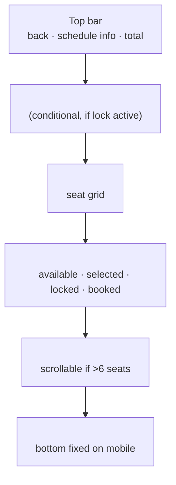

### 5.1 Top bar contents

| Element | Contents |
|---|---|
| Back button | Navigate to results |
| Schedule summary | "14:00 → 22:30 · Delhi → Lucknow" |
| Total fare | Sum of selected seats (right-aligned) |

### 5.2 Region behaviors

| Region | Visible when |
|---|---|
| Top bar | Always |
| Lock countdown | When ≥1 seat selected |
| Fuselage | Always |
| Legend | Always |
| Summary | When ≥1 seat selected |
| Continue button | When ≥1 seat selected (disabled during countdown critical) |

---

## 6. Component Tree

**Diagram: Component tree**
*Full component structure. SeatDeckPage is the top-level route. It renders the header, countdown, fuselage (with seat rows and cells), legend, and summary. Shared UI primitives come from `@busverse/ui`.*

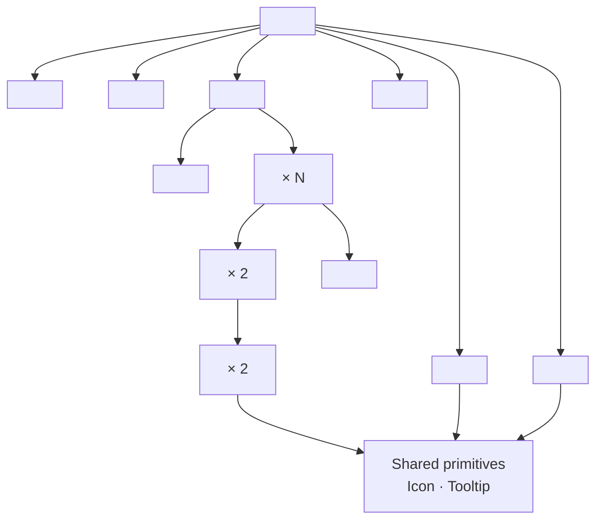

### 6.1 Component contracts

| Component | Props | Emits |
|---|---|---|
| `<SeatDeckPage>` | `scheduleId` (from URL) | — |
| `<SeatDeckHeader>` | `schedule`, `totalFarePaise`, `onBack` | `onBack()` |
| `<LockCountdown>` | `expiresAt`, `onExpire` | `onExpire()` |
| `<BusFuselage>` | `layout`, `seats`, `selectedSeatIds`, `onToggle` | `onToggle(seatId)` |
| `<SeatRow>` | `rowNumber`, `seats`, `aisleCells`, `onToggle` | `onToggle(seatId)` |
| `<SeatPair>` | `seat1`, `seat2`, `onToggle` | `onToggle(seatId)` |
| `<SeatCell>` | `seat`, `onToggle` | `onToggle(seatId)` |
| `<SeatLegend>` | — | — |
| `<SelectedSeatsSummary>` | `selectedSeats`, `onRemove` | `onRemove(seatId)` |
| `<ContinueButton>` | `enabled`, `onClick` | `onClick()` |

### 6.2 Component ownership

| Component | Owner | Design guide reference |
|---|---|---|
| `<SeatDeckPage>` | This doc | — |
| `<SeatDeckHeader>` | This doc | — |
| `<LockCountdown>` | This doc | — |
| `<BusFuselage>` | This doc | §5 `bus-fuselage-mock` |
| `<SeatRow>` | This doc | §5 `seat-row` |
| `<SeatPair>` | This doc | §5 `seat-pair` |
| `<SeatCell>` | This doc | §5 `seat-cell` + state classes |
| `<SeatLegend>` | This doc | — |
| `<SelectedSeatsSummary>` | This doc | — |
| `<ContinueButton>` | This doc | — |

**Rule:** All BusVerse seat components live in `apps/busverse/components/seat-deck/`. Shared primitives come from `@busverse/ui`.

---

## 7. Seat Cell Implementation

**Diagram: Seat cell component**
*SeatCell wraps the design guide's `.seat-cell` CSS. State is derived from the seat object. Click handler gates behavior by state. Accessibility layer adds ARIA attributes. CSS classes are computed from state.*

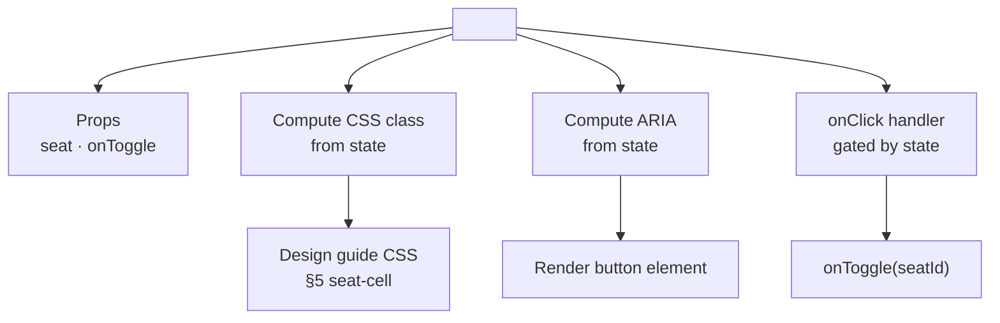

### 7.1 Visual state → CSS class mapping

| Logical state | CSS class | Design guide |
|---|---|---|
| AVAILABLE | `.seat-avail` | §5 |
| AVAILABLE + `isFemaleOnly` | `.seat-fem` | §5 |
| MINE (selected) | `.seat-sel` | §5 |
| LOCKED | `.seat-lock` | §5 |
| BOOKED | `.seat-book` | §5 |
| BLOCKED | (not rendered) | §5 |

**Rule:** Female-only styling only applies to AVAILABLE state. Once selected, uses `.seat-sel` (blue). Once locked by another user, uses `.seat-lock` (amber).

### 7.2 Behavior rules per state

| State | Click action | Cursor | Aria |
|---|---|---|---|
| AVAILABLE | Call `onToggle(seatId)` (acquires lock) | pointer | `role="button" aria-pressed="false"` |
| AVAILABLE + female-only | Same as AVAILABLE | pointer | `aria-label="..., female preferred"` |
| MINE | Call `onToggle(seatId)` (releases lock) | pointer | `aria-pressed="true"` |
| LOCKED | No action | not-allowed | `aria-disabled="true"` |
| BOOKED | No action | not-allowed | `aria-disabled="true"` |
| BLOCKED | Not rendered | — | — |

### 7.3 Accessibility additions

Every `<SeatCell>` renders as a `<button>` with:

- `type="button"`
- `aria-label="{seatLabel}, {state}, {extra}"` where extra may be "female preferred"
- `aria-pressed` for toggle state (true for MINE)
- `aria-disabled` for LOCKED/BOOKED
- Keyboard: Space or Enter triggers `onToggle`
- Focus ring visible (from `--border-focus`)

**Example aria-label:**

- Available seat: `"Seat 1A, available"`
- Available female-only: `"Seat 1A, available, female preferred"`
- Locked: `"Seat 1A, locked by another user"`
- Booked: `"Seat 1A, already booked"`
- Mine: `"Seat 1A, selected by you, press to deselect"`

### 7.4 Dimension rules

From design guide §5:

| Property | Value |
|---|---|
| Width | 40px |
| Height | 44px |
| Border radius | 8px 8px 10px 10px |
| Border width | 1.5px |
| Font | `--font-mono`, 11px, weight 700 |
| Shadow strip (`::after`) | Height 3px, bottom 2px, width 80% |
| Gap between seats in pair | 8px |
| Row gap | 12px |

**Rule:** Do not override these dimensions. They are touch-target compliant (44px minimum height).

### 7.5 Hover and animation

From design guide §5:

- **Available hover:** `transform: translateY(-2px)`, adds soft shadow (150ms ease-out)
- **Selected:** `translateY(-2px)` + `box-shadow: var(--shadow-glow-primary)` (instant on click)
- **Locked:** 2.2s infinite breathing animation (opacity 0.6→1, brightness 1.2)

**Behavior notes:**
- Hover only on AVAILABLE and MINE states
- Locked animation is CSS-only, respects `prefers-reduced-motion` (stops animation, keeps amber color)
- Selected lift is 150ms transition, matches design guide's `--ease-instant`

### 7.6 Reduced motion

When `prefers-reduced-motion: reduce`:

- Locked breathing animation: stopped, uses static `--seat-locked-bg`
- Selected lift transition: instant, no animation
- Hover lift: instant

---

## 8. Bus Fuselage Rendering

**Diagram: Fuselage layout**
*The fuselage is the physical container from the design guide. It wraps seat rows and scales vertically based on row count. The front shield sits at the top. Rows are rendered in order.*

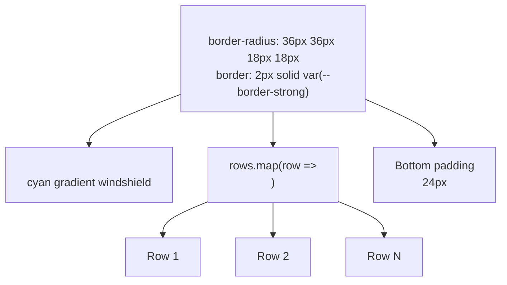

### 8.1 Fuselage dimensions

From design guide §5:

```css
.bus-fuselage-mock {
  padding: 48px 18px 24px;
  border-radius: 36px 36px 18px 18px;
  border: 2px solid var(--border-strong);
  box-shadow: var(--shadow-floating);
}

.bus-front-shield {
  position: absolute;
  top: 10px;
  left: 20px;
  right: 20px;
  height: 22px;
  border: 1.5px solid var(--telemetry-cyan);
  border-radius: 12px 12px 2px 2px;
  background: linear-gradient(180deg, var(--telemetry-cyan-subtle), transparent);
}
```

### 8.2 Fuselage height calculation

Fuselage height is **dynamic**, based on row count.

```ts
const fuselageHeight =
  48 +                              // top padding
  22 + 20 +                         // shield height + gap
  (rows * 44) +                     // seat cells
  ((rows - 1) * 12) +               // row gaps
  24;                               // bottom padding
```

For real bus layouts:

| Layout | Rows | Cell height | Fuselage height |
|---|---:|---:|---:|
| 16-seat demo | 4 | 44px | 48+42+176+36+24 = **326px** |
| 40-seat standard | 10 | 44px | 48+42+440+108+24 = **662px** |
| 30-seat sleeper | 15 | 70px | 48+42+1050+168+24 = **1,332px** |

### 8.3 Aisle rendering

From design guide §5: aisle is a **24px invisible spacer** (`<div class="seat-aisle">`).

**Rules:**

| Aspect | Detail |
|---|---|
| Aisle cells | Sourced from `layout.aisleCells` |
| Rendered as | Empty div with 24px width |
| Not clickable | No cursor, no hover, no ARIA |
| Row structure | 2 seats + aisle + 2 seats |

**Rule:** Aisle cells from `layout.aisleCells` mark which column is the aisle. Standard 2+2 layout has aisle at column 2. Some layouts have aisle at other columns.

---

## 9. Dual Theme Integration

**Diagram: Theme application**
*Theme switch is CSS-only. `<html data-theme="light|dark">` triggers token swap. Seat cells react instantly via CSS custom properties. No React re-render needed for theme change.*

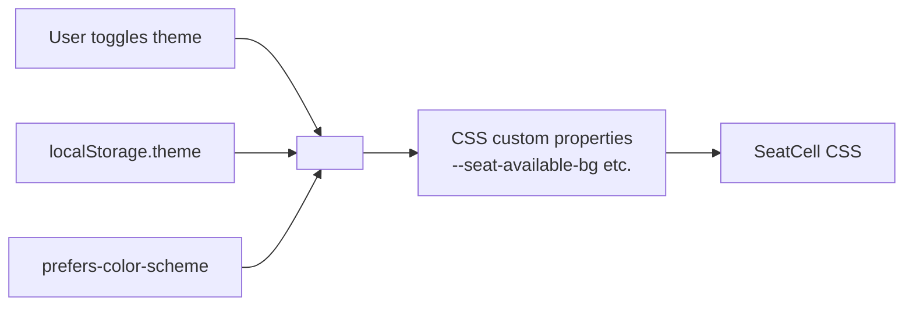

### 9.1 Theme tokens used in seat deck

Every seat color reads from a token. Full list from design guide §1, §8:

| Token | Purpose |
|---|---|
| `--canvas-bg` | Page background |
| `--surface-card` | Fuselage background |
| `--border-strong` | Fuselage border |
| `--seat-available-bg` | Available seat fill |
| `--seat-available-border` | Available seat border |
| `--seat-available-text` | Available seat label |
| `--seat-selected-bg` | Selected seat fill |
| `--seat-selected-border` | Selected seat border |
| `--seat-selected-text` | Selected seat label |
| `--seat-locked-bg` | Locked seat fill |
| `--seat-locked-border` | Locked seat border |
| `--seat-locked-text` | Locked seat label |
| `--seat-booked-bg` | Booked seat fill |
| `--seat-booked-border` | Booked seat border |
| `--seat-booked-text` | Booked seat label |
| `--seat-female-bg` | Female-only seat fill |
| `--seat-female-border` | Female-only seat border |
| `--seat-female-text` | Female-only seat label |
| `--telemetry-cyan` | Front shield accent |
| `--shadow-glow-primary` | Selected seat glow |

**Rule:** Never use raw hex values in components. Only reference tokens.

### 9.2 Theme switching behavior

| Trigger | Behavior |
|---|---|
| User toggles via theme button | `document.documentElement.setAttribute('data-theme', ...)` |
| First visit | Respect `prefers-color-scheme` |
| Subsequent visits | Read `localStorage.theme` |
| OS preference change | Update if user hasn't manually set |
| Theme change on seat deck | CSS re-renders instantly, no layout shift |

### 9.3 Theme test coverage

| Test | Asserts |
|---|---|
| Theme toggle via button | `<html data-theme>` flips |
| Persistence | Reload keeps theme |
| OS preference respected | `prefers-color-scheme: dark` → dark theme |
| Seat colors | Each state renders correct colors in both themes |
| No flash of unstyled | Theme applied before first paint |

---

## 10. Font Loading

**Diagram: Font loading strategy**
*Fonts preloaded with preconnect for connection warm-up. `font-display: swap` prevents FOIT. System fallback for offline or slow network.*

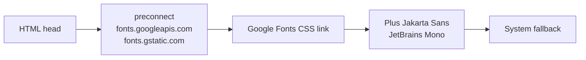

### 10.1 Font loading implementation

```html
<link rel="preconnect" href="https://fonts.googleapis.com">
<link rel="preconnect" href="https://fonts.gstatic.com" crossorigin>
<link href="https://fonts.googleapis.com/css2?family=Plus+Jakarta+Sans:wght@400;500;600;700;800&family=JetBrains+Mono:wght@400;500;700&display=swap" rel="stylesheet">
```

### 10.2 Font stack

From design guide §1:

```css
--font-sans: 'Plus Jakarta Sans', -apple-system, BlinkMacSystemFont, "Segoe UI", Roboto, sans-serif;
--font-mono: 'JetBrains Mono', monospace;
```

### 10.3 Font usage in seat deck

| Element | Font | Weight |
|---|---|---|
| Seat label | `--font-mono` | 700 |
| Screen title | `--font-sans` | 700 |
| Countdown timer | `--font-mono` | 700 |
| Legend labels | `--font-sans` | 500 |
| Total fare | `--font-mono` | 700 |

**Rule:** Every seat label uses mono font. Legibility matters more than style for a 2-character label at 11px.

---

## 11. Lock Flow (WF-P-03)

**Diagram: Lock flow sequence**
*Full lock acquisition flow. User taps available seat → optimistic UI (pending) → POST /seat-locks → success (MINE) or failure (revert + toast).*

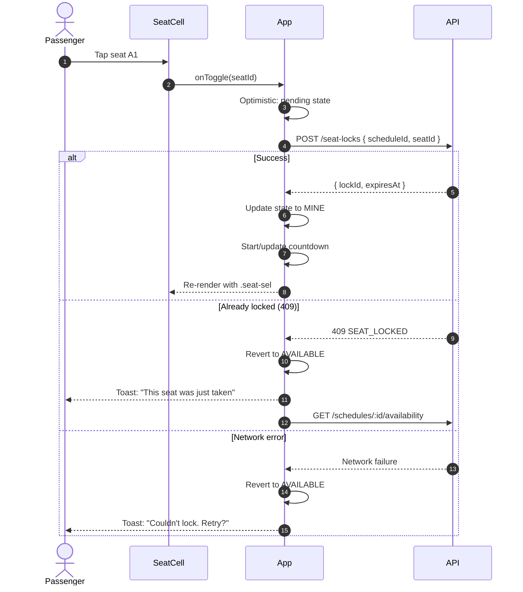

### 11.1 Optimistic UI rules

| Aspect | Detail |
|---|---|
| Immediate feedback | On tap, seat shows "pending" visual (semi-transparent, not MINE yet) |
| Timeout | If no response in 3s, revert + error |
| Success | Update to MINE, start countdown if first seat |
| Failure | Revert, show toast, refresh availability |
| Rapid tapping | Ignore additional taps on same seat during pending |

### 11.2 Lock release

**Diagram: Lock release flow**
*User taps a MINE seat → optimistic remove → DELETE /seat-locks/:id → success or failure. On failure, restore.*

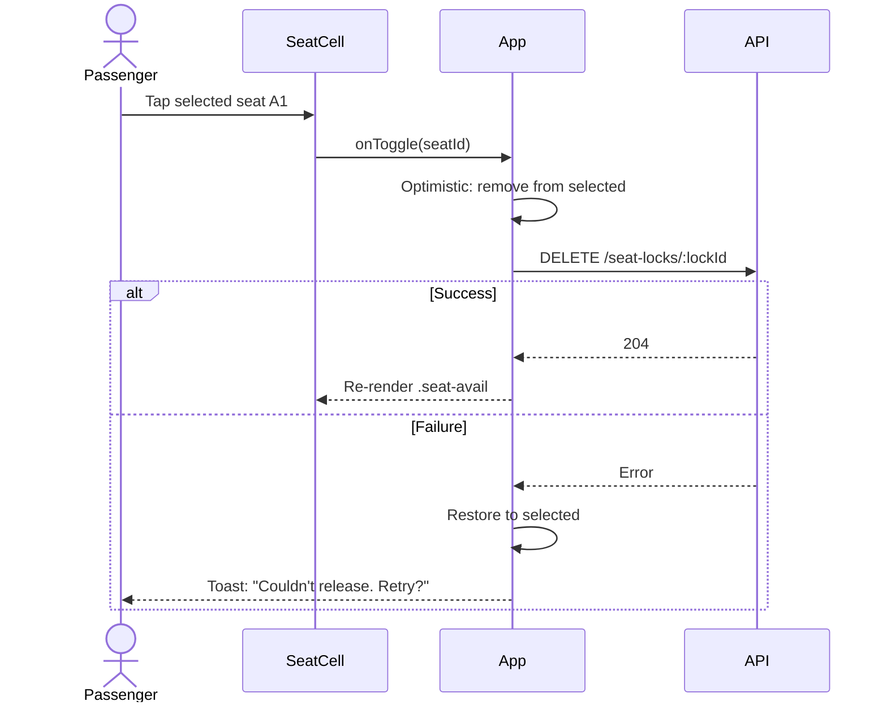

### 11.3 Lock API calls

| Endpoint | When | Request | Response |
|---|---|---|---|
| `POST /v1/passenger/seat-locks` | Tap available seat | `{ scheduleId, seatId }` | `{ lockId, expiresAt }` |
| `DELETE /v1/passenger/seat-locks/:id` | Tap selected seat | — | `204 No Content` |
| `GET /v1/passenger/seat-locks/active` | On mount | — | `{ locks: [...] }` |

**Reference:** Full contracts in `07-API-AND-REALTIME-CONTRACTS.md` §4.4.

### 11.4 Lock state tracking

Client maintains a `selectedSeats` map:

```ts
selectedSeats: Map<seatId, { lockId, expiresAt }>
```

| Event | Action |
|---|---|
| Lock acquired | Add to map |
| Lock released | Remove from map |
| Lock expired | Remove from map, show toast |
| Page refresh | Rebuild from `GET /seat-locks/active` |

---

## 12. Real-Time Updates

**Diagram: Real-time subscription**
*Subscribe to `seat:availability:{scheduleId}` on mount. Handle three events — `seat:locked`, `seat:released`, `seat:booked`. Update seat state without full refetch.*

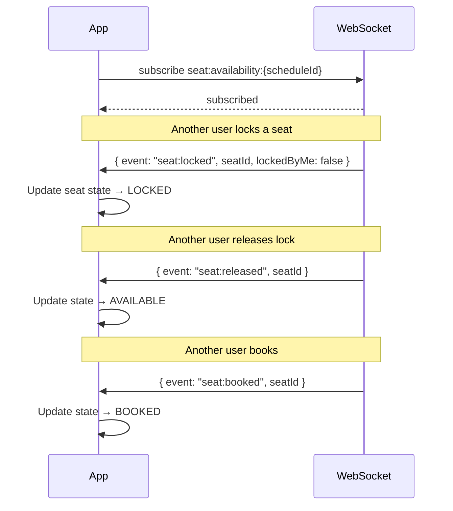

### 12.1 Event handling matrix

| Event | My seat? | Action |
|---|---|---|
| `seat:locked` | No | Set seat state to LOCKED, add lockedUntil |
| `seat:locked` | Yes (I locked it) | Ignore (already in state) |
| `seat:released` | No | Set to AVAILABLE |
| `seat:released` | Yes (my lock released remotely) | Remove from `selectedSeats`, reset countdown, toast "Your lock was released" |
| `seat:booked` | No | Set to BOOKED |
| `seat:booked` | Yes (I booked) | Navigate to ticket (shouldn't happen on seat deck) |

### 12.2 Subscription lifecycle

| Phase | Action |
|---|---|
| On mount | Subscribe to `seat:availability:{scheduleId}` |
| On unmount | Unsubscribe |
| On WebSocket reconnect | Re-subscribe |
| On schedule change | Unsubscribe old, subscribe new |

### 12.3 Event payload shapes

**Reference:** Full WebSocket contracts in `07-API-AND-REALTIME-CONTRACTS.md` §8.

Example `seat:locked`:

```json
{
  "event": "seat:locked",
  "topic": "seat:availability:sch_abc",
  "data": {
    "seatId": "seat_123",
    "lockedUntil": "2026-10-24T14:35:00.000Z",
    "lockedByMe": false
  },
  "ts": "2026-10-24T14:30:00.000Z"
}
```

---

## 13. Lock Countdown

**Diagram: Countdown state machine**
*Countdown has five states based on time remaining. Each state has distinct color and behavior. On expiry, user is redirected.*

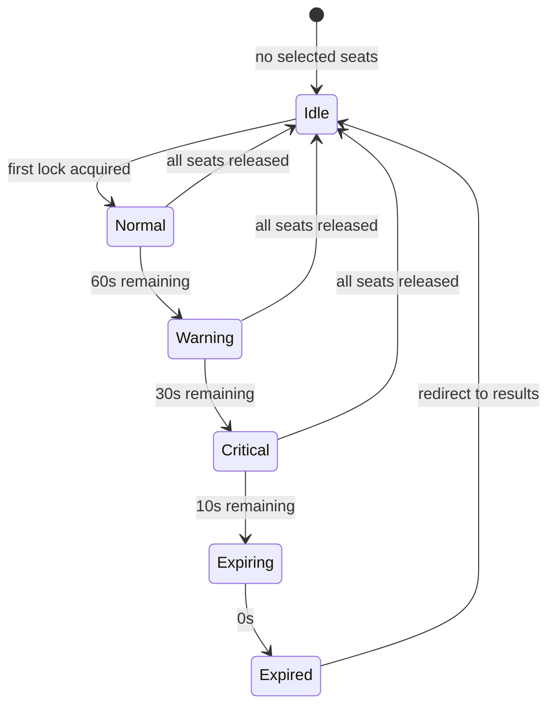

### 13.1 Countdown states

| State | Remaining | Display | Color | Button | Extra |
|---|---|---|---|---|---|
| Idle | — | Hidden | — | Enabled | — |
| Normal | >60s | "5:00" | `--text-primary` | Enabled | — |
| Warning | 30–60s | "0:45" | `--warning-amber` | Enabled | — |
| Critical | 10–30s | "0:25" | `--danger-crimson` | Enabled | — |
| Expiring | <10s | "0:08" | `--danger-crimson` | **Disabled** | Pulse animation |
| Expired | 0s | "Expired" | `--danger-crimson` | Disabled | Auto-redirect |

### 13.2 Countdown implementation

```ts
// Server-authoritative time
const serverTimeOffset = serverTimeMs - clientTimeMs;
const effectiveNow = () => Date.now() + serverTimeOffset;

// Update every second
useEffect(() => {
  const interval = setInterval(() => {
    const remaining = Math.max(0, earliestExpiry - effectiveNow());
    setRemainingMs(remaining);
    if (remaining === 0) handleExpiry();
  }, 1000);
  return () => clearInterval(interval);
}, [earliestExpiry]);
```

### 13.3 Countdown rules

| Rule | Detail |
|---|---|
| Source of truth | `expiresAt` from server (not client clock) |
| Update interval | Every 1 second |
| Multiple seats | Based on **earliest** lock expiry |
| Deselect | Recalculate based on remaining seats |
| Last seat removed | Hide countdown |
| Expiry behavior | Toast + redirect to results |
| Server clock offset | Calculated at response time, adjusted |
| Background tab | Countdown catches up on refocus |

### 13.4 Expiry behavior

When countdown reaches 0:

1. Show toast: "Your seat lock expired. Please select again."
2. Auto-redirect to results after 2 seconds
3. Clear `selectedSeats`
4. Fetch availability again (in case seat was taken by another user)

**Rule:** Never allow user to continue to checkout with expired lock. Submit is blocked before expiry, but defensive check on handoff.

---

## 14. Multi-Seat Selection (No Limit)

**Diagram: Multi-seat selection**
*User can select any number of available seats up to bus capacity. Summary panel scrolls when many seats selected. Each seat independently locked. No artificial cap.*

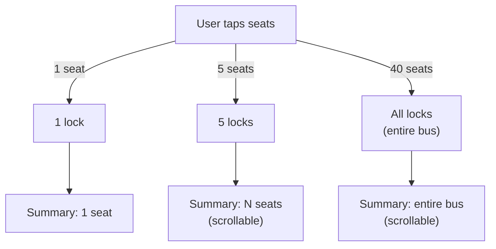

### 14.1 Selection rules (Q3 = C: no limit)

| Rule | Detail |
|---|---|
| Min seats | 1 |
| Max seats | Physical capacity (no artificial cap) |
| Selection mode | Toggle — click to add, click to remove |
| Lock each seat | Each tap calls `POST /seat-locks` |
| Lock failure | Only that seat reverts, others stay |
| Summary display | Scrollable when >6 seats selected |
| Continue | Enabled when ≥1 seat locked AND lock not expiring |
| Deselect | Releases that specific lock |
| Rapid selection | Batch requests where possible |

### 14.2 Warning UX for large selections

| Threshold | Display | Behavior |
|---|---|---|
| >6 seats | Info banner: "Booking more than 6 seats? Consider contacting us for group rates." | Non-blocking |
| All remaining seats | Confirmation banner: "You are booking all {N} remaining seats. Continue?" | Requires confirmation |
| Physical capacity | Continue enabled (all are selected) | No additional restriction |

**Rule:** Never silently block. Always inform and allow.

### 14.3 Summary component behavior

The `<SelectedSeatsSummary>` is scrollable when seats exceed 6.

```ts
const summaryMaxHeight = selectedSeats.size > 6 ? '240px' : 'auto';
```

Each row shows:

- Seat label (e.g., "1A")
- Passenger type indicator (if female-only)
- Individual fare
- Remove icon

Bottom shows:

- Total seat count
- Total fare (sum of `amountPaise` per `07` §2.4)
- Continue button

### 14.4 Resume from active lock

**Diagram: Resume flow**
*On mount, check for existing active lock. If found for this schedule, show resume banner. User can resume or start fresh.*

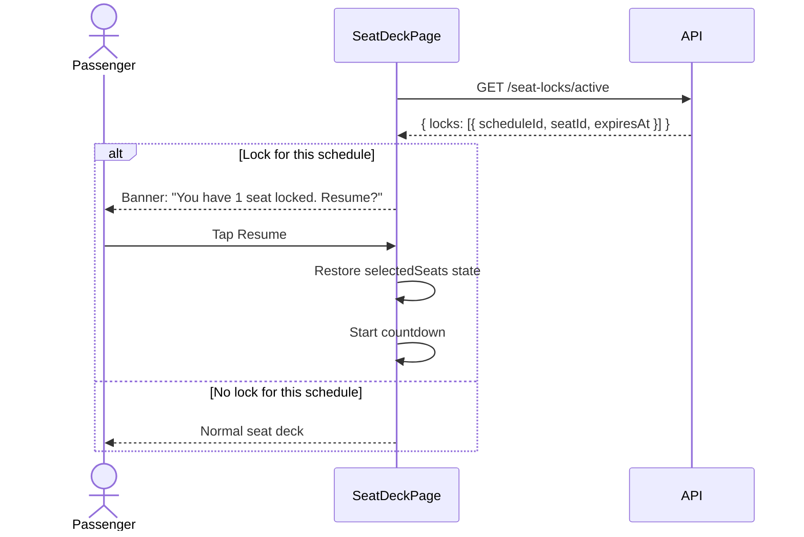

**Resume banner rules:**

| Condition | Display |
|---|---|
| Active lock for this schedule | Banner with seat label(s) + "Resume" |
| Active lock for different schedule | Ignore (do not show) |
| No active lock | No banner |

**Rule:** Never silently restore. Always show the banner with an explicit "Resume" action.

---

## 15. Fallback Polling

**Diagram: Fallback polling**
*If WebSocket fails, client polls `/availability` every 3 seconds. Same data, different transport. Falls back to manual refresh button after 3 failed polls.*

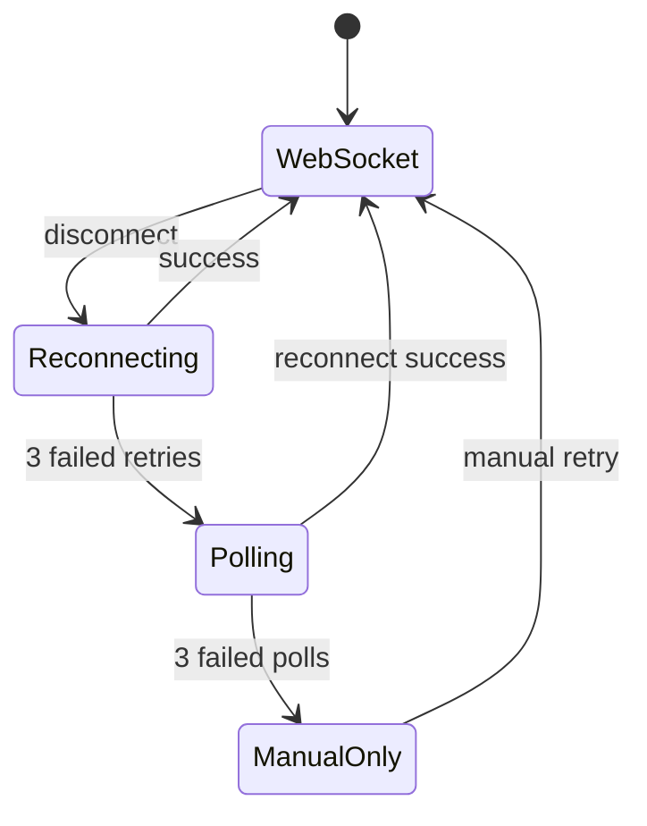

### 15.1 Polling rules

| Aspect | Detail |
|---|---|
| Trigger | WebSocket disconnect + 3 failed reconnection attempts |
| Interval | 3 seconds |
| Endpoint | `GET /v1/passenger/schedules/:id/availability` |
| Merge behavior | Update seat states, don't reset selection |
| Recovery | On WebSocket reconnect, resume real-time |
| Manual fallback | After 3 failed polls, show "Refresh" button, stop auto-poll |

### 15.2 Merge logic

Polling responses must not reset user selections. Merge rule:

```
For each seat in response:
  if seat.state is BOOKED or BLOCKED → overwrite local
  else if seat.id in selectedSeats → keep as MINE
  else if seat.state is LOCKED → overwrite local
  else → overwrite local
```

**Rule:** Selected seats (my locks) always win in the merge.

### 15.3 Polling recovery

When WebSocket reconnects:

1. Stop polling interval
2. Re-subscribe to `seat:availability:{scheduleId}`
3. Resume real-time updates
4. Show toast: "Live updates restored"

---

## 16. Error States

### 16.1 Error matrix

| Error | Trigger | Display | Recovery |
|---|---|---|---|
| Availability load fails | Initial GET | Full-page error with retry | Retry button |
| Lock conflict | 409 on POST | Toast "Seat just taken" | Auto-refresh availability |
| Lock network error | Network failure on POST | Toast "Couldn't lock. Retry?" | Retry on same seat |
| Lock expired on submit | 400 on booking | Toast "Lock expired" | Redirect to results |
| Session expired | 401 | Redirect to login | Return URL preserved |
| Schedule cancelled | 404 on availability | Toast + redirect to results | — |
| All seats booked | Availability empty | Empty state + back button | Navigate to results |
| Release failed | DELETE error | Restore selected, toast | Retry |

### 16.2 Toast messaging

| Error | Toast message | Action |
|---|---|---|
| `SEAT_LOCKED` | "This seat was just taken. Please pick another." | Auto-refresh |
| `LOCK_EXPIRED` | "Your seat lock expired. Please select again." | Redirect |
| Network error | "Connection issue. Tap to retry." | Retry button |
| `SESSION_EXPIRED` | "Session expired. Please log in again." | Redirect |
| `SCHEDULE_CANCELLED` | "This trip has been cancelled." | Redirect |
| Rate limit | "Too many attempts. Try again in {N}s." | Wait |

### 16.3 Empty states

| State | Display | Action |
|---|---|---|
| No seats available | "This bus is fully booked." | "Find another bus" → back to results |
| Availability fails | "Couldn't load seats. Retry?" | Retry button |

---

## 17. Seat Types & 40-Seat Scaling

**Diagram: Layout variants**
*Three layout types use the same grid logic. Cell aspect ratio differs by type. Fuselage height scales with row count.*

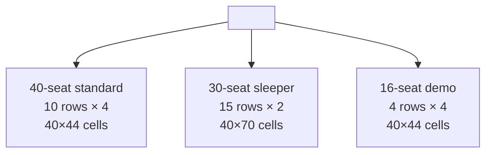

### 17.1 Cell dimensions per seat type

| Type | Width | Height | Icon | Notes |
|---|---:|---:|---|---|
| SEATER | 40px | 44px | `seat` | Standard layout |
| SEMI_SLEEPER | 40px | 60px | `reclined-seat` | Reclined back |
| SLEEPER | 40px | 70px | `bed` | Vertical berth orientation |

**Rule:** Cell width stays 40px for touch target compliance. Height varies by type.

### 17.2 40-seat scaling (Q = A: dynamic height, page scroll)

**Diagram: 40-seat scaling**
*Fuselage height grows with rows. Page scrolls on mobile. All seats visible on desktop, page scrolls on mobile.*

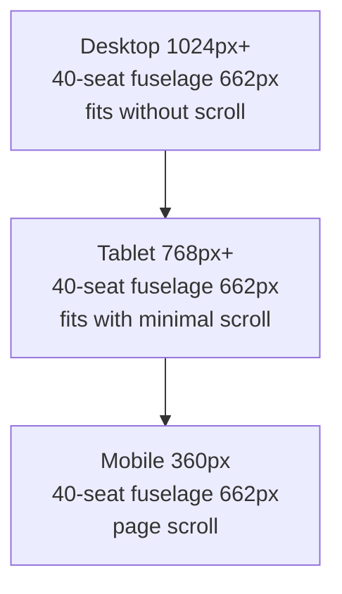

### 17.3 Dynamic fuselage height formula

```ts
const fuselageHeight =
  48 +                              // top padding
  22 + 20 +                         // shield + gap
  (rows * cellHeight) +             // seat cells
  ((rows - 1) * 12) +               // row gaps
  24;                               // bottom padding
```

| Layout | Rows | Cell height | Fuselage height | Mobile scroll |
|---|---:|---:|---:|---|
| 16-seat demo | 4 | 44 | 326px | No |
| 40-seat standard | 10 | 44 | 662px | Yes (page) |
| 30-seat sleeper | 15 | 70 | 1,332px | Yes (page) |

**Rule:** Do not shrink cells below design guide's 40×44. If layout exceeds viewport, allow page scroll.

### 17.4 Aisle detection

The aisle column varies by layout:

| Layout | Aisle column |
|---|---|
| 2+2 seater | Column 2 (between seats 2 and 3) |
| 2+1 sleeper | Column 2 (between seat 2 and 3) |
| 3+2 seater | Column 3 or 4 (source: `layout.aisleCells`) |

**Rule:** Aisle positions come from `layout.aisleCells` — never hardcoded.

---

## 18. Female-Only Seats

**Diagram: Female-only styling**
*Female-only seats use `.seat-fem` class from design guide §5. Rose Magenta full cell tint (not just dot). Tooltip explains.*

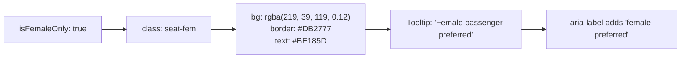

### 18.1 Visual rules (from design guide §5)

| Aspect | Light | Dark |
|---|---|---|
| Background | `rgba(219, 39, 119, 0.12)` | `rgba(236, 72, 153, 0.14)` |
| Border | `#DB2777` | `rgba(236, 72, 153, 0.5)` |
| Text | `#BE185D` | `#F472B6` |

**Rule:** Female-only uses **Rose Magenta** — distinct from emerald (available), amber (locked), slate (booked), and blue (selected).

### 18.2 Behavioral rules

| Condition | Display | Behavior |
|---|---|---|
| Available + female-only | `.seat-fem` | Clickable, acquires lock |
| Selected + female-only | `.seat-sel` (blue) | Female styling lost when selected |
| Locked + female-only | `.seat-lock` (amber) | Locked styling wins |
| Booked + female-only | `.seat-book` (slate) | Booked styling wins |

**Rule:** Female styling only applies to AVAILABLE state. Other states take precedence.

### 18.3 Tooltip and accessibility

- **Tooltip** (on hover/focus): "Female passenger preferred"
- **`aria-label`**: `"Seat 1A, available, female preferred"`
- **Screen reader**: explicitly mentions preference

### 18.4 Enforcement (Phase 1 = visual only)

| Phase | Enforcement |
|---|---|
| Phase 1 | Visual indicator only. Anyone can book any seat. |
| Phase 2 | Enforced for female passengers (booking validation) |

**Rule:** Phase 1 does not enforce female-only. Shows preference only.

---

## 19. Mobile Responsiveness

**Diagram: Responsive breakpoints**
*Three breakpoints. Seat cell size stays at 40×44 across all breakpoints (touch target compliance). Layout adjusts around it.*

```mermaid
flowchart TB
    DESKTOP["Desktop ≥1024px<br/>max 480px fuselage<br/>centered"]
    TABLET["Tablet 768-1023px<br/>max 400px fuselage<br/>centered"]
    MOBILE["Mobile <768px<br/>full width fuselage<br/>page scroll"]

    DESKTOP --> TABLET --> MOBILE
```

### 19.1 Breakpoint behaviors

| Breakpoint | Fuselage width | Seat size | Countdown | Summary |
|---|---|---|---|---|
| ≥1024px | 480px centered | 40×44 | Sticky top | Side panel |
| 768-1023px | 400px centered | 40×44 | Sticky top | Inline above button |
| <768px | Full width - 32px | 40×44 | Sticky top | Bottom sheet |

### 19.2 Mobile-specific rules

| Rule | Detail |
|---|---|
| Cell size | 40×44 unchanged (touch target) |
| Horizontal scroll | Never allowed |
| Aisle width | 24px unchanged |
| Row gap | 12px unchanged |
| Fuselage border | 2px (design guide) |
| Padding | Fuselage 48px top / 24px bottom (design guide) |
| Page scroll | Fuselage height may exceed viewport → page scrolls |

### 19.3 Bottom sheet behavior

On mobile:

- **Continue button** fixed at bottom, always visible
- **Summary** becomes a bottom sheet — expandable
- **Legend** collapses into an icon with tooltip
- **Countdown** sticky at top of viewport

### 19.4 Touch interactions

| Gesture | Behavior |
|---|---|
| Tap on seat | Toggle lock |
| Long press | Show tooltip (if helpful) |
| Swipe on bottom sheet | Expand/collapse |
| Pinch on fuselage | Prevented (no zoom) |
| Pull down | Refresh (if supported) |

---

## 20. Performance

### 20.1 Performance targets

| Concern | Target | Design guide reference |
|---|---|---|
| Availability load | p95 < 300ms | — |
| Lock response | p95 < 50ms | — |
| Real-time event latency | < 100ms | — |
| Grid render (40 seats) | < 16ms (60fps) | — |
| WebSocket reconnect | < 5s | — |
| Polling fallback start | < 10s | — |

### 20.2 Optimization techniques

| Technique | Purpose |
|---|---|
| `React.memo` on SeatCell | Prevent re-render of unchanged seats |
| `useCallback` for onToggle | Stable references |
| Optimistic updates | Perceived <50ms |
| WebSocket event batching | Group multiple seat updates |
| Virtual grid | Not needed at 40 seats, added at 100+ (Phase 2) |
| Debounced countdown | 1s interval not 100ms |
| CSS transitions | No JS animation |
| Font preload | Prevent FOIT |

### 20.3 Memoization strategy

```tsx
const SeatCell = React.memo(({ seat, onToggle }) => {
  // Renders only when seat.state or seat.id changes
}, (prev, next) => {
  return prev.seat.state === next.seat.state
    && prev.seat.id === next.seat.id
    && prev.onToggle === next.onToggle;
});
```

**Rule:** `onToggle` must be wrapped in `useCallback` at parent, or memoization fails.

### 20.4 WebSocket event batching

When many seat events arrive in quick succession (e.g., 5 seats locked in 200ms):

- Batch updates with `requestAnimationFrame`
- Apply all changes in one render cycle
- No per-event render

---

## 21. Test Coverage

### 21.1 Test suites

| Suite | Count | Covers |
|---|---:|---|
| `e2e_seat_deck_load` | 3 | Load, empty, error |
| `e2e_seat_lock` | 4 | Lock, release, conflict, network |
| `e2e_seat_countdown` | 3 | Warning, critical, expiry |
| `e2e_seat_realtime` | 3 | locked, released, booked events |
| `e2e_seat_resume` | 2 | Resume banner, restore |
| `e2e_seat_multi` | 3 | Select 1, select 5, select all |
| `component_seatcell` | 6 | States, click, disabled, aria |
| `component_fuselage` | 4 | Rendering, scaling, aisle, 40 seats |
| `component_countdown` | 3 | Thresholds, expiry, multi |
| `component_summary` | 3 | Update, remove, scroll |
| `component_polling` | 3 | Trigger, merge, recovery |
| `component_theme` | 2 | Toggle, persistence |
| **Total** | **~39** | |

### 21.2 Key assertions

| Test | Asserts |
|---|---|
| `e2e_seat_deck_load` | Availability loads in <300ms |
| `e2e_seat_lock_success` | Tap available → MINE state |
| `e2e_seat_lock_conflict` | 409 → revert + toast |
| `e2e_seat_countdown_warning` | 60s remaining → yellow color |
| `e2e_seat_countdown_expiry` | 0s → redirect to results |
| `e2e_seat_realtime_locked` | Another user locks → seat updates |
| `e2e_seat_resume` | Active lock → banner shown |
| `e2e_seat_multi_all` | Select all 40 seats → summary scrolls |
| `component_seatcell_states` | 5 states render with correct classes |
| `component_seatcell_aria` | ARIA attributes match state |
| `component_fuselage_40` | 40 seats render at correct height |
| `component_countdown_thresholds` | Color changes at 60/30/10s |
| `component_polling_merge` | Selection preserved during poll |
| `component_theme_persist` | Theme survives reload |

### 21.3 Reference

Full test strategy in `10-TESTING-STRATEGY.md` §8 (E2E). Contract tests in `07` §15.5.

---

## 22. Open Questions

| # | Question | Owner | Default |
|:---:|---|---|---|
| 1 | Show legend on all screen sizes? | Shaghaf | Yes, collapsible on mobile |
| 2 | Animate lock acquisition (design guide CSS)? | Shaghaf | Yes, 150ms ease-out |
| 3 | Haptic feedback on lock? | Shaghaf | No (Phase 2) |
| 4 | Show "Seat A1 is yours" label overlay? | Shaghaf | No, use MINE state |
| 5 | Confirm dialog before releasing lock? | Shaghaf | No (instant release) |
| 6 | Show lock owner initial? | Shaghaf | No (privacy) |
| 7 | Show max seats indicator? | Shaghaf | No (unlimited per Q3=C) |
| 8 | Polling failure count before manual refresh? | Shaghaf | 3 |
| 9 | WebSocket reconnect backoff intervals? | Shaghaf | 1s, 2s, 4s, 8s, 16s |
| 10 | Persist selection across tab close? | Shaghaf | No (lock expires anyway) |

---

## 23. Checklist Against Master List

| Item | Included? | Section |
|---|:---:|---|
| Purpose and scope | ✅ | §1 |
| Doc hierarchy | ✅ | §1.2 |
| Prerequisites | ✅ | §2 |
| Resume prerequisite | ✅ | §2.2 |
| Design guide reference | ✅ | §3 |
| Reference table | ✅ | §3.1 |
| Seat data model | ✅ | §4 |
| Seat object shape | ✅ | §4.1 |
| Layout object shape | ✅ | §4.2 |
| State derivation | ✅ | §4.3 |
| Screen layout | ✅ | §5 |
| Top bar contents | ✅ | §5.1 |
| Region behaviors | ✅ | §5.2 |
| Component tree | ✅ | §6 |
| Component contracts | ✅ | §6.1 |
| Component ownership | ✅ | §6.2 |
| Seat cell implementation | ✅ | §7 |
| State → CSS class mapping | ✅ | §7.1 |
| Behavior rules per state | ✅ | §7.2 |
| Accessibility additions | ✅ | §7.3 |
| Dimension rules | ✅ | §7.4 |
| Hover and animation | ✅ | §7.5 |
| Reduced motion | ✅ | §7.6 |
| Fuselage rendering | ✅ | §8 |
| Fuselage dimensions | ✅ | §8.1 |
| Height calculation | ✅ | §8.2 |
| Aisle rendering | ✅ | §8.3 |
| Dual theme integration | ✅ | §9 |
| Theme tokens used | ✅ | §9.1 |
| Theme switching | ✅ | §9.2 |
| Theme test coverage | ✅ | §9.3 |
| Font loading | ✅ | §10 |
| Font loading implementation | ✅ | §10.1 |
| Font stack | ✅ | §10.2 |
| Font usage | ✅ | §10.3 |
| Lock flow | ✅ | §11 |
| Optimistic UI rules | ✅ | §11.1 |
| Lock release | ✅ | §11.2 |
| Lock API calls | ✅ | §11.3 |
| Lock state tracking | ✅ | §11.4 |
| Real-time updates | ✅ | §12 |
| Event handling matrix | ✅ | §12.1 |
| Subscription lifecycle | ✅ | §12.2 |
| Event payloads | ✅ | §12.3 |
| Lock countdown | ✅ | §13 |
| Countdown states | ✅ | §13.1 |
| Countdown implementation | ✅ | §13.2 |
| Countdown rules | ✅ | §13.3 |
| Expiry behavior | ✅ | §13.4 |
| Multi-seat selection (no limit) | ✅ | §14 |
| Selection rules | ✅ | §14.1 |
| Warning UX for large selections | ✅ | §14.2 |
| Summary component | ✅ | §14.3 |
| Resume from active lock | ✅ | §14.4 |
| Fallback polling | ✅ | §15 |
| Polling rules | ✅ | §15.1 |
| Merge logic | ✅ | §15.2 |
| Polling recovery | ✅ | §15.3 |
| Error states | ✅ | §16 |
| Error matrix | ✅ | §16.1 |
| Toast messaging | ✅ | §16.2 |
| Empty states | ✅ | §16.3 |
| Seat types | ✅ | §17 |
| Cell dimensions per type | ✅ | §17.1 |
| 40-seat scaling | ✅ | §17.2 |
| Height formula | ✅ | §17.3 |
| Aisle detection | ✅ | §17.4 |
| Female-only styling | ✅ | §18 |
| Visual rules | ✅ | §18.1 |
| Behavioral rules | ✅ | §18.2 |
| Tooltip and a11y | ✅ | §18.3 |
| Enforcement phase | ✅ | §18.4 |
| Mobile responsiveness | ✅ | §19 |
| Breakpoint behaviors | ✅ | §19.1 |
| Mobile-specific rules | ✅ | §19.2 |
| Bottom sheet behavior | ✅ | §19.3 |
| Touch interactions | ✅ | §19.4 |
| Performance | ✅ | §20 |
| Performance targets | ✅ | §20.1 |
| Optimization techniques | ✅ | §20.2 |
| Memoization strategy | ✅ | §20.3 |
| WebSocket batching | ✅ | §20.4 |
| Test coverage | ✅ | §21 |
| Test suites | ✅ | §21.1 |
| Key assertions | ✅ | §21.2 |
| Open questions | ✅ | §22 |

**All items covered. ~26 Mermaid diagrams. Every diagram described.**

---

## 24. Summary

**The BusVerse seat matrix UI is specified across 24 sections and 26 diagrams, with the visual layer authoritative from `Design_guide.html` and the behavior layer specified here.** The design guide is now canonical for: dual theme tokens (14 seat-related tokens for light + dark), seat cell CSS (40×44px, 8px 8px 10px 10px radius, `::after` shadow strip, locked 2.2s breathing animation, selected `-2px` lift + glow, hover `-2px` lift), bus fuselage (36px 36px 18px 18px radius, 48px top padding, cyan front shield), font stack (Plus Jakarta Sans + JetBrains Mono, preloaded via Google Fonts), and full token block (§9). This doc specifies: seat data model (id, label, row, column, type, isFemaleOnly, state, lockedUntil; layout object with rowsCount, columnsCount, aisleCells), state derivation (5 states, client-managed, WebSocket-updated), component tree (SeatDeckPage → SeatDeckHeader, LockCountdown, BusFuselage with SeatRow → SeatPair → SeatCell, SeatLegend, SelectedSeatsSummary, ContinueButton), lock flow with optimistic UI + 3s timeout (POST /seat-locks success → MINE, 409 conflict → revert + toast + auto-refresh), lock release via DELETE /seat-locks/:id with optimistic remove + restore on failure, WebSocket subscription to `seat:availability:{scheduleId}` on mount with event handling for `seat:locked` / `seat:released` / `seat:booked` (with `lockedByMe` check to skip my own events), lock countdown with 5 states (Idle, Normal >60s, Warning 30-60s, Critical 10-30s, Expiring <10s disables button, Expired → redirect), countdown uses server-authoritative time with clock offset calculation, updates every 1 second based on earliest lock expiry, multi-seat selection with **no artificial limit** (per Q3=C — up to physical bus capacity), warning UX for >6 seats and all-seats confirmation, summary scrollable beyond 6 seats, resume banner on mount if active lock exists (via GET /seat-locks/active), fallback polling every 3s after 3 WebSocket failures with merge logic that preserves user selections, error states for 8 scenarios (availability load, lock conflict, network, expiry, session, cancellation, empty, release failure), seat types (SEATER 40×44, SEMI_SLEEPER 40×60, SLEEPER 40×70) with dynamic fuselage height formula = 48+42+(rows×cellHeight)+((rows-1)×12)+24, female-only seats using Rose Magenta full-tint from design guide (bg `rgba(219,39,119,0.12)` light / `rgba(236,72,153,0.14)` dark, border `#DB2777` / `rgba(236,72,153,0.5)`, text `#BE185D` / `#F472B6`) — Phase 1 is visual-only, mobile responsiveness with 3 breakpoints (≥1024px, 768-1023px, <768px) and cell size staying at 40×44 for touch target compliance, page scroll for 40-seat buses on mobile, performance targets (availability p95<300ms, lock p95<50ms, event latency <100ms, grid render <16ms), optimization via React.memo + useCallback + WebSocket event batching + 1s countdown interval, and ~39 tests across 12 suites (11 E2E, 28 component). Ten open questions remain, all with Phase-1 defaults. The design guide wins for all visuals; this doc wins for all behavior.**

---

**End of Document `busverse/02-SEAT-MATRIX-UI.md` v1.0.**