# `busverse/03-PAYMENT-REFUND-FLOW.md`

**Document:** `busverse/03-PAYMENT-REFUND-FLOW.md`
**Project:** BusVerse + BusCon
**Version:** 1.0
**Status:** Locked — Product Document
**Owner:** Shaghaf
**Guide:** Mr. Mohit Srivastav
**Purpose:** The detailed payment-execution and refund-flow specification for BusVerse. Covers everything that happens after the booking form submits — Razorpay checkout, webhook processing, booking confirmation, GST invoicing, payment timeout, cancel-and-refund, and refund tier calculation. This document owns two screens (`SCR-BV-CHECKOUT`, `SCR-BV-CANCEL`), the payment state machine on the client, the refund tier calculator's exact contract, and every UI state the passenger sees during the money path. Every BusVerse payment/refund implementation and test traces back to this document.

> **Derives from:** `busverse/00-OVERVIEW.md` (navigation), `busverse/01-PASSENGER-WORKFLOWS.md` §5.9 (handoff with router state), `02-REQUIREMENTS.md` §6.3 (FR-BV-027 to FR-BV-033 payment, FR-BV-042 to FR-BV-045 cancel — 11 FRs total), `03-SYSTEM-ARCHITECTURE.md` §12 (async processing), §17.5 (circuit breaker), `04-ACTORS-ROLES-PERMISSIONS.md` §9.1 (passenger permission grid), `05-DOMAIN-MODEL.md` v1.2 §8.1 (booking lifecycle), §8.2 (payment lifecycle), `06-DATABASE-SCHEMA.md` v1.2 §3.5 (webhook transaction), §6.3 (`bookings.expired_at`), §7.2 (`payments.expired_at`), §7.3 (`refunds.refund_tier`), §15 (`expire_pending_bookings` cron), `07-API-AND-REALTIME-CONTRACTS.md` v1.2 §4.5 (booking + refund preview), §4.6 (payment), §9.2 (49 error codes), §11 (idempotency), §13 (webhooks), `08-WORKFLOWS.md` v1.1 §4.4 (WF-P-04), §4.7 (WF-P-07), §9.1 (WF-N-01), §9.2 (WF-N-02a/b), §9.3 (WF-N-03), `09-SECURITY-AND-PLATFORM-RULES.md` v1.2 §9 (idempotency), §13 (webhooks incl. DB fallback), §16 (rate limits), `10-TESTING-STRATEGY.md` v1.2 §5.5 (refund tier unit tests), §7.6 (new contract tests), §10 (concurrency).

> **Referenced by:** `busverse/04-TICKET-AND-TRACKING.md` (success handoff), `busverse/05-UI-SPEC.md` (checkout + cancel screens), `report/14-MODULE_DESCRIPTION.md`, `report/15-SCREENSHOTS_UI.md`, `viva/03-DEMO_SCRIPT.md`.

---

## 1. Purpose and Scope

### 1.1 What this document owns

| Owns here | Referenced from upstream |
|---|---|
| WF-P-04b payment sequence | `08` §4.4 |
| WF-P-07 cancel sequence | `08` §4.7 |
| WF-N-01 payment-fail retry detail | `08` §9.1 |
| WF-N-02b payment-timeout | `08` §9.2 |
| **Refund tier calculator** (canonical) | `07` §4.5 |
| Refund-preview response semantics | `07` §4.5 |
| Payment countdown (15-min window) | `06` §15 |
| Razorpay checkout integration (client side) | `07` §4.6, `09` §13 |
| Webhook client-side polling strategy | `07` §4.6, §13.3 |
| Payment idempotency + retry rule | `07` §4.6, §11.2 |
| GST invoice link on ticket | `06` §7.4 |
| Client payment state machine | `05` §8.2 |
| Component structure for checkout/cancel screens | — |
| Error states for money path | `07` §9 |
| Money-path tests | `10` §5.5, §7.6, §10 |

### 1.2 Document hierarchy

**Diagram: Document hierarchy**
*This doc sits inside the BusVerse folder. It receives a router-state handoff from `01-PASSENGER-WORKFLOWS` and hands off to `04-TICKET-AND-TRACKING` on success. It owns two screens (`SCR-BV-CHECKOUT`, `SCR-BV-CANCEL`). It is the canonical reference for refund tier calculation — every doc that mentions a refund tier, from `05` to `11`, cites §10 of this doc.*

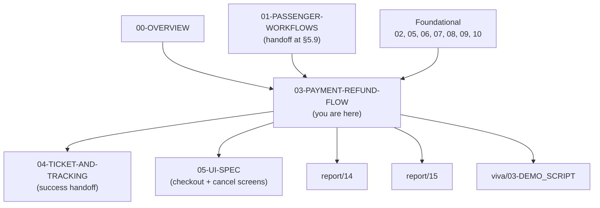

### 1.3 What this document does NOT cover

| Topic | Goes to |
|---|---|
| Booking form (up to PENDING creation) | `busverse/01-PASSENGER-WORKFLOWS.md` §5 |
| Seat deck + lock acquisition | `busverse/02-SEAT-MATRIX-UI.md` |
| Ticket display, QR rendering | `busverse/04-TICKET-AND-TRACKING.md` |
| My Trips list of bookings | `busverse/04-TICKET-AND-TRACKING.md` |
| Backend Razorpay adapter internals | `03-SYSTEM-ARCHITECTURE.md` §6 |
| Webhook DB fallback internals | `09-SECURITY-AND-PLATFORM-RULES.md` §13.5 |
| Admin refund from BusCon | `buscon/` folder (out of scope) |
| Refund settlement / NEFT payout | `01-PLAN-AND-SCOPE.md` §11 (deferred) |

### 1.4 Scope of this document

**Three flows** (with defined boundaries):

| # | Flow | FRs | Screens | In | Out |
|:---:|---|---|---|---|---|
| 1 | Payment (WF-P-04b) | FR-BV-027 to 033 | `SCR-BV-CHECKOUT` | `bookingId` in router state | CONFIRMED booking → ticket (`04`) |
| 2 | Cancel (WF-P-07) | FR-BV-042 to 045 | `SCR-BV-CANCEL` | `bookingId` in router state | CANCELLED booking + refund `INITIATED` |
| 3 | Timeout (WF-N-02b) | FR-BV-033 | `SCR-BV-CHECKOUT` | `bookingId` in router state | EXPIRED booking → back to search |

**Rule:** Every boundary is explicit. No handoff is left implicit.

---

## 2. Workflow Map

**Diagram: Payment and refund workflow map**
*Six workflows converge on this document. WF-P-04b (payment) is the happy path. WF-P-07 (cancel) is the passenger-initiated side branch. WF-N-01 (payment fail → retry) is the failure branch. WF-N-02b (payment timeout) is the passive-timeout branch. WF-N-03 (operator cancel) is not initiated by the passenger — it is the state after operator cancel cascades. WF-N-02a (lock expiry during form) is handled by `01` §5.10, not by this doc; this doc only references it.*

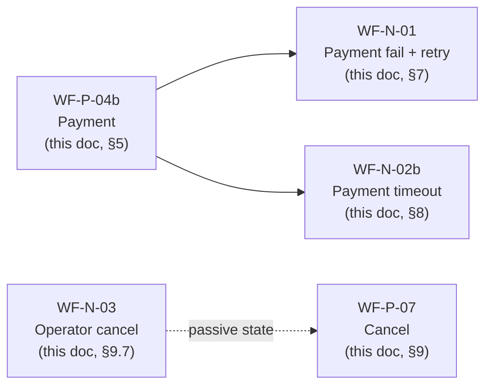

### 2.1 Coverage table

| Flow | FRs | In | Out | Owner |
|---|---|---|---|---|
| Payment | FR-BV-027 to 033 | PENDING booking | CONFIRMED booking | This doc |
| Cancel | FR-BV-042 to 045 | CONFIRMED booking | CANCELLED + refund | This doc |
| Timeout | FR-BV-033 | PENDING booking | EXPIRED booking | This doc |
| Payment fail → retry | FR-BV-030 | FAILED payment | New payment attempt | This doc |
| Operator cancel | FR-BV-044 | CONFIRMED booking | CANCELLED + TIER_FULL refund | This doc (passive) |
| Lock expiry before booking | FR-BV-013 | Active lock | Lock gone | `01` §5.10 (referenced) |

### 2.2 FR mapping per flow

| Flow | FR-BV IDs |
|---|---|
| Payment | 027, 028, 029, 030, 031, 032, 033 |
| Cancel | 042, 043, 044, 045 |

**Reference:** Full FR text in `02-REQUIREMENTS.md` §6.3.

---

## 3. Prerequisites and Handoff

### 3.1 Prerequisites flow

**Diagram: Prerequisites flow**
*Checkout is reached from the booking form (`01` §5.9). It requires: a `PENDING` booking, an authenticated session, and a valid `expiresAt`. The cancel screen is reached from My Trips (owned by `04`). It requires a `CONFIRMED` booking and authenticated session.*

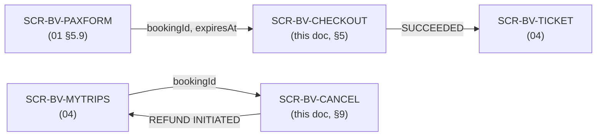

### 3.2 Prerequisites table

| Requirement | Enforced by |
|---|---|
| User authenticated | Auth guard on route |
| `bookingId` in router state | Route validation |
| `expiresAt` in router state | Route validation (v1.0) |
| Booking status `PENDING` (checkout) | `GET /bookings/:id` on mount |
| Booking status `CONFIRMED` (cancel) | `GET /bookings/:id` on mount |
| `expiresAt > now()` (checkout) | Countdown check on mount |
| Departure in future (cancel) | `refund-preview` returns `TIER_NOT_ELIGIBLE` |

### 3.3 Canonical router state

**`01` §5.9** defined router state as:
```typescript
{ bookingId, scheduleId, lockId, totalFarePaise }
```

**This doc extends it** (v1.0):
```typescript
{
  bookingId: string,
  scheduleId: string,
  lockId: string,           // for potential release
  totalFarePaise: number,
  expiresAt: string         // ISO 8601 — server-authoritative payment deadline
}
```

**Why `expiresAt` matters:** the checkout screen must show a countdown. Without it, the client has no way to know the 15-minute window. The server returns `expiresAt` in the `POST /bookings` response (per `07` v1.2 §4.5). `01` §5.9's list must be extended in any implementation that reads from it — this doc is the canonical source.

**Rule:** If `bookingId` or `expiresAt` is not in router state, checkout redirects to home. Prevents deep-linking without a booking.

### 3.4 Entry checks per screen

**Checkout screen (`SCR-BV-CHECKOUT`):**

| Check | On mount | Action if failed |
|---|---|---|
| `bookingId` present | Router state | Redirect to home |
| `expiresAt` present | Router state | Redirect to home |
| `expiresAt > now()` | Parse ISO, compare | Redirect to search with toast "Payment window expired" |
| Booking status | `GET /bookings/:id` | If `PENDING` → allow; if `CONFIRMED` → skip checkout, go to ticket; if `EXPIRED`/`FAILED` → redirect with toast; if `CANCELLED` → redirect to My Trips |
| Booking owned by user | Response validation | If `404` → redirect to home |

**Cancel screen (`SCR-BV-CANCEL`):**

| Check | On mount | Action if failed |
|---|---|---|
| `bookingId` present | Router state | Redirect to My Trips |
| Booking status | `GET /bookings/:id` | If `CONFIRMED` → allow; if `CANCELLED` → redirect to My Trips with toast; if `COMPLETED` → redirect with toast; if `EXPIRED`/`FAILED` → redirect to search |
| Booking owned by user | Response validation | If `404` → redirect to My Trips |
| Departure in future | `refund-preview` returns tier | If `TIER_NOT_ELIGIBLE` → allow cancel with 0% refund + warning |

---

## 4. Client Payment State Machine

### 4.1 The client state machine

**Diagram: Client payment state machine**
*Five states. Entering from `PENDING` booking. INITIATED while opening Razorpay. POLLING while waiting for webhook. SUCCEEDED on confirmation. FAILED on failure. EXPIRED on timeout. Each state has a defined UI and a defined exit.*

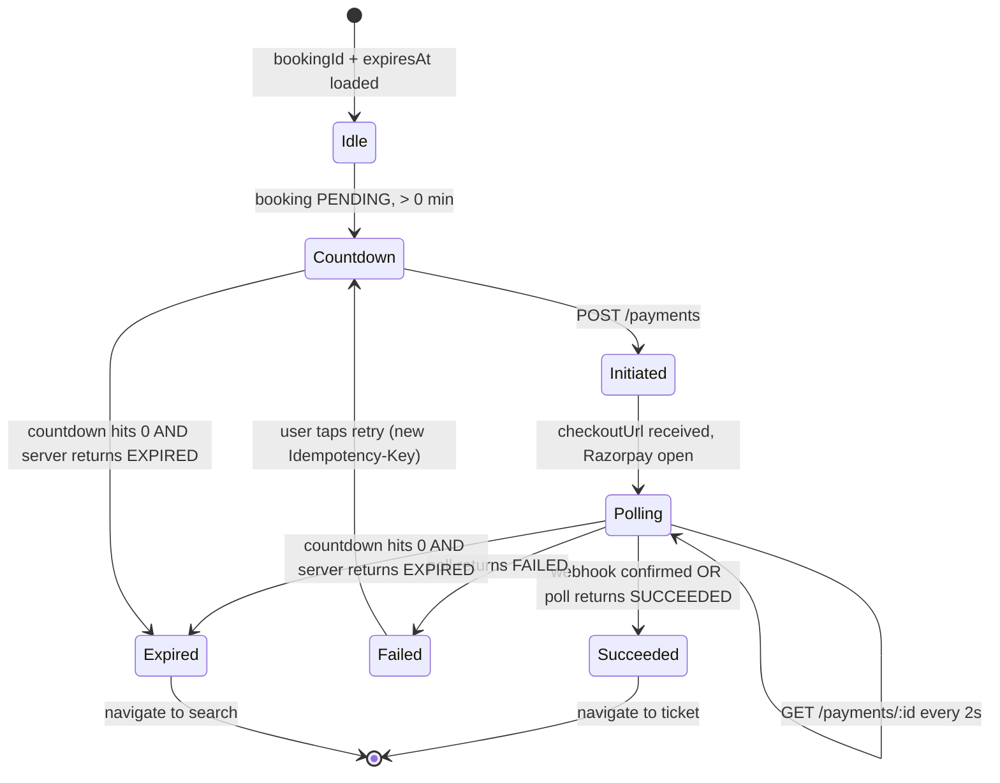

### 4.2 State table

| State | UI | Actions | Exit conditions |
|---|---|---|---|
| **Idle** | Loading skeleton | None | `GET /bookings/:id` returns PENDING with valid `expiresAt` |
| **Countdown** | "Pay ₹X now — 14:32 remaining" + Pay button | Tap Pay, cancel, navigate back | Tap Pay → INITIATED; countdown 0 → EXPIRED; back → stays in Countdown (background poll) |
| **Initiated** | "Opening Razorpay..." + spinner | — | Razorpay opens → POLLING; POST fails → stays Countdown with error toast |
| **Polling** | Razorpay checkout visible (browser tab) | — | Payment succeeds → SUCCEEDED; payment fails → FAILED; 15 min → EXPIRED |
| **Succeeded** | "Booking confirmed! Redirecting..." + spinner | — | Auto-redirect to `SCR-BV-TICKET` after 1s |
| **Failed** | "Payment failed. Retry?" + Retry button | Retry (new key), cancel | Retry → Countdown; cancel → search |
| **Expired** | "Payment window expired" + "Search again" | Search again | Navigate to search |

### 4.3 State transition rules

| From | To | Trigger | Notes |
|---|---|---|---|
| Idle | Countdown | Booking PENDING with valid `expiresAt` | Most common entry |
| Idle | Expired | Booking already EXPIRED | Rare — direct navigation |
| Countdown | Initiated | User taps Pay | POST /payments [idem-new] |
| Initiated | Polling | `checkoutUrl` received | Razorpay checkout opens |
| Initiated | Countdown | POST fails (network, 5xx) | Error toast + retry enabled |
| Polling | Succeeded | WebSocket `booking:confirmed` OR poll `payments.status = SUCCEEDED` | Two-path convergence |
| Polling | Failed | Poll `payments.status = FAILED` OR WebSocket `booking:failed` | Only on payment.failed webhook |
| Polling | Expired | Countdown 0 AND poll returns EXPIRED | Polls every 5s until server confirms |
| Failed | Countdown | User taps Retry | New `Idempotency-Key` required |
| Countdown | Expired | Countdown 0 AND poll returns EXPIRED | Same as from Polling |

### 4.4 Countdown source of truth

The countdown is driven by `expiresAt` from `POST /bookings` (server-authoritative). The client calculates `remaining = expiresAt - now()`. The client never decides "expired" on its own — it always polls the server to confirm.

**Why:** The `expire_pending_bookings` cron runs every 5 minutes (per `06` v1.2 §15). During the cron lag window (~5 min), the client countdown may hit 0 while the server still reports `PENDING`. The client shows "Verifying..." and polls every 5s until the server returns `EXPIRED`.

**Rule:** Never show "Expired" based on countdown alone. Always confirm with server first.

---

## 5. Payment Flow (WF-P-04b)

### 5.1 Flow sequence

**Diagram: Payment flow sequence**
*Full payment sequence. Booking form submits → PENDING booking with `expiresAt`. User taps Pay → POST /payments [idem-new] → Razorpay order. Razorpay checkout opens. User pays. Razorpay webhook (authoritative) confirms via the webhook transaction (per `06` v1.2 §3.5 — `payments SUCCEEDED`, `tickets INSERT`, `gst_invoices INSERT`, `bookings CONFIRMED`, `seat_locks DELETE`). Client polls or receives WebSocket to see SUCCEEDED. Redirect to ticket.*

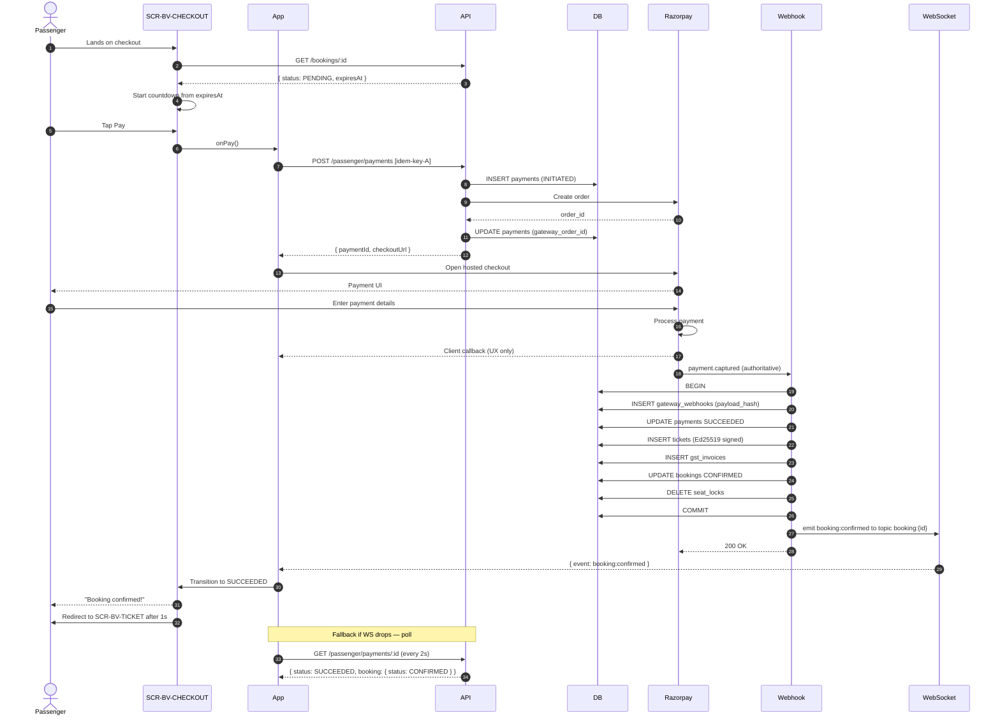

### 5.2 Endpoint chain

| # | Method | Path | Role | Idempotency | Notes |
|:---:|---|---|---|---|---|
| 1 | GET | `/v1/passenger/bookings/:id` | REGISTERED | — | On mount; verifies PENDING |
| 2 | POST | `/v1/passenger/payments` | REGISTERED | **[idem-new]** | First attempt |
| 3 | GET | `/v1/passenger/payments/:id` | REGISTERED | — | Poll every 2s |
| 4 | WS | topic `booking:{bookingId}` | REGISTERED | — | Subscribe on mount |

### 5.3 Payment initiation request

```
POST /v1/passenger/payments
Authorization: Bearer <jwt>
Idempotency-Key: <NEW UUIDv4>
Content-Type: application/json

{ "bookingId": "bkg_xyz", "method": "UPI" }
```

**Note on `method`:** The client sends its intent (e.g., `UPI`), but Razorpay's hosted checkout lets the user change method at payment time. The value sent is advisory; the actual method is captured by Razorpay's webhook.

**Payment response:**

```json
{
  "data": {
    "paymentId": "pay_abc",
    "checkoutUrl": "https://rzp.io/l/...",
    "status": "INITIATED",
    "amountPaise": 48750,
    "expiresAt": "2026-10-24T14:45:00.000Z"
  }
}
```

**Reference:** `07` v1.2 §4.6.

### 5.4 Razorpay checkout — client integration

**Diagram: Razorpay checkout integration**
*The client opens Razorpay's hosted checkout via redirect or embedded iframe. The checkout handles all payment methods (UPI, cards, netbanking, wallets). The client returns to our app after success/failure/cancel. Razorpay also fires a webhook — which is the authoritative confirmation.*

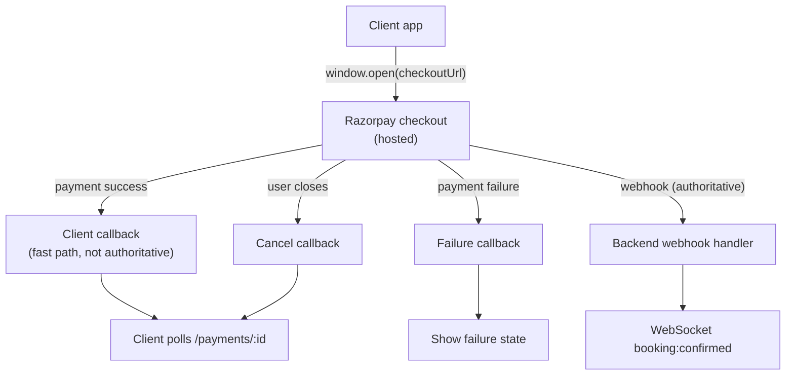

**Client integration rules:**

| Rule | Detail |
|---|---|
| Checkout opens in new tab or iframe | Both supported; iframe preferred for mobile |
| Redirect URL | `https://busverse.app/checkout/return?paymentId=pay_abc` |
| Return tab behavior | On return, client enters POLLING state, polls every 2s |
| Client callback is UX only | Never treat client callback as confirmation |
| User closes tab without paying | Client sees no callback; polling continues from original tab (if still open) |
| User closes original tab | Polling stops; on next `/bookings/:id` fetch, booking is either CONFIRMED (webhook succeeded) or EXPIRED (timeout) |

### 5.5 State changes

| Table | Before | After |
|---|---|---|
| `payments` | 0 | 1 `INITIATED` → `SUCCEEDED` |
| `bookings` | `PENDING` | `CONFIRMED` |
| `tickets` | 0 | 1 `ISSUED` |
| `gst_invoices` | 0 | 1 row |
| `seat_locks` | 1 row (TTL extended) | 0 (deleted at webhook) |
| `gateway_webhooks` | 0 | 1 row (with `payload_hash`) |
| `audit_logs` | — | `payment_initiated`, `payment_succeeded`, `ticket_issued` |

**Reference:** `06` v1.2 §3.5 webhook transaction; `05` v1.2 §8.1 booking lifecycle.

### 5.6 Webhook processing (server-side)

The webhook transaction is documented in `06` v1.2 §3.5. Summary:

1. `INSERT gateway_webhooks` (with `payload_hash`)
2. `UPDATE payments SUCCEEDED`
3. `INSERT tickets` (Ed25519-signed QR — first time this row exists)
4. `INSERT gst_invoices` (invoice_number from sequence)
5. `UPDATE bookings CONFIRMED`
6. `DELETE seat_locks`
7. `INSERT audit_logs` (async after commit)

**DB error fallback:** If the transaction fails (per `09` v1.2 §13.5), the webhook handler writes the raw body to `/tmp/webhooks/{uuid}.json` before returning 200. A replay job retries every 60s. No webhook is ever lost.

**Client impact:** None — the client polling `/payments/:id` will see `INITIATED` until the webhook transaction commits. Once committed, polling returns `SUCCEEDED`.

### 5.7 GST invoice

The GST invoice is created in the same webhook transaction as the ticket. The client does not see the invoice on the checkout screen — it appears on the ticket screen (`SCR-BV-TICKET`, owned by `04-TICKET-AND-TRACKING.md` §7).

**Client contract:** After CONFIRMED, the ticket screen fetches `GET /passenger/bookings/:id` which includes `gstInvoiceAvailable: true` and an invoice download URL. That handoff is owned by `04`.

---

## 6. Payment Confirmation UX (WebSocket vs. Poll Reconciliation)

### 6.1 Two-path convergence

**Diagram: Two-path convergence**
*The client sees confirmation from two sources: WebSocket `booking:confirmed` (fast) and poll `GET /payments/:id` returning `SUCCEEDED` (reliable). Whichever arrives first wins. The second is idempotently ignored.*

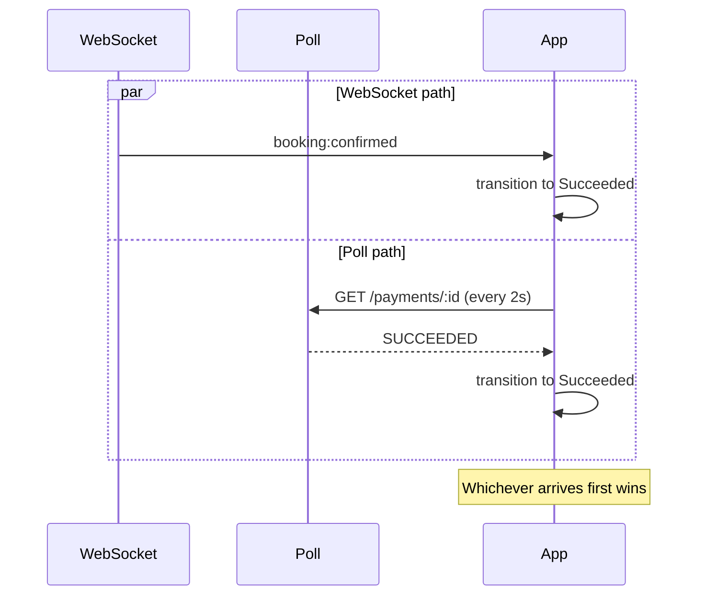

### 6.2 Reconciliation rules

| Scenario | Client behavior |
|---|---|
| WebSocket arrives first | Transition to SUCCEEDED; cancel polling |
| Poll arrives first | Transition to SUCCEEDED; close WS connection |
| Both arrive | Idempotent — SUCCEEDED is terminal |
| WS drops, poll continues | Poll keeps running; UI unaffected |
| Poll fails (network), WS continues | WS drives state; on WS reconnect, resume |
| Both fail | Show "Connection issue" + retry button; on retry, re-poll |

### 6.3 Polling strategy

| State | Poll interval | Max duration |
|---|---|---|
| POLLING (waiting for webhook) | 2s | 15 min (until `expiresAt`) |
| POLLING with 5xx errors | 5s (backoff) | 15 min |
| After countdown 0 | 5s | 5 min (cron lag window) |

**Rule:** Every poll hits `GET /v1/passenger/payments/:id` (not `/bookings/:id`). The payment endpoint is the fastest source of truth after payment.

**Backoff on network errors:** First 5 errors → 2s. 6th–10th → 5s. 11th+ → 10s. Reset on success.

### 6.4 WebSocket subscription

| Aspect | Detail |
|---|---|
| Topic | `booking:{bookingId}` |
| Subscribe on | Mount (from PENDING state) |
| Unsubscribe on | Transition to SUCCEEDED/FAILED/EXPIRED |
| Reconnect on | Automatic (with backoff) |
| Events listened for | `booking:confirmed`, `booking:cancelled` (unlikely), `booking:expired` |

**Reference:** `07` v1.2 §8.7 event catalog.

---

## 7. Payment Failure + Retry (WF-N-01)

### 7.1 Flow sequence

**Diagram: Payment failure + retry sequence**
*Payment fails via webhook. Booking becomes FAILED. Client transitions to FAILED state. User retries with new Idempotency-Key (fresh UUIDv4). Re-lock is required — the webhook failure deleted the seat lock. New payment attempt proceeds as fresh.*

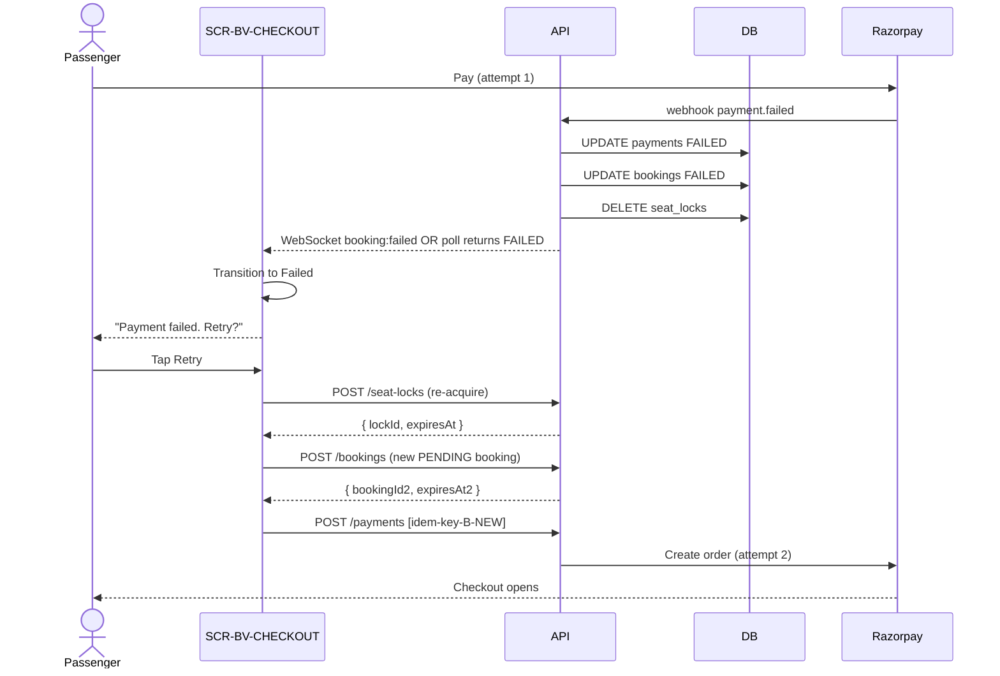

### 7.2 Retry rules

| Rule | Detail |
|---|---|
| **New `Idempotency-Key` required** | Retry with old key returns cached failed response (per `07` v1.2 §11.2) |
| Re-lock required | Webhook failure deletes the seat lock (per `06` v1.2 §3.5) |
| Re-book required | Original booking is `FAILED`; retry creates new `PENDING` booking |
| Booking must be FAILED (not EXPIRED) | Once `expire_pending_bookings` runs, retry returns `PAYMENT_NOT_ALLOWED` |
| Old FAILED booking is preserved | For audit trail; never deleted |
| Retry window | Limited by 15-min payment window (per `07` v1.2 §4.5) |

### 7.3 Retry UX

**Diagram: Retry UI flow**
*The Failed state has two actions: Retry and Search. Retry re-locks, re-books, and re-pays. Search abandons and returns to search.*

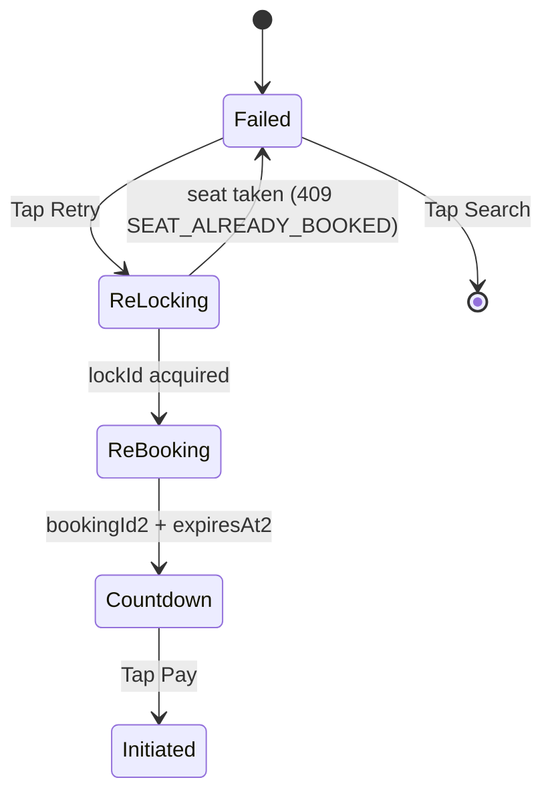

**Failure cases during retry:**

| Failure | UX |
|---|---|
| Seat already booked (another user got it) | "Seat was taken while you were retrying. Pick another." → search |
| Seat locked by another user | Same as above |
| Booking window expired | "Payment window closed. Book again." → search |
| Network error | Retry button remains enabled |

### 7.4 Edge cases

| Scenario | Behavior |
|---|---|
| User retries 3 times | Allowed until booking window closes |
| User retries after webhook delay | Polling picks up FAILED; UI shows Failed |
| User abandons after fail | On next `/bookings` fetch, sees `FAILED` state |
| User retries while Razorpay still open | Checkout state prevents double-open |

---

## 8. Payment Timeout (WF-N-02b)

### 8.1 Flow sequence

**Diagram: Payment timeout sequence**
*The client countdown hits 0 at exactly 15 minutes from booking creation. Client polls to verify server state. Server has not yet run `expire_pending_bookings` (5-min cron). Client shows "Verifying..." and polls every 5s. Eventually cron fires, booking becomes EXPIRED, client transitions to Expired. Subsequent payment attempts return `PAYMENT_NOT_ALLOWED`.*

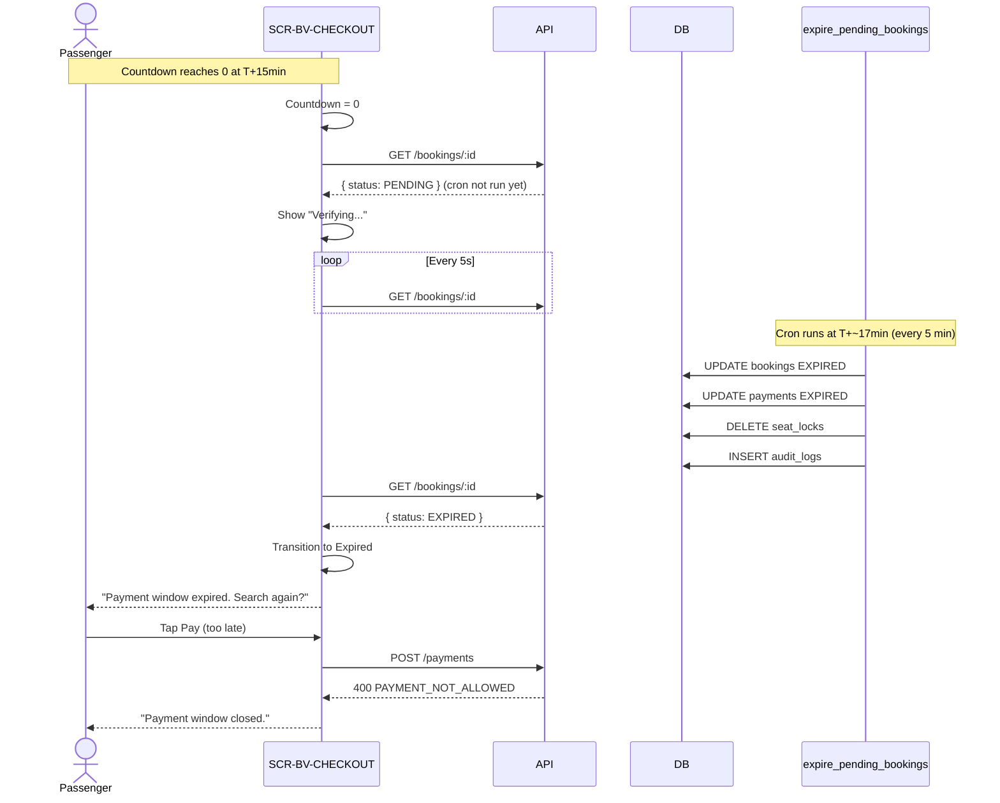

### 8.2 Timeout states

| Time | Client state | UI |
|---|---|---|
| T+0min (landing) | Countdown | "Pay ₹X now — 14:32 remaining" |
| T+14:00min | Countdown (warning) | "Pay ₹X now — 1:00 remaining" (yellow) |
| T+15:00min | Verifying | "Verifying payment window... please wait" (spinner) |
| T+15:00 to T+20:00min | Verifying (polling) | Same; polls every 5s |
| T+20:00min+ (cron ran) | Expired | "Payment window expired. Search again?" |

### 8.3 Countdown implementation

```ts
// Server-authoritative time offset (calculated at page load)
const serverTimeOffset = serverTimeMs - clientTimeMs;
const effectiveNow = () => Date.now() + serverTimeOffset;

// Countdown update
useEffect(() => {
  const interval = setInterval(() => {
    const remaining = Math.max(0, expiresAtMs - effectiveNow());
    setRemainingMs(remaining);
    if (remaining === 0) handleCountdownExpired();
  }, 1000);
  return () => clearInterval(interval);
}, [expiresAtMs]);

function handleCountdownExpired() {
  setState('verifying');
  startVerificationPolling();
}
```

### 8.4 Verification polling

| Aspect | Detail |
|---|---|
| Trigger | Countdown reaches 0 |
| Endpoint | `GET /passenger/bookings/:id` |
| Interval | 5s |
| Max duration | 5 min (cron lag cap) |
| On `EXPIRED` | Transition to Expired state |
| On `PENDING` | Continue polling |
| On `CONFIRMED` | Transition to Succeeded (race — webhook came in late) |
| On `FAILED` | Transition to Failed |
| On timeout (5 min) | Show "Please refresh" + manual refresh button |

### 8.5 Late-webhook race

**Diagram: Late-webhook race**
*If the webhook arrives after the countdown hits 0 but before cron runs, the booking becomes CONFIRMED. Client polling sees this and transitions to Succeeded — NOT Expired.*

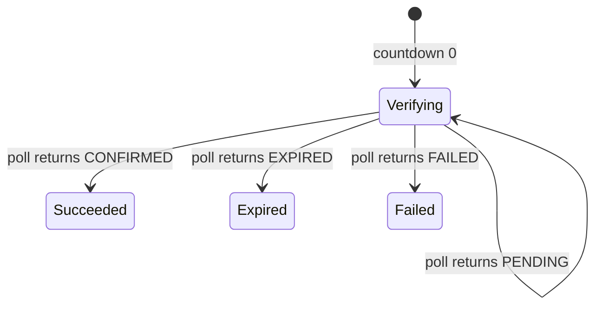

**Rule:** The server is always authoritative. If the webhook succeeded, the booking is CONFIRMED — even if the client's countdown hit 0.

### 8.6 Timeout edge cases

| Scenario | Behavior |
|---|---|
| User closes tab before timeout | No countdown visible; on next `/bookings` fetch, server state applies |
| Webhook arrives during verification | Poll picks up CONFIRMED; redirect to ticket |
| User refreshes during verification | Verification restarts from current server state |
| Network down during verification | Show "Connection issue — Retry"; retry resumes verification |
| User tries to pay during verification | 400 `PAYMENT_NOT_ALLOWED`; toast "Payment window closed" |
| Cron runs while user is verifying | Next poll returns EXPIRED; transition |

---

## 9. Cancel Flow (WF-P-07)

### 9.1 Flow sequence

**Diagram: Cancel flow sequence**
*Passenger opens cancel from My Trips. Client fetches refund-preview (tier + amount + deadline). User confirms. Client posts cancel. Server creates refund, cancels ticket, updates booking. Razorpay processes refund async; webhook confirms. Client polls for refund status.*

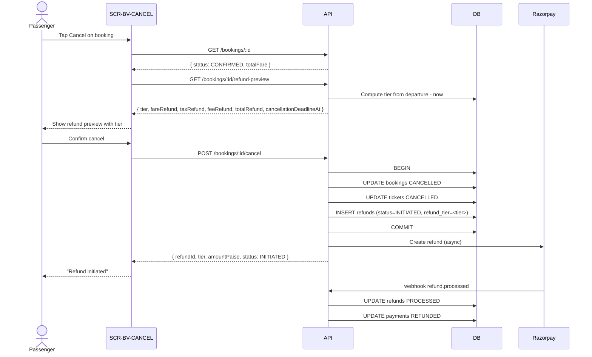

### 9.2 Endpoint chain

| # | Method | Path | Role | Idempotency | Notes |
|:---:|---|---|---|---|---|
| 1 | GET | `/v1/passenger/bookings/:id` | REGISTERED | — | Verify CONFIRMED |
| 2 | GET | `/v1/passenger/bookings/:id/refund-preview` | REGISTERED | — | Tier calculation |
| 3 | POST | `/v1/passenger/bookings/:id/cancel` | REGISTERED | [idem-opt] | Actual cancel |
| 4 | GET | `/v1/passenger/bookings/:id` | REGISTERED | — | Refresh refund status |

### 9.3 Screen — SCR-BV-CANCEL

**Layout:**

| Region | Content |
|---|---|
| **Top bar** | Back to My Trips |
| **Booking summary** | Delhi → Lucknow · 14:00 → 22:30 · 24 Oct · 1 seat |
| **Refund tier card** | Colored tier badge + tier label + explanation |
| **Refund breakdown** | Fare + tax + fee + total (each with refund amount) |
| **Warning** | "You will lose ₹X of the original ₹Y" (if not TIER_FULL) |
| **Cancellation deadline** | "Cancel before {deadline} for {next tier}" |
| **Refund method** | "Refund to original UPI ending 890" + timing estimate |
| **Confirm button** | "Cancel booking — ₹X refund" |
| **Back button** | "Keep booking" |

### 9.4 Refund preview request

**Request:** `GET /v1/passenger/bookings/:id/refund-preview`

**Response:**
```json
{
  "data": {
    "bookingId": "bkg_xyz",
    "tier": "TIER_FULL",
    "totalPaidPaise": 48750,
    "fareRefundPaise": 45000,
    "taxRefundPaise": 2250,
    "feeRefundPaise": 1500,
    "totalRefundPaise": 48750,
    "cancellationDeadlineAt": "2026-10-23T14:00:00.000Z",
    "paymentMethod": "UPI",
    "paymentMethodLast4": "890",
    "expectedRefundDays": { "min": 3, "max": 5 }
  }
}
```

**Reference:** `07` v1.2 §4.5.

### 9.5 Refund preview UI rules

| Tier | Color | Icon | Message |
|---|---|---|---|
| `TIER_FULL` | Green | Check | "Full refund — no penalty" |
| `TIER_75` | Yellow | Alert | "75% fare refund + full tax + full fee" |
| `TIER_50` | Orange | Warning | "50% fare refund + full tax + full fee" |
| `TIER_ZERO` | Red | Alert | "Non-refundable fare — only fee refunded" |
| `TIER_NOT_ELIGIBLE` | Gray | X | "No refund available after departure" |

**Rule:** The tier badge, the breakdown table, and the warning must all agree. Never hide the loss — always show "You will lose ₹X" if not TIER_FULL.

### 9.6 Double-cancel prevention

**Diagram: Double-cancel prevention**
*Client disables Confirm after first tap. If a network error occurs, client calls `GET /bookings/:id` before retrying. If booking is already CANCELLED, treat as success.*

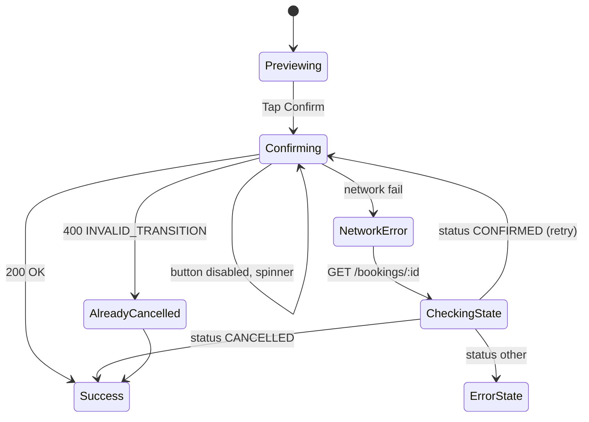

**Rules:**

| Rule | Detail |
|---|---|
| Disable Confirm on tap | Prevents double-tap |
| Network error → check state | `GET /bookings/:id` first |
| If already CANCELLED | Treat as success (idempotent) |
| If still CONFIRMED | Retry cancel |
| If other | Show error |

### 9.7 Operator cancel (WF-N-03) — passive state

When the operator cancels the whole trip (per `08` v1.1 §9.3), all confirmed bookings on that trip are cancelled with `TIER_FULL`. The passenger is not on the cancel screen when this happens — they discover it when they next open My Trips.

**Passenger UX on next open:**

| Trigger | UI |
|---|---|
| Booking is `OPERATOR_CANCELLED` | Card shows "Cancelled by operator" badge + "Full refund: ₹X" |
| Tap for detail | Refund status: INITIATED / PROCESSED |
| No action required | Money is on its way |

**Reference:** `08` v1.1 §9.3.

### 9.8 Refund timing expectations

| Payment method | Expected refund time | Source |
|---|---|---|
| UPI (GPay, PhonePe, Paytm) | 3–5 business days | Razorpay standard |
| Credit card | 5–7 business days | Razorpay standard |
| Debit card | 5–7 business days | Razorpay standard |
| Net banking | 7–10 business days | Razorpay standard |
| Wallet (Paytm Wallet) | 1–2 business days | Razorpay standard |
| Wallet (PhonePe Wallet) | 1–2 business days | Razorpay standard |

**Rule:** Show this in the confirm screen. Never promise "instant" refund. Business days exclude weekends and bank holidays.

### 9.9 Post-cancel state

| Aspect | Detail |
|---|---|
| Booking state | `CANCELLED` (transition to `REFUNDED` after webhook) |
| Ticket state | `CANCELLED` |
| Refund state | `INITIATED` → `PROCESSING` → `PROCESSED` |
| Payment state | `SUCCEEDED` → `REFUNDED` (after `refund.processed` webhook) |
| Client polling | Poll `GET /bookings/:id` every 30s until refund `PROCESSED` |
| Notification | SMS + email on `refund.processed` |

**Reference:** `08` v1.1 §4.7.

---

## 10. Refund Tier Calculator (Canonical)

**This section is the canonical reference for refund tier calculation.** Every doc that mentions a refund tier cites §10.3 of this doc.

### 10.1 The five tiers

**Diagram: Refund tier decision tree**
*Five tiers, thresholds measured from departure time. The calculator is pure: input = departure time + now + amounts, output = tier + per-component refunds.*

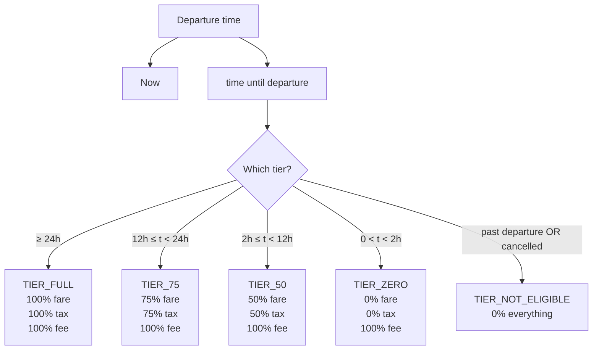

### 10.2 Calculator signature

```ts
type RefundTier =
  | 'TIER_FULL'
  | 'TIER_75'
  | 'TIER_50'
  | 'TIER_ZERO'
  | 'TIER_NOT_ELIGIBLE';

type RefundResult = {
  tier: RefundTier;
  fareRefundPaise: number;
  taxRefundPaise: number;
  feeRefundPaise: number;
  totalRefundPaise: number;
  cancellationDeadlineAt: string | null;
};

function calculateRefund(input: {
  fareAmountPaise: number;
  taxAmountPaise: number;
  feeAmountPaise: number;
  departureAt: string;     // ISO 8601
  cancelledAt: string;     // ISO 8601
  bookingStatus: BookingStatus;
}): RefundResult;
```

### 10.3 Tier thresholds and refund percentages

| Tier | Condition | Fare | Tax | Fee | Example (₹450 + ₹22.50 + ₹15) |
|---|---|---|---|---|---|
| `TIER_FULL` | departure − now ≥ 24h | 100% | 100% | 100% | ₹487.50 |
| `TIER_75` | 12h ≤ departure − now < 24h | 75% | 75% | 100% | ₹369.38 |
| `TIER_50` | 2h ≤ departure − now < 12h | 50% | 50% | 100% | ₹251.25 |
| `TIER_ZERO` | 0 < departure − now < 2h | 0% | 0% | 100% | ₹15.00 |
| `TIER_NOT_ELIGIBLE` | departure − now ≤ 0 OR booking already cancelled | 0% | 0% | 0% | ₹0.00 |

**Rules:**
- Tax refund is proportional to fare refund (GST reversal)
- Fee is always fully refunded except in `TIER_NOT_ELIGIBLE`
- Amounts are rounded **down** to the nearest paise (no bank advantages passengers, no losses)
- Operator-cancelled bookings always use `TIER_FULL` regardless of timing (see §10.4)

### 10.4 Operator-cancelled override

| Aspect | Value |
|---|---|
| Trigger | `booking.status = OPERATOR_CANCELLED` |
| Tier | Always `TIER_FULL` |
| Amount | 100% of `payments.amount_paise` (no deductions) |
| Reason | `refunds.reason = TRIP_CANCELLED` (whole-trip operator cancels) |
| Passenger cost | Zero |

**Reference:** `08` v1.1 §9.3.

### 10.5 `cancellationDeadlineAt` semantics

For each tier, `cancellationDeadlineAt` is the timestamp when the tier drops to the next level:

| Current tier | `cancellationDeadlineAt` | Meaning |
|---|---|---|
| `TIER_FULL` | `departureAt − 24h` | Cancel before this → full refund |
| `TIER_75` | `departureAt − 12h` | Cancel before this → 75% |
| `TIER_50` | `departureAt − 2h` | Cancel before this → 50% |
| `TIER_ZERO` | `departureAt` | Cancel before this → 0% fare |
| `TIER_NOT_ELIGIBLE` | `null` | No next tier — already past |

**Client use:** Show "Cancel before {deadline} for {next tier refund}" on the cancel screen. This gives the user a decision point.

### 10.6 Fee refund policy (locked)

| Rule | Rationale |
|---|---|
| Fee refunded in `TIER_FULL`, `TIER_75`, `TIER_50`, `TIER_ZERO` | Fee is a platform-service charge; refunding it incentivizes early cancellation (better inventory) |
| Fee NOT refunded in `TIER_NOT_ELIGIBLE` | After departure, the booking is completed; no refund is norm across Indian bus platforms |

**This is locked.** Any change requires an amendment to this doc + `07` v1.2 §4.5 + `06` v1.2 §7.3.

### 10.7 Refund calculation examples

**Example 1 — TIER_FULL (₹450 fare, ₹22.50 tax, ₹15 fee, cancel 30h before departure):**

| Component | Amount | Refund |
|---|---|---|
| Fare | ₹450.00 | ₹450.00 (100%) |
| Tax | ₹22.50 | ₹22.50 (100%) |
| Fee | ₹15.00 | ₹15.00 (100%) |
| **Total** | **₹487.50** | **₹487.50** |

**Example 2 — TIER_75 (₹450 fare, ₹22.50 tax, ₹15 fee, cancel 18h before departure):**

| Component | Amount | Refund |
|---|---|---|
| Fare | ₹450.00 | ₹337.50 (75%) |
| Tax | ₹22.50 | ₹16.88 (75%, rounded down) |
| Fee | ₹15.00 | ₹15.00 (100%) |
| **Total** | **₹487.50** | **₹369.38** |

**Example 3 — TIER_50 (₹450 fare, ₹22.50 tax, ₹15 fee, cancel 4h before departure):**

| Component | Amount | Refund |
|---|---|---|
| Fare | ₹450.00 | ₹225.00 (50%) |
| Tax | ₹22.50 | ₹11.25 (50%) |
| Fee | ₹15.00 | ₹15.00 (100%) |
| **Total** | **₹487.50** | **₹251.25** |

**Example 4 — TIER_ZERO (₹450 fare, ₹22.50 tax, ₹15 fee, cancel 1h before departure):**

| Component | Amount | Refund |
|---|---|---|
| Fare | ₹450.00 | ₹0.00 (0%) |
| Tax | ₹22.50 | ₹0.00 (0%) |
| Fee | ₹15.00 | ₹15.00 (100%) |
| **Total** | **₹487.50** | **₹15.00** |

**Example 5 — TIER_NOT_ELIGIBLE (any amounts, departure has passed or already cancelled):**

| Component | Amount | Refund |
|---|---|---|
| Fare | ₹450.00 | ₹0.00 |
| Tax | ₹22.50 | ₹0.00 |
| Fee | ₹15.00 | ₹0.00 |
| **Total** | **₹487.50** | **₹0.00** |

### 10.8 Boundary rules

At exactly 24h, exactly 12h, exactly 2h, and exactly at departure:

| Boundary | Tier | Reason |
|---|---|---|
| `departureAt − now = 24h exactly` | `TIER_FULL` | Inclusive of upper bound |
| `departureAt − now = 12h exactly` | `TIER_75` | Inclusive of upper bound |
| `departureAt − now = 2h exactly` | `TIER_50` | Inclusive of upper bound |
| `departureAt − now = 0` | `TIER_NOT_ELIGIBLE` | Departure has passed |

**Test coverage:** `10` v1.2 §5.5 tests these exact boundaries. Any change to the boundary rules breaks those tests.

---

## 11. GST Invoice (Cross-Reference to `04`)

The GST invoice is created in the same webhook transaction as the ticket (see §5.6). The client does not see it on the checkout screen — it appears on the ticket screen.

**Reference:** `04-TICKET-AND-TRACKING.md` §7 for the ticket-screen invoice download.

**Client contract on checkout:** After CONFIRMED, the client fetches `GET /passenger/bookings/:id` and expects `gstInvoiceAvailable: true`. If `false`, do not show a download link (rare — invoice creation is atomic with booking confirmation).

**Reference:** `06` v1.2 §7.4.

---

## 12. Error States and Edge Cases

### 12.1 Full error catalog for the money path

| Code | HTTP | When | UI |
|---|---|---|---|
| `PAYMENT_NOT_ALLOWED` | 400 | Payment on EXPIRED/FAILED/CANCELLED booking | Toast "Payment window closed" + redirect |
| `IDEMPOTENCY_KEY_REUSED` | 409 | Same key, different body | Toast "Please refresh" |
| `PAYMENT_ALREADY_SUCCEEDED` | 409 | Duplicate payment on CONFIRMED booking | Redirect to ticket |
| `INVALID_TRANSITION` | 400 | Cancel on COMPLETED/EXPIRED | Toast "Cannot cancel this booking" |
| `BOOKING_IMMUTABLE` | 400 | Modify CONFIRMED | Toast "Cannot modify" |
| `REFUND_EXCEEDS_PAYMENT` | 400 | (server-only) | — |
| `PAYMENT_NOT_REFUNDABLE` | 400 | (server-only) | — |
| `RATE_LIMITED` | 429 | Too many requests | Toast "Please wait {N}s" |
| `SERVICE_UNAVAILABLE` | 503 | Dependency down | Toast "Service unavailable, retry in 30s" |
| `GATEWAY_TIMEOUT` | 504 | Razorpay timed out | Toast "Payment gateway timeout" + retry |
| `INTERNAL_ERROR` | 500 | Unexpected | Toast "Something went wrong" + Sentry |
| `UNAUTHORIZED` | 401 | Session expired | Silent refresh → retry, or redirect to login |
| `FORBIDDEN` | 403 | Wrong role | Redirect to home |
| `NOT_FOUND` | 404 | Booking not found OR not owned | Redirect to My Trips |
| `SEAT_ALREADY_BOOKED` | 409 | Retry re-lock on booked seat | "Seat taken" → search |
| `SEAT_LOCKED` | 409 | Retry re-lock on locked seat | "Seat taken" → search |

**Reference:** `07` v1.2 §9.2.

### 12.2 Error handling decision tree

**Diagram: Error handling decision tree**
*Every error maps to one of four UI responses: retry, redirect, toast-only, or silent refresh.*

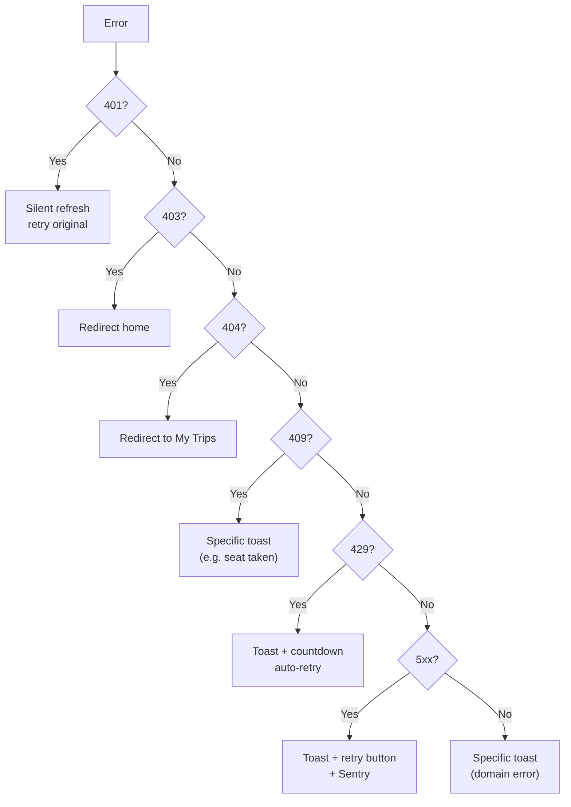

### 12.3 Edge cases matrix

| Scenario | Handling |
|---|---|
| User navigates back during countdown | Countdown continues in background (visibility API) |
| User closes tab during countdown | Server handles timeout; on next open, `/bookings/:id` reflects real state |
| User opens two tabs | Both show same countdown; only one payment allowed (booking lock) |
| User opens cancel from two tabs | Both show preview; only one cancel succeeds |
| User loses network during cancel | On reconnect, `GET /bookings/:id` reflects state |
| Webhook arrives after client closed | On next open, `/bookings/:id` shows CONFIRMED |
| Webhook arrives during timeout verification | Poll sees CONFIRMED, transitions to Succeeded |
| Cron runs while payment in progress | Webhook may complete after cron; server transitions EXPIRED → CONFIRMED (webhook always wins) |

**Note on the last edge case:** If `expire_pending_bookings` runs while a payment is in-flight (between Razorpay charging and webhook arriving), the booking becomes EXPIRED. When the webhook arrives, the server processes it and transitions booking back to CONFIRMED (webhook always wins over cron). This is documented in `06` v1.2 §3.5 as a defensive path. The client polling will see the final CONFIRMED state.

### 12.4 Retry budget

| Endpoint | Retries | Backoff |
|---|---|---|
| `GET /passenger/bookings/:id` | 3 | 1s, 3s, 9s |
| `GET /passenger/payments/:id` | Infinite (until state transition) | 2s → 5s → 10s |
| `POST /passenger/payments` | User-initiated only | None (each retry = new key) |
| `POST /passenger/bookings/:id/cancel` | User-initiated only | None |
| `GET /passenger/bookings/:id/refund-preview` | 3 | 1s, 3s, 9s |

---

## 13. Component Structure

### 13.1 Checkout component tree

**Diagram: Checkout component tree**
*SCR-BV-CHECKOUT is a single-page component. PaymentGate wraps the state machine. The countdown is a sub-component. The Razorpay iframe is embedded or opened via redirect.*

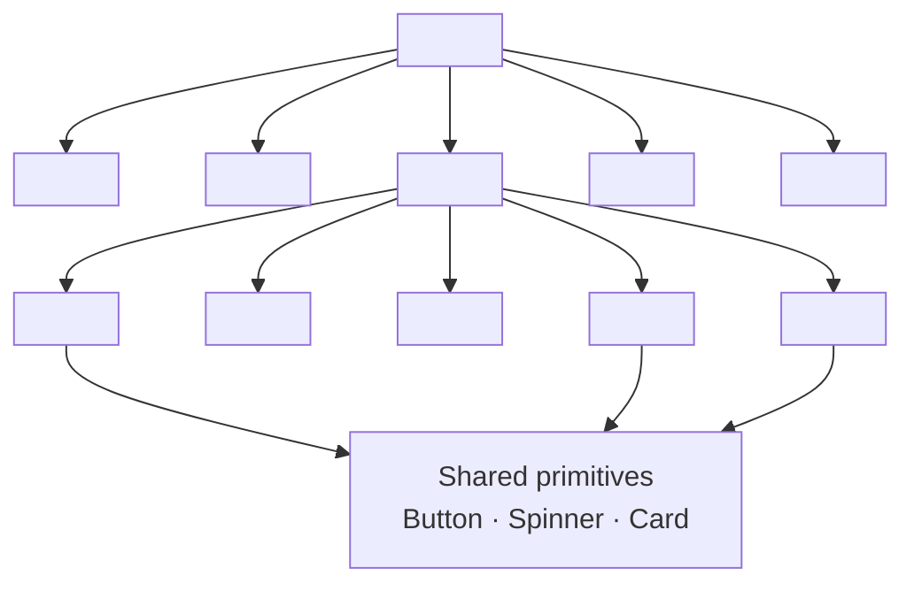

### 13.2 Cancel component tree

**Diagram: Cancel component tree**
*SCR-BV-CANCEL shows the refund preview, then confirms. Preview and confirm are two states within the same page.*

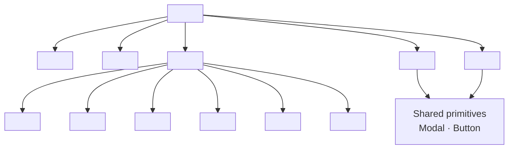

### 13.3 Component contracts

| Component | Props | Emits |
|---|---|---|
| `<CheckoutPage>` | `bookingId` (router) | — |
| `<CheckoutHeader>` | `onBack` | `onBack()` |
| `<BookingSummary>` | `booking` | — |
| `<PaymentGate>` | `booking`, `onSuccess`, `onFail`, `onExpire` | — |
| `<PaymentCountdown>` | `expiresAt`, `onExpire` | `onExpire()` |
| `<IdlePayButton>` | `amountPaise`, `onPay` | `onPay()` |
| `<PollingSpinner>` | `elapsedMs` | — |
| `<SuccessRedirect>` | `target` | — |
| `<FailedRetry>` | `error`, `onRetry`, `onAbandon` | `onRetry()`, `onAbandon()` |
| `<ExpiredState>` | `onSearch` | `onSearch()` |
| `<CancelPage>` | `bookingId` (router) | — |
| `<CancelHeader>` | `onBack` | `onBack()` |
| `<RefundPreview>` | `preview` | — |
| `<RefundTierBadge>` | `tier` | — |
| `<RefundBreakdown>` | `preview` | — |
| `<LossWarning>` | `lossPaise`, `originalPaise` | — |
| `<CancellationDeadline>` | `deadline`, `currentTier`, `nextTier` | — |
| `<RefundTiming>` | `method`, `minDays`, `maxDays` | — |
| `<CancelConfirmDialog>` | `amountPaise`, `onConfirm`, `onCancel` | `onConfirm()`, `onCancel()` |
| `<CancelSuccess>` | `refundId`, `amountPaise` | — |

**Ownership:**

| Component | Owner |
|---|---|
| All components in §13.1, §13.2 | This doc |
| Shared primitives (`Button`, `Spinner`, `Modal`, `Card`) | `@busverse/ui` |

---

## 14. State Management

### 14.1 React Query keys

| Query | Key | staleTime | Notes |
|---|---|---|---|
| Booking by ID | `['booking', bookingId]` | 0 (always fresh) | Refetched after payments |
| Payment by ID | `['payment', paymentId]` | 0 (always fresh) | Poll target |
| Refund preview | `['refundPreview', bookingId]` | 60s | Short — user sees current tier |
| Refund status | `['refund', bookingId]` | 30s | Polled after cancel |

### 14.2 Mutations

| Mutation | Invalidates | Notes |
|---|---|---|
| `POST /payments` | `['payment', paymentId]` | Triggers poll |
| `POST /bookings/:id/cancel` | `['booking', bookingId]`, `['refund', bookingId]`, `['bookings']` | Refresh list |

### 14.3 Local state per screen

**Checkout screen:**

```ts
type CheckoutLocalState =
  | { state: 'idle' }
  | { state: 'countdown'; remainingMs: number; expiresAt: string }
  | { state: 'initiated'; paymentId: string }
  | { state: 'polling'; paymentId: string; elapsedMs: number }
  | { state: 'succeeded'; paymentId: string; ticketId: string }
  | { state: 'failed'; paymentId: string; errorCode: string }
  | { state: 'verifying' }
  | { state: 'expired' };
```

**Cancel screen:**

```ts
type CancelLocalState =
  | { state: 'previewing'; preview: RefundPreview }
  | { state: 'confirming'; preview: RefundPreview }
  | { state: 'submitting'; preview: RefundPreview }
  | { state: 'success'; refundId: string; preview: RefundPreview }
  | { state: 'error'; errorCode: string };
```

---

## 15. Accessibility

### 15.1 Checkout screen

| Requirement | Implementation |
|---|---|
| Countdown announced | `role="timer"` + `aria-live="polite"` |
| Pay button focusable | Standard `<button>` |
| Razorpay iframe accessible | Razorpay handles its own a11y |
| Poll spinner announced | `role="status"` + `aria-live="polite"` |
| Error messages announced | `role="alert"` |
| Focus returns after Razorpay | Return focus to Pay button or success banner |
| Touch targets | ≥ 44×44px |

### 15.2 Cancel screen

| Requirement | Implementation |
|---|---|
| Tier badge | `role="img"` + `aria-label="Refund tier: full refund"` |
| Breakdown table | Proper `<table>` with `<th>` headers |
| Loss warning | `role="alert"` (color + icon + text, never color alone) |
| Deadline | `role="timer"` if showing countdown |
| Confirm dialog | `role="dialog"` + `aria-modal` + focus trap |
| Confirm button | `aria-describedby` pointing to amount |
| Focus trap | Modal traps focus until closed |
| Keyboard-only flow | Tab → Enter works for confirm |

### 15.3 Reduced motion

| Element | Behavior |
|---|---|
| Countdown pulse | Instant color change, no animation |
| Poll spinner | Static icon, no rotation |
| Tier badge | Static |
| Modal transition | Instant |

**Reference:** `01` §10 (accessibility patterns).

---

## 16. Test Coverage

### 16.1 Test suites (~55 tests)

| Suite | Count | Covers |
|---|---:|---|
| `e2e_checkout_happy` | 3 | Load, pay, ticket redirect |
| `e2e_checkout_fail` | 3 | Webhook fails, retry, second failure |
| `e2e_checkout_timeout` | 3 | Countdown to 0, verification poll, EXPIRED state |
| `e2e_checkout_late_webhook` | 2 | Webhook arrives after countdown 0 but before cron → Succeeded |
| `e2e_cancel_happy` | 3 | Preview, confirm, success |
| `e2e_cancel_tiers` | 5 | One per tier (TIER_FULL, TIER_75, TIER_50, TIER_ZERO, TIER_NOT_ELIGIBLE) |
| `e2e_cancel_double` | 2 | Double tap Confirm; network error + state check |
| `component_countdown` | 4 | Format, warning thresholds, expired, server offset |
| `component_payment_gate` | 5 | Each state; transitions |
| `component_refund_preview` | 6 | Each tier; loss warning; deadline |
| `component_cancel_confirm` | 4 | Confirm dialog, focus trap, disabled states |
| `unit_refund_calculator` | 10 | 5 tiers + 4 boundaries + operator override |
| `unit_router_state` | 2 | Missing bookingId; missing expiresAt |
| `contract_refund_preview` | 3 | Happy, unauthorized, not-found |
| `contract_cancel` | 3 | Happy, already-cancelled, invalid-state |
| **Total** | **~58** | |

### 16.2 Key assertions

| Test | Assertion |
|---|---|
| `e2e_checkout_happy_pay` | PENDING → Pay → SUCCEEDED → redirect to ticket |
| `e2e_checkout_fail_retry` | FAILED → Retry → new booking → new payment |
| `e2e_checkout_timeout` | Countdown 0 → Verifying → EXPIRED |
| `e2e_checkout_late_webhook` | Countdown 0 → Verifying → CONFIRMED (race) |
| `e2e_cancel_tier_full` | `TIER_FULL` badge + "Full refund" + correct breakdown |
| `e2e_cancel_tier_75` | 75% fare refund + full fee + "You will lose ₹X" |
| `e2e_cancel_double_tap` | Second tap ignored; single refund |
| `component_countdown_warning` | Yellow at 60s, red at 10s |
| `component_payment_gate_polling` | Spinner shown; polls every 2s |
| `component_refund_preview_deadline` | "Cancel before {date}" matches tier |
| `unit_refund_tier_full` | `fare*100% + tax*100% + fee*100%` |
| `unit_refund_boundary_24h` | Exactly 24h → TIER_FULL |
| `unit_refund_operator` | OPERATOR_CANCELLED → TIER_FULL |

**Reference:** `10` v1.2 §5.5, §7.6, §10.

---

## 17. Open Questions

| # | Question | Owner | Default |
|:---:|---|---|---|
| 1 | Should the "Pay" button be enabled during the first 30s of polling? | Shaghaf | No (prevent double-pay) |
| 2 | Countdown format — `MM:SS` or `X min left`? | Shaghaf | `MM:SS` (precise) |
| 3 | Show `cancellationDeadlineAt` as a countdown or a static date? | Shaghaf | Static date (e.g., "Cancel before Oct 23, 14:00") |
| 4 | Show refund-timing per method or one generic "3–7 days"? | Shaghaf | Per method |
| 5 | Cancel confirm dialog — modal or inline? | Shaghaf | Modal (destructive action) |
| 6 | Auto-close Razorpay iframe on `expiresAt`? | Shaghaf | Yes |
| 7 | Include a "download receipt" button on success? | Shaghaf | Yes (link to GST invoice) |
| 8 | Show support link on failed/expired states? | Shaghaf | Yes |
| 9 | Refund-preview cache TTL — 60s or 30s? | Shaghaf | 60s (user reads it) |
| 10 | After cancel, redirect to My Trips or a dedicated success page? | Shaghaf | My Trips with success banner |
| 11 | Show "refund pending" badge on My Trips card? | Shaghaf | Yes |
| 12 | Cancel button on ticket screen? | Shaghaf | Yes (link to CANCEL) |
| 13 | Show loss amount in red + icon? | Shaghaf | Yes (color + icon + text) |
| 14 | Retry button text — "Retry" or "Try again"? | Shaghaf | "Try again" |

---

## 18. Checklist Against Master List

| Item | Included? | Section |
|---|:---:|---|
| Purpose and scope | ✅ | §1 |
| Doc hierarchy | ✅ | §1.2 |
| Scope table | ✅ | §1.4 |
| Workflow map (6 workflows) | ✅ | §2 |
| FR mapping | ✅ | §2.2 |
| Prerequisites flow | ✅ | §3.1 |
| Prerequisites table | ✅ | §3.2 |
| **Canonical router state** | ✅ | §3.3 |
| Entry checks | ✅ | §3.4 |
| Client payment state machine | ✅ | §4 |
| State table | ✅ | §4.2 |
| State transition rules | ✅ | §4.3 |
| Countdown source of truth | ✅ | §4.4 |
| Payment flow (WF-P-04b) | ✅ | §5 |
| Payment initiation request | ✅ | §5.3 |
| Razorpay integration | ✅ | §5.4 |
| State changes | ✅ | §5.5 |
| Webhook processing | ✅ | §5.6 |
| GST invoice note | ✅ | §5.7 |
| Confirmation UX | ✅ | §6 |
| Two-path convergence | ✅ | §6.1 |
| Reconciliation rules | ✅ | §6.2 |
| Polling strategy | ✅ | §6.3 |
| WebSocket subscription | ✅ | §6.4 |
| Payment fail + retry (WF-N-01) | ✅ | §7 |
| Retry rules | ✅ | §7.2 |
| Retry UX | ✅ | §7.3 |
| Retry edge cases | ✅ | §7.4 |
| Payment timeout (WF-N-02b) | ✅ | §8 |
| Timeout states | ✅ | §8.2 |
| Countdown implementation | ✅ | §8.3 |
| Verification polling | ✅ | §8.4 |
| Late-webhook race | ✅ | §8.5 |
| Timeout edge cases | ✅ | §8.6 |
| Cancel flow (WF-P-07) | ✅ | §9 |
| Cancel screen | ✅ | §9.3 |
| Refund preview request | ✅ | §9.4 |
| Refund preview UI | ✅ | §9.5 |
| Double-cancel prevention | ✅ | §9.6 |
| Operator cancel (WF-N-03) | ✅ | §9.7 |
| Refund timing | ✅ | §9.8 |
| Post-cancel state | ✅ | §9.9 |
| **Refund tier calculator (canonical)** | ✅ | §10 |
| Five tiers | ✅ | §10.1 |
| Calculator signature | ✅ | §10.2 |
| Tier thresholds + percentages | ✅ | §10.3 |
| Operator override | ✅ | §10.4 |
| `cancellationDeadlineAt` semantics | ✅ | §10.5 |
| Fee refund policy | ✅ | §10.6 |
| Refund examples | ✅ | §10.7 |
| Boundary rules | ✅ | §10.8 |
| GST invoice cross-ref | ✅ | §11 |
| Full error catalog (16 codes) | ✅ | §12.1 |
| Error decision tree | ✅ | §12.2 |
| Edge cases matrix | ✅ | §12.3 |
| Retry budget | ✅ | §12.4 |
| Checkout component tree | ✅ | §13.1 |
| Cancel component tree | ✅ | §13.2 |
| Component contracts | ✅ | §13.3 |
| React Query keys | ✅ | §14.1 |
| Mutations | ✅ | §14.2 |
| Local state per screen | ✅ | §14.3 |
| Checkout accessibility | ✅ | §15.1 |
| Cancel accessibility | ✅ | §15.2 |
| Reduced motion | ✅ | §15.3 |
| Test suites (~58) | ✅ | §16.1 |
| Key assertions | ✅ | §16.2 |
| Open questions (14) | ✅ | §17 |

**All items covered. ~20 Mermaid diagrams. Every diagram described.**

---

## 19. Summary

**BusVerse's payment and refund flow is specified across 19 sections and ~20 diagrams, with the refund tier calculator documented as the canonical reference for all downstream docs.** The checkout screen (`SCR-BV-CHECKOUT`) is reached from the booking form (`01` §5.9) with router state extended to include `expiresAt` — the server-authoritative 15-minute payment deadline. The client runs a 5-state machine — Idle → Countdown → Initiated → Polling → Succeeded/Failed/Expired — where each state has a defined UI, defined actions, and defined exit conditions. Payment initiation requires a **new `Idempotency-Key` per attempt** (the retry rule from `07` v1.2 §11.2). Razorpay's hosted checkout handles all payment methods; the client callback is UX only — the **authoritative confirmation is the webhook** (per `06` v1.2 §3.5, the webhook transaction atomically flips `payments SUCCEEDED` + `INSERT tickets` + `INSERT gst_invoices` + `bookings CONFIRMED` + `DELETE seat_locks`). Client confirmation comes from **two sources converging** — WebSocket `booking:confirmed` (fast) and polling `GET /payments/:id` (reliable); whichever arrives first wins; the second is idempotently ignored; if one fails, the other continues. If the webhook transaction fails at the DB, `09` v1.2 §13.5's local-file fallback ensures no webhook is ever lost — the client just sees `INITIATED` for slightly longer. **Payment failure (WF-N-01)** flips booking to `FAILED`, deletes the seat lock, and requires the passenger to **re-lock, re-book, and re-pay with a fresh Idempotency-Key** — retry with the old key returns the cached failed response and prevents retry. **Payment timeout (WF-N-02b)** has a two-phase UX: countdown hits 0 at exactly 15 min (client-side `expiresAt`-driven); client enters "Verifying" state and polls `GET /bookings/:id` every 5s; when `expire_pending_bookings` cron eventually fires (up to 5 min later, per `06` v1.2 §15), booking becomes `EXPIRED`, client transitions; subsequent `POST /payments` returns `400 PAYMENT_NOT_ALLOWED`. **Late-webhook race:** if webhook arrives during the verification window, booking becomes `CONFIRMED` — server is always authoritative, client transitions to Succeeded. **Cancel flow (WF-P-07)** has a **refund-preview step** that computes tier before the confirm dialog — five tiers (`TIER_FULL`, `TIER_75`, `TIER_50`, `TIER_ZERO`, `TIER_NOT_ELIGIBLE`) with explicit fare/tax/fee percentages; **`cancellationDeadlineAt` per tier** (departure−24h/12h/2h/departure/null) lets the user know when the tier will drop; the **fee is always fully refunded except after departure** — this is a deliberate policy locked in §10.6. **Operator cancels (WF-N-03)** are always `TIER_FULL` regardless of timing — `08` v1.1 §9.3. **Double-cancel prevention** uses client-side state pre-check on network retry — if `GET /bookings/:id` shows `CANCELLED`, treat as success. **Refund timing** per payment method (UPI 3-5 days, card 5-7, netbanking 7-10, wallet 1-2) is shown on the confirm screen — never promise "instant." **GST invoice** is created in the same webhook transaction as the ticket and appears on the ticket screen (owned by `04-TICKET-AND-TRACKING.md` §7) — this doc only documents the handoff. **Error handling** covers 16 codes relevant to the money path (`PAYMENT_NOT_ALLOWED`, `IDEMPOTENCY_KEY_REUSED`, `PAYMENT_ALREADY_SUCCEEDED`, `INVALID_TRANSITION`, `BOOKING_IMMUTABLE`, `REFUND_EXCEEDS_PAYMENT`, `PAYMENT_NOT_REFUNDABLE`, `RATE_LIMITED`, `SERVICE_UNAVAILABLE`, `GATEWAY_TIMEOUT`, `INTERNAL_ERROR`, `UNAUTHORIZED`, `FORBIDDEN`, `NOT_FOUND`, `SEAT_ALREADY_BOOKED`, `SEAT_LOCKED`) with a decision tree routing to one of four UI responses (retry, redirect, toast, silent refresh). **Component structure** defines two trees — `<CheckoutPage>` with `<PaymentGate>` and 5 sub-states, and `<CancelPage>` with `<RefundPreview>` + `<CancelConfirmDialog>`. **State management** uses React Query with keys `['booking', id]`, `['payment', id]`, `['refundPreview', id]`, `['refund', id]`, plus screen-local state machines. **Accessibility** covers countdown announcements (`role="timer"` + `aria-live`), Razorpay iframe focus return, tier badge ARIA labels, loss warning with color + icon + text, modal focus trap, and reduced-motion compliance. **Test coverage** spans ~58 tests across 16 suites — 15 E2E, 15 component, 12 unit, 6 contract — including 5 tier-specific E2E tests, 4 boundary unit tests, 10 refund calculator tests, and 3 double-cancel prevention tests. **Fourteen open questions remain**, all Phase-1-decidable defaults. The refund tier calculator (§10) is the canonical reference — every doc that mentions a tier, from `05` to `11`, cites §10.3 of this doc.** This doc hands off to `busverse/04-TICKET-AND-TRACKING.md` on payment success (with `bookingId` + `gstInvoiceAvailable` in the ticket fetch), and provides the checkout + cancel screen specifications for `busverse/05-UI-SPEC.md`.

---

**End of Document `busverse/03-PAYMENT-REFUND-FLOW.md` v1.0.**