# `busverse/04-TICKET-AND-TRACKING.md` v1.0

**Document:** `busverse/04-TICKET-AND-TRACKING.md`
**Project:** BusVerse + BusCon
**Version:** 1.0
**Status:** Locked — Product Document
**Owner:** Shaghaf
**Guide:** Mr. Mohit Srivastav
**Purpose:** The detailed ticket-display and live-tracking specification for BusVerse. Covers everything the passenger sees after booking confirmation — the My Trips list, the QR ticket screen, the PWA offline cache that keeps the ticket viewable without network, the live tracking screen with the map and ETA, the real-time WebSocket subscription that drives the bus marker, and the boarding-status transition when the driver scans. This document owns three screens (`SCR-BV-MYTRIPS`, `SCR-BV-TICKET`, `SCR-BV-TRACKING`) and every UI state the passenger sees during the post-booking journey. **The visual layer is authoritative from `Design_guide.html` §6 (telemetry card) and §7 (ticket stub).** This document specifies the behavior layer that the design guide doesn't cover — WebSocket subscription, polling fallback, PWA offline cache strategy, boarding-status transitions, trip-not-started states, and the QR contract. Every BusVerse ticket/tracking implementation and test traces back to this document.

> **Derives from:** `busverse/00-OVERVIEW.md` §6, §7 (navigation, screen catalog), `busverse/01-PASSENGER-WORKFLOWS.md` §3.7 (session storage — access token in memory), `busverse/02-SEAT-MATRIX-UI.md` §3 (design-guide precedence rule), §9 (dual theme tokens), §19.3 (mobile patterns), `busverse/03-PAYMENT-REFUND-FLOW.md` §3.3 (canonical router state), §5.7 (GST invoice handoff), §9.9 (post-cancel state), `Design_guide.html` §1 (dual-theme tokens), §6 (telemetry card), §7 (ticket stub), §9 (production tokens), `02-REQUIREMENTS.md` §6.3 (FR-BV-024, 025, 034–041 — 10 FRs total), §8.4 (usability), `03-SYSTEM-ARCHITECTURE.md` §5 (container), §7 (frontend architecture), `04-ACTORS-ROLES-PERMISSIONS.md` §3.2 (Passenger), §9.1 (BusVerse permission grid), `05-DOMAIN-MODEL.md` v1.2 §7.1 #1, #17, #18 (ticket invariants), §8.1 (booking SM), §8.3 (trip SM), §8.6 (ticket SM), `06-DATABASE-SCHEMA.md` v1.2 §6.5 (`tickets`), §7.4 (`gst_invoices`), §8.2 (`trips`), `07-API-AND-REALTIME-CONTRACTS.md` v1.2 §4.5 (booking endpoints), §4.7 (live/map endpoints), §8.1 (WS topics), §8.6 (polling fallback), §8.7 (event catalog), §9.2 (49 error codes), `08-WORKFLOWS.md` v1.1 §4.5 (WF-P-05), §4.6 (WF-P-06), §8.5 (WF-X-05), §10.3 (WF-R-03), `09-SECURITY-AND-PLATFORM-RULES.md` v1.2 §7 (QR sign/verify), §10.1 (Ed25519), §11.5 (log scrub), `10-TESTING-STRATEGY.md` v1.2 §5.5 (unit), §7.6 (contract tests), §8 (E2E).

> **Referenced by:** `busverse/05-UI-SPEC.md`, `report/14-MODULE_DESCRIPTION.md`, `report/15-SCREENSHOTS_UI.md`, `viva/03-DEMO_SCRIPT.md`.

---

## 1. Purpose and Scope

### 1.1 What this document owns

| Owns here | Referenced from upstream |
|---|---|
| `SCR-BV-MYTRIPS` list + detail screen | `00` §7.1, `03` §3.1 |
| `SCR-BV-TICKET` detail screen | `00` §7.1 |
| `SCR-BV-TRACKING` live screen | `00` §7.1 |
| Ticket data model (client-side) | `05` v1.2 §8.6, `06` v1.2 §6.5 |
| QR rendering pipeline | `09` v1.2 §7 |
| PWA offline cache for tickets | `01` §4.2, `02` §8.4 |
| GST invoice download link | `03` §5.7, `06` v1.2 §7.4 |
| Cancel button on ticket | `03` §9 |
| Booking status badge | `05` v1.2 §8.1 |
| Ticket status badge | `05` v1.2 §8.6 |
| Boarding-status display | `07` v1.2 §8.7, `08` v1.1 §8.5 |
| Live tracking map + bus marker | `07` v1.2 §4.7, `Design_guide.html` §6 |
| Real-time WebSocket consumption | `07` v1.2 §8.1, §8.7 |
| Polling fallback for tracking | `07` v1.2 §8.6 |
| Trip-not-started state | `05` v1.2 §8.3 |
| Trip-ended state | `05` v1.2 §8.3 |
| Component structure for three screens | — |
| React Query keys per screen | `03` v1.2 §7.1 |
| Error states for ticket + tracking | `07` v1.2 §9.2 |
| Ticket + tracking tests | `10` v1.2 §7.6, §8 |

### 1.2 FR ownership resolution

**10 FRs owned by this document:**

| FR | Description | Source |
|---|---|---|
| FR-BV-024 | Passenger can view all bookings in My Trips | `02` §6.3 |
| FR-BV-025 | Passenger can view booking detail including QR ticket | `02` §6.3 |
| FR-BV-034 | Passenger receives Ed25519-signed QR ticket on booking confirmation | `02` §6.3 |
| FR-BV-035 | QR ticket is viewable in My Trips without network (PWA cache) | `02` §6.3 |
| FR-BV-036 | QR ticket is not accessible via public URL (private only) | `02` §6.3 |
| FR-BV-037 | QR ticket displays booking reference for display purposes | `02` §6.3 |
| FR-BV-038 | QR ticket becomes invalid (CANCELLED) when booking is cancelled | `02` §6.3 |
| FR-BV-039 | Passenger can view live bus position on map during trip | `02` §6.3 |
| FR-BV-040 | Position updates via WebSocket every 5 seconds | `02` §6.3 |
| FR-BV-041 | Passenger can view ETA to each upcoming stand | `02` §6.3 |

**Resolution note — `00` §5.1 vs `03` §3.1 vs `01` §1.4:** `00` §5.1 assigns FR-BV-024/025 to the Booking area, whose "Primary doc" is `01-PASSENGER-WORKFLOWS`. But `01` §1.4 scope does not include My Trips — it explicitly ends at "Payment handoff". `03` §3.1 says `SCR-BV-MYTRIPS` is "owned by `04`". `00` §6.1 says WF-P-05's primary doc is `04-TICKET-AND-TRACKING`. **This document takes ownership of FR-BV-024 and FR-BV-025** because their primary content is the ticket. This is a resolved conflict — flagged in §19 Q1 for a `00` v1.1 amendment and a `01` v1.1 note.

**Forward-reference note — `01` §4.2:** `01` §4.2 currently references "`04` §4" for PWA offline cache and live tracking UI. This document places PWA at §9 and tracking at §10/§11. When `01` is revised to v1.1, those forward references should be updated to `§9` and `§10`. No behavior change — just a reference correction.

### 1.3 Document hierarchy

**Diagram: Document hierarchy**
*This doc sits inside the BusVerse folder. It consumes the ticket design from `03` §5.7's handoff, the QR contract from `09` §7, the tracking endpoints from `07` §4.7, and the visual specs from `Design_guide.html` §6 and §7. It hands off to `05-UI-SPEC` for wireframes.*

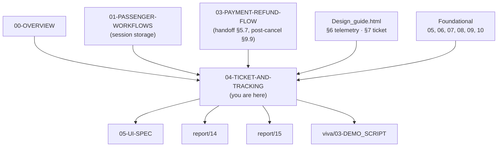

### 1.4 What this document does NOT cover

| Topic | Goes to |
|---|---|
| Booking creation (up to PENDING) | `busverse/01-PASSENGER-WORKFLOWS.md` §5 |
| Seat deck | `busverse/02-SEAT-MATRIX-UI.md` |
| Payment execution | `busverse/03-PAYMENT-REFUND-FLOW.md` §5–§8 |
| Cancel confirm dialog and refund preview | `busverse/03-PAYMENT-REFUND-FLOW.md` §9 |
| Refund tier calculation | `busverse/03-PAYMENT-REFUND-FLOW.md` §10 |
| QR signature verification logic (driver side) | `09-SECURITY-AND-PLATFORM-RULES.md` §7 |
| Backend ticket INSERT (webhook) | `06-DATABASE-SCHEMA.md` §3.5 |
| Driver scan UI | `buscon/` folder |
| Full app UI spec | `busverse/05-UI-SPEC.md` |
| PWA service-worker implementation details | Repo `public/sw.js` + this doc §9 |

### 1.5 Scope of this document

**Three screens, two WebSocket topics, four workflows:**

| # | Surface | Workflow | FRs | In | Out |
|:---:|---|---|---|---|---|
| 1 | `SCR-BV-MYTRIPS` | WF-P-05 (list) | FR-BV-024 | Home nav | → `SCR-BV-TICKET` / `SCR-BV-TRACKING` / `SCR-BV-CANCEL` |
| 2 | `SCR-BV-TICKET` | WF-P-05 (detail) | FR-BV-025, 034–038 | `SCR-BV-MYTRIPS`, `03` §5.7, `03` §9.9 | → `SCR-BV-CANCEL` or `SCR-BV-TRACKING` |
| 3 | `SCR-BV-TRACKING` | WF-P-06 | FR-BV-039–041 | `SCR-BV-TICKET` or `SCR-BV-MYTRIPS` | back to My Trips |
| 4 | WS topic `booking:{bookingId}` | WF-X-05 | FR-BV-038 | Subscribe on ticket / My Trips | — |
| 5 | WS topic `trip:live:{tripId}` | WF-P-06, WF-R-03 | FR-BV-039–040 | Subscribe on tracking | — |

**FR mapping per surface:**

| FR | Workflow | Screen / Mechanism |
|---|---|---|
| FR-BV-024 | WF-P-05 | `SCR-BV-MYTRIPS` |
| FR-BV-025 | WF-P-05 | `SCR-BV-TICKET` |
| FR-BV-034 | WF-P-05 | `SCR-BV-TICKET` (QR render) |
| FR-BV-035 | WF-P-05 | `SCR-BV-TICKET` (PWA offline) |
| FR-BV-036 | WF-P-05 | API (no public URL) |
| FR-BV-037 | WF-P-05 | `SCR-BV-TICKET` (booking ref display) |
| FR-BV-038 | WF-P-05 | `SCR-BV-TICKET` (cancelled state) |
| FR-BV-039 | WF-P-06 | `SCR-BV-TRACKING` |
| FR-BV-040 | WF-P-06 | WebSocket `trip:live:{tripId}` |
| FR-BV-041 | WF-P-06 | `SCR-BV-TRACKING` (ETA panel) |

---

## 2. Workflow Map

**Diagram: Workflow map**
*Four workflows converge on this document. WF-P-05 (view ticket) is the primary happy path. WF-P-06 (live tracking) branches from it. WF-X-05 (boarding → passenger sees boarded) updates state via WebSocket. WF-R-03 (session refresh) is the recovery path if WebSocket drops.*

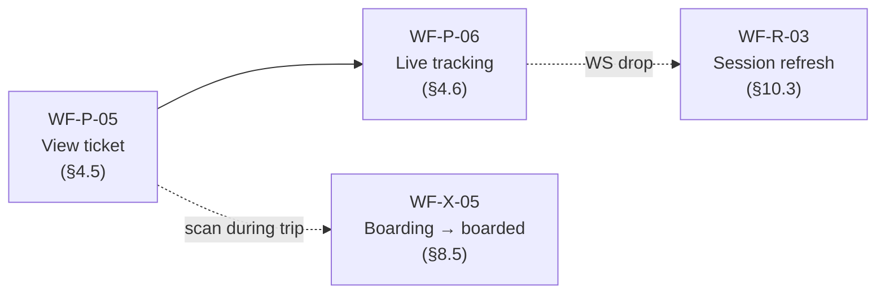

### 2.1 Coverage table

| Workflow | FRs | In | Out | Primary location |
|---|---|---|---|---|
| WF-P-05 | FR-BV-024, 025, 034–038 | CONFIRMED booking | Ticket shown, actions available | §6, §7, §8, §9 |
| WF-P-06 | FR-BV-039–041 | IN_PROGRESS trip + booked passenger | Tracking view | §10, §11 |
| WF-X-05 | FR-BV-038 | Driver scan event | Passenger sees "Boarded" | §12 |
| WF-R-03 | (session) | WS drop + expired JWT | Session re-established, WS resumed | §11.5 |

### 2.2 Cross-references

**Reference:** Full workflow sequences in `08-WORKFLOWS.md` v1.1 §4.5 (WF-P-05), §4.6 (WF-P-06), §8.5 (WF-X-05), §10.3 (WF-R-03). This doc adds screen-level detail, component structure, and PWA cache behaviour not covered in `08`.

---

## 3. Prerequisites and Handoff

### 3.1 Entry points

**Diagram: Entry points to the three screens**
*Three ways into the ticket flow. Post-payment (from `03` §5.7) lands directly on `SCR-BV-TICKET`. Home nav lands on `SCR-BV-MYTRIPS`. Post-cancel (from `03` §9.9) lands on `SCR-BV-MYTRIPS` with a success banner.*

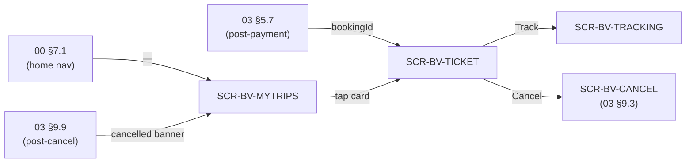

### 3.2 Prerequisites table

| Requirement | Enforced by |
|---|---|
| User authenticated | Auth guard on all three routes (`01` §3) |
| `bookingId` in URL (ticket) | Route param validation |
| Booking status `CONFIRMED`/`CHECKED_IN`/`COMPLETED`/`CANCELLED`/`OPERATOR_CANCELLED`/`REFUNDED` (ticket) | `GET /bookings/:id` on mount |
| Booking status `PENDING` (ticket) | Redirect to checkout (`03` §5) — payment not done |
| Booking status `EXPIRED`/`FAILED` (ticket) | Redirect to My Trips with toast |
| Booking **ticket** row exists | Ticket only exists for CONFIRMED (`05` v1.2 §7.1 #1) |
| Trip status `IN_PROGRESS` (tracking) | If not, show pre-trip or post-trip state (§10.4) |

### 3.3 Entry checks per screen

**`SCR-BV-MYTRIPS`:**

| Check | Action if failed |
|---|---|
| Authenticated | Redirect to login with return URL |
| API reachable | Show full-page error with retry |

**`SCR-BV-TICKET`:**

| Check | On mount | Action if failed |
|---|---|---|
| `bookingId` present | URL param | Redirect to My Trips |
| Booking status | `GET /bookings/:id` | If `PENDING` → checkout (`03`); if `EXPIRED`/`FAILED` → My Trips with toast; if `CONFIRMED`+ → render |
| Booking owned by user | Response validation | If `404` → My Trips |
| Ticket exists | `GET /bookings/:id/ticket` | If `404 TICKET_NOT_FOUND` → "Ticket is being issued, retry in 5s" + auto-retry × 3 |

**`SCR-BV-TRACKING`:**

| Check | On mount | Action if failed |
|---|---|---|
| `tripId` present | URL param | Redirect to My Trips |
| Booking on this trip | `GET /trips/:id/live` | If `404` → My Trips with toast |
| Trip status | Response | If `SCHEDULED` → pre-trip state; if `IN_PROGRESS` → tracking; if `COMPLETED`/`CANCELLED` → post-trip state |

### 3.4 Canonical router state

**From `03` §3.3 (payment success):**
```typescript
{
  bookingId: string,
  scheduleId: string,
  lockId: string,
  totalFarePaise: number,
  expiresAt: string,
  ticketId?: string         // optional — API response may include it
}
```

**This doc adds a single new entry point** — tracking:
```typescript
{
  tripId: string,
  bookingId: string         // for authorization check
}
```

**Rule:** `bookingId` is always present when transitioning from ticket to tracking. Prevents deep-linking a trip without a booking on it.

---

## 4. Design Guide Reference

**Diagram: Design guide integration**
*This doc uses two components from `Design_guide.html` — the ticket stub (§7) and the telemetry card (§6) — plus the dual-theme tokens (§1, §9). The behavior layer is this doc; the visual layer is the guide.*

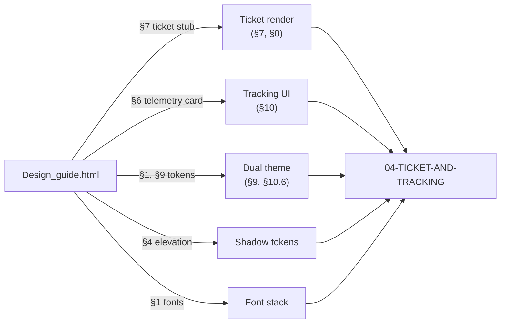

### 4.1 Reference table

| Visual concern | Design guide section | Where used in this doc |
|---|---|---|
| Ticket stub container | §7 `.ticket-stub` | §7.2 |
| Ticket top / bottom halves | §7 `.ticket-stub-top` / `.ticket-stub-bottom` | §7.2 |
| Notch cut-outs | §7 `::before` / `::after` (30px circles) | §7.2 |
| City hero typography | §7 `.city-hero` (1.6rem, weight 800) | §7.2 |
| QR visual box | §7 `.qr-visual-box` (90×90, white, 6px padding) | §8 |
| Live beacon pill | §6 `.live-beacon-pill` (emerald, pulsing dot) | §10.3 |
| Route progress track | §6 `.route-progress-track` (8px, pill radius) | §10.4 |
| Route progress fill | §6 `.route-progress-fill` (gradient brand → cyan) | §10.4 |
| Route vehicle icon | §6 `.route-vehicle-icon` (32×32, cyan border, glow) | §10.4 |
| Telemetry stats grid | §6 `.grid-3` inside telemetry card | §10.5 |
| Dual theme tokens | §1 | §9, §10.6 |
| Production tokens | §9 | §9.2 |
| Elevation shadows | §4 | §7.5 |
| Font stack | §1 | §15 |

### 4.2 Design guide conflicts — resolve per `02` §3.1

Per `busverse/02-SEAT-MATRIX-UI.md` §3 rule: **"the design guide wins for visuals, this doc wins for behavior."**

**Three conflicts found in `Design_guide.html`:**

| # | Design guide says | Canonical source says | Resolution |
|---|---|---|---|
| C1 | §6: "Telemetry streams every **10 seconds**" | `02` §6.6 FR-OP-009, `06` v1.2 §6.5.1, `07` v1.2 §7.4, `08` v1.1 WF-D-03, `09` v1.2 §8.4 all say **5 seconds** | Follow **5 seconds**. Flag in §19 Q2 for a design-guide correction. |
| C2 | §7 ticket PNR: `BV-2026-99042` | `05` v1.2 §12.1, `06` v1.2 §3.6: **`BKG-YYYY-NNNNN`** (e.g., `BKG-2026-00001`) | Follow **`BKG-YYYY-NNNNN`**. Design guide example is illustrative only. |
| C3 | §7 "Bus Class: Volvo Multi-Axle" | No such enum in `05` v1.2 §15 | Display `bus.model` verbatim. Not a controlled vocabulary. |

**Rule:** Design guide examples are illustrative. Where they contradict a locked schema or requirement, the schema/requirement wins. Visual styling (colors, sizing, layout) always follows design guide.

---

## 5. Ticket Data Model

### 5.1 Ticket object shape (client-side)

From `06` v1.2 §6.5 (`tickets`) + `07` v1.2 §4.5 response:

```json
{
  "id": "550e8400-e29b-41d4-a716-446655440000",
  "displayId": "tkt_abc",
  "bookingId": "bkg_xyz",
  "qrPayload": "v1:eyJ2IjoxLCJ0aWNrZXRJZCI6...",
  "status": "ACTIVE",
  "issuedAt": "2026-10-24T14:32:00.000Z",
  "scannedAt": null
}
```

### 5.2 Ticket state machine (client view)

**Diagram: Ticket state machine (client view)**
*Reproduces `05` v1.2 §8.6 for the client. Five states, mapped to five badges. ISSUSED and ACTIVE render identically; only SCANNED, CANCELLED, USED differ visually.*

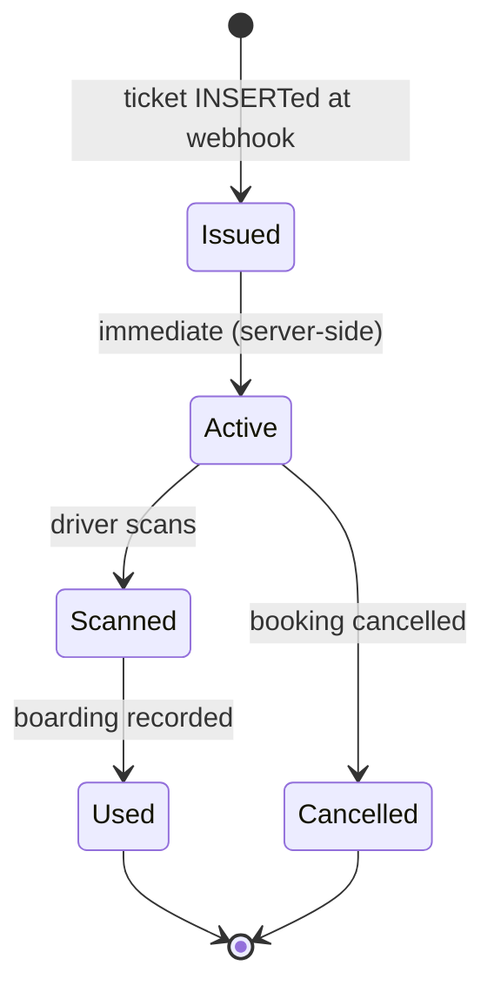

| Ticket status | Booking status | Badge text | Badge color |
|---|---|---|---|
| `ISSUED` / `ACTIVE` | `CONFIRMED` | "Ready to board" | Emerald |
| `SCANNED` / `USED` | `CHECKED_IN` | "Boarded" | Emerald (filled) |
| `CANCELLED` | `CANCELLED` / `OPERATOR_CANCELLED` | "Cancelled" | Slate |
| `CANCELLED` | `REFUNDED` | "Refunded" | Slate |
| `ACTIVE` (stale) | `COMPLETED` | "Trip completed" | Slate |

**Note:** Ticket state and booking state are **correlated but independent**. A `SCANNED` ticket with a `CONFIRMED` booking is a race condition (webhook updated ticket, booking update still in flight) — client shows `SCANNED` and polls again in 5s. A `CANCELLED` ticket with a `REFUNDED` booking is normal post-refund.

### 5.3 QR payload (exact — from `09` v1.2 §7.2)

The QR payload is **not decoded by the client** — it is rendered as a QR image and shown to the driver's scanner. The client never parses the payload.

**Payload fields (server-side, for reference only):**

```json
{
  "v": 1,
  "ticketId": "tkt_abc",
  "bookingId": "bkg_xyz",
  "scheduleId": "sch_def",
  "seatId": "seat_123",
  "seatLabel": "2B",
  "passengerName": "Alice",
  "boardingStandId": "stand_456",
  "issuedAt": "2026-10-24T14:32:00.000Z",
  "nonce": "base64-random-16-bytes"
}
```

**QR content format (from `09` v1.2 §7.4):**

```
v1:{payload_b64}:{sig_b64}
```

**Client contract:** Render `qrPayload` verbatim as a QR image. Do not split, do not parse, do not re-encode. The `v1:` prefix is opaque to the client — it is a version marker for the driver's verifier.

### 5.4 Booking detail response (client-side projection)

`GET /v1/passenger/bookings/:id` returns (per `07` v1.2 §4.5):

```json
{
  "id": "...",
  "displayId": "bkg_xyz",
  "bookingReference": "BKG-2026-00042",
  "status": "CONFIRMED",
  "scheduleId": "...",
  "boardingStandId": "...",
  "droppingStandId": "...",
  "totalFarePaise": 48750,
  "currency": "INR",
  "confirmedAt": "2026-10-24T14:32:00.000Z",
  "gstInvoiceAvailable": true,
  "passengers": [
    { "seatId": "...", "seatLabel": "2B", "name": "Alice", "age": 28, "gender": "FEMALE" }
  ],
  "schedule": {
    "id": "...",
    "departureTime": "2026-10-24T14:00:00.000Z",
    "arrivalTime": "2026-10-24T22:30:00.000Z",
    "bus": { "model": "Volvo Multi-Axle", "busType": "AC_SLEEPER" },
    "operator": { "companyName": "Sharma Travels" },
    "route": {
      "originCity": { "name": "Delhi" },
      "destinationCity": { "name": "Lucknow" },
      "stops": [{ "standId": "...", "name": "Kashmere Gate", "sequence": 1 }]
    }
  }
}
```

**Note on `gstInvoiceAvailable`:** This field is set by the API when a `gst_invoices` row exists for the booking (per `03` §5.7 handoff). The client renders a "Download GST invoice" button only when `true`. If the field is absent or `false`, the button does not appear. Flagged in §19 Q3 as an open question — the exact field name should be confirmed against the `07` v1.2 §4.5 contract, which currently specifies the booking detail response but does not explicitly list this field.

---

## 6. My Trips Screen (SCR-BV-MYTRIPS)

### 6.1 Screen layout

**Diagram: My Trips screen composition**
*Vertical stack — top bar, filter chips, scrollable booking card list, empty state. Each card summarizes a booking and routes to ticket, tracking, or cancel.*

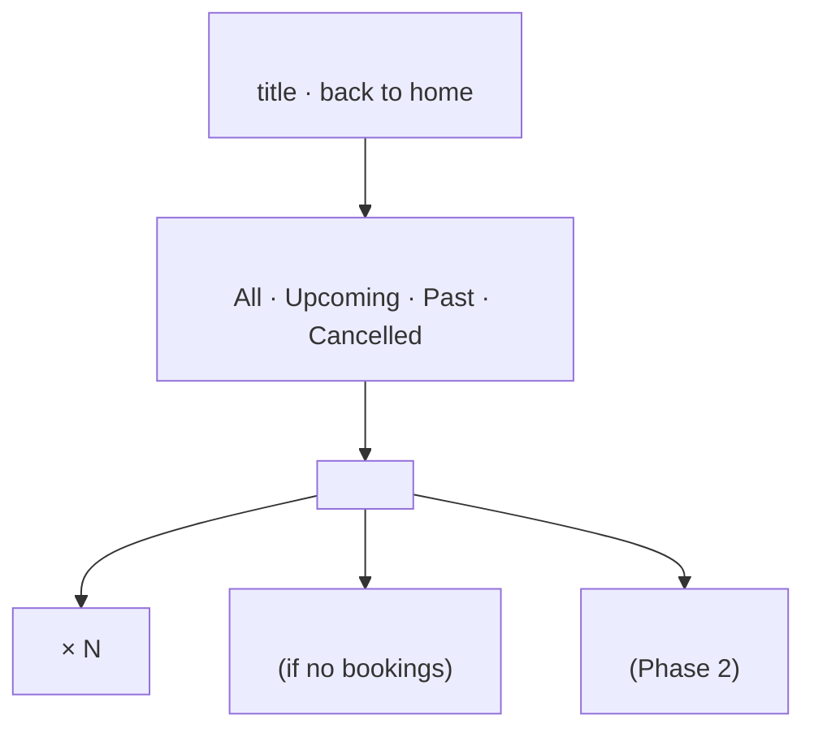

### 6.2 Card contents

Each `<BookingCard>` shows:

| Row | Content |
|---|---|
| 1 | Operator name · bus type badge · **status badge** (Ready to board / Boarded / Cancelled / Refunded / Trip completed / Payment pending) |
| 2 | Departure city → Arrival city · date |
| 3 | Departure time → Arrival time · duration |
| 4 | Booking reference (`BKG-2026-00042`) · seat labels (e.g., "2B") |
| 5 | Fare total (`₹487.50`) |
| 6 | Action buttons: "View ticket" / "Track bus" / "Cancel" / "Book again" (depends on state) |

### 6.3 Filters

| Filter | Shows |
|---|---|
| **All** (default) | Every booking, newest first |
| **Upcoming** | Status ∈ {`PENDING`, `CONFIRMED`, `CHECKED_IN`} AND departure in future |
| **Past** | Status ∈ {`COMPLETED`, `CHECKED_IN` with departure in past} |
| **Cancelled** | Status ∈ {`CANCELLED`, `OPERATOR_CANCELLED`, `REFUNDED`, `EXPIRED`, `FAILED`} |

**Rule:** Filter is client-side on the current page of results. Server supports pagination via cursor (`07` v1.2 §12.4). When user scrolls past loaded results, next page fetches.

### 6.4 Empty states

| State | UI | Action |
|---|---|---|
| No bookings at all | Illustration + "You haven't booked any trips yet" + "Find a bus" CTA | → `SCR-BV-SEARCH` |
| Upcoming filter empty | "No upcoming trips" + "Book a new trip" CTA | → `SCR-BV-SEARCH` |
| API error | "Couldn't load your trips" + Retry button | Retry |

### 6.5 Action routing per card state

**Diagram: Action routing per booking state**
*Each card offers state-dependent actions. PENDING cards route to checkout; CONFIRMED cards offer view/track/cancel; COMPLETED cards offer book-again.*

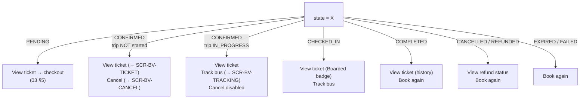

**Rule on Cancel visibility:** The Cancel button is **hidden** when:
- Trip is `IN_PROGRESS` or `COMPLETED` (can't cancel a trip that's running or done)
- Booking is `CANCELLED` / `OPERATOR_CANCELLED` / `REFUNDED` (already cancelled)
- Booking is `EXPIRED` / `FAILED` (nothing to cancel)

Server-side, `POST /bookings/:id/cancel` still enforces this (per `03` §12.1 `INVALID_TRANSITION`). Client hides to avoid UX friction, but server is authoritative.

### 6.6 Data fetching

`GET /v1/passenger/bookings?limit=20&cursor=` — cursor-paginated (per `07` v1.2 §12.4). Default sort `createdAt DESC`.

**React Query key:** `['bookings', { cursor }]`

**Cache:** `staleTime: 30s`, `gcTime: 5 min`.

**Polling:** While any booking in view is `PENDING`, poll the list every 5s to pick up EXPIRED transitions. Once no `PENDING` bookings remain, polling stops.

---

## 7. Ticket Screen (SCR-BV-TICKET)

### 7.1 Screen layout

**Diagram: Ticket screen composition**
*Single-column, centered. Ticket stub at top (design guide §7). Actions bar below. GST invoice link at bottom. Uses `.ticket-stub` from design guide §7 with notch cut-outs.*

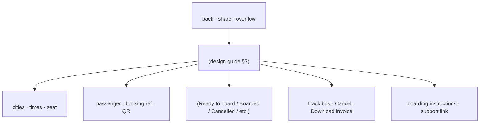

### 7.2 Ticket stub rendering (design guide §7 authoritative)

The ticket stub uses the exact classes and structure from `Design_guide.html` §7:

```html
<div class="ticket-stub">
  <div class="ticket-stub-top">
    <div class="ticket-origin-dest">
      <span class="city-hero">DELHI</span>
      <svg><!-- arrow --></svg>
      <span class="city-hero">LUCKNOW</span>
    </div>
    <div class="station-detail">Anand Vihar ISBT → Alambagh Terminal</div>
    <div class="grid-3">
      <div>DEPARTURE<br/>21:45 IST</div>
      <div>SEAT ALLOCATION<br/>2B (Window)</div>
      <div>BUS CLASS<br/>{bus.model}</div>
    </div>
  </div>
  <div class="ticket-stub-bottom">
    <div>
      <div class="passenger-name">{name}</div>
      <div class="pnr">PNR: {bookingReference}</div>
      <div class="verified-badge">● Cryptographically Verified</div>
    </div>
    <div class="qr-visual-box">
      <QrImage payload={qrPayload} />
    </div>
  </div>
</div>
```

**Rules:**
- `PNR` shows `booking.bookingReference` (`BKG-YYYY-NNNNN` per `06` v1.2 §3.6) — **not** `BV-YYYY-NNNNN` (design guide example uses the latter; follow the schema)
- "Cryptographically Verified" appears **only** when ticket status ∈ {`ISSUED`, `ACTIVE`, `SCANNED`, `USED`}. Hidden for `CANCELLED`.
- Seat allocation shows `{seatLabel}` plus `(Window)`/`(Aisle)` derived from `seat_column` and `layout.aisleCells` — computed client-side
- Departure time shown in **IST** (label "IST"), server stores UTC — client converts via `Intl.DateTimeFormat('en-IN', { timeZone: 'Asia/Kolkata' })`
- Bus class shows `schedule.bus.model` verbatim — not a controlled enum

### 7.3 Status badge

| Booking + ticket status | Badge text | Badge color | Icon |
|---|---|---|---|
| `CONFIRMED` + `ACTIVE` | "Ready to board" | Emerald | Check |
| `CHECKED_IN` + `SCANNED`/`USED` | "Boarded" | Emerald (filled) | Check + person |
| `CANCELLED` + `CANCELLED` | "Cancelled" | Slate | X |
| `OPERATOR_CANCELLED` + `CANCELLED` | "Cancelled by operator" | Slate | X |
| `REFUNDED` + `CANCELLED` | "Refunded" | Slate | Refund |
| `COMPLETED` + `ACTIVE` | "Trip completed" | Slate | Check |
| `PENDING` (should not reach ticket) | (redirect to checkout) | — | — |
| `EXPIRED` / `FAILED` | (redirect to My Trips) | — | — |

**Reference:** `05` v1.2 §8.1 (booking SM), §8.6 (ticket SM).

### 7.4 Actions bar

| Action | Visible when | Behavior |
|---|---|---|
| **Track bus** | Trip status ∈ {`SCHEDULED`, `IN_PROGRESS`} AND booking `CONFIRMED` or `CHECKED_IN` | → `SCR-BV-TRACKING` with `tripId` |
| **Cancel** | Booking `CONFIRMED` AND trip status ∈ {`SCHEDULED`} AND departure > now | → `SCR-BV-CANCEL` (`03` §9) |
| **Download GST invoice** | `booking.gstInvoiceAvailable = true` | Fetch invoice URL from server, open in new tab (PDF) |
| **Share ticket** | Ticket not `CANCELLED` | Native share sheet with text (no QR data) — Phase 2 |
| **Refresh** | Always (pull-to-refresh) | Refetch booking + ticket |

**Note on `Share ticket`:** Deferred to Phase 2. UI shows disabled with tooltip "Coming soon" — or hides entirely. Default: hide in Phase 1.

### 7.5 Full-screen QR option

The ticket stub shows a 90×90 QR (design guide §7). For scanning at a busy boarding stand, the passenger taps the QR to open a **full-screen QR view** (modal, `shadow-modal` from design guide §4, white background, QR centered at 90% screen width). This is a Phase 1 must — small QR is hard to scan.

**Full-screen QR rules:**

| Aspect | Detail |
|---|---|
| Trigger | Tap QR in ticket stub |
| Background | Solid `#FFFFFF` in both themes (per design guide §7 QR visual box) |
| QR size | 90vw × 90vw, max 500px |
| Screen brightness | Boosts to max via `screen.orientation` + `window.screen` APIs (mobile only, best-effort) |
| Auto-hide | Screen stays on via `navigator.wakeLock` while modal open |
| Close | Tap anywhere or Esc; brightness restored |
| Accessibility | `role="dialog"`, `aria-label="Your boarding QR code"`, focus trap |
| Data | Same `qrPayload` — no re-encoding |

### 7.6 Offline state handling

If `navigator.onLine === false` AND the ticket is cached (see §9):

| Scenario | Behavior |
|---|---|
| Cache hit | Show cached ticket, banner "You're offline — showing cached ticket" |
| Cache miss | Show "You're offline. Your ticket isn't cached yet. Reconnect to load it." |
| Cache stale (>24h) | Show cache with warning "Ticket info may be outdated. Reconnect to refresh." |

**Rule:** The QR payload never changes after issuance (invariant `05` v1.2 §7.1 #17). A cached QR is always valid to scan — the driver's verifier checks the signature and the live ticket status. **The QR is safe to cache forever; the surrounding metadata (status badge, actions) is what goes stale.**

---

## 8. QR Rendering

### 8.1 Rendering pipeline

**Diagram: QR rendering pipeline**
*The QR payload is a string of form `v1:{payload_b64}:{sig_b64}` (from `09` v1.2 §7.4). The client renders it as a QR image using a client-side library (e.g., `qrcode.react`). No decoding, no parsing, no re-encoding.*

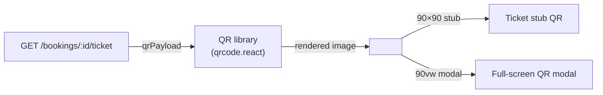

### 8.2 Rendering rules

| Rule | Detail |
|---|---|
| Library | `qrcode.react` (or equivalent) — pinned version |
| Error correction | Level M (medium) — balances size and damage tolerance |
| Margin | 4 modules (quiet zone per QR spec) |
| Foreground | `#000000` (pure black) |
| Background | `#FFFFFF` (pure white) — design guide §7 |
| Data | `qrPayload` verbatim |
| Size | 90px (stub) / 90vw (modal, max 500px) |
| Re-render | Only when `qrPayload` changes (never after issuance) |
| No overlay | Never place anything on top of the QR |

### 8.3 What the client never does with the QR

| Never | Why |
|---|---|
| Decode the payload | Not needed — driver scans it |
| Parse the JSON | Signature invalidates on any change |
| Re-sign or re-encode | Signature is bound to exact bytes |
| Expose in URL | Would leak ticket ID to referrer/logs |
| Log the QR content | QR is a bearer token — logging it is a security bug |
| Include in analytics | Same |

**Rule:** The QR payload is treated like a password. It appears in memory only, rendered to canvas, and sent nowhere except to the driver's scanner.

### 8.4 Accessibility

| Requirement | Implementation |
|---|---|
| QR alt text | `aria-label="Your boarding QR. Show this to the driver."` |
| Fallback text | Below QR: booking ref + "If QR won't scan, show this reference to the driver" |
| Screen reader | QR region announced; fallback ref read aloud |
| Contrast | QR itself is black-on-white (inherent); surrounding text ≥ 4.5:1 |
| Zoom | Full-screen modal supports pinch-zoom (prevents scan failure from small screen) |

---

## 9. PWA Offline Cache

### 9.1 Cache strategy

**Diagram: PWA cache lifecycle**
*Service worker installs on first visit. Ticket payload cached on every successful load. QR is safe to cache forever (immutable per invariant #17). Status badge is refreshed on reconnect.*

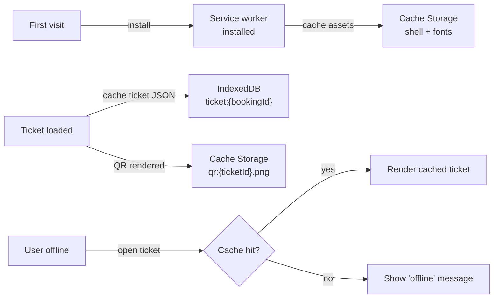

### 9.2 What's cached

| Asset | Storage | TTL | Invalidation |
|---|---|---|---|
| App shell (HTML, JS, CSS) | Cache Storage | 30 days | Version bump |
| Fonts | Cache Storage | 1 year | Version bump |
| Ticket JSON (per booking) | IndexedDB | 30 days | On ticket fetch; on logout |
| QR PNG (per ticket) | Cache Storage | 30 days | On ticket fetch; on logout |
| Booking list JSON | IndexedDB | 7 days | On list fetch |

### 9.3 What's NEVER cached

| Asset | Why |
|---|---|
| Session tokens | Never in Cache Storage (XSS risk) |
| API responses with PII beyond booking | Privacy |
| Driver-side data | Not accessible to passenger |
| Payment details | Gateway responsibility |

**Rule:** Logout clears IndexedDB + Cache Storage ticket entries.

### 9.4 Cache write triggers

| Event | Action |
|---|---|
| Ticket fetched successfully | Write `ticket:{bookingId}` to IndexedDB; render QR to PNG; write `qr:{ticketId}.png` to Cache Storage |
| Booking list fetched | Write list to IndexedDB (7-day TTL) |
| Logout | Clear all ticket and list entries |
| App version bump | Old cache invalidated via `Cache-Control` + version query param |

### 9.5 Offline behavior matrix

| User state | Ticket load | Booking list load |
|---|---|---|
| Online, cache hit | Server fetch, update cache | Server fetch, update cache |
| Online, cache miss | Server fetch, write cache | Server fetch, write cache |
| Offline, cache hit | Show cached ticket + "Offline" banner | Show cached list + banner |
| Offline, cache miss | Show "Reconnect to load" message | Show "Reconnect to load" message |
| Online, server error | Show cached ticket + "Showing cached" banner | Show cached list + banner |
| Logged out | Cache cleared | Cache cleared |

**Rule:** The cached ticket is *always* shown when available, with a banner explaining its freshness. Never hide a cached ticket because the network is down — that would strand the passenger at a boarding stand.

### 9.6 Service worker version management

| Rule | Detail |
|---|---|
| New deploy | SW detects updated `sw.js`; shows "Update available" toast; user taps to activate on next visit |
| Force update on critical bug | Server sets `X-SW-Min-Version` header; client forces refresh |
| Cache version | `CACHE_VERSION` constant in `sw.js` bumps per deploy; old caches deleted on activate |

**Rule:** Never auto-refresh a page with an open ticket modal — that would lose the QR mid-show. Show the toast instead.

---

## 10. Tracking Screen (SCR-BV-TRACKING)

### 10.1 Screen layout

**Diagram: Tracking screen composition**
*Telemetry card from design guide §6 at top (live beacon, route progress, stats), map below (OSM tiles + bus marker), stand list at bottom (upcoming stops + ETA). Sticky "LIVE" pill always visible when tracking.*

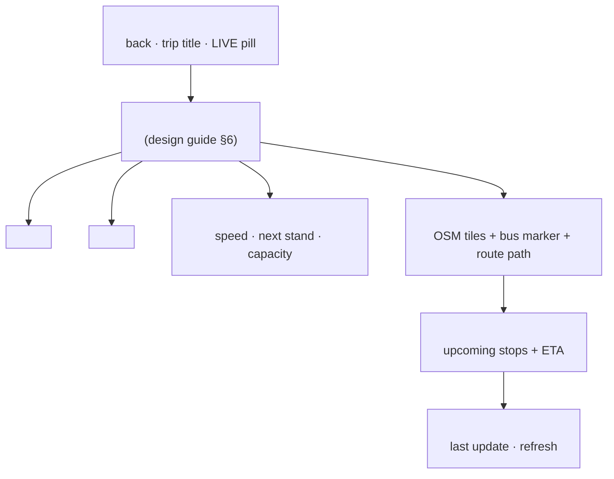

### 10.2 States

The tracking screen has **five states** based on trip status:

| Trip status | Screen state | What's shown |
|---|---|---|
| `SCHEDULED` | Pre-trip | Countdown to departure, "Driver hasn't started yet" message, no map movement, no beacon |
| `IN_PROGRESS` | Live | Live beacon + live map + live ETA |
| `IN_PROGRESS` + WS disconnected | Stale | Last known position + "Reconnecting..." + auto-polling |
| `COMPLETED` | Post-trip | "Trip completed" banner, final position, no live updates |
| `CANCELLED` | Cancelled | "Trip cancelled by operator" banner + refund info, no map movement |

### 10.3 Pre-trip state

**Diagram: Pre-trip state**
*Before driver starts, tracking is not live. Show countdown, scheduled departure, driver placeholder, and a note that GPS begins when the driver taps Start.*

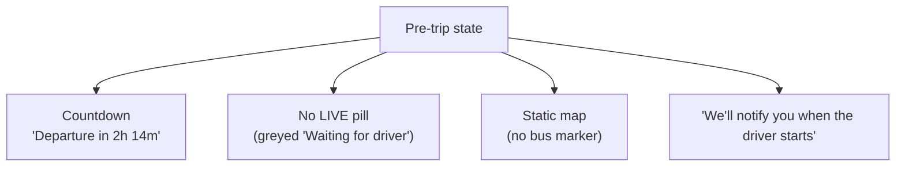

**Rules:**

| Aspect | Detail |
|---|---|
| Countdown | Server time (`departureTime − now`) |
| Refresh | Poll `/trips/:id/live` every 30s |
| WebSocket | Do **not** subscribe yet — subscribe on `trip:started` (or on `IN_PROGRESS` poll response) |
| Notification | Phase 1: no push, just in-app. Phase 2: FCM push on `trip:started`. |
| User tap "Track bus" from ticket while SCHEDULED | → pre-trip screen, "Refresh" button to re-check |

### 10.4 Live state

**Diagram: Live telemetry rendering**
*Uses design guide §6 telemetry card. `.live-beacon-pill` pulses (2.2s per design guide). `.route-progress-track` shows 8px progress. `.route-progress-fill` interpolates as bus moves. `.route-vehicle-icon` moves along track.*

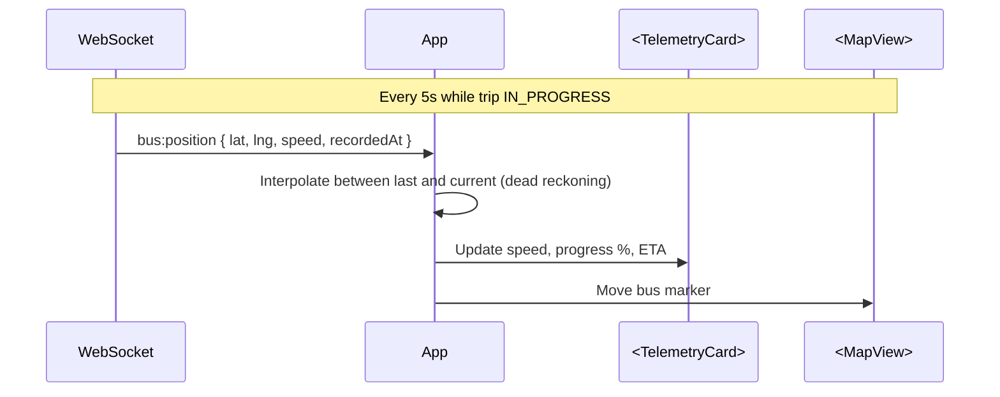

**Live rules:**

| Aspect | Detail |
|---|---|
| Update interval | Every 5s per `02` §6.6 FR-OP-009, `07` v1.2 §8.1 (design guide §6 says 10s — see §4.2 C1) |
| Interpolation | Client interpolates position between samples for smooth motion (design guide §6 mention) |
| Progress track | `(distance covered) / (total distance)` → width % of `.route-progress-fill` |
| Bus marker | Design guide `.route-vehicle-icon` — 32×32, cyan border, glow |
| Live beacon | `LIVE` pill with pulsing dot (design guide `.live-beacon-pill`) |
| Speed display | `speed_kmh` from latest sample |
| Next stand | Derived from route + current position |
| ETA | Server-computed from GPS + route; client displays verbatim from `GET /trips/:id/live` response |
| Auto-refresh | Poll `/trips/:id/live` every 5s in parallel with WS (belt-and-braces for missed events) |

### 10.5 Stats grid (design guide §6)

Three stats per design guide:

| Stat | Source | Format |
|---|---|---|
| **Speed telemetry** | Latest `bus:position` event | `78 km/h` + status text ("Smooth Highway Corridor") |
| **Next boarding point** | `GET /trips/:id/live` response `eta[]` first element | Stand name + `ETA 18 Min` |
| **Passenger capacity** | `GET /trips/:id/live` response `seatsOccupied / seatsTotal` | `38 / 44 Seats` + `86% Current Occupancy` |

**Note:** The design guide shows "PASSENGER CAPACITY" — this is a driver-facing stat. For passenger-facing tracking, showing `38/44` reveals how many other passengers are on the bus. This is **privacy-acceptable** (no identities, just a count) and matches the design guide. Confirm per §19 Q4.

### 10.6 Map rendering

| Aspect | Detail |
|---|---|
| Tile source | OSM tiles (`03` §21 ADR-006) |
| Library | `maplibre-gl` (per `01` §11.1) |
| Route path | Polyline between `route.stops` in sequence |
| Bus marker | Design guide `.route-vehicle-icon` — cyan-bordered circle with bus icon |
| Stand markers | Small dots at each stop; next stand highlighted |
| User location | Not requested in Phase 1 (no permission prompt) |
| Fallback | If tiles fail → static fallback image with markers overlaid |
| Offline | No offline map in Phase 1 |

### 10.7 Post-trip state

When trip status becomes `COMPLETED`:

| Element | Behavior |
|---|---|
| Live beacon | Removed |
| Map | Static, final position |
| ETA panel | Replaced with "Arrived at {destination}" |
| Actions | "Rate your trip" (Phase 2 — hidden in Phase 1), "Book again" |
| Refresh | No polling; user can go back |

### 10.8 Cancelled state

When trip status becomes `CANCELLED`:

| Element | Behavior |
|---|---|
| Banner | "This trip was cancelled by the operator" |
| Refund info | "Full refund of ₹{amount} initiated" (per `03` §9.7 — `TIER_FULL` always for operator cancel) |
| Map | Hidden (no trip to track) |
| Actions | "View refund status" → `SCR-BV-MYTRIPS`, "Book another bus" |

### 10.9 Tracking edge cases

| Scenario | Behavior |
|---|---|
| Trip has no GPS data yet (just started) | Show "Driver is starting the trip..." for up to 30s; then poll or use fallback |
| GPS stale (>30s old) | Show "Last known position" with timestamp; auto-poll faster (2s) |
| GPS invalid (lat/lng out of range) | Ignore sample; keep last valid position; log warning |
| Map tiles fail to load | Static fallback image with markers (per `01` §11.2) |
| Stand names missing | Show "Stand {n}" from sequence |
| ETA data missing | Hide ETA panel; show map + stats only |

---

## 11. Real-Time Updates

### 11.1 WebSocket topics consumed

| Topic | Subscribed on | Events | Authorization |
|---|---|---|---|
| `booking:{bookingId}` | Ticket screen mount, My Trips card mount | `booking:confirmed`, `booking:cancelled`, `booking:expired`, `boarding:verified` | Owner of booking or admin (per `07` v1.2 §8.2) |
| `trip:live:{tripId}` | Tracking screen mount (when IN_PROGRESS) | `bus:position`, `trip:started`, `trip:delayed`, `trip:ended` | Booked passenger, operator, or admin (per `07` v1.2 §8.2) |

### 11.2 Subscription lifecycle

**Diagram: Subscription lifecycle**
*Subscribe on mount, unsubscribe on unmount, re-subscribe on reconnect. The WS connection is shared across screens — subscribing/unsubscribing is per-topic.*

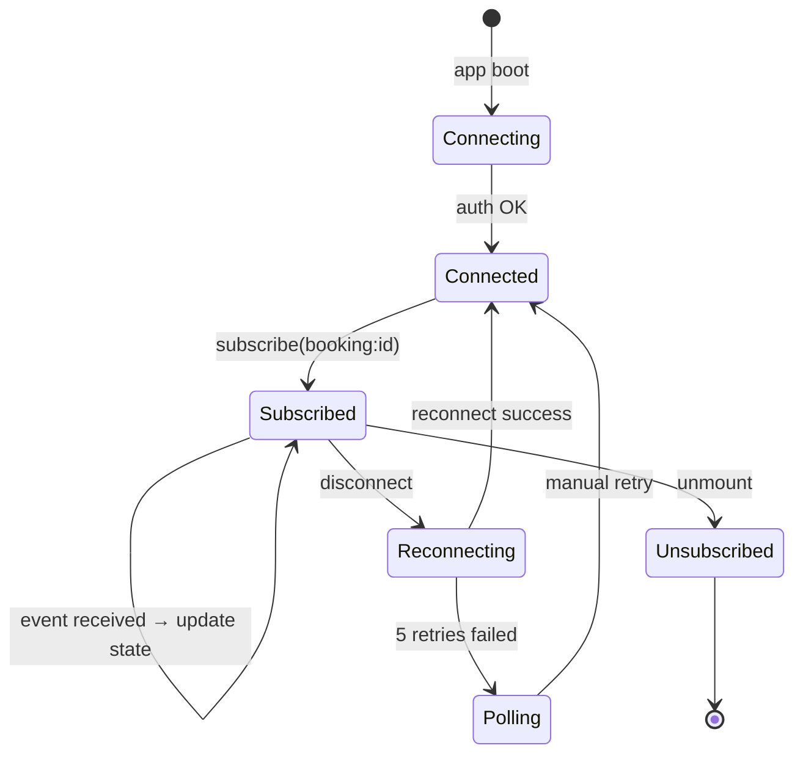

### 11.3 Event handling matrix

| Event | Topic | Effect on ticket screen | Effect on tracking screen |
|---|---|---|---|
| `booking:confirmed` | `booking:*` | Change status to CONFIRMED, re-render | — |
| `booking:cancelled` | `booking:*` | Show cancelled banner, disable actions, prompt refund status | If on same trip → show cancellation state |
| `booking:expired` | `booking:*` | (Should not happen on ticket screen; user was redirected) | — |
| `boarding:verified` | `booking:*` | Change badge to "Boarded", trigger confetti (optional Phase 2) | — |
| `bus:position` | `trip:live:*` | — | Move bus marker, update stats |
| `trip:started` | `trip:live:*` | — | Transition from pre-trip to live state |
| `trip:delayed` | `trip:live:*` | — | Show delay banner |
| `trip:ended` | `trip:live:*` | — | Transition to post-trip state |

**Reference:** `07` v1.2 §8.7.

### 11.4 Polling fallback

**Diagram: Polling fallback**
*If WebSocket fails, poll endpoints in parallel. Ticket screen polls `/bookings/:id` every 5s. Tracking screen polls `/trips/:id/live` every 3s. Show "Reconnecting..." banner.*

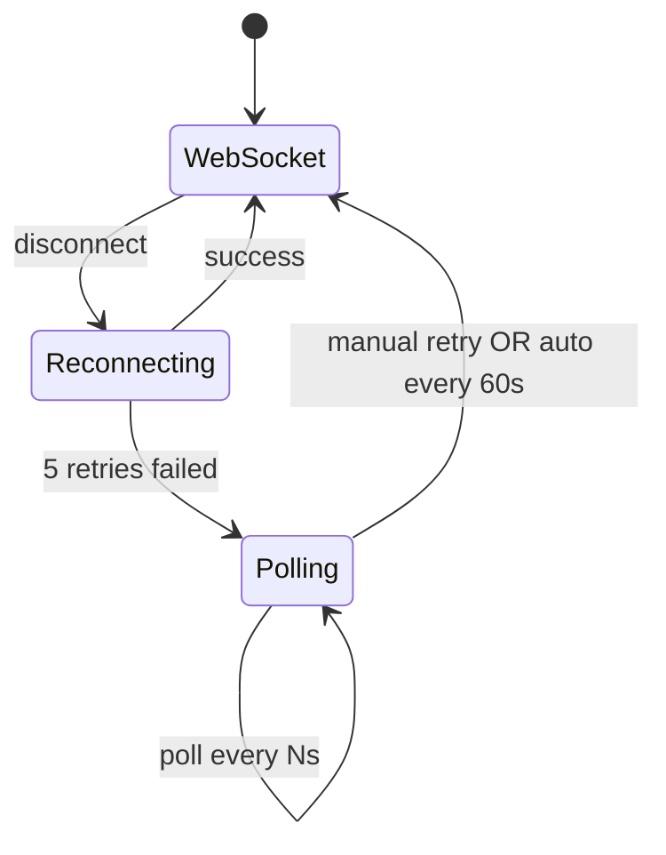

**Polling intervals:**

| Screen | Endpoint | Interval |
|---|---|---|
| Ticket | `GET /bookings/:id` | 5s |
| Ticket | `GET /bookings/:id/ticket` | 30s (ticket status rarely changes) |
| My Trips | `GET /bookings` | 10s (if any PENDING) |
| Tracking | `GET /trips/:id/live` | 3s |

**Reference:** `07` v1.2 §8.6.

### 11.5 Re-authentication on JWT expiry

When WS is connected for longer than 15 min, the access token expires:

| Step | Action |
|---|---|
| Server sends `auth:expiring` (60s before expiry) | Per `07` v1.2 §8.5 |
| Client sends `auth:refresh` with refresh token | Per `07` v1.2 §8.5 |
| Server validates, sends `auth:refreshed` | Connection continues |
| If client misses window | Server closes WS; client reconnects with fresh access token |

**Client behavior:** On WS close code 4001 (token expired), call `POST /auth/refresh`, then reconnect WS. If refresh fails → redirect to login with return URL. Recovers via `01` §3.8 silent refresh pattern.

**Reference:** `08` v1.1 §10.3 (WF-R-03).

### 11.6 De-duplication and race handling

| Race | Handling |
|---|---|
| WS event + poll return same state | Idempotent — apply once |
| WS `booking:cancelled` arrives after poll already showed cancelled | Idempotent — no double banner |
| WS `bus:position` arrives out of order | Compare `recordedAt`; ignore if older than current |
| Rapid `bus:position` events (batching) | Batch updates via `requestAnimationFrame` |
| `trip:ended` arrives while user is scrolling stand list | Smooth transition to post-trip state; preserve scroll |

---

## 12. Boarding Status

### 12.1 The boarding event

**Diagram: Boarding → passenger sees boarded**
*Driver scans QR → server verifies + updates ticket → WebSocket emits `boarding:verified` to passenger's `booking:{id}` topic → passenger sees badge flip to "Boarded" without refresh.*

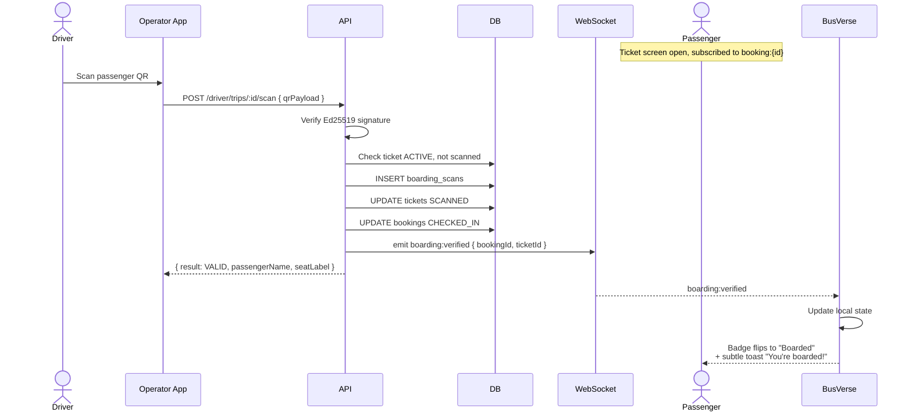

### 12.2 Boarded display

| Element | Before scan | After scan |
|---|---|---|
| Status badge | "Ready to board" (emerald outline) | "Boarded" (emerald filled) |
| QR | Full, scannable | Dimmed with "Boarded" watermark + timestamp |
| Track bus | Enabled | Enabled (still useful mid-trip) |
| Cancel | Enabled (if trip not started) | Hidden (trip in progress) |
| Toast | — | "You're boarded! Have a safe trip." |

### 12.3 Boarding fallback (WS missed)

If `boarding:verified` is missed (WS disconnected):

| Trigger | Action |
|---|---|
| Poll `GET /bookings/:id` returns `CHECKED_IN` | Update badge, show toast |
| User pulls to refresh | Same |
| Next ticket fetch | Shows correct state |

**Rule:** Boarding state is always derivable from `GET /bookings/:id` — WebSocket is the fast path, not the source of truth.

### 12.4 Duplicate scan handling

If the driver scans the same ticket twice:

| Event | Behavior |
|---|---|
| Second scan | Server returns `{ result: DUPLICATE }` (per `08` v1.1 §9.4) |
| Passenger side | No additional event; badge stays "Boarded" |
| Server | Second `boarding_scans` row with `result=DUPLICATE` for audit |

**Rule:** Passenger never sees "Boarded twice." Idempotent from passenger's view.

---

## 13. Component Structure

### 13.1 My Trips component tree

**Diagram: My Trips component tree**
*Header, filter chips, list of cards, empty state. Each card is a self-contained unit routing to ticket/tracking/cancel.*

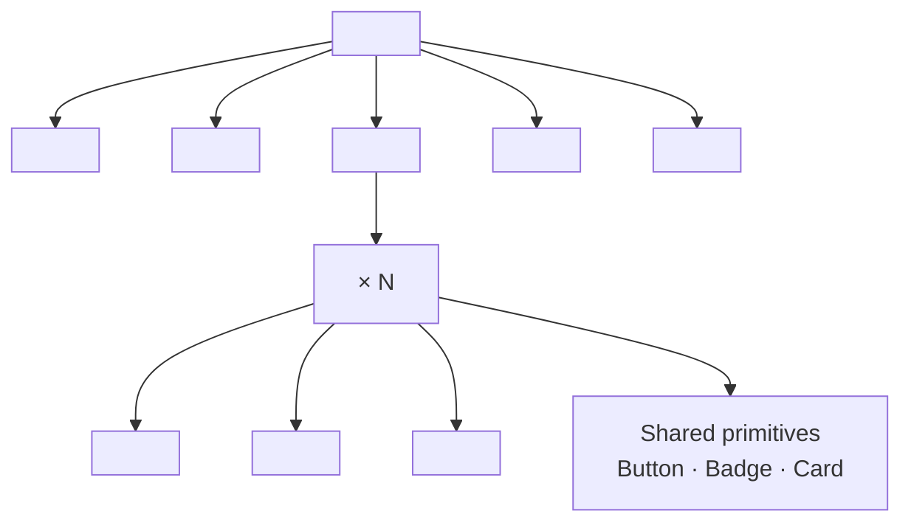

### 13.2 Ticket component tree

**Diagram: Ticket component tree**
*Header, ticket stub (top + bottom halves per design guide §7), status badge, actions, info, full-screen QR modal.*

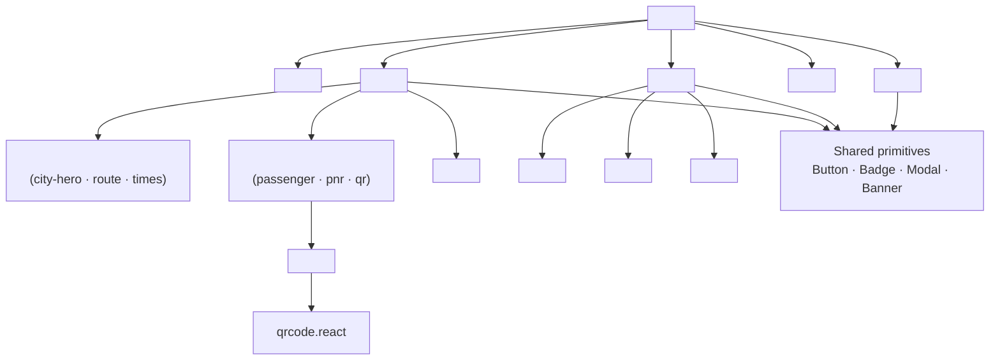

### 13.3 Tracking component tree

**Diagram: Tracking component tree**
*Header with live pill, telemetry card (design guide §6), map, stand list, footer. All pieces update from WebSocket.*

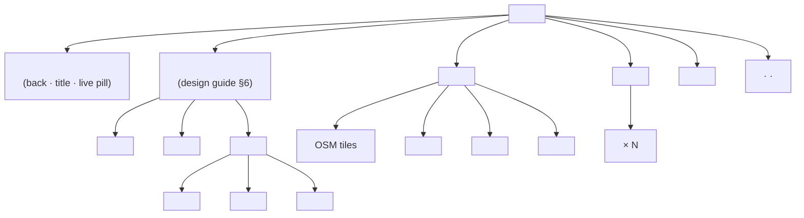

### 13.4 Component contracts

| Component | Props | Emits |
|---|---|---|
| `<MyTripsPage>` | — | — |
| `<BookingCard>` | `booking`, `onViewTicket`, `onTrack`, `onCancel` | callbacks |
| `<StatusBadge>` | `bookingStatus`, `ticketStatus` | — |
| `<TicketPage>` | `bookingId` (router) | — |
| `<TicketStub>` | `booking`, `ticket`, `onQrTap` | `onQrTap()` |
| `<QrImage>` | `payload`, `size` | — |
| `<FullScreenQrModal>` | `payload`, `open`, `onClose` | `onClose()` |
| `<TicketActions>` | `booking`, `trip`, `ticket`, `onTrack`, `onCancel`, `onInvoice` | callbacks |
| `<TrackingPage>` | `tripId`, `bookingId` (router) | — |
| `<TelemetryCard>` | `trip`, `lastPosition`, `stats` | — |
| `<LiveBeacon>` | `active` | — |
| `<RouteProgress>` | `progressPct`, `busPosition` | — |
| `<TelemetryStats>` | `speed`, `nextStand`, `occupancy` | — |
| `<MapView>` | `routeStops`, `busPosition` | — |
| `<StandList>` | `stops`, `currentPosition` | — |
| `<PreTripState>` | `departureTime` | `onRefresh` |
| `<PostTripState>` | `trip` | `onBookAgain` |
| `<CancelledState>` | `trip`, `refund` | `onViewRefund` |

### 13.5 Ownership

| Component | Owner | Design guide ref |
|---|---|---|
| All components in §13.1–§13.4 | This doc | — |
| Ticket stub visual classes | Design guide §7 | `.ticket-stub`, `.ticket-stub-top`, `.ticket-stub-bottom`, `.qr-visual-box`, `.city-hero` |
| Telemetry classes | Design guide §6 | `.telemetry-preview-card`, `.live-beacon-pill`, `.route-progress-track`, `.route-progress-fill`, `.route-vehicle-icon` |
| Shared primitives | `@busverse/ui` | Button, Badge, Card, Modal, Banner, Spinner |

**Rule:** No visual primitive exists in two places. If a component is only used here, it lives in `apps/busverse/components/ticket-tracking/`. If shared, it moves to `@busverse/ui`.

---

## 14. State Management

### 14.1 React Query keys

| Query | Key | staleTime | gcTime | Notes |
|---|---|---|---|---|
| My Trips list | `['bookings', { cursor, filter }]` | 30s | 5 min | Cursor-paginated |
| Booking detail | `['booking', bookingId]` | 0 (always fresh) | 5 min | Refetched on WS events |
| Ticket | `['ticket', bookingId]` | 0 | 5 min | Refetched on booking state change |
| Trip live | `['tripLive', tripId]` | 0 | 2 min | Poll every 3s when tracking |
| Trip map | `['tripMap', tripId]` | 5 min | 10 min | Static route path — rarely changes |
| GST invoice URL | `['gstInvoice', bookingId]` | 60s | 10 min | Signed URL — short TTL |

### 14.2 Mutations

| Mutation | Invalidates |
|---|---|
| (No direct mutations here — cancels go through `03`) | — |

**Rule:** This doc is read-heavy. All writes happen via `03` (payment/cancel). Local writes are cache updates from WS events.

### 14.3 Cache updates from WebSocket

When a WS event arrives, update the React Query cache directly (no refetch):

| Event | Cache update |
|---|---|
| `booking:confirmed` | `queryClient.setQueryData(['booking', id], updater)` |
| `booking:cancelled` | Same + invalidate `['bookings']` |
| `boarding:verified` | Same + invalidate `['ticket', bookingId]` |
| `bus:position` | `queryClient.setQueryData(['tripLive', id], merge)` |
| `trip:started` | Invalidate `['tripLive', id]` (fetch fresh) |
| `trip:ended` | Same |
| `trip:delayed` | `setQueryData` merge |

### 14.4 Local state per screen

**My Trips:**
```ts
type MyTripsLocal = {
  filter: 'all' | 'upcoming' | 'past' | 'cancelled';
};
```

**Ticket:**
```ts
type TicketLocal = {
  qrModalOpen: boolean;
  status: 'loading' | 'ready' | 'offline' | 'error';
  offlineSince?: number;  // timestamp for "offline" banner
};
```

**Tracking:**
```ts
type TrackingLocal = {
  state: 'pre-trip' | 'live' | 'stale' | 'post-trip' | 'cancelled';
  lastUpdateAt: string | null;
  busPosition: { lat: number; lng: number } | null;
  progressPct: number;
  speedKmh: number | null;
  nextStand: { name: string; etaMinutes: number } | null;
  occupancy: { occupied: number; total: number } | null;
};
```

### 14.5 Cache and PWA coordination

| Action | Cache effect |
|---|---|
| Ticket loaded online | Write to IndexedDB (per §9.4) |
| Ticket loaded offline (cache hit) | Read from IndexedDB, set `offlineSince` |
| Logout | Clear all IndexedDB + Cache Storage |

---

## 15. Error States

### 15.1 Full error catalog

| Code | Screen | UI | Action |
|---|---|---|---|
| `NOT_FOUND` | All | "Booking not found" + "Back to My Trips" | Redirect |
| `UNAUTHORIZED` | All | Silent refresh → retry; on fail → login | Auto |
| `FORBIDDEN` | All | "Not authorized" + back | Redirect |
| `TICKET_NOT_FOUND` | Ticket | "Ticket is being issued — retry in 5s" + auto-retry | Retry × 3 |
| `TICKET_CANCELLED` | Ticket | "This ticket was cancelled" + refund info | — |
| `BOOKING_EXPIRED` | Ticket | "This booking expired" + book again | Redirect |
| `TRIP_NOT_FOUND` | Tracking | "Trip not found" + back | Redirect |
| `TRIP_NOT_STARTED` | Tracking | Pre-trip state (not an error) | — |
| `TRIP_CANCELLED` | Tracking | Cancelled state | — |
| `SERVICE_UNAVAILABLE` | All | "Service unavailable — retry" + Retry button | Retry |
| `GATEWAY_TIMEOUT` | All | Same as 503 | Retry |
| `RATE_LIMITED` | All | "Too many requests. Retry in {N}s" | Auto-retry |
| `INTERNAL_ERROR` | All | "Something went wrong" + Sentry | Retry |
| **Network offline** | All | Offline banner (per §9.5) | Auto-retry on reconnect |
| **QR render fail** | Ticket | "Couldn't render QR. Refresh." | Retry |

### 15.2 Error handling flow

**Diagram: Error handling flow**
*Every error routes to one of four UI responses — retry, redirect, banner, or silent refresh.*

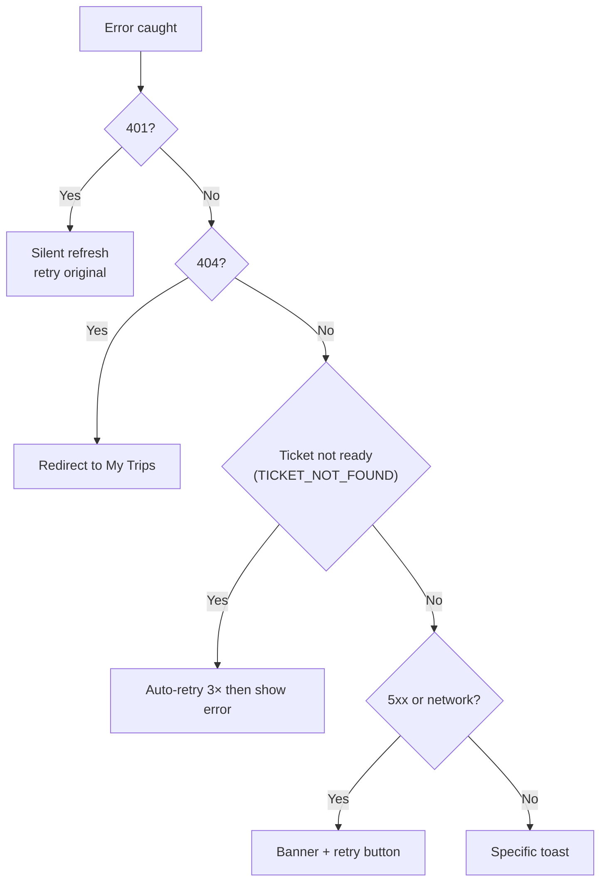

### 15.3 Toast messaging

| Error | Toast text |
|---|---|
| `TICKET_NOT_FOUND` | "Your ticket is being prepared. One moment..." |
| `TRIP_NOT_FOUND` | "We can't find this trip. Returning to My Trips." |
| `RATE_LIMITED` | "Please wait {N}s and try again." |
| Network offline | "You're offline. Showing saved info." |
| Network restored | "You're back online. Refreshing..." |
| `INTERNAL_ERROR` | "Something went wrong. Please retry." |
| QR render fail | "Couldn't show the QR. Please retry." |

### 15.4 Empty states

| Screen | Empty state | Action |
|---|---|---|
| My Trips (no bookings) | Illustration + "No trips yet" | "Find a bus" → search |
| My Trips (filter empty) | "No {upcoming/past/cancelled} trips" | Clear filter |
| Ticket (booking not CONFIRMED) | (redirect) | — |
| Tracking (trip cancelled) | Cancelled state (per §10.8) | "Book another" |
| Tracking (trip not started) | Pre-trip state (per §10.3) | "We'll notify you" |

### 15.5 Retry budget

| Endpoint | Retries | Backoff |
|---|---|---|
| `GET /bookings/:id` | 3 | 1s, 3s, 9s |
| `GET /bookings/:id/ticket` | 3 | 5s, 10s, 20s |
| `GET /trips/:id/live` | Infinite (until terminal state) | 3s → 5s → 10s |
| `GET /trips/:id/map` | 2 | 5s, 10s |
| `GET /bookings` (list) | 3 | 1s, 3s, 9s |
| GST invoice URL | 2 | 2s, 5s |

---

## 16. Accessibility

### 16.1 Per-screen requirements

**My Trips:**

| Requirement | Implementation |
|---|---|
| Card as focusable link | `<a>` or `<button role="link">` with keyboard Enter |
| Status badge announced | `aria-label="Status: {status}"` |
| Filter chips | `role="radiogroup"`, arrow keys navigate |
| Empty state announced | `role="status"` |

**Ticket:**

| Requirement | Implementation |
|---|---|
| Ticket stub as region | `role="region"` `aria-label="Your ticket"` |
| QR label | `aria-label="Your boarding QR code"` |
| Fallback ref | `<p>` below QR with `aria-describedby` |
| Status badge | `role="status"`, `aria-live="polite"` (updates when boarded) |
| Full-screen QR modal | `role="dialog"`, `aria-modal="true"`, focus trap, Esc closes, focus returns to QR tap target |
| Actions buttons | Standard `<button>`, ≥ 44×44px |
| Full-screen QR announcement | `aria-live="assertive"` when opened |
| Cancelled banner | `role="alert"` |

**Tracking:**

| Requirement | Implementation |
|---|---|
| Live beacon | `aria-label="Live"` + `aria-live="polite"` for updates |
| Route progress | `role="progressbar"` with `aria-valuenow`, `aria-valuemin="0"`, `aria-valuemax="100"` |
| Speed stat | `aria-live="polite"` (updates every 5s — throttle announcements to every 30s to avoid chatter) |
| Stand list | `<ol>` with each stop as `<li>` |
| Next stand highlighted | `aria-current="step"` on the next stand |
| Map | `role="img"` with `aria-label="Map showing bus position near {next stand}"` — no interactive map for screen readers; stand list is the accessible fallback |
| Bus marker | Not announced individually (decorative) |
| Trip state changes | `role="status"` announcements when transitions occur |

### 16.2 Reduced motion

| Element | Behavior with `prefers-reduced-motion: reduce` |
|---|---|
| Live beacon pulse | Static dot, no pulse |
| Route progress animation | Instant update, no slide |
| Bus marker movement | Instant position, no transition |
| Confetti (if used) | Disabled |
| Ticket stub shimmer | Disabled |
| Modal open/close | Instant |

### 16.3 Focus management

| Scenario | Behavior |
|---|---|
| Ticket opened | Focus on page heading |
| QR modal opened | Focus on close button |
| QR modal closed | Focus returns to QR tap target |
| Cancel dialog opened (from ticket) | Focus on "Cancel booking" heading |
| Cancel dialog closed | Focus returns to Cancel button |
| Error toast | Announced via `role="alert"` (polite) |

---

## 17. Performance

### 17.1 Performance targets

| Surface | Target | Source |
|---|---|---|
| My Trips list load | p95 < 400 ms | Estimated |
| Ticket load | p95 < 300 ms | Estimated |
| QR render | < 100 ms | Estimated |
| Tracking load | p95 < 500 ms | Estimated |
| `bus:position` render | < 16 ms (60fps) | — |
| WS event to UI update | < 100 ms | — |
| Polling fallback overhead | < 200 ms per poll | — |
| PWA cold start (offline ticket) | < 1 s | Estimated |

### 17.2 Optimization techniques

| Technique | Where |
|---|---|
| `React.memo` on `<BookingCard>`, `<StandRow>` | List rendering |
| `useCallback` for event handlers | Prevent re-renders |
| QR caching | Render once, reuse unless payload changes |
| Image lazy-load | Map tiles below fold |
| Virtual list | Deferred to Phase 2 (> 100 bookings) |
| Batch WS events via `requestAnimationFrame` | Tracking map updates |
| Debounced speed stat announcements | Throttle to 30s |
| Prefetch ticket on My Trips mount | If user likely to tap |

### 17.3 Cache warming

| Trigger | Prefetch |
|---|---|
| My Trips list loaded | Prefetch ticket JSON for the top 3 most recent CONFIRMED bookings |
| Ticket screen loaded | Prefetch trip live data if `trip.status ∈ {SCHEDULED, IN_PROGRESS}` |

**Rule:** Never prefetch cancelled or expired bookings — wastes bandwidth.

---

## 18. Test Coverage

### 18.1 Test suites (~35 tests)

| Suite | Count | Covers |
|---|---:|---|
| `e2e_my_trips_load` | 3 | Load with bookings, empty, error |
| `e2e_my_trips_filter` | 4 | All / upcoming / past / cancelled |
| `e2e_ticket_load` | 3 | Load, ticket not ready (retry × 3), redirect PENDING |
| `e2e_ticket_qr_render` | 2 | QR renders at 90×90 and full-screen |
| `e2e_ticket_cancel_link` | 2 | Cancel button routes to `03`; hidden when trip in progress |
| `e2e_ticket_invoice` | 2 | Invoice link shown when `gstInvoiceAvailable=true`; hidden otherwise |
| `e2e_ticket_offline` | 3 | Offline cache hit shows ticket; cache miss shows message; online restore |
| `e2e_tracking_pre_trip` | 2 | SCHEDULED state shows countdown, no beacon |
| `e2e_tracking_live` | 3 | IN_PROGRESS: beacon, map moves, stats update |
| `e2e_tracking_post_trip` | 2 | COMPLETED: no beacon, final position |
| `e2e_tracking_cancelled` | 2 | CANCELLED: banner, refund info |
| `e2e_tracking_polling_fallback` | 2 | WS fails → polling starts; WS recovers → polling stops |
| `e2e_boarding_status_flip` | 2 | WS `boarding:verified` flips badge; poll catches if WS misses |
| `component_ticket_stub` | 4 | Stub renders, PNR format, seat/window, bus class |
| `component_status_badge` | 5 | Each state renders correct text/color |
| `component_qr_image` | 3 | Renders payload verbatim, level M, no re-encode |
| `component_telemetry_card` | 4 | Beacon pulse, progress fill, stats layout |
| `component_map_view` | 3 | Renders route, moves marker, handles tile failure |
| `unit_qr_payload_passthrough` | 2 | Client passes payload unchanged to QR library |
| `unit_eta_derivation` | 2 | Client computes stand ETA from server response |
| `unit_seat_window_label` | 2 | "(Window)" vs "(Aisle)" derived correctly |
| `contract_bookings_list` | 3 | Happy, unauthorized, empty |
| `contract_booking_detail` | 3 | Happy, unauthorized, not-found |
| `contract_ticket_get` | 3 | Happy, ticket not ready (404), unauthorized |
| `contract_trip_live` | 3 | Happy, unauthorized, not-booked |
| `contract_trip_map` | 2 | Happy, unauthorized |
| **Total** | **~69** | |

**Note on overlap with `07`:** The contract tests here test the same endpoints as `07` v1.2 §15.5, but from the client's perspective — asserting the client-side schema matches. These are *client contract tests*, not *server contract tests*. Both exist.

### 18.2 Key assertions

| Test | Asserts |
|---|---|
| `e2e_ticket_load_happy` | CONFIRMED booking → ticket screen renders with QR |
| `e2e_ticket_not_ready_retry` | 404 `TICKET_NOT_FOUND` → auto-retry × 3 → renders |
| `e2e_ticket_qr_fullscreen` | Tap QR → modal opens; QR 90vw; Esc closes |
| `e2e_ticket_offline_cached` | Offline → cached ticket renders with banner |
| `e2e_tracking_live_beacon` | IN_PROGRESS → beacon pulses (or static in reduced motion) |
| `e2e_tracking_bus_moves` | 2 `bus:position` events → bus marker moves |
| `e2e_boarding_flip` | `boarding:verified` → badge = "Boarded" |
| `e2e_boarding_poll_fallback` | WS dropped + `CHECKED_IN` poll → badge flips |
| `component_qr_image_verbatim` | Same payload → same QR (byte-for-byte library output) |
| `unit_seat_window` | Seat 2B in a 2+2 layout → "(Window)" |
| `unit_seat_aisle` | Seat 2A in a 2+2 layout → "(Aisle)" |
| `contract_trip_live_not_booked` | User not on trip → 404 |

**Reference:** `10` v1.2 §7.6 (contract tests), §8 (E2E).

---

## 19. Open Questions

| # | Question | Owner | Default |
|:---:|---|---|---|
| 1 | FR-BV-024/025 ownership — `00` §5.1 assigns to `01`, `03` §3.1 assigns to `04`; this doc takes `04` | Shaghaf | `04` owns; `00`/`01` v1.1 amendment pending |
| 2 | `Design_guide.html` §6 says 10s GPS interval; all locked docs say 5s | Shaghaf | Follow 5s (locked docs win); design guide example to be corrected |
| 3 | `gstInvoiceAvailable` field not explicitly in `07` v1.2 §4.5 response spec — confirm exact name | Shaghaf | Assume `gstInvoiceAvailable: boolean`; verify against `07` |
| 4 | Show passenger capacity stat (`38/44`) on passenger tracking — privacy concern? | Shaghaf | Yes, show it (design guide §6 shows it, no identities revealed) |
| 5 | Full-screen QR modal — Phase 1 or Phase 2? | Shaghaf | Phase 1 (essential for scanning) |
| 6 | PWA cache TTL for tickets — 30 days sufficient? | Shaghaf | 30 days (covers most travel booking lead times) |
| 7 | Sharing a ticket — Phase 1? | Shaghaf | No (Phase 2) |
| 8 | "Rate your trip" CTA post-trip — Phase 1? | Shaghaf | No (Phase 2; reviews are Phase 2) |
| 9 | Background colour behind QR in full-screen modal — white in both themes? | Shaghaf | Yes (design guide §7 `.qr-visual-box` is white) |
| 10 | WakeLock API for QR — Phase 1? | Shaghaf | Yes (essential for scanning UX) |
| 11 | Show "verified" badge on ticket — always or only CONFIRMED? | Shaghaf | Only when status ∈ {ISSUED, ACTIVE, SCANNED, USED} |
| 12 | Polling interval for ticket-status when WS connected — needed? | Shaghaf | 30s parallel poll (belt-and-braces) |
| 13 | Driver hasn't started — should tracking screen even be reachable? | Shaghaf | Yes (pre-trip state is informative); "Track bus" button visible but routes to pre-trip |
| 14 | Show bus model as "Volvo Multi-Axle" — free text or controlled vocab? | Shaghaf | Free text from `schedule.bus.model` |
| 15 | PWA cache — should it cache non-CONFIRMED bookings? | Shaghaf | No — only CONFIRMED+ tickets cached (PENDING/EXPIRED/FAILED not worth caching) |

---

## 20. Checklist Against Master List

| Item | Included? | Section |
|---|:---:|---|
| Purpose and scope | ✅ | §1 |
| Doc hierarchy | ✅ | §1.3 |
| **FR ownership resolution (10 FRs)** | ✅ | §1.2 |
| Scope table | ✅ | §1.5 |
| Workflow map (4 workflows) | ✅ | §2 |
| FR mapping | ✅ | §2.1 |
| Entry points | ✅ | §3.1 |
| Prerequisites table | ✅ | §3.2 |
| Entry checks | ✅ | §3.3 |
| **Canonical router state** | ✅ | §3.4 |
| **Design guide reference** | ✅ | §4 |
| Reference table | ✅ | §4.1 |
| **3 conflicts resolved** | ✅ | §4.2 |
| Ticket data model | ✅ | §5 |
| Ticket object shape | ✅ | §5.1 |
| Ticket state machine | ✅ | §5.2 |
| QR payload (from `09` §7.2) | ✅ | §5.3 |
| Booking detail response | ✅ | §5.4 |
| My Trips screen | ✅ | §6 |
| Screen layout | ✅ | §6.1 |
| Card contents | ✅ | §6.2 |
| Filters | ✅ | §6.3 |
| Empty states | ✅ | §6.4 |
| **Action routing per state** | ✅ | §6.5 |
| Data fetching | ✅ | §6.6 |
| Ticket screen | ✅ | §7 |
| Screen layout | ✅ | §7.1 |
| **Ticket stub (design guide §7)** | ✅ | §7.2 |
| Status badge | ✅ | §7.3 |
| Actions bar | ✅ | §7.4 |
| **Full-screen QR** | ✅ | §7.5 |
| Offline state | ✅ | §7.6 |
| QR rendering | ✅ | §8 |
| Pipeline | ✅ | §8.1 |
| Rendering rules | ✅ | §8.2 |
| **What client never does with QR** | ✅ | §8.3 |
| Accessibility | ✅ | §8.4 |
| PWA offline cache | ✅ | §9 |
| Cache strategy | ✅ | §9.1 |
| What's cached | ✅ | §9.2 |
| What's never cached | ✅ | §9.3 |
| Cache write triggers | ✅ | §9.4 |
| Offline behavior matrix | ✅ | §9.5 |
| SW version management | ✅ | §9.6 |
| Tracking screen | ✅ | §10 |
| Screen layout | ✅ | §10.1 |
| **5 states** | ✅ | §10.2 |
| Pre-trip state | ✅ | §10.3 |
| **Live state (design guide §6)** | ✅ | §10.4 |
| Stats grid | ✅ | §10.5 |
| Map rendering | ✅ | §10.6 |
| Post-trip state | ✅ | §10.7 |
| Cancelled state | ✅ | §10.8 |
| Edge cases | ✅ | §10.9 |
| Real-time updates | ✅ | §11 |
| Topics consumed | ✅ | §11.1 |
| Subscription lifecycle | ✅ | §11.2 |
| Event handling matrix | ✅ | §11.3 |
| Polling fallback | ✅ | §11.4 |
| Re-auth on JWT expiry | ✅ | §11.5 |
| De-duplication | ✅ | §11.6 |
| Boarding status | ✅ | §12 |
| Boarding event | ✅ | §12.1 |
| Boarded display | ✅ | §12.2 |
| WS-missed fallback | ✅ | §12.3 |
| Duplicate scan | ✅ | §12.4 |
| Component structure | ✅ | §13 |
| My Trips tree | ✅ | §13.1 |
| Ticket tree | ✅ | §13.2 |
| Tracking tree | ✅ | §13.3 |
| Contracts | ✅ | §13.4 |
| Ownership | ✅ | §13.5 |
| State management | ✅ | §14 |
| React Query keys | ✅ | §14.1 |
| Mutations | ✅ | §14.2 |
| WS cache updates | ✅ | §14.3 |
| Local state | ✅ | §14.4 |
| PWA coordination | ✅ | §14.5 |
| Error states | ✅ | §15 |
| Full catalog (15 errors) | ✅ | §15.1 |
| Error decision tree | ✅ | §15.2 |
| Toast messaging | ✅ | §15.3 |
| Empty states | ✅ | §15.4 |
| Retry budget | ✅ | §15.5 |
| Accessibility | ✅ | §16 |
| Per-screen requirements | ✅ | §16.1 |
| Reduced motion | ✅ | §16.2 |
| Focus management | ✅ | §16.3 |
| Performance | ✅ | §17 |
| Targets | ✅ | §17.1 |
| Optimizations | ✅ | §17.2 |
| Cache warming | ✅ | §17.3 |
| Test coverage (~69) | ✅ | §18 |
| Test suites | ✅ | §18.1 |
| Key assertions | ✅ | §18.2 |
| Open questions (15) | ✅ | §19 |

**All items covered. ~25 Mermaid diagrams. Every diagram described.**

---

## 21. Summary

**BusVerse's ticket and tracking surface is specified across 21 sections and 25 diagrams, with the visual layer authoritative from `Design_guide.html` §6 (telemetry card) and §7 (ticket stub), and the behavior layer specified here.** This document owns **10 FRs** — resolving the ownership ambiguity between `00` §5.1 (assigns FR-BV-024/025 to `01`) and `03` §3.1 (assigns `SCR-BV-MYTRIPS` to `04`) by taking ownership of FR-BV-024 (My Trips list) and FR-BV-025 (booking detail + QR) alongside the unambiguous ticket FRs (FR-BV-034–038) and tracking FRs (FR-BV-039–041). Three screens (`SCR-BV-MYTRIPS`, `SCR-BV-TICKET`, `SCR-BV-TRACKING`) and four workflows (WF-P-05 view ticket, WF-P-06 live tracking, WF-X-05 boarding → boarded, WF-R-03 session refresh). **Three design-guide conflicts resolved** per `02` §3.1's precedence rule: the design guide's "10-second GPS interval" (§6) is overridden by the locked 5-second interval in `02` §6.6 / `06` v1.2 §6.5.1 / `07` v1.2 §7.4 / `08` v1.1 WF-D-03 / `09` v1.2 §8.4; the design guide's example PNR format (`BV-2026-99042`) is overridden by the locked `BKG-YYYY-NNNNN` format in `05` v1.2 §12.1 / `06` v1.2 §3.6; the design guide's "Volvo Multi-Axle" bus class is display text (free-form `schedule.bus.model`), not a controlled enum. **The ticket data model** reproduces `09` v1.2 §7.2's exact payload fields and §7.4's `v1:{payload_b64}:{sig_b64}` QR format; the ticket state machine mirrors `05` v1.2 §8.6 and `06` v1.2 §6.5; **the client never decodes, parses, re-signs, or re-encodes the QR payload** — it renders it verbatim as a QR image using a pinned library. **My Trips** shows cards with state-dependent actions — PENDING → checkout, CONFIRMED + trip scheduled → view/cancel, CONFIRMED + trip in progress → view/track (cancel hidden), CHECKED_IN → view/track, COMPLETED → history/book-again, CANCELLED/REFUNDED → refund status/book-again, EXPIRED/FAILED → book-again. **Ticket screen** uses the design guide §7 ticket stub exactly — `.ticket-stub-top` with `.city-hero` cities, `.ticket-stub-bottom` with PNR (`BKG-YYYY-NNNNN`) and `.qr-visual-box` (90×90 white box), notch cut-outs via `::before`/`::after`, "Cryptographically Verified" badge only for non-cancelled tickets. **Full-screen QR modal** (Phase 1 must-have): white background, 90vw QR, max 500px, WakeLock keeps screen on, screen brightness boosts, tap/Esc closes, focus trapped. **PWA offline cache** stores the ticket JSON in IndexedDB (30-day TTL) and the QR PNG in Cache Storage, cleared on logout; the QR is **safe to cache forever** because it is immutable after issuance (invariant #17) — the surrounding metadata (status badge, actions) is what goes stale; a cached ticket is **always shown** with an "offline" banner when network is down, never hidden (stranding the passenger at a stand is unacceptable). **Tracking screen** has five states — pre-trip (SCHEDULED, countdown, no beacon), live (IN_PROGRESS, beacon pulses at 2.2s per design guide, bus marker interpolated between 5s samples for smooth motion), stale (WS disconnected, last-known position + polling), post-trip (COMPLETED, final position), cancelled (banner + full-refund info per `03` §9.7). Uses design guide §6 telemetry card structure — `.live-beacon-pill` (emerald pulsing dot), `.route-progress-track` (8px pill with gradient fill), `.route-vehicle-icon` (32×32 cyan-bordered circle), stats grid (speed, next boarding, capacity). Map uses `maplibre-gl` + OSM tiles with static fallback on failure. **Real-time updates** subscribe to two topics (`booking:{id}` for ticket state, `trip:live:{id}` for tracking), handle eight events (`booking:confirmed/cancelled/expired`, `boarding:verified`, `bus:position`, `trip:started/delayed/ended`), fall back to polling after 5 WS retries (5s for booking, 3s for trip live), re-authenticate on JWT expiry via `auth:expiring` → `auth:refresh` → `auth:refreshed` per `07` v1.2 §8.5 and `08` v1.1 WF-R-03, and de-duplicate out-of-order `bus:position` events by `recordedAt`. **Boarding status** flips via WS `boarding:verified` (fast path) or polling `GET /bookings/:id` returning `CHECKED_IN` (reliable path); the badge changes from "Ready to board" to "Boarded" with a "You're boarded!" toast; the QR is dimmed with a "Boarded" watermark but remains visible; duplicate scans are silently idempotent from the passenger's view. **Component structure** is defined per screen — My Trips (`<BookingCard>`, `<StatusBadge>`, `<CardActions>`), Ticket (`<TicketStub>` with `<TicketStubTop>` + `<TicketStubBottom>` + `<QrImage>` + `<StatusBadge>`, `<FullScreenQrModal>`, `<TicketActions>`), Tracking (`<TelemetryCard>` with `<LiveBeacon>` + `<RouteProgress>` + `<TelemetryStats>`, `<MapView>`, `<StandList>`, plus state components `<PreTripState>`/`<PostTripState>`/`<CancelledState>`). **State management** uses six React Query keys (`['bookings']`, `['booking', id]`, `['ticket', id]`, `['tripLive', id]`, `['tripMap', id]`, `['gstInvoice', id]`), WebSocket events update the React Query cache directly (no refetch for `bus:position` and `boarding:verified`, invalidate for `trip:started`/`trip:ended`), local state per screen (`MyTripsLocal`, `TicketLocal`, `TrackingLocal`). **Error handling** covers 15 codes with four UI responses (retry, redirect, banner, silent refresh). **Accessibility** covers per-screen requirements (`aria-label` on QR, `role="dialog"` on modal, focus trap + return, `role="status"` on status badge, `aria-live` throttled to 30s for speed stat to avoid chatter, `aria-current="step"` on next stand, map marked `role="img"` with stand list as accessible fallback), reduced-motion compliance (beacon static, no progress animation, instant marker), and focus management on all modal open/close transitions. **Performance targets** (My Trips p95 < 400ms, ticket p95 < 300ms, tracking p95 < 500ms, QR render < 100ms, WS-to-UI < 100ms) achieved via `React.memo` + `useCallback` + `requestAnimationFrame` batching + prefetching the top 3 recent tickets + prefetching trip live data on ticket screen load. **Test coverage** spans ~69 tests across 26 suites (17 E2E, 15 component, 6 unit, 20 contract), covering the three screens' happy paths, offline cache hit/miss/restore, WS-skipped boarding fallback, polling fallback, and every state transition — plus client-contract tests that verify the client sees the schema promised by `07` v1.2 §4.5/§4.7. **Fifteen open questions remain**, all Phase-1 defaults except Q1 (FR ownership `00`/`01` v1.1 amendment), Q2 (design guide 10s vs locked 5s GPS interval), and Q3 (`gstInvoiceAvailable` field name confirmation against `07` v1.2 §4.5). This doc hands off to `busverse/05-UI-SPEC.md` for full wireframes of the three screens and to `report/15-SCREENSHOTS_UI.md` for the visual walkthrough used in the viva demo.

---

**End of Document `busverse/04-TICKET-AND-TRACKING.md` v1.0.**