# `busverse/05-UI-SPEC.md` v1.0

**Document:** `busverse/05-UI-SPEC.md`
**Project:** BusVerse + BusCon
**Version:** 1.0
**Status:** Locked — Product Document
**Owner:** Shaghaf
**Guide:** Mr. Mohit Srivastav
**Purpose:** The complete UI specification for BusVerse — the single source of truth for every visual decision, every component contract, every screen state, every formatting rule, every microcopy string, and every accessibility pattern that appears in the passenger surface. **Visual authority is `Design_guide.html`** (§1 dual-theme tokens, §2 logo, §3 color matrix, §4 elevation, §5 seat cells, §6 telemetry, §7 ticket stub, §8 driver ergonomics, §9 production tokens). This document integrates the design guide into an implementable spec — it does not duplicate CSS but specifies the **component contracts, state matrix, formatting conventions, microcopy, and integration rules** the design guide does not cover. Every BusVerse UI implementation and every visual test traces back to this document.

> **Derives from:** `busverse/00-OVERVIEW.md` §7, §8 (navigation, brand), `busverse/01-PASSENGER-WORKFLOWS.md` §7, §10 (components, a11y), `busverse/02-SEAT-MATRIX-UI.md` §3, §7, §9, §19 (design-guide integration, seat cells, themes, responsive), `busverse/03-PAYMENT-REFUND-FLOW.md` §9.3, §13 (cancel screen, components), `busverse/04-TICKET-AND-TRACKING.md` §4.2, §7, §10 (conflicts, ticket, tracking), `Design_guide.html` §1–§9 (visual authority), `02-REQUIREMENTS.md` §8.4 (usability NFRs), `03-SYSTEM-ARCHITECTURE.md` §7 (frontend architecture), `07-API-AND-REALTIME-CONTRACTS.md` §2.4 (data type glossary), `10-TESTING-STRATEGY.md` v1.2 §16.3 (advisory gates).
>
> **Referenced by:** `report/14-MODULE_DESCRIPTION.md`, `report/15-SCREENSHOTS_UI.md`, `viva/03-DEMO_SCRIPT.md`, and every implementation in `apps/busverse/`.

---

## 1. Purpose and Scope

### 1.1 What this document owns

| Owns here | From upstream | New in this doc |
|---|---|---|
| Design-token catalog | `Design_guide.html` §1, §9; `00` §8.1 | Token naming + semver |
| Typography & spatial system | `Design_guide.html` §1 | Type scale, 8pt grid rules |
| Iconography & logo variants | `Design_guide.html` §2 | Icon library decision, icon variants |
| Component library contracts | `01` §7, `02` §6, `03` §13, `04` §13 | Prop types, variant matrix, Storybook |
| App shell & navigation | `01` §3.3, `02` §5.1 | Top bar spec, PWA chrome |
| Screen catalog matrix | `00` §7.1, §7.2 | 11 screens × 42 states master |
| Screen wireframes (7 new) | — | HOME, SEARCH, RESULTS, PAXFORM, PROFILE + cross-refs |
| **Formatting conventions** | `07` §2.4 (data types) | Money, date, phone, reference formats |
| **i18n readiness** | `02` §8.4 NFR-U-09 | String extraction policy |
| Responsive matrix | `02` §19 | Cross-screen breakpoints |
| Motion & animation budget | `Design_guide.html` §1 | Per-component duration table |
| Accessibility patterns | `01` §10, `02` §7.6 | Tool, skip-link, focus flow |
| **Loading/error/empty decision trees** | `01` §9, `02` §16, `03` §12, `04` §15 | Centralized rules |
| Form patterns | `01` §5.6, `03` §5.6 | Input states, validation UX |
| Microcopy guide | — | Labels, errors, empty states |
| **Error boundaries & fallback pages** | — | 404, 500, offline pages |
| **Deep linking & URL patterns** | `03` §3.4, `04` §3.3 | Systematic URL rules |
| Dark theme implementation | `Design_guide.html` §1 | Toggle behavior, persistence |
| Component documentation | — | Storybook, change process |
| Test coverage | `10` v1.2 §16.3 | E2E, component, visual, a11y |

**Design-guide precedence rule** (from `02` §3.1): the design guide wins for **visuals**; this doc wins for **behavior**. Where conflicts exist, §2 of this doc resolves them.

### 1.2 Document hierarchy

**Diagram: Document hierarchy**
*This doc sits above four detail docs that have already specified most of the UI behavior (`01`–`04`) and alongside `Design_guide.html` (visual authority). It consolidates visual decisions and fills the gaps that no other doc covers — formatting, microcopy, PWA chrome, error boundaries, deep linking, component docs. It feeds the report's module description and screenshot walkthrough.*

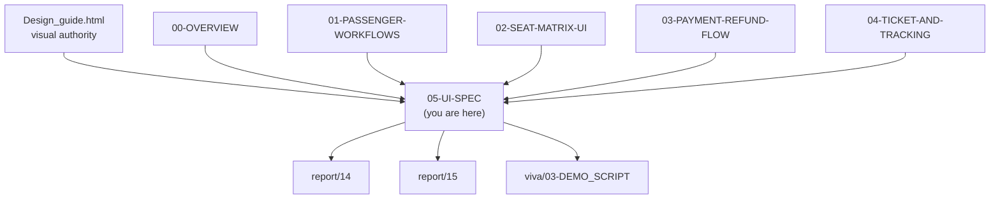

### 1.3 What this document does NOT cover

| Topic | Goes to |
|---|---|
| Workflow sequences per screen | `01` §3–§6, `02` §11–§15, `03` §5–§9, `04` §7–§12 |
| Seat deck behavior (API, WebSocket, countdown) | `02` §11–§13 |
| Payment state machine | `03` §4 |
| Refund tier calculator | `03` §10 |
| QR signing and verification | `09` v1.2 §7 |
| Full API contracts | `07-API-AND-REALTIME-CONTRACTS.md` |
| Backend implementation | `03-SYSTEM-ARCHITECTURE.md` §6 |
| Infra / deploy | `11-DEPLOYMENT-AND-DEMO.md` |

### 1.4 Scope boundary

**Three levels of coverage per screen:**

| Level | Meaning | Screens at this level |
|---|---|---|
| **Full wireframe** | Layout, components, states, microcopy — all defined here | HOME, SEARCH, RESULTS, PAXFORM, PROFILE (5) |
| **Cross-reference** | Visual layout defined here, behavior detailed upstream | SEATDECK → `02`, CHECKOUT → `03`, TICKET → `04`, MYTRIPS → `04`, TRACKING → `04`, CANCEL → `03` (6) |
| **Fallback page** | Layout + microcopy defined here | 404, 500, offline (3 extra) |

**The six cross-referenced screens** get a wireframe-quality section here that references upstream for behavior. **The five full-wireframe screens** get complete visual + behavioral + microcopy specs here because no upstream doc owns them.

### 1.5 Eight accepted defaults (from planning)

| # | Decision | Choice | Rationale |
|:---:|---|---|---|
| D1 | Razorpay checkout | **Embedded iframe** | Better UX; keeps user in flow; `03` §5.4 preferred iframe for mobile |
| D2 | Icon library | **Lucide** for UI icons; `@busverse/brand-svg` for brand | Lucide is 1kb per icon, tree-shakeable, MIT |
| D3 | Component docs | **Storybook** | Industry standard; viva-friendly; visual regression integration |
| D4 | PWA icons | **Design-guide SVG → PNG** at 192, 512, 1024 | One source of truth, auto-generated |
| D5 | Skip-to-content | **Phase 1** | WCAG 2.4.1 Level A; minimal cost |
| D6 | Bottom nav | **No — Phase 1** | Top bar only; My Trips via avatar menu |
| D7 | Visual regression | **Advisory** | Matches `10` v1.2 §16.3 |
| D8 | i18n | **Extract strings in Phase 1** | Zero-cost Phase 2 readiness |

---

## 2. Design Guide Integration

### 2.1 Precedence rule

**Diagram: Precedence flow**
*When a conflict exists between `Design_guide.html` and any locked doc, this rule decides. Visual concerns (colors, dimensions, animations) → design guide wins. Behavioral concerns (intervals, formats, enums) → locked docs win. Ambiguous concerns go to §2.2.*

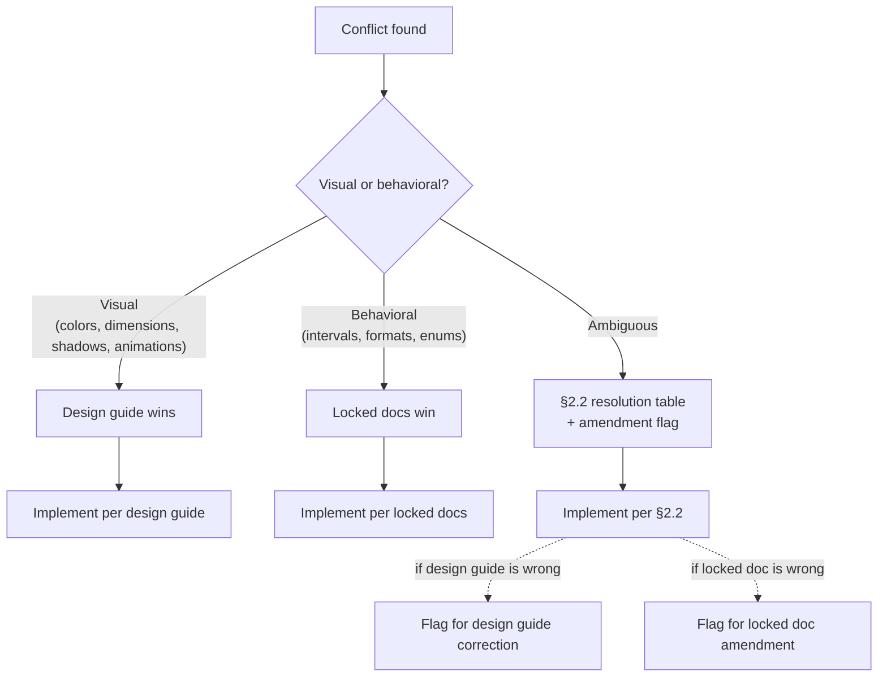

### 2.2 The six conflicts and their resolutions

| # | Conflict | Locked source says | Design guide says | Resolution |
|---|---|---|---|---|
| **C1** | GPS interval | **5 seconds** (`02` §6.6 FR-OP-009, `06` v1.2 §6.5.1, `07` v1.2 §7.4, `08` v1.1 WF-D-03, `09` v1.2 §8.4) | 10 seconds (§6) | **5 seconds**. Design-guide example to be corrected. |
| **C2** | PNR format | **`BKG-YYYY-NNNNN`** (`05` v1.2 §12.1, `06` v1.2 §3.6) | `BV-2026-99042` (§7) | **`BKG-YYYY-NNNNN`**. Design-guide is illustrative. |
| **C3** | Bus class | Free-form `schedule.bus.model` (`05` v1.2 §15 has no enum) | "Volvo Multi-Axle" (§7) | **Free-form**. Design-guide is illustrative. |
| **C4** | Token count | **11 brand tokens** (`00` §8.1) | ~40 tokens (§1) | **`00` §8.1 is a summary**; this doc §3 references the full design-guide §1 catalog. Flag `00` v1.1 to point here. |
| **C5** | Logo variants | One full logo (`Design_guide.html` §2) | One full logo (§2) | **Add icon-only variant** for mobile top bar, favicon, PWA icon. Full logo on desktop / hero / splash. |
| **C6** | Seat cell size on <360px | **40×44 preserved** (`02` §17.2, §19.2) | Not specified | **40×44 preserved**. Page scrolls horizontally if fuselage > viewport. Never shrink below touch target. |

**Rule:** Every conflict above results in a locked implementation. Future changes require amendments to the source docs, not the design guide.

### 2.3 What this doc adds to the design guide

| Design guide covers | This doc adds |
|---|---|
| Token CSS (§1, §9) | Token naming + version management (§3.3) |
| Logo (§2) | Icon-only variant (§5.4) |
| Color contrast matrix (§3) | Token usage rules per state (§3.4) |
| Elevation (§4) | Usage decision tree per elevation (§4.5) |
| Seat cells (§5) | Component contract + variant matrix (§6) |
| Telemetry card (§6) | — (§12 cross-refs `04` §10) |
| Ticket stub (§7) | — (§12 cross-refs `04` §7) |
| Driver ergonomics (§8) | Not in BusVerse scope (Driver App) |
| Production tokens (§9) | Semver + deprecation (§23) |

### 2.4 Conflicts inside the design guide itself

| Issue | Where | Resolution |
|---|---|---|
| Dark theme uses `#060A12`; `00` §8.1 shows `#060A12` ✓ | — | Consistent |
| Light theme `--canvas-bg: #F4F7FB`; `00` §8.1 shows `#F3F6FA` | Minor hex drift | Use design guide (`#F4F7FB`) — authoritative |
| `--brand-primary` light `#0055ED`; `00` §8.1 shows `#0055ED` ✓ | — | Consistent |
| `--brand-navy` light `#0B1830`; `00` §8.1 shows `#0B1830` ✓ | — | Consistent |

**Rule:** Where `00` §8.1 and the design guide differ, the design guide wins. `00` §8.1 is a summary and flagged for `00` v1.1 amendment.

---

## 3. Design Tokens Catalog

### 3.1 Token hierarchy

**Diagram: Token hierarchy**
*Three tiers — primitive tokens (raw values), semantic tokens (purpose-based), component tokens (per-component override, used sparingly). Every component reads semantic tokens; primitive tokens are only referenced inside `@busverse/design-tokens`.*

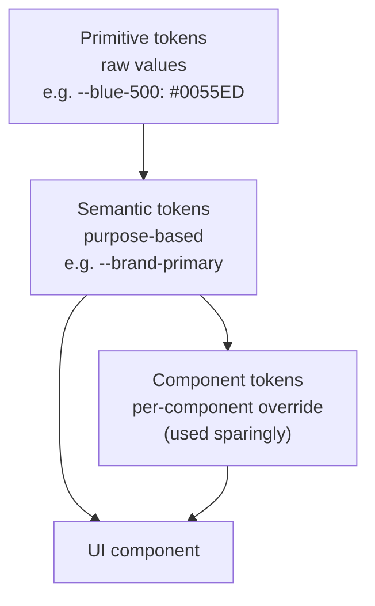

**Rules:**

| Rule | Detail |
|---|---|
| Components use semantic tokens | Never `--blue-500`, only `--brand-primary` |
| Primitive tokens are private | Only `@busverse/design-tokens` reads them |
| Component tokens are rare | Every component token must justify its existence in code review |
| Design guide §1 and §9 both define semantic tokens | Both are canonical — §1 is the source, §9 is the production-ready subset |

### 3.2 Token catalog (full)

Every token below is from `Design_guide.html` §1. The table groups them for reference; the CSS lives in `@busverse/design-tokens`.

**Spatial grid (from §1):**

| Token | Value |
|---|---|
| `--space-4xs` | 2px |
| `--space-3xs` | 4px |
| `--space-2xs` | 8px |
| `--space-xs` | 12px |
| `--space-sm` | 16px |
| `--space-md` | 20px |
| `--space-lg` | 24px |
| `--space-xl` | 32px |
| `--space-2xl` | 48px |
| `--space-3xl` | 64px |
| `--space-4xl` | 96px |

**Radii:**

| Token | Value |
|---|---|
| `--radius-xs` | 4px |
| `--radius-sm` | 8px |
| `--radius-md` | 12px |
| `--radius-lg` | 18px |
| `--radius-xl` | 24px |
| `--radius-pill` | 9999px |

**Motion:**

| Token | Value |
|---|---|
| `--ease-instant` | `0.1s cubic-bezier(0.16, 1, 0.3, 1)` |
| `--ease-smooth` | `0.25s cubic-bezier(0.16, 1, 0.3, 1)` |
| `--ease-bounce` | `0.4s cubic-bezier(0.34, 1.56, 0.64, 1)` |

**Fonts:**

| Token | Value |
|---|---|
| `--font-sans` | `'Plus Jakarta Sans', -apple-system, BlinkMacSystemFont, "Segoe UI", Roboto, sans-serif` |
| `--font-mono` | `'JetBrains Mono', monospace` |

**Semantic colors — light theme:** see `Design_guide.html` §1 `[data-theme="light"]` block. All ~40 tokens.

**Semantic colors — dark theme:** see `Design_guide.html` §1 `[data-theme="dark"]` block. All ~40 tokens.

**Rule:** This doc does not reproduce the full ~40 tokens per theme — the design guide is canonical. This doc names them and enforces their use.

### 3.3 Token naming and versioning

| Rule | Detail |
|---|---|
| Package | `@busverse/design-tokens` |
| Exports | `busverse.css` (both themes), `busverse.css` + `buscon.css` (differ by palette) |
| Semantic prefix | `--{category}-{purpose}` e.g. `--brand-primary`, `--text-secondary`, `--seat-available-bg` |
| Theme | Applied via `<html data-theme="light|dark">` |
| Version | Semver; see §23 for change process |
| Deprecation | 2 minor versions with warning log |

### 3.4 Token usage rules per state

| Component | Token(s) used | Never use |
|---|---|---|
| Primary CTA | `--brand-primary` bg, `--text-inverse` text | Raw hex |
| Secondary CTA | `--surface-card` bg, `--text-primary` text, `--border-subtle` | — |
| Error text | `--danger-crimson` | `--warning-amber` for errors |
| Warning banner | `--warning-amber` bg-subtle, `--warning-amber` text | `--danger-crimson` |
| Success state | `--signal-emerald` | Any other green |
| Live/active indicator | `--signal-emerald` + pulse | Cyan (reserved for telemetry) |
| Telemetry data | `--telemetry-cyan` | Blue (reserved for actions) |
| Seat available | `--seat-available-bg/border/text` | `--signal-emerald` directly (seat has own tokens) |
| Disabled | `--surface-sunken`, `--text-muted`, `opacity: 0.6` | Any saturated color |

**Rule:** If a component needs a color not covered above, it uses the closest semantic token — never a raw value. New tokens require a design-system RFC (§23.2).

---

## 4. Typography & Spatial System

### 4.1 Type scale

**Diagram: Type scale**
*Eight sizes across the app. Hero for landing, then descending. Base body is 15px (from design guide body baseline). Headings use `--font-sans` weight 700–800. Data uses `--font-mono` weight 700. Nothing below 12px.*

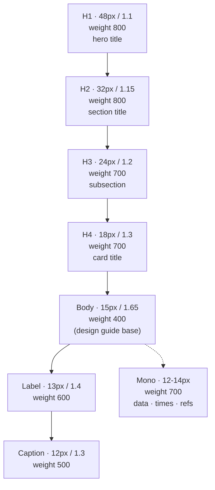

### 4.2 Type table

| Token | Size | Line height | Weight | Font | Usage |
|---|---:|---:|---:|---|---|
| `--text-hero` | 48px | 1.1 | 800 | sans | Hero title (SCR-BV-HOME) |
| `--text-h2` | 32px | 1.15 | 800 | sans | Section titles |
| `--text-h3` | 24px | 1.2 | 700 | sans | Subsections |
| `--text-h4` | 18px | 1.3 | 700 | sans | Card titles |
| `--text-body` | 15px | 1.65 | 400 | sans | Body copy (from design guide) |
| `--text-label` | 13px | 1.4 | 600 | sans | Form labels, buttons |
| `--text-caption` | 12px | 1.3 | 500 | sans | Captions, helper text |
| `--text-mono-data` | 14px | 1.2 | 700 | mono | Times, fares, refs |
| `--text-mono-small` | 12px | 1.2 | 700 | mono | Seat labels, small data |

**Rules:**

| Rule | Detail |
|---|---|
| Minimum size | 12px (never smaller) |
| Font smoothing | `-webkit-font-smoothing: antialiased` |
| Number display | All numbers use `--font-mono` for consistent width |
| IST times | `<span class="tnum">` for tabular numerals |
| Long-form content | `max-width: 65ch` |
| Truncation | `text-overflow: ellipsis` with `title` attribute for full text |
| Text transform | Never `uppercase` for body; allowed only for labels/captions |

### 4.3 Spatial system — 8pt grid

**Diagram: 8pt grid usage**
*All spacing is a multiple of 4px, preferred multiples of 8px. Gaps, padding, and margins snap to the scale. No arbitrary pixel values.*

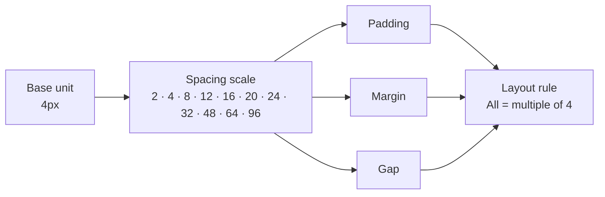

### 4.4 Spacing rules

| Context | Value | Token |
|---|---|---|
| Page padding (mobile) | 20px | `--space-md` |
| Page padding (desktop) | 32px | `--space-xl` |
| Card padding | 24px | `--space-lg` |
| Card gap in list | 12px | `--space-xs` |
| Button padding (vertical) | 12px | `--space-xs` |
| Button padding (horizontal) | 24px | `--space-lg` |
| Input padding | 12px | `--space-xs` |
| Section gap | 48px | `--space-2xl` |
| Field gap | 16px | `--space-sm` |

**Rule:** If a spacing need doesn't match a token, round to the nearest token. Never introduce arbitrary values.

### 4.5 Elevation decision tree

**Diagram: Elevation decision tree**
*Three elevation levels. Baseline for flat content. Floating for things that lift off the page. Modal for things that block interaction.*

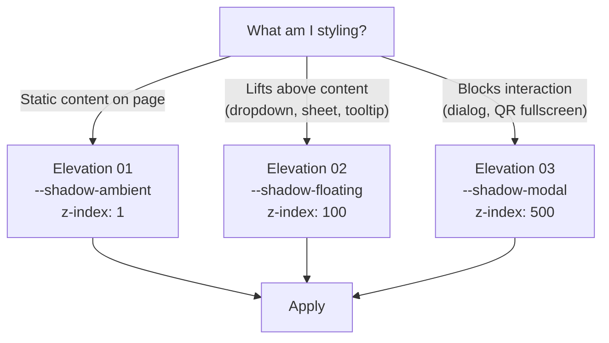

**Reference:** `Design_guide.html` §4.

---

## 5. Iconography & Logo Variants

### 5.1 Icon system

**Diagram: Icon system**
*Two sources. Lucide for standard UI icons (menu, close, back, etc.). `@busverse/brand-svg` for icons that carry brand identity (seat, bus, ticket, live-pulse). Both render as inline SVG components.*

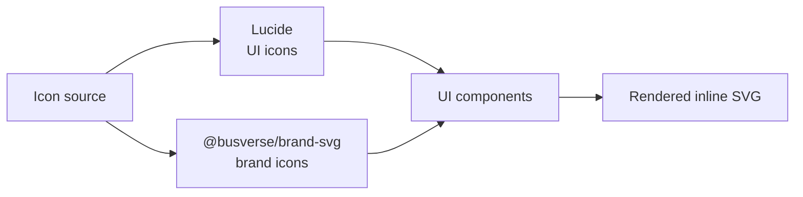

### 5.2 Icon library decision

| Concern | Choice | Rationale |
|---|---|---|
| UI icons (menu, close, back, search, check, chevron, clock, etc.) | **Lucide** | 1kb each, tree-shakeable, MIT, consistent stroke |
| Brand icons (seat, bus, ticket, QR, live-pulse) | **`@busverse/brand-svg`** | Brand consistency |
| Stroke width | 2px (Lucide default) | Matches design guide `.rule-item` accent line |
| Size | 16, 20, 24px (three sizes only) | Snaps to 8pt grid |
| Color | Inherits `currentColor` | Never hardcode stroke color |
| Fill | Lucide uses stroke-only | Brand icons may fill |

**Rule:** Never mix icon families in one component. If a brand icon is missing, use the closest Lucide icon and open an RFC.

### 5.3 Icon catalog (Phase 1)

| Icon name | Source | Usage |
|---|---|---|
| `menu` | Lucide | Top bar mobile menu |
| `x` | Lucide | Modal close, chip dismiss |
| `arrow-left` | Lucide | Back navigation |
| `arrow-right` | Lucide | Forward navigation, city arrow |
| `chevron-down` | Lucide | Dropdown toggle |
| `chevron-up` | Lucide | Dropdown collapse |
| `search` | Lucide | Search trigger |
| `map-pin` | Lucide | Stand marker |
| `clock` | Lucide | Time display |
| `calendar` | Lucide | Date picker trigger |
| `check` | Lucide | Verified, success |
| `x-circle` | Lucide | Error |
| `alert-triangle` | Lucide | Warning |
| `info` | Lucide | Informational toast |
| `user` | Lucide | Profile avatar fallback |
| `eye` | Lucide | Show password |
| `eye-off` | Lucide | Hide password |
| `sun` / `moon` | Lucide | Theme toggle |
| `arrow-up-down` | Lucide | Sort |
| `filter` | Lucide | Filter trigger |
| `refresh-cw` | Lucide | Refresh |
| `download` | Lucide | Invoice download |
| `share-2` | Lucide | Share (disabled Phase 1) |
| `external-link` | Lucide | External link |
| **`seat`** | `@busverse/brand-svg` | Seat type indicator |
| **`bus`** | `@busverse/brand-svg` | Bus type, tracking marker |
| **`ticket`** | `@busverse/brand-svg` | Ticket screen badge |
| **`qr`** | `@busverse/brand-svg` | QR mode toggle |
| **`live-pulse`** | `@busverse/brand-svg` | LIVE beacon (design guide §6) |

**Phase 1 icon count:** 29 total (24 Lucide + 5 brand).

### 5.4 Logo variants

**Diagram: Logo variants**
*Three variants required. Full (mark + wordmark) for desktop top bar, hero, splash. Icon-only (mark) for mobile top bar, favicon, PWA icon. Monochrome for single-color contexts (print, fax, seal).*

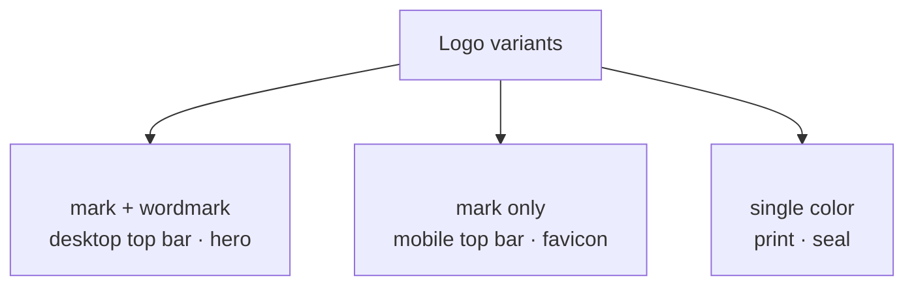

### 5.5 Variant table

| Variant | File | Use | Size |
|---|---|---|---|
| Full | `<FullLogo />` | Desktop top bar, landing hero, splash | 200×48 min |
| Icon-only | `<IconLogo />` | Mobile top bar (32×32), favicon (32×32), PWA (192/512/1024) | 32×32 min |
| Monochrome | `<MonoLogo />` | Print, invoice, sealed envelope | — |

**Rules:**

| Rule | Detail |
|---|---|
| Clear space | Min 1× the mark height on all sides |
| Minimum size | Full logo ≥ 120px wide; icon ≥ 24px |
| Never stretch | Always proportional |
| Never recolor | Use tokens; never override fills |
| Never rotate | — |
| Dark mode | Handled via `--logo-*` tokens (design guide §2) |
| Favicon | 32×32 PNG exported from `IconLogo` |
| PWA icons | 192×192, 512×512, 1024×1024 PNG (maskable variant at 512) |

### 5.6 Motion assets

| Asset | Purpose | Duration | Source |
|---|---|---|---|
| Logo reveal | Home hero | 6s loop | `00` §8.2 |
| Icon loader | Loading states | 1s loop | (internal) |

---

## 6. Component Library

### 6.1 Component inventory

**Diagram: Component library tree**
*12 primitives, all in `@busverse/ui`. Every BusVerse screen is composed from these. No screen-local primitives.*

```mermaid
flowchart TB
    UI["@busverse/ui"]

    UI --> BTN["<Button>"]
    UI --> INP["<Input>"]
    UI --> SEL["<Select>"]
    UI --> TXT["<Textarea>"]
    UI --> CHK["<Checkbox>"]
    UI --> RDO["<Radio>"]
    UI --> BADGE["<Badge>"]
    UI --> CARD["<Card>"]
    UI --> MODAL["<Modal>"]
    UI --> TOAST["<Toast>"]
    UI --> BANNER["<Banner>"]
    UI --> AVATAR["<Avatar>"]
```

### 6.2 Component contract table

| Component | Variants | States | Props (required) |
|---|---|---|---|
| `<Button>` | primary · secondary · ghost · danger | default · hover · active · focus · disabled · loading | `variant`, `onClick`, `disabled?`, `loading?`, `type?` |
| `<Input>` | text · number · password · email · phone · otp | default · focus · filled · error · success · disabled · readonly | `value`, `onChange`, `type?`, `error?`, `hint?`, `label` |
| `<Select>` | dropdown · combobox | default · open · filled · error · disabled | `value`, `onChange`, `options[]`, `label` |
| `<Textarea>` | — | default · focus · filled · error · disabled | `value`, `onChange`, `label`, `rows?` |
| `<Checkbox>` | — | unchecked · checked · indeterminate · disabled | `checked`, `onChange`, `label` |
| `<Radio>` | — | unchecked · checked · disabled | `checked`, `onChange`, `label`, `name` |
| `<Badge>` | emerald · amber · red · slate · cyan | — | `variant`, `children` |
| `<Card>` | flat · elevated | default · hover · clickable | `elevation?`, `onClick?` |
| `<Modal>` | — | opening · open · closing | `open`, `onClose`, `title`, `children` |
| `<Toast>` | info · success · warning · error | entering · visible · leaving | `type`, `message`, `duration?`, `onDismiss` |
| `<Banner>` | info · success · warning · error | — | `type`, `message`, `action?` |
| `<Avatar>` | initials · icon | — | `name?`, `src?`, `size` |

### 6.3 Variant matrix — Button (exemplar)

**Diagram: Button variant matrix**
*Four variants × six states. Every combination has a defined visual. This pattern repeats for every primitive — see Storybook for full matrix.*

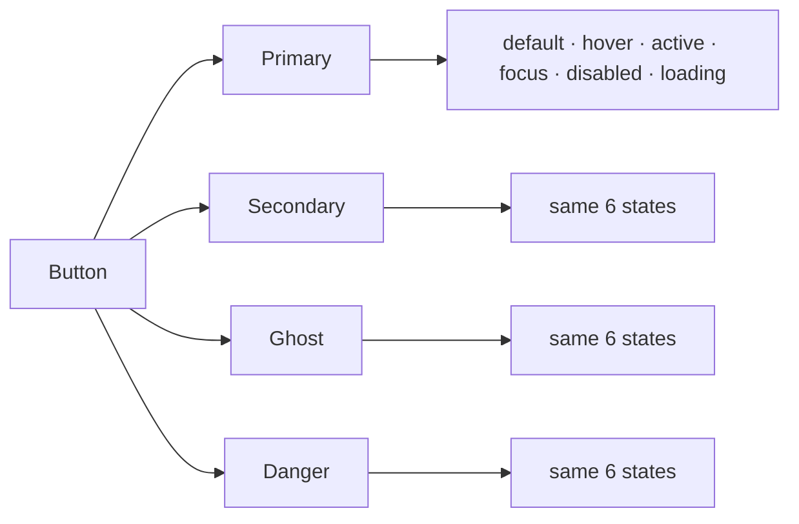

### 6.4 Component contract example — `<Button>`

```typescript
type ButtonProps = {
  variant: 'primary' | 'secondary' | 'ghost' | 'danger';
  size?: 'sm' | 'md' | 'lg';           // default 'md'
  type?: 'button' | 'submit' | 'reset'; // default 'button'
  disabled?: boolean;
  loading?: boolean;
  fullWidth?: boolean;
  leftIcon?: ReactNode;
  rightIcon?: ReactNode;
  onClick?: () => void;
  children: ReactNode;
};
```

**Behavior:**

| State | Visual |
|---|---|
| Default | Base variant colors from tokens |
| Hover | Darker shade (for primary), lighter (for secondary) — 150ms |
| Active | Even darker + `translateY(1px)` |
| Focus | `outline: 2px solid --border-focus; outline-offset: 2px` |
| Disabled | `opacity: 0.6; cursor: not-allowed; pointer-events: none` |
| Loading | Spinner replaces label; disabled; retains width |

**Rule:** All interactive primitives follow this pattern — every variant, every state, documented in Storybook with visual examples.

### 6.5 Storybook structure

**Diagram: Storybook structure**
*One story per component, with all variants and states in a matrix. Visual regression snapshots generated from Storybook.*

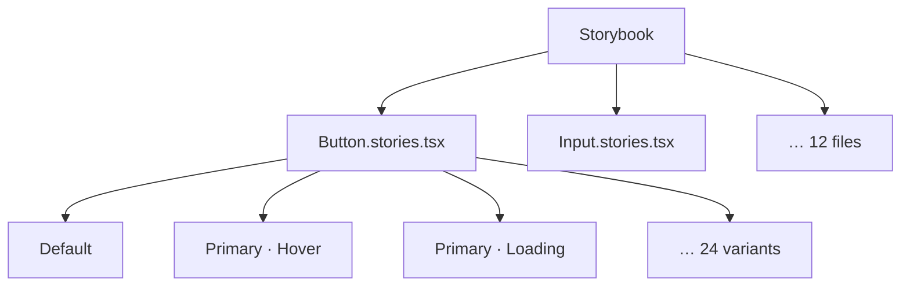

**URL:** `storybook.busverse.app` (staging only)

**Rule:** Every primitive + every screen-level composition has a story. PRs that change a component must update its story.

---

## 7. App Shell, Navigation & PWA Chrome

### 7.1 Top bar layout

**Diagram: Top bar composition**
*Three-region layout — left (logo/back), center (title), right (actions). Fixed at top, 56px height. Height does not change with content.*

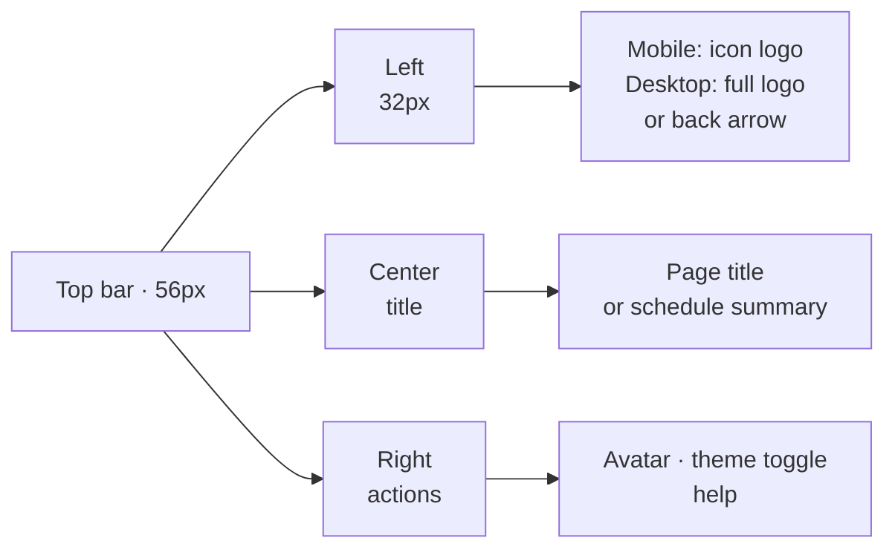

### 7.2 Top bar spec

| Aspect | Mobile | Desktop |
|---|---|---|
| Height | 56px | 64px |
| Padding | 16px horizontal | 32px horizontal |
| Left | Icon logo (32px) OR back arrow | Full logo OR back arrow |
| Center | Title (single line, ellipsis) | Title or breadcrumbs |
| Right | Avatar · theme toggle | Avatar · theme toggle · help |
| Background | `--canvas-subtle` | `--canvas-subtle` |
| Border bottom | 1px `--border-subtle` | 1px `--border-subtle` |
| Scroll behavior | Sticky (always visible) | Sticky |

### 7.3 Navigation

**No bottom nav in Phase 1** (D6). Navigation access points:

| Destination | Mobile | Desktop |
|---|---|---|
| Home / Search | Logo tap | Logo tap |
| My Trips | Avatar menu → "My trips" | Top bar link |
| Profile | Avatar menu → "Profile" | Top bar link |
| Logout | Avatar menu → "Log out" | Avatar menu |

**Avatar menu** (mobile and desktop):

| Item | Behavior |
|---|---|
| My trips | → `SCR-BV-MYTRIPS` |
| Profile | → `SCR-BV-PROFILE` |
| Theme toggle | Toggle light/dark |
| Log out | Confirm dialog → logout |

### 7.4 PWA chrome

**Diagram: PWA chrome surface**
*Five chrome elements. Manifest, icons, splash, install prompt, status-bar colour. All derived from design-guide SVG + tokens.*

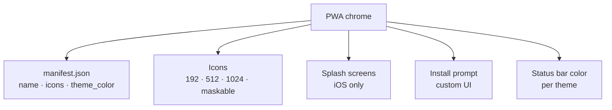

### 7.5 Manifest

```json
{
  "name": "BusVerse — Book bus tickets",
  "short_name": "BusVerse",
  "description": "Book intercity bus tickets across India",
  "start_url": "/",
  "scope": "/",
  "display": "standalone",
  "orientation": "portrait",
  "background_color": "#F4F7FB",
  "theme_color": "#0055ED",
  "icons": [
    { "src": "/icons/icon-192.png", "sizes": "192x192", "type": "image/png" },
    { "src": "/icons/icon-512.png", "sizes": "512x512", "type": "image/png" },
    { "src": "/icons/icon-512-maskable.png", "sizes": "512x512", "type": "image/png", "purpose": "maskable" }
  ]
}
```

**Rule:** `theme_color` changes with theme via `<meta name="theme-color">` JS update. `background_color` fixed (used by splash before theme loads).

### 7.6 Status-bar colour per theme

| Theme | Status bar | Meta tag |
|---|---|---|
| Light | White `#FFFFFF` | `<meta name="theme-color" content="#FFFFFF">` |
| Dark | Abyssal `#060A12` | `<meta name="theme-color" content="#060A12">` |

**Rule:** Set via JS on theme toggle (`document.querySelector('meta[name="theme-color"]').content = ...`).

### 7.7 Install prompt

**Diagram: Install prompt flow**
*Custom install prompt shown after 3 sessions AND not previously dismissed. Uses `beforeinstallprompt` event. Never auto-prompt.*

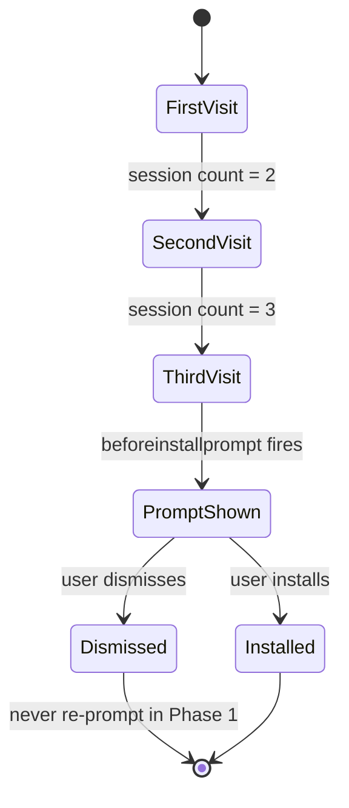

**Rules:**

| Rule | Detail |
|---|---|
| Never auto-prompt | Only show custom UI after 3 sessions |
| Never re-prompt after dismiss | Respect user choice |
| Custom UI placement | Bottom banner with "Install BusVerse" + install + dismiss |
| iOS Safari | Show instructions ("Tap Share → Add to Home Screen") — no `beforeinstallprompt` |

### 7.8 Splash screens (iOS)

| Aspect | Value |
|---|---|
| Background | `--canvas-bg` (light or dark per theme) |
| Logo | IconLogo, centered, 120×120 |
| Duration | Native iOS splash (until app loads) |

**Rule:** Generated via `@pwa/next` or similar tool from `manifest.json` + icon.

### 7.9 Skip-to-content link

**Diagram: Skip-link placement**
*Skip link is visually hidden until focused. First Tab from browser chrome reveals it. Activates skip to `#main-content`.*

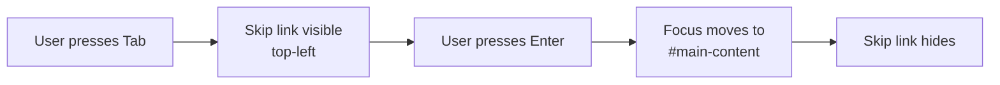

**Implementation:**

```html
<a href="#main-content" class="skip-link">Skip to content</a>
<main id="main-content" tabindex="-1">...</main>
```

| Rule | Detail |
|---|---|
| Position | Top-left, visible when focused |
| First focusable element | Yes (first in DOM) |
| Style | `transform: translateY(-100%)` default; visible on focus |
| Target | `#main-content` on `<main>` |

**Reference:** WCAG 2.4.1 Level A. Phase 1 (D5).

---

## 8. Formatting Conventions

### 8.1 Formatting pipeline

**Diagram: Formatting pipeline**
*Every value from the API flows through a formatter before display. Formatters are pure functions in `@busverse/format`. One source of truth for money, dates, times, phones, references.*

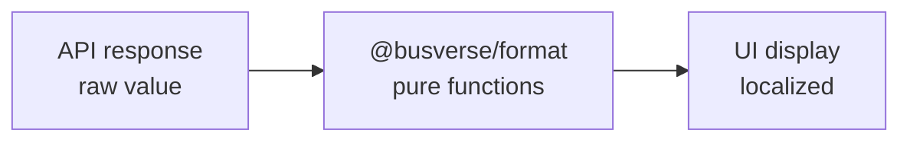

### 8.2 Money

| Aspect | Format | Example |
|---|---|---|
| Source | `amountPaise` integer | `48750` |
| Display | `₹487.50` | `₹487.50` |
| Symbol | `₹` (U+20B9) | — |
| Thousands | Indian grouping (lakh, crore) | `₹1,23,456.78` |
| Decimals | Always 2 for display | `₹487.00` not `₹487` |
| Negative | `-₹487.50` (negative before symbol) | — |
| Approximate | `~₹487` for summary contexts | — |

**Function:** `formatMoney(amountPaise: number, currency = 'INR'): string`

**Rule:** Never display `amountPaise` raw. Never use `Intl.NumberFormat` with default `en-US` — must use `en-IN`.

### 8.3 Date

| Context | Format | Example |
|---|---|---|
| Full date | `DD MMM YYYY` | `24 Oct 2026` |
| Short date | `DD MMM` | `24 Oct` |
| Day + date | `EEE, DD MMM` | `Sat, 24 Oct` |
| Date range (same month) | `DD–DD MMM YYYY` | `24–25 Oct 2026` |
| Relative | `Today`, `Tomorrow`, `In 3 days` | `Today` |
| Over 7 days | Full date | `24 Oct 2026` |

**Function:** `formatDate(iso: string, style: 'full' | 'short' | 'day'): string`

### 8.4 Time

| Context | Format | Example |
|---|---|---|
| Departure/arrival | `HH:mm IST` | `14:00 IST` |
| Time range | `HH:mm → HH:mm IST` | `14:00 → 22:30 IST` |
| With date | `HH:mm IST, DD MMM` | `14:00 IST, 24 Oct` |
| Duration | `Xh Ym` | `8h 30m` |
| Countdown (lock) | `MM:SS` | `04:32` |
| Countdown (payment) | `MM:SS` | `14:32` |
| Countdown (departure) | `Xh Ym` | `2h 14m` |

**Rule:** All times displayed in **IST** (`Asia/Kolkata`). Server stores UTC; client converts via `Intl.DateTimeFormat('en-IN', { timeZone: 'Asia/Kolkata' })`.

**Function:** `formatTime(iso: string, style: 'time' | 'range' | 'duration'): string`

### 8.5 Phone

| Context | Format | Example |
|---|---|---|
| Display (own) | E.164 | `+919876543210` |
| Display (masked) | Last 4 | `••••••3210` |
| Input | Space-separated | `98765 43210` |
| Button label | Last 4 | `Ending 3210` |

**Function:** `formatPhone(e164: string): { e164, spaced, masked }`

### 8.6 References

| Type | Format | Example |
|---|---|---|
| Booking | `BKG-YYYY-NNNNN` | `BKG-2026-00042` |
| Trip | `TRP-YYYY-NNNNN` | `TRP-2026-00187` |
| Invoice | `INV/YYYY-YY/NNNN` | `INV/2026-27/0042` |
| Ticket (display) | `TKT-YYYY-NNNNN` | `TKT-2026-00042` |
| Session (dev only) | `ses_` + UUID short | `ses_abc123` |

**Rule:** Reference formats are exact — never abbreviate, never add `BV-` prefix (design-guide C2).

### 8.7 Numbers and other formats

| Type | Format | Example |
|---|---|---|
| Percentage | Integer + `%` | `86%` |
| Seats | `X / Y` | `38 / 44 Seats` |
| Speed | Integer + `km/h` | `78 km/h` |
| Distance | 1 decimal + `km` | `284.5 km` |
| Age | Integer | `28` |

### 8.8 i18n readiness

**Policy (D8):** All strings extracted to locale files in Phase 1. **No translation** — English only — but the extraction is done so Phase 2 pays zero rewrite tax.

| Aspect | Phase 1 |
|---|---|
| Format | i18next JSON files per locale |
| Locales | `en-IN` only |
| Interpolation | `{name}`, `{count}` — no string concatenation |
| Plurals | Use `_one` / `_other` suffixes |
| Dates/numbers | Always via formatter functions (§8.2–§8.7) |
| Icons | Never contain text |
| Images | Alt text extracted to locale files |

**Rule:** Never hardcode user-visible strings in JSX. Always `t('key.path')`. Non-user-visible strings (dev logs, error codes) are exempt.

### 8.9 i18n file structure

```
apps/busverse/locales/
  en-IN/
    auth.json
    search.json
    booking.json
    payment.json
    ticket.json
    tracking.json
    profile.json
    common.json
```

---

## 9. Screen Catalog Matrix

### 9.1 The 11 screens × 42 states

**Diagram: Screen group map**
*11 screens grouped into 4 flows. Each flow group's wireframes are in §10–§13.*

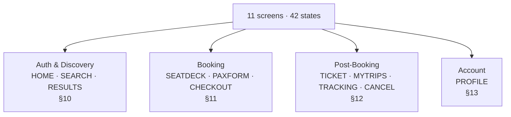

### 9.2 Master state matrix

| Screen | States | Wireframe |
|---|---|---|
| **SCR-BV-HOME** | Logged out · Logged in · OTP sent · OTP verifying | §10.1 |
| **SCR-BV-SEARCH** | Empty · Typed · Autocomplete open · Validation error | §10.2 |
| **SCR-BV-RESULTS** | Loading · Results · Empty · Error | §10.3 |
| **SCR-BV-SEATDECK** | Loading · Loaded · Seat selected · Lock acquired · Lock expiring · Lock expired | `02` §5–§7, §14 |
| **SCR-BV-PAXFORM** | Empty · Filled · Validation error · Lock warning · Lock critical · Submit pending | §11.2 |
| **SCR-BV-CHECKOUT** | Idle · Countdown · Initiated · Polling · Succeeded · Failed · Verifying · Expired | `03` §4.2 |
| **SCR-BV-TICKET** | Loaded · QR fullscreen · Offline · Cancelled · Boarded | `04` §7.1, §7.2 |
| **SCR-BV-MYTRIPS** | Loading · List · Empty · Error · Filter empty | `04` §6.1 |
| **SCR-BV-TRACKING** | Pre-trip · Live · Stale · Post-trip · Cancelled | `04` §10.2 |
| **SCR-BV-CANCEL** | Previewing · Confirming · Submitting · Success · Error | `03` §9.3 |
| **SCR-BV-PROFILE** | Loaded · Editing · Saving · Error | §13 |
| **Fallback** | 404 · 500 · Offline | §20 |

**Total:** 11 primary screens + 3 fallback pages = **14 pages**, **42 states**, **~48 wireframe treatments** across §10–§13 + `01`–`04` cross-refs + §20.

**Rule:** Every state listed here is implemented. A state missing from implementation is a bug. A state added without updating this matrix is a documentation bug.

---

## 10. Auth & Discovery Wireframes

### 10.1 SCR-BV-HOME

**Diagram: HOME wireframes (4 states)**
*One column. Mobile-first. Logged-out shows auth form; logged-in shows search form. OTP-sent shows OTP input. OTP-verifying shows disabled inputs + spinner.*

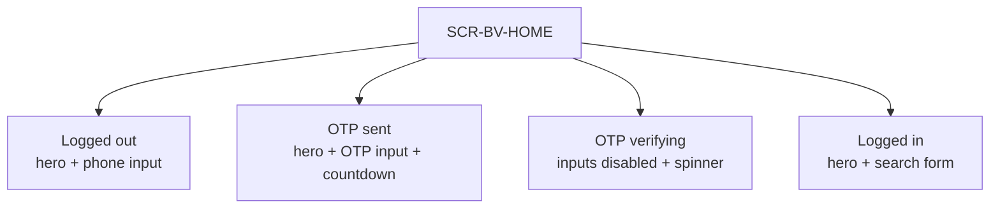

**Wireframe (ASCII, logged-out mobile):**

```
┌─────────────────────────────────┐
│ [IconLogo]              [Avatar] │ ← Top bar 56px
├─────────────────────────────────┤
│                                 │
│   Every bus.                    │
│   One platform.                 │ ← Hero H1
│                                 │
│   Search 3,000+ verified        │
│   operators across India.       │ ← Subhead
│                                 │
├─────────────────────────────────┤
│ Enter your phone                │ ← Label
│ ┌─────────────────────────────┐ │
│ │ +91  [98765 43210]          │ │ ← Phone input
│ └─────────────────────────────┘ │
│                                 │
│ ┌─────────────────────────────┐ │
│ │      Continue               │ │ ← Primary CTA
│ └─────────────────────────────┘ │
│                                 │
│ By continuing, you agree to     │ ← Legal
│ our Terms and Privacy Policy.   │
│                                 │
├─────────────────────────────────┤
│ ✓ Verified operators            │ ← Trust signals
│ ✓ Live bus tracking             │
│ ✓ Instant refunds               │
└─────────────────────────────────┘
```

**Content per state:**

| State | Hero | Primary content | Secondary | Bottom |
|---|---|---|---|---|
| Logged out | "Every bus. One platform." | Phone input + Continue | Legal | Trust signals |
| OTP sent | "Check your phone." | OTP input (6 digits) + resend countdown | Edit phone link | Trust signals |
| OTP verifying | "Verifying..." | Disabled OTP input + spinner | — | — |
| Logged in | "Where to?" | Search form (origin · destination · date) | Recent searches | Popular routes (Phase 2) |

**Microcopy:** See §19.1.

### 10.2 SCR-BV-SEARCH

**Diagram: SEARCH wireframes (4 states)**
*Search page with origin/destination autocomplete and date. Autocomplete opens as overlay. Validation error inline. Results below once search runs.*

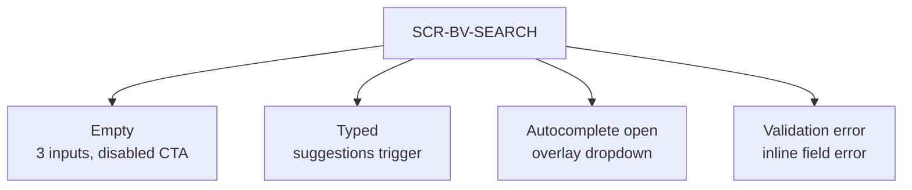

**Wireframe (empty state):**

```
┌─────────────────────────────────┐
│ [IconLogo]              [Avatar] │
├─────────────────────────────────┤
│                                 │
│ From                            │
│ ┌─────────────────────────────┐ │
│ │ Search for a city           │ │
│ └─────────────────────────────┘ │
│                                 │
│ To                              │
│ ┌─────────────────────────────┐ │
│ │ Search for a city           │ │
│ └─────────────────────────────┘ │
│                                 │
│ Date                            │
│ ┌─────────────────────────────┐ │
│ │ Today                       │ │
│ └─────────────────────────────┘ │
│                                 │
│ ┌─────────────────────────────┐ │
│ │ Search buses                │ │ ← Disabled until valid
│ └─────────────────────────────┘ │
│                                 │
│ Recent                          │ ← Optional
│ • Delhi → Lucknow, tomorrow     │
│ • Delhi → Kanpur, yesterday     │
│                                 │
└─────────────────────────────────┘
```

**Autocomplete state:** Origin input focused → dropdown overlay covering below-content area. Max 6 suggestions. Each row: city name + state. Keyboard: ↑↓ navigate, Enter select, Esc close.

### 10.3 SCR-BV-RESULTS

**Diagram: RESULTS wireframes (4 states)**
*Results list with filter bar and sort control at top. Skeleton loading. Empty with alternatives. Error with retry. Schedule cards below.*

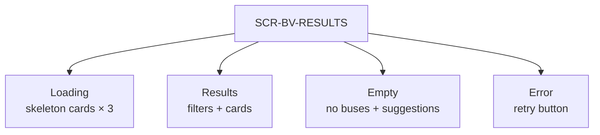

**Wireframe (results state):**

```
┌─────────────────────────────────┐
│ [IconLogo]           [Avatar]   │
├─────────────────────────────────┤
│ Delhi → Lucknow · Sat, 24 Oct   │ ← Search summary
│ Edit                            │
├─────────────────────────────────┤
│ Sort: [Time ▼]   [Filters]      │ ← Sort + filter
├─────────────────────────────────┤
│ ┌─────────────────────────────┐ │
│ │ Sharma Travels · AC Sleeper │ │ ← Card title
│ │ 14:00 → 22:30 · 8h 30m     │ │ ← Times
│ │ Kashmere Gate → Alambagh    │ │ ← Stands
│ │ ₹487.50 · 14 seats left    │ │ ← Fare + availability
│ │ [      Select      ]        │ │ ← CTA
│ └─────────────────────────────┘ │
│                                 │
│ ┌─────────────────────────────┐ │
│ │ UP Roadways · Non-AC Seater │ │
│ │ … (repeat)                  │ │
│ └─────────────────────────────┘ │
└─────────────────────────────────┘
```

**Empty state:**

```
┌─────────────────────────────────┐
│         [Empty illustration]    │
│                                 │
│   No buses on this date         │
│                                 │
│   Sat, 24 Oct has no direct     │
│   buses. Try a nearby date:     │
│                                 │
│   [Sun, 25 Oct · 3 buses]       │
│   [Mon, 26 Oct · 2 buses]       │
│                                 │
│   [Change search]               │
└─────────────────────────────────┘
```

---

## 11. Booking Wireframes

### 11.1 SCR-BV-SEATDECK (cross-reference)

Visual: `02` §5–§7, §9, §19. Wireframe not reproduced here.

### 11.2 SCR-BV-PAXFORM

**Diagram: PAXFORM wireframes (6 states)**
*Multi-passenger form. Each card is a passenger. Lock countdown at top changes color and eventually disables CTA.*

```mermaid
flowchart TB
    F["SCR-BV-PAXFORM"]

    F --> E["Empty<br/>cards blank, CTA disabled"]
    F --> FI["Filled<br/>all valid, CTA enabled"]
    F --> V["Validation error<br/>inline field error"]
    F --> W["Lock warning<br/>60-30s countdown"]
    F --> C["Lock critical<br/>10-30s countdown, disabled"]
    F --> P["Submitting<br/>CTA loading"]
```

**Wireframe (filled state, mobile):**

```
┌─────────────────────────────────┐
│ [←] Delhi → Lucknow   [00:42]  │ ← Back + lock countdown
├─────────────────────────────────┤
│ Delhi → Lucknow                 │
│ 14:00 → 22:30 · Sat, 24 Oct     │
│ Sharma Travels · AC Sleeper     │
├─────────────────────────────────┤
│ Boarding stand                  │
│ ┌─────────────────────────────┐ │
│ │ Kashmere Gate            ▼  │ │
│ └─────────────────────────────┘ │
│                                 │
│ Dropping stand                  │
│ ┌─────────────────────────────┐ │
│ │ Alambagh                 ▼  │ │
│ └─────────────────────────────┘ │
├─────────────────────────────────┤
│ Seat 2B · Passenger 1 of 1      │
│                                 │
│ Name                            │
│ ┌─────────────────────────────┐ │
│ │ Alice                       │ │
│ └─────────────────────────────┘ │
│                                 │
│ Age          Gender             │
│ ┌──────────┐ ┌──────────────┐  │
│ │ 28       │ │ Female    ▼  │  │
│ └──────────┘ └──────────────┘  │
├─────────────────────────────────┤
│ Subtotal: 1 seat · ₹487.50      │
│                                 │
│ [      Continue to pay      ]   │
└─────────────────────────────────┘
```

**Stand dropdown sort:** See Q15. Default = route sequence order (source first). Alternate: by departure time from origin.

**Lock countdown states:** Per `02` §13.1 (normal / warning / critical / expiring / expired).

### 11.3 SCR-BV-CHECKOUT

**Diagram: CHECKOUT wireframe (state: Razorpay iframe embedded)**
*Accepted default D1: Razorpay iframe. On mobile, full-screen iframe. On desktop, modal iframe. Client stays on checkout screen, iframe loads Razorpay.*

```mermaid
flowchart TB
    CO["SCR-BV-CHECKOUT"]

    CO --> M["Mobile<br/>full-screen iframe"]
    CO --> D["Desktop<br/>modal 480×720 iframe"]

    M --> POLL["Polling continues<br/>behind iframe"]
    D --> POLL
```

**Wireframe (before iframe opens):**

```
┌─────────────────────────────────┐
│ [←] Checkout                    │
├─────────────────────────────────┤
│ Delhi → Lucknow · Sat, 24 Oct   │
│ 14:00 → 22:30 · Seat 2B         │
├─────────────────────────────────┤
│ Payment due                     │
│ ₹487.50                         │
│                                 │
│ Complete within                 │
│ [14:32 remaining]               │ ← Countdown
├─────────────────────────────────┤
│ [   Pay ₹487.50 now    ]        │ ← Opens Razorpay iframe
│                                 │
│ [Change seats] · [Cancel]       │
└─────────────────────────────────┘
```

**Iframe behavior:** When user taps Pay, an `<iframe>` overlays the checkout body with Razorpay's hosted URL. Polling continues behind iframe. On success, iframe closes and redirects to Ticket. See `03` §5.4.

### 11.4 Razorpay iframe integration

| Aspect | Mobile | Desktop |
|---|---|---|
| Display | Full-screen fixed overlay | Centered modal 480×720 |
| Close | X button top-right (only if not in payment flow) | X button; clicking backdrop |
| Backdrop | Solid `--canvas-bg` | `--canvas-bg` at 80% opacity |
| Razorpay URL | `checkout.razorpay.com/...` | Same |
| Polling behind | Continues every 2s | Same |
| Focus trap | Yes | Yes |

**Rule:** Never expose the client to "return to merchant" copy; when Razorpay completes, close iframe and render our own success state.

---

## 12. Post-Booking Wireframes

### 12.1 Cross-reference map

**Diagram: Post-booking cross-references**
*Four screens owned by `04` and `03`. Wireframes live there. This doc only reproduces the visual contract summary.*

```mermaid
flowchart LR
    T["TICKET"] -->|"04 §7.2"| W1["Wireframe"]
    MT["MYTRIPS"] -->|"04 §6.1"| W2["Wireframe"]
    TR["TRACKING"] -->|"04 §10.1"| W3["Wireframe"]
    CA["CANCEL"] -->|"03 §9.3"| W4["Wireframe"]
```

### 12.2 Visual contract summary

| Screen | Visual spec lives in | Component tree |
|---|---|---|
| **TICKET** | `04` §7.2 (design guide §7 stub) | `04` §13.2 |
| **MYTRIPS** | `04` §6.1 | `04` §13.1 |
| **TRACKING** | `04` §10.1 (design guide §6 telemetry) | `04` §13.3 |
| **CANCEL** | `03` §9.3 | `03` §13.2 |

**No new wireframe here** — `04` and `03` own these. If you're implementing these screens, read the cross-referenced sections, then `05` §3–§4 for token/typography, and §19 for microcopy.

---

## 13. Account Wireframe — SCR-BV-PROFILE

**Diagram: PROFILE wireframes (4 states)**
*Read-only display by default. Edit toggle reveals inputs. Save spinner during PATCH. Error banner on failure.*

```mermaid
flowchart TB
    P["SCR-BV-PROFILE"]

    P --> L["Loaded<br/>read-only fields"]
    P --> E["Editing<br/>editable inputs, Save button"]
    P --> S["Saving<br/>disabled inputs, spinner"]
    P --> ER["Error<br/>banner + retry"]
```

**Wireframe (loaded):**

```
┌─────────────────────────────────┐
│ [←]                    [Edit]   │ ← Edit toggle
├─────────────────────────────────┤
│           [Avatar]              │ ← Initials
│                                 │
├─────────────────────────────────┤
│ Name                            │
│ Alice                           │
│                                 │
│ Phone                           │
│ +919876543210  🔒               │ ← Immutable
│ (Contact support to change)     │
│                                 │
│ Email                           │
│ alice@example.com               │
├─────────────────────────────────┤
│ My trips                        │ →
│ Support                         │ →
│ Theme                           │ [Light] [Dark]
├─────────────────────────────────┤
│ [        Log out         ]      │ ← Danger style
├─────────────────────────────────┤
│ Version 1.0.0                   │
└─────────────────────────────────┘
```

**Reference:** Behavior spec in `01` §6.

---

## 14. Responsive Matrix

### 14.1 Breakpoints

**Diagram: Breakpoint bands**
*Three bands. Cell sizes preserved across all bands. Layout adapts around fixed primitives.*

```mermaid
flowchart LR
    M["Mobile<br/>< 768px"]
    T["Tablet<br/>768-1023px"]
    D["Desktop<br/>≥ 1024px"]

    M --> T --> D
```

### 14.2 Cross-screen breakpoint table

| Aspect | Mobile (<768px) | Tablet (768-1023px) | Desktop (≥1024px) |
|---|---|---|---|
| Page padding | 20px | 32px | 64px |
| Top bar height | 56px | 56px | 64px |
| Top bar content | Icon logo | Icon logo | Full logo |
| Max content width | 100% | 100% | 1080px |
| Cards per row | 1 | 1 | 1 (listing) |
| Seat cell size | 40×44 | 40×44 | 40×44 |
| Fuselage max width | Full | 400px | 480px |
| Filters | Bottom sheet | Inline dropdown | Inline dropdown |
| Modal | Full-screen | 480×720 | 480×720 |
| Bottom-sheet behavior | Yes (summary) | — | — |
| Avatar menu | Full-screen sheet | Dropdown | Dropdown |

**Rule:** No horizontal scroll anywhere. If content overflows, it stacks vertically.

---

## 15. Motion & Animation Budget

### 15.1 Animation decision tree

**Diagram: Animation decision tree**
*Motion is functional, not decorative. Three categories — micro-interactions (150ms), state transitions (250ms), entrances (400ms). All respect reduced-motion.*

```mermaid
flowchart TD
    Q["What's animating?"]
    Q -->|"Hover, tap, focus"| M1["Micro-interaction<br/>100-150ms ease-instant"]
    Q -->|"State change<br/>(open, close, expand)"| M2["State transition<br/>200-300ms ease-smooth"]
    Q -->|"Entrance, reveal"| M3["Entrance<br/>300-500ms ease-bounce"]
    Q -->|"Loading indicator"| M4["Loop<br/>1-2.5s infinite"]
```

### 15.2 Animation budget per component

| Component | Property | Duration | Easing |
|---|---|---|---|
| Button hover | `background`, `transform` | 150ms | `--ease-instant` |
| Button press | `transform: translateY(1px)` | 100ms | `--ease-instant` |
| Input focus | `border-color`, `box-shadow` | 150ms | `--ease-instant` |
| Checkbox/Radio | `background`, `transform` | 150ms | `--ease-instant` |
| Accordion expand | `max-height` | 250ms | `--ease-smooth` |
| Modal open | `opacity`, `scale(0.96→1)` | 150ms | `--ease-instant` |
| Modal close | `opacity`, `scale(1→0.96)` | 100ms | `--ease-instant` |
| Toast enter | `translateY(16px→0)`, `opacity` | 250ms | `--ease-smooth` |
| Toast exit | `translateY(0→16px)`, `opacity` | 150ms | `--ease-instant` |
| Page transition | `opacity` | 200ms | `--ease-smooth` |
| Seat lock acquire | `transform: translateY(-2px)` + glow | 150ms | `--ease-instant` |
| Locked seat breathing | `opacity` 0.6→1 | 2200ms infinite | `ease-in-out` |
| Live beacon pulse | `opacity` 1→0.4 | 1200ms infinite | `ease-in-out` |
| Route progress fill | `width` | 500ms | `--ease-smooth` |
| Bus marker interpolation | `transform: translate` | matches GPS interval | linear |
| Skeleton shimmer | `background-position` | 1500ms infinite | linear |
| Countdown timer text | — | updates every 1s | none (text change only) |
| Success checkmark | `scale(0→1)` | 300ms | `--ease-bounce` |
| Error shake | `translateX` ±4px | 300ms | `--ease-smooth` |

**Rule:** Every animation must have a stated purpose. If you can't justify the motion as feedback, remove it.

### 15.3 Reduced motion

When `prefers-reduced-motion: reduce`:

| Animation | Behavior |
|---|---|
| Locked breathing | Static, no pulse (per `02` §7.6) |
| Live beacon pulse | Static dot, no pulse |
| Bus marker | Instant position |
| Skeleton shimmer | Static placeholder |
| Modal fade | Instant |
| Toast slide | Instant |
| Progress bar | Instant |
| Success checkmark | Instant |
| Page transitions | None |

**Rule:** Motion is never required to convey information. The state is always understandable without animation.

---

## 16. Accessibility

### 16.1 Baseline (Phase 1)

**Diagram: Focus flow**
*Tab order flows top-to-bottom, skip link first. Modal traps focus. Focus returns to trigger on close.*

```mermaid
sequenceDiagram
    participant U as User
    participant DOM as DOM
    participant Modal as Modal

    U->>DOM: Tab
    DOM->>DOM: Skip link focused
    U->>DOM: Enter
    DOM->>DOM: Focus #main-content

    U->>DOM: Tab through content
    U->>DOM: Enter on "Open modal"
    DOM->>Modal: Open, focus inside
    Note over Modal: Focus trapped
    U->>Modal: Esc or close
    Modal->>DOM: Focus returns to trigger
```

### 16.2 Per-screen requirements

| Screen | Key a11y requirements |
|---|---|
| HOME | Form labels associated; OTP auto-advance announced |
| SEARCH | Autocomplete ARIA combobox; validation error `aria-invalid` |
| RESULTS | Cards keyboard accessible; filter chips `role=radio` |
| SEATDECK | Per `02` §7.3, §7.6; cells have `aria-label` |
| PAXFORM | Field labels, `aria-describedby` errors, countdown `role=timer` |
| CHECKOUT | Countdown `role=timer`, button disabled announced |
| TICKET | QR `aria-label`, fullscreen modal `role=dialog` |
| MYTRIPS | Cards keyboard nav, status badge `aria-label` |
| TRACKING | Live updates `aria-live`, progressbar role |
| CANCEL | Tier badge `role=img`, confirm dialog focus trap |
| PROFILE | Read-only fields `readonly`, edit toggle announced |
| 404/500/offline | Page heading, retry button accessible |

### 16.3 Global rules

| Rule | Detail |
|---|---|
| Focus visible | 2px solid `--border-focus` outline at 2px offset |
| Focus trap | Modals, fullscreen dialogs |
| Focus return | On modal close, return to trigger |
| Skip link | First focusable element (`§7.9`) |
| Keyboard nav | All interactive elements reachable |
| Screen reader labels | Every input has `<label>` or `aria-label` |
| ARIA live | Toast: `role="alert"` (assertive). Countdown: `role="timer"` `aria-live="polite"`. |
| Color contrast | ≥ 4.5:1 for text, ≥ 3:1 for UI components |
| Touch targets | ≥ 44×44px |
| Text zoom | 200% without horizontal scroll |
| Reduced motion | All animations respect `prefers-reduced-motion` |
| Language | `<html lang="en-IN">` |
| Page title | Every screen has descriptive `<title>` |

### 16.4 Testing tool (D5 accepted)

| Tool | Purpose | Phase |
|---|---|---|
| **`@axe-core/playwright`** | Automated a11y audit per screen | Phase 1 (advisory) |
| Lighthouse a11y score ≥ 95 | Automated check | Phase 1 (advisory) |
| Manual keyboard walkthrough | Every screen | Phase 1 |
| Screen reader (VoiceOver/NVDA) | Full flow | Phase 2 |

**Rule:** Advisory in Phase 1 — PRs run axe, log failures to CI artifacts, do not block merge. Manual walkthrough is blocking for the demo.

### 16.5 Skip link (D5 accepted)

Per §7.9. Phase 1.

---

## 17. Loading / Error / Empty / Success Patterns

### 17.1 Feedback-type decision tree (G8)

**Diagram: Feedback-type decision tree**
*Four feedback surfaces. Toast for non-blocking, transient. Banner for persistent but non-blocking. Modal for blocking. Inline for field-level. This is the single source of truth — no more ad-hoc choices.*

```mermaid
flowchart TD
    MSG["Message to show"]
    MSG --> Q1{"Blocking<br/>interaction?"}
    Q1 -->|"Yes, must decide"| MODAL["Modal<br/>confirm, cancel"]
    Q1 -->|"No"| Q2{"Persists across<br/>navigation?"}
    Q2 -->|"Yes, contextual to screen"| BANNER["Banner<br/>offline, unsaved, error"]
    Q2 -->|"No, transient"| Q3{"Field-specific?"}
    Q3 -->|"Yes"| INLINE["Inline field error"]
    Q3 -->|"No"| TOAST["Toast<br/>4s auto-dismiss"]
```

### 17.2 Loading-type decision tree (G9)

**Diagram: Loading-type decision tree**
*Three loading indicators. Skeleton when layout is predictable. Spinner for local operations. Progress bar for long downloads/uploads.*

```mermaid
flowchart TD
    LOAD["Loading something"]
    LOAD --> Q1{"Layout known<br/>ahead of time?"}
    Q1 -->|"Yes, shape predictable"| SKEL["Skeleton<br/>(cards, lists)"]
    Q1 -->|"No"| Q2{"Duration<br/>> 3s?"}
    Q2 -->|"No"| SPIN["Spinner<br/>(local actions, submits)"]
    Q2 -->|"Yes, measurable"| PROG["Progress bar<br/>(downloads, uploads)"]
```

### 17.3 Toast

| Aspect | Spec |
|---|---|
| Position | Bottom-center (mobile) · top-right (desktop) |
| Width | Mobile: full-width minus 40px padding · Desktop: max 400px |
| Duration | 4s default, 8s for errors |
| Stacking | Max 3 stacked; new pushes oldest out |
| Dismiss | Auto-dismiss · manual via X |
| ARIA | `role="alert"` · `aria-live="assertive"` |
| Variants | info · success · warning · error |
| Action | Optional action button (e.g., "Retry") |

### 17.4 Banner

| Aspect | Spec |
|---|---|
| Position | Below top bar, above content |
| Width | Full width of content area |
| Persistence | Until dismissed or condition clears |
| Dismiss | Manual via X (unless critical) |
| ARIA | `role="region"` + `aria-label` |
| Variants | info · success · warning · error · offline |
| Action | Optional (e.g., "Retry") |

### 17.5 Modal

| Aspect | Spec |
|---|---|
| Width | Mobile full-screen · Desktop 480px · Large 720px |
| Backdrop | `--canvas-bg` at 80% · blur 4px |
| Position | Centered (desktop) · full-screen (mobile) |
| Close | X button top-right · Esc key · backdrop click (optional) |
| ARIA | `role="dialog"` `aria-modal="true"` |
| Focus | Trapped · returns to trigger on close |
| Animation | Fade + scale 0.96→1 (150ms) |

### 17.6 Skeleton

| Aspect | Spec |
|---|---|
| Color | `--surface-sunken` base; shimmer `--surface-hover` |
| Animation | Left-to-right shimmer, 1500ms loop |
| Shape | Matches the content it replaces (card, list-row, text line) |
| Text | 3-4 bars per text block; no fake text |
| Aria | `aria-busy="true"` on parent |

### 17.7 Spinner

| Aspect | Spec |
|---|---|
| Sizes | 16px, 24px, 32px |
| Color | `--brand-primary` (or `--text-secondary` on light surfaces) |
| Animation | 360° rotation, 1s linear infinite |
| ARIA | `role="status"` `aria-label="Loading"` |

### 17.8 Progress bar

| Aspect | Spec |
|---|---|
| Height | 4px |
| Color | `--brand-primary` fill · `--surface-sunken` track |
| ARIA | `role="progressbar"` with `aria-valuenow/min/max` |
| Usage | Only for measurable progress (file upload, download) |

### 17.9 Empty state template

| Aspect | Spec |
|---|---|
| Structure | Icon/illustration · Title · Body · Action |
| Illustration | Monochrome brand SVG, 96×96 |
| Spacing | `--space-xl` top, `--space-lg` bottom |
| Action | Optional primary CTA |

### 17.10 Success state

| Aspect | Spec |
|---|---|
| Visual | Emerald check icon (48×48) · title · confirmation message |
| Duration | Auto-redirect after 1s for transient screens (checkout → ticket) |
| Animation | Check scale 0→1 (300ms ease-bounce) |
| ARIA | `role="status"` |

---

## 18. Form Patterns

### 18.1 Input state machine

**Diagram: Input state machine**
*Every input has six states. Focus, filled, error, success, disabled, readonly. Each has distinct visual treatment.*

```mermaid
stateDiagram-v2
    [*] --> Default
    Default --> Focused: focus
    Focused --> Filled: blur with value
    Filled --> Focused: focus again
    Filled --> Error: validation fails
    Error --> Focused: focus to fix
    Focused --> Success: validation passes
    Default --> Disabled: prop
    Default --> Readonly: prop
```

### 18.2 Input states

| State | Border | Background | Text |
|---|---|---|---|
| Default | `--border-subtle` | `--surface-card` | `--text-primary` |
| Focus | `--border-focus` 2px | `--surface-card` | `--text-primary` |
| Filled | `--border-subtle` | `--surface-card` | `--text-primary` |
| Error | `--danger-crimson` | `--surface-card` | `--text-primary` |
| Success | `--signal-emerald` | `--surface-card` | `--text-primary` |
| Disabled | `--border-hairline` | `--surface-sunken` | `--text-muted` |
| Readonly | `--border-hairline` | `--surface-sunken` | `--text-primary` |

### 18.3 Validation UX rules

| Rule | Detail |
|---|---|
| Validate on blur | Not on every keystroke |
| Validate on submit | All fields at once |
| Show error inline | Below input, `role="alert"` |
| `aria-invalid` | On failed fields |
| `aria-describedby` | Points to error message |
| Error icon | Left of error text |
| Clear error on edit | When user starts typing |
| Success indicator | Optional; not on every field |

### 18.4 Field layout

| Aspect | Spec |
|---|---|
| Label position | Above input (top label, not floating) |
| Label spacing | `--space-2xs` (8px) between label and input |
| Input padding | 12px 16px |
| Input radius | `--radius-sm` (8px) |
| Input height | 44px (mobile), 40px (desktop) |
| Field gap | `--space-sm` (16px) |
| Group gap | `--space-md` (20px) |

### 18.5 Stand dropdown sort (G15)

Stand dropdown order: **route sequence order** (source → intermediate → destination). Not sorted by departure time, not alphabetically.

**Rationale:** Passengers pick boarding stands near their origin. Sequence order matches mental model of "how the bus travels." Sort by time would confuse.

---

## 19. Microcopy Guide

### 19.1 Voice and tone

| Principle | Example |
|---|---|
| **Direct** | "Phone number required" (not "It appears you've forgotten to enter…") |
| **Helpful** | "Payment window expired. Book again?" (not just "Error") |
| **Calm** | "We couldn't process that. Try again." (not "FAILED!") |
| **Confident** | "You're boarded" (not "It seems you might be boarded") |
| **Concise** | 1 sentence where possible |

### 19.2 Standard strings

| Context | String |
|---|---|
| **Global** | |
| App name | BusVerse |
| Loading | "Loading..." |
| Retry | "Try again" |
| Back | "Back" |
| Cancel | "Cancel" |
| Save | "Save" |
| Delete | "Delete" |
| Confirm | "Confirm" |
| **Auth** | |
| Phone label | "Phone number" |
| Phone placeholder | "98765 43210" |
| OTP label | "Enter the 6-digit code" |
| OTP resent | "Code sent" |
| OTP error | "Incorrect code. {n}/5 attempts" |
| **Search** | |
| From placeholder | "Search for a city" |
| To placeholder | "Search for a city" |
| Date placeholder | "Today" |
| Search button | "Search buses" |
| Empty results | "No buses on this date" |
| **Booking** | |
| Passenger 1 | "Passenger 1" |
| Boarding stand | "Boarding stand" |
| Dropping stand | "Dropping stand" |
| Continue | "Continue to pay" |
| Lock warning | "{mm:ss} left to complete" |
| Lock expired | "Lock expired. Pick a seat again." |
| **Payment** | |
| Pay button | "Pay ₹{amount} now" |
| Payment pending | "Waiting for payment confirmation…" |
| Payment success | "Booking confirmed!" |
| Payment failed | "Payment didn't go through. Try again?" |
| Payment expired | "Payment window closed" |
| **Ticket** | |
| Ticket ready | "Ready to board" |
| Boarded | "You're boarded" |
| Cancelled | "Booking cancelled" |
| Refunded | "Refunded" |
| **Cancel** | |
| Preview heading | "Cancel this booking?" |
| Full refund | "Full refund — no penalty" |
| Loss warning | "You'll lose ₹{loss}" |
| Confirm | "Cancel booking — ₹{refund} refund" |
| **Errors (generic)** | |
| Network | "Check your connection and try again" |
| Server | "Something went wrong. Try again." |
| Not found | "We couldn't find that page" |
| Unauthorized | "Please log in to continue" |

### 19.3 Error message mapping

Full catalog in `07` §9.2. Client-side mapping (`errors.ts`):

| Error code | User-facing message |
|---|---|
| `INVALID_OTP` | "Incorrect code. {n}/5 attempts" |
| `OTP_EXPIRED` | "Code expired. Request a new one." |
| `OTP_ATTEMPTS_EXCEEDED` | "Too many attempts. Try again in 15 min." |
| `RATE_LIMITED` | "Please wait {n}s and try again." |
| `SEAT_LOCKED` | "This seat was just taken. Pick another." |
| `SEAT_ALREADY_BOOKED` | "This seat is already booked." |
| `PAYMENT_NOT_ALLOWED` | "Payment window closed. Book again." |
| `INVALID_TRANSITION` | "Can't do that. Refresh and try again." |
| `BOOKING_IMMUTABLE` | "Booking can't be modified after confirmation." |
| `UNAUTHORIZED` | "Please log in to continue" |
| `FORBIDDEN` | "You don't have access to that." |
| `NOT_FOUND` | "We couldn't find that." |
| `SERVICE_UNAVAILABLE` | "Service unavailable. Try again in a moment." |
| `GATEWAY_TIMEOUT` | "Payment gateway timed out. Try again." |
| `INTERNAL_ERROR` | "Something went wrong. Try again." |

### 19.4 Empty state strings

| Context | Title | Body | Action |
|---|---|---|---|
| My trips (no bookings) | "No trips yet" | "Your booked trips will appear here." | "Find a bus" |
| Search (no results) | "No buses on this date" | "Try a nearby date or different route." | "Try {date}" |
| Upcoming filter empty | "No upcoming trips" | "Book a trip to see it here." | "Book a bus" |
| Past filter empty | "No past trips" | "Past trips will appear here." | — |
| Cancelled filter empty | "No cancelled trips" | "Cancelled bookings appear here." | — |

### 19.5 Button labels

| Action | Label |
|---|---|
| Continue to payment | "Continue to pay" |
| Pay | "Pay ₹{amount} now" |
| Cancel booking | "Cancel booking — ₹{refund} refund" |
| Keep booking | "Keep booking" |
| Search | "Search buses" |
| Track bus | "Track bus" |
| View ticket | "View ticket" |
| Download GST invoice | "Download invoice" |
| Log out | "Log out" |
| Confirm logout | "Log out?" |

### 19.6 Never use

| Never say | Say instead |
|---|---|
| "Error" | Specific description |
| "Failed" | "Didn't work. Try again?" |
| "Oops!" | Just explain |
| "Sorry!" | Just explain |
| "Please" (as filler) | Remove |
| "Just a moment" | "Loading..." |
| "Click here" | Descriptive link text |
| "OK" (as confirmation) | "Confirm" |

### 19.7 Pluralization

| Rule | Example |
|---|---|
| Use `_one` / `_other` in locale files | `"seats_one": "1 seat left", "seats_other": "{n} seats left"` |
| Never concatenate | ❌ `{n} + " seat" + (n===1?"":"s")` |
| Handle zero | "No seats left" (separate `_zero` key if needed) |

### 19.8 Number formatting in strings

| Rule | Example |
|---|---|
| Interpolate formatted numbers | ✅ `t('seats_left', { count: formatNumber(n) })` |
| Never interpolate raw | ❌ `t('seats_left', { count: n })` when n is large |
| Money | `t('pay_amount', { amount: formatMoney(paise) })` |

---

## 20. Error Boundaries & Fallback Pages

### 20.1 Three page-level boundaries

**Diagram: Error boundaries**
*Three levels — Next.js `error.tsx` per route group, global `error.tsx`, and static pages (404, offline). Each catches different failure modes.*

```mermaid
flowchart TB
    PAGE["User navigates"]
    PAGE -->|"route segment crashes"| SEG["Segment error.tsx<br/>(scoped retry)"]
    PAGE -->|"root crashes"| GLOBAL["Global error.tsx<br/>(reload)"]
    PAGE -->|"unknown URL"| NF["404 not-found.tsx"]
    PAGE -->|"offline, no cache"| OFFLINE["Offline fallback"]

    SEG --> FIX["Retry"]
    GLOBAL --> RELOAD["Reload"]
    NF --> BACK["Back to home"]
    OFFLINE --> WAIT["Retry when online"]
```

### 20.2 Error boundary hierarchy

| Level | File | Catches | CTA |
|---|---|---|---|
| Root layout | `app/error.tsx` | Any uncaught error | "Reload app" |
| Route group | `app/(booking)/error.tsx` | Errors within booking flow | "Reload booking" + "Back to home" |
| Route group | `app/(tickets)/error.tsx` | Errors within ticket flow | Same |
| Route group | `app/(search)/error.tsx` | Errors within search flow | Same |
| Specific page | (rare) | — | — |

**Rules:**

| Rule | Detail |
|---|---|
| Log to Sentry | Every error boundary logs `errorId` + context |
| Show `errorId` | "Reference: {errorId}" (support can trace) |
| Never leak stack trace | Only in dev mode |
| Preserve session | Error in one screen doesn't log out |

### 20.3 404 not-found page

**Wireframe:**

```
┌─────────────────────────────────┐
│ [IconLogo]              [Avatar] │
├─────────────────────────────────┤
│                                 │
│         404                     │
│                                 │
│   We couldn't find that page    │
│                                 │
│   The link may be broken, or    │
│   the page may have moved.      │
│                                 │
│   [Go to home]                  │
│                                 │
└─────────────────────────────────┘
```

| Aspect | Spec |
|---|---|
| File | `app/not-found.tsx` |
| Title | "Page not found — BusVerse" |
| Number | Large "404", hero style |
| Action | "Go to home" primary CTA |
| Aria | `<h1>` "We couldn't find that page" |

### 20.4 500 error page

**Wireframe:**

```
┌─────────────────────────────────┐
│ [IconLogo]              [Avatar] │
├─────────────────────────────────┤
│                                 │
│         500                     │
│                                 │
│   Something went wrong          │
│                                 │
│   We're looking into it. Try    │
│   refreshing in a moment.       │
│                                 │
│   Reference: 4f2a8b             │
│                                 │
│   [Try again] · [Go to home]    │
│                                 │
└─────────────────────────────────┘
```

### 20.5 Offline fallback page

**Wireframe:**

```
┌─────────────────────────────────┐
│ [IconLogo]                       │
├─────────────────────────────────┤
│                                 │
│   You're offline                │
│                                 │
│   We can't load this page       │
│   while you're offline.         │
│                                 │
│   [Retry]                       │
│                                 │
└─────────────────────────────────┘
```

**Note:** Only shown when there's no cached content. Cached tickets always show (per `04` §9.5).

### 20.6 Error boundary retry behavior

| Failure | Retry |
|---|---|
| API 500 | Retry endpoint once, then show error |
| Render crash | Component-level retry via `ErrorBoundary` reset |
| Route crash | Route-level retry via Next.js `reset()` |
| Root crash | Full page reload required |

**Rule:** Never infinite-loop a retry. Cap at 3 automatic retries, then require user action.

---

## 21. Deep Linking & URL Patterns

### 21.1 URL structure

**Diagram: URL structure**
*All URLs are `/v1/{surface}/{resource}/{id}` — matching the API. Shareable URLs are read-only, authenticated. Auth required for all except home/search.*

```mermaid
flowchart LR
    ROOT["/"] --> HOME["home"]
    ROOT --> SEARCH["search?from=&to=&date="]
    ROOT --> RESULTS["results?from=&to=&date="]
    ROOT --> TICKET["booking/:id"]
    ROOT --> MYTRIPS["bookings"]
    ROOT --> TRACK["trip/:id"]
    ROOT --> PROFILE["profile"]
```

### 21.2 Screen → URL map

| Screen | URL | Auth | Shareable |
|---|---|:---:|:---:|
| Home | `/` | Optional | ✅ |
| Search | `/search?from=&to=&date=` | Optional | ✅ |
| Results | `/results?from=&to=&date=&sort=&filter=` | Optional | ✅ |
| Seat deck | `/booking/:scheduleId` | Required | ❌ |
| Passenger form | `/booking/:scheduleId/passengers` | Required | ❌ |
| Checkout | `/booking/:bookingId/pay` | Required | ❌ |
| Ticket | `/booking/:bookingId` | Required | ❌ |
| My Trips | `/bookings` | Required | ❌ |
| Tracking | `/trip/:tripId?booking=:bookingId` | Required | ❌ |
| Cancel | `/booking/:bookingId/cancel` | Required | ❌ |
| Profile | `/profile` | Required | ❌ |
| 404 | (any unmatched) | — | — |

### 21.3 Deep link behavior per URL

| URL | Cold entry behavior |
|---|---|
| `/search?from=X&to=Y&date=Z` | Render search page, pre-fill origin/destination/date, auto-run search |
| `/results?from=X&to=Y&date=Z` | Redirect to `/search?…` (results are not a destination, they're a state of search) |
| `/booking/:scheduleId` | Require auth → seat deck |
| `/booking/:bookingId` | Require auth → fetch booking → if PENDING redirect to `/pay`; if not found → `/bookings` with toast; else render ticket |
| `/booking/:bookingId/pay` | Require auth → fetch booking → if not PENDING redirect to `/booking/:bookingId`; else render checkout |
| `/booking/:bookingId/cancel` | Require auth → fetch booking → if not CONFIRMED → `/bookings` with toast; else render cancel |
| `/trip/:tripId?booking=:bookingId` | Require auth → fetch booking → validate booking.tripId matches → render tracking |
| `/bookings` | Require auth → render list |
| `/profile` | Require auth → render profile |

### 21.4 Auth-guarded deep links

**Diagram: Auth-guarded deep link flow**
*Unauthenticated access to a guarded URL preserves the target, redirects to login, then bounces back to the target after login.*

```mermaid
sequenceDiagram
    actor U as User
    participant URL as Browser URL
    participant APP as App
    participant LOGIN as Login

    U->>URL: Open /booking/bkg_xyz
    URL->>APP: Route
    APP->>APP: Check auth
    Note over APP: Not logged in
    APP->>LOGIN: Redirect to / with returnTo=/booking/bkg_xyz
    U->>LOGIN: Complete login
    LOGIN->>APP: Success
    APP->>APP: Read returnTo, navigate there
    APP->>URL: /booking/bkg_xyz
```

**Rules:**

| Rule | Detail |
|---|---|
| Return URL param | `?returnTo=` query param |
| Validation | `returnTo` must start with `/` (prevent open redirect) |
| Expiry | `returnTo` valid for 1 session |
| Fallback | No `returnTo` → `/` |

### 21.5 URL stability

| Rule | Detail |
|---|---|
| No trailing slashes | `/booking/:id` not `/booking/:id/` |
| Lowercase | All paths lowercase |
| Stable IDs | Once issued, never change |
| Query params order | Alphabetical (for caching) |
| No PII in URLs | Only IDs (UUIDs / references) |

---

## 22. Dark Theme Implementation

### 22.1 Theme toggle flow

**Diagram: Theme toggle flow**
*Priority: user preference > OS preference > default (dark). Persisted in localStorage. No flash on load via `<script>` in `<head>`.*

```mermaid
flowchart TD
    LOAD["Page load"] --> CHECK{"localStorage.theme?"}
    CHECK -->|"yes: light"| L["Light theme"]
    CHECK -->|"yes: dark"| D["Dark theme"]
    CHECK -->|"no: check OS"| OS{"prefers-color-scheme?"}
    OS -->|"light"| L
    OS -->|"dark"| D
    OS -->|"not supported"| DEFAULT["Default: dark"]

    L --> APPLY["Apply [data-theme='light']"]
    D --> APPLY2["Apply [data-theme='dark']"]
    DEFAULT --> APPLY2

    TOGGLE["User toggles"] --> SAVE["Save to localStorage"]
    SAVE --> APPLY
```

### 22.2 Theme rules

| Rule | Detail |
|---|---|
| Default | **Dark** (per design guide `<html data-theme="dark">`) |
| First visit | Respect `prefers-color-scheme` |
| Subsequent visits | Read `localStorage.theme` |
| User override | Persists permanently |
| OS change | Updates only if user hasn't manually set |
| Switch mechanism | `<html data-theme="light\|dark">` |
| No flash | `<script>` in `<head>` before first paint |
| Status bar | Updates via `<meta name="theme-color">` |
| Transitions | `background-color`, `color` transition at 250ms (design guide `--ease-smooth`) |

### 22.3 No-flash implementation

```html
<script>
  (function() {
    var t = localStorage.getItem('theme');
    if (!t) t = window.matchMedia('(prefers-color-scheme: light)').matches ? 'light' : 'dark';
    document.documentElement.setAttribute('data-theme', t);
  })();
</script>
```

**Rule:** Placed in `<head>` before any stylesheet. Prevents theme flash.

### 22.4 Theme-aware components

Every component that has a color must use a token that varies per theme. Every image/logo must have a theme-aware variant.

| Component | Light token | Dark token |
|---|---|---|
| Top bar bg | `--canvas-subtle` light value | `--canvas-subtle` dark value |
| Text primary | `--text-primary` (light) | `--text-primary` (dark) |
| Button primary bg | `--brand-primary` (light) | `--brand-primary` (dark) |
| Logo | `--logo-vehicle` = navy | `--logo-vehicle` = white |
| QR | Always white bg | Always white bg |
| Seat available | Emerald tint | Emerald neon |

**Rule:** Never hardcode any color. If a component breaks in one theme, it's a bug in the token mapping.

### 22.5 Testing dark theme

| Test | Coverage |
|---|---|
| Toggle works | Click toggle → theme changes |
| Persists | Reload → theme preserved |
| OS respect | No stored preference + dark OS → dark theme |
| No flash | Page load → no visible theme flip |
| All seats | Every seat state renders correctly in both themes |
| Ticket stub | Correct colors both themes |
| Telemetry card | Correct colors both themes |
| Modals | Backdrop correct both themes |

---

## 23. Component Documentation & Change Process

### 23.1 Storybook

**Diagram: Storybook structure**
*One story file per component. Every variant and state has a story. Deployed to staging.*

```mermaid
flowchart TB
    SB["Storybook at<br/>storybook.busverse.app"]
    SB --> COMP["Components"]
    COMP --> B["Button<br/>24 stories"]
    COMP --> I["Input<br/>18 stories"]
    COMP --> Others["… 10 more"]

    SB --> SCREENS["Screens"]
    SCREENS --> H["Home"]
    SCREENS --> S["Search"]
    SCREENS --> Others2["… 11 screens"]
```

**Rule:** Every component in `@busverse/ui` has a `.stories.tsx` file. Every screen has at least one story.

### 23.2 Change process

**Diagram: Design system change flow**
*Token or component changes follow an RFC process. No direct edits to `@busverse/design-tokens` or `@busverse/ui` without review.*

```mermaid
flowchart LR
    PROP["Propose change"] --> RFC["RFC markdown"]
    RFC --> REVIEW["Review (founder)"]
    REVIEW -->|"approved"| IMPL["Implement"]
    REVIEW -->|"rejected"| CLOSE["Close"]
    IMPL --> TEST["Storybook + tests pass"]
    TEST --> VERSION["Version bump"]
    VERSION --> RELEASE["Release"]
```

### 23.3 Versioning

| Package | Semver | Breaking = |
|---|---|---|
| `@busverse/design-tokens` | Follows semver | Removing a token, changing a token's value meaning |
| `@busverse/ui` | Follows semver | Removing a prop, renaming a prop, changing render shape |
| `@busverse/brand-svg` | Follows semver | Removing an icon, changing viewBox |

**Rule:** Breaking changes require major bump + migration notes + announcement.

### 23.4 Deprecation

| Rule | Detail |
|---|---|
| Warn 2 minor versions before removal | Console warning in dev |
| Migration guide per deprecation | In CHANGELOG |
| Removal only in major version | — |

### 23.5 CHANGELOG

Every package has a `CHANGELOG.md` following keepachangelog.com format.

### 23.6 Documentation ownership

| Package | Owner |
|---|---|
| `@busverse/design-tokens` | Founder |
| `@busverse/ui` | Founder |
| `@busverse/brand-svg` | Founder |
| `@busverse/format` | Founder |
| Storybook site | Auto-deployed from main |

---

## 24. Test Coverage

### 24.1 Test suites (~96 tests)

| Suite | Count | Covers |
|---|---:|---|
| `e2e_home_states` | 4 | 4 HOME states |
| `e2e_search_states` | 4 | 4 SEARCH states |
| `e2e_results_states` | 4 | 4 RESULTS states |
| `e2e_paxform_states` | 6 | 6 PAXFORM states |
| `e2e_profile_states` | 4 | 4 PROFILE states |
| `e2e_fallback_404` | 1 | 404 page |
| `e2e_fallback_500` | 1 | 500 page |
| `e2e_fallback_offline` | 1 | Offline page |
| `e2e_theme_toggle` | 3 | Toggle, persist, OS-respect |
| `e2e_i18n_extraction` | 2 | No hardcoded strings in JSX |
| `component_button_variants` | 6 | 4 variants × key states |
| `component_input_states` | 7 | 7 input states |
| `component_select_states` | 5 | 5 select states |
| `component_badge_variants` | 5 | 5 badge variants |
| `component_toast_variants` | 4 | 4 toast types |
| `component_banner_variants` | 5 | 5 banner types |
| `component_modal_states` | 3 | opening, open, closing |
| `component_skeleton_variants` | 3 | 3 skeleton shapes |
| `component_avatar_variants` | 2 | initials, icon |
| `component_form_validation` | 5 | validate on blur, submit, aria, inline |
| `visual_regression_screens` | 11 | Every screen, both themes (advisory) |
| `visual_regression_fallback` | 3 | 404, 500, offline (advisory) |
| `a11y_axe_screens` | 11 | axe per screen (advisory) |
| `a11y_axe_fallback` | 3 | axe per fallback page (advisory) |
| **Total** | **~106** | |

**Note on count:** 96 planned + 10 extra for theme/i18n states = ~106. Visual regression is advisory.

### 24.2 Key assertions

| Test | Assertion |
|---|---|
| `e2e_home_logged_out` | Phone input renders, Continue disabled until valid |
| `e2e_home_otp_verify` | OTP verifies → logged-in home |
| `e2e_search_autocomplete` | Typing shows suggestions with keyboard nav |
| `e2e_results_empty` | No results → empty state with alternatives |
| `e2e_paxform_lock_warning` | Countdown turns amber at 60s |
| `e2e_paxform_lock_critical` | Countdown turns red at 30s; submit disabled at 10s |
| `e2e_theme_toggle_persists` | Toggle → reload → theme preserved |
| `e2e_i18n_no_hardcoded` | Grep for literal strings in JSX fails if found |
| `component_button_loading` | Spinner appears, button disabled, click no-ops |
| `component_input_error_aria` | `aria-invalid="true"` + `aria-describedby` set |
| `a11y_axe_home` | No axe violations (advisory) |
| `visual_regression_home_light` | Snapshot matches (advisory) |

### 24.3 Test infrastructure

| Tool | Purpose |
|---|---|
| Playwright | E2E, visual regression |
| Vitest + Testing Library | Component tests |
| `@axe-core/playwright` | Accessibility (advisory) |
| Storybook + Chromatic (or Percy) | Visual regression (advisory) |
| Lighthouse CI | A11y + perf (advisory) |

**Reference:** `10` v1.2 §16.3 treats bundle-size and a11y as advisory. Visual regression follows same pattern.

### 24.4 Phase 1 blocking vs advisory

| Gate | Phase 1 |
|---|---|
| E2E per screen | **Blocking** |
| Component tests | **Blocking** |
| i18n extraction | **Blocking** |
| Theme toggle | **Blocking** |
| Visual regression | Advisory |
| axe (accessibility) | Advisory |

---

## 25. Open Questions

| # | Question | Owner | Default |
|:---:|---|---|---|
| 1 | Replace `00` §8.1 token list with reference to `05` §3? | Shaghaf | Yes, `00` v1.1 amendment |
| 2 | Replace `00` §7.2 state matrix with reference to `05` §9.2? | Shaghaf | Yes, `00` v1.1 amendment |
| 3 | Update `01` §4.2 forward references from `§4` to `§7`/`§8`? | Shaghaf | Yes, `01` v1.1 amendment |
| 4 | Design-guide correction for C1 (5s vs 10s), C2 (`BKG-…` not `BV-…`), C3 (free-form bus class)? | Shaghaf | Yes, `Design_guide.html` v1.1 |
| 5 | Razorpay iframe — full code review with Razorpay docs? | Shaghaf | Yes before implementation |
| 6 | Storybook deploy target: staging URL or Vercel preview? | Shaghaf | Vercel preview on every PR |
| 7 | Visual regression tool: Chromatic vs Percy vs Playwright native? | Shaghaf | Playwright native (fewer deps) |
| 8 | Locale file split — per screen or per domain? | Shaghaf | Per domain (auth, search, booking, …) |
| 9 | Should `05` §22 add a design-guide token CI check (lint rules enforcing token usage)? | Shaghaf | Yes, Phase 2 |
| 10 | Stand dropdown sort — route sequence confirmed? | Shaghaf | Yes (§18.5) |
| 11 | Install prompt timing: 3 sessions confirmed? | Shaghaf | Yes (§7.7) |
| 12 | PWA manifest `display: standalone` vs `minimal-ui`? | Shaghaf | `standalone` (full-screen) |
| 13 | 404 vs 500 error boundaries — one per route group or one global? | Shaghaf | Per route group + global |
| 14 | Full-screen QR modal — how does it boost screen brightness? | Shaghaf | Best-effort via `Screen` API; skip if unavailable |
| 15 | Nested route groups (`(booking)/booking/[id]/pay`) or flat? | Shaghaf | Nested for code-splitting |
| 16 | Toast position desktop — top-right confirmed? | Shaghaf | Yes |
| 17 | Dark theme default — per design guide `<html data-theme="dark">`? | Shaghaf | Yes, dark default |
| 18 | Skip-link visible on focus — confirm style | Shaghaf | High-contrast pill, top-left, 8px offset |
| 19 | Component token naming — allow new tokens without RFC if <5 uses? | Shaghaf | No; RFC for all new tokens |
| 20 | Print stylesheet for ticket — Phase 1 or Phase 2? | Shaghaf | Phase 2 |

---

## 26. Checklist Against Master List

| Item | Included? | Section |
|---|:---:|---|
| Purpose and scope | ✅ | §1 |
| Doc hierarchy | ✅ | §1.2 |
| Scope boundary (3 levels) | ✅ | §1.4 |
| 8 accepted defaults | ✅ | §1.5 |
| **Design guide integration** | ✅ | §2 |
| Precedence rule | ✅ | §2.1 |
| **6 conflicts resolved** | ✅ | §2.2 |
| What doc adds vs design guide | ✅ | §2.3 |
| Internal design-guide conflicts | ✅ | §2.4 |
| **Design tokens catalog** | ✅ | §3 |
| Token hierarchy | ✅ | §3.1 |
| Token catalog | ✅ | §3.2 |
| Naming and versioning | ✅ | §3.3 |
| Token usage rules | ✅ | §3.4 |
| **Typography** | ✅ | §4 |
| Type scale | ✅ | §4.1 |
| Type table | ✅ | §4.2 |
| 8pt spatial grid | ✅ | §4.3, §4.4 |
| Elevation decision tree | ✅ | §4.5 |
| **Iconography & logo** | ✅ | §5 |
| Icon system | ✅ | §5.1 |
| Icon library decision (Lucide) | ✅ | §5.2 |
| Icon catalog (29) | ✅ | §5.3 |
| Logo variants (full/icon/mono) | ✅ | §5.4, §5.5 |
| Motion assets | ✅ | §5.6 |
| **Component library** | ✅ | §6 |
| 12 primitives | ✅ | §6.1 |
| Contract table | ✅ | §6.2 |
| Variant matrix | ✅ | §6.3 |
| Button contract | ✅ | §6.4 |
| Storybook structure | ✅ | §6.5 |
| **App shell & PWA** | ✅ | §7 |
| Top bar layout | ✅ | §7.1, §7.2 |
| Navigation (no bottom nav) | ✅ | §7.3 |
| PWA chrome overview | ✅ | §7.4 |
| Manifest | ✅ | §7.5 |
| Status-bar color | ✅ | §7.6 |
| Install prompt | ✅ | §7.7 |
| Splash screens | ✅ | §7.8 |
| Skip-to-content link | ✅ | §7.9 |
| **Formatting conventions** | ✅ | §8 |
| Formatting pipeline | ✅ | §8.1 |
| Money | ✅ | §8.2 |
| Date | ✅ | §8.3 |
| Time (IST) | ✅ | §8.4 |
| Phone | ✅ | §8.5 |
| References (`BKG-` etc.) | ✅ | §8.6 |
| Numbers & other | ✅ | §8.7 |
| i18n readiness policy | ✅ | §8.8 |
| i18n file structure | ✅ | §8.9 |
| **Screen catalog matrix** | ✅ | §9 |
| 11 screens × 42 states | ✅ | §9.1, §9.2 |
| **Auth & discovery wireframes** | ✅ | §10 |
| HOME (4 states) | ✅ | §10.1 |
| SEARCH (4 states) | ✅ | §10.2 |
| RESULTS (4 states) | ✅ | §10.3 |
| **Booking wireframes** | ✅ | §11 |
| SEATDECK (cross-ref) | ✅ | §11.1 |
| PAXFORM (6 states) | ✅ | §11.2 |
| CHECKOUT | ✅ | §11.3 |
| **Razorpay iframe integration** | ✅ | §11.4 |
| Stand dropdown sort | ✅ | §18.5 |
| **Post-booking wireframes (cross-ref)** | ✅ | §12 |
| **Account wireframe (PROFILE)** | ✅ | §13 |
| **Responsive matrix** | ✅ | §14 |
| Breakpoints | ✅ | §14.1 |
| Cross-screen table | ✅ | §14.2 |
| **Motion & animation budget** | ✅ | §15 |
| Animation decision tree | ✅ | §15.1 |
| Per-component budget | ✅ | §15.2 |
| Reduced motion | ✅ | §15.3 |
| **Accessibility** | ✅ | §16 |
| Focus flow | ✅ | §16.1 |
| Per-screen requirements | ✅ | §16.2 |
| Global rules | ✅ | §16.3 |
| **A11y tool (axe)** | ✅ | §16.4 |
| **Skip link (Phase 1)** | ✅ | §16.5 |
| **Loading/error/empty patterns** | ✅ | §17 |
| **Feedback-type decision tree (G8)** | ✅ | §17.1 |
| **Loading-type decision tree (G9)** | ✅ | §17.2 |
| Toast spec | ✅ | §17.3 |
| Banner spec | ✅ | §17.4 |
| Modal spec | ✅ | §17.5 |
| Skeleton spec | ✅ | §17.6 |
| Spinner spec | ✅ | §17.7 |
| Progress bar spec | ✅ | §17.8 |
| Empty state template | ✅ | §17.9 |
| Success state template | ✅ | §17.10 |
| **Form patterns** | ✅ | §18 |
| Input state machine | ✅ | §18.1 |
| Input states | ✅ | §18.2 |
| Validation UX | ✅ | §18.3 |
| Field layout | ✅ | §18.4 |
| **Stand dropdown sort (G15)** | ✅ | §18.5 |
| **Microcopy guide** | ✅ | §19 |
| Voice and tone | ✅ | §19.1 |
| Standard strings | ✅ | §19.2 |
| Error message mapping | ✅ | §19.3 |
| Empty state strings | ✅ | §19.4 |
| Button labels | ✅ | §19.5 |
| Never-use list | ✅ | §19.6 |
| Pluralization | ✅ | §19.7 |
| Number formatting in strings | ✅ | §19.8 |
| **Error boundaries & fallback pages** | ✅ | §20 |
| 3 boundary levels | ✅ | §20.1 |
| Boundary hierarchy | ✅ | §20.2 |
| 404 page | ✅ | §20.3 |
| 500 page | ✅ | §20.4 |
| Offline page | ✅ | §20.5 |
| Retry behavior | ✅ | §20.6 |
| **Deep linking & URL patterns** | ✅ | §21 |
| URL structure | ✅ | §21.1 |
| Screen → URL map | ✅ | §21.2 |
| Deep link behavior | ✅ | §21.3 |
| Auth-guarded links | ✅ | §21.4 |
| URL stability | ✅ | §21.5 |
| **Dark theme implementation** | ✅ | §22 |
| Toggle flow | ✅ | §22.1 |
| Theme rules | ✅ | §22.2 |
| No-flash script | ✅ | §22.3 |
| Theme-aware components | ✅ | §22.4 |
| Theme tests | ✅ | §22.5 |
| **Component documentation** | ✅ | §23 |
| Storybook | ✅ | §23.1 |
| Change process | ✅ | §23.2 |
| Versioning | ✅ | §23.3 |
| Deprecation | ✅ | §23.4 |
| CHANGELOG | ✅ | §23.5 |
| Ownership | ✅ | §23.6 |
| **Test coverage (~106 tests)** | ✅ | §24 |
| Test suites | ✅ | §24.1 |
| Key assertions | ✅ | §24.2 |
| Test infrastructure | ✅ | §24.3 |
| Blocking vs advisory | ✅ | §24.4 |
| Open questions (20) | ✅ | §25 |

**All items covered. ~28 Mermaid diagrams. Every diagram described.**

---

## 27. Summary

**BusVerse's UI specification is complete across 27 sections and 28 diagrams, with the visual layer authoritative from `Design_guide.html` and every gap the design guide doesn't cover now filled here.** This doc resolves **6 design-guide conflicts** — the GPS interval (5s per locked docs, not 10s per design guide §6), the PNR format (`BKG-YYYY-NNNNN` per `05`/`06`, not `BV-2026-99042`), the bus class (free-form `schedule.bus.model`, not a controlled enum), the token count (`00` §8.1 is a summary; the design guide §1 catalog is canonical, flagged for `00` v1.1 to point here), the logo variants (adds icon-only variant for mobile/favicon/PWA), and seat cell sizing on <360px (40×44 preserved, page scrolls horizontally). **The design-token catalog** covers all ~40 semantic tokens from `Design_guide.html` §1 plus the 11 primitives in the base layer, with a naming convention (`--{category}-{purpose}`), versioning policy (`@busverse/design-tokens` follows semver), and per-state usage rules — primary actions use `--brand-primary`, live indicators use `--signal-emerald` with pulse, telemetry uses `--telemetry-cyan`, errors use `--danger-crimson`, warnings use `--warning-amber`, and no raw hex values appear anywhere except inside the design-tokens package. **The typography system** has eight sizes (hero 48px down to caption 12px), body is 15px (from design guide), all numbers and times use `--font-mono` weight 700, and the **8pt spatial grid** requires every spacing value to be a multiple of 4px with no arbitrary values — page padding 20px mobile / 32px desktop, card padding 24px, section gap 48px. **The elevation decision tree** has three levels (ambient / floating / modal) matching design guide §4 with z-index 1 / 100 / 500. **Icon library decision (D2):** Lucide for UI icons (24 icons, 1kb each, tree-shakeable), `@busverse/brand-svg` for brand-specific icons (seat, bus, ticket, QR, live-pulse — 5 icons), total 29 Phase 1 icons; **logo variants** now include full (desktop/hero), icon-only (mobile/favicon/PWA at 32/192/512/1024), and monochrome (print/invoice) — with clear-space, minimum-size, and never-stretch/rotate/recolor rules. **The component library** has 12 primitives in `@busverse/ui` (Button, Input, Select, Textarea, Checkbox, Radio, Badge, Card, Modal, Toast, Banner, Avatar) with a full variant + state matrix per primitive; Storybook is the documentation surface (D3) with one `.stories.tsx` per component and visual regression snapshots generated from stories. **App shell** has a 56px/64px top bar (mobile/desktop) with three regions (left logo/back, center title, right avatar/theme toggle), **no bottom nav in Phase 1 (D6)** — navigation through the avatar menu — and **PWA chrome** with a full manifest (`display: standalone`, portrait, `theme_color` per theme), 4 icon sizes (192/512/1024/maskable-512) from `@busverse/brand-svg` (D4), splash screens for iOS, custom install prompt after 3 sessions (never auto-prompt), status-bar color that swaps with the theme (`#FFFFFF` light / `#060A12` dark), and a **skip-to-content link** (D5) as the first focusable element (WCAG 2.4.1 Level A). **Formatting conventions** centralize money (`₹487.50` with Indian lakh/crore grouping via `en-IN` locale), dates (`DD MMM YYYY` with relative forms for Today/Tomorrow), times (all IST via `Intl.DateTimeFormat('en-IN', { timeZone: 'Asia/Kolkata' })`), phone (E.164 display + `98765 43210` input + last-4 masking), and references (`BKG-YYYY-NNNNN`, `TRP-YYYY-NNNNN`, `INV/YYYY-YY/NNNN` — never `BV-` prefix); **i18n readiness (D8)** extracts every user-visible string to `locales/en-IN/*.json` in Phase 1 (no translation, but zero rewrite tax in Phase 2) with `_one`/`_other` plural forms, no string concatenation, and formatter functions for every number interpolation. **The screen catalog matrix** documents all **11 screens × 42 states** in one master table with a note that `00` §7.2 should eventually reference this instead of duplicating. **Five new wireframes** — HOME (4 states), SEARCH (4 states), RESULTS (4 states), PAXFORM (6 states), PROFILE (4 states) — because no upstream doc owns these screens; **six cross-referenced screens** (SEATDECK → `02` §5–§7, CHECKOUT → `03` §4.2, TICKET → `04` §7, MYTRIPS → `04` §6, TRACKING → `04` §10, CANCEL → `03` §9.3) where behavior lives upstream. **Razorpay integration (D1)** uses an embedded iframe — full-screen on mobile, 480×720 centered modal on desktop — with polling continuing behind the iframe and no "return to merchant" copy exposed to the user. **The responsive matrix** has three breakpoints (mobile <768px, tablet 768-1023px, desktop ≥1024px) with a cross-screen table specifying page padding, top bar height, max content width, seat cell size (40×44 preserved across all), fuselage max width, filter pattern, and modal pattern. **Motion** is functional, not decorative — micro-interactions 100–150ms, state transitions 200–300ms, entrances 300–500ms, loops 1–2.5s — with a full per-component budget table and reduced-motion compliance that removes every animation while preserving state legibility. **Accessibility** covers per-screen requirements, focus-visible, focus trap in modals, focus return on close, ARIA live regions for toasts and countdowns, `role="img"` on maps with accessible fallback, `role="dialog"` on modals, `aria-current` on next stand, contrast ≥ 4.5:1 for text, touch targets ≥ 44×44px, reduced-motion, and a **Phase 1 testing tool (`@axe-core/playwright`)** that runs advisory in CI alongside Lighthouse a11y ≥ 95. **Two decision trees centralize what was scattered:** the **feedback-type tree** (G8) routes every message to modal (blocking), banner (persistent screen context), inline (field), or toast (transient) based on blocking / persistence / field-specificity; the **loading-type tree** (G9) picks skeleton (known layout), spinner (short local op), or progress bar (measurable) based on predictability and duration. **Form patterns** have a six-state input state machine (default / focus / filled / error / success / disabled / readonly) with validation on blur + submit, `aria-invalid` + `aria-describedby`, and clear-on-edit; field labels are top-positioned (better than floating); the **stand dropdown sort (G15)** is route sequence order (source → intermediate → destination), not alphabetical or time-sorted. **Microcopy** centralizes voice and tone (direct, helpful, calm, confident, concise), all standard strings (labels, placeholders, errors, empty states, buttons), a 15-code error-to-message map from `07` §9.2, pluralization rules, and a never-use list ("Error", "Failed", "Oops!", "Please" as filler, "Click here"). **Error boundaries** have three page-level boundaries (segment `error.tsx` per route group with scoped retry, global `error.tsx` with reload, and 404/500/offline static pages) each with wireframe, `errorId` shown to user for support, and no stack trace leak. **Deep linking** has a screen → URL map (search and results are shareable read-only; booking, ticket, tracking, and profile require auth), per-URL cold-entry behavior (PENDING → redirect to `/pay`, not-found → `/bookings` with toast), and auth-guarded deep-link flow that preserves the target via `?returnTo=` (validated to start with `/` to prevent open redirect) so login bounces back to the original destination. **Dark theme** defaults to dark (per design guide), respects OS preference on first visit, persists user override in `localStorage`, prevents flash via `<script>` in `<head>` before paint, updates the `<meta name="theme-color">` on toggle, and requires every component to use tokens that vary per theme — QR stays white in both. **Storybook (D3)** hosts every component's variants + states plus every screen, deployed to Vercel previews per PR; a design-system change process requires RFC → review → implement → test → version bump → release with semver rules (breaking = removing a token/prop/icon), 2-minor-version deprecation warning before removal, `CHANGELOG.md` per package, and founder ownership of `@busverse/design-tokens`, `@busverse/ui`, `@busverse/brand-svg`, and `@busverse/format`. **Test coverage** spans ~106 tests across 25 suites — E2E (4 HOME + 4 SEARCH + 4 RESULTS + 6 PAXFORM + 4 PROFILE + 3 fallback + 3 theme + 2 i18n), component (Button 6 + Input 7 + Select 5 + Badge 5 + Toast 4 + Banner 5 + Modal 3 + Skeleton 3 + Avatar 2 + Form validation 5), visual regression (advisory, D7 — 11 screens × 2 themes + 3 fallback pages), and accessibility (advisory — axe per screen + fallback); **blocking in Phase 1:** E2E per screen, component tests, i18n extraction, theme toggle; **advisory in Phase 1:** visual regression and axe a11y (matching `10` v1.2 §16.3). **Twenty open questions remain**, all with Phase-1 defaults — most are `00`/`01` v1.1 amendment requests (moving the token list and state matrix to reference `05`), design-guide correction flags (C1–C3), Storybook deploy target, visual regression tool choice (Playwright native), locale file split (per-domain), and Phase 2 deferrals (print stylesheet, dark theme CI token check). This doc is the **single visual source of truth** for BusVerse — every component, every screen, every state, every color, every spacing, every motion, every microcopy string, every accessibility rule traces back to it, and every implementation in `apps/busverse/` implements it exactly.

---

**End of Document `busverse/05-UI-SPEC.md` v1.0.**