# `shared/00-SYSTEM-CONTEXT.md` v1.0

**Document:** `shared/00-SYSTEM-CONTEXT.md`
**Project:** BusVerse + BusCon
**Version:** 1.0
**Status:** Locked — Reference Document
**Owner:** Shaghaf
**Guide:** Mr. Mohit Srivastav
**Purpose:** The portal into the `shared/` folder and the 24-doc system. Provides the one-page map, the 30-term glossary, the cross-surface flow diagrams, the surface-to-data reachability matrix, and the reading guide that ties the three product folders together. This is a **reference document** — it owns no FRs, no endpoints, no screens, no entities, no workflows. Its entire value is in **connecting** what's already written and **consolidating** what's scattered across foundational docs. Every section references upstream; none duplicates.

> **Derives from:** All 11 foundational docs (`01`–`11`), all 6 BusVerse docs (`busverse/00`–`05`), all 7 BusCon docs (`buscon/00`–`06`), and `00-INDEX.md` v1.1 (consistency values, amendment tracker, priority queue).
>
> **Referenced by:** `shared/01-DEMO-TRANSIT-NETWORK.md` (glossary terms), `shared/02-QR-SIGNING-CONTRACT.md` (cross-surface contract pattern), `shared/03-SEAT-LOCKING-CONTRACT.md` (surface-to-data reachability), `shared/04-EVENT-AND-REALTIME-CATALOG.md` (WebSocket subscriber map), `shared/05-ADMIN-AND-SUPPORT.md` (trust zones), `report/06-INTRODUCTION.md`, `report/11-SYSTEM_ANALYSIS_DESIGN.md`, `viva/01-PRESENTATION_SLIDES.md`.

---

## 1. Purpose and Scope

### 1.1 What this document owns

| Owns here | Unique angle vs upstream |
|---|---|
| **One-page flow diagram** | Flow view (how data moves) — `03` §4 shows what interacts, not how data moves |
| **30-term glossary** | No other doc owns this |
| **30 cross-surface data flows** (via the reachability matrix) | No doc shows which surface touches which table |
| **3 request lifecycle diagrams** (Vercel vs direct) | No doc shows the infrastructure asymmetry |
| **5 actor-facing trust zones** | `09` §3 has technical boundaries; this uses actor-facing zones |
| **2 hero cross-surface flow diagrams** (booking ripple + suspension cascade) | No doc shows the whole ripple |
| **Session isolation map** | `04` §2.2 states the rule; this visualizes it |
| **Shared reference formats** (consolidated) | Format specifications scattered across `05` §12.3, `06` §3.6–3.7, `busverse/05` §8 |
| **Endpoint surface split** (with auth classification) | `07` §1.5 has categories but not the auth-per-category view |
| **WebSocket subscriber map** | `07` §8.1 has topics; this shows which surface subscribes to which |
| **6-track reading guide** | `00-INDEX` §13 has write order; this is read order |

### 1.2 Document hierarchy

**Diagram: Document hierarchy**
*This doc sits above the 24-doc tree as the portal. It references every foundational doc and every product doc, and is the entry point to the remaining 5 shared docs. It feeds the report's introduction and viva presentation.*

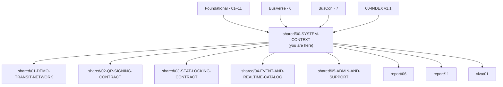

### 1.3 What this document does NOT cover

| Topic | Goes to |
|---|---|
| Workflow sequences | `08` §2, all product docs |
| Endpoint contracts | `07` §1.5, §4–§7 |
| Entity definitions | `05` §4 |
| Table schemas | `06` §4–§9 |
| Security controls | `09` §4–§19 |
| Screen wireframes | `busverse/05` §9–§13, `buscon/06` §12–§18 |
| Component library | `busverse/05` §6, `buscon/06` §7 |
| Test implementations | `10` §5–§24 |

### 1.4 Scope boundary

**This doc is a map, not a source.** Every fact it states has a canonical source in another doc — this doc points to it, doesn't re-derive it.

| If you want to know… | Read this doc §X | Then the canonical source |
|---|---|---|
| What the system is | §2, §4 | `01` §2, `03` §5 |
| Who the actors are | §3 | `01` §4, `04` §3 |
| How sessions work | §5 | `04` §8 |
| What data lives where | §6 | `05` §3, `06` §4–§9 |
| What trust boundaries exist | §7 | `09` §3 (technical) |
| How an action ripples cross-surface | §8 | (no other doc — this is the value) |
| What a term means | §9 | Each term's canonical source |
| What format to use | §10 | `busverse/05` §8 + `05` §12.3 + `06` §3.6–3.7 |
| How endpoints split by surface | §11 | `07` §1.5 |
| What subscribes to what | §12 | `07` §8.1 |
| What's the full chain for an action | §13 | `03` §8.4 (call matrix), `03` §9 (lifecycle) |
| Where do I start reading | §14 | `00-INDEX` §13 (write order) |

### 1.5 What is the `shared/` folder?

**The folder has 6 docs with mixed purposes** — SH-00 is meta, SH-01 is seed data, SH-02–SH-04 are cross-surface contracts, SH-05 is Phase 2 scope.

| Doc | Purpose | Category |
|---|---|---|
| **SH-00** (this) | Portal + glossary + reading guide | **Meta** |
| SH-01 | Demo transit network (Delhi–Kanpur–Lucknow seed data) | **Data** |
| SH-02 | QR signing contract — cross-surface (BusVerse renders, Operator App verifies) | **Contract** |
| SH-03 | Seat locking contract — cross-surface (BusVerse locks, API enforces) | **Contract** |
| SH-04 | Event and real-time catalog — 4 WS topics + event schemas | **Contract** |
| SH-05 | Admin and support operations (Phase 2 support panel) | **Deferred** |

**Rule:** SH-00 references all 5 other shared docs; SH-01–SH-04 reference SH-00's glossary for term definitions; SH-05 is deferred to Phase 2 and only appears in §1.5 for completeness.

---

## 2. How a Request Flows

### 2.1 Why this is different from `03` §4

`03` §4's C4 Level 1 diagram shows **what interacts** (4 actors, 1 system, 4 externals). That's a static structural view. This section shows **how a request moves through the system in time** — different diagram, different purpose.

**Diagram: Two contrasting view types**
*Structural views answer "what's connected to what." Flow views answer "how does data get from user to storage and back." This doc uses both but distinguishes them.*

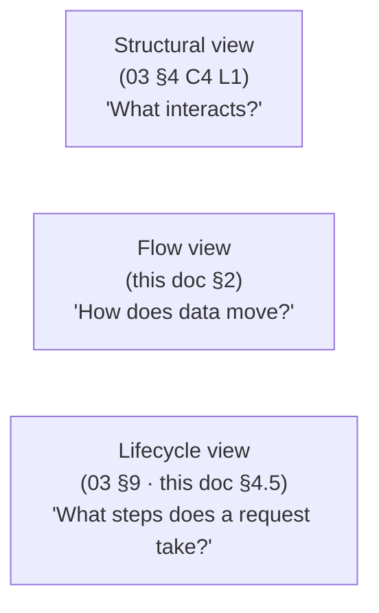

### 2.2 The generic request flow

**Diagram: Generic request flow (all 3 surfaces)**
*A request from any surface goes through 6 stages — client → API gateway → auth/validation → business module → data layer → response. Every request in the system follows this pattern; §4.5 shows the surface-specific differences.*

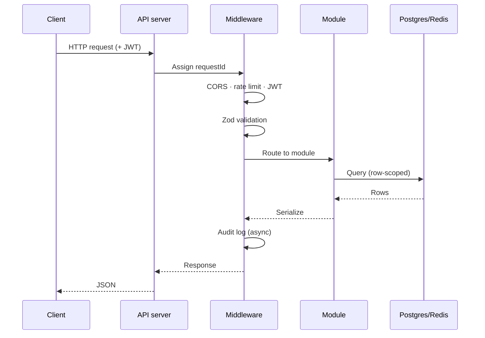

**Total typical p50:** ~50ms. **p95 target:** 200ms (search), 500ms (booking). **Source:** `03` §9 (20-step lifecycle).

### 2.3 What's unique in this section

| Not in `03` §9 | Here |
|---|---|
| Per-surface lifecycle differences | §4.5 |
| The "Vercel hop" for web surfaces | §4.5 |
| The "no hop" for native | §4.5 |

---

## 3. Four Actors and the Identity Model

### 3.1 The four actors

**Diagram: Four actors with their surfaces**
*Each actor accesses exactly one surface (except Operator + Admin who share BusCon web via role routing). Sources: `01` §4, `04` §3.*

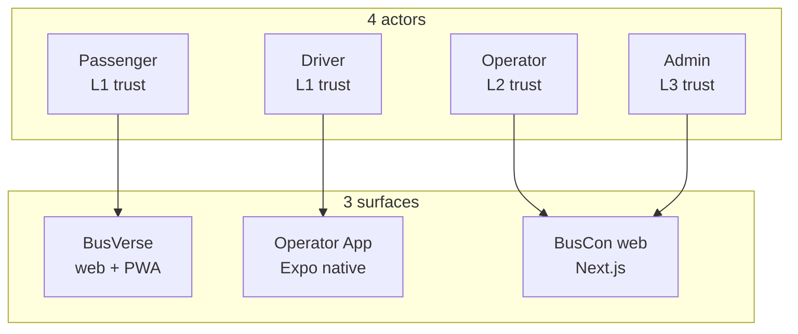

### 3.2 The identity model — one human, many profiles

**Diagram: One `users` row → up to four profile rows**
*The system anchors identity to a single `users` row per human. Role-specific profiles extend it. A driver can simultaneously be a passenger, and the same human can be both Operator and Admin — each requires a separate profile row and a separate login. Source: `04` §3.6, `06` §4.2–§4.6.*

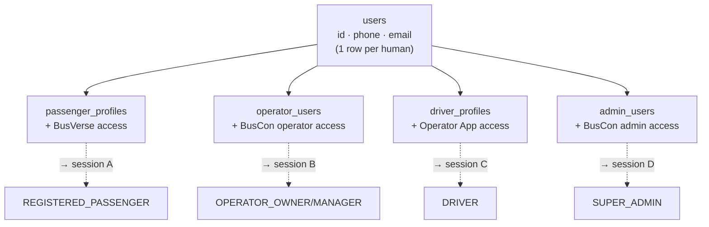

### 3.3 The one-human-many-roles walkthrough

**Concrete example: a bus driver named Ravi**

| Scenario | Ravi's action | Session created | Surface |
|---|---|---|---|
| Ravi wants to check his work schedule | Opens Operator App, logs in | Session C (role: DRIVER) | Operator App |
| Ravi wants to book a ticket for his daughter | Opens BusVerse, logs in separately | Session A (role: REGISTERED_PASSENGER) | BusVerse |
| Ravi's wife wants to become a driver | She's a different human | (Ravi's sessions unchanged) | — |
| Ravi switches jobs to a new operator | Old driver_profiles deactivated; new driver_profiles created | Sessions B/C revoked; new session issued | Operator App |

**Rule:** Session A and Session C are **independent** — one JWT for BusVerse, another JWT for Operator App, different device, different TTL. Logging out of one doesn't affect the other. **Exception:** when Ravi is suspended as a driver, all driver sessions cascade-revoke (Session C dies), but Session A (passenger) stays alive.

**Reference:** `04` §2.2, §3.6, §8.9.

### 3.4 What's unique in this section

| Not in `04` §3.6 | Here |
|---|---|
| Concrete walkthrough with a named persona | §3.3 |
| The ripple to sessions when switching operators | §3.3 |
| The suspension exception (driver session dies, passenger survives) | §3.3 |

---

## 4. Three Codebases, One Backend

### 4.1 The relationship

**Diagram: Three codebases sharing one backend**
*BusVerse, BusCon, and the Operator App are separate codebases with separate deploys. All three talk to the same API server, which talks to the same Postgres + Redis. Sources: `01` §3, `03` §5.*

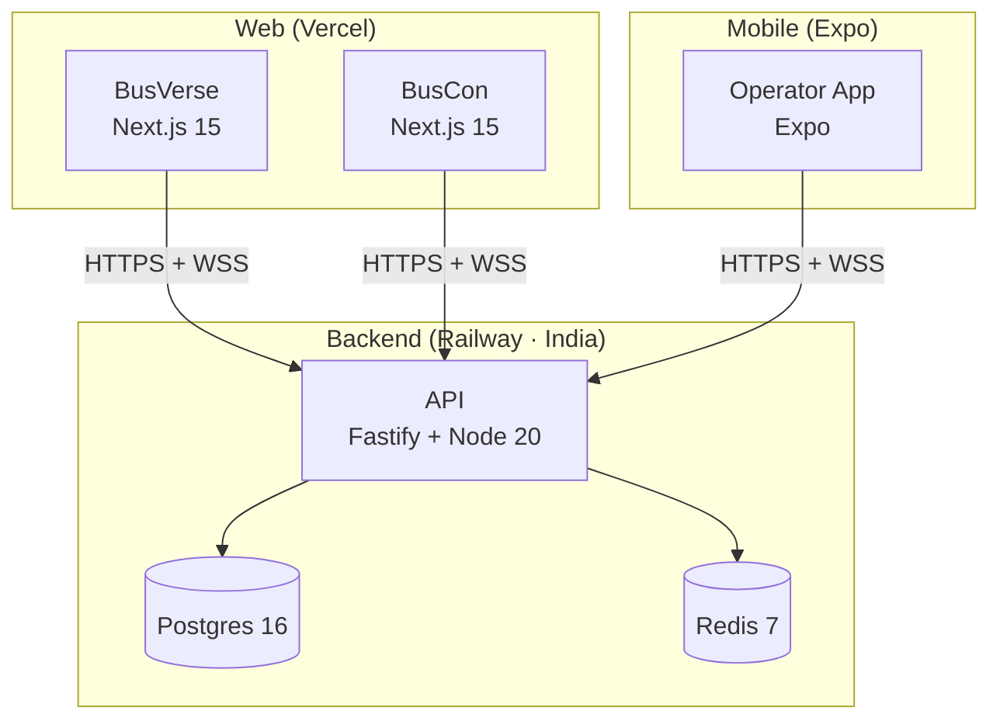

### 4.2 What each codebase owns

| Codebase | Deploy | Actor | Primary concern |
|---|---|---|---|
| BusVerse | Vercel | Passenger | Book, pay, ticket, track |
| BusCon | Vercel | Operator + Admin | Fleet, routes, approvals, refunds, audit |
| Operator App | Expo Go | Driver | Login, trips, GPS, scan, manifest |

**Reference:** `03` §5, `01` §3.

### 4.3 What the shared backend owns

| Backend concern | Handled in |
|---|---|
| All business logic | `03` §6 |
| All endpoints | `07` §4–§7 |
| All auth | `04` §7 |
| All persistence | `06` |
| All real-time | `07` §8 |

### 4.4 What's unique in this section

| Not in `03` §5 | Here |
|---|---|
| Simplified one-page view | §4.1 |
| Per-codebase actor mapping | §4.2 |

---

## 4.5 Three Surfaces, Three Lifecycles

### 4.5.1 The infrastructure asymmetry

**Diagram: Three request lifecycles**
*Web requests go through Vercel's edge network before reaching Railway. Native requests go directly to Railway. This asymmetry is invisible in `03` §9 (which shows one lifecycle) but affects cache strategy, request latency, and debugging.*

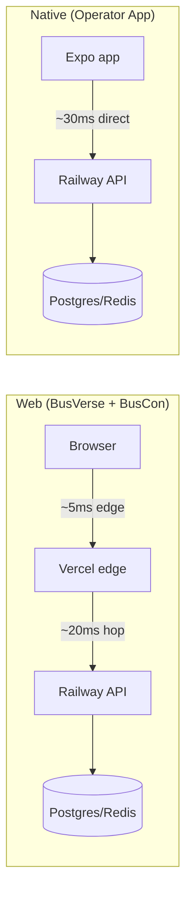

### 4.5.2 Lifecycle comparison

| Stage | BusVerse + BusCon (web) | Operator App (native) |
|---|---|---|
| Client | Browser (React) | Expo (React Native) |
| Edge caching | **Yes (Vercel edge)** | No |
| Static asset CDN | Vercel | Expo bundle |
| API hop | 2 hops (client → Vercel → Railway) | 1 hop (client → Railway) |
| WebSocket | Browser → Vercel → Railway | Direct to Railway |
| Total p50 | ~50ms | ~40ms |
| **Trade-off** | Slower but benefits from Vercel edge caching + DDoS protection + automatic HTTPS | Faster but no edge caching; must handle HTTPS + auth + rate limiting at Railway |

### 4.5.3 Why this matters

| Concern | Web advantage | Native advantage |
|---|---|---|
| Cold start | Vercel edge warms up SSR | Direct to Railway |
| Static assets | Vercel CDN | Expo bundle (cached after first launch) |
| DDoS protection | Vercel (built-in) | Railway (add Cloudflare if needed — Phase 2) |
| Rate limiting | API (single location) | API (same) |
| Observability | Vercel analytics + Railway logs | Railway logs only |
| **Debugging** | **2 places (Vercel + Railway)** | **1 place (Railway)** |

**Reference:** `03` §5 (topology), `03` §9 (single lifecycle for web), `11` §13 (deployment).

### 4.5.4 What's unique in this section

| Not in `03` §5 or §9 | Here |
|---|---|
| Explicit per-surface lifecycle comparison | §4.5.2 |
| Trade-off analysis (edge caching vs latency) | §4.5.3 |
| Debugging implications | §4.5.3 last row |

---

## 5. Session Isolation Map

### 5.1 The rule

**The rule** (from `04` §2.2):
> One session belongs to exactly one actor-role. No cross-surface session sharing.

### 5.2 The visualization

**Diagram: Session isolation**
*A human can have up to 4 concurrent sessions — one per actor-role. Each session is an independent JWT with its own TTL. Revoking one does not revoke others (except suspension cascade, which is per-actor, not per-human).*

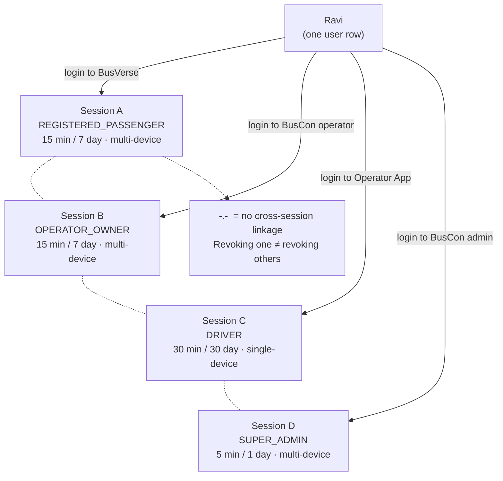

### 5.3 Session TTLs per actor

**Source:** `04` §8.4.

| Actor | Access TTL | Refresh TTL | Devices | Rationale |
|---|---|---|---|---|
| Passenger | 15 min | 7 days | Multi | Low risk; convenience prioritized |
| Operator | 15 min | 7 days | Multi | Company can operate from multiple desks |
| Driver | 30 min | 30 days | **Single** | Single device; longer TTL to avoid logout on long trips |
| Admin | **5 min** | **1 day** | Multi | High blast radius; shorter TTL limits exposure window |

### 5.4 Cascade exceptions

**When does a session cascade?**

| Trigger | Sessions affected | Cross-actor? |
|---|---|---|
| Password change (own) | All sessions of **same actor-role** | No |
| Password reset (email/OTP) | All sessions of **same actor-role** | No |
| **Operator suspension** | All operator_users **+ all driver_profiles of that operator** | **Yes** (within operator's scope) |
| **Driver suspension** | That driver only | No |
| Admin deactivation | That admin only | No |
| Logout | Current session only | No |
| Refresh replay | That refresh chain | No |
| Absolute TTL | That session | No |

**Reference:** `04` §8.9.

### 5.5 What's unique in this section

| Not in `04` §2.2 / §8 | Here |
|---|---|
| Single diagram showing 4 concurrent sessions | §5.2 |
| TTL comparison table | §5.3 |
| Cascade exceptions matrix | §5.4 |

---

## 6. Surface → Data Reachability

### 6.1 The matrix

**Diagram: Surface reachability**
*Which surface reads which of the 31 tables. BusVerse is the most restricted (only its own booking data + public catalog). BusCon web is the most permissive (all operator's data + admin sees all). Operator App has the narrowest surface — only its own trip's data.*

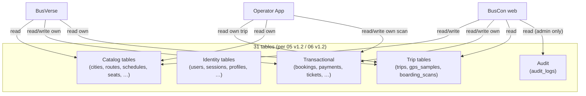

### 6.2 Full reachability table (31 tables × 3 surfaces)

| Table | BusVerse | BusCon web | Operator App |
|---|:---:|:---:|:---:|
| `users` | RW (own) | R (via profiles) | RW (own) |
| `passenger_profiles` | RW (own) | R (masked name) | — |
| `operator_users` | — | RW (own company) | — |
| `driver_profiles` | — | RW (own company) | R (own) |
| `admin_users` | — | R (own) | — |
| `sessions` | RW (own) | RW (own + cascade) | RW (own) |
| `otp_challenges` | RW (own) | RW (own) | RW (own) |
| `refresh_token_chains` | RW (own) | RW (own) | RW (own) |
| `consent_records` | RW (own) | R (via profile) | — |
| `password_reset_tokens` | — | RW (own) | — |
| `cities` | R | R | — |
| `stands` | R | RW | R (own trip) |
| `operators` | R (public search) | RW (own) | R (own company) |
| `buses` | R (public search) | RW (own) | R (via trips) |
| `seat_layouts` | R | RW (own) | — |
| `seats` | R | RW (own) | R (manifest) |
| `routes` | R (public search) | RW (own) | R (via trips) |
| `route_stands` | R (public search) | RW (own) | R (manifest) |
| `schedules` | R (public search) | RW (own) | R (via trips) |
| `seat_locks` | RW (own) | — | — |
| `bookings` | RW (own) | R (own fleet) | R (own trip) |
| `booking_passengers` | RW (own) | R (own fleet) | R (own trip) |
| `tickets` | R (own) | R (own fleet) | R (own trip) |
| `payments` | RW (own) | R (own fleet) | — |
| `refunds` | R (own) | R (own fleet) | — |
| `gst_invoices` | R (own) | R (own fleet) | — |
| `gateway_webhooks` | — | — | — |
| `trips` | R (own trip) | R (own fleet) | RW (own trip) |
| `gps_samples` | R (own trip) | — | RW (own trip) |
| `boarding_scans` | R (own trip) | R (own fleet) | RW (own trip) |
| `audit_logs` | — | R (admin only) | — |

**Legend:** RW = read/write · R = read · — = no access

### 6.3 Key insights

| Insight | Why it matters |
|---|---|
| **`gateway_webhooks` is internal-only** — no surface reads it | Webhooks are API-internal; nobody queries raw webhook logs |
| **`audit_logs` is admin-only** | Operators cannot see audit history — that's a Super Admin privilege |
| **Operator App never reads `payments` or `refunds`** | Driver doesn't see money (per `04` §9.3) |
| **BusVerse never writes `audit_logs` directly** | API middleware writes audit rows asynchronously |
| **Operator App writes to 4 tables** | `sessions`, `driver_profiles` (via `/start` `/end`), `trips` (via `/start` `/end`), `boarding_scans` (via `/scan`) |

### 6.4 Data ownership by bounded context

**Reference:** `05` §3 (6 contexts) + `06` §4–§9 (table ownership).

| Context | Tables | Primary surface consumers |
|---|---|---|
| Identity (10 tables) | users, profiles, sessions, OTP, consent, reset tokens | All 3 surfaces |
| Network (9 tables) | cities, stands, operators, buses, layouts, seats, routes, route_stands, schedules | BusVerse + BusCon |
| Booking (4 tables) | seat_locks, bookings, booking_passengers, tickets | BusVerse + BusCon + Operator App |
| Payments (4 tables) | payments, refunds, gst_invoices, gateway_webhooks | BusVerse + BusCon |
| Trip (3 tables) | trips, gps_samples, boarding_scans | Operator App + BusVerse (tracking) |
| Audit (1 table) | audit_logs | BusCon (admin only) |

### 6.5 What's unique in this section

| Not in `05` §3 / `06` §4–§9 | Here |
|---|---|
| Surface × table reachability matrix | §6.2 |
| 5 key insights about cross-surface access | §6.3 |
| Consolidated 31-table × 3-surface view | §6.2 |

---

## 7. Actor-Facing Trust Zones

### 7.1 Why this is different from `09` §3

`09` §3 defines 5 **technical** trust boundaries — Browser↔API, API↔DB, Razorpay→API, etc. That's a **threat-model view**. This section defines 5 **actor-facing** zones — what group of humans can reach what data. Different decomposition, different purpose.

**Diagram: Two trust views**
*Technical boundaries (09 §3) answer "which network hops are encrypted and authenticated." Actor-facing zones (this doc) answer "which humans can reach what data."*

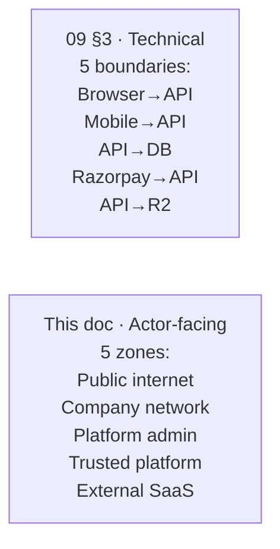

### 7.2 The 5 actor-facing zones

**Diagram: 5 actor-facing trust zones**
*Each zone has a distinct threat profile and distinct defense strategy. Zones are ordered by trust level (lowest trust outermost).*

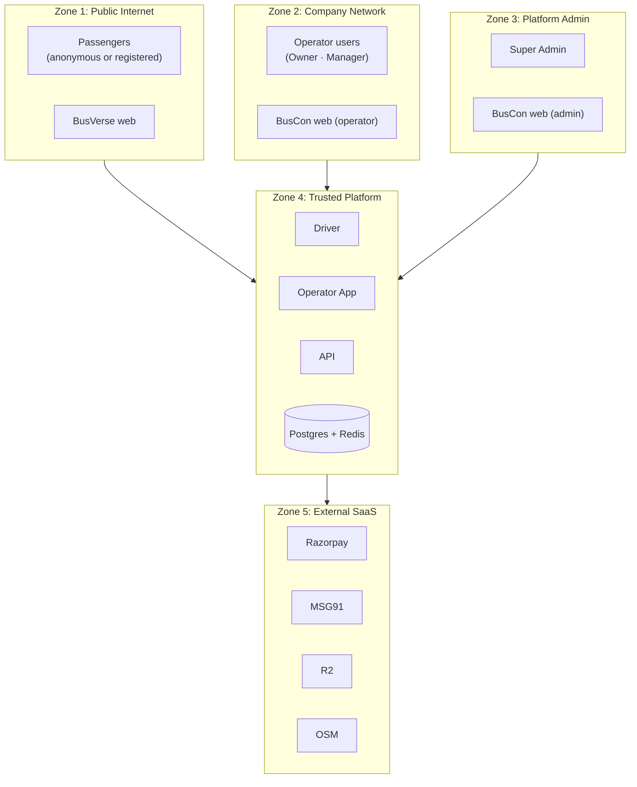

### 7.3 Zone characteristics

| Zone | Members | Trust level | Data exposure | Defense |
|---|---|---|---|---|
| **1 · Public Internet** | Anonymous + registered passengers | L0–L1 | Own bookings, public catalog | TLS · JWT · rate limits · CAPTCHA |
| **2 · Company Network** | Operator Owner + Manager | L2 | Own fleet + own bookings (masked PII) | TLS · JWT · tenant isolation |
| **3 · Platform Admin** | Super Admin | L3 | All operators + all bookings (unmasked with reason) | TLS · JWT · short TTL · audit |
| **4 · Trusted Platform** | API + DB + Redis + Operator App | L1 (driver only sees own trip) | Whatever's requested via API | Internal TLS · row scope |
| **5 · External SaaS** | Razorpay, MSG91, R2, OSM | Third-party | Only what's contracted | HMAC signatures · IP allowlists · signed URLs |

### 7.4 Cross-zone reachability

| From Zone | Can reach | Cannot reach |
|---|---|---|
| 1 (Public) | Public catalog + own data | Other passengers' data |
| 2 (Company) | Own fleet data | Other operators' data |
| 3 (Admin) | All data (with reason for PII) | Raw card data, UPI PINs |
| 4 (Platform) | Any data needed for a request | Anything beyond row scope |
| 5 (External) | Only contracted data | Any customer data beyond the contract |

### 7.5 What's unique in this section

| Not in `09` §3 | Here |
|---|---|
| Actor-facing zone decomposition | §7.2 |
| Per-zone data exposure | §7.3 |
| Cross-zone reachability table | §7.4 |

---

## 8. Cross-Surface Data Flows (the doc's core value)

### 8.1 Hero Flow 1 — The booking ripple

**Diagram: Full booking ripple across all 4 actors**
*A single passenger booking creates ripple effects across BusVerse, BusCon, and the Operator App. This diagram shows the complete lifecycle from "passenger taps Pay" to "booking completed." No other doc shows this end-to-end.*

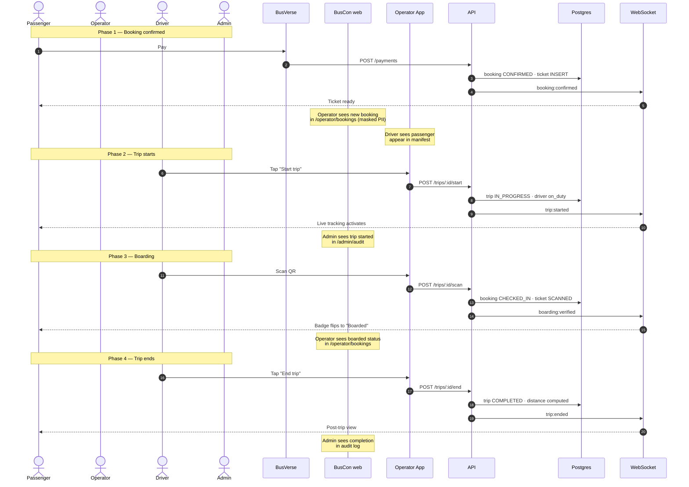

### 8.2 Hero Flow 2 — The suspension cascade

**Diagram: Admin suspension rippling to all surfaces**
*An admin suspending an operator triggers cascading effects within 1 second — sessions revoked across Operator App + BusCon, search results blocked on BusVerse, audit log written. The suspension is the most forceful cross-surface action in the system.*

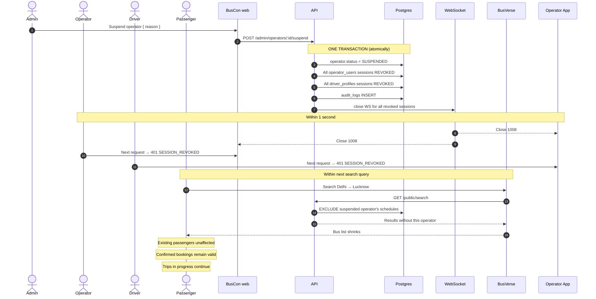

### 8.3 What makes these the doc's core value

| Aspect | Where stated elsewhere | What's new here |
|---|---|---|
| Booking state machine | `05` §8.1 | — |
| Booking workflow | `08` WF-P-04 | — |
| Scan workflow | `08` WF-D-04, `buscon/05` §5 | — |
| Suspension workflow | `08` §8.4, `buscon/01` §13 | — |
| **Cross-surface ripple of ONE action** | **— no other doc** | **§8.1, §8.2** |

The value is **not** in any single state machine — it's in showing that one action (pay, scan, suspend) has **simultaneous consequences on 3–4 surfaces.** This is exactly what a newcomer needs to understand the system's cohesion.

---

## 9. Glossary

**30 terms** — each with a canonical source. This is the single lookup point for project terminology.

### 9.1 Actors and roles

| Term | Definition | Canonical source |
|---|---|---|
| **Actor** | A type of entity that interacts with the platform. Phase 1 has 4: Passenger, Operator, Driver, Admin. | `04` §2.1 |
| **Role** | A specialization within an actor. Phase 1 has 6: Guest, Registered Passenger, Operator Owner, Operator Manager, Driver, Super Admin. | `04` §4.1 |
| **Profile** | A role-specific extension of the `users` identity row. A human with 4 profiles can log into 4 actor-roles. | `04` §3.6 |
| **Session** | An authenticated state for one actor-role on one device. One session = one JWT access token + one refresh token. | `04` §2.1, §8.1 |
| **Surface** | A frontend codebase. Phase 1 has 3: BusVerse, BusCon web, Operator App. | `01` §3 |
| **Codebase** | Same as surface in this project. | `01` §3 |
| **Tenant** | An operator in the multi-tenant model. All operator data is scoped to a tenant. | `03` §10.5 |
| **Multi-tenancy** | The pattern where one system serves multiple operators with row-level data isolation. BusVerse + BusCon use shared schema with row-level scope. | `03` §10.5 |

### 9.2 Domain concepts

| Term | Definition | Canonical source |
|---|---|---|
| **Bounded context** | A module boundary in the domain model. Phase 1 has 6: Identity, Network, Booking, Payments, Trip, Audit. | `05` §3 |
| **Aggregate root** | A transactional boundary entity. Phase 1 has 9 (User, Session, City, Operator, SeatLock, Booking, Payment, Trip, AuditLog). | `05` §5.1 |
| **Domain invariant** | A rule that must always hold. Phase 1 has 21 invariants (invariants #1–#21). | `05` §7.1 |
| **Never-permission** | An action impossible for any role to perform. Phase 1 has 12. | `04` §12 |
| **Booking** | A confirmed purchase of one or more seats on one schedule. | `05` §6.3 |
| **Schedule** | A specific bus running a specific route at a specific time with a specific fare. | `05` §6.2 |
| **Route** | An ordered sequence of cities and stands that a bus travels. | `05` §6.2 |
| **Stand** | A physical boarding point within a city. | `05` §6.2 |
| **Seat** | An individual passenger position within a bus's seat layout. | `05` §6.2 |
| **Trip** | One actual run of a schedule by a driver. Trip = the operational instance; Schedule = the planned blueprint. | `05` §6.5 |
| **Ticket** | The Ed25519-signed QR payload for a booking. One per booking (multiple passengers on one ticket). | `05` §6.3 |
| **Seat lock** | A temporary reservation (5 min acquire, 15 min at booking). Enforced by Redis SET NX + Postgres unique constraint. | `05` §6.3, `09` §8 |

### 9.3 Operations concepts

| Term | Definition | Canonical source |
|---|---|---|
| **QR payload** | The string `v1:{payload_b64}:{sig_b64}` encoding ticket data + Ed25519 signature. Payload v2 includes `passengerCount` + `allSeatLabels[]`. | `09` §7.2, `buscon/05` §4.2 |
| **Boarding scan** | One scan event by a driver on a ticket. The scan transitions booking CONFIRMED → CHECKED_IN. | `05` §6.5, `buscon/05` §5 |
| **Manifest** | The driver's passenger list, grouped by boarding stand, with boarding status per passenger. | `buscon/05` §12 |
| **Refund tier** | One of 5 refund categories: `TIER_FULL`, `TIER_75`, `TIER_50`, `TIER_ZERO`, `TIER_NOT_ELIGIBLE`. Calculated from time-to-departure. | `busverse/03` §10 |
| **Provenance** | The 6 checks the server runs on each GPS sample to detect spoofing: timestamp window, coordinates, accuracy, speed consistency, teleport detection, device fingerprint. | `buscon/04` §11 |
| **GPS sample** | One position record from a driver's device. Client sends every 5s; stored in Redis every 5s (live) and Postgres every 30s (historical). | `buscon/04` §3 |
| **ETA** | Estimated time to arrival at each upcoming stand. Computed server-side from current GPS + remaining distance + 5-min average speed. | `buscon/04` §16 |

### 9.4 Infrastructure concepts

| Term | Definition | Canonical source |
|---|---|---|
| **Session TTL** | The lifetime of an access or refresh token. Varies by actor: 5min/1day (admin) to 30min/30day (driver). | `04` §8.4 |
| **Idempotency** | The property where repeating an operation produces the same result. Required on all money-path endpoints (`POST /payments`, `POST /refunds`). | `07` §11 |
| **Webhook** | An HTTP callback from a payment gateway (Razorpay) confirming a payment or refund. Verified by HMAC-SHA256 signature + IP allowlist + replay dedup. | `07` §13 |

**Term count:** 8 actors/roles + 12 domain + 7 operations + 3 infrastructure = **30 terms**.

---

## 10. Shared Reference Formats

### 10.1 The consolidated table

**Scattered sources:** `busverse/05` §8 (money, dates, times), `05` §12.3 (ID prefixes), `06` §3.6–§3.7 (booking ref + invoice sequences), `busverse/03` §10 (refund tiers).

| Format | Pattern | Example | Source |
|---|---|---|---|
| **Booking reference** | `BKG-YYYY-NNNNN` | `BKG-2026-00042` | `06` §3.6 |
| **Trip reference** | `TRP-YYYY-NNNNN` | `TRP-2026-00187` | `05` §12.3 |
| **Refund reference** | `REF-YYYY-NNNNN` | `REF-2026-00089` | `05` §12.3 |
| **Invoice number** | `INV/YYYY-YY/NNNN` | `INV/2026-27/0042` | `06` §3.7 |
| **Display ticket** | `TKT-YYYY-NNNNN` | `TKT-2026-00042` | `05` §12.3 |
| **User display ID** | `usr_` + short UUID | `usr_abc123` | `05` §12.3 |
| **Session display ID** | `ses_` + short UUID | `ses_xyz789` | `05` §12.3 |
| **Money (display)** | `₹` + lakh/crore grouping | `₹487.50` · `₹1,23,456.78` | `busverse/05` §8.2 |
| **Money (storage)** | `bigint` paise | `48750` (for ₹487.50) | `06` §1.2 |
| **Date (full)** | `DD MMM YYYY` | `24 Oct 2026` | `busverse/05` §8.3 |
| **Date (short)** | `DD MMM` | `24 Oct` | `busverse/05` §8.3 |
| **Time** | `HH:mm IST` | `14:00 IST` | `busverse/05` §8.4 |
| **Duration** | `Xh Ym` | `8h 30m` | `busverse/05` §8.4 |
| **Timestamp (table)** | `DD MMM HH:mm` | `24 Oct 14:32` | `buscon/06` §18A.3 |
| **Phone (display)** | E.164 | `+919876543210` | `busverse/05` §8.5 |
| **Phone (input)** | space-separated | `98765 43210` | `busverse/05` §8.5 |
| **Phone (masked)** | last-4 | `••••••3210` | `busverse/05` §8.5 |
| **Bus registration** | `{State}-{District}-{Series}-{Number}` | `DL-1P-1234` | `buscon/03` §4.4 |
| **QR payload** | `v1:{payload_b64}:{sig_b64}` | (opaque string) | `09` §7.4 |

### 10.2 Rules

| Rule | Source |
|---|---|
| Reference formats are exact — never abbreviate | `05` §12.1 |
| Prefixes are for display/logs; internal PKs are UUIDs | `05` §12.3 |
| All times displayed in IST (`Asia/Kolkata`) | `busverse/05` §8.4 |
| Money always stored as paise, never floats | `06` §1.2 |
| No PII in URLs | `busverse/05` §21.5, `buscon/06` §21A.5 |

---

## 11. Endpoint Surface Split

### 11.1 The 101 endpoints by category

**Source:** `07` §1.5.

| Category | Count | Auth required | Primary surface |
|---|---:|---|---|
| Health | 2 | None | (internal) |
| Auth | 14 | Mixed (see §11.2) | All 3 surfaces |
| Public | 3 | None | BusVerse |
| Passenger | 15 | REGISTERED_PASSENGER | BusVerse |
| Operator | 33 | OPERATOR_OWNER / OPERATOR_MANAGER | BusCon web |
| Admin | 21 | SUPER_ADMIN | BusCon web |
| Driver | 12 (+1 flagged — `07` v1.3 A6) | DRIVER | Operator App |
| Webhooks | 1 | Razorpay HMAC signature | (external) |
| **Total** | **101** | | |

### 11.2 Auth classification (per §11.1)

**Auth category clarification (resolves N8):**

The "Auth: 14" category contains both public login endpoints (no auth) and authenticated logout endpoints (JWT required). Full split:

| Auth endpoint | Auth required |
|---|---|
| `POST /passenger/auth/otp/request` | **None (public)** |
| `POST /passenger/auth/otp/verify` | **None (public)** |
| `POST /driver/auth/otp/request` | **None (public)** |
| `POST /driver/auth/otp/verify` | **None (public)** |
| `POST /operator/auth/login` | **None (public)** |
| `POST /operator/auth/otp/request` | **None (public)** |
| `POST /operator/auth/otp/verify` | **None (public)** |
| `POST /admin/auth/login` | **None (public)** |
| `POST /operator/auth/reset/request` | **None (public)** |
| `POST /operator/auth/reset/verify` | **None (public)** |
| `POST /admin/auth/reset/request` | **None (public)** |
| `POST /admin/auth/reset/verify` | **None (public)** |
| `POST /{surface}/auth/refresh` | **Refresh cookie (authenticated)** |
| `POST /{surface}/auth/logout` | **JWT (authenticated)** |

**12 public + 2 authenticated = 14 auth endpoints.**

### 11.3 Surface → endpoint distribution

| Surface | Consumes | Auth |
|---|---|---|
| BusVerse | 3 public + 15 passenger + 12 auth (public+refresh) = **~30** | Guest or REGISTERED_PASSENGER |
| BusCon web | 33 operator + 21 admin + 12 auth = **~66** | OPERATOR_* or SUPER_ADMIN |
| Operator App | 12 driver (+1 flagged) + 4 driver auth = **~17** | DRIVER |

**Note:** Some endpoints are consumed by 2 surfaces — e.g., `/auth/refresh` is used by all 3 (busverse auth refresh, buscon auth refresh, driver auth refresh — separate endpoints per surface).

### 11.4 What's unique in this section

| Not in `07` §1.5 | Here |
|---|---|
| Auth-per-category breakdown | §11.2 |
| Surface → endpoint distribution | §11.3 |
| Explicit public vs authenticated split | §11.2 |

---

## 12. WebSocket Subscriber Map

### 12.1 The 4 topics and their subscribers

**Source:** `07` §8.1, §8.7.

| Topic | Purpose | BusVerse | BusCon web | Operator App |
|---|---|:---:|:---:|:---:|
| `seat:availability:{scheduleId}` | Seat state changes | ✅ (any passenger viewing) | — | — |
| `trip:live:{tripId}` | GPS position + trip state | ✅ (booked passengers) | ✅ (operator + admin) | — |
| `booking:{bookingId}` | Booking status changes | ✅ (booking owner) | — | — |
| `admin:notifications` | System alerts | — | ✅ (SUPER_ADMIN only) | — |

**Note:** Operator App does **not** subscribe to any WebSocket topic — it is a producer only (emits GPS, scan events). It receives events via polling (`/trips/:id/live`, `/bookings/:id`, `/trips/:id/manifest`).

### 12.2 Event catalog per topic

**Source:** `07` §8.7.

| Topic | Events |
|---|---|
| `seat:availability:*` | `seat:locked` · `seat:released` · `seat:booked` |
| `trip:live:*` | `bus:position` · `trip:started` · `trip:delayed` · `trip:ended` · `trip:cancelled` · `boarding:verified` |
| `booking:*` | `booking:confirmed` · `booking:cancelled` · `booking:expired` · `payment:succeeded` |
| `admin:notifications` | `operator:applied` · `refund:requested` |

### 12.3 Polling fallbacks (web)

When WebSocket fails, each subscriber has a polling fallback:

| Topic | Fallback endpoint | Frequency | Source |
|---|---|---|---|
| `seat:availability:*` | `GET /schedules/:id/availability` | 3s | `busverse/02` §15.1 |
| `trip:live:*` | `GET /trips/:id/live` | 3s | `busverse/04` §11.4 |
| `booking:*` | `GET /bookings/:id` | 5s | `busverse/04` §11.4 |
| `admin:notifications` | `GET /admin/notifications` | 10s | (Phase 2) |

### 12.4 What's unique in this section

| Not in `07` §8.1 | Here |
|---|---|
| Surface → topic subscription matrix | §12.1 |
| Polling fallback consolidation | §12.3 |
| Note that Operator App is producer-only | §12.1 |

---

## 13. Surface → Endpoint → Table Chain

### 13.1 Why this section exists

`03` §8.4 has a **cross-module call matrix** (which module calls which). `03` §9 has the **request lifecycle** (generic). Neither shows the **full chain** from a user action to the tables it touches. This section provides three concrete examples.

### 13.2 Example chain 1 — "Passenger locks a seat" (BusVerse)

**Diagram: Passenger seat lock chain**
*The simplest chain: 1 surface → 1 endpoint → 1 module → 3 tables + Redis. No cross-surface ripple (seat locks are internal).*

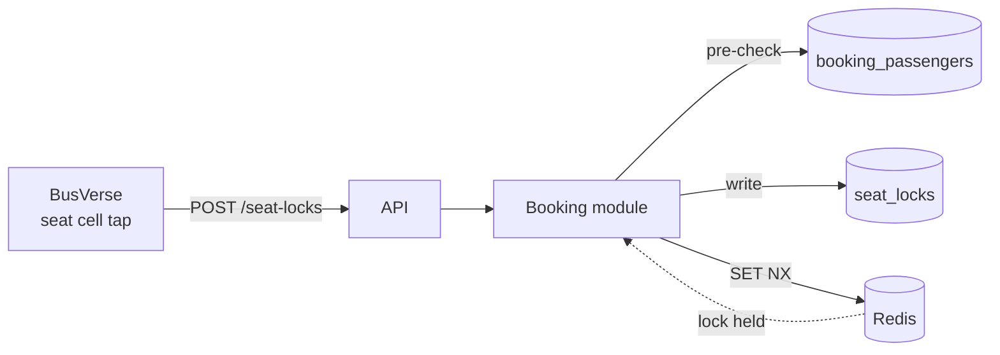

| Step | Actor | Surface | Endpoint | Module | Tables read | Tables write | Events |
|---|---|---|---|---|---|---|---|
| 1 | Passenger | BusVerse | POST /passenger/seat-locks | Booking | booking_passengers, seats, schedules | seat_locks | (none — internal) |

### 13.3 Example chain 2 — "Driver starts a trip" (Operator App)

**Diagram: Driver trip-start chain**
*Cross-module: Trip module calls Network module for validation. Cross-surface ripple: passenger sees tracking activate.*

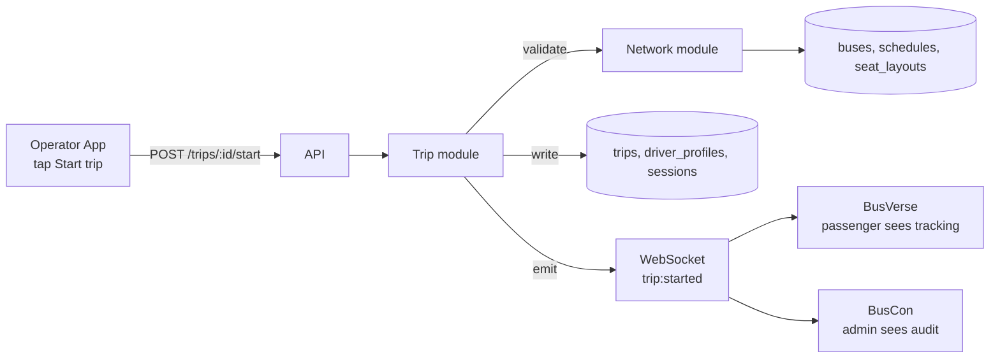

| Step | Actor | Surface | Endpoint | Module | Tables read | Tables write | Events |
|---|---|---|---|---|---|---|---|
| 1 | Driver | Operator App | POST /driver/trips/:id/start | Trip (+Network) | trips, buses, schedules, seat_layouts, driver_profiles, seat_locks | trips (IN_PROGRESS), driver_profiles (on_duty), sessions (metadata) | `trip:started` → `trip:live:{tripId}` |
| 2 | Passenger | BusVerse | (WS subscriber) | — | — | — | Consumes `trip:started` |
| 3 | Admin | BusCon | (WS subscriber) | — | — | — | Consumes `trip:started` |

### 13.4 Example chain 3 — "Admin initiates a refund" (BusCon web)

**Diagram: Admin refund chain**
*Cross-module: Payments module calls Booking module. External: Razorpay API. Cross-surface: passenger sees refund status.*

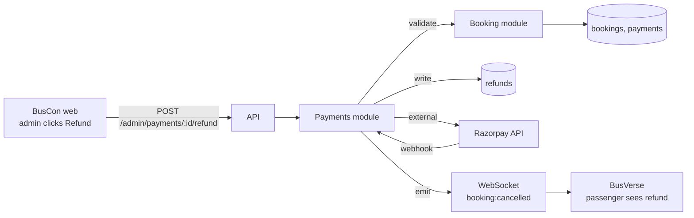

| Step | Actor | Surface | Endpoint | Module | Tables read | Tables write | Events |
|---|---|---|---|---|---|---|---|
| 1 | Admin | BusCon web | POST /admin/payments/:id/refund | Payments (+Booking) | payments, bookings, refunds | refunds (INITIATED), payments (status) | (async via webhook) |
| 2 | System | API | (Razorpay callback) | Payments | gateway_webhooks | refunds (PROCESSED), payments (REFUNDED) | `booking:cancelled` (via `refund.processed`) |
| 3 | Passenger | BusVerse | (WS or poll) | — | — | — | Consumes `booking:cancelled` |

### 13.5 What's unique in this section

| Not in `03` §8.4 / §9 | Here |
|---|---|
| Full chain from action → endpoint → module → tables → events | §13.2–§13.4 |
| Cross-surface ripple visible per chain | §13.3, §13.4 |
| 3 concrete examples vs abstract call matrix | §13.2–§13.4 |

---

## 14. Reading Guide

### 14.1 The write-order trap

`00-INDEX.md` §13 has a **write order** (which doc to write next). That's not the same as a **read order** (which doc to read next). A newcomer joining today needs read order.

### 14.2 Six reading tracks

**Diagram: Reading tracks**
*Six paths through the 24 docs, each tuned to a role. The executive track is 30 min. The full track is ~40 hrs.*

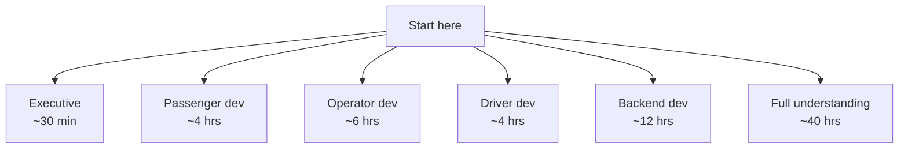

### 14.3 Track 1 — Executive (30 min)

**Purpose:** "What is this system?" in half an hour.

| # | Read |
|---|---|
| 1 | `01` §2 (what is BusVerse + BusCon) |
| 2 | `01` §4 (four actors) |
| 3 | `buscon/00` §2 (what operations is) |
| 4 | This doc §2 (one-page flow) |
| 5 | This doc §8 (booking ripple + suspension cascade) |

### 14.4 Track 2 — Passenger developer (4 hrs)

**Purpose:** Build or maintain BusVerse.

| # | Read |
|---|---|
| 1 | `01` §3, §4, §6.3 |
| 2 | `02` §6.3, §8.1 |
| 3 | `04` §3.2, §7.1, §8.4 |
| 4 | `07` §3 (auth), §4 (passenger) |
| 5 | `08` §4.1, §4.2 |
| 6 | `busverse/00` (overview) |
| 7 | `busverse/01` (workflows) |
| 8 | `busverse/02` (seat matrix) |
| 9 | `busverse/03` (payment + refund) |
| 10 | `busverse/04` (ticket + tracking) |
| 11 | `busverse/05` §3, §6 (tokens + primitives) |

### 14.5 Track 3 — Operator developer (6 hrs)

**Purpose:** Build or maintain BusCon web.

| # | Read |
|---|---|
| 1 | `01` §4 |
| 2 | `02` §6.4 (operator FRs), §6.5 (admin FRs) |
| 3 | `04` §3.3 (Operator), §3.5 (Admin), §4.5 (Owner vs Manager), §7.2, §9.2 |
| 4 | `07` §3, §5 (operator endpoints), §6 (admin endpoints) |
| 5 | `08` §5 (operator workflows), §6 (admin workflows) |
| 6 | `buscon/00` (overview) |
| 7 | `buscon/01` (operator + admin workflows) |
| 8 | `buscon/03` (fleet/routes/schedules) |
| 9 | `buscon/06` §8 (sidebar) |

### 14.6 Track 4 — Driver developer (4 hrs)

**Purpose:** Build or maintain the Operator App.

| # | Read |
|---|---|
| 1 | `01` §4 |
| 2 | `02` §6.6 (driver FRs) |
| 3 | `04` §3.4 (Driver), §7.3 (auth), §9.3 (permissions) |
| 4 | `07` §3, §7 (driver endpoints) |
| 5 | `08` §7 (driver workflows) |
| 6 | `buscon/00` (overview) |
| 7 | `buscon/02` (driver workflows) |
| 8 | `buscon/04` (GPS telemetry) |
| 9 | `buscon/05` (QR scan + boarding) |

### 14.7 Track 5 — Backend developer (12 hrs)

**Purpose:** Build or maintain the API.

| # | Read |
|---|---|
| 1 | `01` (whole) — 1 hr |
| 2 | `02` (whole) — 1.5 hrs |
| 3 | `03` (whole) — 2 hrs |
| 4 | `04` (whole) — 1 hr |
| 5 | `05` (whole) — 1.5 hrs |
| 6 | `06` (whole) — 2 hrs |
| 7 | `07` (whole) — 2 hrs |
| 8 | `08` (whole) — 2 hrs |
| 9 | `09` (whole) — 1.5 hrs |
| 10 | `buscon/04` §16 (ETA) — 30 min |
| 11 | `buscon/05` §4 (QR verify) — 30 min |

### 14.8 Track 6 — Full understanding (~40 hrs)

**Purpose:** Complete project comprehension.

| # | Read | Time |
|---|---|---|
| 1 | `01`–`11` foundational (all 11) | ~12 hrs |
| 2 | `busverse/00`–`05` (all 6) | ~8 hrs |
| 3 | `buscon/00`–`06` (all 7) | ~12 hrs |
| 4 | This doc (SH-00) | ~1.5 hrs |
| 5 | SH-01 through SH-05 (once written) | ~5 hrs |
| 6 | Report chapters (once written) | ~2 hrs |

### 14.9 What's unique in this section

| Not in `00-INDEX` §13 | Here |
|---|---|
| Read-order vs write-order distinction | §14.1 |
| 6 role-tuned tracks | §14.3–§14.8 |
| Time estimates per track | Each track |

---

## 15. Cross-Doc Amendments

### 15.1 Amendments raised by this doc

| # | Target | Amendment | Priority |
|:---:|---|---|---|
| **A1** | `00-INDEX` v1.2 | Update **29 entities → 31 entities** (per `05` v1.2 §4.2 which added ConsentRecord + PasswordResetToken) | Medium |
| **A2** | `00-INDEX` v1.2 | Update **19 invariants → 21 invariants** (per `05` v1.2 §7.1 which added invariants #20, #21) | Medium |
| **A3** | `00-INDEX` v1.2 | Update **29 tables → 31 tables** (per `06` v1.2 §4.10, §4.11 which added consent_records + password_reset_tokens) | Medium |
| **A4** | `00-INDEX` v1.2 | Update **~1,082 tests → ~1,900** (per product doc test matrices) | Low |

### 15.2 Amendments from other docs referenced here

**Reference:** `00-INDEX.md` v1.1 §14 (the consolidated amendment tracker).

**~40 pending amendments** across 5 foundational docs + 4 product docs, batched into 3 waves:
- **Wave 1 (3 High):** A2, A6, A19 — schema + endpoint + payload v2 updates
- **Wave 2 (12 Medium):** A1, A3, A4, A7–A10, A12, A14–A17
- **Wave 3 (9 Low):** A5, A11, A13, A18, A20, A21, A23, A24 + P1–P7

**This doc does not resolve any pending amendment** — it only adds 4 new amendments (A1–A4 above) about `00-INDEX` consistency drift.

### 15.3 The 00-INDEX drift explained

**Diagram: The v1.0 → v1.2 drift**
*When `05` and `06` migrated from v1.0 to v1.2, they added entities, invariants, and tables (consent + reset tokens). `00-INDEX` was never updated to match. This is a documented drift.*

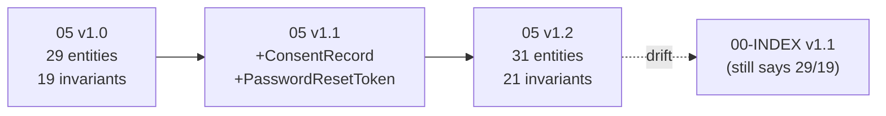

**Reference:** `05` v1.2 §4.2 (31 entities), `05` v1.2 §7.1 (21 invariants), `06` v1.2 §4.10–§4.11 (2 new tables).

---

## 16. Open Questions

| # | Question | Owner | Default |
|:---:|---|---|---|
| 1 | Should the 30-term glossary include DDD terms (bounded context, aggregate root) or only business terms? | Shaghaf | Include both (per §9.2) |
| 2 | 6 reading tracks or fewer? | Shaghaf | 6 tracks |
| 3 | Should §13's chain examples include a 4th (passenger cancels)? | Shaghaf | No — 3 suffices (booking, trip start, refund) |
| 4 | Endpoint split — show auth classification or keep category view? | Shaghaf | Both (§11.1 + §11.2) |
| 5 | WebSocket subscriber map — include Phase 2 topics? | Shaghaf | No — only 4 Phase 1 (`07` §8.1) |
| 6 | Should §7 trust zones align exactly with `09` §3 or use a different decomposition? | Shaghaf | Different (actor-facing vs technical) |
| 7 | Should `00-INDEX` drift (A1–A3) be fixed via v1.2 immediately or wait for next wave? | Shaghaf | **Next wave (Wave 2)** — not urgent for launch |
| 8 | Should the 30 terms include "surface" and "codebase" separately? | Shaghaf | Yes — they're often confused |
| 9 | Should §5 session isolation show all 4 sessions for one human, or just the rule? | Shaghaf | Show all 4 (concrete example) |
| 10 | Should §8 include a 3rd hero flow (e.g., refund)? | Shaghaf | No — refund ripple is smaller; 2 flows suffice |
| 11 | Should this doc reference SH-01 through SH-05 in more detail? | Shaghaf | No — §1.5 has the table; SH-01–05 aren't written yet |
| 12 | Should the reading guide reference the report and viva docs (which don't exist yet)? | Shaghaf | Yes — anticipated at end of each track with "coming" markers |

---

## 17. Checklist Against Master List

| Item | Included? | Section |
|---|:---:|---|
| Purpose and scope | ✅ | §1 |
| Doc hierarchy | ✅ | §1.2 |
| What this doc does NOT cover | ✅ | §1.3 |
| Scope boundary (map not source) | ✅ | §1.4 |
| What is the shared/ folder? | ✅ | §1.5 |
| Request flow vs structural view | ✅ | §2.1 |
| Generic request flow | ✅ | §2.2 |
| What's unique in this section | ✅ | §2.3 |
| Four actors | ✅ | §3.1 |
| Identity model | ✅ | §3.2 |
| One-human-many-roles walkthrough | ✅ | §3.3 |
| What's unique | ✅ | §3.4 |
| Three codebases one backend | ✅ | §4.1 |
| What each codebase owns | ✅ | §4.2 |
| What backend owns | ✅ | §4.3 |
| What's unique | ✅ | §4.4 |
| **3 surfaces, 3 lifecycles** | ✅ | §4.5 |
| Infrastructure asymmetry | ✅ | §4.5.1 |
| Lifecycle comparison | ✅ | §4.5.2 |
| Why this matters | ✅ | §4.5.3 |
| Session rule | ✅ | §5.1 |
| Session isolation visualization | ✅ | §5.2 |
| TTLs per actor | ✅ | §5.3 |
| Cascade exceptions | ✅ | §5.4 |
| What's unique | ✅ | §5.5 |
| **Surface reachability matrix** | ✅ | §6 |
| 31-table × 3-surface matrix | ✅ | §6.2 |
| Key insights | ✅ | §6.3 |
| Data ownership by context | ✅ | §6.4 |
| What's unique | ✅ | §6.5 |
| **Actor-facing trust zones** | ✅ | §7 |
| Why different from 09 §3 | ✅ | §7.1 |
| 5 zones | ✅ | §7.2 |
| Zone characteristics | ✅ | §7.3 |
| Cross-zone reachability | ✅ | §7.4 |
| What's unique | ✅ | §7.5 |
| **Hero Flow 1 — Booking ripple** | ✅ | §8.1 |
| **Hero Flow 2 — Suspension cascade** | ✅ | §8.2 |
| Why these are the doc's core value | ✅ | §8.3 |
| **30-term glossary** | ✅ | §9 |
| Actors and roles terms (8) | ✅ | §9.1 |
| Domain concepts (12) | ✅ | §9.2 |
| Operations concepts (7) | ✅ | §9.3 |
| Infrastructure concepts (3) | ✅ | §9.4 |
| **Shared reference formats** | ✅ | §10 |
| Consolidated table (19 formats) | ✅ | §10.1 |
| Rules | ✅ | §10.2 |
| **Endpoint surface split** | ✅ | §11 |
| 101 endpoints by category | ✅ | §11.1 |
| **Auth classification (12 public + 2 auth)** | ✅ | §11.2 |
| Surface → endpoint distribution | ✅ | §11.3 |
| What's unique | ✅ | §11.4 |
| **WebSocket subscriber map** | ✅ | §12 |
| 4 topics × 3 surfaces matrix | ✅ | §12.1 |
| Event catalog per topic | ✅ | §12.2 |
| Polling fallbacks | ✅ | §12.3 |
| What's unique | ✅ | §12.4 |
| **Surface → endpoint → table chain** | ✅ | §13 |
| Why this exists | ✅ | §13.1 |
| Chain 1 — seat lock | ✅ | §13.2 |
| Chain 2 — trip start | ✅ | §13.3 |
| Chain 3 — refund | ✅ | §13.4 |
| What's unique | ✅ | §13.5 |
| **Reading guide (6 tracks)** | ✅ | §14 |
| Write-order trap | ✅ | §14.1 |
| 6 tracks overview | ✅ | §14.2 |
| Executive track | ✅ | §14.3 |
| Passenger dev track | ✅ | §14.4 |
| Operator dev track | ✅ | §14.5 |
| Driver dev track | ✅ | §14.6 |
| Backend dev track | ✅ | §14.7 |
| Full understanding track | ✅ | §14.8 |
| What's unique | ✅ | §14.9 |
| **Cross-doc amendments** | ✅ | §15 |
| Amendments raised by this doc (4) | ✅ | §15.1 |
| Amendments from other docs | ✅ | §15.2 |
| 00-INDEX drift explained | ✅ | §15.3 |
| Open questions (12) | ✅ | §16 |

**All items covered. ~14 Mermaid diagrams. Every diagram described.**

---

## 18. Summary

**`shared/00-SYSTEM-CONTEXT.md` is the portal into the 24-doc project and the entry point to the 5 remaining shared docs. It owns zero FRs, zero endpoints, zero screens, zero entities, zero workflows — its entire value is in connecting what's already written and consolidating what's scattered.** The doc opens with its own scope boundary (§1.4) — every fact has a canonical source elsewhere; this doc only points to it — and clarifies what the `shared/` folder actually is (§1.5): 6 docs with mixed purposes (SH-00 meta + SH-01 data + SH-02–SH-04 cross-surface contracts + SH-05 Phase 2). **§2 shows how a request flows** — different from `03` §4's structural view (what interacts) and `03` §9's generic lifecycle (what steps) — establishing that every request goes through 6 stages: client → API → auth/validation → module → data layer → response. **§3 walks through the four actors and the identity model** — one `users` row per human, up to 4 profile rows, with a concrete Ravi-the-driver example showing that a driver's Operator App session and passenger's BusVerse session are independent JWTs on different devices with different TTLs; suspension as a driver cascades Session C but leaves Session A alive. **§4 diagrams the three-codebase relationship** — BusVerse + BusCon on Vercel, Operator App on Expo, all hitting one Railway API → Postgres + Redis. **§4.5 exposes the infrastructure asymmetry** that no other doc shows: web requests traverse 2 hops (browser → Vercel edge → Railway), native requests traverse 1 hop (Expo → Railway), with distinct trade-offs (web benefits from Vercel caching + DDoS protection, native benefits from lower latency + single-place debugging). **§5 shows session isolation** — 4 concurrent sessions for one human, TTL comparison (passenger 15min/7day, operator 15min/7day, driver 30min/30day single-device, admin 5min/1day), cascade exceptions matrix showing that operator suspension is the only trigger that crosses actor boundaries. **§6 provides the surface × table reachability matrix** — 31 tables × 3 surfaces with RW/R/— classification — revealing that `gateway_webhooks` is never read by any surface (internal only), `audit_logs` is admin-only, Operator App never reads payments/refunds (per `04` §9.3), and Operator App writes to exactly 4 tables. **§7 defines 5 actor-facing trust zones** (public internet, company network, platform admin, trusted platform, external SaaS) — a different decomposition from `09` §3's 5 technical boundaries, answering "which humans can reach what data" rather than "which network hops are authenticated." **§8 is the doc's core value** — two hero cross-surface flow diagrams showing what no other doc shows: the **booking ripple** (passenger pays → BusVerse ticket ready + operator sees booking + driver sees manifest + admin sees audit + driver scans → passenger badge flips + admin sees scan + driver ends trip → passenger sees post-trip) and the **suspension cascade** (admin suspends → all operator + driver sessions revoked within 1 second + BusVerse search excludes operator + existing bookings remain valid + audit log written). **§9 provides the 30-term glossary** — 8 actors/roles + 12 domain + 7 operations + 3 infrastructure — every term with canonical source pointer, becoming the single lookup point for project terminology (resolving the fact that terms like "session", "profile", "ticket" are consistent across 24 docs but never consolidated). **§10 consolidates 19 shared reference formats** — `BKG-`, `TRP-`, `REF-`, `INV/`, `TKT-`, `usr_`, `ses_`, money (₹ + lakh/crore), dates, times, phones, bus registration — scattered across `busverse/05` §8, `05` §12.3, `06` §3.6–3.7, `buscon/03` §4.4. **§11 provides the endpoint surface split** — 101 endpoints across 8 categories with **auth classification** (12 public + 2 authenticated within the "Auth: 14" category), and surface → endpoint distribution (BusVerse consumes ~30, BusCon web ~66, Operator App ~17). **§12 maps WebSocket subscribers** — 4 topics × 3 surfaces showing that Operator App is producer-only (never subscribes), with consolidated polling fallbacks per topic. **§13 shows the surface → endpoint → table chain** for 3 concrete actions (seat lock, trip start, refund) — filling a gap that neither `03` §8.4's cross-module matrix nor `03` §9's generic lifecycle covers. **§14 provides the 6-track reading guide** — executive (30 min), passenger dev (~4 hrs), operator dev (~6 hrs), driver dev (~4 hrs), backend dev (~12 hrs), full understanding (~40 hrs) — resolving the fact that `00-INDEX` §13 has write order but not read order. **§15 tracks 4 new amendments** against `00-INDEX` v1.2 — the index still says 29 entities, 19 invariants, 29 tables, ~1,082 tests, but `05` v1.2 and `06` v1.2 added ConsentRecord + PasswordResetToken + invariants #20-21 + consent_records + password_reset_tokens tables; the drift is documented with a diagram. **Twelve open questions remain**, all Phase-1 defaults — the most material being Q7 (when to fix the 00-INDEX drift — recommended next wave, not urgent), Q6 (trust zones use different decomposition from `09` §3 — confirmed), and Q3 (3 chain examples suffice, no 4th needed). **~14 diagrams, ~1,300 lines, 30 glossary terms, 6 reading tracks, 2 hero flows.** This doc is the **portal** — it doesn't replace any other doc; it makes all 24 accessible in one place.

---

**End of Document `shared/00-SYSTEM-CONTEXT.md` v1.0.**

---
