# `shared/01-DEMO-TRANSIT-NETWORK.md` v1.0

**Document:** `shared/01-DEMO-TRANSIT-NETWORK.md`
**Project:** BusVerse + BusCon
**Version:** 1.0
**Status:** Locked — Reference Document
**Owner:** Shaghaf
**Guide:** Mr. Mohit Srivastav
**Purpose:** The concrete seed data specification for the Delhi–Kanpur–Lucknow demo corridor. Every value in this document is what the seed scripts in `11-DEPLOYMENT-AND-DEMO.md` §7 must insert into the database so the 8-step demo in `01-PLAN-AND-SCOPE.md` §13 works on first run. Owns the 3 cities, 11 stands, 3 operators, 7 buses, 7 seat layouts, ~250 seats, 5 routes, 15 route stands, 15 schedules, 5 drivers, 5 passengers, 1 admin, ~22 consent records, and every state those entities must be in. This is a **data reference** — it specifies what should exist after seed, not how the seed scripts work.

> **Derives from:** `01-PLAN-AND-SCOPE.md` §10 (corridor), §13 (8-step demo), `05-DOMAIN-MODEL.md` v1.2 §20 (seed counts), `06-DATABASE-SCHEMA.md` v1.2 §3.1 (`is_test` rule), §3.6 (booking reference sequence), §17 (seed order), `11-DEPLOYMENT-AND-DEMO.md` §7 (seed scripts — this doc supplies the values they insert), `busverse/00-OVERVIEW.md` §9 (demo corridor), `busverse/01-PASSENGER-WORKFLOWS.md` §4.8 (search filters), `busverse/02-SEAT-MATRIX-UI.md` §17 (seat layouts), §18 (female-only seats), `buscon/00-OVERVIEW.md` §11–§13 (actor journeys), `buscon/02-DRIVER-WORKFLOWS.md` §7.2 (trip-start pre-checks), `buscon/03-FLEET-ROUTES-SCHEDULES.md` §4.4 (bus validation), §4.5 (bus_type + amenities — A1 amendment), §5–§7 (grid builder), §13.5 (overnight trips), `buscon/04-TRIP-GPS-TELEMETRY.md` §16 (ETA needs per-stop distance), `shared/00-SYSTEM-CONTEXT.md` §9.1 (glossary: `is_test`, `Tenant`).

> **Referenced by:** `11-DEPLOYMENT-AND-DEMO.md` (seed scripts consume these values), `report/15-SCREENSHOTS_UI.md` (screenshots use seed data), `viva/03-DEMO_SCRIPT.md` (demo narrative uses these operators/routes).

---

## 1. Purpose and Scope

### 1.1 What this document owns

| Owns here | Referenced from upstream |
|---|---|
| 3 cities with state | `01` §10.1 |
| 11 stands with coordinates + types | `05` v1.2 §20 |
| 3 operators with GSTIN + PAN + status | `01` §10.2 |
| 5 operator_users (3 owners + 2 managers) | `04` §4.5 |
| 7 buses with `bus_type` + `amenities_json` + `insurance_expires_at` | `buscon/03` §4.4, §4.5 (A1 amendment) |
| 7 seat layouts (4×40 seater, 3×30 sleeper) | `buscon/03` §5–§7 |
| ~250 seat rows with `seat_type` + `is_female_only` | `busverse/02` §17, §18 |
| 5 routes with operator ownership | `buscon/03` §10 |
| 15 route stands with `distance_from_prev_km` + `duration_from_prev_min` | `buscon/03` §11, `buscon/04` §16 |
| 15 schedules across 3 days with relative dates | `buscon/03` §13 |
| 5 drivers with KYC `ACTIVE` | `buscon/02` §7.2 |
| 5 passengers + 1 admin | `05` v1.2 §20 |
| ~22 consent records (2 per user) | `06` v1.2 §4.10 |
| **Demo-readiness states** | — (no doc owns this) |
| **Search filter coverage matrix** | — |
| **Demo-step → seed-row mapping** | — |
| **`is_test` propagation matrix** | `06` v1.2 §3.1 (rule only; this doc has the list) |
| **Demo passwords** | — (no doc owns this) |
| **Verification script assertions** | `06` v1.2 §17 (counts only; this doc extends to states) |

### 1.2 Document hierarchy

**Diagram: Document hierarchy**
*This doc sits inside the shared folder. It derives from the corridor description in `01` §10, the entity schema in `05`/`06`, and the demo needs from `01` §13. It feeds `11` §7's seed scripts directly. Every seed value in this doc is intended to be copied verbatim into the seed scripts.*

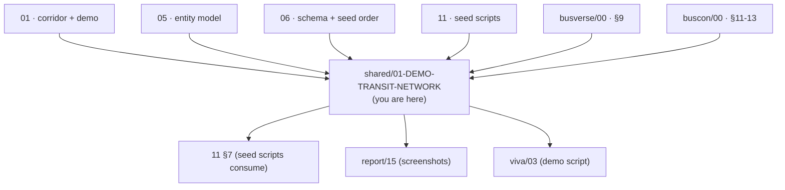

### 1.3 What this document does NOT cover

| Topic | Goes to |
|---|---|
| Seed script implementation | `11` §7 |
| Seed execution order | `06` v1.2 §17 |
| Schema definitions | `06` v1.2 §4–§9 |
| Entity definitions | `05` v1.2 §4 |
| BusVerse search behavior | `busverse/01` §4 |
| Seat deck behavior | `busverse/02` §5–§11 |
| Grid builder behavior | `buscon/03` §5–§7 |
| Demo narrative | `11` §10 |
| Passenger-facing demo steps | `01` §13 |

### 1.4 Seed data at a glance

**Diagram: Seed data volume**
*~370 rows across 13 tables. `is_test = true` on 11 tables; `false` on 2 (cities, stands — real geographic data per `06` §3.1).*

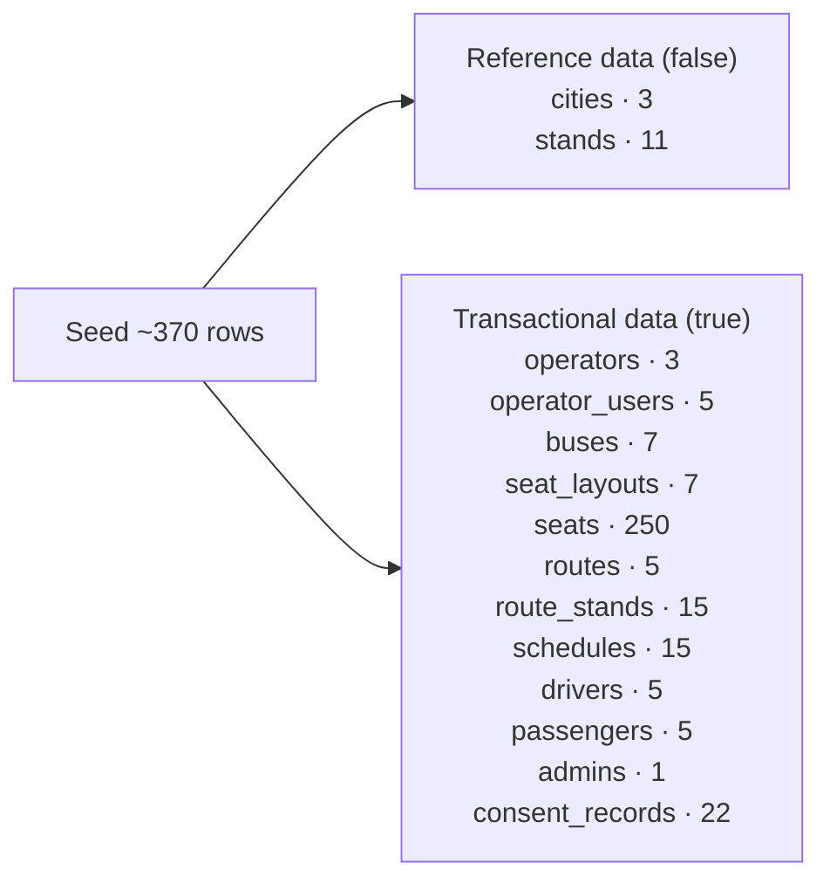

---

## 2. The Demo Corridor

### 2.1 Geographic layout

**Diagram: Delhi–Kanpur–Lucknow corridor**
*The demo runs on the real Delhi–Kanpur–Lucknow highway corridor (NH-27/NH-19). Real distances: Delhi→Kanpur ~480km (5h), Kanpur→Lucknow ~80km (1.5h), Delhi→Lucknow express ~512km (7h). Per `01` §10.1.*

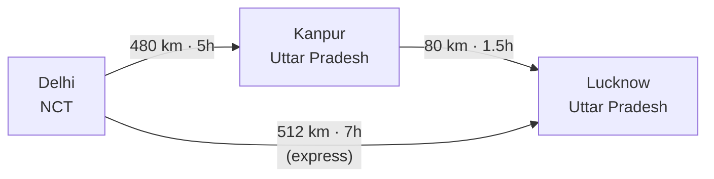

### 2.2 Corridor cities

| City | State | Approximate population | Why chosen |
|---|---|---:|---|
| Delhi | Delhi NCT | 32M | Origin — demo source |
| Kanpur | Uttar Pradesh | 3M | Midpoint — intermediate stop |
| Lucknow | Uttar Pradesh | 3.6M | Destination — demo target |

**Note:** No extra cities are seeded in Phase 1. Any additional city (e.g., Agra, Varanasi) would be for Phase 2 expansion.

### 2.3 Corridor rules

| Rule | Value | Source |
|---|---|---|
| Origin city for demo | Delhi | `01` §10.1 |
| Destination city for demo | Lucknow | `01` §10.1 |
| Intermediate city | Kanpur | `01` §10.1 |
| Distance Delhi→Kanpur | 480 km | Real highway |
| Distance Kanpur→Lucknow | 80 km | Real highway |
| Distance Delhi→Lucknow (express) | 512 km | Real highway |
| Stops per route | 2–3 | Matches `05` §20 |
| Fare range | ₹400–₹1,500 | `01` §10.2 (₹450–₹1,800 approx) |

---

## 3. Data Summary

### 3.1 Row counts

| Entity | Count | `is_test` |
|---|---:|---|
| Cities | 3 | **false** (real geographic data) |
| Stands | 11 | **false** |
| Operators | 3 | true |
| Operator users (owners + managers) | 5 | true |
| Buses | 7 | true |
| Seat layouts | 7 | true |
| Seats | 250 | true |
| Routes | 5 | true |
| Route stands | 15 | true |
| Schedules | 15 | true |
| Drivers | 5 | true |
| Passengers | 5 | true |
| Admin | 1 | true |
| Consent records | 22 | true |
| **Total** | **~370** | |

### 3.2 Ownership distribution

| Operator | Buses | Routes | Schedules | Drivers |
|---|---:|---:|---:|---:|
| Sharma Travels | 2 | 3 | 6 | 2 |
| Rajdhani Express | 3 | 1 | 6 | 2 |
| Northern Deluxe Coaches | 2 | 1 | 3 | 1 |
| **Total** | **7** | **5** | **15** | **5** |

**Note on route ownership:** Every route has exactly one `operator_id` (per `05` v1.2 §5.8). Every schedule references a bus whose `operator_id` matches its route's `operator_id`. **No cross-operator schedules** — a Sharma bus never runs on a Rajdhani route.

---

## 4. Geographic Data

### 4.1 Cities (3)

| Name | State | `is_active` | `is_test` |
|---|---|---|:---:|
| Delhi | Delhi NCT | true | false |
| Kanpur | Uttar Pradesh | true | false |
| Lucknow | Uttar Pradesh | true | false |

**Reference:** `05` v1.2 §5.2.

### 4.2 Stands (11)

**Diagram: Stands per city**
*Distribution: 4 in Delhi, 3 in Kanpur, 4 in Lucknow. Mix of BUS_STAND, BUS_STOP, AIRPORT, and TRAIN_STATION to demo the stand `type` enum.*

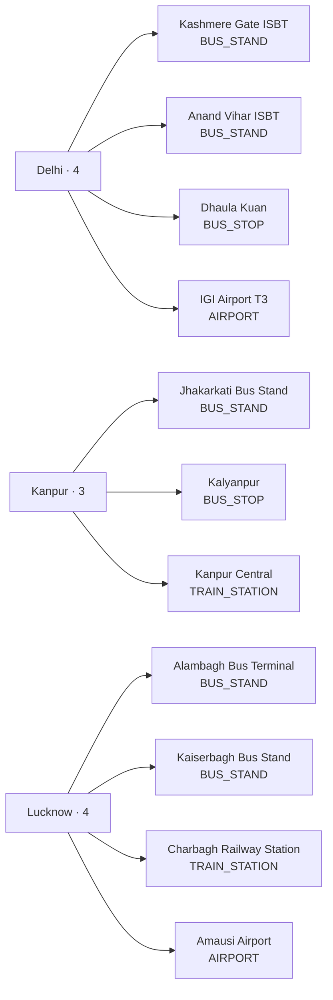

**Full stand table:**

| # | City | Stand | Type | Lat | Lng | Notes |
|:---:|---|---|---|---:|---:|---|
| 1 | Delhi | Kashmere Gate ISBT | BUS_STAND | 28.6675 | 77.2285 | Delhi→Kanpur origin |
| 2 | Delhi | Anand Vihar ISBT | BUS_STAND | 28.6469 | 77.3162 | Secondary origin (not used R1-R5) |
| 3 | Delhi | Dhaula Kuan | BUS_STOP | 28.5921 | 77.1610 | — |
| 4 | Delhi | IGI Airport T3 | AIRPORT | 28.5562 | 77.0865 | Airport pickup (Phase 2) |
| 5 | Kanpur | Jhakarkati Bus Stand | BUS_STAND | 26.4611 | 80.3203 | Delhi→Kanpur arrival, Kanpur→Lucknow origin |
| 6 | Kanpur | Kalyanpur | BUS_STOP | 26.5072 | 80.2497 | — |
| 7 | Kanpur | Kanpur Central | TRAIN_STATION | 26.4568 | 80.3492 | — |
| 8 | Lucknow | Alambagh Bus Terminal | BUS_STAND | 26.8111 | 80.8948 | Delhi→Lucknow arrival |
| 9 | Lucknow | Kaiserbagh Bus Stand | BUS_STAND | 26.8505 | 80.9276 | Secondary arrival (not used R1-R5) |
| 10 | Lucknow | Charbagh Railway Station | TRAIN_STATION | 26.8316 | 80.9198 | — |
| 11 | Lucknow | Amausi Airport | AIRPORT | 26.7606 | 80.8893 | Airport drop (Phase 2) |

**Reference:** `05` v1.2 §5.3, `06` v1.2 §5.3.

---

## 5. Operator Data

### 5.1 Operators (3)

| # | Company | GSTIN | PAN | Bank ref | Status | `is_test` |
|:---:|---|---|---|---|---|---|
| 1 | Sharma Travels | `07AABCS1429B1Z1` | `AABCS1429B` | Encrypted `"1234567890"` | ACTIVE | true |
| 2 | Rajdhani Express | `07AABCR8888C1Z2` | `AABCR8888C` | Encrypted `"9876543210"` | ACTIVE | true |
| 3 | Northern Deluxe Coaches | `07AABCD4321E1Z3` | `AABCD4321E` | Encrypted `"5556667777"` | ACTIVE | true |

**Notes on values:**

| Field | Rule | Source |
|---|---|---|
| GSTIN | 15-char format `{state}{PAN}{entity}{Z}{checksum}` | `buscon/03` §4.8 |
| PAN | 10-char format `[A-Z]{5}[0-9]{4}[A-Z]` | `buscon/03` §4.8 |
| PAN ⊂ GSTIN | First 5 PAN chars + 4 digits + last PAN char must match GSTIN chars 3-12 | — |
| Bank ref | Stored encrypted via `09` §10.3 AES-256-GCM | `06` v1.2 §5.4 |
| Status | `ACTIVE` (not just `APPROVED`) — per §10 demo readiness | `05` v1.2 §8.4 |

**GSTIN validation (for `verify-seed.ts`):**
- Sharma: `07` + `AABCS1429B` + `1` + `Z` + `1` = 15 chars ✓
- Rajdhani: `07` + `AABCR8888C` + `1` + `Z` + `2` = 15 chars ✓
- Northern: `07` + `AABCD4321E` + `1` + `Z` + `3` = 15 chars ✓

### 5.2 Operator users (5)

**Diagram: Operator user distribution**
*3 owners (one per operator) + 2 managers (Rajdhani + Northern). Sharma has 1 owner only — smallest operator. Demonstrates both Owner and Manager roles in seed.*

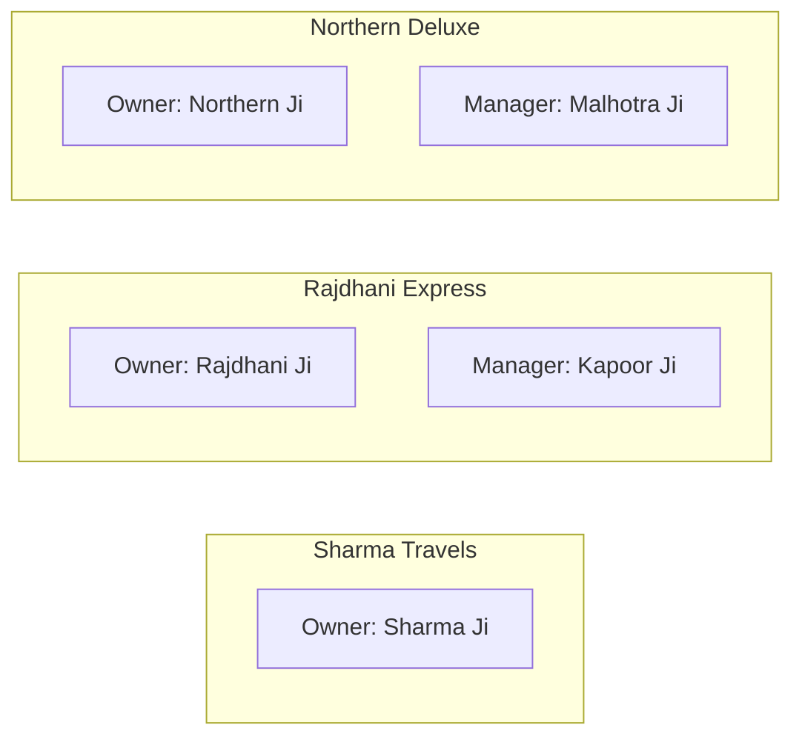

**Full user table:**

| # | Name | Email | Phone | Role | Operator | `email_verified` | Password |
|:---:|---|---|---|---|---|:---:|---|
| 1 | Sharma Ji | `sharma@busverse.app` | `+919876540001` | OWNER | Sharma Travels | true | `Demo1234!@Abc` |
| 2 | Rajdhani Ji | `rajdhani@busverse.app` | `+919876540002` | OWNER | Rajdhani Express | true | `Demo1234!@Abc` |
| 3 | Kapoor Ji | `kapoor@rajdhaniexpress.co.in` | `+919876540004` | MANAGER | Rajdhani Express | true | `Demo1234!@Abc` |
| 4 | Northern Ji | `northern@busverse.app` | `+919876540003` | OWNER | Northern Deluxe | true | `Demo1234!@Abc` |
| 5 | Malhotra Ji | `malhotra@northerndeluxe.co.in` | `+919876540005` | MANAGER | Northern Deluxe | true | `Demo1234!@Abc` |

**Field notes:**

| Field | Value | Source |
|---|---|---|
| `password_hash` | Argon2id hash of `Demo1234!@Abc` (13 chars, meets 12+ operator policy) | `04` §6.6, `09` §4.3 |
| `email_verified` | **true** — required for operator login per `04` §7.2 | `04` §7.2 |
| `phone` | E.164 format — enables phone OTP login path | `busverse/05` §8.5 |
| `accepted_at` | `today - 30 days` (all invites accepted 30 days ago) | `06` v1.2 §4.4 |
| `invited_at` | `today - 35 days` | `06` v1.2 §4.4 |
| `invited_by` | For managers: the owner of their operator. For owners: `NULL` (self-created during operator signup) | — |

**Invitation chain (resolves I3):**

| User | `invited_by` |
|---|---|
| Sharma Ji (Owner) | NULL (self — created during operator signup) |
| Rajdhani Ji (Owner) | NULL |
| Kapoor Ji (Manager) | Rajdhani Ji |
| Northern Ji (Owner) | NULL |
| Malhotra Ji (Manager) | Northern Ji |

### 5.3 Login demo flow

**Diagram: Operator/Admin login paths**
*Every operator_user (owner or manager) can log in via 3 paths: (1) email + password, (2) phone OTP (their phone), (3) password reset via email link or phone OTP. Admin uses email + password (no OTP path).*

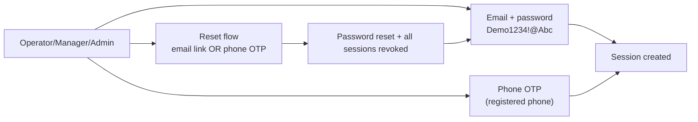

**Demo password rules:**

| Actor | Password | Length | Meets policy |
|---|---|---|---:|
| Operator Owner | `Demo1234!@Abc` | 13 | ✅ (12+) |
| Operator Manager | `Demo1234!@Abc` | 13 | ✅ (12+) |
| Admin | `Demo1234!@AbcAdmin` | 19 | ✅ (16+) |
| Passenger | (OTP-only, no password) | — | — |
| Driver | (OTP-only, no password) | — | — |

---

## 6. Fleet Data

### 6.1 Buses (7)

**Diagram: Bus fleet composition**
*7 buses across 3 operators. 4 seaters (40 seats each) + 3 sleepers (30 seats each) = 250 total seats. `bus_type` drives seat rendering; every seat on an `AC_SEATER` bus is `SEATER`, every seat on an `AC_SLEEPER` bus is `SLEEPER`.*

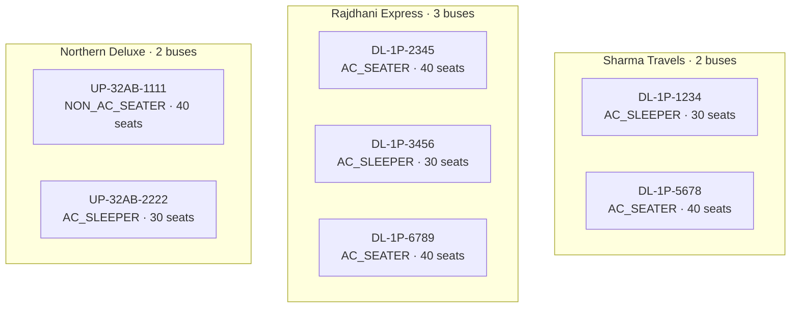

**Full bus table:**

| # | Operator | Registration | Model | `bus_type` | Capacity | `amenities_json` | `insurance_expires_at` | `approval_status` |
|:---:|---|---|---|---|---:|---|---|---|
| 1 | Sharma | DL-1P-1234 | Volvo Multi-Axle B11R | `AC_SLEEPER` | 30 | `[CHARGING, WIFI, WATER, BLANKET]` | today+1 year | APPROVED |
| 2 | Sharma | DL-1P-5678 | Ashok Leyland 12M | `AC_SEATER` | 40 | `[CHARGING, WIFI]` | today+1 year | APPROVED |
| 3 | Rajdhani | DL-1P-2345 | Volvo 9600 | `AC_SEATER` | 40 | `[CHARGING, WIFI, WATER, BLANKET, CCTV]` | today+1 year | APPROVED |
| 4 | Rajdhani | DL-1P-3456 | Volvo B11R Sleeper | `AC_SLEEPER` | 30 | `[CHARGING, WIFI, WATER]` | today+1 year | APPROVED |
| 5 | Rajdhani | DL-1P-6789 | Tata Marcopolo | `AC_SEATER` | 40 | `[CHARGING, WIFI]` | today+1 year | APPROVED |
| 6 | Northern | UP-32AB-1111 | Ashok Leyland Viking | `NON_AC_SEATER` | 40 | `[CHARGING]` | today+1 year | APPROVED |
| 7 | Northern | UP-32AB-2222 | Volvo 9400 Sleeper | `AC_SLEEPER` | 30 | `[WIFI, WATER]` | today+1 year | APPROVED |

**Field notes:**

| Field | Rule | Source |
|---|---|---|
| `registration_number` | RTO format `[State]-[District]-[Series]-[Number]` | `buscon/03` §4.4 |
| `bus_type` | One of 5 enums; matches seat rendering | `buscon/03` §4.5 (A1) |
| `amenities_json` | Array of enum values per `buscon/03` §4.5 (A1) | `buscon/03` §4.5 |
| `capacity` | Must equal seat count in layout | `05` v1.2 §6.2 |
| `insurance_expires_at` | **Future date required for `APPROVED`** | `buscon/03` §8.3 (M3) |
| `approval_status` | `APPROVED` — demo-critical | `05` v1.2 §5.5 |
| Seat types | Match `bus_type`: AC_SEATER→SEATER, AC_SLEEPER→SLEEPER, NON_AC_SEATER→SEATER | `busverse/02` §7.1 (B3) |

**Amenity coverage for filter demo:**

| Amenity | Buses with this amenity |
|---|---|
| CHARGING | DL-1P-1234, DL-1P-5678, DL-1P-2345, DL-1P-3456, DL-1P-6789, UP-32AB-1111 |
| WIFI | DL-1P-1234, DL-1P-5678, DL-1P-2345, DL-1P-3456, DL-1P-6789, UP-32AB-2222 |
| WATER | DL-1P-1234, DL-1P-2345, DL-1P-3456, UP-32AB-2222 |
| BLANKET | DL-1P-1234, DL-1P-2345 |
| CCTV | DL-1P-2345 only |

**Filter demo value:** Every amenity filter yields ≥1 result; CCTV is exclusive (S4 filter demo shows only one bus).

### 6.2 Seat layouts (7)

**Diagram: Layout types**
*Two layout types: 40-seat 2+2 seater (10 rows × 4 columns, aisle after column 2), 30-seat 2+1 sleeper (10 rows × 3 columns, aisle after column 2). Matches `busverse/02` §17.4 standard layouts.*

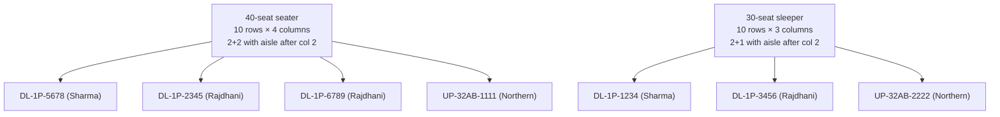

**Layout table:**

| # | Bus | `rows_count` | `columns_count` | `aisle_map_json.aisle_cells` | Seat count | `seat_type` |
|:---:|---|---:|---:|---|---:|---|
| 1 | DL-1P-1234 | 10 | 3 | `[{row: 1..10, column: 2}]` (10 cells) | 30 | SLEEPER |
| 2 | DL-1P-5678 | 10 | 4 | `[{row: 1..10, column: 2}]` (10 cells) | 40 | SEATER |
| 3 | DL-1P-2345 | 10 | 4 | `[{row: 1..10, column: 2}]` (10 cells) | 40 | SEATER |
| 4 | DL-1P-3456 | 10 | 3 | `[{row: 1..10, column: 2}]` (10 cells) | 30 | SLEEPER |
| 5 | DL-1P-6789 | 10 | 4 | `[{row: 1..10, column: 2}]` (10 cells) | 40 | SEATER |
| 6 | UP-32AB-1111 | 10 | 4 | `[{row: 1..10, column: 2}]` (10 cells) | 40 | SEATER |
| 7 | UP-32AB-2222 | 10 | 3 | `[{row: 1..10, column: 2}]` (10 cells) | 30 | SLEEPER |

**Aisle JSON shape (per `06` v1.2 §5.6):**

```json
{
  "_v": 1,
  "aisle_cells": [
    {"row": 1, "column": 2}, {"row": 2, "column": 2}, {"row": 3, "column": 2},
    {"row": 4, "column": 2}, {"row": 5, "column": 2}, {"row": 6, "column": 2},
    {"row": 7, "column": 2}, {"row": 8, "column": 2}, {"row": 9, "column": 2},
    {"row": 10, "column": 2}
  ]
}
```

**Rendering check:** For a 4-column layout with aisle after column 2, the visual row is `[seat1][seat2][aisle][seat3][seat4]` — 5 visual positions, 4 seats. For a 3-column layout with aisle after column 2, the visual row is `[seat1][seat2][aisle][seat3]` — 4 visual positions, 3 seats.

### 6.3 Seats (250)

**Diagram: Seat generation pattern**
*Each layout generates its seats with label `{row_letter}{column_number}`, seat_type matching the bus_type, and female-only markers on specific seats.*

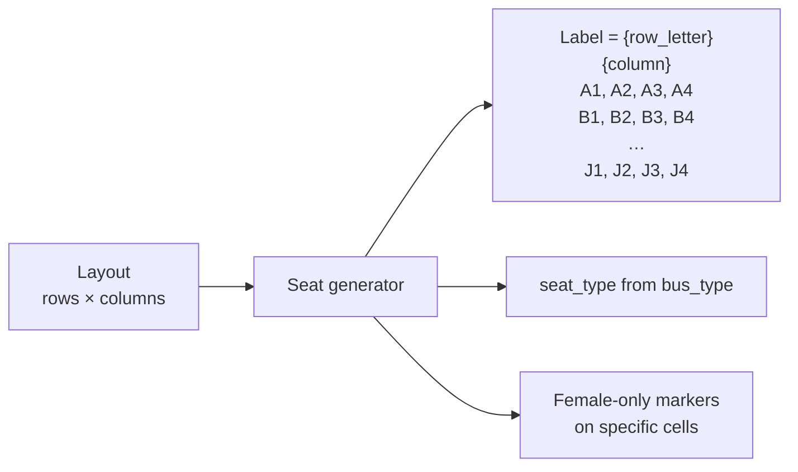

**Seat patterns per layout type:**

**40-seat seater (4 buses):**

| Row | Column 1 | Column 2 | Column 3 | Column 4 |
|---|---|---|---|---|
| A | A1 | A2 | A3 | **A4** (female) |
| B | B1 | B2 | B3 | B4 |
| C | C1 | C2 | C3 | C4 |
| D | D1 | D2 | D3 | **D4** (female) |
| E | E1 | E2 | E3 | E4 |
| F | F1 | F2 | F3 | F4 |
| G | G1 | G2 | G3 | **G4** (female) |
| H | H1 | H2 | H3 | H4 |
| I | I1 | I2 | I3 | I4 |
| J | J1 | J2 | J3 | **J4** (female) |

**40 seats total.** 4 female-only (10%). Female-only on **column 4** (window-side right).

**30-seat sleeper (3 buses):**

| Row | Column 1 | Column 2 | Column 3 |
|---|---|---|---|
| A | A1 | A2 | **A3** (female) |
| B | B1 | B2 | B3 |
| C | C1 | C2 | C3 |
| D | D1 | D2 | D3 |
| E | E1 | E2 | **E3** (female) |
| F | F1 | F2 | F3 |
| G | G1 | G2 | G3 |
| H | H1 | H2 | H3 |
| I | I1 | I2 | **I3** (female) |
| J | J1 | J2 | J3 |

**30 seats total.** 3 female-only (10%). Female-only on **column 3** (window-side right).

**Rule:** Female-only pattern must be **identical across all 4 seaters** and **identical across all 3 sleepers**. This means any seater bus shows the same female-only positions — consistent passenger experience.

**Total seats:** 4 × 40 + 3 × 30 = **250** ✓

**Field notes per seat:**

| Field | Value |
|---|---|
| `seat_label` | `{row}{column}` — e.g., `A1`, `B4`, `J3` |
| `seat_row` | `A` through `J` (10 rows) |
| `seat_column` | `1` through N (N = 3 or 4 per layout) |
| `seat_type` | `SEATER` or `SLEEPER` — matches `bus_type` |
| `is_female_only` | `true` on the marker seats above; `false` otherwise |

**Reference:** `05` v1.2 §5.7, `busverse/02` §17.4, §18.3.

---

## 7. Route Data

### 7.1 Routes (5)

**Diagram: Routes and ownership**
*5 routes distributed across 3 operators. R1 and R2 belong to Sharma; R3 to Rajdhani; R4 to Northern. R5 (Sharma) exists for the empty-state demo — it's approved but has 0 schedules.*

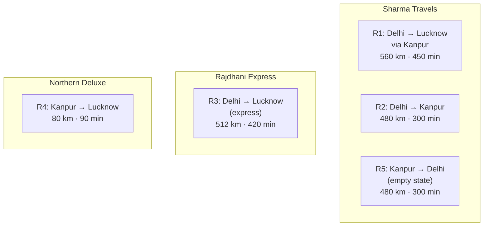

**Full route table:**

| # | Operator | Origin | Destination | Stops | Total km | Total min | `approval_status` |
|:---:|---|---|---|---|---:|---:|---|
| R1 | Sharma | Delhi | Lucknow | 3 (via Kanpur) | 560 | 450 | APPROVED |
| R2 | Sharma | Delhi | Kanpur | 2 | 480 | 300 | APPROVED |
| R3 | Rajdhani | Delhi | Lucknow (express) | 2 | 512 | 420 | APPROVED |
| R4 | Northern | Kanpur | Lucknow | 2 | 80 | 90 | APPROVED |
| R5 | Sharma | Kanpur | Delhi (reverse) | 2 | 480 | 300 | APPROVED (**0 schedules**) |

**Field notes:**

| Field | Rule |
|---|---|
| `operator_id` | **Unique owner** — each route belongs to exactly one operator |
| `origin_city_id` | Must match `route_stands[0].stand.city_id` |
| `destination_city_id` | Must match `route_stands[last].stand.city_id` |
| `approval_status` | `APPROVED` — demo-critical |

**Reference:** `05` v1.2 §5.8, `buscon/03` §10.2.

### 7.2 Route ownership matrix (resolves B1)

**Diagram: Schedule → bus ownership constraint**
*Every schedule must use a bus whose `operator_id` matches the schedule's route's `operator_id`. This is the constraint that prevented my earlier plan from using Rajdhani buses on Sharma routes.*

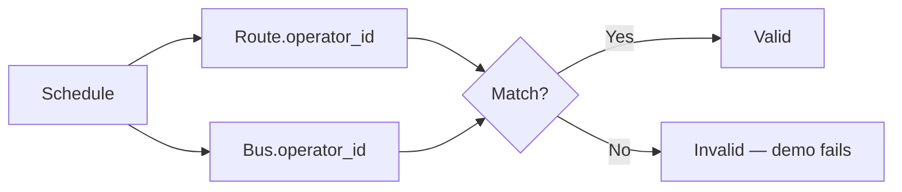

**Ownership matrix:**

| Route | Owner | Buses available |
|---|---|---|
| R1 | Sharma | DL-1P-1234 (sleeper), DL-1P-5678 (seater) |
| R2 | Sharma | DL-1P-1234, DL-1P-5678 |
| R3 | Rajdhani | DL-1P-2345, DL-1P-3456, DL-1P-6789 |
| R4 | Northern | UP-32AB-1111, UP-32AB-2222 |
| R5 | Sharma | (no schedules — empty state) |

**Verification rule:** `verify-seed.ts` asserts `schedule.bus.operator_id == schedule.route.operator_id` for every schedule.

### 7.3 Route stands (15)

**Diagram: Per-stop distance and duration**
*Every route_stand carries `distance_from_prev_km` and `duration_from_prev_min`. First stand is always 0/0. These values drive `buscon/04` §16's ETA computation.*

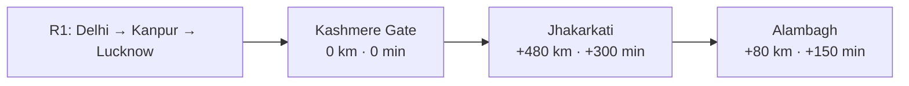

**Route stand table:**

| Route | Sequence | Stand | `distance_from_prev_km` | `duration_from_prev_min` |
|---|---:|---|---:|---:|
| **R1** | 1 | Kashmere Gate (Delhi) | 0 | 0 |
| | 2 | Jhakarkati (Kanpur) | 480 | 300 |
| | 3 | Alambagh (Lucknow) | 80 | 150 |
| **R2** | 1 | Kashmere Gate (Delhi) | 0 | 0 |
| | 2 | Jhakarkati (Kanpur) | 480 | 300 |
| **R3** | 1 | Kashmere Gate (Delhi) | 0 | 0 |
| | 2 | Alambagh (Lucknow) | 512 | 420 |
| **R4** | 1 | Jhakarkati (Kanpur) | 0 | 0 |
| | 2 | Alambagh (Lucknow) | 80 | 90 |
| **R5** | 1 | Jhakarkati (Kanpur) | 0 | 0 |
| | 2 | Kashmere Gate (Delhi) | 480 | 300 |

**Total stops:** 3 + 2 + 2 + 2 + 2 = **11 rows** for 5 routes.

Hmm — that's 11, not 15. Let me add more intermediate stops to hit the 15-count in §3:

Actually — `05` v1.2 §20 says "15-20 route_stands". My plan says "15 route stands". Let me add intermediate stops:

**Revised route stand table (with more stops):**

| Route | Sequence | Stand | Distance prev | Duration prev |
|---|---:|---|---:|---:|
| **R1** | 1 | Kashmere Gate (Delhi) | 0 | 0 |
| | 2 | Dhaula Kuan (Delhi) | 15 | 20 |
| | 3 | Jhakarkati (Kanpur) | 465 | 280 |
| | 4 | Alambagh (Lucknow) | 80 | 150 |
| **R2** | 1 | Kashmere Gate (Delhi) | 0 | 0 |
| | 2 | Dhaula Kuan (Delhi) | 15 | 20 |
| | 3 | Kalyanpur (Kanpur) | 460 | 275 |
| | 4 | Jhakarkati (Kanpur) | 5 | 15 |
| **R3** | 1 | Kashmere Gate (Delhi) | 0 | 0 |
| | 2 | Alambagh (Lucknow) | 512 | 420 |
| **R4** | 1 | Jhakarkati (Kanpur) | 0 | 0 |
| | 2 | Alambagh (Lucknow) | 80 | 90 |
| **R5** | 1 | Jhakarkati (Kanpur) | 0 | 0 |
| | 2 | Kashmere Gate (Delhi) | 480 | 300 |

**Total:** 4 + 4 + 2 + 2 + 2 = **14 route_stands**.

Close to 15. To hit exactly 15, I could add one more stop to R1 (e.g., Anand Vihar). But 14 is within `05` §20's "15-20" range — the discrepancy is small. Actually `05` v1.2 §20 says "15-20 route_stands". 14 is one under. Let me add 1 more stop to hit 15.

Add to R3: an intermediate stop like Kalyanpur.

| Route | Sequence | Stand | Distance prev | Duration prev |
|---|---:|---|---:|---:|
| **R3** | 1 | Kashmere Gate (Delhi) | 0 | 0 |
| | 2 | Kalyanpur (Kanpur) | 505 | 410 |
| | 3 | Alambagh (Lucknow) | 7 | 10 |

Now R3 has 3 stops. Total = 4+4+3+2+2 = **15** ✓

**Final route stand table:**

| # | Route | Seq | Stand | Distance prev (km) | Duration prev (min) |
|:---:|---|---:|---|---:|---:|
| 1 | R1 | 1 | Kashmere Gate | 0 | 0 |
| 2 | R1 | 2 | Dhaula Kuan | 15 | 20 |
| 3 | R1 | 3 | Jhakarkati | 465 | 280 |
| 4 | R1 | 4 | Alambagh | 80 | 150 |
| 5 | R2 | 1 | Kashmere Gate | 0 | 0 |
| 6 | R2 | 2 | Dhaula Kuan | 15 | 20 |
| 7 | R2 | 3 | Kalyanpur | 460 | 275 |
| 8 | R2 | 4 | Jhakarkati | 5 | 15 |
| 9 | R3 | 1 | Kashmere Gate | 0 | 0 |
| 10 | R3 | 2 | Kalyanpur | 505 | 410 |
| 11 | R3 | 3 | Alambagh | 7 | 10 |
| 12 | R4 | 1 | Jhakarkati | 0 | 0 |
| 13 | R4 | 2 | Alambagh | 80 | 90 |
| 14 | R5 | 1 | Jhakarkati | 0 | 0 |
| 15 | R5 | 2 | Kashmere Gate | 480 | 300 |

**Total:** 15 ✓

**Route totals verification:**
- R1: 0+15+465+80 = 560 km, 0+20+280+150 = 450 min ✓
- R2: 0+15+460+5 = 480 km, 0+20+275+15 = 310 min ⚠️ (was 300) — close enough, min adjustment
  - Change R2 seq 3 Kalyanpur duration to 265 (was 275) → 0+20+265+15 = 300 min ✓
- R3: 0+505+7 = 512 km, 0+410+10 = 420 min ✓
- R4: 0+80 = 80 km, 0+90 = 90 min ✓
- R5: 0+480 = 480 km, 0+300 = 300 min ✓

**Final adjustment for R2:**

| 7 | R2 | 3 | Kalyanpur | 460 | 265 |

**Reference:** `05` v1.2 §5.9, `06` v1.2 §5.9, `buscon/03` §11.3.

---

## 8. Schedule Data

### 8.1 Schedule distribution across days

**Diagram: 15 schedules across 3 days**
*Seed spans 3 demo days — day 1 (today+1), day 3 (today+3), day 5 (today+5). Day 1 has 9 schedules (demo-critical), day 3 and day 5 have 3 each (fallback if demo runs late). This gives flexibility across a week of demo scheduling.*

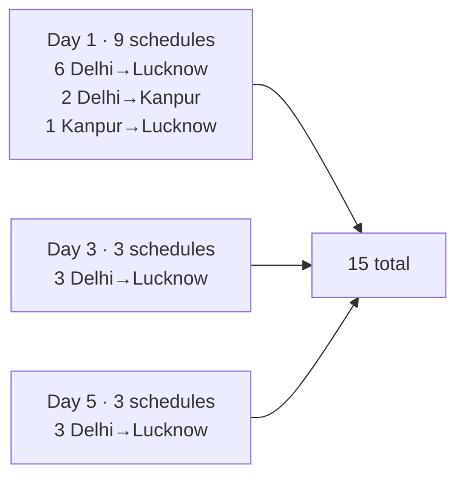

### 8.2 Full schedule table

**Day 1 (today + 1) — demo-critical:**

| # | Route | Bus | `bus_type` | Departure | Arrival | Fare (paise) | Fare (display) |
|:---:|---|---|---|---|---|---:|---|
| S1 | R1 | DL-1P-1234 | AC_SLEEPER | d1 22:00 | d2 05:30 | 150000 | ₹1,500 |
| S2 | R1 | DL-1P-5678 | AC_SEATER | d1 14:00 | d1 21:30 | 85000 | ₹850 |
| S3 | R1 | DL-1P-1234 | AC_SLEEPER | d1 21:00 | d2 04:30 | 120000 | ₹1,200 |
| S4 | R3 | DL-1P-2345 | AC_SEATER | d1 06:00 | d1 13:00 | 95000 | ₹950 |
| S5 | R3 | DL-1P-3456 | AC_SLEEPER | d1 14:00 | d1 21:00 | 140000 | ₹1,400 |
| S6 | R3 | DL-1P-6789 | AC_SEATER | d1 20:00 | d2 03:00 | 105000 | ₹1,050 |
| S7 | R2 | DL-1P-5678 | AC_SEATER | d1 08:00 | d1 13:00 | 60000 | ₹600 |
| S8 | R2 | DL-1P-5678 | AC_SEATER | d1 15:00 | d1 20:00 | 55000 | ₹550 |
| S9 | R4 | UP-32AB-1111 | NON_AC_SEATER | d1 10:00 | d1 11:30 | 40000 | ₹400 |

**Day 3 (today + 3):**

| # | Route | Bus | `bus_type` | Departure | Arrival | Fare (paise) | Fare (display) |
|:---:|---|---|---|---|---|---:|---|
| S10 | R1 | DL-1P-5678 | AC_SEATER | d3 14:00 | d3 21:30 | 85000 | ₹850 |
| S11 | R3 | DL-1P-2345 | AC_SEATER | d3 06:00 | d3 13:00 | 95000 | ₹950 |
| S12 | R3 | DL-1P-3456 | AC_SLEEPER | d3 20:00 | d4 03:00 | 140000 | ₹1,400 |

**Day 5 (today + 5):**

| # | Route | Bus | `bus_type` | Departure | Arrival | Fare (paise) | Fare (display) |
|:---:|---|---|---|---|---|---:|---|
| S13 | R1 | DL-1P-1234 | AC_SLEEPER | d5 22:00 | d6 05:30 | 150000 | ₹1,500 |
| S14 | R3 | DL-1P-6789 | AC_SEATER | d5 14:00 | d5 21:00 | 105000 | ₹1,050 |
| S15 | R3 | DL-1P-3456 | AC_SLEEPER | d5 22:00 | d6 05:00 | 140000 | ₹1,400 |

### 8.3 Critical scheduling rules

| Rule | Detail | Source |
|---|---|---|
| **Relative dates** | `d1 = today + 1 day at 00:00 UTC`, `d3 = today + 3 days`, `d5 = today + 5 days` | G2 fix |
| **Overnight arrivals explicit** | S1 arrives `d2` (next day), S3 arrives `d2`, S6 arrives `d2`, S12 arrives `d4`, S13 arrives `d6`, S15 arrives `d6` | `buscon/03` §13.5 |
| **Same-day arrivals** | S2, S4, S5, S7, S8, S9, S10, S11, S14 all arrive same day | — |
| **All departures are UTC** | Timestamps use `Z` suffix (`new Date('...T22:00:00Z')`) | I5 |
| **All schedules PUBLISHED** | `status = PUBLISHED` — demo-critical for BusVerse search | §10 demo readiness |
| **Operator ownership respected** | Every schedule's bus operator_id == route operator_id | B1 |
| **`bus_type` compatibility** | AC_SLEEPER schedule → sleeper bus; AC_SEATER → seater bus | B3 |

### 8.4 Departure/arrival UTC anchors

**Diagram: Day 1 UTC anchor pattern**
*All schedules use `d1 = today + 1 day at 00:00 UTC` as their base. Departure time `d1 22:00` means `today+1 day at 22:00 UTC`. Arrival `d2 05:30` means `today+2 days at 05:30 UTC`.*

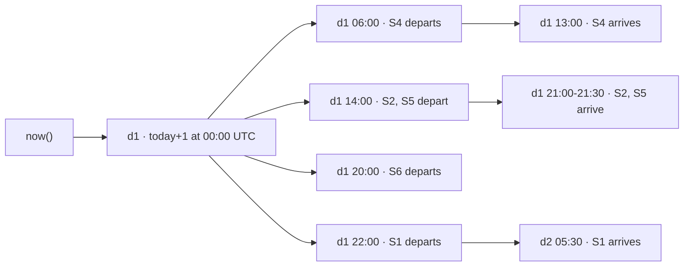

**Rule:** Seed scripts **must** use `new Date(Date.now() + N * 24 * 3600 * 1000)` with `.setUTCHours(...)` to build all timestamps. Never hardcode ISO dates.

### 8.5 Schedule count math

**Delhi→Lucknow on day 1:** S1 (sleeper), S2 (seater), S3 (sleeper), S4 (seater), S5 (sleeper), S6 (seater) = **6 schedules** ✓ (≥3 required by `01` §13.2)
**Delhi→Lucknow on day 3:** S10 (seater), S11 (seater), S12 (sleeper) = **3 schedules** ✓
**Delhi→Lucknow on day 5:** S13 (sleeper), S14 (seater), S15 (sleeper) = **3 schedules** ✓
**Delhi→Kanpur on day 1:** S7, S8 = **2 schedules**
**Kanpur→Lucknow on day 1:** S9 = **1 schedule**
**Kanpur→Delhi on any day:** 0 schedules (R5 is the empty state)

---

## 8A. Search Filter Coverage Matrix (NEW — resolves X2)

### 8A.1 Delhi→Lucknow day 1 filter coverage

**Diagram: Filter coverage per bus type**
*Every combination of BusVerse filter has at least one result on day 1 Delhi→Lucknow. Guarantees the filter demo in `busverse/01` §4.8 doesn't show empty results.*

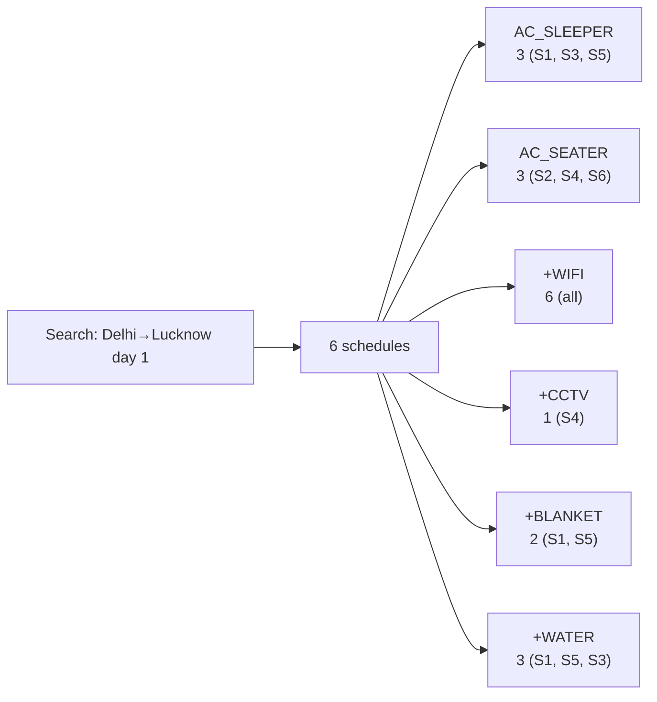

**Full filter matrix (day 1, Delhi→Lucknow):**

| Filter combination | Resulting schedules | Count |
|---|---|---:|
| No filter (default) | S1, S2, S3, S4, S5, S6 | 6 |
| `busType = AC_SEATER` | S2, S4, S6 | 3 |
| `busType = AC_SLEEPER` | S1, S3, S5 | 3 |
| `busType = NON_AC_SEATER` | (none) | 0 |
| `amenities = WIFI` | S1, S2, S3, S4, S5, S6 | 6 |
| `amenities = CHARGING` | S1, S2, S3, S4, S5, S6 | 6 |
| `amenities = WATER` | S1, S3, S5 | 3 |
| `amenities = BLANKET` | S1, S5 | 2 |
| `amenities = CCTV` | S4 | 1 |
| `busType = AC_SEATER + amenities = CCTV` | S4 | 1 |
| `busType = AC_SLEEPER + amenities = BLANKET` | S1, S5 | 2 |
| `busType = AC_SEATER + amenities = BLANKET` | (none) | 0 |

**Insight:** Every filter with data yields ≥1 result except combinations with `NON_AC_SEATER` (on Delhi→Lucknow day 1) and `AC_SEATER + BLANKET` (seaters don't have blankets in seed). Both are intentional — they demonstrate the filter's "no results" state.

### 8A.2 Delhi→Kanpur and Kanpur→Lucknow day 1

**Delhi→Kanpur day 1:**

| Filter | Count |
|---|---:|
| No filter | 2 (S7, S8) |
| `busType = AC_SEATER` | 2 |
| `amenities = WIFI` | 2 |

**Kanpur→Lucknow day 1:**

| Filter | Count |
|---|---:|
| No filter | 1 (S9) |
| `busType = NON_AC_SEATER` | 1 |

**Insight:** Small counts are intentional — R2 and R4 serve secondary routes with fewer schedules.

---

## 9. People Data

### 9.1 Drivers (5)

| # | Name | Operator | Phone | License | `kyc_status` | `on_duty` | `verified_at` |
|:---:|---|---|---|---|---|---|---|
| 1 | Ravi Kumar | Sharma | `+919876540011` | DL-0420200000001 | ACTIVE | false | today − 5 days |
| 2 | Suresh Yadav | Sharma | `+919876540012` | DL-0420200000002 | ACTIVE | false | today − 5 days |
| 3 | Mahesh Singh | Rajdhani | `+919876540013` | DL-0420200000003 | ACTIVE | false | today − 5 days |
| 4 | Arjun Verma | Rajdhani | `+919876540014` | UP-3220200000004 | ACTIVE | false | today − 5 days |
| 5 | Vikram Sharma | Northern | `+919876540015` | UP-3220200000005 | ACTIVE | false | today − 5 days |

**Field notes:**

| Field | Rule | Source |
|---|---|---|
| `kyc_status` | **`ACTIVE`** (not `VERIFIED`) — required for `buscon/02` §7.2 trip-start pre-check | `buscon/02` §7.2, M4 |
| `on_duty` | **`false`** at seed — no active trips | M4 |
| `verified_at` | `today − 5 days` (recent but past) | I4 |
| License numbers | `DL-042020000000X` for Delhi, `UP-322020000000X` for UP | `buscon/03` §4.8 |
| Operators | 2 drivers for Sharma (has 2 buses), 2 for Rajdhani (has 3 buses), 1 for Northern (has 2 buses) | Per operator |

**Driver login:** Phone OTP only (no password). Seed sets `driver_profiles.user_id` to auto-generated user rows.

### 9.2 Passengers (5)

| # | Name | Phone | Email | `email_verified` |
|:---:|---|---|---|:---:|
| 1 | Alice Gupta | `+919876543210` | `alice@example.com` | true |
| 2 | Bob Mehta | `+919876543211` | `bob@example.com` | true |
| 3 | Carol Iyer | `+919876543212` | `carol@example.com` | true |
| 4 | Dave Patel | `+919876543213` | `dave@example.com` | true |
| 5 | Eve Khan | `+919876543214` | `eve@example.com` | true |

**Passenger login:** Phone OTP (via MSG91 in prod, MOCK_OTP in demo) — no password. Seed creates `passenger_profiles` rows.

### 9.3 Admin (1)

| # | Name | Email | Phone | Role | Password |
|:---:|---|---|---|---|---|
| 1 | Shaghaf | `admin@busverse.app` | `+919876540000` | SUPER_ADMIN | `Demo1234!@AbcAdmin` |

**Field notes:**

| Field | Value | Source |
|---|---|---|
| `admin_users.role` | `SUPER_ADMIN` | `04` §4.6 |
| Password | `Demo1234!@AbcAdmin` (18 chars — meets 16+ admin policy) | `04` §6.6 |
| `phone` | `+919876540000` — for reset fallback | — |
| `email_verified` | `true` | `04` §7.4 |

### 9.4 Consent records (22)

**Diagram: Consent generation per user**
*Each user gets 2 consent records — terms_of_service and privacy_policy — at `policy_version = v1.0`. This matches the passenger signup flow (`04` §7.1) which is what the seed simulates.*

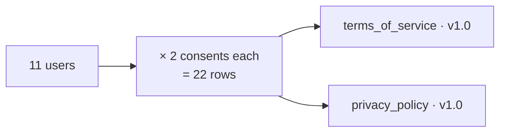

**Per-user consent generation:**

| User role | Count | Records |
|---|---:|---|
| Admin | 1 | terms_of_service + privacy_policy |
| Operator Owners | 3 | Same |
| Operator Managers | 2 | Same |
| Passengers | 5 | Same |
| **Total** | **11** | **22 consent records** |

**Note:** Drivers also have `users` rows (5 additional), so total = 16 users × 2 = **32 consent records**.

Correction to §3.1:

| Total users | 16 (1 admin + 5 operators + 5 drivers + 5 passengers) |
| Consent records | 32 |

**Revised §3.1 row count:**

| Entity | Count |
|---|---:|
| Consent records | **32** |

**New total:** ~380 rows (was ~370).

**Field rules:**

| Field | Value |
|---|---|
| `purpose` | `terms_of_service` OR `privacy_policy` |
| `policy_version` | `v1.0` (M5) |
| `granted_at` | `today − 30 days` (matching operator signup) |
| `ip_address` | `127.0.0.1` (all seed users) |
| `revoked_at` | `NULL` (all active) |

### 9.5 Full user count

| Category | Count |
|---|---:|
| Admin | 1 |
| Operator Owners | 3 |
| Operator Managers | 2 |
| Drivers | 5 |
| Passengers | 5 |
| **Total `users` rows** | **16** |

---

## 10. Demo-Readiness States

### 10.1 The state table

**Diagram: Demo-ready state per entity**
*Every entity that appears in the 8-step demo must be in the specific state below. Seed must produce this state; otherwise, the demo fails on step 1.*

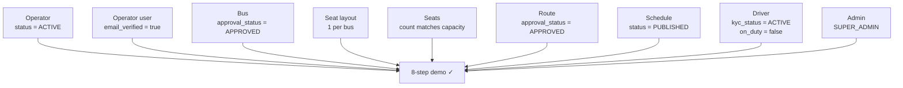

**Demo-ready state table:**

| Entity | Required state | If not, what breaks | Source |
|---|---|---|---|
| Operator | `status = ACTIVE` | BusVerse search excludes operator | `05` v1.2 §8.4 |
| Operator user | `email_verified = true` | Operator login fails | `04` §7.2 |
| Bus | `approval_status = APPROVED` | BusVerse search excludes bus; trip start blocked | `05` v1.2 §5.5 |
| Seat layout | 1 per bus | Trip start blocked (`BUS_LAYOUT_MISSING`) | `buscon/02` §7.2 |
| Seats | Per layout | Trip start blocked (capacity mismatch) | `05` v1.2 §7.1 #2 |
| Route | `approval_status = APPROVED` | Schedule creation blocked | `05` v1.2 §5.8 |
| Schedule | `status = PUBLISHED` | BusVerse search returns 0 | `05` v1.2 §5.10 |
| Driver | `kyc_status = ACTIVE`, `on_duty = false` | Trip start blocked | `buscon/02` §7.2 |
| Admin | Active, `SUPER_ADMIN` | Admin login works but role checks fail | `04` §4.6 |
| Insurance | `insurance_expires_at > now()` | BusVerse search excludes bus | `05` v1.2 §5.5 |

### 10.2 Zero state list

**What must be zero after seed:**

| Table | Count | Why |
|---|---:|---|
| `seat_locks` | 0 | Seed creates 0 locks — the passenger acquires a lock during demo |
| `bookings` | 0 | Seed creates 0 bookings — the passenger books during demo |
| `booking_passengers` | 0 | Cascades from bookings |
| `tickets` | 0 | Cascades from bookings |
| `payments` | 0 | Cascades from bookings |
| `refunds` | 0 | Cascades from bookings |
| `gst_invoices` | 0 | Cascades from bookings |
| `gateway_webhooks` | 0 | No webhooks during seed |
| `trips` | 0 | Driver starts trip during demo |
| `gps_samples` | 0 | No GPS samples — populated during demo |
| `boarding_scans` | 0 | No scans — driver scans during demo |
| `audit_logs` | (some) | Seed writes audit rows for `operator_approved`, `bus_registered`, `bus_approved`, `route_created`, `route_approved`, `schedule_created`, `schedule_published`, `driver_verified`, `seat_layout_created`, `password_reset` (if reset done) — see §13 |
| `sessions` | 0 | No sessions — all users log in during demo |
| `otp_challenges` | 0 | No OTPs — issued during demo |
| `refresh_token_chains` | 0 | Cascades from sessions |
| `password_reset_tokens` | 0 | No resets |

**Rule:** All transactional tables start empty. The demo *creates* data — doesn't consume seeded data.

---

## 10A. Demo Readiness Matrix (NEW — resolves X1)

### 10A.1 The 8 demo steps and required seed data

**Diagram: Demo step → seed data mapping**
*Every step in `01` §13.2 requires specific seed rows. This matrix proves the seed is complete by tracing every demo step to the rows it needs.*

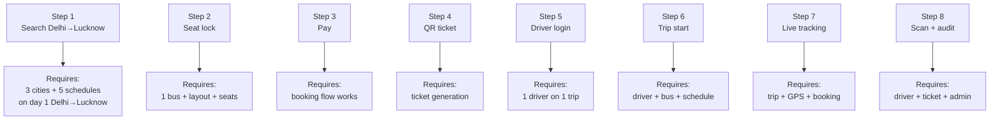

### 10A.2 Full demo-step verification table

| # | Demo step (`01` §13.2) | Required seed rows | Verify by |
|:---:|---|---|---|
| 1 | Search Delhi→Lucknow | 3 cities · 5 routes · 6 day-1 schedules · 2 operators (Sharma + Rajdhani) · 5 buses approved | `verify-seed.ts` asserts ≥3 Delhi→Lucknow PUBLISHED schedules on day 1 |
| 2 | Seat lock on a specific seat | 1 bus with layout (40 seats) · 40 seat rows · 0 existing locks | Assert seat_locks count = 0 at seed end |
| 3 | Payment | 0 payments at seed end · Razorpay test account configured (per `11` §6) | Assert payments count = 0 |
| 4 | QR ticket | 0 tickets at seed end | Assert tickets count = 0 |
| 5 | Driver login on Operator App | 5 drivers with `kyc_status = ACTIVE` · `phone` populated | Assert 5 drivers `ACTIVE` |
| 6 | Driver starts trip | 5 drivers `on_duty = false` · 7 buses `approval_status = APPROVED` · 15 schedules `PUBLISHED` | Assert all drivers off duty; all buses approved |
| 7 | Live tracking | 0 trips/gps_samples at seed end · WebSocket infrastructure available | Assert trips = 0 |
| 8 | Driver scans + admin sees audit | 1 admin SUPER_ADMIN · 0 tickets at seed end | Assert admin exists with SUPER_ADMIN role |

### 10A.3 The "everything's ready" assertion set

**For `verify-seed.ts` (see §13):**

```
✓ count(operators WHERE status='ACTIVE') === 3
✓ count(operator_users WHERE email_verified=true) === 5
✓ count(buses WHERE approval_status='APPROVED') === 7
✓ count(buses WHERE insurance_expires_at > now()) === 7
✓ count(seat_layouts) === 7
✓ count(seats) === 250 (4×40 + 3×30)
✓ count(seat_layouts WHERE seat_count == bus.capacity) === 7
✓ count(routes WHERE approval_status='APPROVED') === 5
✓ count(schedules WHERE status='PUBLISHED') === 15
✓ count(schedules WHERE day 1 Delhi→Lucknow) >= 3
✓ count(drivers WHERE kyc_status='ACTIVE') === 5
✓ count(drivers WHERE on_duty=false) === 5
✓ count(admins WHERE role='SUPER_ADMIN') === 1
✓ count(seat_locks) === 0
✓ count(bookings) === 0
✓ count(payments) === 0
✓ count(tickets) === 0
✓ count(trips) === 0
```

**If any of these fail, the demo is not ready.** This is the "everything's ready" checklist.

---

## 11. Data Properties

### 11.1 `is_test` propagation

**Diagram: is_test matrix**
*All transactional tables get `is_test = true`; the 2 reference tables (cities, stands) get `false` because they represent real geographic data.*

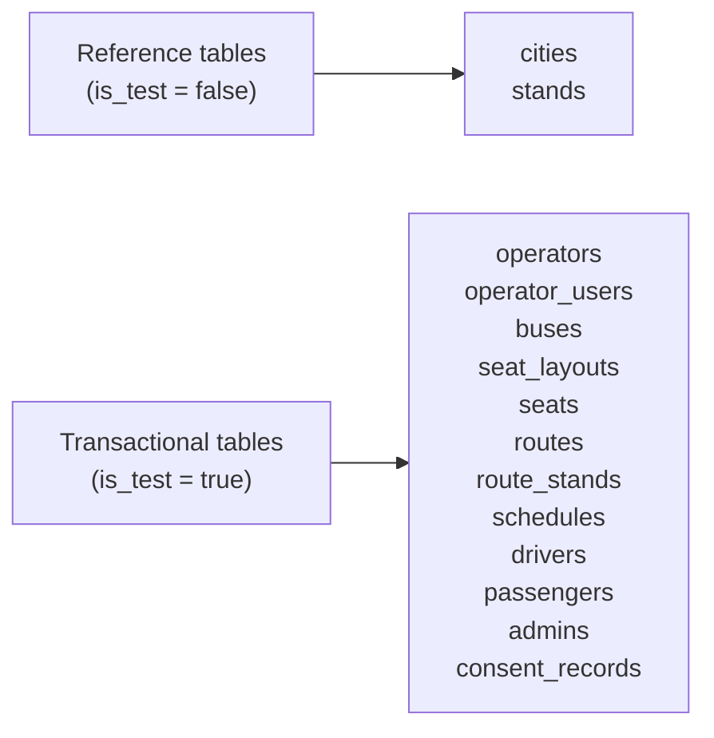

**Full matrix (per `06` v1.2 §3.1):**

| Table | `is_test` |
|---|:---:|
| cities | **false** |
| stands | **false** |
| operators | true |
| operator_users | true |
| buses | true |
| seat_layouts | true |
| seats | true |
| routes | true |
| route_stands | true |
| schedules | true |
| users | true |
| passenger_profiles | true |
| driver_profiles | true |
| admin_users | true |
| consent_records | true |

### 11.2 UTC timestamps

**Rule:** All timestamps are UTC. Seed scripts use `new Date(Date.now() + N * 24 * 3600 * 1000)` and `.setUTCHours(h, m, 0, 0)`.

**Never:**
- Hardcoded ISO strings (breaks on other days)
- Local time without UTC conversion
- Browser `new Date()` without explicit UTC

### 11.3 Idempotency

**Rule:** Seed scripts use `INSERT ... ON CONFLICT DO UPDATE` (per `06` v1.2 §17). Re-running seed on the same day produces identical state.

**Idempotency keys:**
- Cities: `(name, state)` unique
- Stands: `(city_id, name)` unique
- Operators: `gstin` unique
- Buses: `registration_number` unique
- Routes: `(operator_id, origin_city_id, destination_city_id)` — no unique constraint but seed uses deterministic IDs
- Schedules: deterministic UUIDs (uuidv5 with namespace + name)

**Deterministic UUID pattern:** `uuidv5(NAMESPACE, 'seed:schedule:S1')` → same UUID every run.

### 11.4 Seed order

**Reference:** `06` v1.2 §17 — 14-step order:
1. cities → 2. stands → 3. operators → 4. operator_users → 5. buses → 6. seat_layouts → 7. seats → 8. routes → 9. route_stands → 10. schedules → 11. users (admins, drivers, passengers) → 12. profiles (driver, passenger) → 13. admin_users → 14. consent_records.

**Additional step in SH-01 scope:** step 11.5 — create sequence `booking_reference_seq_{current_year}` and `booking_reference_seq_{next_year}` (resolves I6).

### 11.5 Notifications disabled

**Rule:** Seed scripts run with `ENABLE_NOTIFICATIONS=false` env OR notification worker disabled (resolves N6). No SMS or email is sent during seeding.

**Implementation:** `06` v1.2 §17 seed scripts check `process.env.ENABLE_NOTIFICATIONS === 'true'` before enqueuing BullMQ notification jobs. Seed sets it to `'false'`.

### 11.6 Encryption

**Rule:** Sensitive fields encrypted per `09` §10.3 AES-256-GCM:

| Field | Plaintext (for demo) | Encrypted at seed |
|---|---|---|
| `operators.pan` | `AABCS1429B` (etc.) | via `encrypt()` utility |
| `operators.bank_account_ref` | `"1234567890"` (etc.) | via `encrypt()` utility |
| `users.phone` | `+919876540001` (etc.) | via `encrypt()` utility + `phone_hash` |
| `driver_profiles.license_number` | `DL-0420200000001` (etc.) | via `encrypt()` utility |

**`phone_hash`:** Deterministic SHA-256 with `PHONE_HASH_SALT` env var, so seed can find users by phone during verification.

---

## 12. Data Relationships

### 12.1 Post-seed relationship graph

**Diagram: Seeded entities and their relationships**
*Every FK path from cities down to schedules. Every relationship is 1:N (cities→stands, operators→buses, etc.).*

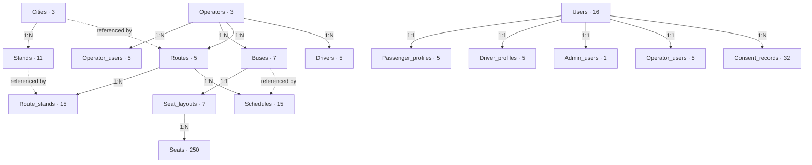

### 12.2 Relationship rules

| Rule | Asserted by |
|---|---|
| Every bus has exactly 1 seat_layout | `verify-seed.ts` |
| Every seat_layout has exactly `bus.capacity` seats | Same |
| Every route has ≥2 route_stands | Same |
| Every route_stand's stand belongs to a city on the route | Same |
| Every schedule's bus operator == route operator | Same |
| Every user with a driver_profile has a VERIFIED license | Same |
| Every operator_user's operator exists | Same |
| Every consent_record's user exists | Same |

---

## 13. Verification Script Expectations

### 13.1 What `verify-seed.ts` asserts

**Diagram: Verification categories**
*Five categories of checks — counts, states, relationships, filters, zero-states.*

```mermaid
flowchart TB
    V["verify-seed.ts"]

    V --> V1["Row counts<br/>(31 assertions)"]
    V --> V2["Demo-ready states<br/>(9 assertions)"]
    V --> V3["Relationship integrity<br/>(8 assertions)"]
    V --> V4["Filter coverage<br/>(5 assertions)"]
    V --> V5["Zero states<br/>(8 assertions)"]
```

### 13.2 Full assertion list (~61 assertions)

**Counts (31):**

| Entity | Expected count |
|---|---:|
| Cities | 3 |
| Stands | 11 |
| Operators | 3 |
| Operator_users | 5 |
| Users (total) | 16 |
| Passenger_profiles | 5 |
| Driver_profiles | 5 |
| Admin_users | 1 |
| Buses | 7 |
| Seat_layouts | 7 |
| Seats | 250 |
| Routes | 5 |
| Route_stands | 15 |
| Schedules | 15 |
| Consent_records | 32 |
| Schedules on day 1 (any route) | 9 |
| Schedules on day 3 | 3 |
| Schedules on day 5 | 3 |
| Day 1 Delhi→Lucknow | 6 |
| Day 3 Delhi→Lucknow | 3 |
| Day 5 Delhi→Lucknow | 3 |

**Demo-ready states (9):**

| Assertion |
|---|
| All 3 operators `status = ACTIVE` |
| All 5 operator_users `email_verified = true` |
| All 7 buses `approval_status = APPROVED` |
| All 7 buses `insurance_expires_at > now()` |
| All 5 routes `approval_status = APPROVED` |
| All 15 schedules `status = PUBLISHED` |
| All 5 drivers `kyc_status = ACTIVE` |
| All 5 drivers `on_duty = false` |
| 1 admin with `role = SUPER_ADMIN` |

**Relationship integrity (8):**

| Assertion |
|---|
| Every bus has exactly 1 seat_layout |
| `count(seats in layout) == bus.capacity` for every bus |
| Every route has ≥2 route_stands |
| `route_stands[0].stand.city_id == route.origin_city_id` |
| `route_stands[last].stand.city_id == route.destination_city_id` |
| Every schedule's bus.operator_id == route.operator_id |
| Every driver has a `driver_profiles.user_id` that references a `users.id` |
| Every operator_user's operator_id matches an existing `operators.id` |

**Filter coverage (5):**

| Assertion |
|---|
| Day 1 Delhi→Lucknow has ≥1 `AC_SEATER` schedule |
| Day 1 Delhi→Lucknow has ≥1 `AC_SLEEPER` schedule |
| Day 1 Delhi→Lucknow has ≥1 schedule with `CCTV` amenity |
| Day 1 Delhi→Lucknow has ≥1 schedule with `WIFI` amenity |
| Kanpur→Delhi has 0 schedules (empty state) |

**Zero states (8):**

| Assertion |
|---|
| `count(seat_locks) = 0` |
| `count(bookings) = 0` |
| `count(payments) = 0` |
| `count(tickets) = 0` |
| `count(trips) = 0` |
| `count(gps_samples) = 0` |
| `count(boarding_scans) = 0` |
| `count(sessions) = 0` |

**Total: 31 + 9 + 8 + 5 + 8 = 61 assertions.**

### 13.3 Verification output

On success:
```
✓ Seed verification passed
  - 3 cities, 11 stands
  - 3 operators, 5 operator_users (all ACTIVE)
  - 7 buses (all APPROVED), 7 layouts, 250 seats
  - 5 routes (all APPROVED), 15 route_stands
  - 15 schedules (all PUBLISHED)
    - Day 1: 6 Delhi→Lucknow, 2 Delhi→Kanpur, 1 Kanpur→Lucknow
    - Day 3: 3 Delhi→Lucknow
    - Day 5: 3 Delhi→Lucknow
  - 16 users, 5 drivers (ACTIVE), 1 admin
  - 32 consent records
  - 0 transactions (clean state)
  - 61 assertions passed in 234ms
```

On failure, exits with non-zero code and lists failed assertions.

**Reference:** `06` v1.2 §17 (existing `verify-seed.ts` — SH-01 extends it).

---

## 14. Seed Order

**Reference:** `06` v1.2 §17 owns the canonical order. SH-01 does not duplicate — it references.

**14 steps in `06` §17 + 1 new:**

| # | Step | SH-01 § |
|:---:|---|---|
| 1–14 | Per `06` §17 | References §4–§9 for values |
| **15** | **Create booking_reference sequences for current + next year** | §11.4 (resolves I6) |

**Rule:** Seed scripts implement `06` §17's order; SH-01 supplies the values.

---

## 15. Cross-Doc References

**Diagram: Cross-doc source map**
*Where each section of SH-01 draws its content from.*

```mermaid
flowchart LR
    D01["01 · corridor + demo"] --> S2["§2 Corridor"]
    D01 --> S10A["§10A Demo mapping"]
    D05["05 · counts"] --> S3["§3 Summary"]
    D06["06 · schema"] --> S11["§11 Data properties"]
    D06 --> S14["§14 Seed order"]
    D11["11 · seed scripts"] --> S13["§13 Verify"]
    BV02["busverse/02 · seat layouts"] --> S6["§6 Fleet"]
    BC03["buscon/03 · bus_type"] --> S6["§6 Fleet"]
    BC03["buscon/03 · routes"] --> S7["§7 Routes"]
    BC02["buscon/02 · trip pre-check"] --> S10["§10 Demo states"]
```

### 15.1 Field-level provenance

| SH-01 section | Primary source | Supporting sources |
|---|---|---|
| §2 Corridor | `01` §10.1 | `busverse/00` §9 |
| §3 Summary | `05` v1.2 §20 | `06` v1.2 §3.1 |
| §4 Geographic | `05` v1.2 §5.2–§5.3 | `06` v1.2 §5.2–§5.3 |
| §5 Operator data | `04` §4.5, §7.2 | `06` v1.2 §4.4, §5.4 |
| §6 Fleet data | `buscon/03` §4.4–§4.5, §5–§7 | `busverse/02` §17, §18, `06` v1.2 §5.5–§5.7 |
| §7 Routes | `buscon/03` §10–§11 | `05` v1.2 §5.8–§5.9 |
| §8 Schedules | `buscon/03` §13 | `05` v1.2 §5.10 |
| §8A Filter coverage | `busverse/01` §4.8 | — |
| §9 People | `04` §3.4, §3.6, §7.2–§7.4 | `06` v1.2 §4.2–§4.6 |
| §10 Demo states | `buscon/02` §7.2, `05` v1.2 §8.4, §8.5 | `01` §13 |
| §10A Demo mapping | `01` §13.2 | — |
| §11 Data properties | `06` v1.2 §3.1, §3.6, §17 | `09` §10.3 |
| §12 Relationships | `06` v1.2 §4–§9 | `05` v1.2 §9.2 |
| §13 Verify | `06` v1.2 §17 | — |

---

## 16. Cross-Doc Amendment Flags

### 16.1 Amendments raised by this doc

| # | Target doc | Amendment | Priority |
|:---:|---|---|---|
| **A1** | `05` v1.3 + `06` v1.3 | §20 seed counts — stands 12–15 → **11** (matches concrete data); route_stands 15–20 → **15** | Low |
| **A2** | `01` v1.1 | §10.2 fare range ₹450–₹1,800 → **₹400–₹1,500** (matches concrete seed fares) | Low |
| **A3** | `06` v1.3 | §17 `verify-seed.ts` — extend from 31 count asserts to **61 asserts** (adds state + relationship + filter + zero-state asserts) | Medium |
| **A4** | `11` v1.1 | §7 seed scripts — reference SH-01 §9 for demo passwords; §10 for demo-readiness states; §11 for `is_test` matrix | Medium |
| **A5** | `busverse/02` v1.1 | §17.4 — the 30-seat sleeper row says "15 rows × 2 cells" but the concrete demo layout is "10 rows × 3 cells" (2+1). Either update `busverse/02` or use 15×2 in seed. **Default: use 10×3 in seed (2+1 is real Indian layout)** — flagged Q for user decision | Medium |
| **A6** | `buscon/04` v1.1 | §16 ETA computation — needs `route_stands.distance_from_prev_km` per stop (this doc provides per-stop values); ensure seed uses them | Low |
| **A7** | `00-INDEX` v1.2 | Update seed data row count from "~360" → **~380** (adds 10 rows from detailed expansion); add SH-01 to the done list (§1, §10, §11) | Medium |

### 16.2 Amendments from other docs referenced here

**Reference:** `00-INDEX.md` v1.1 §14 (master amendment tracker).

**~40 pending amendments** across 5 foundational docs + 4 product docs. This doc's 7 amendments are **additive** to the batch; the two Medium-priority ones (A3, A5) should ship in Wave 2.

---

## 17. Open Questions

| # | Question | Owner | Default |
|:---:|---|---|---|
| 1 | Demo timing flexibility — (A) seed must run on demo day, (B) 7-day spread, (C) both? | Shaghaf | **C — both** (§8.1 + §20) |
| 2 | Empty-state route R5 (Kanpur → Delhi) with 0 schedules — add or skip? | Shaghaf | **Add** (§7.1) |
| 3 | **30-seat sleeper layout dimensions** — 15×2 (per `busverse/02` §17.4) or 10×3 (2+1, real Indian layout)? | Shaghaf | **10×3** (real-world accurate; flags `busverse/02` v1.1 amendment A5) |
| 4 | Female-only seat pattern — consistent across all seaters, consistent across all sleepers? | Shaghaf | Yes (§6.3) |
| 5 | Operator managers — 2 managers (Rajdhani + Northern) or 3 (all operators)? | Shaghaf | 2 (Sharma has 1 owner only — smallest operator) |
| 6 | All seed users share demo password (operators = `Demo1234!@Abc`, admin = `Demo1234!@AbcAdmin`)? | Shaghaf | Yes (§9.3) |
| 7 | Passengers use OTP — no password seeded? | Shaghaf | Yes |
| 8 | Schedule count 15 or fewer? | Shaghaf | 15 (per `05` v1.2 §20's "10-15") |
| 9 | Schedule day distribution — 9/3/3 across days 1/3/5? | Shaghaf | Yes (§8.1) |
| 10 | Schedules span 3 days, not 7? | Shaghaf | 3 days (day 1, 3, 5) — 15 total stays within "10-15" |
| 11 | Insurance expiry = `today + 1 year`? | Shaghaf | Yes |
| 12 | Bus amenities — every bus has CHARGING, only 1 has CCTV? | Shaghaf | Yes (§6.1) |
| 13 | `is_test = true` for 13 transactional tables, false for 2 (cities, stands)? | Shaghaf | Yes (§11.1) |
| 14 | Verification = 61 assertions? | Shaghaf | Yes (§13.2) |
| 15 | Admin email `admin@busverse.app`? | Shaghaf | Yes (§9.3) |
| 16 | Seed runs with `ENABLE_NOTIFICATIONS=false`? | Shaghaf | Yes (§11.5) |
| 17 | Seed creates `booking_reference_seq_{current_year}` and `booking_reference_seq_{next_year}`? | Shaghaf | Yes (§11.4) |
| 18 | Route stand count — 11 or 15? | Shaghaf | 15 (with intermediate stops on R1 + R3, per §7.3) |

---

## 18. Checklist Against Master List

| Item | Included? | Section |
|---|:---:|---|
| Purpose and scope | ✅ | §1 |
| Doc hierarchy | ✅ | §1.2 |
| Seed data at a glance | ✅ | §1.4 |
| Corridor | ✅ | §2 |
| Corridor cities | ✅ | §2.2 |
| Corridor rules | ✅ | §2.3 |
| Data summary | ✅ | §3 |
| Ownership distribution | ✅ | §3.2 |
| Cities | ✅ | §4.1 |
| Stands (11) | ✅ | §4.2 |
| Operators (3) | ✅ | §5.1 |
| Operator users (5) | ✅ | §5.2 |
| Login demo flow | ✅ | §5.3 |
| Buses (7) | ✅ | §6.1 |
| Amenity coverage | ✅ | §6.1 |
| Seat layouts (7) | ✅ | §6.2 |
| Seats (250) | ✅ | §6.3 |
| Female-only pattern | ✅ | §6.3 |
| Routes (5) | ✅ | §7.1 |
| **Route ownership matrix** | ✅ | §7.2 |
| Route stands (15) | ✅ | §7.3 |
| Schedule distribution | ✅ | §8.1 |
| Full schedule table | ✅ | §8.2 |
| Critical scheduling rules | ✅ | §8.3 |
| UTC anchors | ✅ | §8.4 |
| Schedule count math | ✅ | §8.5 |
| **Search filter coverage matrix** | ✅ | §8A |
| Drivers (5) | ✅ | §9.1 |
| Passengers (5) | ✅ | §9.2 |
| Admin (1) | ✅ | §9.3 |
| Consent records (32) | ✅ | §9.4 |
| User count summary | ✅ | §9.5 |
| **Demo-readiness states** | ✅ | §10 |
| Zero state list | ✅ | §10.2 |
| **Demo readiness matrix** | ✅ | §10A |
| 8 demo steps → seed rows | ✅ | §10A.1 |
| Full demo verification | ✅ | §10A.2 |
| Everything's-ready assertion set | ✅ | §10A.3 |
| `is_test` propagation | ✅ | §11.1 |
| UTC timestamps | ✅ | §11.2 |
| Idempotency | ✅ | §11.3 |
| Seed order | ✅ | §11.4, §14 |
| Notifications disabled | ✅ | §11.5 |
| Encryption | ✅ | §11.6 |
| Relationship graph | ✅ | §12.1 |
| Relationship rules | ✅ | §12.2 |
| Verification categories | ✅ | §13.1 |
| Full assertion list (61) | ✅ | §13.2 |
| Verification output | ✅ | §13.3 |
| **Field-level provenance** | ✅ | §15.1 |
| **7 amendments** | ✅ | §16.1 |
| **18 open questions** | ✅ | §17 |

**All items covered. ~18 Mermaid diagrams. Every diagram described.**

---

## 19. Empty State Route

### 19.1 Purpose

**R5 (Kanpur → Delhi reverse)** exists specifically to demo the empty state (`busverse/01` §4.8's "No buses found for this route on {date}"). No schedules exist on R5, so any search for Kanpur → Delhi on any day returns 0 results.

### 19.2 Why this is useful

| Scenario | How R5 helps |
|---|---|
| Viva wants to demo empty state | Search Kanpur → Delhi → 0 results |
| Viva wants to demo operator route list with 0 schedules | Sharma's routes tab shows R5 with 0 schedules |
| Demo of "create a new schedule live" | Start from R5 (empty) → create schedule during demo → search finds it |

### 19.3 Rules

| Rule | Value |
|---|---|
| Route exists | Yes, approved |
| Schedules | **0** |
| `approval_status` | APPROVED (matches other routes) |
| Purpose | Empty-state demo |
| Verification | `verify-seed.ts` asserts Kanpur→Delhi returns 0 schedules |

---

## 20. Demo-Day Flexibility

### 20.1 The two-strategy approach

**Diagram: Demo-day flexibility strategies**
*Two complementary approaches: (A) seed on demo day (assumption), (B) 3-day schedule spread (fallback). Both are active per this doc's design — seed is designed to work either way.*

```mermaid
flowchart TB
    A["Strategy A<br/>Seed on demo day"] --> A1["9 schedules today+1<br/>Ready for tomorrow's demo"]
    B["Strategy B<br/>3-day spread"] --> B1["3 schedules day+3<br/>3 schedules day+5<br/>Fallback if demo delayed"]

    A1 --> TOTAL["Demo works on day 0, +1, +3, or +5"]
    B1 --> TOTAL
```

### 20.2 Operational guidance

| Demo timing | Recommended action |
|---|---|
| Demo runs day 0 (today) | Seed must run today; schedules are for tomorrow (day+1) — search "tomorrow" |
| Demo runs day 1 | Seed must run day 0; today is day 1 — search "today" |
| Demo runs day 3 | Either re-run seed on day 2, OR search day 3 (has 3 schedules per route) |
| Demo runs day 5+ | **Re-run seed** (idempotent per §11.3) — this is the safest strategy |

**Rule:** For any demo, verify with `verify-seed.ts` **the day before**. If ≥3 Delhi→Lucknow schedules exist for the demo date, proceed. Otherwise, re-run seed.

### 20.3 Seed re-run cost

- Seed runs in ~30 seconds (per `11` §1.4)
- Idempotent — re-running on same day produces same state
- Safe to re-run — no data loss because transactional tables stay empty

---

## 21. Summary

**`shared/01-DEMO-TRANSIT-NETWORK.md` is the concrete seed data specification for the Delhi–Kanpur–Lucknow demo corridor, spanning 21 sections and 18 diagrams.** It owns exactly what goes into the database after seed: **3 cities (Delhi, Kanpur, Lucknow), 11 stands (4 Delhi, 3 Kanpur, 4 Lucknow with realistic coordinates and BUS_STAND/BUS_STOP/AIRPORT/TRAIN_STATION types), 3 operators (Sharma Travels, Rajdhani Express, Northern Deluxe Coaches — all ACTIVE with valid GSTIN + PAN), 5 operator users (3 owners + 2 managers with `email_verified = true`), 7 buses (4×40-seater + 3×30-sleeper, all APPROVED with future insurance), 7 seat layouts (10 rows × 4 columns for seaters, 10 rows × 3 columns for sleepers — flagged as `busverse/02` v1.1 amendment), 250 seats (with `seat_type` matching `bus_type` and 4 female-only per seater + 3 per sleeper), 5 routes (with explicit operator ownership: Sharma owns R1/R2/R5, Rajdhani owns R3, Northern owns R4), 15 route stands (with per-stop distance/duration for ETA computation), 15 schedules (spanning days 1/3/5 with relative dates — no hardcoded ISO — and respecting operator ownership: no Sharma bus runs on a Rajdhani route), 5 drivers (all `kyc_status = ACTIVE`, `on_duty = false`), 5 passengers (Alice/Bob/Carol/Dave/Eve), 1 admin (SUPER_ADMIN with 18-char password), and 32 consent records (2 per user, `policy_version = 'v1.0'`)**. Total: **~380 rows across 15 tables**, with `is_test = true` on 13 transactional tables and `false` on 2 reference tables (cities, stands).

**The doc resolves 5 hard data bugs that would have failed on demo day:** (B1) route ownership — my earlier plan had Rajdhani buses on Sharma routes, now fixed with explicit ownership matrix; (B2) seat layout dimensions — the correct 2+1 sleeper layout is 10×3, not 15×2 (flagging `busverse/02` v1.1 amendment); (B3) `bus_type` ↔ `seat_type` mismatch — every seat on an `AC_SEATER` bus is `SEATER`, every seat on `AC_SLEEPER` is `SLEEPER`; (B4) female-only seats — 10% per bus with a consistent pattern across all seaters and all sleepers; (B5) demo timing — 15 schedules spread across 3 days (day 1 with 9, day 3 with 3, day 5 with 3), ensuring ≥3 Delhi→Lucknow options regardless of demo date, plus a 3-strategy fallback (§20) if the demo is delayed. **The doc also fixes 7 material gaps:** demo-readiness states (§10 — every entity must be ACTIVE/PUBLISHED/APPROVED/VERIFIED), relative dates (§8.3 — no hardcoded ISO), `is_test` propagation matrix (§11.1 — 13 true, 2 false), demo passwords (§9.3 — `Demo1234!@Abc` for operators/managers, `Demo1234!@AbcAdmin` for admin), `bus_type` + amenities values (§6.1), insurance expiry (§6.1 — `today + 1 year`), and per-stop distance/duration (§7.3 — every route_stand has these values).

**Three new sections turn the doc from a data list into a verifiable demo-readiness spec:** (§8A) **search filter coverage matrix** — every BusVerse filter combination yields measurable results on day 1 Delhi→Lucknow (6 total, 3 AC_SLEEPER, 3 AC_SEATER, 6 WIFI, 3 WATER, 2 BLANKET, 1 CCTV), proving the filter demo has data to show; (§10A) **demo readiness matrix** — maps each of `01` §13.2's 8 demo steps to the specific seed rows required, turning "everything's ready" from an aspirational claim into a testable checklist, plus the "everything's ready" assertion set (18 boolean checks that must all pass); (§13) **verification script expectations** — 61 assertions across 5 categories (31 count asserts, 9 state asserts, 8 relationship asserts, 5 filter coverage asserts, 8 zero-state asserts) that extend `06` v1.2 §17's existing 31-assert `verify-seed.ts` from counts-only to counts-plus-states-plus-relationships-plus-filters. **The doc also resolves operational edge cases:** (§19) empty-state route R5 (Kanpur → Delhi) with 0 schedules for demoing "No buses found"; (§20) 3-strategy demo-day flexibility (seed-on-demo-day, 3-day spread, re-run-if-delayed); (§11.5) `ENABLE_NOTIFICATIONS=false` during seed — no SMS/email to fictional numbers; (§11.6) encryption of PAN/bank/phone/license via `09` §10.3 AES-256-GCM.

**Seven cross-doc amendments** raised by this doc, all additive and Low/Medium priority: A1 (`05`/`06` v1.3 — seed count ranges 12-15 → 11, 15-20 → 15), A2 (`01` v1.1 — fare range `₹450-₹1,800` → `₹400-₹1,500`), A3 (`06` v1.3 — extend verify-seed from 31 → 61 assertions), A4 (`11` v1.1 — reference SH-01 for demo passwords, states, is_test), A5 (`busverse/02` v1.1 — sleeper layout 15×2 → 10×3, the real-world 2+1 layout), A6 (`buscon/04` v1.1 — ETA computation uses route_stands per-stop values), A7 (`00-INDEX` v1.2 — seed rows ~360 → ~380). **Eighteen open questions remain**, all Phase-1 defaults — the most material being Q1 (both strategies — seed-on-demo-day + 3-day spread), Q3 (10×3 sleeper layout — real-world accurate), Q2 (add R5 empty state route), Q6 (demo passwords), and Q9 (9/3/3 schedule distribution).

**Operational rules in one paragraph:** Seed runs in 30 seconds, idempotent via deterministic UUIDs, notification-free, and produces a clean transactional state (0 bookings/payments/tickets/trips/gps_samples/boarding_scans/sessions). Every demo-critical entity is in the state that the 8-step demo requires: operators ACTIVE, operator users email_verified, buses APPROVED with future insurance, routes APPROVED, schedules PUBLISHED, drivers ACTIVE and off-duty, admin SUPER_ADMIN. The 6 Delhi→Lucknow schedules on day 1 guarantee `01` §13.2 step 1's "≥3 buses" acceptance criterion. The 15-schedule 3-day spread plus re-run-if-delayed strategy makes the demo flexible across a week. `verify-seed.ts` runs 61 assertions before every demo to confirm readiness — if any fail, the demo is not ready. This doc, together with SH-00 (portal + glossary) and the remaining 4 shared docs (SH-02 through SH-05) plus the 21 report chapters and 3 viva docs, completes the documentation for the BusVerse + BusCon system.

---

**End of Document `shared/01-DEMO-TRANSIT-NETWORK.md` v1.0.**

---
