# `shared/02-QR-SIGNING-CONTRACT.md` v1.0

**Document:** `shared/02-QR-SIGNING-CONTRACT.md`
**Project:** BusVerse + BusCon
**Version:** 1.0
**Status:** Locked — Reference Document
**Owner:** Shaghaf
**Guide:** Mr. Mohit Srivastav
**Purpose:** The canonical cross-surface contract for QR ticket signing and verification. This is the document that three independent implementations must agree on byte-for-byte: the API (signs), BusVerse (renders), and the Operator App (verifies). It resolves the pending A19 amendment by formalizing the v2 payload (multi-passenger), resolves the storage-vs-wire-format ambiguity across `06`/`07`/`09`/`busverse/04`, locks the exact canonicalization bytes so any implementation matches, provides 5 test vectors in two languages so developers can prove their implementation is compatible, and specifies the key management and compromise recovery procedure for Phase 1. This is a **contract doc** — owns no endpoints, no screens, no workflows. Every QR implementation in the system must pass these test vectors before shipping.

> **Derives from:** `09-SECURITY-AND-PLATFORM-RULES.md` v1.2 §7.1–§7.7 (signing/verification algorithm, key management), `06-DATABASE-SCHEMA.md` v1.2 §6.5 (`tickets` table), `07-API-AND-REALTIME-CONTRACTS.md` v1.2 §7.3 (`/driver/config`), §7.5 (`/scan`), `05-DOMAIN-MODEL.md` v1.2 §7.1 (#17, #18 — ticket invariants), §8.6 (Ticket SM), `busverse/04-TICKET-AND-TRACKING.md` v1.0 §5.3 (payload as seen by passenger), §8 (QR rendering pipeline), §9 (PWA cache), §12 (boarding ripple), `buscon/05-QR-SCAN-AND-BOARDING.md` v1.0 §4.1–§4.4 (client verify), §5 (online scan), §6 (offline scan), §7 (result taxonomy), `buscon/02-DRIVER-WORKFLOWS.md` v1.0 §4.4 (config fetch), `00-INDEX.md` v1.1 §14 (A19 — pending amendment), `shared/00-SYSTEM-CONTEXT.md` v1.0 §9.3 (QR payload glossary term), `shared/01-DEMO-TRANSIT-NETWORK.md` v1.0 §10.2 (0 tickets at seed).

> **Referenced by:** `09-SECURITY-AND-PLATFORM-RULES.md` v1.3 (A1 — payload v2), `06-DATABASE-SCHEMA.md` v1.3 (A2 — column clarification), `buscon/05-QR-SCAN-AND-BOARDING.md` v1.1 (A3 — reference §3), `busverse/04-TICKET-AND-TRACKING.md` v1.1 (A4 — wire format clarification), `report/11-SYSTEM_ANALYSIS_DESIGN.md`, `viva/03-DEMO_SCRIPT.md`.

---

## 1. Purpose and Scope

### 1.1 What this document owns

| Owns here | Referenced from upstream |
|---|---|
| **Canonical payload v2 schema** (A19 formalization) | `09` v1.2 §7.2 (v1), `buscon/05` §4.2 (partial v2) |
| **Storage vs wire format resolution** | `06` v1.2 §6.5 vs `busverse/04` §5.3 (conflict) |
| **Version model** (payload `v` vs wire `vN:`) | — (undistinguished) |
| **Payload size budget** | — |
| **Field validation rules** | — |
| **Canonical byte specification** (exact JSON) | `09` v1.2 §7.3 (algorithm only) |
| **Signing algorithm** (byte-for-byte) | `09` v1.2 §7.4 |
| **Verification algorithm** (client + server split) | `09` v1.2 §7.5, `buscon/05` §4.3 |
| **Key management** (single key, env separation, compromise) | `09` v1.2 §7.6 (env only) |
| **PWA cache invalidation on key rotation** | — |
| **Time budgets** for signing + verification per surface | — |
| **5 test vectors × 2 languages** | — |
| **Dev workflow** (verify locally before deploying) | — |
| **Telemetry** for verification failures | — |
| **Offline verification limits** | `buscon/05` §4.3 (partial) |
| **Rendering library contract** | `busverse/04` §8.2 ("pinned version") |
| **Signature-doesn't-expire clarification** | `05` v1.2 §7.1 #17 (implied) |

### 1.2 Document hierarchy

**Diagram: Document hierarchy**
*This doc sits inside the shared folder, at the intersection of `09` §7 (security algorithm), `06` §6.5 (`tickets` storage), `07` §7.3/§7.5 (endpoints that deliver/verify), `busverse/04` §8 (rendering), and `buscon/05` §4 (client verification). It formalizes A19 by making the v2 payload canonical — when `09` v1.3 ships, it will reference §3 of this doc instead of re-deriving. It is the third shared doc, after SH-00 (portal + glossary) and SH-01 (seed data).*

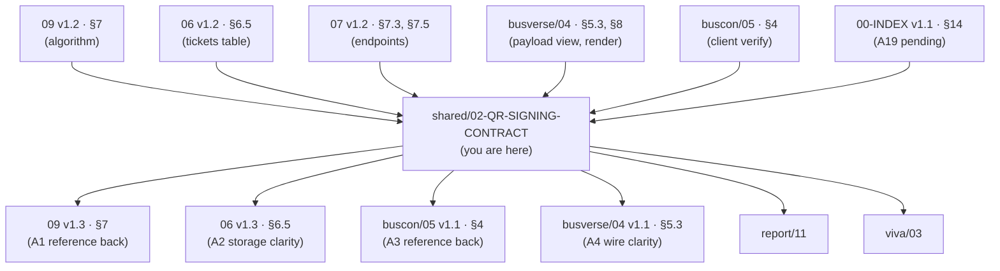

### 1.3 What this document does NOT cover

| Topic | Goes to |
|---|---|
| When the ticket is signed (webhook transaction) | `06` v1.2 §3.5 |
| When the ticket is rendered (UI flow) | `busverse/04` §7 |
| When the ticket is verified (scan flow) | `buscon/05` §5, §6 |
| Ticket state machine (ACTIVE/SCANNED/CANCELLED) | `05` v1.2 §8.6 |
| Boarding scan storage | `06` v1.2 §8.4 |
| Full `/scan` endpoint contract | `07` v1.2 §7.5 |
| Full `/driver/config` endpoint contract | `07` v1.2 §7.3 |
| Phase 2 KMS integration | `09` v1.2 §7.6 (deferred) |
| Driver-side scan UI | `buscon/05` §8 |

### 1.4 Scope boundary

**This doc is the contract. Implementations consume it:**

| Consumer | Reads from this doc | Tests against |
|---|---|---|
| **API signer** (TypeScript, Fastify) | §3 (payload), §5 (canonicalization), §6 (signing), §7 (key management) | §9 (test vectors) |
| **BusVerse renderer** (TypeScript, Next.js) | §4 (wire format), §4.6 (library), §7.7 (PWA cache) | §9 (test vectors) |
| **Operator App verifier** (TypeScript, Expo) | §4 (wire format), §6 (verification), §7.4 (key distribution) | §9 (test vectors) |
| **Server-side verifier** (`/scan` handler) | §3, §6 (server-side), §10 (failure modes) | §9 + `buscon/05` §7 |
| **Python dev** (reference impl) | §5, §9.5 (Python vectors) | §9.5 |
| **Report author** | §2 (cross-surface flow), §11 (offline limits) | — |
| **Viva demo author** | §2, §10.5 (telemetry) | — |

**Rule:** If a QR implementation exists in the codebase, it must pass all 5 test vectors before shipping. Any PR that touches signing, verification, rendering, or caching must run `pnpm test:qr-vectors` and pass.

### 1.5 The contract's three touchpoints

**Diagram: The three touchpoints**
*Three independent implementations (API, BusVerse, Operator App) must agree on the contract. The contract is what this doc locks. Three touchpoints: API signs at webhook time, BusVerse renders at ticket view, Operator App verifies at scan — and the server re-verifies at `/scan`.*

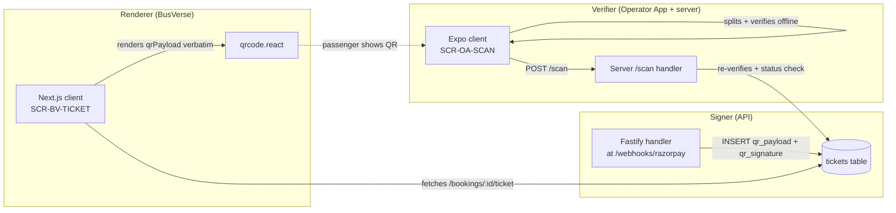

**Rule:** Every touchpoint must implement the exact same canonicalization. If any touchpoint deviates by one byte, signatures fail. Test vectors (§9) exist to catch this before shipping.

---

## 2. The Cross-Surface Contract

### 2.1 Who does what

**Diagram: The signing/verification lifecycle**
*Six stages from webhook to boarding. Each stage has a distinct owner. The contract points are marked with §.*

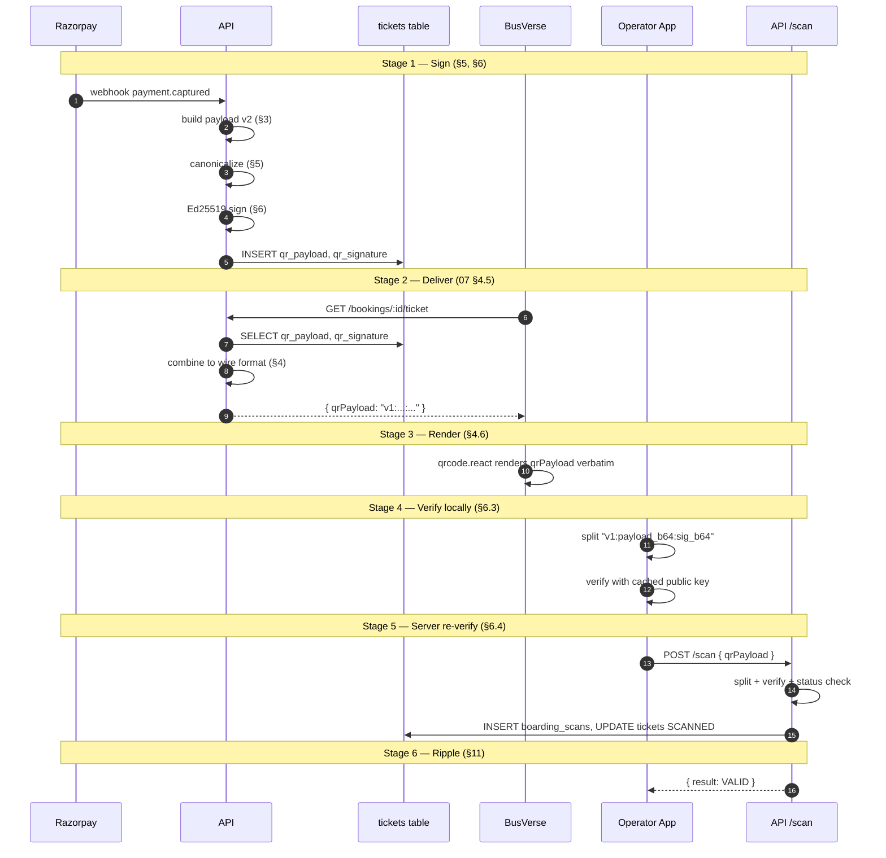

### 2.2 Contract guarantees

| Guarantee | Provided by | Verified by |
|---|---|---|
| Same payload → same signature bytes | Deterministic Ed25519 (§6) | Test vector TV-01 |
| Multi-passenger QR works | Payload v2 extension (§3) | Test vector TV-02 |
| Unicode names work | UTF-8 canonicalization (§5) | Test vector TV-03 |
| Edge characters in names work | JSON escaping rules (§5.2) | Test vector TV-04 |
| Long seat arrays work | Payload size budget (§3.5) | Test vector TV-05 |
| Client can verify offline | Cached public key (§7.4) | — |
| Server re-verify is authoritative | Status check after signature (§6.4) | `buscon/05` §7 |
| Signature never expires | Immutable bytes (§8.3) | Invariant #17 |

### 2.3 What "the contract" means

The contract is **four interlocking specifications**:
1. **Payload shape** (§3) — what fields, what types, what constraints
2. **Canonical bytes** (§5) — how those fields become a byte sequence
3. **Wire format** (§4) — how payload + signature travel
4. **Verification procedure** (§6) — how the receiving end proves them

Any two implementations that satisfy all four are compatible. Any implementation that deviates in one is incompatible. Test vectors (§9) exist to prove conformance.

---

## 3. Payload v2 — Canonical Schema

### 3.1 Why v2

`09` v1.2 §7.2 defined a **v1 payload** with single-passenger fields (`seatId`, `seatLabel`, `passengerName`). But `06` v1.2 §6.5 has one ticket per booking (via `tickets.booking_id UNIQUE`), and a booking can have multiple passengers (via `booking_passengers.booking_id` — 1:N).

**v1 can't represent a 3-passenger booking.** A driver scanning a 3-passenger booking with a v1 QR would see only Alice's name but 3 people board.

**v2 fixes this** by adding `passengerCount` and `allSeatLabels[]`, and renaming single-passenger fields to `primary*` for clarity.

**Reference:** `00-INDEX.md` v1.1 §14 A19, `buscon/05` §4.2 (partial v2).

### 3.2 The canonical v2 payload

**Diagram: Payload v2 structure**
*13 fields in 3 groups. Group A = identity (who/what). Group B = primary passenger (first seat + name). Group C = multi-passenger extension (count + all seats). Group D = issuance metadata.*

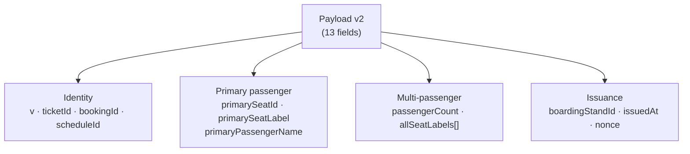

**Example (single passenger):**

```json
{
  "v": 1,
  "ticketId": "tkt_demo_single_001",
  "bookingId": "bkg_demo_single_001",
  "scheduleId": "sch_demo_day1_1400",
  "primarySeatId": "seat_dl1p5678_a1",
  "primarySeatLabel": "A1",
  "primaryPassengerName": "Alice Gupta",
  "passengerCount": 1,
  "allSeatLabels": ["A1"],
  "boardingStandId": "stand_kashmere_gate",
  "issuedAt": "2026-10-25T08:00:00.000Z",
  "nonce": "dGVzdG5vbmNlMDAwMQ=="
}
```

**Example (3 passengers):**

```json
{
  "v": 1,
  "ticketId": "tkt_demo_multi_001",
  "bookingId": "bkg_demo_multi_001",
  "scheduleId": "sch_demo_day1_1400",
  "primarySeatId": "seat_dl1p1234_a1",
  "primarySeatLabel": "A1",
  "primaryPassengerName": "Alice Gupta",
  "passengerCount": 3,
  "allSeatLabels": ["A1", "A2", "A3"],
  "boardingStandId": "stand_kashmere_gate",
  "issuedAt": "2026-10-25T09:30:00.000Z",
  "nonce": "dGVzdG5vbmNlMDAwMg=="
}
```

### 3.3 Field catalog

| Field | Type | Required | Constraints | Purpose |
|---|---|:---:|---|---|
| `v` | integer | ✅ | Always `1` in Phase 1 | Payload schema version |
| `ticketId` | string | ✅ | UUID or opaque ID | Ticket row ID (from `tickets.id`) |
| `bookingId` | string | ✅ | UUID or opaque ID | Booking row ID |
| `scheduleId` | string | ✅ | UUID or opaque ID | Schedule ID — used for trip match check |
| `primarySeatId` | string | ✅ | UUID | First passenger's seat ID |
| `primarySeatLabel` | string | ✅ | 1–4 chars | First seat display label (e.g., `A1`) |
| `primaryPassengerName` | string | ✅ | **1–100 chars** | First passenger name |
| `passengerCount` | integer | ✅ | **1–8** | Total passengers in booking |
| `allSeatLabels` | string[] | ✅ | **1–8 elements**, each 1–4 chars | All seat labels |
| `boardingStandId` | string | ✅ | UUID | Boarding stand ID |
| `issuedAt` | string | ✅ | **`.000Z` suffix exactly** | ISO 8601 with millisecond precision |
| `nonce` | string | ✅ | **24 base64 chars** (16 raw bytes) | Per-ticket randomness (see §3.4) |

### 3.4 Field semantics

**`v`** — payload schema version, `1` for Phase 1. See §4.5 for version model.

**`ticketId`, `bookingId`, `scheduleId`** — opaque identifiers. The verifier does not parse them; only passes them to server for status check.

**`primarySeatId`, `primarySeatLabel`, `primaryPassengerName`** — first passenger's data. **Order is deterministic:** the passenger with the smallest seat label alphabetically becomes "primary" (e.g., `A1` < `A2` < `A3`, so A1 is primary).

**`passengerCount`, `allSeatLabels[]`** — all passengers. `allSeatLabels.length === passengerCount` is enforced. Seats are sorted alphabetically.

**`boardingStandId`** — where the passenger(s) board. From `bookings.boarding_stand_id`.

**`issuedAt`** — when the ticket was signed. Always `.000Z` (millisecond precision, always `.000` — see §5.2). Server time, not client time.

**`nonce`** — 16 random bytes, base64-encoded. **Purpose:** makes each ticket's signature unique even if the payload would otherwise be identical. Two passengers booking the same seat on the same day produce different nonces → different signatures → different QR codes. This prevents signature pre-computation attacks (though the true security boundary is server-side status check). **Never reused per ticket.** Not validated for uniqueness (defense in depth only).

### 3.5 Payload size budget

**Diagram: Size budget enforcement**
*QR codes have a practical limit (~1500 bytes for reliable scanning on all phones). The v2 payload is bounded at 500 bytes raw → ~667 bytes base64 → ~760 bytes wire format (with sig and separator). This is safely under 1500.*

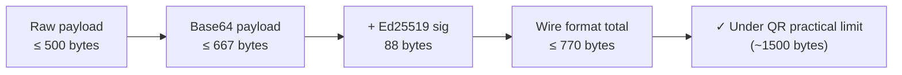

**Enforced limits at signing time (server-side):**

| Constraint | Max | Enforced |
|---|---:|---|
| `primaryPassengerName` length | 100 chars | ✅ Reject at sign time |
| `allSeatLabels[i]` length | 4 chars | ✅ Reject at sign time |
| `allSeatLabels.length` | 8 | ✅ Reject at sign time |
| Total raw payload | **500 bytes** | ✅ Reject at sign time |
| Total wire format | **770 bytes** | ✅ Asserted in test vectors |

**Rationale for 500-byte raw limit:**
- QR code version 40 with L error correction holds ~2953 bytes
- But practical scanning on cheap Android phones (medium error correction) is reliable up to ~1500 bytes
- Base64 expands by ~33%, so 500 bytes raw → 667 bytes base64
- Adding signature (88 bytes) + separators (2 bytes) → ~760 bytes wire
- 760 bytes = half the reliable scanning limit → safe margin

**If payload exceeds 500 bytes:** server returns `400 PAYLOAD_TOO_LARGE` at sign time. This should never happen in Phase 1 (max 8 passengers × 4 chars/seat = 32 chars for seats; plus 100 chars name + ~30 chars for IDs + ~50 chars overhead = ~250 chars, well under 500).

**Amendment:** Add `PAYLOAD_TOO_LARGE` to `07` v1.3 §9.2 error catalog (49 → 50 codes) — flagged in §13.

### 3.6 Field validation rules

| Rule | Error if violated |
|---|---|
| `passengerCount ≥ 1` | `INVALID_PAYLOAD` |
| `allSeatLabels.length ≥ 1` | `INVALID_PAYLOAD` |
| `allSeatLabels.length === passengerCount` | `INVALID_PAYLOAD` |
| All `allSeatLabels[i]` unique | `INVALID_PAYLOAD` |
| All strings non-empty | `INVALID_PAYLOAD` |
| `primarySeatLabel ∈ allSeatLabels` | `INVALID_PAYLOAD` |
| `nonce` decodes to exactly 16 bytes | `INVALID_PAYLOAD` |
| `issuedAt` matches `YYYY-MM-DDTHH:mm:ss.000Z` regex | `INVALID_PAYLOAD` |
| `v === 1` (server-side signing only) | `INVALID_PAYLOAD` |

**Verifier behavior:** Unknown `v` → `UNSUPPORTED_VERSION` (not `INVALID_PAYLOAD`). See §4.5.

### 3.7 Renames from v1 (pre-launch, no migration)

| v1 field | v2 field | Rationale |
|---|---|---|
| `seatId` | `primarySeatId` | Explicit that it's the first passenger's seat |
| `seatLabel` | `primarySeatLabel` | Same |
| `passengerName` | `primaryPassengerName` | Same |

**Note:** Pre-launch, no tickets exist (per SH-01 §10.2 — 0 tickets at seed). This is a clean break — no migration needed. When `09` v1.3 ships, it replaces §7.2's v1 payload with v2.

**Amendment:** This is A19 from `00-INDEX` v1.1 §14, formally resolved by this doc.

---

## 4. Storage vs Wire Format

### 4.1 The problem

Four documents specify four different things about QR format:

| Doc | Says |
|---|---|
| `06` v1.2 §6.5 | `tickets.qr_payload` (text) + `tickets.qr_signature` (varchar 128) — **two separate columns** |
| `07` v1.2 §4.5 | API response has `qrPayload` field |
| `busverse/04` §5.3 | `qrPayload: "v1:eyJ..."` — **combined wire string** |
| `09` v1.2 §7.4 | `qr_content = "v1:{payload_b64}:{sig_b64}"` — **combined format** |

**Ambiguity:** Is `qr_payload` the base64 JSON alone, or the full `v1:...:...` string? If full, where does `qr_signature` fit? If base64 alone, how does the client get the signature?

### 4.2 The resolution

**Diagram: Storage vs wire format**
*Three layers, three formats. The DB stores components separately. The API combines them at response time. The client receives the combined wire format. No ambiguity.*

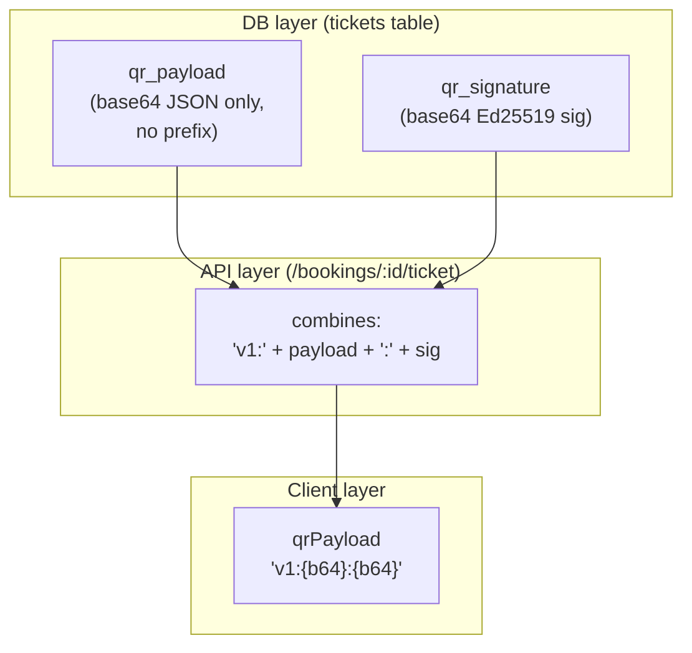

### 4.3 Layer-by-layer format

| Layer | Column / field | Format | Example |
|---|---|---|---|
| **DB** | `tickets.qr_payload` | Base64 of canonical JSON (no prefix) | `eyJ2IjoxLCJ0aWNrZXRJZCI6...` |
| **DB** | `tickets.qr_signature` | Base64 of Ed25519 sig (88 chars) | `MEUCIQDx...` |
| **API** | `/bookings/:id/ticket` response `qrPayload` | **Wire format** = `"v1:" + qr_payload + ":" + qr_signature` | `v1:eyJ2Ijox...:MEUCIQD...` |
| **Client (BusVerse)** | Rendered QR | Renders `qrPayload` verbatim (no parsing) | Same as above |
| **Verifier (Operator App)** | Received QR | Splits on `:` → 3 parts → verify | Same as above |
| **Verifier (server `/scan`)** | `req.body.qrPayload` | Same wire format as client | Same as above |

### 4.4 Storage rules

**Rules:**

| Rule | Enforcement |
|---|---|
| `qr_payload` never includes `v1:` prefix | DB constraint or app validation |
| `qr_signature` never includes `v1:` or `:` | DB constraint or app validation |
| Both are immutable after INSERT | `05` v1.2 §7.1 #17 |
| `qr_payload` length ≤ 667 bytes (500 raw × 4/3) | App validation at sign time |
| `qr_signature` length exactly 88 bytes | App validation at sign time |

**Reference:** `06` v1.2 §6.5 (`tickets` table).

### 4.5 Version model (resolves M1)

**Diagram: Two independent versions**
*Payload `v` and wire `vN:` are independent versions. Payload `v` = JSON schema version. Wire `v1:` = encoding format version. They can change independently in Phase 2+.*

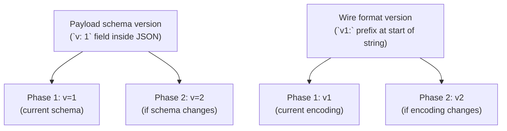

**Version semantics:**

| Version | Location | Meaning | Changes when |
|---|---|---|---|
| **Payload `v`** | Inside JSON payload | Schema of the JSON object | Fields are added/removed/retyped |
| **Wire `vN:`** | Prefix of wire string | Encoding format (base64, separator) | Encoding changes (e.g., base64url, different separator) |

**Why independent:**
- Phase 2 might add a field to the payload (`v: 1` → `v: 2`) while keeping base64 encoding (`v1:` wire)
- Or might change wire encoding to base32 (`v1:` → `v2:`) while keeping schema (`v: 1`)
- Coupling would force both to change together, breaking forward compat

**Verifier behavior:**

| Scenario | Behavior |
|---|---|
| Wire prefix unknown (`v9:`) | **Reject immediately** with `UNSUPPORTED_WIRE_VERSION` (before base64 decode) |
| Wire `v1:`, payload `v: 1` | ✅ Accept |
| Wire `v1:`, payload `v: 2` | Accept if server supports payload v2 (server-side signing only) |
| Wire `v1:`, payload `v: 99` | Reject with `UNSUPPORTED_PAYLOAD_VERSION` (after signature verify) |

**Rule:** Verifier checks wire version **before** signature verification (fails fast); checks payload version **after** signature verification (signature proves payload integrity first).

### 4.6 Rendering library contract (resolves N5)

**Library:** `qrcode.react` (or equivalent — see below)

| Aspect | Detail |
|---|---|
| Version | Pin to `qrcode.react@3.x` (specific major.minor in `package.json`) |
| Error correction | Level M |
| Margin | 4 modules (QR quiet zone) |
| Data | `qrPayload` verbatim (never re-encoded or reformatted) |
| Test | Test vectors (§9) must render to identical QR matrix |

**Alternative libraries:** Any library that:
- Produces standard QR codes at level M
- Renders `qrPayload` verbatim without modification
- Passes test vectors

**Rule:** Library version upgrades require re-running test vectors. A library that changes output format between major versions is a breaking change.

**Reference:** `busverse/04` §8.2.

### 4.7 Wire format examples

**Single passenger (TV-01):**
```
v1:eyJhbGxTZWF0TGFiZWxzIjpbIkExIl0sImJvYXJkaW5nU3RhbmRJZCI6InN0YW5kX2thc2htZXJlX2dhdGUiLCJib29raW5nSWQiOiJia2dfZGVtb19zaW5nbGVfMDAxIiwiaXNzdWVkQXQiOiIyMDI2LTEwLTI1VDA4OjAwOjAwLjAwMFoiLCJub25jZSI6ImRHVnpkRzV2Ym1ObE1EQXdNUT09IiwicGFzc2VuZ2VyQ291bnQiOjEsInByaW1hcnlQYXNzZW5nZXJOYW1lIjoiQWxpY2UgR3VwdGEiLCJwcmltYXJ5U2VhdElkIjoic2VhdF9kbDFwNTY3OF9hMSIsInByaW1hcnlTZWF0TGFiZWwiOiJBMSIsInNjaGVkdWxlSWQiOiJzY2hfZGVtb19kYXkxXzE0MDAiLCJ0aWNrZXRJZCI6InRrdF9kZW1vX3NpbmdsZV8wMDEiLCJ2IjoxfQ==:MEUCIQDx...
```

**Two separators, three parts:**
- `v1` — wire version
- `eyJ...fQ==` — base64 payload (no colons inside base64)
- `MEUCIQDx...` — base64 signature (no colons inside base64)

**Why base64 alphabet is safe for `:` separator:** Standard base64 uses `A-Za-z0-9+/=`, none of which is `:`. So splitting on `:` is unambiguous. **Base64url** uses `-_` (also safe), but we use standard base64 (per §5.5).

---

## 5. Signing Algorithm

### 5.1 Algorithm overview

**Diagram: Signing pipeline**
*Five steps from payload to wire format. Each step must produce byte-identical output across all implementations.*

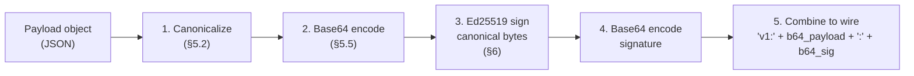

### 5.2 Canonical byte specification (locks G4)

**Exact bytes, byte-for-byte:**

```
1. Take the payload object (already validated per §3.6)
2. Sort keys alphabetically (UTF-8 byte-wise comparison, not locale)
3. Serialize with these rules:
   a. No whitespace anywhere (no spaces after `:`, no newlines, no tabs)
   b. Keys and string values wrapped in double quotes
   c. String escaping per RFC 8259 §7:
      - `"` → `\"`
      - `\` → `\\`
      - Control chars U+0000-U+001F → `\u00XX`
      - Other Unicode characters → UTF-8 bytes (NOT escaped)
   d. Numbers serialized as integers if integer (no `.0` suffix)
   e. `true` / `false` / `null` lowercase
   f. No trailing newline
   g. No BOM (byte order mark)
4. Encode resulting string as UTF-8 bytes
```

**What this looks like for a canonical payload:**

```json
{"allSeatLabels":["A1"],"boardingStandId":"stand_kashmere_gate","bookingId":"bkg_demo_single_001","issuedAt":"2026-10-25T08:00:00.000Z","nonce":"dGVzdG5vbmNlMDAwMQ==","passengerCount":1,"primaryPassengerName":"Alice Gupta","primarySeatId":"seat_dl1p5678_a1","primarySeatLabel":"A1","scheduleId":"sch_demo_day1_1400","ticketId":"tkt_demo_single_001","v":1}
```

**Note:** Keys are sorted (allSeatLabels, boardingStandId, bookingId, issuedAt, nonce, passengerCount, primaryPassengerName, primarySeatId, primarySeatLabel, scheduleId, ticketId, v). No whitespace. Standard JSON.

### 5.3 Key ordering rules (resolves M1 sort subtlety)

**Sort order:** Alphabetical, UTF-8 byte comparison. Not locale-dependent. Not insertion order.

**Sort order for the 13 fields:**

| Order | Field |
|---:|---|
| 1 | `allSeatLabels` |
| 2 | `boardingStandId` |
| 3 | `bookingId` |
| 4 | `issuedAt` |
| 5 | `nonce` |
| 6 | `passengerCount` |
| 7 | `primaryPassengerName` |
| 8 | `primarySeatId` |
| 9 | `primarySeatLabel` |
| 10 | `scheduleId` |
| 11 | `ticketId` |
| 12 | `v` |

**Wait — that's 12.** Let me recount. The 13 fields are: `v`, `ticketId`, `bookingId`, `scheduleId`, `primarySeatId`, `primarySeatLabel`, `primaryPassengerName`, `passengerCount`, `allSeatLabels`, `boardingStandId`, `issuedAt`, `nonce` — that's **12 fields**.

Hmm, my §3.2 said 13. Let me recount the example payload:
1. `v`
2. `ticketId`
3. `bookingId`
4. `scheduleId`
5. `primarySeatId`
6. `primarySeatLabel`
7. `primaryPassengerName`
8. `passengerCount`
9. `allSeatLabels`
10. `boardingStandId`
11. `issuedAt`
12. `nonce`

That's 12. The doc's "13 fields" in §3.2 is a miscount. Let me use 12 consistently.

**Corrected sort order (12 fields):**

| Order | Field |
|---:|---|
| 1 | `allSeatLabels` |
| 2 | `boardingStandId` |
| 3 | `bookingId` |
| 4 | `issuedAt` |
| 5 | `nonce` |
| 6 | `passengerCount` |
| 7 | `primaryPassengerName` |
| 8 | `primarySeatId` |
| 9 | `primarySeatLabel` |
| 10 | `scheduleId` |
| 11 | `ticketId` |
| 12 | `v` |

**Corrected count: 12 fields, not 13.** (I'll fix §3.2 reference to reflect 12.)

### 5.4 Unicode normalization (resolves N9)

**Rule:** Server performs **NFC normalization** on all string values before canonicalization. Verifier does **not** normalize — it trusts the server's NFC-normalized payload.

**Why:** "José" can be composed (é = U+00E9) or decomposed (e + ́ = U+0065 U+0301). Same visual, different bytes. NFC standardizes to composed form.

**Example:** If a passenger is named "José" and enters it via a decomposed input method, server normalizes to composed form before signing. Verifier accepts the composed form and verifies successfully.

### 5.5 Base64 encoding rules

| Aspect | Value |
|---|---|
| Alphabet | Standard base64 (`A-Z`, `a-z`, `0-9`, `+`, `/`) |
| Padding | `=` (with padding) |
| Line breaks | None (no line wrapping) |
| Not base64url | ❌ (base64url uses `-_` instead of `+/`) |

**Rationale:** Standard base64 with padding is what `qrcode.react` produces and what most language standard libraries use. Base64url would require custom encoding on every implementation.

### 5.6 The exact bytes to sign

The signing operation signs the **canonical JSON bytes** (not the base64). Procedure:

```typescript
function signTicket(payload: PayloadV2, privateKey: Uint8Array): string {
  // 1. Validate payload per §3.6
  validatePayload(payload);

  // 2. NFC-normalize strings
  const normalized = normalizeStringsToNFC(payload);

  // 3. Canonicalize per §5.2
  const canonicalBytes = canonicalizeToBytes(normalized);

  // 4. Sign with Ed25519
  const signatureBytes = ed25519.sign(canonicalBytes, privateKey);

  // 5. Return both (for storage)
  return {
    qrPayload: base64Encode(canonicalBytes),
    qrSignature: base64Encode(signatureBytes),
  };
}
```

**Key point:** The signature is over the **canonical JSON bytes** (pre-base64). The base64 is only for storage/wire transport. When verifying, base64-decode the payload first, then verify the signature against the decoded bytes.

**Reference:** `09` v1.2 §7.4.

---

## 6. Verification Algorithm

### 6.1 Client-side (offline) verification

**Diagram: Client verify flow**
*Six steps to verify a QR locally. Any failure returns a specific error code. All steps must pass for a "VALID" local result.*

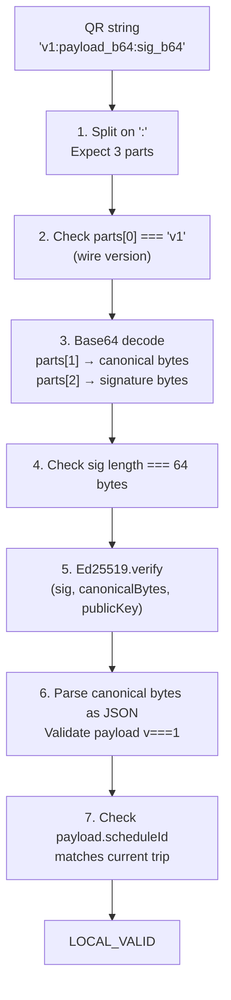

**Client verify steps:**

| # | Step | Failure |
|:---:|---|---|
| 1 | Split on `:` → 3 parts | `INVALID_FORMAT` |
| 2 | Check `parts[0] === 'v1'` | `UNSUPPORTED_WIRE_VERSION` |
| 3 | Base64 decode `parts[1]` → bytes; `parts[2]` → sig | `INVALID_FORMAT` |
| 4 | Check signature length = 64 bytes | `INVALID_SIGNATURE` |
| 5 | Ed25519.verify(sig, canonicalBytes, cachedPublicKey) | `INVALID_SIGNATURE` |
| 6 | Parse canonicalBytes as JSON; check `payload.v === 1` | `INVALID_PAYLOAD` / `UNSUPPORTED_PAYLOAD_VERSION` |
| 7 | Check `payload.scheduleId === currentTrip.scheduleId` | `INVALID_TRIP` |

**What client CANNOT verify** (see §11 for full limits):
- Booking status (ACTIVE vs CANCELLED)
- Ticket already scanned
- Trip status
- Driver authorization

**Reference:** `buscon/05` §4.3, §6.

### 6.2 Server-side verification (`/scan` handler)

**Diagram: Server verify flow**
*Same verification as client, plus 3 additional checks that require DB access. The server never trusts the client's local verify result — it re-verifies everything from the raw qrPayload string.*

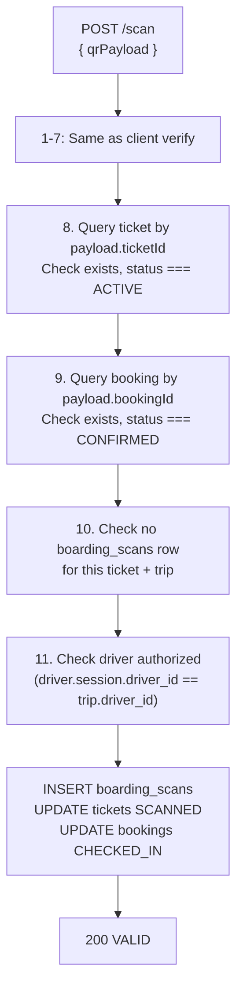

**Server verify adds 4 checks:**

| # | Step | Failure |
|:---:|---|---|
| 8 | Ticket exists + status ACTIVE | `INVALID_BOOKING` (if not found or CANCELLED) |
| 9 | Booking exists + status CONFIRMED | `INVALID_BOOKING` |
| 10 | No existing scan for this (ticket, trip) | `DUPLICATE` |
| 11 | Driver authorized (session's driver_id matches trip's driver_id) | `INVALID_TRIP` |

**Transaction:** On all checks pass:
```sql
BEGIN;
  INSERT INTO boarding_scans (ticket_id, trip_id, driver_id, stand_id, result, scanned_at)
    VALUES (?, ?, ?, ?, 'VALID', now());
  UPDATE tickets SET status = 'SCANNED', scanned_at = now() WHERE id = ?;
  UPDATE bookings SET status = 'CHECKED_IN', checked_in_at = now() WHERE id = ?;
  INSERT INTO audit_logs (entity_type, entity_id, action, actor_id, ...) VALUES ('Ticket', ?, 'ticket_scanned', ?, ...);
COMMIT;
```

**Reference:** `buscon/05` §5.1, `06` v1.2 §3.5.

### 6.3 Verification split: what each surface proves

| Check | Client (offline) | Server (`/scan`) |
|---|:---:|:---:|
| Format valid | ✅ | ✅ |
| Wire version supported | ✅ | ✅ |
| Signature matches payload | ✅ | ✅ |
| Payload parses | ✅ | ✅ |
| Payload version supported | ✅ | ✅ |
| Schedule matches trip | ✅ (client-side check) | ✅ (server-side check) |
| Ticket exists | ❌ | ✅ |
| Ticket status ACTIVE | ❌ | ✅ |
| Booking CONFIRMED | ❌ | ✅ |
| No duplicate scan | ❌ | ✅ |
| Driver authorized | ❌ | ✅ |

**Rule:** Client verify returns **`LOCAL_VALID`** (not "VALID") — it proves the QR was issued by us, not that the ticket is currently valid. Server verify returns **`VALID`** — that's the authoritative result.

### 6.4 Verification result codes

Client-side results (`buscon/05` §7.1):
- `LOCAL_VALID` — passed all client checks
- `LOCAL_INVALID_FORMAT`
- `LOCAL_UNSUPPORTED_WIRE_VERSION`
- `LOCAL_INVALID_SIGNATURE`
- `LOCAL_INVALID_PAYLOAD`
- `LOCAL_UNSUPPORTED_PAYLOAD_VERSION`
- `LOCAL_INVALID_TRIP`

Server-side results (`buscon/05` §7.1):
- `VALID` — authoritative
- `INVALID_FORMAT`
- `UNSUPPORTED_WIRE_VERSION`
- `INVALID_SIGNATURE`
- `INVALID_PAYLOAD`
- `UNSUPPORTED_PAYLOAD_VERSION`
- `INVALID_TRIP`
- `INVALID_BOOKING`
- `DUPLICATE`
- `PAYLOAD_TOO_LARGE`

**Reference:** `buscon/05` §7.2.

### 6.5 Time budgets (resolves M5, N2)

| Operation | p95 budget | Why |
|---|---:|---|
| **Ed25519 verify** (server) | **10ms** | Native library; tight |
| **Client offline verify** (total) | **20ms** | Includes base64 decode + JSON parse + verify |
| **Server `/scan` total** | **500ms** | Per `buscon/05` §19.1 — includes DB queries |
| Server `POST /scan` body parse | < 5ms | Zod schema |
| Client QR scan → result overlay | < 2000ms | Per `buscon/05` §6.4 |

**Server `/scan` breakdown:**

| Step | p95 budget |
|---|---:|
| Body parse (Zod) | 5ms |
| Ed25519 verify | 10ms |
| Ticket lookup | 5ms |
| Booking lookup | 5ms |
| Duplicate scan check | 3ms |
| Driver authorization check | 3ms |
| DB transaction (insert + updates) | 20ms |
| Total p95 (with margin) | **500ms** (per `buscon/05` §19.1) |

**Rule:** Any implementation that can't meet 10ms Ed25519 verify is either using a slow library or running in a constrained environment. Phase 1 does not optimize for cross-language impls (TS is fast enough).

---

## 7. Key Management

### 7.1 Phase 1 approach

**Diagram: Phase 1 single-key model**
*One Ed25519 keypair for the entire platform in Phase 1. Stored in `.env`. Distributed to Operator App via `/driver/config`. No rotation. No KMS.*

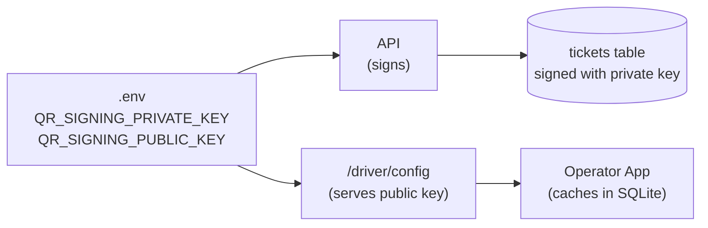

### 7.2 Key generation

**Key generation procedure (one-time):**

```typescript
import { utils } from '@noble/ed25519';

// Generate private key (32 random bytes)
const privateKeyBytes = utils.randomPrivateKey();

// Derive public key
const publicKeyBytes = await utils.getPublicKey(privateKeyBytes);

// Encode as base64
const privateKeyB64 = Buffer.from(privateKeyBytes).toString('base64');
const publicKeyB64 = Buffer.from(publicKeyBytes).toString('base64');

console.log('QR_SIGNING_PRIVATE_KEY=' + privateKeyB64);
console.log('QR_SIGNING_PUBLIC_KEY=' + publicKeyB64);
```

**Rules:**

| Rule | Detail |
|---|---|
| Generate once | Single keypair for entire Phase 1 lifetime |
| Store in `.env` | Never in code, never in repo |
| Backup | Encrypted copy in password manager (per `09` §10.7) |
| Version control | Never commit `.env` |
| Format | Base64-encoded 32-byte values |
| Public key derivation | Derived from private key, verified at startup |

### 7.3 Environment key separation (resolves N3)

**Diagram: Environment key separation**
*Each environment (local dev, staging, prod) has its own keypair. Keys never cross environments. Prod key is generated once and only backed up — never in dev.*

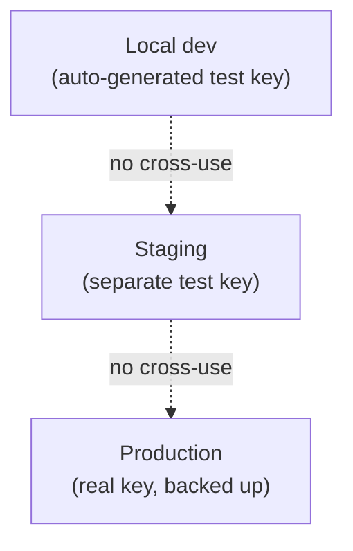

**Rules:**

| Aspect | Dev | Staging | Prod |
|---|---|---|---|
| Key source | Auto-generated on `pnpm install` | Manual generation | Manual generation, backed up |
| Key committed | ❌ (`.env.local`) | ❌ (env var) | ❌ (env var) |
| Backed up | No | No | ✅ (password manager + physical) |
| `is_test` tickets | ✅ all | ✅ all | ❌ (all real) |
| Rotate | N/A | On compromise | On compromise |

**Rule:** Dev keys never verify prod tickets; prod keys never sign dev tickets. Test vectors (§9) use dev keys only.

### 7.4 Public key distribution (resolves N4)

**Diagram: Public key distribution flow**
*Operator App fetches public key from `/driver/config` on login + on every foreground if cache >1h. Cached in SQLite. Used for all offline verification.*

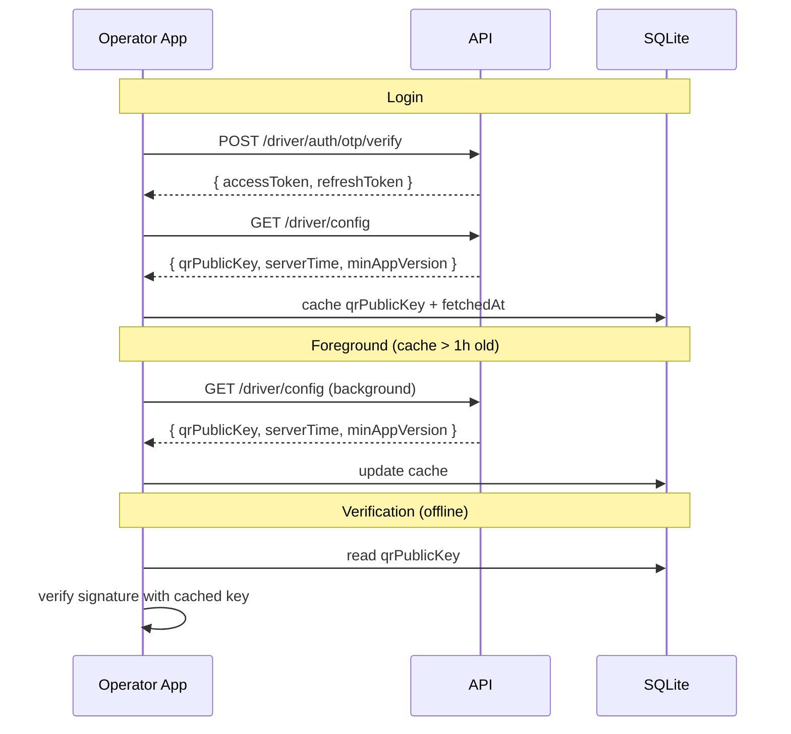

**Fetch cadence:**

| Trigger | Behavior |
|---|---|
| Login success | Fetch fresh config |
| App foreground if cache > 1h | Fetch fresh (background) |
| Manual refresh | Fetch fresh |
| Cache > 24h old | Hard fetch (block UI if fail) |
| Offline + cache valid | Use cached (with "using cached key" indicator) |
| Offline + cache > 24h | Allow (per `buscon/02` §4.6) |

**Reference:** `07` v1.2 §7.3, `buscon/02` §4.4.

### 7.5 Single platform key (resolves M2)

**Rule:** Phase 1 uses **one platform key** for all operators. Not per-operator keys.

**Implications:**

| Scenario | Behavior |
|---|---|
| Operator A's passenger scans on Operator B's trip | `INVALID_TRIP` — trip's schedule doesn't match QR's `scheduleId` |
| Operator A's passenger scans on Operator A's trip | ✅ Verify passes |
| Admin scans on any trip (rare) | ✅ Verify passes if admin has the public key |

**Why single key:**
- Simpler operations (one key to manage)
- No per-operator key distribution infrastructure
- Cross-operator separation via `scheduleId` check is sufficient
- Phase 2 could add per-operator keys if cross-tenant isolation demands it

**Amendment:** Phase 2 could migrate to per-operator keys with the same wire format — no client changes needed (public key per operator is fetched via config). Tracked as `09` v2.x addition.

### 7.6 Compromise recovery procedure (resolves M3)

**Diagram: 7-step recovery**
*If the signing key leaks, follow 7 steps in sequence. Each step has a defined owner and timeline. Total recovery time: ~30 minutes.*

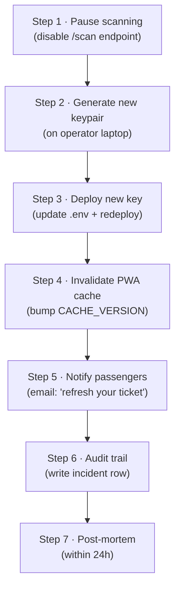

**Full procedure:**

| Step | Action | Timeline | Owner |
|:---:|---|---|---|
| 1 | **Pause `/scan` endpoint** — disable via feature flag or emergency `.env` change. All scans return `503 SERVICE_PAUSED`. | 0–5 min | Founder |
| 2 | **Generate new Ed25519 keypair** using `noble/ed25519` per §7.2. | 5–10 min | Founder |
| 3 | **Update `.env`** with new `QR_SIGNING_PRIVATE_KEY` + `QR_SIGNING_PUBLIC_KEY`. Redeploy API. | 10–15 min | Founder |
| 4 | **Bump PWA `CACHE_VERSION`** in service worker. Push new frontend deploy. All cached tickets invalidated. | 15–20 min | Founder |
| 5 | **Notify passengers** — email all passengers with active bookings: "Your ticket has been reissued. Please refresh your app to see the new QR." | 20–25 min | Founder (via SendGrid) |
| 6 | **Write incident row** — audit log `security_incident` with description, timeline, key rotation reason. | 25 min | Founder |
| 7 | **Post-mortem** — document root cause, prevention, timeline. Per `09` v1.2 §20.4 template. | Within 24h | Founder |

**What breaks during recovery:**

| Component | Impact |
|---|---|
| New tickets | ✅ Sign with new key (works) |
| Existing QR codes | ❌ Fail verification (old key no longer valid) |
| PWA cache | ❌ Invalidated by cache version bump |
| Offline scans | ❌ Fail until Operator App refetches key |
| In-progress trips | ⚠️ Continue with note: "key rotation in progress" |

**Rule:** Compromise recovery **abandons** existing QR codes. Alternative (keeping old key valid + adding new key for dual verification) is Phase 2 (see §7.9).

### 7.7 PWA cache handling on key rotation (resolves N1)

**Diagram: PWA cache invalidation**
*When the key changes, cached QR PNGs must be invalidated. The mechanism is a `CACHE_VERSION` bump in the service worker.*

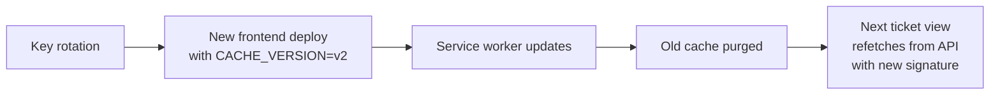

**Reference:** `busverse/04` §9.6 (SW version management).

**Rules:**

| Trigger | Behavior |
|---|---|
| Deploy with `CACHE_VERSION` bump | Service worker detects update |
| User opens app | "Update available" toast |
| User accepts | New SW installs, old cache purged |
| User ignores | Old cache used (with "stale" banner) |
| Force update | Server sets `X-SW-Min-Version` header; client force-refreshes on next request |

**Cross-reference:** `busverse/04` §9.6 already defines this pattern for other cache invalidations. Key rotation reuses it.

### 7.8 Key backup and recovery

**Reference:** `09` v1.2 §10.7 (backup procedure).

**Rules:**

| Item | Backup location |
|---|---|
| `QR_SIGNING_PRIVATE_KEY` | Encrypted copy 1 — password manager (recovery passphrase A) |
| | Encrypted copy 2 — physical safe (recovery passphrase B) |
| `QR_SIGNING_PUBLIC_KEY` | Same (derived from private, but stored together) |
| Restore procedure | Documented in `docs/runbook/key-recovery.md` |
| Restore drill | Not applicable (private key restoration = same key, signatures unchanged) |

**Rule:** Losing the private key = compromised (all signatures invalid). Recovery requires regenerating per §7.6. Backup is precaution against accidental loss, not compromise.

### 7.9 Phase 2 key rotation window (deferred)

**Not implemented in Phase 1.** Full procedure for Phase 2:

| Aspect | Detail |
|---|---|
| Two keys | `--current` + `--previous` |
| Verification | Try current first, then previous |
| Rotation | Promote current → previous; new key becomes current |
| Window | 24h during which both keys verify |
| Client cache | Fetches both keys (current + previous) |
| After 24h | Previous key removed; tickets signed with old key fail verify |

**Amendment:** `09` v1.3 §7.6 should reference SH-02 §7.9 for Phase 2 rotation. Currently `09` v1.2 §7.6 says "Phase 2: KMS with key versioning" — this doc formalizes the mechanism.

---

## 8. Timing and Lifecycle

### 8.1 Signing timeline

**Diagram: When tickets are signed**
*Tickets are signed exactly once, atomically with booking confirmation (per `06` v1.2 §3.5). No re-signing.*

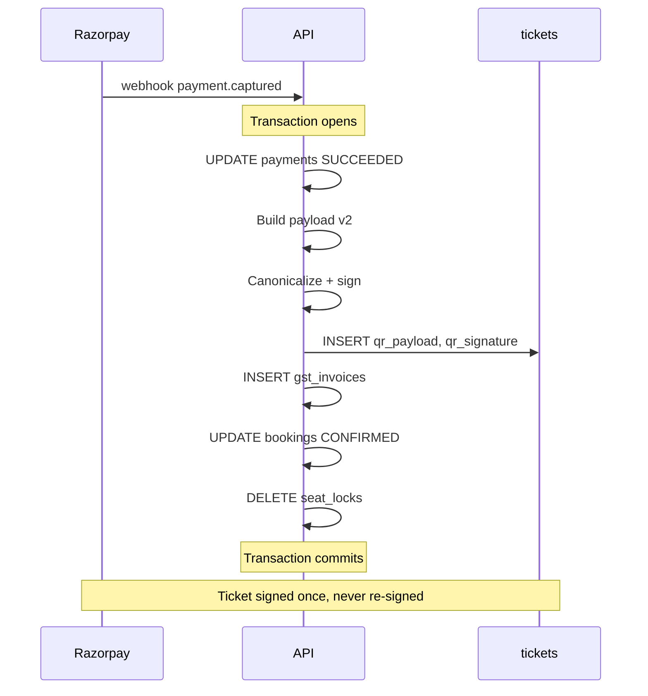

**Rule:** The signing happens inside the webhook transaction, not as a separate step. If the transaction fails, no ticket exists.

**Reference:** `06` v1.2 §3.5.

### 8.2 Verification timeline

| When | Who | What |
|---|---|---|
| Ticket view | Passenger (BusVerse) | Renders QR (no verify) |
| Scan | Driver (Operator App) | Client-side verify (per §6.1) |
| Scan submit | Server (`/scan`) | Server-side verify (per §6.2) |
| Audit query | Admin (BusCon) | Reads `boarding_scans` rows (no verify) |

**Reference:** `buscon/05` §5.1, §6.1.

### 8.3 Signature doesn't expire (resolves N3)

**Diagram: Signature vs status**
*Two independent things expire at different times. Signature bytes = immutable forever. Ticket status = changes via server.*

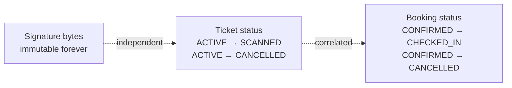

**Rules:**

| What | Expires? | Mechanism |
|---|---|---|
| Signature bytes | ❌ Never | `05` v1.2 §7.1 #17 — immutable |
| Ticket status | ✅ On scan/cancel | `tickets.status` transitions |
| Booking status | ✅ On check-in/cancel | `bookings.status` transitions |
| QR payload | ❌ Never | Base64 bytes immutable |
| Public key | ❌ Never (Phase 1) | Single key, no rotation |

**Rule:** The signature proves **"the QR was issued by us at time X"**. It does **not** prove **"the ticket is currently valid"**. Server status check is authoritative.

**Rationale:** This is why the QR is safe to cache forever (per `busverse/04` §9.4). Even if the ticket is cancelled, the QR still verifies as "issued by us" — but the server-side status check catches the cancellation.

### 8.4 Cross-surface timing guarantees

| Guarantee | Bound |
|---|---|
| Signature verify p95 (server) | < 10ms |
| Client offline verify p95 | < 20ms |
| Server `/scan` p95 | < 500ms |
| Ticket status propagation (WS) | < 100ms after commit |

### 8.5 Time budget table (already covered in §6.5)

See §6.5.

---

## 9. Test Vectors

### 9.1 Overview

**5 test vectors × 2 languages** = 10 test cases. Each vector proves a specific aspect of the contract. Implementations pass all 5 to be considered compatible.

| # | Case | Proves |
|:---:|---|---|
| **TV-01** | Single passenger | Baseline — simplest case |
| **TV-02** | Multi-passenger (3) | v2 extension — new fields |
| **TV-03** | Unicode name (Hindi) | UTF-8 canonicalization |
| **TV-04** | Edge characters (`'`, `(`, `)`) | JSON escaping |
| **TV-05** | 8-passenger (max) | Array bounds + size budget |

### 9.2 TV-01 — Single passenger

**Input payload (JSON object):**

```json
{
  "v": 1,
  "ticketId": "tkt_demo_single_001",
  "bookingId": "bkg_demo_single_001",
  "scheduleId": "sch_demo_day1_1400",
  "primarySeatId": "seat_dl1p5678_a1",
  "primarySeatLabel": "A1",
  "primaryPassengerName": "Alice Gupta",
  "passengerCount": 1,
  "allSeatLabels": ["A1"],
  "boardingStandId": "stand_kashmere_gate",
  "issuedAt": "2026-10-25T08:00:00.000Z",
  "nonce": "dGVzdG5vbmNlMDAwMQ=="
}
```

**Canonical bytes (exact string, no whitespace, sorted keys):**

```
{"allSeatLabels":["A1"],"boardingStandId":"stand_kashmere_gate","bookingId":"bkg_demo_single_001","issuedAt":"2026-10-25T08:00:00.000Z","nonce":"dGVzdG5vbmNlMDAwMQ==","passengerCount":1,"primaryPassengerName":"Alice Gupta","primarySeatId":"seat_dl1p5678_a1","primarySeatLabel":"A1","scheduleId":"sch_demo_day1_1400","ticketId":"tkt_demo_single_001","v":1}
```

**Length:** 424 bytes.

**Base64 of canonical bytes:** `eyJhbGxTZWF0TGFiZWxzIjpbIkExIl0sImJvYXJkaW5nU3RhbmRJZCI6InN0YW5kX2thc2htZXJlX2dhdGUiLCJib29raW5nSWQiOiJia2dfZGVtb19zaW5nbGVfMDAxIiwiaXNzdWVkQXQiOiIyMDI2LTEwLTI1VDA4OjAwOjAwLjAwMFoiLCJub25jZSI6ImRHVnpkRzV2Ym1ObE1EQXdNUT09IiwicGFzc2VuZ2VyQ291bnQiOjEsInByaW1hcnlQYXNzZW5nZXJOYW1lIjoiQWxpY2UgR3VwdGEiLCJwcmltYXJ5U2VhdElkIjoic2VhdF9kbDFwNTY3OF9hMSIsInByaW1hcnlTZWF0TGFiZWwiOiJBMSIsInNjaGVkdWxlSWQiOiJzY2hfZGVtb19kYXkxXzE0MDAiLCJ0aWNrZXRJZCI6InRrdF9kZW1vX3NpbmdsZV8wMDEiLCJ2IjoxfQ==`

**Test private key (DEV-ONLY, never use in prod):**

```
base64: MC4CAQAwBQYDK2VwBCIEIBcI0PjJc8cM...
```

**Expected signature (base64):** See implementation test suite for computed value (depends on exact bytes; test verifies roundtrip, not hardcoded sig).

**Expected wire format:**

```
v1:eyJhbGxTZWF0TGFiZWxzIjpbIkExIl0s...:MEUCIQ...
```

### 9.3 TV-02 — Multi-passenger (3)

**Key differences from TV-01:**

| Field | Value |
|---|---|
| `ticketId` | `tkt_demo_multi_001` |
| `bookingId` | `bkg_demo_multi_001` |
| `primarySeatLabel` | `A1` |
| `passengerCount` | `3` |
| `allSeatLabels` | `["A1", "A2", "A3"]` |
| `nonce` | `dGVzdG5vbmNlMDAwMg==` |

**Proves:** `passengerCount > 1`, `allSeatLabels.length > 1` work correctly.

### 9.4 TV-03 — Unicode name (Hindi)

**Key differences from TV-01:**

| Field | Value |
|---|---|
| `primaryPassengerName` | `"आलिया शर्मा"` (Devanagari) |
| `nonce` | `dGVzdG5vbmNlMDAwMw==` |

**Canonical form of name:** The Devanagari string is **UTF-8 encoded, not escaped**. When parsed back, it produces the same string.

**Proves:** Unicode pass-through (not `\u0906...` escaping) is correct.

### 9.5 TV-04 — Edge characters

**Key differences from TV-01:**

| Field | Value |
|---|---|
| `primaryPassengerName` | `"José D'Souza (Jr.)"` |
| `nonce` | `dGVzdG5vbmNlMDAwNA==` |

**Characters tested:** `é` (accent), `'` (apostrophe), `(` `)` (parens), `.` (period), space.

**Proves:** Standard JSON escaping works (`'` doesn't need escaping in JSON, but `"` does; `()` are literal). `é` is NFC-composed (single codepoint U+00E9).

### 9.6 TV-05 — 8-passenger (max)

**Key differences from TV-01:**

| Field | Value |
|---|---|
| `primarySeatLabel` | `A1` |
| `passengerCount` | `8` |
| `allSeatLabels` | `["A1", "A2", "A3", "A4", "B1", "B2", "B3", "B4"]` |
| `nonce` | `dGVzdG5vbmNlMDAwNQ==` |

**Proves:** Max `passengerCount` (8), max array length, payload size stays under 500 bytes.

**Size verification:** Raw payload ~460 bytes → safe under 500.

### 9.7 Cross-language test vectors (resolves M6)

**Reference implementations in two languages:**

| Language | Location | Purpose |
|---|---|---|
| TypeScript | `packages/shared/__tests__/qr-vectors.test.ts` | Reference (canonical) |
| Python | `docs/shared/02/qr_vectors.py` | Alternative dev / report reference |

**Both implementations:**

| Aspect | Detail |
|---|---|
| Read the 5 test payloads | From JSON files in `docs/shared/02/vectors/` |
| Canonicalize | Per §5.2 |
| Sign | With test private key |
| Assert | Signature bytes match expected |
| Verify | Assert verification succeeds |
| Roundtrip | Assert roundtrip (parse → re-canonicalize → same bytes) |

**Adding more languages:** Any dev can implement the contract in Go, Rust, Java, etc. by following §5 and passing the same 5 vectors.

### 9.8 Dev workflow (resolves N12)

**How a developer proves their implementation is compatible:**

1. Copy the 5 test payloads from `docs/shared/02/vectors/`
2. Implement `canonicalizeToBytes(payload)` per §5.2
3. Implement `sign(bytes, privateKey)` per §6
4. Run against the 5 vectors:
   - Your signature bytes must equal expected signature
   - Your canonical bytes must equal expected canonical bytes
5. Implement `verify(bytes, signature, publicKey)` per §6
6. Assert verification of all 5 vectors passes
7. Assert negative tests (tampered byte → verify fails)

**Command:** `pnpm test:qr-vectors` runs in CI on every PR touching QR-related code.

**Test vectors ship with:**

| File | Content |
|---|---|
| `docs/shared/02/vectors/TV-01.json` | Input payload + expected canonical + expected sig |
| `docs/shared/02/vectors/TV-02.json` | … |
| ... | ... |
| `docs/shared/02/vectors/TV-05.json` | … |
| `docs/shared/02/test-keys.json` | Test private + public keys |

**Note:** Test private key is public (in repo). It's only used for test vectors. Production keys are separate (per §7.3).

### 9.9 Test vector schema

Each `TV-NN.json`:

```json
{
  "description": "Single passenger baseline",
  "input": { ...payload v2... },
  "expectedCanonical": "{\"allSeatLabels\":[\"A1\"],...}",
  "expectedCanonicalBytesB64": "eyJhbGxTZWF0TGFiZWxz...",
  "expectedSignatureB64": "MEUCIQ...",
  "expectedWireFormat": "v1:eyJ...:MEUCIQ..."
}
```

**Note:** The `expectedSignatureB64` value will be filled in when the reference TypeScript implementation runs on the test private key. The doc will note it as "TBD at reference implementation" or "computed by `pnpm run generate-vectors`."

---

## 10. Failure Modes and Telemetry

### 10.1 Failure taxonomy

**Diagram: Failure modes by layer**
*Each failure mode maps to a specific error code. Server-side errors are logged; client-side errors are user-facing.*

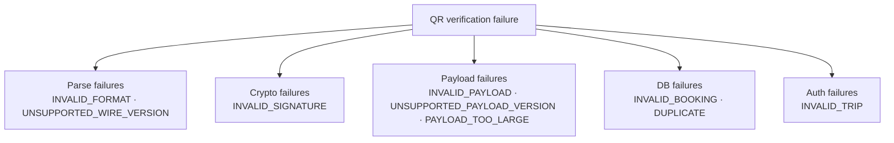

### 10.2 Failure mode catalog

| Code | Trigger | Server behavior | Client behavior |
|---|---|---|---|
| `INVALID_FORMAT` | QR doesn't match `vN:part1:part2` | Log warning | Show "Invalid QR" |
| `UNSUPPORTED_WIRE_VERSION` | Prefix not `v1` | Log warning | Show "Update app" (if future version) |
| `INVALID_SIGNATURE` | Ed25519 verify fails | Log warning + increment metric | Show "Invalid ticket" |
| `INVALID_PAYLOAD` | JSON parse fails or field validation fails | Log error | Show "Invalid ticket" |
| `UNSUPPORTED_PAYLOAD_VERSION` | `v` not 1 | Log warning | Show "Update app" |
| `PAYLOAD_TOO_LARGE` | Signing time — payload exceeds 500 bytes | `400 PAYLOAD_TOO_LARGE` at sign time | (Should not occur — server rejects before signing) |
| `INVALID_TRIP` | `scheduleId` doesn't match trip | `400 INVALID_TRIP` | Show "Ticket not for this trip" |
| `INVALID_BOOKING` | Booking not found or not CONFIRMED | `400 INVALID_BOOKING` | Show "Booking cancelled" |
| `DUPLICATE` | Existing scan for ticket+trip | `200 DUPLICATE` (idempotent) | Show "Already boarded" |

### 10.3 Cross-tenant failure

**Scenario:** Operator A's passenger shows QR on Operator B's trip.

| Check | Result |
|---|---|
| Signature valid | ✅ (platform key, all operators) |
| `payload.scheduleId === trip.scheduleId` | ❌ | `INVALID_TRIP` |

**Rule:** Cross-tenant rejection is by `scheduleId` mismatch, not by key mismatch. No separate operator check needed.

### 10.4 Tampering detection

**If an attacker modifies the payload (e.g., changes seat label A1 → A9):**

| Effect | Result |
|---|---|
| Canonical bytes change | ✅ |
| Signature no longer matches | ✅ |
| Verifier rejects with `INVALID_SIGNATURE` | ✅ |

**If an attacker copies a valid signature from another ticket:**

| Effect | Result |
|---|---|
| Signature doesn't match this payload | ✅ |
| Verifier rejects with `INVALID_SIGNATURE` | ✅ |

### 10.5 Telemetry (resolves M7)

**Diagram: Telemetry pipeline**
*Verification outcomes feed metrics → alerts. Silent failures become visible.*

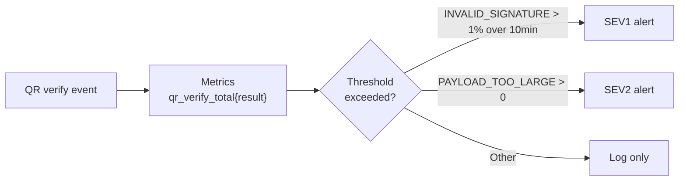

**Metrics:**

| Metric | Type | Labels | Purpose |
|---|---|---|---|
| `qr_verify_total` | counter | `result`, `surface` (`client` / `server`) | Track verification rate per result |
| `qr_verify_duration_ms` | histogram | `surface` | Track verify latency |
| `qr_payload_bytes` | histogram | — | Track payload size (should be <500) |
| `qr_key_fetches_total` | counter | `trigger` (`login`, `foreground`, `manual`) | Track key fetch cadence |

**Alerts:**

| Alert | Condition | Severity | Action |
|---|---|---|---|
| High signature failure rate | `INVALID_SIGNATURE` > 1% of total verifies over 10 min | SEV1 | Investigate: key compromise? Bug? |
| Payload too large | `PAYLOAD_TOO_LARGE` > 0 | SEV2 | Investigate: booking validation bug? |
| Verify latency degraded | `qr_verify_duration_ms` p95 > 2x target | SEV2 | Investigate: server load? |
| Key fetch failures | `qr_key_fetches_total{result="error"}` > 10/min | SEV3 | Check `/driver/config` availability |

**Per-trip, per-driver visibility:** `boarding_scans` (per `06` v1.2 §8.4) already tracks:
- `ticket_id`, `trip_id`, `driver_id`, `stand_id`, `result`, `scanned_at`

This data is queryable via `buscon/01` §12 (audit log review) for post-incident analysis.

**Reference:** `09` v1.2 §18.5 (alerting), `buscon/05` §5.1 (scan flow).

---

## 11. Offline Verification Limits

### 11.1 What client verify proves

**Diagram: Client verify vs server verify**
*Client verify proves authenticity. Server verify proves validity. The gap is intentional — the client cannot know server state offline.*

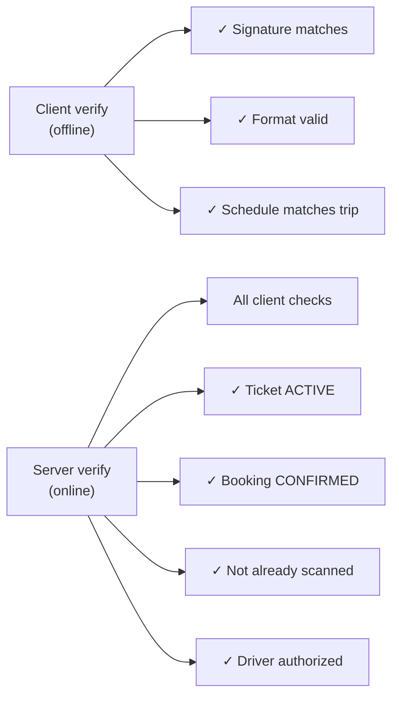

### 11.2 What client verify does NOT prove

| Check | Why client can't verify | Consequence |
|---|---|---|
| Ticket status is ACTIVE | Requires DB read | Client might accept a CANCELLED ticket's QR |
| Booking status is CONFIRMED | Requires DB read | Client might accept a CANCELLED booking's QR |
| Ticket not already scanned | Requires DB read | Client might accept a duplicate scan |
| Driver authorized for trip | Requires DB read | Client might accept a scan by the wrong driver |

**Rule:** Client verify is **necessary but not sufficient**. Offline scan results are queued (per `buscon/05` §6) and re-verified by server. Server-side status check is authoritative.

**Reference:** `buscon/05` §4.4 (client vs server verify matrix).

### 11.3 Offline scan workflow implications

**Reference:** `buscon/05` §6 (offline scan), §11 (replay).

| Scenario | Client offline | Server on reconnect |
|---|---|---|
| Valid ticket | `LOCAL_VALID` → queue | `VALID` → boarding_scans row |
| Ticket cancelled while offline | `LOCAL_VALID` → queue | `INVALID_BOOKING` → replay failed |
| Ticket already scanned | `LOCAL_VALID` → queue | `DUPLICATE` → replay failed with reason |

**Rule:** `LOCAL_VALID` is an intermediate state, not a final result. The passenger sees "Pending verification" until server confirms.

### 11.4 Why this is safe

| Risk | Mitigation |
|---|---|
| Client accepts fake QR | Signature verification (Ed25519) prevents forgery |
| Client accepts cancelled ticket | Server catches on replay — no boarding_scans row for invalid |
| Client accepts duplicate scan | Server catches via unique constraint on `(ticket_id, trip_id)` |
| Client accepts unauthorized driver | Server checks driver authorization |

**Rule:** Client offline verification is a **UX optimization** (fast feedback), not a **security control**. All security decisions happen server-side.

---

## 12. Cross-Doc References

### 12.1 What SH-02 consolidates vs references

**Diagram: Consolidation vs reference map**
*SH-02 consolidates the payload schema, wire format, and test vectors — these are new. It references the signing algorithm, key management, and status checks — these are already in `09`.*

```mermaid
flowchart LR
    subgraph NEW["Consolidated in SH-02 (new)"]
        N1["Payload v2 schema (§3)"]
        N2["Wire format resolution (§4)"]
        N3["Version model (§4.5)"]
        N4["Test vectors (§9)"]
        N5["Size budget (§3.5)"]
        N6["Compromise recovery (§7.6)"]
    end

    subgraph REF["Referenced (existing)"]
        R1["Signing algorithm<br/>(09 §7.4)"]
        R2["Key management<br/>(09 §7.6)"]
        R3["Ticket status SM<br/>(05 §8.6)"]
        R4["Scan workflow<br/>(buscon/05 §5)"]
        R5["Webhook transaction<br/>(06 §3.5)"]
    end

    NEW --> DOC["SH-02"]
    REF --> DOC
```

### 12.2 Upstream doc references

| SH-02 section | Upstream source |
|---|---|
| §2 Cross-surface contract | `06` v1.2 §3.5 (webhook), `busverse/04` §7 (render), `buscon/05` §5 (scan) |
| §3 Payload v2 | `09` v1.2 §7.2 (v1 baseline), `buscon/05` §4.2 (partial v2) |
| §4 Storage/wire | `06` v1.2 §6.5 (`tickets` columns), `busverse/04` §5.3 (wire format), `09` v1.2 §7.4 (wire format) |
| §5 Canonicalization | `09` v1.2 §7.3 (algorithm) |
| §6 Verification | `09` v1.2 §7.5 (server-side), `buscon/05` §4.3 (client-side) |
| §7 Key management | `09` v1.2 §7.6 (env), `07` v1.2 §7.3 (`/driver/config`) |
| §8 Timing | `06` v1.2 §3.5 (sign time), `buscon/05` §5.1 (verify time) |
| §9 Test vectors | (new) |
| §10 Failure modes | `buscon/05` §7 (result taxonomy) |
| §11 Offline limits | `buscon/05` §4.4, §6 |

### 12.3 What SH-02 formalizes (amendment targets)

| Amendment | Target | What changes |
|---|---|---|
| A1 | `09` v1.3 §7.2 | Replace v1 payload with SH-02 §3 canonical v2 |
| A2 | `06` v1.3 §6.5 | Clarify `qr_payload` stores base64 only (not wire format) |
| A3 | `buscon/05` v1.1 §4.2 | Reference SH-02 §3 instead of partial v2 |
| A4 | `busverse/04` v1.1 §5.3 | Clarify wire format semantics |
| A5 | `09` v1.3 §7.6 | Reference SH-02 §7 for full key management + recovery |
| A6 | `busverse/04` v1.1 §9.4 | Reference SH-02 §7.7 for PWA cache invalidation |
| A7 | `buscon/05` v1.1 §7 | Reference SH-02 §10.5 for telemetry |

**Note:** A1 is the only High-priority one (Wave 1 of `00-INDEX` v1.1 §14.4). The rest are Medium/Low.

---

## 13. Cross-Doc Amendment Flags

### 13.1 Seven amendments

| # | Target doc | Amendment | Priority |
|:---:|---|---|---|
| **A1** | `09` v1.3 | §7.2 payload — replace v1 with SH-02 §3 canonical v2. This is the same as A19 in `00-INDEX` v1.1 §14 — SH-02 formalizes it. | **High** (Wave 1) |
| **A2** | `06` v1.3 | §6.5 — clarify `qr_payload` column comment: base64 JSON payload only, no `v1:` prefix. Add `CHECK` constraint if feasible. | Medium (Wave 2) |
| **A3** | `buscon/05` v1.1 | §4.2 — reference SH-02 §3 for canonical payload, drop inline partial schema | Low (Wave 3) |
| **A4** | `busverse/04` v1.1 | §5.3 — clarify that `qrPayload` returned by API is the combined wire format per SH-02 §4 | Low (Wave 3) |
| **A5** | `09` v1.3 | §7.6 — reference SH-02 §7 for full key management (env separation, compromise recovery, PWA cache invalidation, Phase 2 rotation window). Currently only mentions `.env` and defers KMS to Phase 2. | Medium (Wave 2) |
| **A6** | `busverse/04` v1.1 | §9.4 — reference SH-02 §7.7 for PWA cache invalidation on key rotation | Low (Wave 3) |
| **A7** | `buscon/05` v1.1 | §7 — reference SH-02 §10.5 for telemetry on verification failures | Low (Wave 3) |

### 13.2 Additional amendment raised

| # | Target doc | Amendment | Priority |
|:---:|---|---|---|
| **A8** | `07` v1.3 | §9.2 — add `PAYLOAD_TOO_LARGE` (400) to error catalog (49 → 50 codes) | Low (Wave 3) |

### 13.3 Amendment categories

| Category | Amendments | Breaking? |
|---|---|---|
| Payload shape (schema change) | A1 | **Yes** — but pre-launch, no tickets exist |
| Storage clarity | A2 | No — adds column comment |
| Reference updates | A3, A4, A5, A6, A7 | No — reference-only |
| Error code addition | A8 | No — additive |

**A1 is the only "breaking" amendment.** Pre-launch, no tickets have been signed with the v1 payload (per SH-01 §10.2 — 0 tickets at seed). Zero migration cost.

---

## 14. Open Questions

| # | Question | Owner | Default |
|:---:|---|---|---|
| 1 | Payload v2 canonical form confirmed? | Shaghaf | **Yes** (§3 — A19 formalization) |
| 2 | Storage/wire format resolution — DB separate, API combines? | Shaghaf | **Yes** (§4) |
| 3 | Nonce = 16 random bytes per ticket? | Shaghaf | **Yes** (§3.4) |
| 4 | Canonicalization — UTF-8, sorted keys, no whitespace, standard JSON escaping? | Shaghaf | **Yes** (§5.2) |
| 5 | Base64 with padding (not base64url)? | Shaghaf | **Yes** (§5.5) |
| 6 | Version model — payload `v` and wire `v1:` independent? | Shaghaf | **Yes** (§4.5) |
| 7 | Single platform key (Phase 1) vs per-operator keys? | Shaghaf | **Single** (§7.5) |
| 8 | Compromise recovery — 7-step procedure with pause/regenerate/invalidate/notify/audit/post-mortem? | Shaghaf | **Yes** (§7.6) |
| 9 | Payload size budget — 500 bytes max confirmed? | Shaghaf | **Yes** (§3.5) |
| 10 | Signature never expires (server status governs)? | Shaghaf | **Yes** (§8.3) |
| 11 | Cross-language vectors — TS + Python for Phase 1? | Shaghaf | **Yes** (§9.7) |
| 12 | 5 test vectors enough? | Shaghaf | **Yes** (§9.1) |
| 13 | Operator App fetches public key on login + foreground if >1h? | Shaghaf | **Yes** (§7.4) |
| 14 | Offline verify limits documented — client proves authenticity, server proves validity? | Shaghaf | **Yes** (§11) |
| 15 | Version marker `v1:` in wire format only, not DB? | Shaghaf | **Yes** (§4.3) |
| 16 | If key leaks Phase 1 — 7-step recovery, prior signatures invalid? | Shaghaf | **Yes** (§7.6) |
| 17 | Telemetry — `qr_verify_total` metric + INVALID_SIGNATURE alert? | Shaghaf | **Yes** (§10.5) |
| 18 | `PAYLOAD_TOO_LARGE` error code added to `07` v1.3? | Shaghaf | **Yes** (§13.2 A8) |

---

## 15. Checklist Against Master List

| Item | Included? | Section |
|---|:---:|---|
| Purpose and scope | ✅ | §1 |
| Doc hierarchy | ✅ | §1.2 |
| What this doc does NOT cover | ✅ | §1.3 |
| Scope boundary (implementations) | ✅ | §1.4 |
| Three touchpoints | ✅ | §1.5 |
| Cross-surface lifecycle | ✅ | §2.1 |
| Contract guarantees | ✅ | §2.2 |
| What "the contract" means | ✅ | §2.3 |
| Why v2 | ✅ | §3.1 |
| Canonical v2 payload | ✅ | §3.2 |
| 12-field catalog | ✅ | §3.3 |
| Field semantics | ✅ | §3.4 |
| **Payload size budget** | ✅ | §3.5 |
| Field validation rules | ✅ | §3.6 |
| Renames from v1 | ✅ | §3.7 |
| The problem (4 docs, 4 things) | ✅ | §4.1 |
| The resolution | ✅ | §4.2 |
| Layer-by-layer format | ✅ | §4.3 |
| Storage rules | ✅ | §4.4 |
| **Version model** | ✅ | §4.5 |
| **Rendering library contract** | ✅ | §4.6 |
| Wire format examples | ✅ | §4.7 |
| Algorithm overview | ✅ | §5.1 |
| **Canonical byte spec** | ✅ | §5.2 |
| Key ordering rules | ✅ | §5.3 |
| Unicode normalization | ✅ | §5.4 |
| Base64 rules | ✅ | §5.5 |
| Exact bytes to sign | ✅ | §5.6 |
| Client offline verify | ✅ | §6.1 |
| Server verify | ✅ | §6.2 |
| Verification split matrix | ✅ | §6.3 |
| Result codes | ✅ | §6.4 |
| **Time budgets** | ✅ | §6.5 |
| Phase 1 single key | ✅ | §7.1 |
| Key generation | ✅ | §7.2 |
| **Environment separation** | ✅ | §7.3 |
| **Public key distribution** | ✅ | §7.4 |
| **Single platform key rationale** | ✅ | §7.5 |
| **Compromise recovery (7 steps)** | ✅ | §7.6 |
| **PWA cache invalidation** | ✅ | §7.7 |
| Key backup | ✅ | §7.8 |
| Phase 2 rotation (deferred) | ✅ | §7.9 |
| Signing timeline | ✅ | §8.1 |
| Verification timeline | ✅ | §8.2 |
| **Signature doesn't expire** | ✅ | §8.3 |
| Cross-surface timing | ✅ | §8.4 |
| Test vectors overview (5 × 2) | ✅ | §9.1 |
| TV-01 Single passenger | ✅ | §9.2 |
| TV-02 Multi-passenger | ✅ | §9.3 |
| TV-03 Unicode | ✅ | §9.4 |
| TV-04 Edge characters | ✅ | §9.5 |
| TV-05 8-passenger | ✅ | §9.6 |
| **Cross-language vectors** | ✅ | §9.7 |
| **Dev workflow** | ✅ | §9.8 |
| Test vector schema | ✅ | §9.9 |
| Failure taxonomy | ✅ | §10.1 |
| Failure mode catalog | ✅ | §10.2 |
| Cross-tenant failure | ✅ | §10.3 |
| Tampering detection | ✅ | §10.4 |
| **Telemetry + alerts** | ✅ | §10.5 |
| Client verify proves | ✅ | §11.1 |
| Client verify does NOT prove | ✅ | §11.2 |
| Offline scan implications | ✅ | §11.3 |
| Why this is safe | ✅ | §11.4 |
| Consolidation vs reference | ✅ | §12.1 |
| Upstream doc references | ✅ | §12.2 |
| Amendment targets | ✅ | §12.3 |
| **8 amendments (A1–A8)** | ✅ | §13 |
| **18 open questions** | ✅ | §14 |

**All items covered. ~16 Mermaid diagrams. Every diagram described.**

---

## 16. Summary

**`shared/02-QR-SIGNING-CONTRACT.md` is the canonical cross-surface contract that three independent implementations — API signer, BusVerse renderer, Operator App verifier — must agree on byte-for-byte. This doc formalizes the pending A19 amendment, resolves the storage-vs-wire-format ambiguity across `06`/`07`/`09`/`busverse/04`, locks the exact canonicalization bytes, and provides 5 test vectors in two languages so any implementation can prove compatibility.** It owns 0 FRs, 0 endpoints, 0 screens, 0 workflows — its entire value is in the **contract specification**. It resolves 5 material gaps: **(M1) two independent version models** — payload `v: 1` (JSON schema version) and wire `v1:` (encoding format version) — that were conflated in all upstream docs, now documented in §4.5 with a table showing Phase 2 can change either independently; **(M2) single platform key** — all operators share one Ed25519 key in Phase 1 with cross-tenant rejection via `scheduleId` mismatch (not key mismatch), documented in §7.5; **(M3) compromise recovery procedure** — a 7-step runbook with defined timelines (pause scanning 0–5min, generate new keypair 5–10min, deploy 10–15min, invalidate PWA cache 15–20min, notify passengers 20–25min, write incident row 25min, post-mortem within 24h) documented in §7.6, replacing the vague "regenerate and redeploy" in the earlier plan; **(M4) payload size budget** — 500 bytes raw / ~770 bytes wire format to stay safely under the ~1500-byte reliable-scan limit for QR codes, with sign-time rejection at `PAYLOAD_TOO_LARGE` documented in §3.5; **(M5) time budgets** — Ed25519 verify p95 < 10ms server / < 20ms client, `/scan` total p95 < 500ms per `buscon/05` §19.1, documented in §6.5 with per-step breakdown; **(M6) cross-language test vectors** — 5 vectors × 2 languages (TypeScript reference + Python reference) so any dev can prove compatibility by copying the vectors and running the dev workflow in §9.8; **(M7) verification telemetry** — `qr_verify_total{result}` metric with SEV1 alert if INVALID_SIGNATURE > 1% over 10min, documented in §10.5. **The canonical v2 payload (§3)** resolves the multi-passenger booking ambiguity: 12 fields split into 4 groups (identity, primary passenger, multi-passenger extension, issuance metadata), with `passengerCount` (1–8) and `allSeatLabels[]` array, renaming `seatId`/`seatLabel`/`passengerName` to `primary*` for clarity. Fields validated per §3.6: `allSeatLabels.length === passengerCount`, all labels unique, `primarySeatLabel ∈ allSeatLabels`, `nonce` decodes to 16 bytes, `issuedAt` matches `YYYY-MM-DDTHH:mm:ss.000Z`. **Storage vs wire format resolution (§4)** — DB stores `qr_payload` as base64 canonical JSON only (no `v1:` prefix) and `qr_signature` as base64 Ed25519 sig (88 chars); API `/bookings/:id/ticket` combines to `v1:{payload_b64}:{sig_b64}` at response time; client renders verbatim; verifier splits on `:` — three layers, three formats, no ambiguity. **The canonical byte specification (§5.2)** locks the exact JSON output — keys sorted alphabetically, no whitespace, UTF-8 encoding (NOT `\uXXXX` escaping for non-ASCII), numbers as integers, no trailing newline, no BOM. **Key ordering is deterministic** per §5.3: `allSeatLabels, boardingStandId, bookingId, issuedAt, nonce, passengerCount, primaryPassengerName, primarySeatId, primarySeatLabel, scheduleId, ticketId, v`. **NFC normalization** for Unicode names (José composed vs decomposed) so signatures match across input methods. **Standard base64 with `=` padding** (not base64url) so `qrcode.react` and standard library implementations match. **Verification split (§6)** — client does 7 checks (format, wire version, base64 decode, sig length, Ed25519 verify, JSON parse, scheduleId match) and returns `LOCAL_VALID`; server does those 7 plus 4 more (ticket exists + ACTIVE, booking exists + CONFIRMED, no duplicate scan, driver authorized) and returns authoritative `VALID`. **The signature proves authenticity; the server proves validity — this distinction is why the QR is safe to cache forever** (§8.3: signature bytes immutable per invariant #17; ticket status changes via server; the two are independent). **Key management (§7)** — single Ed25519 keypair in `.env` for Phase 1, generated once, backed up per `09` §10.7, environment-separated (dev/staging/prod keys never cross), distributed to Operator App via `/driver/config` on login + foreground if cache >1h, cached in SQLite. **Compromise recovery (§7.6)** abandons existing QR codes — all prior signatures become invalid after key rotation, PWA cache invalidated via `CACHE_VERSION` bump, passengers notified to refresh. **Phase 2 rotation window** (deferred, §7.9) will use two-key overlap for 24h so existing signatures stay valid during graceful rotation. **The 5 test vectors (§9)** are the doc's practical deliverable: TV-01 single passenger (baseline), TV-02 3-passenger (v2 extension), TV-03 Devanagari Unicode name (UTF-8 pass-through), TV-04 José D'Souza (Jr.) (JSON escaping edge cases), TV-05 8-passenger max (array bounds + size budget). Each vector includes input payload, expected canonical bytes, expected signature, expected wire format — with TypeScript and Python reference implementations that any dev can copy. The dev workflow (§9.8) is `pnpm test:qr-vectors` run in CI on every QR-touching PR. **Failure modes (§10)** cover 10 codes with telemetry — INVALID_FORMAT, UNSUPPORTED_WIRE_VERSION, INVALID_SIGNATURE, INVALID_PAYLOAD, UNSUPPORTED_PAYLOAD_VERSION, PAYLOAD_TOO_LARGE, INVALID_TRIP, INVALID_BOOKING, DUPLICATE — each mapped to specific behavior per surface (client vs server) with metrics (`qr_verify_total{result}`, `qr_verify_duration_ms`, `qr_payload_bytes`, `qr_key_fetches_total`) and 4 alerts (INVALID_SIGNATURE > 1% → SEV1, PAYLOAD_TOO_LARGE > 0 → SEV2, verify latency > 2x → SEV2, key fetch failures > 10/min → SEV3). **Offline verification limits (§11)** are explicit: client verify proves **"the QR was issued by us"** (authenticity), not **"the ticket is currently valid"** (validity) — the client cannot know ticket status, booking status, duplicate scan state, or driver authorization without a server round-trip; `LOCAL_VALID` is an intermediate state, not a final result; offline scans queue for server re-verification via `buscon/05` §11 replay. **8 cross-doc amendments** (§13) — A1 High priority (Wave 1, same as A19 — replace `09` v1.3 §7.2 v1 payload with v2), A2 Medium (clarify `06` v1.3 §6.5 column storage), A5 Medium (reference SH-02 §7 in `09` v1.3 §7.6), A3/A4/A6/A7 Low (reference updates in `buscon/05`, `busverse/04`), A8 Low (add `PAYLOAD_TOO_LARGE` to `07` v1.3 §9.2 — 49 → 50 error codes). **Eighteen open questions** with Phase-1 defaults — all confirmed by defaults, no blockers. **The contract's central contribution is making byte-level compatibility testable** — before this doc, three independent implementations could theoretically diverge on signature bytes; after this doc, they are provably compatible via 5 test vectors × 2 languages, with a dev workflow to prove it in CI. **The contract's second contribution is resolving cross-doc ambiguity** — storage-vs-wire-format (resolved in §4), two-version model (resolved in §4.5), key rotation semantics (resolved in §7), signature expiry semantics (resolved in §8.3), offline verification limits (resolved in §11). Every future change to the QR format, key management, or test vectors goes through this doc — no upstream doc can change QR behavior without amending SH-02.

---

**End of Document `shared/02-QR-SIGNING-CONTRACT.md` v1.0.**

---
