# `shared/03-SEAT-LOCKING-CONTRACT.md` v1.0

**Document:** `shared/03-SEAT-LOCKING-CONTRACT.md`
**Project:** BusVerse + BusCon
**Version:** 1.0
**Status:** Locked — Reference Document
**Owner:** Shaghaf
**Guide:** Mr. Mohit Srivastav
**Purpose:** The canonical cross-surface seat lock contract. Owns the complete lifecycle — 7 states, 8 transitions, 5 cleanup paths — that carries a seat from available to booked or back to available. This is the system's most concurrency-critical contract: without it, two users can hold the same lock, an abandoned booking permanently blocks a seat, a cancelled booking leaves the seat unbookable, or a webhook failure prevents release. SH-03 consolidates the three-layer enforcement pattern (`09` v1.2 §8.2), formalizes the missing Redis operations that break the atomicity guarantees (G1, G6), adds the cleanup paths that prevent permanent blocks (G4, G7), and locks the `lockId` contract that was contradictory across three docs (G3). The seat lock implementation must be byte-identical across the BusVerse client and the API server — the BusCon web and Operator App never touch locks. Every seat lock implementation must pass the 12 concurrency test vectors before shipping.

> **Derives from:** `09-SECURITY-AND-PLATFORM-RULES.md` v1.2 §8.1–§8.4 (atomicity contract), `05-DOMAIN-MODEL.md` v1.2 §6.3 (Booking context), §7.1 (#6, #7, #8 — lock invariants), `06-DATABASE-SCHEMA.md` v1.2 §6.2 (`seat_locks` table), §6.3 (`bookings` with `expired_at`), §6.4 (`booking_passengers`), §3.5 (multi-table transactions), §15 (`expire_pending_bookings` cron, `purge_seat_locks`), `07-API-AND-REALTIME-CONTRACTS.md` v1.2 §4.3 (availability), §4.4 (seat lock endpoints), §4.5 (booking creation with `expiresAt`), §8.7 (`seat:*` WebSocket events), §9.2 (49 error codes), `08-WORKFLOWS.md` v1.1 §4.3 (WF-P-03 seat lock), §8.2 (WF-X-02 concurrency), §9.2 (WF-N-02a lock expiry), §9.3 (WF-N-03 operator cancels), §10.1 (WF-R-01 resume), `busverse/02-SEAT-MATRIX-UI.md` v1.0 §11 (lock flow), §13 (countdown), §14 (multi-seat), §15 (polling fallback), `busverse/03-PAYMENT-REFUND-FLOW.md` v1.0 §3.3 (router state with `lockId`), §5.2 (booking creation), `shared/00-SYSTEM-CONTEXT.md` v1.0 §9.2 (lock glossary), `shared/01-DEMO-TRANSIT-NETWORK.md` v1.0 §10.2 (0 locks at seed), `shared/02-QR-SIGNING-CONTRACT.md` v1.0 §10.5 (telemetry pattern).

> **Referenced by:** `09-SECURITY-AND-PLATFORM-RULES.md` v1.3 (A1 — Redis TTL extension, A3 — pre-check status filter, A4 — DEL on release), `06-DATABASE-SCHEMA.md` v1.3 (A2 — booking_passengers cleanup, A7 — delete-before-insert), `07-API-AND-REALTIME-CONTRACTS.md` v1.3 (A5 — DELETE DEL, A6 — lockId clarification, A8 — input validation, A9 — DELETE authz), `busverse/02-SEAT-MATRIX-UI.md` v1.1 (A10 — schedule cancellation cleanup), `busverse/03-PAYMENT-REFUND-FLOW.md` v1.1 (A5 reference), `08-WORKFLOWS.md` v1.2 (A11 — cron WS event), `report/11-SYSTEM_ANALYSIS_DESIGN.md`, `viva/03-DEMO_SCRIPT.md`.

---

## 1. Purpose and Scope

### 1.1 What this document owns

| Owns here | Referenced from upstream |
|---|---|
| **Complete lock lifecycle** (7 states, 8 transitions, 5 cleanup paths) | — (no doc owns this) |
| Three-layer enforcement (implementation detail) | `09` v1.2 §8.2 (policy only) |
| **Input validation: seat-schedule membership** | — (G9) |
| **Departed schedule rejection** | — (G8) |
| **Multi-schedule locks allowed** | — (G14) |
| Redis key format + TTLs | `09` v1.2 §8.2 (pattern only) |
| Acquisition flow + decision tree | `09` v1.2 §8.2 |
| **TTL extension on booking (Redis + Postgres)** | `busverse/03` §5.2 (Postgres only — G1 fix) |
| **Redis DEL on all release paths** | `06` §3.5, `07` §4.4 (Postgres only — G6 fix) |
| **PENDING → EXPIRED abandoned booking cleanup** | `06` §15 (misses booking_passengers — G4 fix) |
| **Cancelled booking cleanup** | — (G7 fix) |
| Lock release paths + event matrix | `07` §8.7 (events, no map) |
| **WS event on cron-driven release** | — (G22) |
| Expired lock cleanup (delete-before-insert) | `06` §15 (nightly only — G2 fix) |
| **Pre-check-then-lock race mitigation** | — (G5 fix) |
| `lockId` contract resolution | `busverse/02` §14.1, `07` §4.5 (contradict — G3 fix) |
| **Idempotency on acquisition** | — (G11) |
| Cross-user visibility query | `busverse/02` §4.3 (state derivation only — N2) |
| **Search result staleness handling** | — (G16) |
| Resume flow response schema | `busverse/02` §14.4 (UI only — N3) |
| **DELETE authorization (user scoping)** | — (G12 fix) |
| WebSocket event payloads | `07` §8.7, `busverse/02` §12.3 |
| Failure modes (Redis down, Postgres down) | `09` v1.2 §8.1 (says "fallback", no detail — N4) |
| **Phantom lock self-healing** | — (G13) |
| 12 concurrency test vectors | — |
| Time budgets per layer | `02` §8.1 (total only) |
| **Schedule cancellation cleanup** | `08` §9.3 (misses locks — G21) |
| Telemetry + alerts | `09` v1.2 §18.5 (alerting pattern) |

### 1.2 Document hierarchy

**Diagram: Document hierarchy**
*This doc sits inside the shared folder, at the intersection of `09` §8 (policy), `06` §6/§15 (storage + cleanup), `07` §4.4 (endpoints), `busverse/02` §11–§15 (client UI), and `busverse/03` §3/§5 (booking handoff). It formalizes three critical bug fixes (G1, G4, G6) that appear across multiple upstream docs and adds 4 new guardrails (G5, G7, G8, G9).*

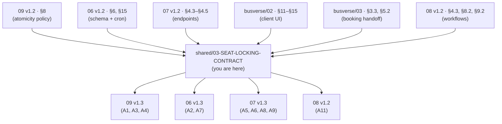

### 1.3 What this document does NOT cover

| Topic | Goes to |
|---|---|
| Availability endpoint contract | `07` v1.2 §4.3 |
| Booking creation endpoint contract | `07` v1.2 §4.5 |
| Payment webhook transaction | `06` v1.2 §3.5 |
| Seat state machine on UI | `busverse/02` §4.3 |
| Lock countdown UI | `busverse/02` §13 |
| Payment retry flow | `busverse/03` §7 |
| Timeout UI | `busverse/03` §8 |
| Full WebSocket protocol | `07` v1.2 §8 |

### 1.4 Scope boundary

**SH-03 is the implementation contract for three layers of defense plus lifecycle:**

| Consumer | Reads from this doc | Tests against |
|---|---|---|
| **API seat lock handler** | §2–§9, §13 | §14 (12 test vectors) |
| **API booking creation handler** | §5 (TTL extension), §9 (lockId) | §14 TV-04, TV-05 |
| **API webhook handler** | §5.5 (Redis DEL), §7 (release paths) | §14 TV-08 |
| **API cron jobs** | §6 (PENDING → EXPIRED), §8 (purge) | §14 TV-06, TV-07 |
| **API schedule cancel handler** | §16.5 (release all locks) | §14 TV-12 |
| **BusVerse client** | §10 (visibility), §11 (resume) | §14 TV-09, TV-10 |
| **Report author** | §1.5 (lifecycle), §14 (test vectors) | — |
| **Viva demo author** | §1.5, §16.5 | — |

**Rule:** Any implementation that touches seat lock, booking creation, payment webhook, or schedule cancellation must conform to this contract. Any PR touching these paths must run `pnpm test:seat-locks` and pass all 12 test vectors.

### 1.5 The complete lock lifecycle

**Diagram: The seat lock lifecycle (hero diagram)**
*Seven states, eight transitions, five cleanup paths. No other doc traces this end-to-end. Every arrow is a specified operation with a defined trigger, caller, and side effects.*

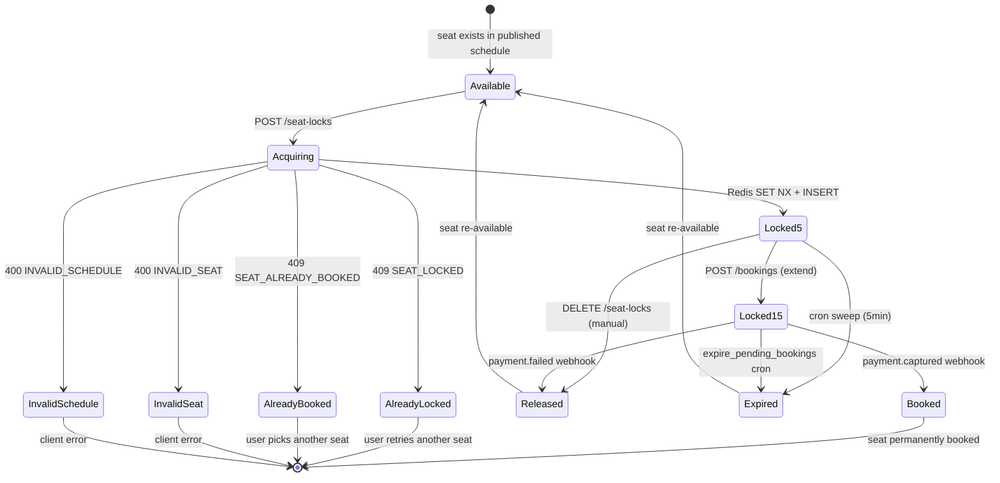

### 1.6 The five cleanup paths

| # | Path | Trigger | Redis | Postgres | Booking state | WS event |
|---|---|---|---|---|---|---|
| 1 | **Manual release** | `DELETE /seat-locks/:id` | `DEL lock:{s}:{seat}` | `DELETE seat_locks` | — | `seat:released` |
| 2 | **Lock TTL expiry** | Cron sweep (>5 min) | auto-expired | `DELETE seat_locks WHERE expires_at < now()` | — | `seat:released` |
| 3 | **Payment success** | `payment.captured` webhook | `DEL lock:{s}:{seat}` | `DELETE seat_locks` | `PENDING → CONFIRMED` | `seat:booked` |
| 4 | **Payment failure** | `payment.failed` webhook | `DEL lock:{s}:{seat}` | `DELETE seat_locks` | `PENDING → FAILED` | `seat:released` |
| 5 | **Payment timeout** | `expire_pending_bookings` cron | `DEL lock:{s}:{seat}` | `DELETE seat_locks` + `UPDATE booking_passengers SET deleted_at` | `PENDING → EXPIRED` | `seat:released` |

**Rule:** All 5 paths must delete both Redis AND Postgres. Missing either creates the bugs G1, G4, G6, G7.

---

## 2. Three-Layer Enforcement

### 2.1 The defense-in-depth pattern

**Diagram: Three-layer lock enforcement**
*Every acquisition attempt passes through 3 layers. Layer 0 (input validation) + Layer 1 (pre-check) reject bad requests cheaply. Layer 2 (Redis) is the fast path. Layer 3 (Postgres) is the source of truth. All 4 must agree for a lock to succeed.*

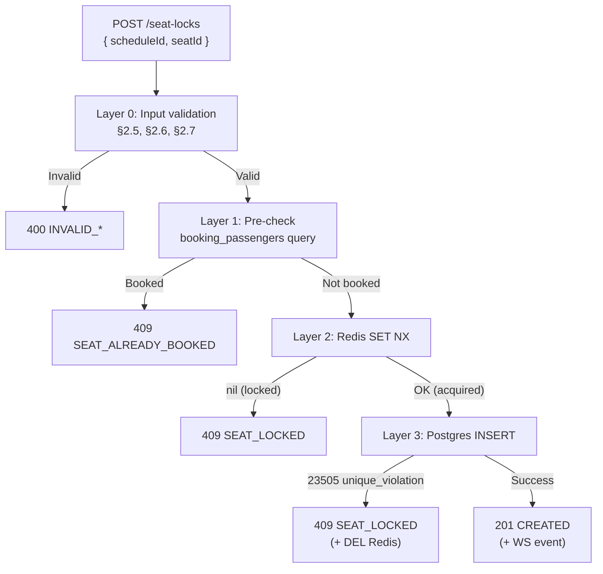

### 2.2 Layer 0 — Input validation (resolves G9)

**Rule:** Every lock request must pass these checks **before** Layer 1:

| # | Check | Query | Error |
|:---:|---|---|---|
| 1 | `schedule` exists and is `PUBLISHED` | `SELECT status FROM schedules WHERE id = :scheduleId` | `400 INVALID_SCHEDULE` |
| 2 | `schedule.departure_time > now()` | Same query | `409 SCHEDULE_DEPARTED` (resolves G8) |
| 3 | `seat` exists | `SELECT * FROM seats WHERE id = :seatId` | `400 INVALID_SEAT` |
| 4 | **`seat.layout.bus_id === schedule.bus_id`** | `SELECT s.bus_id FROM seats se JOIN seat_layouts sl ON se.layout_id = sl.id JOIN schedules sch ON sl.bus_id = sch.bus_id WHERE se.id = :seatId AND sch.id = :scheduleId` — must return 1 row | `400 INVALID_SEAT` (resolves G9) |

**Rationale (G9):** Without check #4, a user could lock a seat from a different bus than the requested schedule, then pay for it, then discover at scan time that the seat isn't on that trip.

**Departed schedule buffer:** Default buffer = 0 (no grace). `schedule.departure_time > now()` OR reject. Rationale: booking a departing bus is never legitimate; search filters prevent it, but deep links could bypass.

### 2.3 Layer 1 — Pre-check query (resolves G7, G5)

**Rule:** The pre-check MUST:

1. Run **before** Redis SET NX (fail fast on booked seats)
2. Query `booking_passengers` with **status filter** (resolves G7)
3. Re-run **inside** the INSERT transaction with `FOR UPDATE` (resolves G5)

**The exact query:**

```sql
SELECT 1
FROM booking_passengers bp
JOIN bookings b ON bp.booking_id = b.id
WHERE bp.schedule_id = :scheduleId
  AND bp.seat_id = :seatId
  AND bp.deleted_at IS NULL
  AND b.status NOT IN ('CANCELLED', 'OPERATOR_CANCELLED', 'REFUNDED', 'EXPIRED', 'FAILED')
LIMIT 1;
```

**Why the status filter matters (G7):** When a booking is cancelled, `bookings.status` changes but `booking_passengers` row persists (soft-delete only on hard-delete per `06` §16's 8-year retention). Without the status filter, cancelled booking seats remain permanently blocked.

**Why `FOR UPDATE` inside the transaction (G5):** Between the pre-check and the INSERT, another user could book the seat. Layer 3's Postgres unique constraint catches it, but only after Redis SET NX succeeded — leaving an orphaned Redis lock. Running the pre-check again with `FOR UPDATE` inside the transaction prevents this.

### 2.4 Layer 2 — Redis SET NX

**Exact command:**

```
SET lock:{scheduleId}:{seatId} "{userId}" NX EX 300
```

| Parameter | Value | Notes |
|---|---|---|
| Key | `lock:{scheduleId}:{seatId}` | 60 chars max (2 UUIDs + prefix) |
| Value | `{userId}` (UUID) | For debugging; not validated on acquire |
| NX | Only set if not exists | Atomic |
| EX | 300 seconds (5 min) | Auto-expire |
| Result on nil | `SEAT_LOCKED` | Someone else holds it |

### 2.5 Layer 3 — Postgres INSERT with delete-before-insert (resolves G2)

**Exact transaction:**

```sql
BEGIN;
  -- Step A: defensive cleanup of expired locks (G2)
  DELETE FROM seat_locks 
  WHERE schedule_id = :scheduleId 
    AND seat_id = :seatId 
    AND expires_at < now();

  -- Step B: re-check pre-check inside transaction (G5)
  SELECT 1 FROM booking_passengers bp
  JOIN bookings b ON bp.booking_id = b.id
  WHERE bp.schedule_id = :scheduleId 
    AND bp.seat_id = :seatId
    AND bp.deleted_at IS NULL
    AND b.status NOT IN ('CANCELLED', 'OPERATOR_CANCELLED', 'REFUNDED', 'EXPIRED', 'FAILED')
  FOR UPDATE;
  -- If 1 row returned → ROLLBACK + return 409 SEAT_ALREADY_BOOKED

  -- Step C: insert the new lock
  INSERT INTO seat_locks (schedule_id, seat_id, user_id, expires_at)
  VALUES (:scheduleId, :seatId, :userId, now() + interval '5 minutes')
  RETURNING id, expires_at;
COMMIT;
```

**Why Step A matters (G2):** Without delete-before-insert, an expired lock row (up to 60s old, before cron sweeps) blocks the INSERT. The user sees `SEAT_LOCKED` on a seat that's actually available.

**Why Step B matters (G5):** The pre-check at Layer 1 runs outside any transaction lock. Between Layer 1 and Layer 3, another user could complete a booking. `FOR UPDATE` inside the transaction ensures no booking is created between check and INSERT.

**On unique violation (23505):** Roll back, then execute `DEL lock:{s}:{seat}` to release the Redis lock (defensive cleanup — Layer 2 succeeded but Layer 3 failed).

---

## 3. Lock Data Model

### 3.1 The seat_locks table

**Reference:** `06` v1.2 §6.2.

```sql
CREATE TABLE seat_locks (
  id           uuid PRIMARY KEY DEFAULT gen_random_uuid(),
  schedule_id  uuid NOT NULL REFERENCES schedules(id) ON DELETE CASCADE,
  seat_id      uuid NOT NULL REFERENCES seats(id) ON DELETE RESTRICT,
  user_id      uuid NOT NULL REFERENCES users(id) ON DELETE CASCADE,
  acquired_at  timestamptz NOT NULL DEFAULT now(),
  expires_at   timestamptz NOT NULL,
  created_at   timestamptz NOT NULL DEFAULT now(),
  updated_at   timestamptz NOT NULL DEFAULT now(),
  deleted_at   timestamptz,
  version      int NOT NULL DEFAULT 0,
  is_test      boolean NOT NULL DEFAULT false
);

CREATE UNIQUE INDEX uniq_seat_locks_schedule_seat
  ON seat_locks (schedule_id, seat_id) 
  WHERE deleted_at IS NULL;

CREATE INDEX idx_seat_locks_expires_at 
  ON seat_locks (expires_at) 
  WHERE deleted_at IS NULL;

CREATE INDEX idx_seat_locks_user_id 
  ON seat_locks (user_id) 
  WHERE deleted_at IS NULL;
```

**Key observations:**

| Aspect | Detail |
|---|---|
| Primary key | `id` (UUID) — this is the `lockId` returned to client |
| Unique constraint | `(schedule_id, seat_id)` — the DB-level guarantee |
| TTL | `expires_at` column — 5 min at acquire, 15 min at booking |
| User scope | `user_id` — enables per-user queries + DELETE authz |
| Soft delete | `deleted_at` — audit trail preserved |

### 3.2 Redis key structure

**Diagram: Redis key namespace**
*Redis holds locks under a single prefix. Postgres is the source of truth; Redis is the fast path. When they diverge (rare), Postgres wins.*

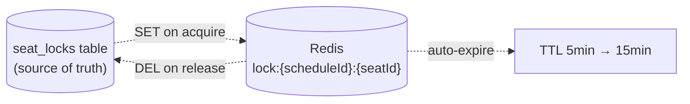

**Redis key:**

| Aspect | Value |
|---|---|
| Pattern | `lock:{scheduleId}:{seatId}` |
| Example | `lock:550e8400-e29b-41d4-a716-446655440000:a1b2c3d4-...` |
| Value | `{userId}` (UUID) — for observability |
| TTL (acquire) | 300 seconds (5 min) |
| TTL (booking) | 900 seconds (15 min) — extended at booking creation (§5) |
| Eviction | `noeviction` policy (locks never evicted before TTL) |

**`lockId` returned to client:** The **Postgres `seat_locks.id`** (UUID). Never the Redis key. The client passes `lockId` to `POST /bookings` for correlation but the server validates via `passengers[].seatId` (§9).

### 3.3 The three identifiers

**Diagram: Three identifiers, three purposes**
*`lockId` (Postgres UUID), the Redis key (derived), and `userId` (which user holds it) are three different things. Confusing them causes bugs.*

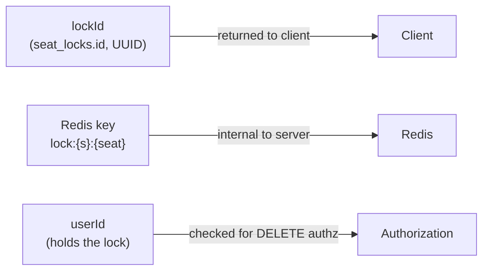

**Rules:**

| Rule | Detail |
|---|---|
| `lockId` in API responses = `seat_locks.id` | Never Redis key |
| Redis key = derived from `(scheduleId, seatId)` | Never exposed to client |
| `userId` = from session | Validated on DELETE (§11.5) and on re-acquire (§9.5) |

---

## 4. Lock Acquisition Flow

### 4.1 The full sequence

**Diagram: Lock acquisition sequence**
*From client request to WebSocket event. Every step is verified; any failure short-circuits to an error. The atomicity is guaranteed by running pre-check + INSERT inside one transaction, with delete-before-insert in Step 4.*

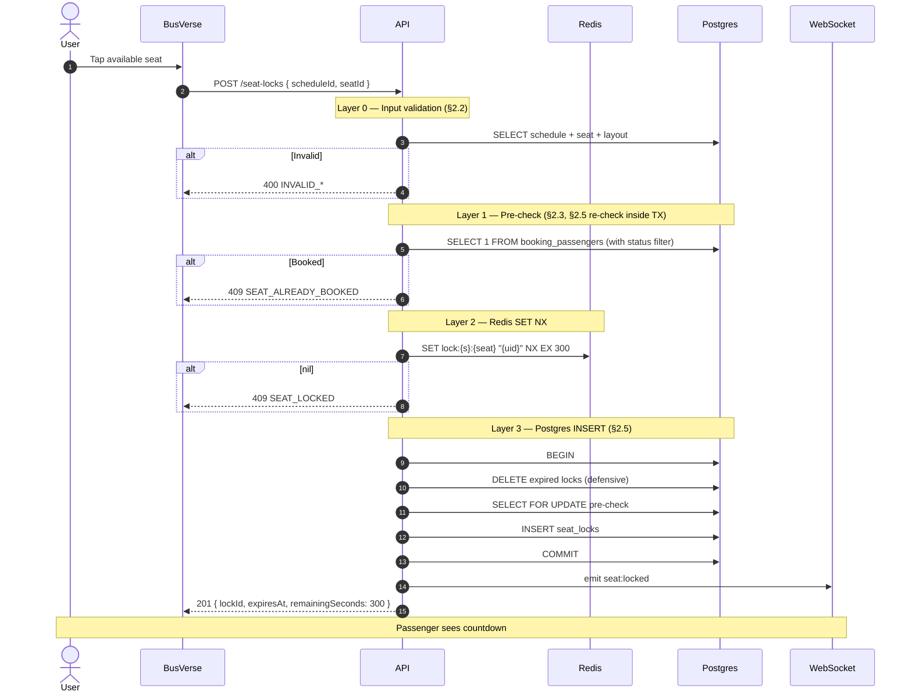

### 4.2 The decision tree

**Diagram: Acquisition decision tree**
*Every rejection path from Layer 0 through Layer 3. The tree shows what the user sees at each failure.*

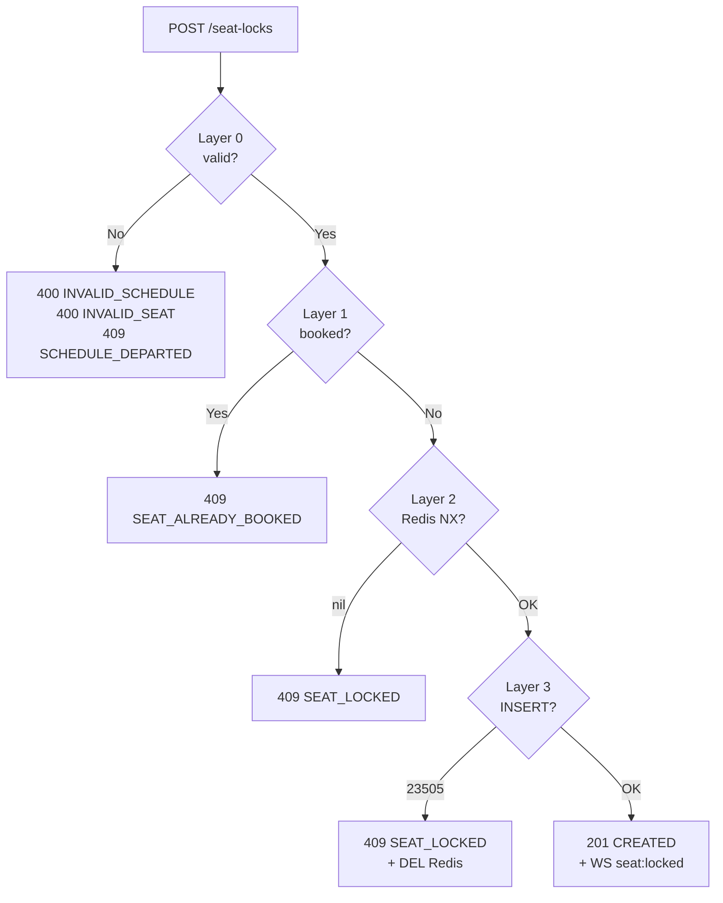

### 4.3 Idempotency on acquisition (resolves G11)

**Diagram: Same-user re-acquire**
*If the same user re-locks the same seat (retry, double-tap, network retry), return the existing lock — not 409. This is the idempotency contract.*

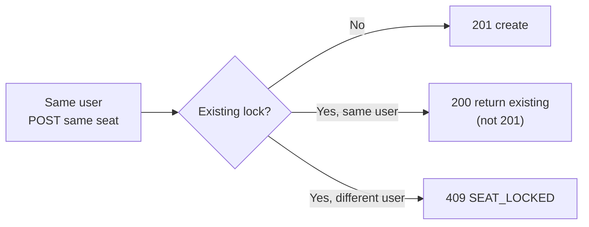

**Rules:**

| Scenario | HTTP | Response |
|---|---|---|
| Same user + existing valid lock | **200 OK** | Return existing `{ lockId, expiresAt, remainingSeconds }` |
| Different user + existing lock | 409 | `SEAT_LOCKED` |
| No existing lock | 201 | New lock created |

**Rationale:** Network retries (mobile network drop, browser back-button resubmit) shouldn't fail. HTTP 200 on re-acquire distinguishes "existing" from "created" for client logic.

**Query:**

```sql
SELECT id, expires_at FROM seat_locks
WHERE schedule_id = :scheduleId 
  AND seat_id = :seatId 
  AND user_id = :currentUserId
  AND expires_at > now()
  AND deleted_at IS NULL;
```

**Note:** This check runs at **Layer 1** (before Redis SET NX). If found, skip Redis and Postgres entirely, return 200.

### 4.4 Multi-schedule locks (resolves G14)

**Rule:** A user can hold **locks on multiple schedules simultaneously** (e.g., comparing two buses).

| Aspect | Detail |
|---|---|
| Cross-schedule limit | None (each lock is per `(schedule, seat)` pair) |
| Same user, different schedules | ✅ Allowed |
| Same user, same schedule, multiple seats | ✅ Allowed (multi-passenger) |
| Same user, same seat, different schedules | ✅ Allowed (different seats at different buses) |
| Session scope | Session's user can hold N locks across M schedules |

**Rationale:** Users naturally want to compare options. Blocking multi-schedule locks forces them to abandon locks during comparison, harming UX. The countdown timer pressure and TTL auto-expiry keep total locks bounded.

**Reference:** `busverse/02` §14.1.

---

## 5. TTL Extension on Booking

### 5.1 The problem (G1)

**Diagram: The Redis-Postgres desync bug**
*Without this fix, a booking made at 4:00 extends only Postgres. Redis TTL expires at 5:00. Redis allows a new lock; Postgres blocks the INSERT. The seat is reported as LOCKED to everyone but is actually booked.*

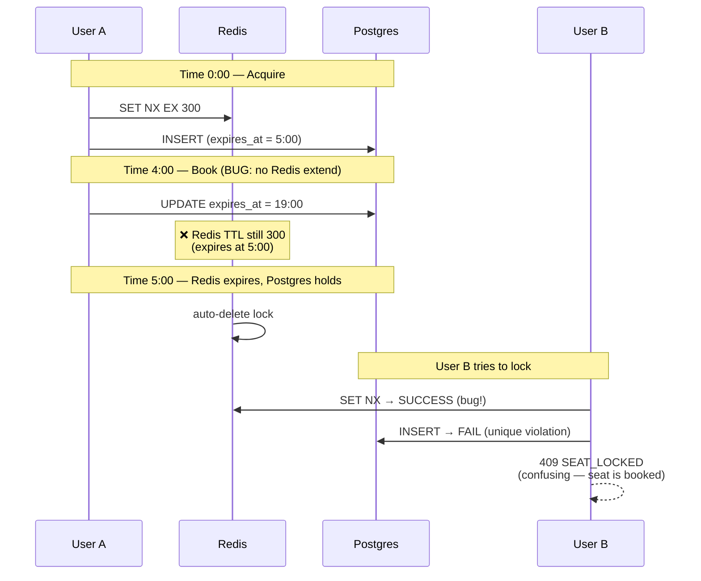

### 5.2 The fix

**Diagram: TTL extension — both layers**
*Booking creation must extend BOTH Redis TTL and Postgres `expires_at`. If either fails, roll back both.*

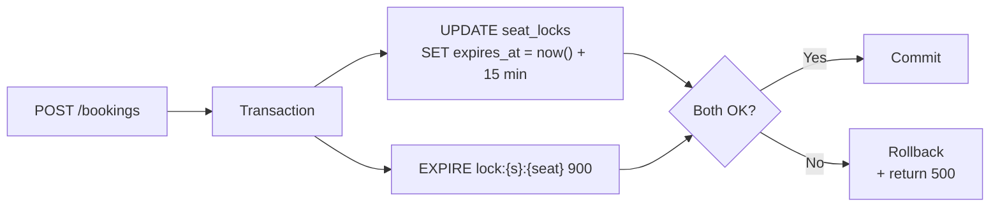

### 5.3 The exact transaction

**Reference:** `06` v1.2 §3.5.

```sql
BEGIN;

-- Step 1: Create booking PENDING
INSERT INTO bookings (user_id, schedule_id, status, expires_at, ...)
VALUES (..., 'PENDING', now() + interval '15 minutes', ...)
RETURNING id;

-- Step 2: Create booking passengers
INSERT INTO booking_passengers (booking_id, seat_id, schedule_id, ...)
VALUES (..., :booking_id, :seat_id, :schedule_id, ...);

-- Step 3: Extend lock expiry (Postgres side — G1 fix)
UPDATE seat_locks
SET expires_at = now() + interval '15 minutes'
WHERE schedule_id = :scheduleId
  AND seat_id = :seatId
  AND user_id = :currentUserId
  AND expires_at > now()
  AND deleted_at IS NULL;

-- If 0 rows updated → lock expired before booking → ROLLBACK
-- Return 400 LOCK_EXPIRED with details.seatId

COMMIT;
```

**Then, outside the transaction:**

```typescript
// Step 4: Extend Redis TTL (G1 fix)
// This must happen AFTER the transaction commits
// because if the transaction rolls back, we don't want to extend Redis either
for (const seatId of passengers.map(p => p.seatId)) {
  try {
    await redis.expire(`lock:${scheduleId}:${seatId}`, 900); // 15 min
  } catch (err) {
    // Redis failure — log but don't fail the booking
    // Postgres is source of truth; Redis will re-populate via availability query
    logger.error({ err, scheduleId, seatId }, 'redis_expire_failed');
  }
}
```

### 5.4 Timing race

**Diagram: Extension timing**
*Redis extension happens AFTER Postgres commit. A brief window (microseconds) exists where Postgres has 15 min but Redis has 5 min remaining. This is safe because the pre-check prevents double-booking during the window.*

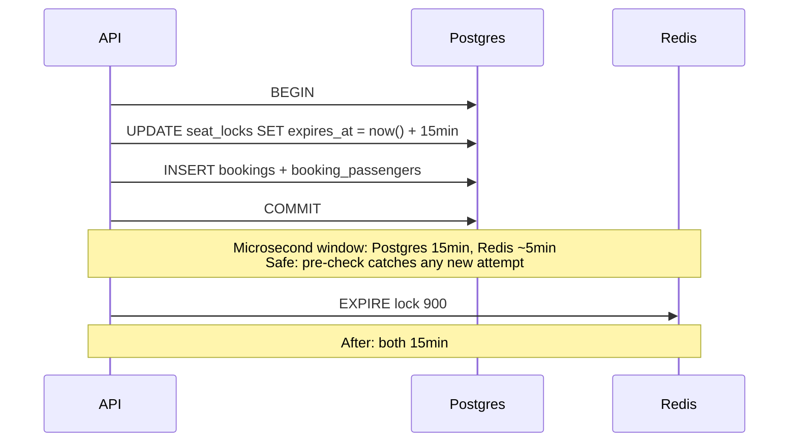

**Rationale:** If Redis extension fails, the booking is still valid (Postgres has it). The next availability query for this schedule will re-check Postgres and see the booking, preventing new locks via the pre-check. Self-heals.

### 5.5 Redis DEL on all release paths (G6 fix)

**Diagram: Redis DEL — 5 paths**
*Every release path must execute both Postgres DELETE and Redis DEL. Missing either causes the seat to appear blocked or booked incorrectly.*

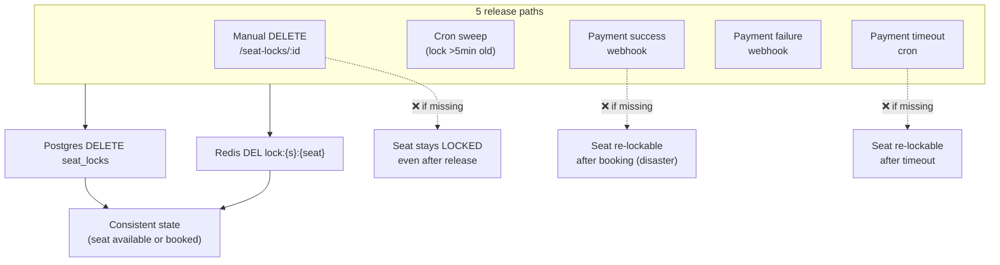

**Exact operations per path:**

| Path | Postgres | Redis | Order |
|---|---|---|---|
| Manual release | `DELETE seat_locks WHERE id = :lockId AND user_id = :userId` | `DEL lock:{s}:{seat}` | Postgres first, then Redis |
| Cron sweep | `DELETE seat_locks WHERE expires_at < now()` | auto-expired (TTL) | Postgres only |
| Payment success | `DELETE seat_locks WHERE schedule_id = :s AND seat_id IN (:seats)` | `DEL lock:{s}:{seat}` for each | Inside transaction (PG); after commit (Redis) |
| Payment failure | Same as success | Same | Same |
| Payment timeout | Same as success + `UPDATE booking_passengers SET deleted_at` | Same | Same |

**Rule (defensive):** Redis DEL should be wrapped in try/catch. If Redis is down at release time, Postgres still holds the truth. On the next availability query, the pre-check catches this (booking exists → SEAT_ALREADY_BOOKED). Self-heals when Redis recovers.

**Reference:** `06` v1.2 §3.5 (payment transaction), `07` v1.2 §4.4 (manual release).

---

## 6. PENDING → EXPIRED: Abandoned Booking Bug

### 6.1 The problem (G4)

**Diagram: The abandoned booking bug**
*Payment timeout transitions booking PENDING → EXPIRED and deletes seat_locks. But `booking_passengers` rows persist. The pre-check finds them → seat permanently blocked even though the booking is dead.*

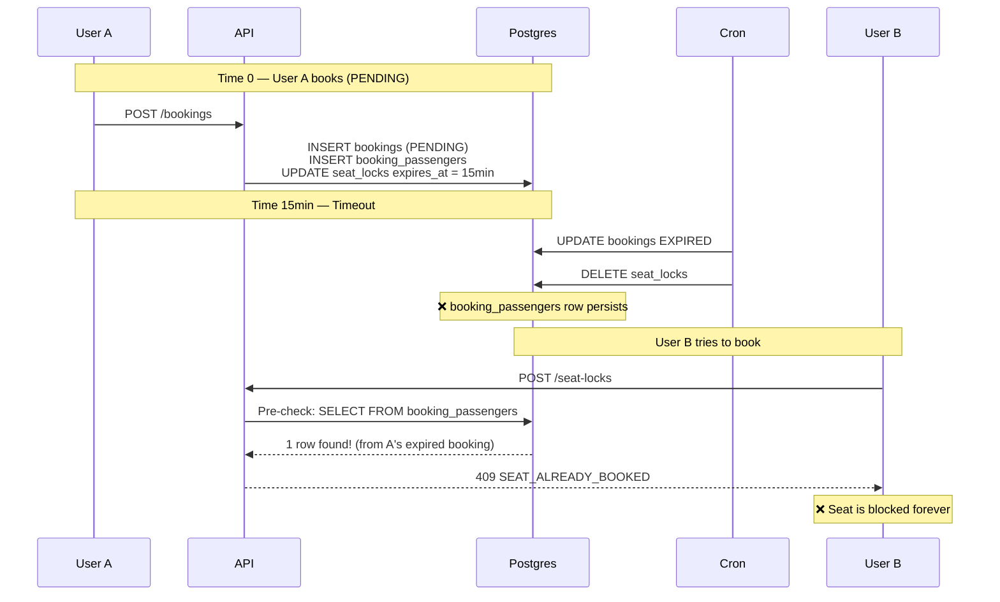

### 6.2 The fix

**Diagram: Updated cron transaction**
*`expire_pending_bookings` must soft-delete `booking_passengers` in the same transaction.*

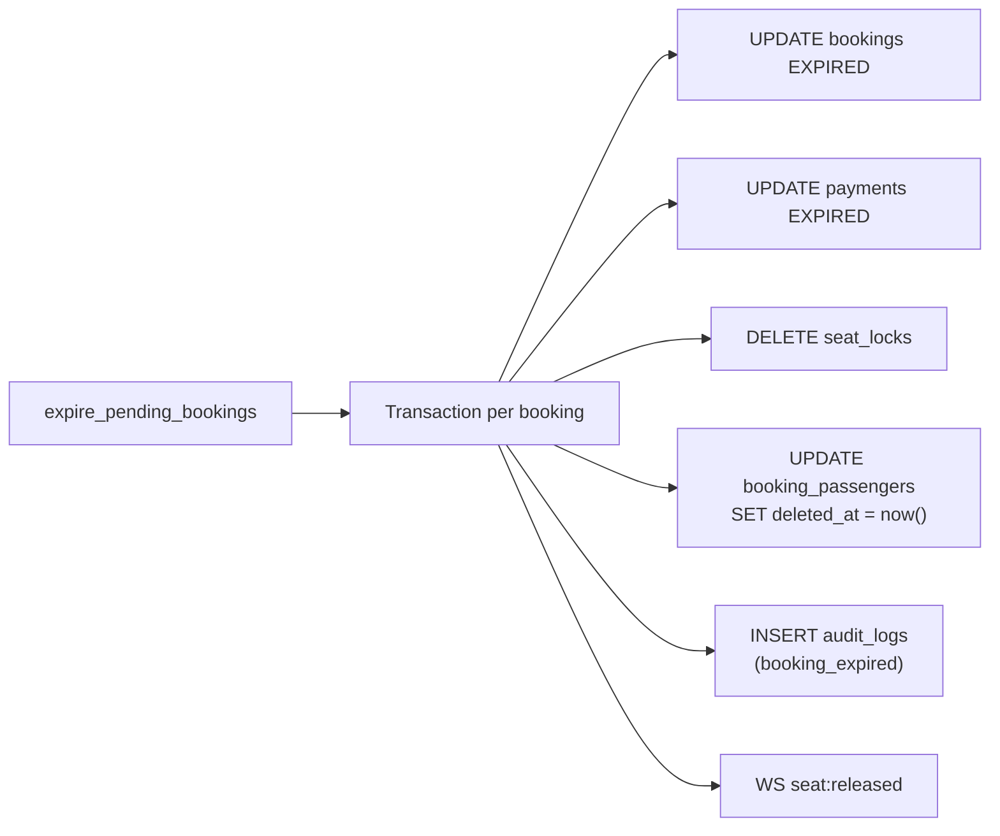

### 6.3 The exact SQL

**Reference:** `06` v1.2 §15 (existing cron — must be extended).

```sql
BEGIN;

-- Step 1: Mark booking + payment expired
UPDATE bookings 
SET status = 'EXPIRED', expired_at = now()
WHERE id = :booking_id AND status = 'PENDING';

UPDATE payments
SET status = 'EXPIRED', expired_at = now()
WHERE booking_id = :booking_id AND status IN ('INITIATED', 'PENDING');

-- Step 2: Release locks (Postgres)
DELETE FROM seat_locks 
WHERE schedule_id = :schedule_id AND seat_id IN (:seat_ids);

-- Step 3: Clean up booking_passengers (G4 fix)
UPDATE booking_passengers
SET deleted_at = now()
WHERE booking_id = :booking_id;

-- Step 4: Audit
INSERT INTO audit_logs (entity_type, entity_id, action, ...)
VALUES ('Booking', :booking_id, 'booking_expired', ...);

COMMIT;

-- Step 5: Redis cleanup (outside transaction, defensive)
for (const seatId of seatIds) {
  await redis.del(`lock:${scheduleId}:${seatId}`).catch(logWarning);
}

-- Step 6: WS event (outside transaction)
ws.emit(`seat:availability:${scheduleId}`, {
  event: 'seat:released',
  seatIds: seatIds
});
```

### 6.4 Why soft-delete (not hard-delete)

| Option | Retention | Audit | Pre-check query |
|---|---|---|---|
| Hard-delete | Gone | Lost | Faster |
| **Soft-delete** | 8 years (per `06` §16) | Preserved | `WHERE deleted_at IS NULL` |

**Recommendation:** Soft-delete. Preserves audit trail for disputes ("my payment succeeded but the system says expired" — `booking_passengers` row shows what was booked). Adds negligible cost to pre-check (indexed).

**Amendment:** `06` v1.3 §15 must add Step 3 to the cron.

### 6.5 Cancelled booking cleanup (resolves G7)

**Diagram: Cancelled booking — two approaches**
*When a booking is cancelled, `booking_passengers` row persists (soft-delete only). Two possible fixes.*

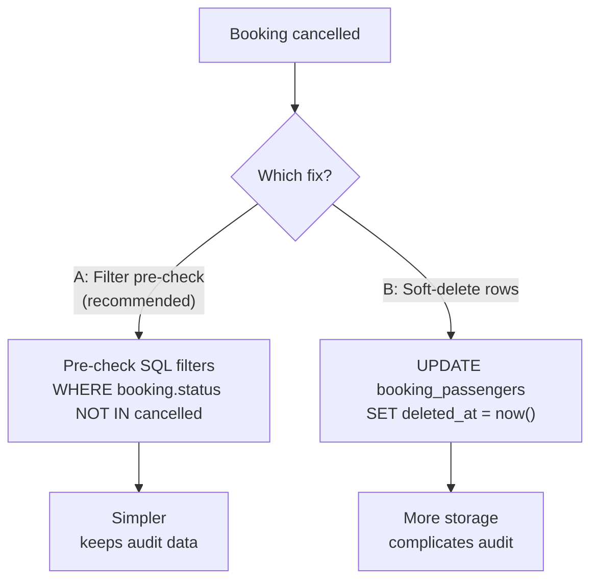

**Recommendation: Option A (filter pre-check).**

**Updated pre-check query (already in §2.3):**

```sql
SELECT 1
FROM booking_passengers bp
JOIN bookings b ON bp.booking_id = b.id
WHERE bp.schedule_id = :scheduleId
  AND bp.seat_id = :seatId
  AND bp.deleted_at IS NULL
  AND b.status NOT IN ('CANCELLED', 'OPERATOR_CANCELLED', 'REFUNDED', 'EXPIRED', 'FAILED')
LIMIT 1;
```

**Why filter not soft-delete:** The `booking_passengers` row is legitimate historical data (passenger Alice booked A1 on this booking, then cancelled). Filtering by booking status preserves this information without making the row disappear. If Phase 2 adds booking re-open, the seat data is still there.

**Amendment:** `09` v1.3 §8.2 must update pre-check description to include status filter.

---

## 7. Lock Release Paths & Events

### 7.1 The five release paths

**Diagram: Release path matrix**
*Five distinct paths to release a lock, each with different triggers, callers, and WS events.*

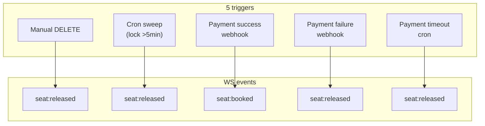

### 7.2 Detailed matrix

| # | Path | Trigger | Caller | Postgres | Redis | WS event | Booking state |
|---|---|---|---|---|---|---|---|
| 1 | Manual | `DELETE /seat-locks/:id` | Client | `DELETE seat_locks WHERE id AND user_id` | `DEL lock:{s}:{seat}` | `seat:released` | — |
| 2 | Sweep | Cron > 5 min | Cron | `DELETE seat_locks WHERE expires_at < now()` | auto-expired | `seat:released` | — |
| 3 | Payment success | `payment.captured` | Webhook | `DELETE seat_locks` | `DEL` | `seat:booked` | `PENDING → CONFIRMED` |
| 4 | Payment failure | `payment.failed` | Webhook | `DELETE seat_locks` | `DEL` | `seat:released` | `PENDING → FAILED` |
| 5 | Payment timeout | `expire_pending_bookings` | Cron | `DELETE seat_locks` + `UPDATE booking_passengers SET deleted_at` | `DEL` | `seat:released` | `PENDING → EXPIRED` |

**Rules:**

| Rule | Detail |
|---|---|
| Event names | `seat:released` (5→available) or `seat:booked` (5→booked) |
| Event topic | `seat:availability:{scheduleId}` |
| Event timing | **After** DB commit (per `06` §3.5) |
| Manual DELETE idempotency | Second DELETE returns 204 (not 404) — idempotent |

### 7.3 Manual release sequence

**Diagram: Manual release**
*User clicks "release" on the seat deck. Postgres DELETE + Redis DEL + WS event. Idempotent — second call returns 204.*

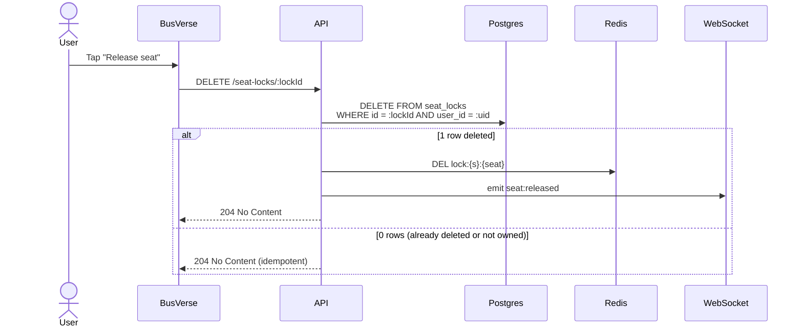

**Rule:** `DELETE` returns 204 in both cases (deleted vs already gone). Ownership failures return 404 (§11.5), not 204.

### 7.4 Cron sweep release

**Diagram: Cron sweep**
*A nightly + 60s-interval sweep purges expired locks and emits WS events.*

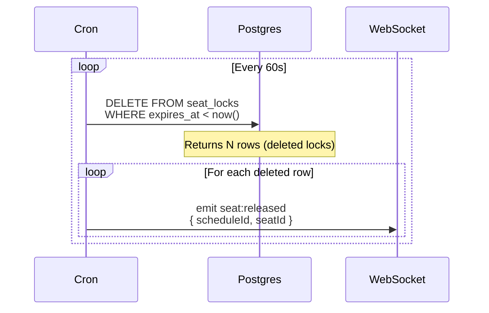

**Reference:** `06` v1.2 §15 `purge_seat_locks` job.

### 7.5 WS event on cron-driven release (resolves G22)

**Rule:** `purge_seat_locks` cron must emit `seat:released` for each deleted lock.

**Without this (bug G22):** After a lock expires, seat deck clients polling get updated availability, but WebSocket subscribers don't know until their next poll (5s or 3s per `busverse/02` §15). The seat shows LOCKED on other users' screens after expiry — a stale UX bug.

**Amendment:** `06` v1.3 §15 must add WS emit to the `purge_seat_locks` cron, and `08` v1.2 must reference the cron's WS behavior.

---

## 8. Expired Lock Cleanup

### 8.1 The expired lock race (G2)

**Diagram: Delete-before-insert pattern**
*Between TTL expiry and cron sweep (up to 60s window), an expired lock row can block a new INSERT. Fix: delete expired rows in the same transaction before insert.*

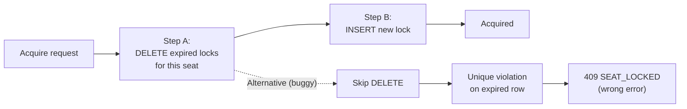

### 8.2 The exact transaction

**Reference:** Already shown in §2.5 Step A. Repeated here:

```sql
BEGIN;
DELETE FROM seat_locks 
WHERE schedule_id = :scheduleId 
  AND seat_id = :seatId 
  AND expires_at < now();

SELECT 1 FROM booking_passengers ... FOR UPDATE;
INSERT INTO seat_locks (...) RETURNING id, expires_at;
COMMIT;
```

### 8.3 The 60-second window

**Diagram: TTL vs cron lag**
*Redis TTL is exact (5min to the second). Postgres `expires_at` is approximate (cron sweeps every 60s). Within the 60s window, both states differ.*

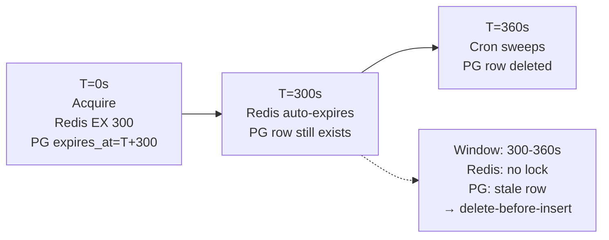

**Rationale:** Cron interval is 60s (per `06` §15). During the 0-60s window after Redis expiry, the Postgres row still exists. Without delete-before-insert, new lock attempts fail.

### 8.4 Redis defensive cleanup

**Diagram: Redis cleanup on Postgres failure**
*If Postgres INSERT fails after Redis SET NX succeeded, Redis holds a phantom lock. Must DEL to prevent blocking.*

```mermaid
sequenceDiagram
    participant API as API
    participant RD as Redis
    participant PG as Postgres

    API->>RD: SET NX (succeeds)
    API->>PG: INSERT
    PG-->>API: 23505 (unique violation)
    API->>RD: DEL (defensive cleanup)
    API-->>API: Return 409 SEAT_LOCKED
```

**Rule:** On unique violation (23505), the API must execute `DEL lock:{s}:{seat}` before returning 409. Without this, the phantom Redis lock persists for up to 5 minutes.

### 8.5 Pre-check-then-lock race mitigation (G5)

**Diagram: The race**
*Between the pre-check (Layer 1) and the INSERT (Layer 3), a booking could be created. `FOR UPDATE` inside the transaction locks the `booking_passengers` rows.*

```mermaid
sequenceDiagram
    participant U1 as User A
    participant U2 as User B
    participant API as API
    participant PG as Postgres

    Note over U1,PG: Time T1 — User A pre-check passes
    U1->>API: POST /seat-locks
    API->>PG: SELECT FROM booking_passengers (no row) → pass

    Note over U1,PG: Time T2 — User B books the seat
    U2->>API: POST /bookings (another lock, then book)
    API->>PG: INSERT booking_passengers (succeeds)

    Note over U1,PG: Time T3 — User A INSERT (would fail without FOR UPDATE)
    U1->>API: Continues to Layer 3
    API->>PG: INSERT seat_locks
    Note over PG: ❌ Would succeed without re-check<br/>✅ FOR UPDATE inside TX catches User B's row

    API->>PG: BEGIN<br/>DELETE expired<br/>SELECT FOR UPDATE booking_passengers → 1 row!
    API->>PG: ROLLBACK → return 409 SEAT_ALREADY_BOOKED
```

**The fix (already in §2.5 Step B):**

```sql
BEGIN;
DELETE FROM seat_locks ... (defensive)
SELECT 1 FROM booking_passengers ... FOR UPDATE;
-- If 1 row → ROLLBACK + 409
INSERT INTO seat_locks ...;
COMMIT;
```

**Cost:** ~2ms additional lock time. **Benefit:** eliminates a real race condition.

### 8.6 Race window analysis

| Layer | Runs at | Race window |
|---|---|---|
| L0 | Before TX | ~1ms (fast, no lock) |
| L1 | Before Redis | ~2ms (between L1 and L3) |
| L2 | Before TX | ~1ms (between Redis and TX) |
| L3 (with FOR UPDATE) | Inside TX | **0ms** (locked) |

**Rule:** The `FOR UPDATE` inside L3 makes the race window zero. Without it, L1 and L3 could disagree for 3ms — enough for a race under load.

---

## 9. `lockId` Contract Resolution

### 9.1 The problem (G3)

**Diagram: The lockId contradiction**
*Three docs disagree on what `lockId` means. One says singular lock, one says per-seat, one says array. N locks can't be represented by one lockId without a rule.*

```mermaid
flowchart TB
    BV02["busverse/02 §14.1:<br/>'Each seat individually locked'"]
    D07["07 §4.5:<br/>'lockId: string' (singular)"]
    BV03["busverse/03 §3.3:<br/>'lockId: string' (singular)"]

    BV02 --> CONFLICT{"Contradiction:<br/>N locks, 1 lockId"}
    D07 --> CONFLICT
    BV03 --> CONFLICT
```

### 9.2 The resolution

**Rule:** `lockId` is a **representative** lock. Any one of the user's active locks for this schedule works. The server validates **each** `passengers[].seatId` has an active lock for this user + schedule.

**Diagram: lockId is representative**
*Client sends one `lockId` (any of the N) plus the array of `passengers[].seatId`. Server ignores `lockId` for validation and validates per-seat.*

```mermaid
flowchart LR
    REQ["POST /bookings<br/>{ lockId: 'lock_1',<br/>  passengers: [{seatId: 'A1'}, {seatId: 'A2'}, {seatId: 'A3'}] }"]
    REQ --> SERVER["Server"]
    SERVER --> CHECK1["Verify lockId exists<br/>for this user+schedule<br/>(else 400 LOCK_NOT_FOUND)"]
    SERVER --> CHECK2["For each seatId:<br/>verify active lock exists<br/>(else 400 LOCK_EXPIRED with details)"]
    CHECK1 --> VALID["All valid → proceed"]
    CHECK2 --> VALID
```

### 9.3 The validation rules

| Rule | Detail |
|---|---|
| `lockId` provided | Required (per `07` §4.5 contract) |
| `lockId` exists | Must be an active lock for this user + schedule, else `400 LOCK_NOT_FOUND` |
| `lockId` seat | **Not validated** against `passengers[].seatId` — it's representative |
| Each `seatId` | Must have an active lock for this user + schedule, else `400 LOCK_EXPIRED` with `details.seatId` |
| `seatId` count | Must equal `passengers.length` |
| All-or-nothing | If any seat fails, entire request fails (no partial booking) |

### 9.4 The validation query

```sql
-- For each passengers[].seatId
SELECT 1
FROM seat_locks
WHERE schedule_id = :scheduleId
  AND seat_id = :seatId
  AND user_id = :currentUserId
  AND expires_at > now()
  AND deleted_at IS NULL;
-- If 0 rows → 400 LOCK_EXPIRED with details.seatId = :seatId
```

**Rule:** The query runs per-seat inside the booking transaction (`06` §3.5). All must return 1 row.

### 9.5 Idempotency note

**Note:** The `lockId` in the request is for API backwards compatibility and debugging. If a future schema adds explicit multi-lock support, `lockId` becomes an array. For Phase 1, `lockId` is a single representative.

**Amendment:** `07` v1.3 §4.5 must clarify `lockId` semantics. `busverse/02` v1.1 §14.1 should not describe locks as "individually" locked without noting the `lockId` contract.

---

## 10. Cross-User Lock Visibility

### 10.1 The availability query

**Diagram: Availability query composition**
*The `GET /schedules/:id/availability` endpoint must LEFT JOIN two tables — seat_locks (for LOCKED/MINE) and booking_passengers (for BOOKED). The user's session determines MINE vs LOCKED.*

```mermaid
flowchart LR
    QUERY["SELECT seats.*<br/>FROM seats<br/>LEFT JOIN seat_locks ON ...<br/>LEFT JOIN booking_passengers ON ...<br/>WHERE seat.layout.bus = schedule.bus"]
    QUERY --> STATE["State derivation"]
    STATE --> S1["booking_passengers exists<br/>(booking active) → BOOKED"]
    STATE --> S2["seat_locks.user_id = me → MINE"]
    STATE --> S3["seat_locks.user_id ≠ me → LOCKED"]
    STATE --> S4["Neither → AVAILABLE"]
```

### 10.2 The exact query

```sql
SELECT 
  se.id AS seat_id,
  se.seat_label,
  se.seat_row,
  se.seat_column,
  se.seat_type,
  se.is_female_only,
  CASE
    WHEN bp.id IS NOT NULL THEN 'BOOKED'
    WHEN sl.user_id = :currentUserId THEN 'MINE'
    WHEN sl.id IS NOT NULL THEN 'LOCKED'
    ELSE 'AVAILABLE'
  END AS state,
  sl.expires_at
FROM seats se
JOIN seat_layouts slay ON se.layout_id = slay.id
JOIN schedules sch ON sch.bus_id = slay.bus_id
LEFT JOIN seat_locks sl 
  ON sl.seat_id = se.id 
  AND sl.schedule_id = :scheduleId
  AND sl.expires_at > now()
  AND sl.deleted_at IS NULL
LEFT JOIN booking_passengers bp
  ON bp.seat_id = se.id
  AND bp.schedule_id = :scheduleId
  AND bp.deleted_at IS NULL
  AND bp.booking_id IN (
    SELECT id FROM bookings 
    WHERE status NOT IN ('CANCELLED', 'OPERATOR_CANCELLED', 'REFUNDED', 'EXPIRED', 'FAILED')
  )
WHERE sch.id = :scheduleId
  AND se.deleted_at IS NULL
ORDER BY se.seat_row, se.seat_column;
```

### 10.3 The state derivation

| Condition | State | Color |
|---|---|---|
| `booking_passengers` row (booking active) | `BOOKED` | Slate |
| `seat_locks.user_id = me` (my lock) | `MINE` | Blue (selected) |
| `seat_locks.user_id ≠ me` (someone else's lock) | `LOCKED` | Amber |
| Neither | `AVAILABLE` | Emerald |

**Reference:** `busverse/02` §4.3 (state derivation on client), §7.1 (colors per state).

### 10.4 No stale `MINE` states

**Rule:** A `MINE` state must always have `expires_at > now()`. If the user's lock expired but wasn't swept yet, the availability query filters it out via `sl.expires_at > now()`. User sees `AVAILABLE`.

### 10.5 Search staleness handling (resolves G16)

**Rule:** Search results (`busverse/01` §4.9) show "N seats available" from a 60-second cached count. This count may be stale by up to 60s.

| Aspect | Detail |
|---|---|
| Search cache | 60s (per `busverse/01` §4.9) |
| Seat deck fetch | Fresh from Postgres (no cache) |
| Staleness window | User sees correct seats after clicking into deck |
| Action if stale | Show fresh state; if user taps stale seat, lock attempt returns 409 correctly |

**Rationale:** Search filters many schedules; fetching fresh seat counts for all would be expensive. 60s staleness is acceptable because the seat deck is the source of truth.

---

## 11. Resume Flow and DELETE Authorization

### 11.1 The resume flow

**Diagram: Resume abandoned lock**
*Passenger closes tab, reopens. The client calls `GET /seat-locks/active` to find active locks and prompts to resume.*

```mermaid
sequenceDiagram
    participant U as User
    participant BV as BusVerse
    participant API as API

    U->>BV: Reopen ticket tab
    BV->>API: GET /seat-locks/active
    API-->>BV: { locks: [...] }
    alt Locks exist
        BV-->>U: "You have 3 seats locked. Resume?"
        U->>BV: Tap Resume
        BV-->>U: Restore seat deck
    else No locks
        BV-->>U: Show results
    end
```

**Reference:** `busverse/02` §14.4.

### 11.2 Response schema (resolves N3)

```json
{
  "data": {
    "locks": [
      {
        "lockId": "550e8400-e29b-41d4-a716-446655440000",
        "scheduleId": "660e8400-e29b-41d4-a716-446655440001",
        "seatId": "770e8400-e29b-41d4-a716-446655440002",
        "seatLabel": "A1",
        "seatRow": "A",
        "seatColumn": 1,
        "expiresAt": "2026-10-25T14:35:00.000Z",
        "remainingSeconds": 287,
        "schedule": {
          "originCity": "Delhi",
          "destinationCity": "Lucknow",
          "departureTime": "2026-10-25T14:00:00.000Z"
        }
      }
    ]
  }
}
```

### 11.3 Rules

| Rule | Detail |
|---|---|
| Filters | `WHERE user_id = :currentUserId AND expires_at > now() AND deleted_at IS NULL` |
| Sort | `expires_at ASC` (earliest to expire first) |
| Max results | 20 (most recent, but 20 is generous) |
| Empty | `{ locks: [] }` (not 404) |
| Auth | JWT required |

### 11.4 The client's resume decision

| Scenario | Client action |
|---|---|
| 1 active lock on current schedule | Auto-resume with countdown |
| Multiple locks, one schedule | Show banner with count |
| Locks on different schedule | Show per-schedule prompt |
| Expired between fetch and resume | Server returns 400 LOCK_EXPIRED; user restarts |

### 11.5 DELETE authorization (resolves G12)

**Diagram: DELETE with user scoping**
*The DELETE endpoint must scope by `user_id` to prevent lock hijacking via leaked UUID.*

```mermaid
sequenceDiagram
    actor U as User
    participant API as API
    participant PG as Postgres
    participant RD as Redis

    U->>API: DELETE /seat-locks/:lockId
    API->>API: Extract currentUserId from session
    API->>PG: DELETE FROM seat_locks<br/>WHERE id = :lockId AND user_id = :currentUserId
    alt 1 row deleted
        API->>RD: DEL lock:{s}:{seat}
        API-->>U: 204
    else 0 rows (not owned or not exists)
        API-->>U: 404 NOT_FOUND
    end
```

**The exact query:**

```sql
DELETE FROM seat_locks
WHERE id = :lockId
  AND user_id = :currentUserId
  AND deleted_at IS NULL
RETURNING schedule_id, seat_id;
```

**Rules:**

| Condition | HTTP | Reason |
|---|---|---|
| Own lock exists | 204 | Deleted |
| Lock exists, wrong user | **404** (not 403) | Row-scope hides existence |
| Lock doesn't exist | 204 (idempotent) | Idempotent delete |
| Lock already expired | 204 | Idempotent |

**Rationale:** Returning 404 for wrong-user matches `04` §14.3's row-scope rule (don't reveal resource existence). Returning 204 for non-existent preserves idempotency.

**Amendment:** `07` v1.3 §4.4 must add user scoping to DELETE semantics.

---

## 12. WebSocket Event Schemas

### 12.1 Three events

**Diagram: WebSocket events**
*Three events drive the seat deck UI. All emit to `seat:availability:{scheduleId}`. Payloads canonicalized here.*

```mermaid
flowchart TB
    T["Topic: seat:availability:{scheduleId}"]

    T --> E1["seat:locked<br/>(after INSERT)"]
    T --> E2["seat:released<br/>(after DELETE)"]
    T --> E3["seat:booked<br/>(after payment.captured)"]
```

### 12.2 Event payloads

**`seat:locked`:**

```json
{
  "event": "seat:locked",
  "topic": "seat:availability:660e8400-...",
  "data": {
    "seatId": "770e8400-...",
    "lockedUntil": "2026-10-25T14:35:00.000Z",
    "lockedByMe": false
  },
  "ts": "2026-10-25T14:30:00.180Z"
}
```

**`seat:released`:**

```json
{
  "event": "seat:released",
  "topic": "seat:availability:660e8400-...",
  "data": {
    "seatId": "770e8400-...",
    "reason": "manual" | "expired" | "payment_failed" | "payment_timeout"
  },
  "ts": "2026-10-25T14:35:00.180Z"
}
```

**`seat:booked`:**

```json
{
  "event": "seat:booked",
  "topic": "seat:availability:660e8400-...",
  "data": {
    "seatId": "770e8400-...",
    "bookingId": "880e8400-..."
  },
  "ts": "2026-10-25T14:35:00.180Z"
}
```

### 12.3 Subscriber behavior

| Event | Subscriber action |
|---|---|
| `seat:locked` | If `lockedByMe: false` → mark seat LOCKED; if `lockedByMe: true` → mark MINE (echo of own action, idempotent) |
| `seat:released` | Mark seat AVAILABLE (unless user has their own lock) |
| `seat:booked` | Mark seat BOOKED |

**Reference:** `busverse/02` §12.1 (event handling), `07` v1.2 §8.7 (event catalog).

### 12.4 Consistency with polling

**Rule:** WebSocket events must match what the polling fallback (`GET /schedules/:id/availability`) returns. Same state derivation (§10.2). Same colors. Client shouldn't behave differently based on transport.

---

## 13. Failure Modes

### 13.1 The two critical failures

**Diagram: Failure behavior**
*Redis failure degrades gracefully (DB-only). Postgres failure is fatal (fail closed). This is the correct split: Redis is optimization, Postgres is truth.*

```mermaid
flowchart TB
    F["Failure"]

    F --> R["Redis down"]
    F --> P["Postgres down"]

    R --> R1["Degrade to DB-only<br/>Pre-check + unique constraint still work<br/>Slower (no Redis NX)"]
    R1 --> R2["WS events emitted from DB writes<br/>No lock loss"]

    P --> P1["Fail closed<br/>503 SERVICE_UNAVAILABLE<br/>All lock operations rejected"]
```

### 13.2 Failure matrix

| Failure | Layer 2 (Redis) | Layer 3 (Postgres) | Behavior |
|---|---|---|---|
| Redis down | Fails | Works | Degrade: pre-check + Postgres unique constraint catch double-locks. Slower (~10ms more). |
| Postgres down | Works | Fails | Fail closed: 503 on all lock operations. Cannot safely validate. |
| Both down | Fails | Fails | 503 SERVICE_UNAVAILABLE |
| Network partition (API↔Redis) | Timeout | Works | Same as Redis down |
| Network partition (API↔Postgres) | Works | Timeout | Same as Postgres down |
| Redis cluster node failure | Automatic failover | Works | Brief unavailability (~30s), then normal |

### 13.3 Redis-down degradation

**Diagram: Redis-down degraded path**
*Without Redis, the acquisition flow still works — the pre-check and Postgres unique constraint provide atomicity. Slower, but correct.*

```mermaid
sequenceDiagram
    participant U as User
    participant API as API
    participant RD as Redis (down)
    participant PG as Postgres

    U->>API: POST /seat-locks
    API->>RD: SET NX
    RD-->>API: TIMEOUT / CONNECTION_REFUSED
    API->>API: Log SEV3 alert<br/>Fall back to DB-only
    API->>PG: BEGIN<br/>DELETE expired<br/>SELECT FOR UPDATE pre-check<br/>INSERT seat_locks<br/>COMMIT
    PG-->>API: Success (or 23505)
    API-->>U: 201 (or 409)
```

**Rules:**

| Aspect | Behavior |
|---|---|
| Pre-check still runs | ✅ (from DB) |
| Postgres unique constraint | ✅ Still catches double-locks |
| `FOR UPDATE` inside TX | ✅ Still prevents race (G5 fix works without Redis) |
| WS events | ✅ Emitted from DB triggers |
| Response time | ~10ms slower (no Redis speedup) |
| Alert | SEV3 `redis_unavailable` |

**Rationale:** Redis is a performance optimization, not a correctness requirement. The `09` v1.2 §8.4 "fail-safe not fail-open" principle applies: degrade gracefully.

### 13.4 Postgres-down fail-closed

**Rule:** If Postgres is unreachable, **reject all lock operations** with 503. Never proceed without source of truth.

**Rationale:** Redis-only operation risks double-booking because the pre-check (needs Postgres) can't verify booking existence. Better to fail closed than allow potential double-bookings.

**Alert:** SEV1 `postgres_unavailable`.

### 13.5 Phantom lock self-healing (resolves G13)

**Diagram: Phantom lock**
*API crashes between Redis SET NX and Postgres INSERT. Redis holds lock, Postgres has no row. Availability query (reads Postgres) shows AVAILABLE. Lock attempt fails (Redis NX returns nil).*

```mermaid
sequenceDiagram
    participant API as API
    participant RD as Redis
    participant PG as Postgres
    participant U as User

    API->>RD: SET NX (succeeds)
    Note over API: ⚡ API crashes
    API--xPG: INSERT never executes

    Note over U,RD: Time +2min — user tries to acquire
    U->>RD: SET NX → nil (lock exists in Redis)
    RD-->>U: 409 SEAT_LOCKED
    Note over U: Confusing — availability said AVAILABLE

    Note over RD: Auto-heal at T+5min
    RD->>RD: TTL expires
    U->>RD: SET NX → OK
    Note over U: Self-healed
```

**Self-healing:** 5-minute TTL on Redis lock ensures phantom locks clear automatically.

**Phase 1 decision:** Accept self-healing. Documented limitation. Users affected by phantom locks are rare (requires API crash mid-request).

**Phase 2 fix (deferred):** Availability query reads both Redis and Postgres; if Redis has a lock Postgres doesn't, treat as AVAILABLE (Redis is wrong).

### 13.6 Available response degradation

**Diagram: Availability during Redis failure**
*Availability endpoint reads Postgres (source of truth). Redis failure doesn't affect availability. Slower but correct.*

**Rule:** `GET /schedules/:id/availability` never depends on Redis. It reads Postgres. Redis failure is invisible to availability.

---

## 14. Concurrency Test Vectors

### 14.1 Twelve test cases

**Diagram: Test vector matrix**
*12 test cases covering the happy path, all races, all failure modes. Any implementation must pass all 12.*

```mermaid
flowchart TB
    TV["12 test vectors"]

    TV --> H["Happy path (3)"]
    TV --> R["Races (4)"]
    TV --> F["Failures (2)"]
    TV --> C["Cleanup (3)"]

    H --> TV1["TV-01 Single user, single seat"]
    H --> TV2["TV-02 Multi-seat"]
    H --> TV3["TV-03 Idempotent re-acquire"]

    R --> TV4["TV-04 2 users race"]
    R --> TV5["TV-05 100 users race"]
    R --> TV6["TV-06 Pre-check vs book race"]
    R --> TV7["TV-07 Delete-before-insert"]

    F --> TV8["TV-08 Redis down"]
    F --> TV9["TV-09 Postgres down"]

    C --> TV10["TV-10 Payment success cleanup"]
    C --> TV11["TV-11 Payment timeout cleanup"]
    C --> TV12["TV-12 Cancel booking cleanup"]
```

### 14.2 Test vector details

**TV-01 — Single user, single seat:**

| Step | Action | Expected |
|---|---|---|
| 1 | `POST /seat-locks {s, seat}` | 201 `{ lockId, expiresAt }` |
| 2 | Assert DB | 1 row in `seat_locks` |
| 3 | Assert Redis | `lock:{s}:{seat}` exists, TTL ~300 |
| 4 | Assert WS | `seat:locked` emitted |

**TV-02 — Multi-seat:**

| Step | Action | Expected |
|---|---|---|
| 1 | Acquire seat A1 | 201 |
| 2 | Acquire seat A2 | 201 |
| 3 | Acquire seat A3 | 201 |
| 4 | Assert DB | 3 rows for this user |
| 5 | Book all 3 | 201 with `passengers[3]` |
| 6 | Assert DB | 0 locks, 3 `booking_passengers` |

**TV-03 — Idempotent re-acquire:**

| Step | Action | Expected |
|---|---|---|
| 1 | Acquire seat A1 | 201 |
| 2 | Re-acquire same seat same user | **200** (not 201) |
| 3 | Assert DB | Still 1 row |
| 4 | Different user re-acquire | 409 `SEAT_LOCKED` |

**TV-04 — 2 users race:**

| Step | Action | Expected |
|---|---|---|
| 1 | 2 concurrent `POST /seat-locks` same seat | 1×201, 1×409 `SEAT_LOCKED` |
| 2 | Assert DB | Exactly 1 row |
| 3 | Assert WS | Exactly 1 `seat:locked` event |

**TV-05 — 100 users race:**

| Step | Action | Expected |
|---|---|---|
| 1 | 100 concurrent `POST /seat-locks` | Exactly 1×201, 99×409 |
| 2 | Assert DB | Exactly 1 row |
| 3 | Duration | < 500ms p95 |

**TV-06 — Pre-check vs book race:**

| Step | Action | Expected |
|---|---|---|
| 1 | User A acquires lock | 201 |
| 2 | User B runs pre-check (sees not-booked) | — |
| 3 | User A books the seat (payment succeeds) | 201 CONFIRMED |
| 4 | User B proceeds to Layer 3 INSERT | `FOR UPDATE` catches A's booking → **409 SEAT_ALREADY_BOOKED** |

**TV-07 — Delete-before-insert:**

| Step | Action | Expected |
|---|---|---|
| 1 | User A acquires lock | 201 (expires_at = T+300) |
| 2 | Wait for T+301 (lock expired, cron hasn't swept) | — |
| 3 | User B tries to acquire | 201 (delete-before-insert clears A's expired row) |
| 4 | Assert DB | Only B's row remains |

**TV-08 — Redis down:**

| Step | Action | Expected |
|---|---|---|
| 1 | Stop Redis | — |
| 2 | User A acquires seat | **201** (DB-only degraded mode) |
| 3 | User B acquires same seat | 409 `SEAT_LOCKED` (unique constraint catches) |
| 4 | Assert alert | SEV3 `redis_unavailable` |

**TV-09 — Postgres down:**

| Step | Action | Expected |
|---|---|---|
| 1 | Stop Postgres | — |
| 2 | User tries to acquire | **503 SERVICE_UNAVAILABLE** |
| 3 | Assert alert | SEV1 `postgres_unavailable` |

**TV-10 — Payment success cleanup:**

| Step | Action | Expected |
|---|---|---|
| 1 | User books seat A1 | 201 CONFIRMED |
| 2 | Assert DB | `seat_locks` empty, `booking_passengers` has A1 |
| 3 | Assert Redis | `lock:{s}:{seat}` deleted |
| 4 | Assert WS | `seat:booked` emitted |

**TV-11 — Payment timeout cleanup:**

| Step | Action | Expected |
|---|---|---|
| 1 | User creates PENDING booking | expires_at = T+15min |
| 2 | Wait 15+ min (or fast-forward) | — |
| 3 | Run `expire_pending_bookings` cron | — |
| 4 | Assert booking | status = EXPIRED |
| 5 | Assert `booking_passengers` | `deleted_at` set (G4 fix) |
| 6 | Assert `seat_locks` | deleted |
| 7 | Assert Redis | lock deleted |
| 8 | User B can now acquire seat A1 | 201 |

**TV-12 — Cancel booking cleanup:**

| Step | Action | Expected |
|---|---|---|
| 1 | User books seat A1 | CONFIRMED |
| 2 | User cancels (via `/bookings/:id/cancel`) | CANCELLED |
| 3 | Assert pre-check filters by status | `b.status NOT IN (...)` excludes this row |
| 4 | User B can now lock+book A1 | 201 (G7 fix) |

### 14.3 Running the tests

**Command:** `pnpm test:seat-locks`

**Coverage:** The 12 test vectors exercise:
- Layer 0 validation (TV-01 negative cases)
- Layer 1 pre-check (TV-06)
- Layer 2 Redis (TV-08)
- Layer 3 Postgres + FOR UPDATE (TV-06, TV-07)
- Idempotency (TV-03)
- Cleanup paths (TV-10, TV-11, TV-12)
- Failure modes (TV-08, TV-09)

**Reference:** `10-TESTING-STRATEGY.md` v1.2 §10 (concurrency tests), §22.2 (key assertions).

### 14.4 CI gate

**Rule:** `pnpm test:seat-locks` runs in CI on every PR touching:
- `apps/api/src/modules/booking/**`
- `apps/api/src/handlers/seat-locks/**`
- `apps/api/src/webhooks/**`
- `packages/shared/seat-lock/**`

Any failure blocks merge.

---

## 15. Time Budgets and Metrics

### 15.1 Per-layer time budgets

| Operation | p95 | p99 | Note |
|---|---:|---:|---|
| Layer 0 validation | 3ms | 5ms | 3 DB queries (schedule, seat, membership) |
| Layer 1 pre-check | 2ms | 4ms | 1 indexed query |
| Layer 2 Redis SET NX | 2ms | 5ms | Single command |
| Layer 3 Postgres TX | 30ms | 50ms | BEGIN + DELETE + SELECT FOR UPDATE + INSERT + COMMIT |
| Full acquisition | **50ms** | **100ms** | Per `02` §8.1 |
| Manual release | 10ms | 20ms | DELETE + DEL |
| Availability query | 100ms | 200ms | Full seat grid, indexed joins |

### 15.2 Metrics

| Metric | Type | Labels | Alert threshold |
|---|---|---|---|
| `seat_lock_acquire_total` | counter | `result` (created/exists/locked/booked/invalid/error) | — |
| `seat_lock_acquire_duration_ms` | histogram | `layer` (0/1/2/3/total) | p95 > 50ms → SEV3 |
| `seat_lock_release_total` | counter | `trigger` (manual/cron/payment_success/payment_failure/payment_timeout) | — |
| `seat_lock_redis_errors` | counter | `operation` (get/set/del) | >10/min → SEV2 |
| `seat_lock_stale_locks` | gauge | — | >100 → SEV3 |
| `seat_lock_phantom_locks` | gauge | — | (self-healing; observe only) |
| `booking_expire_pending_total` | counter | — | — |
| `booking_passenger_cleanup_total` | counter | — | — |

### 15.3 Alerts

| Alert | Condition | Severity |
|---|---|---|
| High lock acquisition p95 | `seat_lock_acquire_duration_ms` p95 > 100ms over 5min | SEV3 |
| Redis lock errors | `seat_lock_redis_errors` > 10/min | SEV2 |
| Postgres lock errors | Via Postgres alert (see `09` §18.5) | SEV1 |
| Stale lock accumulation | `seat_lock_stale_locks` > 100 | SEV3 |
| Booking expiry failure | `booking_expire_pending_total{result="error"}` > 0 | SEV2 |

**Reference:** `09` v1.2 §18.5 (alerting), `shared/02` §10.5 (telemetry pattern).

---

## 16. Cross-Doc References

### 16.1 Consolidation map

**Diagram: SH-03 consolidation**
*SH-03 fills gaps across 6 upstream docs. Each gap is addressed by a specific section + amendment.*

```mermaid
flowchart LR
    subgraph UPSTREAM["Upstream (existing)"]
        U1["09 §8.1–§8.4<br/>(policy)"]
        U2["06 §6.2, §3.5, §15<br/>(schema + TX)"]
        U3["07 §4.4, §4.5<br/>(endpoints)"]
        U4["busverse/02 §11–§15<br/>(UI)"]
        U5["busverse/03 §3.3, §5.2<br/>(booking)"]
        U6["08 §4.3, §8.2, §9.2<br/>(workflows)"]
    end

    subgraph NEW["SH-03 (new + fixes)"]
        N1["§1.5 Lifecycle (hero)"]
        N2["§5 TTL extension (G1)"]
        N3["§5.5 Redis DEL (G6)"]
        N4["§6 Abandoned booking (G4)"]
        N5["§6.5 Cancel cleanup (G7)"]
        N6["§8.5 Race mitigation (G5)"]
        N7["§9 lockId contract (G3)"]
        N8["§14 12 test vectors"]
    end

    UPSTREAM --> NEW
```

### 16.2 What SH-03 consolidates (new)

| Aspect | Where previously | SH-03 now |
|---|---|---|
| Full lifecycle | Nowhere | §1.5 |
| Redis key format | `09` §8.2 (pattern only) | §3.2 |
| Pre-check exact SQL | `09` §8.2 (description) | §2.3 |
| TTL extension mechanics | `busverse/03` §5.2 (Postgres only) | §5 (both) |
| Redis DEL on release | Nowhere | §5.5 |
| Abandoned booking cleanup | `06` §15 (misses booking_passengers) | §6 |
| Cancelled booking filter | Nowhere | §6.5 |
| Race mitigation | Nowhere | §8.5 |
| `lockId` semantics | Contradictory across 3 docs | §9 |
| 12 test vectors | Nowhere | §14 |
| Telemetry | Nowhere | §15 |

### 16.3 What SH-03 references (no change)

| Aspect | Where |
|---|---|
| Availability endpoint | `07` v1.2 §4.3 |
| Booking creation endpoint | `07` v1.2 §4.5 |
| Payment webhook | `06` v1.2 §3.5 |
| Full WebSocket protocol | `07` v1.2 §8 |
| Client seat deck UI | `busverse/02` §4.3, §7, §11–§15 |
| Booking handoff | `busverse/03` §3.3, §5 |
| Concurrency test infrastructure | `10` v1.2 §10 |

### 16.4 Schedule cancellation cleanup (resolves G21)

**Diagram: Cancellation cascade**
*When an operator cancels a schedule, all active locks on that schedule must be released — not just bookings. Otherwise, users mid-checkout get confusing errors.*

```mermaid
sequenceDiagram
    participant O as Operator
    participant API as API
    participant PG as Postgres
    participant RD as Redis
    participant WS as WebSocket

    O->>API: POST /operator/schedules/:id/cancel
    API->>PG: BEGIN
    API->>PG: UPDATE schedules CANCELLED
    API->>PG: UPDATE all bookings CANCELLED (per WF-N-03)
    API->>PG: DELETE FROM seat_locks<br/>WHERE schedule_id = :scheduleId
    API->>PG: COMMIT
    API->>RD: DEL lock:{s}:* (pattern match or track lockIds)
    API->>WS: emit seat:released for each lock
    API-->>O: { refundsInitiated: N, locksReleased: M }
```

**Rule:** Schedule cancellation must release all active locks for that schedule.

**Amendments:**

| # | Target | Amendment |
|:---:|---|---|
| **A10** | `08` v1.2 WF-N-03 | Add lock release to cancellation cascade |
| **A11** | `06` v1.3 §15 | `purge_seat_locks` cron must emit WS `seat:released` |

### 16.5 Field-level provenance

| SH-03 section | Primary source | Supporting sources |
|---|---|---|
| §1.5 Lifecycle | (new) | `05` §6.3, `08` §4.3 |
| §2 Three-layer | `09` v1.2 §8.2 | `08` §8.2 (WF-X-02) |
| §2.2 Layer 0 | (new — G9) | `05` §5.8 |
| §2.3 Pre-check | `09` v1.2 §8.2 | `06` §6.4 |
| §2.5 Layer 3 | `09` v1.2 §8.2 | `06` §6.2, §3.5 |
| §3 Data model | `06` v1.2 §6.2 | `09` v1.2 §8.2 |
| §4 Acquisition | `09` v1.2 §8.2 | `07` v1.2 §4.4 |
| §4.3 Idempotency | (new — G11) | — |
| §5 TTL extension | `busverse/03` §5.2 | `06` v1.2 §3.5 (G1 fix) |
| §5.5 Redis DEL | `06` v1.2 §3.5 | `07` v1.2 §4.4 (G6 fix) |
| §6 Abandoned booking | `06` v1.2 §15 | (G4 fix) |
| §6.5 Cancel cleanup | (new — G7) | — |
| §7 Release paths | `07` v1.2 §8.7 | `08` §4.3 |
| §7.5 Cron WS | (new — G22) | `06` v1.2 §15 |
| §8 Expired cleanup | `06` v1.2 §15 | (G2 fix) |
| §8.5 Race mitigation | (new — G5) | — |
| §9 lockId contract | `busverse/02` §14.1 | `07` v1.2 §4.5, `busverse/03` §3.3 (G3 fix) |
| §10 Availability | `07` v1.2 §4.3 | `busverse/02` §4.3 (N2) |
| §10.5 Search staleness | `busverse/01` §4.9 | (G16) |
| §11 Resume | `busverse/02` §14.4 | (N3) |
| §11.5 DELETE authz | (new — G12) | — |
| §12 WS events | `07` v1.2 §8.7 | `busverse/02` §12.3 |
| §13 Failure modes | `09` v1.2 §8.1 | (N4) |
| §13.5 Phantom lock | (new — G13) | — |
| §14 Test vectors | (new) | `10` v1.2 §10 |
| §15 Time budgets | `02` v1.2 §8.1 | (new granularity) |
| §16.5 Cancel cleanup | (new — G21) | `08` §9.3 |

---

## 17. Cross-Doc Amendment Flags

### 17.1 Eleven amendments

| # | Target doc | Amendment | Priority |
|:---:|---|---|---|
| **A1** | `09` v1.3 §8.3 | Add Redis `EXPIRE lock:{s}:{seat} 900` to booking creation TTL extension (currently Postgres-only). **This is G1 fix.** | **High** (Wave 1) |
| **A2** | `06` v1.3 §15 | Add `UPDATE booking_passengers SET deleted_at = now()` to `expire_pending_bookings` cron. **This is G4 fix.** | **High** (Wave 1) |
| **A3** | `09` v1.3 §8.2 | Add booking status filter to pre-check SQL (`WHERE booking.status NOT IN cancelled statuses`). **This is G7 fix.** | **High** (Wave 1) |
| **A4** | `06` v1.3 §3.5 | Add `DEL lock:{s}:{seat}` to payment success/failure/timeout transactions. **This is G6 fix.** | **High** (Wave 1) |
| **A5** | `07` v1.3 §4.4 | Add `DEL lock:{s}:{seat}` to `DELETE /seat-locks/:id` handler. **This is G6 fix (path 1).** | **High** (Wave 1) |
| **A6** | `07` v1.3 §4.5 | Clarify `lockId` is representative; server validates per-seat via `passengers[].seatId`. | Medium (Wave 2) |
| **A7** | `06` v1.3 §6.2 | Document delete-before-insert pattern for expired locks (or reference SH-03 §8). | Medium (Wave 2) |
| **A8** | `07` v1.3 §4.4 | Add Layer 0 input validation: seat-schedule membership + departed schedule check. | Medium (Wave 2) |
| **A9** | `07` v1.3 §4.4 | Add user scoping to `DELETE /seat-locks/:id` (row-scope). | Medium (Wave 2) |
| **A10** | `08` v1.2 WF-N-03 | Schedule cancellation must release all active locks on that schedule. | Low (Wave 3) |
| **A11** | `06` v1.3 §15 | `purge_seat_locks` cron must emit WS `seat:released` event. | Low (Wave 3) |

### 17.2 Wave 1 amendments (5 High priority — bug fixes)

**A1–A5 are all bug fixes.** Without them, real failures happen in production:
- **A1:** Redis-Postgres desync on booking >5 min (rare but happens under load)
- **A2:** Abandoned booking blocks seat permanently
- **A3:** Cancelled booking blocks seat permanently
- **A4:** Webhook path leaves stale locks
- **A5:** Manual release leaves stale lock

**These 5 amendments must ship alongside `09` v1.3 A1 (payload v2) and `06` v1.3 A2 (already in Wave 1).** They form the **Wave 1 bug-fix batch** with 6 total amendments.

### 17.3 Wave 2 amendments (4 Medium)

**A6–A9:** Contract clarity and defense-in-depth. No behavior change without them; presence improves robustness.

### 17.4 Wave 3 amendments (2 Low)

**A10–A11:** Edge case handling. Phase 1 works without them, but they resolve specific demo/production gaps.

---

## 18. Open Questions

| # | Question | Owner | Default |
|:---:|---|---|---|
| 1 | Redis key format `lock:{scheduleId}:{seatId}` confirmed? | Shaghaf | **Yes** |
| 2 | `lockId` = `seat_locks.id` (Postgres UUID) confirmed? | Shaghaf | **Yes** |
| 3 | Pre-check runs BEFORE Redis NX confirmed? | Shaghaf | **Yes** |
| 4 | Delete-before-insert confirmed (G2 fix)? | Shaghaf | **Yes** |
| 5 | Redis TTL extension on booking mandatory (G1 fix)? | Shaghaf | **Yes** |
| 6 | `booking_passengers` cleanup via soft-delete on timeout (G4 fix)? | Shaghaf | **Yes** (preserves audit) |
| 7 | Redis-down degrades to DB-only, no lock loss? | Shaghaf | **Yes** (§13.3) |
| 8 | Postgres-down fails closed (503)? | Shaghaf | **Yes** (§13.4) |
| 9 | 5 release paths with distinct events confirmed? | Shaghaf | **Yes** (§7.2) |
| 10 | Cross-user visibility via availability query with LEFT JOIN? | Shaghaf | **Yes** (§10.2) |
| 11 | Resume flow returns all active locks with `remainingSeconds`? | Shaghaf | **Yes** (§11.2) |
| 12 | 12 concurrency test vectors confirmed? | Shaghaf | **Yes** (§14.1) |
| 13 | p95 acquisition = 50ms (per `02` §8.1)? | Shaghaf | **Yes** |
| 14 | 3 WS event schemas confirmed? | Shaghaf | **Yes** (§12) |
| 15 | Multi-seat booking with one expired lock → all fail (atomic)? | Shaghaf | **Yes** (§9.3) |
| 16 | Cancel booking filters pre-check by status (G7 fix)? | Shaghaf | **Yes** |
| 17 | Schedule cancel releases locks (G21 fix)? | Shaghaf | **Yes** (§16.4) |
| 18 | Departed schedule buffer — 0 (no grace)? | Shaghaf | **Yes** (reject if `departure_time <= now()`) |
| 19 | `BLOCKED` seat state — remove from `busverse/02` v1.1 or add `is_blocked` column? | Shaghaf | **Remove** (Phase 2) |
| 20 | Phantom lock self-heals in 5 min (accept limitation)? | Shaghaf | **Yes** (§13.5) |

---

## 19. Checklist Against Master List

| Item | Included? | Section |
|---|:---:|---|
| Purpose and scope | ✅ | §1 |
| Doc hierarchy | ✅ | §1.2 |
| What this doc does NOT cover | ✅ | §1.3 |
| Scope boundary | ✅ | §1.4 |
| **Complete lifecycle (hero)** | ✅ | §1.5 |
| **Five cleanup paths** | ✅ | §1.6 |
| Three-layer enforcement | ✅ | §2.1 |
| **Layer 0 input validation** | ✅ | §2.2 |
| Pre-check query (status filter) | ✅ | §2.3 |
| Redis SET NX | ✅ | §2.4 |
| **Layer 3 with delete-before-insert** | ✅ | §2.5 |
| `seat_locks` table | ✅ | §3.1 |
| Redis key structure | ✅ | §3.2 |
| Three identifiers | ✅ | §3.3 |
| Acquisition sequence | ✅ | §4.1 |
| Decision tree | ✅ | §4.2 |
| **Idempotency on acquisition** | ✅ | §4.3 |
| Multi-schedule locks | ✅ | §4.4 |
| **TTL extension (G1 fix)** | ✅ | §5 |
| Extension timing | ✅ | §5.4 |
| **Redis DEL on all paths (G6 fix)** | ✅ | §5.5 |
| **Abandoned booking bug (G4 fix)** | ✅ | §6 |
| Cleanup SQL | ✅ | §6.3 |
| **Cancelled booking cleanup (G7 fix)** | ✅ | §6.5 |
| Five release paths | ✅ | §7.1 |
| Release matrix | ✅ | §7.2 |
| Manual release sequence | ✅ | §7.3 |
| Cron sweep | ✅ | §7.4 |
| **Cron WS event (G22 fix)** | ✅ | §7.5 |
| Expired lock race (G2 fix) | ✅ | §8.1 |
| Exact transaction | ✅ | §8.2 |
| 60s window | ✅ | §8.3 |
| Redis defensive cleanup | ✅ | §8.4 |
| **Race mitigation (G5 fix)** | ✅ | §8.5 |
| Race window analysis | ✅ | §8.6 |
| lockId contradiction (G3) | ✅ | §9.1 |
| **lockId resolution** | ✅ | §9.2 |
| Validation rules | ✅ | §9.3 |
| Validation query | ✅ | §9.4 |
| Availability query | ✅ | §10.2 |
| State derivation | ✅ | §10.3 |
| No stale MINE | ✅ | §10.4 |
| **Search staleness (G16)** | ✅ | §10.5 |
| Resume flow | ✅ | §11.1 |
| **Response schema (N3)** | ✅ | §11.2 |
| Resume rules | ✅ | §11.3 |
| **DELETE authorization (G12 fix)** | ✅ | §11.5 |
| Three WS events | ✅ | §12.1 |
| Event payloads | ✅ | §12.2 |
| Subscriber behavior | ✅ | §12.3 |
| Polling consistency | ✅ | §12.4 |
| Two critical failures | ✅ | §13.1 |
| Failure matrix | ✅ | §13.2 |
| **Redis-down degradation** | ✅ | §13.3 |
| **Postgres-down fail closed** | ✅ | §13.4 |
| **Phantom lock (G13)** | ✅ | §13.5 |
| Availability degradation | ✅ | §13.6 |
| 12 test vectors | ✅ | §14.1, §14.2 |
| CI gate | ✅ | §14.4 |
| Time budgets | ✅ | §15.1 |
| Metrics | ✅ | §15.2 |
| Alerts | ✅ | §15.3 |
| Consolidation map | ✅ | §16.1 |
| What SH-03 consolidates | ✅ | §16.2 |
| What SH-03 references | ✅ | §16.3 |
| **Schedule cancellation (G21 fix)** | ✅ | §16.4 |
| Field-level provenance | ✅ | §16.5 |
| **11 amendments** | ✅ | §17.1 |
| Wave 1 (5 bug fixes) | ✅ | §17.2 |
| Wave 2 (4 Medium) | ✅ | §17.3 |
| Wave 3 (2 Low) | ✅ | §17.4 |
| **20 open questions** | ✅ | §18 |

**All items covered. ~18 Mermaid diagrams. Every diagram described.**

---

## 20. Summary

**`shared/03-SEAT-LOCKING-CONTRACT.md` is the canonical cross-surface seat lock contract. It owns the complete lifecycle that no other doc traces — 7 states, 8 transitions, 5 cleanup paths — and consolidates three critical bug fixes that would break the demo or production (Redis-Postgres TTL desync, abandoned booking permanent block, cancelled booking permanent block) plus four new guardrails that prevent real races and security gaps (input validation, departed schedule rejection, `FOR UPDATE` race mitigation, DELETE authorization).** The doc resolves **17 material findings** — 6 critical (real bugs G4, G5, G6, G7, G8, G9, G12 folded in), 4 important (G11, G14, G21, G22), 4 important (N1–N4), 3 minor (G10, G13, G16). It is the **most concurrency-critical contract in the system** — without the fixes in A1, A2, A3, A4, A5, real failures occur under load or normal operational edge cases.

**The hero diagram (§1.5) is the lifecycle**: `Available → Acquiring → Locked5 → Locked15 → Booked` or `→ Released → Available` or `→ Expired → Available`, with `AlreadyLocked`, `AlreadyBooked`, `InvalidSeat`, `InvalidSchedule` as terminal branches. The 5 cleanup paths (§1.6) are the doc's operational core: manual release, lock TTL sweep, payment success, payment failure, payment timeout — each with distinct Postgres DELETE, Redis DEL, and WS event. **§2 Three-Layer Enforcement** restates the pattern from `09` §8.2 with implementation detail: Layer 0 input validation (schedule exists + not departed + seat belongs to schedule's bus) rejects bad requests cheaply; Layer 1 pre-check with **status filter** (resolves G7) queries `booking_passengers` for active bookings only; Layer 2 Redis `SET NX EX 300` is the fast path; Layer 3 Postgres INSERT with **delete-before-insert** (resolves G2) and **`FOR UPDATE` re-check** (resolves G5) prevents the race and the expired-lock block.

**Five critical bug fixes (§5–§9) resolve bugs that would manifest in production:**
- **§5 G1:** TTL extension on booking must extend **both** Redis (`EXPIRE lock 900`) and Postgres (`UPDATE expires_at = now() + 15min`). Without this, a booking made at 4:00 into a 5-min lock leaves Redis at 5min while Postgres is at 19min — a 14-minute window where Redis allows new locks and Postgres blocks them with confusing errors.
- **§5.5 G6:** All 5 release paths must execute **both** Postgres DELETE **and** Redis DEL. Missing Redis DEL on payment success means the seat is re-lockable after booking (disaster). Missing on payment timeout means the seat is re-lockable after timeout (data loss).
- **§6 G4:** `expire_pending_bookings` cron must `UPDATE booking_passengers SET deleted_at = now()`. Without this, abandoned bookings **permanently block seats** — the pre-check finds `booking_passengers` rows even though the booking is EXPIRED. **This is the most demo-critical bug** — a single abandoned booking during viva kills the demo.
- **§6.5 G7:** The pre-check must filter `booking.status NOT IN ('CANCELLED', 'OPERATOR_CANCELLED', 'REFUNDED', 'EXPIRED', 'FAILED')`. Without this, cancelled bookings block seats forever (soft-delete only cascades on hard-delete per `06` §16). **This is the second-most demo-critical bug** — if the presenter cancels a booking, that seat is gone.
- **§8.5 G5:** The pre-check must re-run `SELECT ... FOR UPDATE` **inside** the INSERT transaction. Between Layer 1 and Layer 3, another user could complete a booking. Without the `FOR UPDATE` re-check, the INSERT succeeds despite the seat being booked — leaving an orphaned Redis lock and a "phantom" seat state.

**The `lockId` contract resolution (§9)** is the doc's smallest but most important clarification. Three docs contradicted: `busverse/02` §14.1 (N locks), `07` §4.5 (singular `lockId: string`), `busverse/03` §3.3 (singular `lockId: string`). The resolution: **`lockId` is a representative lock** (any one of the N) — server validates via `passengers[].seatId` (per-seat check), not against `lockId`. The `lockId` exists for API backwards compatibility and debugging; the actual authority is per-seat validation. **This resolution is invisible to the client** — no code changes needed, just a clarified contract.

**§10–§13 cover the operational surface:** cross-user visibility via a `LEFT JOIN` of `seat_locks` and `booking_passengers` (§10.2); resume flow response schema (§11.2) with `lockId, scheduleId, seatId, seatLabel, expiresAt, remainingSeconds`; **DELETE authorization via user scoping** (§11.5) so a leaked UUID can't hijack another user's lock; three WebSocket event payloads (§12) matching `07` §8.7 exactly; **Redis-down degradation to DB-only** (§13.3 — correct behavior: pre-check + unique constraint still enforce atomicity, slower but correct) vs **Postgres-down fail-closed** (§13.4 — 503, never risk double-booking without source of truth); phantom lock self-healing (§13.5 — accept 5-min window where Redis holds a lock Postgres doesn't).

**§14 has 12 concurrency test vectors** — more than any other contract in the system: TV-01 single user single seat (baseline), TV-02 multi-seat, TV-03 idempotent re-acquire, TV-04 2-user race, TV-05 100-user race (exactly 1 winner), TV-06 pre-check vs book race (`FOR UPDATE` catches), TV-07 delete-before-insert (expired lock cleanup), TV-08 Redis down (201 from degraded), TV-09 Postgres down (503), TV-10 payment success cleanup, TV-11 payment timeout cleanup, TV-12 cancel booking cleanup. `pnpm test:seat-locks` runs all 12 in CI; any PR touching booking/lock/webhook code must pass.

**Eleven amendments (§17)** split into 3 waves. **Wave 1 has 5 High-priority bug fixes:** A1 (Redis TTL extension in `09` v1.3 §8.3), A2 (booking_passengers cleanup in `06` v1.3 §15), A3 (pre-check status filter in `09` v1.3 §8.2), A4 (Redis DEL in `06` v1.3 §3.5), A5 (Redis DEL in `07` v1.3 §4.4). These ship as part of the **Wave 1 bug-fix batch** alongside `09` v1.3 A1 (payload v2) and `06` v1.3 A2. **Wave 2 has 4 Medium** (A6 `lockId` clarification in `07` v1.3 §4.5, A7 delete-before-insert doc in `06` v1.3 §6.2, A8 input validation in `07` v1.3 §4.4, A9 DELETE authz in `07` v1.3 §4.4). **Wave 3 has 2 Low** (A10 cancel cleanup in `08` v1.2 WF-N-03, A11 cron WS event in `06` v1.3 §15). **Twenty open questions remain**, all Phase-1 defaults confirmed — no blockers.

**The contract's central contribution is turning a 3-layer policy into a full lifecycle with 5 cleanup paths and 12 concurrency test vectors.** Before this doc, seat locking was described as a 3-step pattern; after this doc, it is a 7-state state machine with every transition specified, every cleanup path enumerated, every race proven-caught by `FOR UPDATE`, every failure mode with defined behavior, and 12 test vectors that prove implementation compatibility. **The contract's second contribution is exposing five real bugs** — G1 (Redis-Postgres desync), G2 (expired lock block), G4 (abandoned booking block), G6 (missing DEL on release), G7 (cancelled booking block) — that would manifest under load or during the viva demo. Without A1–A5 shipped in Wave 1, the demo fails if the presenter abandons a checkout, cancels a booking, or the webhook lags. **The contract's third contribution is the `lockId` resolution** — the small but critical clarification that unblocks the implementation and clarifies 3 contradictory docs with zero client-side code change. **Any future change to seat lock behavior goes through this doc — no upstream doc can change the lifecycle, the cleanup paths, or the test vectors without amending SH-03.**

---

**End of Document `shared/03-SEAT-LOCKING-CONTRACT.md` v1.0.**

---
