# `shared/04-EVENT-AND-REALTIME-CATALOG.md` v1.0

**Document:** `shared/04-EVENT-AND-REALTIME-CATALOG.md`
**Project:** BusVerse + BusCon
**Version:** 1.0
**Status:** Locked — Reference Document
**Owner:** Shaghaf
**Guide:** Mr. Mohit Srivastav
**Purpose:** The canonical catalog of every real-time event in the system — 4 WebSocket topics, 16 events, their payload schemas, subscriber matrix, authorization rules, delivery guarantees, reconnection behavior, and polling fallbacks. This is the fourth consolidation contract in the `shared/` folder (SH-02 standardized the QR payload, SH-03 standardized the seat lock lifecycle, SH-04 standardizes the event stream). It resolves the GPS broadcast throttle contradiction between `07` v1.2 §8.7 and the actual 5s cadence, formalizes the `admin:notifications` Phase 1 reality (events emitted, no UI subscriber), adds `_v` versioning to every event payload, and locks the polling fallback intervals that were previously inconsistent across `busverse/02` and `busverse/04`. Every WebSocket producer and subscriber must conform to this catalog — no doc can add or change an event without amending SH-04.

> **Derives from:** `07-API-AND-REALTIME-CONTRACTS.md` v1.2 §8.1–§8.7 (WebSocket topics, events, auth, reconnection), §9.2 (error codes), `03-SYSTEM-ARCHITECTURE.md` v1.2 §13 (module events, delivery guarantees), §14 (real-time topology), `09-SECURITY-AND-PLATFORM-RULES.md` v1.2 §12.5 (WS rate limits, size limits, auth, reconnection, re-auth), §18.5 (alerting), `busverse/02-SEAT-MATRIX-UI.md` v1.0 §12 (seat events consumption), §15 (polling fallback), `busverse/04-TICKET-AND-TRACKING.md` v1.0 §11.3 (event handling matrix), §11.4 (polling fallbacks), §11.6 (out-of-order), §12.2 (boarding ripple), `buscon/02-DRIVER-WORKFLOWS.md` v1.0 §7.4 (trip:started emission), §8.4 (trip:cancelled), §9.2 (trip:ended), §12.3 (trip:delayed), `buscon/04-TRIP-GPS-TELEMETRY.md` v1.0 §8 (bus:position emission), §10.5 (gps_anomaly alert), `buscon/05-QR-SCAN-AND-BOARDING.md` v1.0 §13.2 (boarding:verified payload), `shared/00-SYSTEM-CONTEXT.md` v1.0 §12 (WebSocket subscriber map), `shared/02-QR-SIGNING-CONTRACT.md` v1.0 §10.5 (telemetry pattern), `shared/03-SEAT-LOCKING-CONTRACT.md` v1.0 §7 (seat:* event matrix).

> **Referenced by:** `07-API-AND-REALTIME-CONTRACTS.md` v1.3 (A1 — full payload schemas + `_v`, A2 — throttle clarification, A3 — admin subscriber), `busverse/02-SEAT-MATRIX-UI.md` v1.1 (A4 — reference §3.2), `busverse/04-TICKET-AND-TRACKING.md` v1.1 (A5 — reference §3-§4), `buscon/05-QR-SCAN-AND-BOARDING.md` v1.1 (A6 — reference §4), `buscon/04-TRIP-GPS-TELEMETRY.md` v1.1 (A7 — reference §3.6), `09-SECURITY-AND-PLATFORM-RULES.md` v1.3 (A8 — reference §6), `report/11-SYSTEM_ANALYSIS_DESIGN.md`, `viva/03-DEMO_SCRIPT.md`.

---

## 1. Purpose and Scope

### 1.1 What this document owns

| Owns here | Referenced from upstream |
|---|---|
| **4 WebSocket topics** (canonical list) | `07` v1.2 §8.1 (partial) |
| **16 canonical events** with `_v: 1` schema | `07` v1.2 §8.7 (partial), 6 product docs |
| **Subscriber matrix** (topic × surface) | `07` v1.2 §8.1, `shared/00` §12 (partial) |
| **Authorization rules per topic** | `07` v1.2 §8.2, `09` v1.2 §12.5.2 |
| **Delivery guarantees** (WS-specific) | `03` v1.2 §13.3 (module events only) |
| **Idempotency per event** | — (not specified) |
| **Event ordering** (per-entity, per-connection) | — (not specified) |
| **Reconnection state machine + backoff** | `07` v1.2 §8.4 (state only), `09` v1.2 §12.5.6 |
| **Polling fallback intervals** (canonical) | `busverse/02` §15.1, `busverse/04` §11.4 (differ) |
| **GPS broadcast throttle resolution** (G1) | `07` v1.2 §8.7 (contradicts 5s cadence) |
| **`admin:notifications` Phase 1 reality** (G2) | — (events emitted, no UI — gap) |
| **Event versioning** (`_v: 1`) (G4) | — (not specified) |
| **`gps_anomaly` event** (16th event) | `buscon/04` §10.5 (referenced, not formalized) |
| **`seat:locked.lockedByMe` field** (N4) | `busverse/02` §12.3 (in payload), `07` §8.7 (missing) |
| **Test vectors** (16 + 4 + 3) | — (none exist) |
| **Time budgets + metrics** | `07` v1.2 §8.5 (WS latency), `09` v1.2 §18.5 (alerting) |

### 1.2 Document hierarchy

**Diagram: Document hierarchy**
*This doc sits inside the shared folder, at the intersection of `07` §8 (WS contract), `09` §12.5 (WS security), `03` §13-§14 (event architecture), and six product docs that consume or emit events. It formalizes three critical fixes (G1, G2, G4) and adds one new event (`gps_anomaly`). It is the fourth shared doc, completing the SH-00–SH-05 pattern for consolidation.*

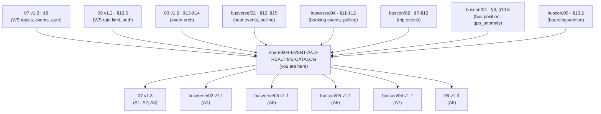

### 1.3 What this document does NOT cover

| Topic | Goes to |
|---|---|
| WebSocket transport protocol (Socket.io) | `03` v1.2 §14 |
| WebSocket auth handshake | `07` v1.2 §8.2, `09` v1.2 §12.5.1 |
| Full `/v1/ws` connection contract | `07` v1.2 §8 |
| Module event bus (in-process) | `03` v1.2 §13 |
| Publisher implementation (server-side) | `03` v1.2 §14 |
| Client-side event handling UI | `busverse/02` §12, `busverse/04` §11.3, `buscon/05` §13 |
| Polling fallback UI | `busverse/02` §15.3, `busverse/04` §11.4 |
| Full WebSocket security | `09` v1.2 §12.5 |

### 1.4 Scope boundary

**SH-04 is the catalog, not the implementation.** Consumers:

| Consumer | Reads from this doc | Tests against |
|---|---|---|
| **API publisher** | §3 (topics), §4 (event schemas), §5 (guarantees) | §12 (payload validations) |
| **BusVerse client** | §3.1 (seat events), §3.2 (trip events), §3.3 (booking events), §7 (reconnection), §8 (polling) | §12 (subscriber validations) |
| **BusCon web client** | §3.2 (trip events — admin view), §6.4 (admin:notifications Phase 2) | §12 |
| **Operator App** | §1.5 (producer-only), §3.2, §3.3 (emission points) | — |
| **Report author** | §2 (subscriber matrix), §5 (guarantees) | — |
| **Viva demo author** | §2, §9 (GPS throttle) | — |

### 1.5 The producer-only pattern

**Diagram: Producer-only vs publisher-subscriber surfaces**
*Three surfaces interact with the event stream. BusVerse is subscriber-only. BusCon web is subscriber-only. Operator App is producer-only — it POSTs GPS samples and boarding scans that trigger events, but never subscribes.*

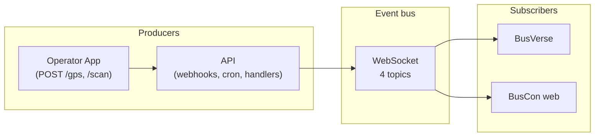

**Rules:**

| Surface | Producer | Subscriber |
|---|:---:|:---:|
| BusVerse | — (client) | ✅ |
| BusCon web | — (client) | ✅ |
| Operator App | ✅ (POST /gps, /scan, /trips/:id/start, etc.) | ❌ **never subscribes** |
| API | ✅ (webhooks, crons, handlers) | — |

**Rationale:** The Operator App is a driver's field tool. Subscribing to events would require driver-initiated polling loops on a mobile device — battery cost, bandwidth cost, and no value because the driver already knows what's happening (they just did it). If a driver needs current state, they POST and the response has it. Phase 2 could add a driver notification subscription (`driver:notifications` topic) if push notifications demand it.

---

## 2. The Subscriber Matrix

### 2.1 The four topics

| # | Topic | Pattern | Purpose |
|:---:|---|---|---|
| 1 | `seat:availability:{scheduleId}` | Per-schedule | Seat state changes on the seat deck |
| 2 | `trip:live:{tripId}` | Per-trip | GPS position + trip lifecycle |
| 3 | `booking:{bookingId}` | Per-booking | Booking status changes (post-payment) |
| 4 | `admin:notifications` | Global (admin-only) | System alerts for admin |

### 2.2 The subscriber matrix (hero diagram)

**Diagram: Subscriber matrix**
*4 topics × 3 surfaces. BusVerse and BusCon web subscribe to their relevant topics. Operator App is producer-only. `admin:notifications` has no Phase 1 subscriber (Phase 2 adds the UI).*

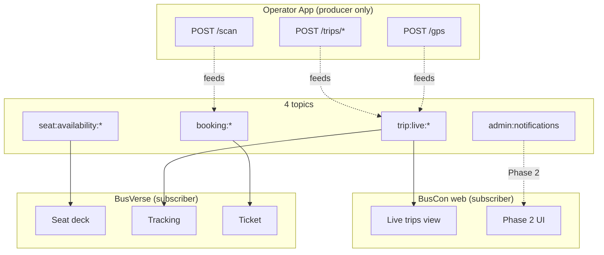

### 2.3 The matrix table

| Topic | BusVerse | BusCon web | Operator App |
|---|:---:|:---:|:---:|
| `seat:availability:{scheduleId}` | ✅ (any user viewing) | — | — |
| `trip:live:{tripId}` | ✅ (booked passengers) | ✅ (admin oversight) | **Producer only** |
| `booking:{bookingId}` | ✅ (owner) | — | **Producer only** (scan) |
| `admin:notifications` | — | ⚠️ Phase 2 UI | — |

**Notes:**

| Note | Detail |
|---|---|
| "Any user viewing" | Even anonymous visitors can subscribe to `seat:availability` for a schedule (public topic) |
| "Booked passengers" | Only users with a `CONFIRMED` booking on this trip |
| "Admin oversight" | Super Admin can subscribe to any `trip:live` topic |
| "Phase 2 UI" | Events are emitted but no Phase 1 client subscribes (§6.4) |
| Operator App | Producer-only — no subscription code in the app |

### 2.4 Why Operator App doesn't subscribe

| Reason | Detail |
|---|---|
| **No value** | The driver already knows what's happening — they just triggered it |
| **Battery cost** | Background WS connection drains battery |
| **Bandwidth cost** | Continuous WS traffic on mobile data |
| **Already handled** | `POST /gps` returns 200; `POST /scan` returns result; trip state is in `GET /trips` |
| **Phase 2 plan** | Driver push notifications use FCM (per `buscon/00` §17.2), not WS |

**Rule:** Operator App never opens a WebSocket connection in Phase 1. Any future subscription (Phase 2+) becomes a new topic (`driver:notifications`) and a new amendment to SH-04.

---

## 3. Topic Reference

### 3.1 `seat:availability:{scheduleId}`

**Diagram: Seat availability flow**
*Three events drive the seat deck. Every user viewing the schedule subscribes. Events emit within 100ms of DB commit.*

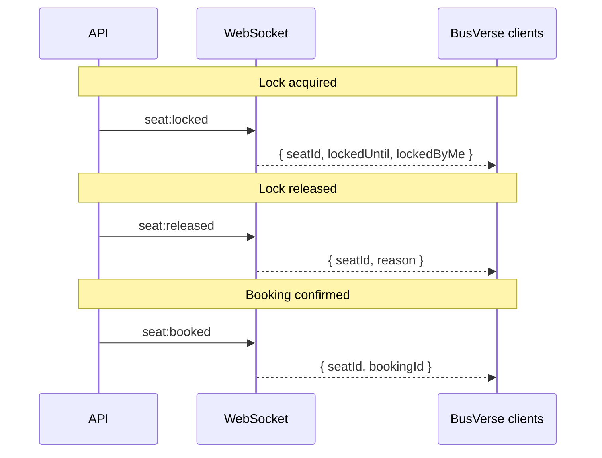

**Events:** `seat:locked`, `seat:released`, `seat:booked`

**Subscribers:** Any user (authenticated or anonymous) viewing `SCR-BV-SEATDECK`

**Authorization:** Public — no auth required to subscribe. See §6.1.

**Payload schema:**

| Event | `data` fields | `_v` |
|---|---|:---:|
| `seat:locked` | `seatId`, `lockedUntil`, `lockedByMe` | 1 |
| `seat:released` | `seatId`, `reason` (`manual`/`expired`/`payment_failed`/`payment_timeout`) | 1 |
| `seat:booked` | `seatId`, `bookingId` | 1 |

**Source:** `shared/03` §7.2 (event matrix), `shared/03` §12.2 (payloads), `busverse/02` §12.1 (client handling).

**Note on `lockedByMe` (resolves N4):** `07` v1.2 §8.7 omits this field but `busverse/02` §12.3 includes it. Canonical: **included**. The client uses it to distinguish own lock echo (ignore) from other users' locks (mark LOCKED).

### 3.2 `trip:live:{tripId}`

**Diagram: Trip live flow**
*Five events drive live tracking on BusVerse and admin oversight on BusCon. Only passengers with bookings + admins can subscribe. The main event is `bus:position` (every 5s during active trip).*

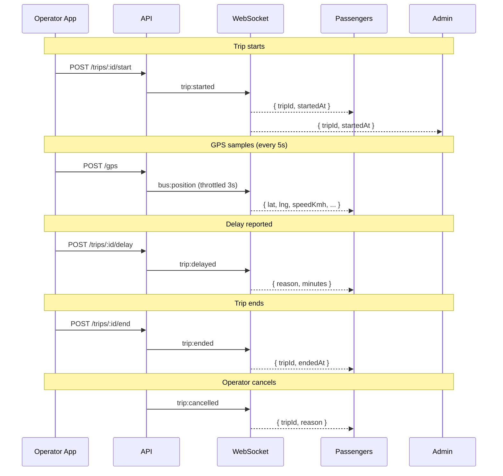

**Events:** `bus:position`, `trip:started`, `trip:delayed`, `trip:ended`, `trip:cancelled`

**Subscribers:** Booked passengers (BusVerse) + Super Admin (BusCon web)

**Authorization:** Requires booking on trip OR SUPER_ADMIN role. See §6.2.

**Payload schema:**

| Event | `data` fields | `_v` |
|---|---|:---:|
| `bus:position` | `tripId`, `scheduleId`, `lat`, `lng`, `speedKmh`, `bearing` (null Phase 1), `accuracyM`, `recordedAt`, `receivedAt`, `nextStandId`, `etaMinutes` | 1 |
| `trip:started` | `tripId`, `startedAt` | 1 |
| `trip:delayed` | `tripId`, `reason`, `minutes` | 1 |
| `trip:ended` | `tripId`, `endedAt`, `distanceKm` | 1 |
| `trip:cancelled` | `tripId`, `reason` | 1 |

**Source:** `buscon/04` §8.2 (bus:position full payload — flagged A5 in `07` v1.3), `buscon/02` §7.4 (trip:started emission), §9.2 (trip:ended), §12.3 (trip:delayed), §8.4 (trip:cancelled).

### 3.3 `booking:{bookingId}`

**Diagram: Booking status flow**
*Five events drive the ticket screen + payment polling. Only the booking owner can subscribe. Includes the boarding ripple (WF-X-05) that flips the "Boarded" badge.*

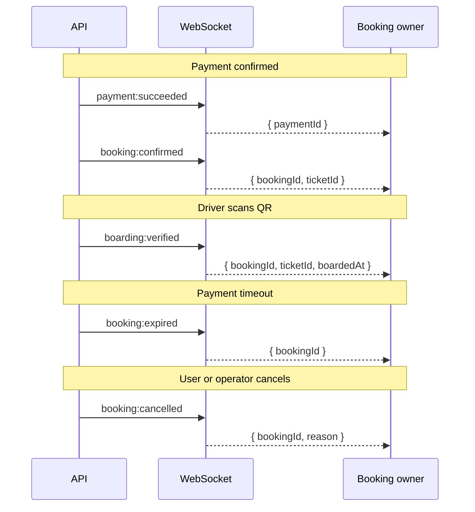

**Events:** `booking:confirmed`, `booking:cancelled`, `booking:expired`, `boarding:verified`, `payment:succeeded`

**Subscribers:** Booking owner (BusVerse)

**Authorization:** Requires ownership of the booking. See §6.3.

**Payload schema:**

| Event | `data` fields | `_v` |
|---|---|:---:|
| `booking:confirmed` | `bookingId`, `ticketId`, `totalFarePaise` | 1 |
| `booking:cancelled` | `bookingId`, `reason`, `refundId` (if applicable) | 1 |
| `booking:expired` | `bookingId` | 1 |
| `boarding:verified` | `bookingId`, `ticketId`, `passengerCount`, `allSeatLabels[]`, `boardedAt` | 1 |
| `payment:succeeded` | `paymentId`, `bookingId`, `method` | 1 |

**Source:** `busverse/04` §12.2 (boarding ripple — G7/A3 in `buscon/05`), `buscon/05` §13.2 (boarding:verified extended payload).

### 3.4 `admin:notifications`

**Diagram: admin:notifications Phase 1 reality**
*Three events emitted to the topic. No Phase 1 UI subscriber (G2). Events land in audit_logs for admin review via `buscon/01` §12. Phase 2 adds the WS UI.*

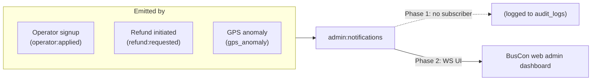

**Events:** `operator:applied`, `refund:requested`, `gps_anomaly`

**Subscribers:** **No Phase 1 subscriber** — events are emitted but not consumed. Phase 2 adds the admin dashboard WS UI.

**Authorization:** SUPER_ADMIN only. See §6.4.

**Payload schema:**

| Event | `data` fields | `_v` |
|---|---|:---:|
| `operator:applied` | `operatorId`, `companyName`, `submittedAt` | 1 |
| `refund:requested` | `refundId`, `bookingId`, `amountPaise`, `reason` | 1 |
| `gps_anomaly` | `tripId`, `driverId`, `failureCount`, `lastFailureType`, `detectedAt` | 1 |

**Source:** `07` v1.2 §8.7 (`operator:applied`, `refund:requested`), `buscon/04` §10.5 (`gps_anomaly` — new in this doc).

**Note on `gps_anomaly` (resolves A7):** `buscon/04` §10.5 describes an alert fired after 5+ provenance failures, but doesn't formalize the WS event. SH-04 makes it canonical.

---

## 4. Event Catalog — Full Schemas

### 4.1 The wire envelope

**Diagram: Event wire envelope**
*Every event uses the same envelope. `data` contains the event-specific payload with `_v` versioning.*

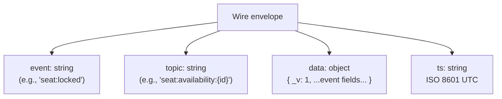

**Canonical envelope:**

```json
{
  "event": "seat:locked",
  "topic": "seat:availability:660e8400-...",
  "data": {
    "_v": 1,
    "seatId": "770e8400-...",
    "lockedUntil": "2026-10-25T14:35:00.000Z",
    "lockedByMe": false
  },
  "ts": "2026-10-25T14:30:00.180Z"
}
```

### 4.2 All 16 event schemas

**Event 1 — `seat:locked`:**

```json
{
  "event": "seat:locked",
  "topic": "seat:availability:660e8400-...",
  "data": {
    "_v": 1,
    "seatId": "770e8400-...",
    "lockedUntil": "2026-10-25T14:35:00.000Z",
    "lockedByMe": false
  },
  "ts": "2026-10-25T14:30:00.180Z"
}
```

**Event 2 — `seat:released`:**

```json
{
  "event": "seat:released",
  "topic": "seat:availability:660e8400-...",
  "data": {
    "_v": 1,
    "seatId": "770e8400-...",
    "reason": "manual" | "expired" | "payment_failed" | "payment_timeout"
  },
  "ts": "2026-10-25T14:35:00.180Z"
}
```

**Event 3 — `seat:booked`:**

```json
{
  "event": "seat:booked",
  "topic": "seat:availability:660e8400-...",
  "data": {
    "_v": 1,
    "seatId": "770e8400-...",
    "bookingId": "880e8400-..."
  },
  "ts": "2026-10-25T14:35:00.180Z"
}
```

**Event 4 — `bus:position`:**

```json
{
  "event": "bus:position",
  "topic": "trip:live:trp_abc...",
  "data": {
    "_v": 1,
    "tripId": "trp_abc",
    "scheduleId": "sch_def",
    "lat": 26.8467,
    "lng": 80.9462,
    "speedKmh": 62.5,
    "bearing": null,
    "accuracyM": 12.4,
    "recordedAt": "2026-10-25T14:32:00.000Z",
    "receivedAt": "2026-10-25T14:32:00.180Z",
    "nextStandId": "stand_456",
    "etaMinutes": 18
  },
  "ts": "2026-10-25T14:32:00.180Z"
}
```

**Event 5 — `trip:started`:**

```json
{
  "event": "trip:started",
  "topic": "trip:live:trp_abc...",
  "data": {
    "_v": 1,
    "tripId": "trp_abc",
    "startedAt": "2026-10-25T14:00:00.000Z"
  },
  "ts": "2026-10-25T14:00:00.180Z"
}
```

**Event 6 — `trip:delayed`:**

```json
{
  "event": "trip:delayed",
  "topic": "trip:live:trp_abc...",
  "data": {
    "_v": 1,
    "tripId": "trp_abc",
    "reason": "TRAFFIC" | "WEATHER" | "BREAKDOWN" | "ACCIDENT" | "ROAD_CLOSURE" | "OTHER",
    "minutes": 30
  },
  "ts": "2026-10-25T14:15:00.180Z"
}
```

**Event 7 — `trip:ended`:**

```json
{
  "event": "trip:ended",
  "topic": "trip:live:trp_abc...",
  "data": {
    "_v": 1,
    "tripId": "trp_abc",
    "endedAt": "2026-10-25T22:30:00.000Z",
    "distanceKm": 512.4
  },
  "ts": "2026-10-25T22:30:00.180Z"
}
```

**Event 8 — `trip:cancelled`:**

```json
{
  "event": "trip:cancelled",
  "topic": "trip:live:trp_abc...",
  "data": {
    "_v": 1,
    "tripId": "trp_abc",
    "reason": "Operator cancelled due to bus breakdown"
  },
  "ts": "2026-10-25T16:00:00.180Z"
}
```

**Event 9 — `booking:confirmed`:**

```json
{
  "event": "booking:confirmed",
  "topic": "booking:bkg_xyz...",
  "data": {
    "_v": 1,
    "bookingId": "bkg_xyz",
    "ticketId": "tkt_abc",
    "totalFarePaise": 48750
  },
  "ts": "2026-10-25T14:32:00.180Z"
}
```

**Event 10 — `booking:cancelled`:**

```json
{
  "event": "booking:cancelled",
  "topic": "booking:bkg_xyz...",
  "data": {
    "_v": 1,
    "bookingId": "bkg_xyz",
    "reason": "PASSENGER_CANCELLED" | "OPERATOR_CANCELLED" | "TRIP_CANCELLED",
    "refundId": "ref_abc" | null
  },
  "ts": "2026-10-25T15:00:00.180Z"
}
```

**Event 11 — `booking:expired`:**

```json
{
  "event": "booking:expired",
  "topic": "booking:bkg_xyz...",
  "data": {
    "_v": 1,
    "bookingId": "bkg_xyz"
  },
  "ts": "2026-10-25T14:47:00.180Z"
}
```

**Event 12 — `boarding:verified`:**

```json
{
  "event": "boarding:verified",
  "topic": "booking:bkg_xyz...",
  "data": {
    "_v": 1,
    "bookingId": "bkg_xyz",
    "ticketId": "tkt_abc",
    "passengerCount": 3,
    "allSeatLabels": ["A1", "A2", "A3"],
    "boardedAt": "2026-10-25T14:30:00.000Z"
  },
  "ts": "2026-10-25T14:30:00.180Z"
}
```

**Event 13 — `payment:succeeded`:**

```json
{
  "event": "payment:succeeded",
  "topic": "booking:bkg_xyz...",
  "data": {
    "_v": 1,
    "paymentId": "pay_abc",
    "bookingId": "bkg_xyz",
    "method": "UPI" | "CARD" | "NETBANKING" | "WALLET" | "EMI"
  },
  "ts": "2026-10-25T14:32:00.180Z"
}
```

**Event 14 — `operator:applied`:**

```json
{
  "event": "operator:applied",
  "topic": "admin:notifications",
  "data": {
    "_v": 1,
    "operatorId": "opr_xyz",
    "companyName": "Sharma Travels",
    "submittedAt": "2026-10-25T10:00:00.000Z"
  },
  "ts": "2026-10-25T10:00:00.180Z"
}
```

**Event 15 — `refund:requested`:**

```json
{
  "event": "refund:requested",
  "topic": "admin:notifications",
  "data": {
    "_v": 1,
    "refundId": "ref_abc",
    "bookingId": "bkg_xyz",
    "amountPaise": 48750,
    "reason": "DUPLICATE_CHARGE"
  },
  "ts": "2026-10-25T15:00:00.180Z"
}
```

**Event 16 — `gps_anomaly`:**

```json
{
  "event": "gps_anomaly",
  "topic": "admin:notifications",
  "data": {
    "_v": 1,
    "tripId": "trp_abc",
    "driverId": "drv_xyz",
    "failureCount": 5,
    "lastFailureType": "TELEPORT_DETECTED" | "SPEED_MISMATCH" | "COORDINATE_INVALID",
    "detectedAt": "2026-10-25T14:15:00.000Z"
  },
  "ts": "2026-10-25T14:15:00.180Z"
}
```

### 4.3 Event versioning (resolves G4)

**Rule:** Every `data` object carries `_v: 1` in Phase 1.

| Change | `_v` bump? |
|---|---|
| Add new field | ❌ (additive) |
| Remove field | ✅ → `_v: 2` |
| Rename field | ✅ → `_v: 2` |
| Change field type | ✅ → `_v: 2` |
| Change semantics | ✅ → `_v: 2` |

**Client behavior:**

| `_v` value | Client action |
|---|---|
| `1` | Accept |
| `2+` (unknown) | Log warning; ignore event; don't crash |
| Missing | Treat as `1` (defensive) |
| Non-integer | Reject; log error |

**Server behavior:** Server emits `_v: 1` for the entire Phase 1 lifetime. Phase 2 can introduce `_v: 2` per event; clients upgraded in a coordinated release.

### 4.4 Field naming and format

**Inherited from `07` v1.2 §2.4 (data type glossary):**

| Format | Example |
|---|---|
| camelCase | `seatId`, `bookingId`, `lockedUntil` |
| ISO 8601 UTC | `"2026-10-25T14:32:00.000Z"` |
| Money | `amountPaise: 48750` (integer paise) |
| Enums | `SCREAMING_SNAKE` |
| IDs | UUID (opaque to client) |
| Null | `null` (never absent) |

### 4.5 The `_v: 1` addition (Amendment A1)

**Current state:** `07` v1.2 §8.7 shows `data` payloads **without** `_v`.

**Required:** `07` v1.3 §8.7 must add `_v: 1` to every payload. This is a **non-breaking additive change** — clients that ignore extra fields already handle it; clients that validate strictly need updating.

**Amendment:** A1 (Medium priority, Wave 2).

---

## 5. Delivery Guarantees

### 5.1 WS delivery model

**Diagram: Delivery guarantees**
*Three layers with different guarantees. WebSocket is at-most-once per connection. Module event bus is at-least-once. Polling fallback is at-least-once (per-poll).*

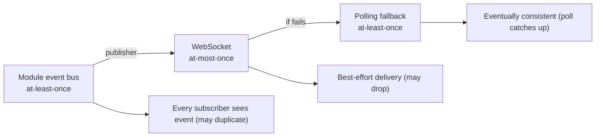

### 5.2 Delivery guarantees by layer

| Layer | Delivery | Ordering | Failure mode |
|---|---|---|---|
| Module event bus (in-process) | At-least-once | Per-entity | Retry via BullMQ |
| WebSocket broadcast | **At-most-once per connection** | Per-entity within one connection | Event dropped; client must poll to recover |
| Polling fallback | At-least-once per poll | N/A | Repeats until success |

**Rationale for WS at-most-once:** Real-time events are ephemeral. If delivery fails (network drop, socket closed), the client recovers via polling — not by retry storming the WS server. This matches industry practice (Kafka at-least-once for persistence, WS at-most-once for UI).

### 5.3 Idempotency requirements per event

**Diagram: Idempotency matrix**
*Every event has an idempotency rule. Some are naturally idempotent (SET-based state). Others require explicit dedup (based on a unique field).*

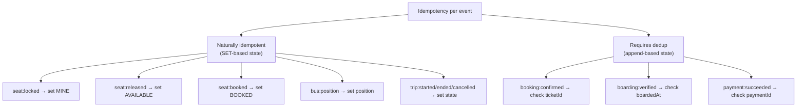

**Per-event idempotency rules:**

| Event | Idempotency requirement |
|---|---|
| `seat:locked` | SET seat state to MINE/LOCKED (naturally idempotent) |
| `seat:released` | SET seat state to AVAILABLE (naturally idempotent) |
| `seat:booked` | SET seat state to BOOKED (naturally idempotent) |
| `bus:position` | SET position to latest (naturally idempotent) |
| `trip:started` | SET trip state to IN_PROGRESS (idempotent) |
| `trip:delayed` | SET delay reason + minutes (idempotent) |
| `trip:ended` | SET trip state to COMPLETED (idempotent) |
| `trip:cancelled` | SET trip state to CANCELLED (idempotent) |
| `booking:confirmed` | Dedup on `ticketId` — only apply if different from last |
| `booking:cancelled` | SET state to CANCELLED (idempotent) |
| `booking:expired` | SET state to EXPIRED (idempotent) |
| `boarding:verified` | Dedup on `boardedAt` — only apply if newer than last |
| `payment:succeeded` | Dedup on `paymentId` — only apply if new |
| `operator:applied` | Dedup on `operatorId` |
| `refund:requested` | Dedup on `refundId` |
| `gps_anomaly` | Dedup on `detectedAt` |

**Client rule:** For dedup events, maintain a small set of last-seen IDs (per topic). Discard duplicates. Set size bounded to 100 (FIFO).

### 5.4 Ordering guarantees

| Scope | Ordering |
|---|---|
| Per-entity (same seat, same trip, same booking) | ✅ Guaranteed within one connection |
| Per-entity (across reconnection) | ❌ Not guaranteed; client must re-fetch state |
| Cross-entity | ❌ Not guaranteed |

**Client rule:** If `event.ts` is older than last-seen `ts` for this entity, drop event (out-of-order safety).

**Reference:** `busverse/04` §11.6 (out-of-order `bus:position` handling).

---

## 6. Authorization & Access

### 6.1 Topic authorization matrix

| Topic | Subscriber authorization | Server check |
|---|---|---|
| `seat:availability:{scheduleId}` | Public — any authenticated or anonymous user | Schedule exists + is `PUBLISHED` |
| `trip:live:{tripId}` | Booked passenger OR SUPER_ADMIN | JWT valid + (booking on trip OR SUPER_ADMIN) |
| `booking:{bookingId}` | Booking owner OR SUPER_ADMIN | JWT valid + (booking owner OR SUPER_ADMIN) |
| `admin:notifications` | SUPER_ADMIN only | JWT valid + role = SUPER_ADMIN |

### 6.2 Authorization check per subscription

**Diagram: Authorization flow on subscribe**
*When a client subscribes to a topic, the server validates the token and the authorization rule. Failed authorization closes the connection (not just the subscription).*

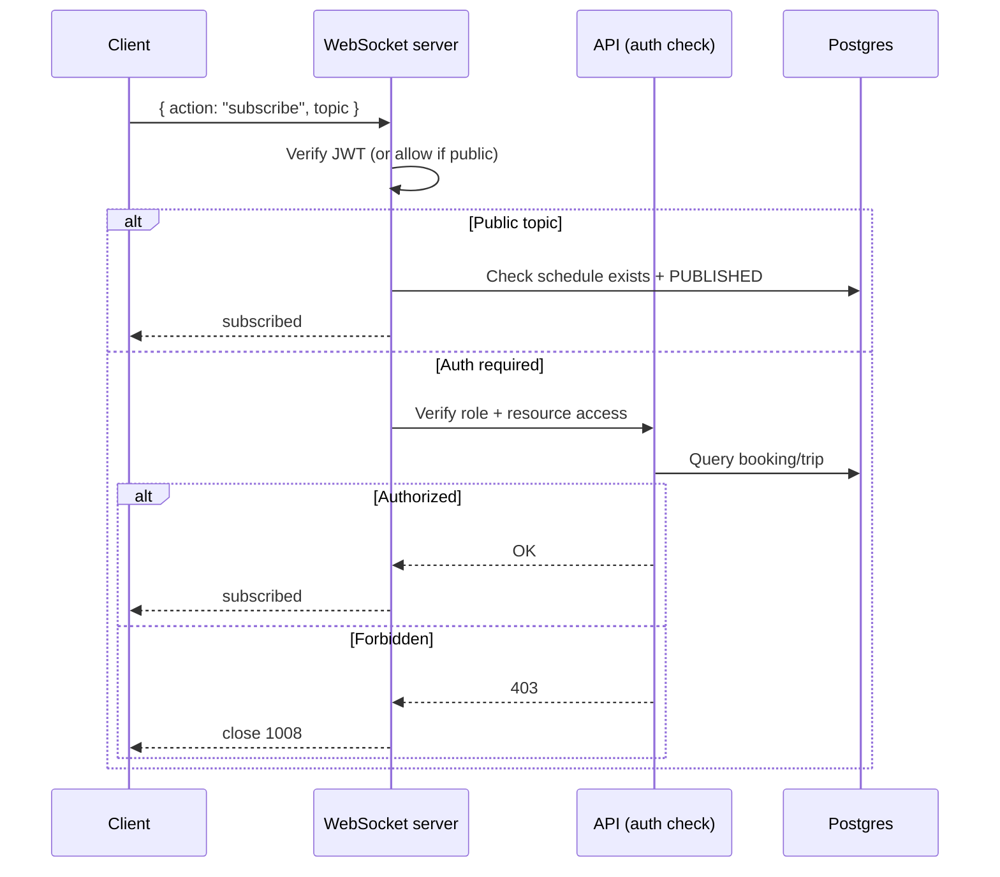

### 6.3 Per-topic authorization queries

**`seat:availability:{scheduleId}`:**

```sql
SELECT 1 FROM schedules 
WHERE id = :scheduleId 
  AND status = 'PUBLISHED'
  AND deleted_at IS NULL;
```

**`trip:live:{tripId}`:**

```sql
SELECT 1 FROM trips t
JOIN bookings b ON b.schedule_id = t.schedule_id
WHERE t.id = :tripId
  AND (
    (b.user_id = :currentUserId AND b.status IN ('CONFIRMED', 'CHECKED_IN'))
    OR :currentUserRole = 'SUPER_ADMIN'
  );
```

**`booking:{bookingId}`:**

```sql
SELECT 1 FROM bookings
WHERE id = :bookingId
  AND (
    user_id = :currentUserId 
    OR :currentUserRole = 'SUPER_ADMIN'
  );
```

**`admin:notifications`:**

```sql
SELECT 1 FROM sessions
WHERE user_id = :currentUserId
  AND role = 'SUPER_ADMIN'
  AND status = 'ACTIVE';
```

### 6.4 `admin:notifications` Phase 1 reality (resolves G2)

**Diagram: The Phase 1 gap**
*Events emitted to `admin:notifications` topic. Phase 1 has zero WS clients subscribed (no admin UI code). Events land in `audit_logs` for review via `buscon/01` §12.*

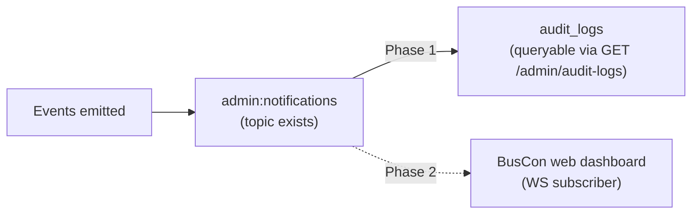

**Rules:**

| Aspect | Phase 1 | Phase 2 |
|---|---|---|
| Events emitted to topic | ✅ | ✅ |
| Server-side audit log | ✅ (all events persisted) | ✅ |
| Admin WS subscriber | ❌ (no client code) | ✅ |
| Admin dashboard UI | ❌ (counts from `/admin/dashboard`) | ✅ (live feed) |
| Events lost? | ❌ (in audit_logs) | ❌ |

**Rationale:** The events are cheap to emit and get preserved in `audit_logs` for admin review. Phase 2 adds the UI without changing the emission behavior. No event is "wasted" — the topic is ready, the audit trail is complete.

### 6.5 WS size and rate limits (resolves N5)

**Reference:** `09` v1.2 §12.5.3.

| Limit | Value |
|---|---|
| Max message size | 64 KB |
| Max messages per session | 60 / min |
| Max connections per user | 5 |
| Max auth failures | 5 / min (then close) |

**Enforcement:** Server-side. Exceeding closes connection with code 1008 (policy violation).

**Reference:** `07` v1.2 §8, `09` v1.2 §12.5.

### 6.6 Rate-limited reconnection

**Rule:** If a client reconnects more than 10 times in 60 seconds, server rejects with `401 TOO_MANY_RECONNECTS` and enforces a 60-second backoff. Prevents connection storms from misbehaving clients.

---

## 7. Reconnection & Backoff

### 7.1 Reconnection state machine

**Diagram: Reconnection state machine**
*Five states with explicit transitions. Backoff schedule is exponential with a max of 5 retries, then falls back to polling.*

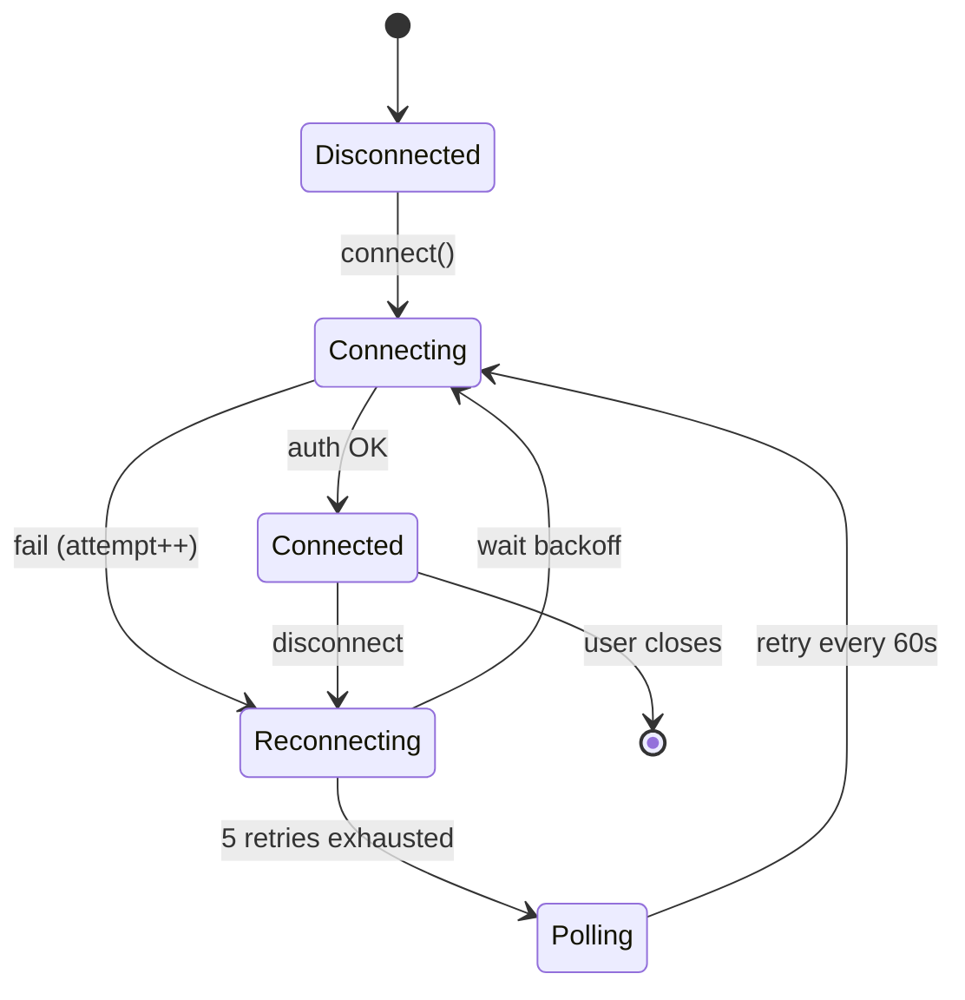

### 7.2 Backoff schedule (resolves N3)

**Diagram: Backoff sequence**
*Exponential backoff from 1s to 16s across 5 retries. On 6th failure, switch to polling.*

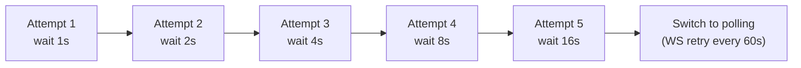

| Attempt | Delay before retry | Cumulative time |
|---:|---:|---:|
| 1 | 1s | 1s |
| 2 | 2s | 3s |
| 3 | 4s | 7s |
| 4 | 8s | 15s |
| 5 | 16s | 31s |
| 6+ | — (polling) | — |

**Rule:** Backoff resets on successful connection. If a connection stays up > 30s, next disconnect starts from attempt 1.

### 7.3 Re-authentication on expiry

**Reference:** `07` v1.2 §8.5, `09` v1.2 §12.5.6.

**Diagram: Token refresh during WS**
*Server sends `auth:expiring` 60s before JWT expiry. Client sends `auth:refresh` within 30s. On success, connection continues. On fail, close and reconnect.*

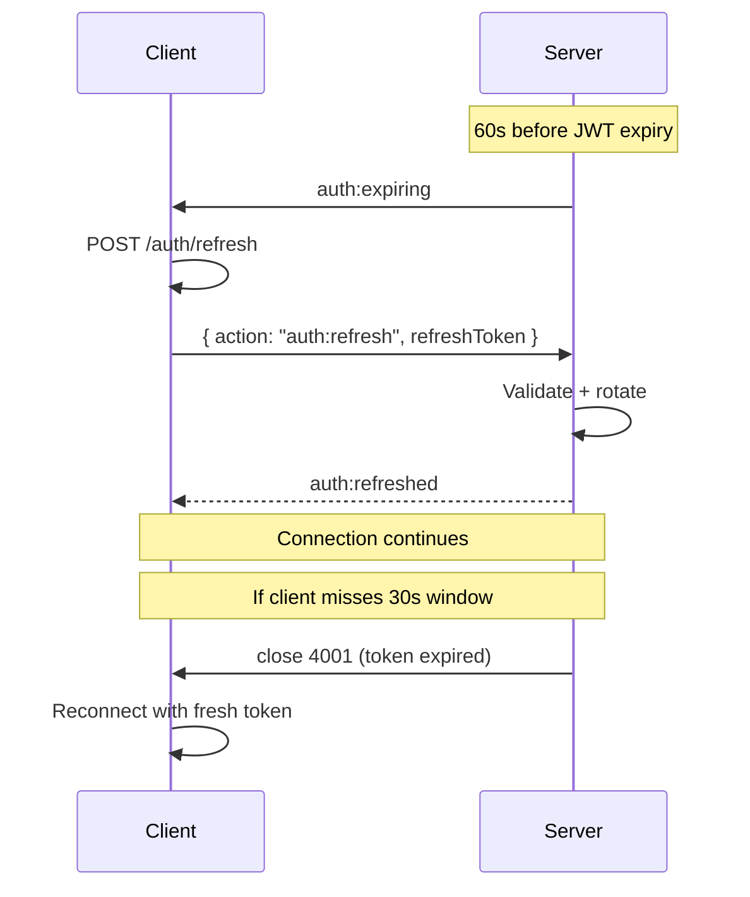

**Rules:**

| Aspect | Detail |
|---|---|
| `auth:expiring` timing | 60s before JWT `exp` |
| Client response window | 30s |
| Missing window | Server closes with 4001 |
| Refresh failure | Client re-authenticates via login |

**Reference:** `08` v1.1 WF-R-03.

### 7.4 Reconnect state recovery

**Diagram: State recovery on reconnect**
*After reconnection, client must re-fetch state (not rely on missed events). Different endpoints for different topics.*

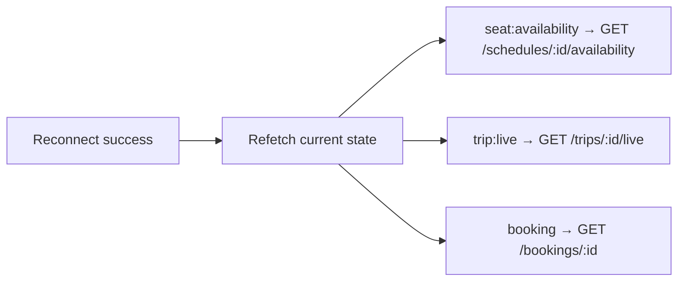

**Rule:** Never trust the event stream alone to reconstruct state. On reconnect, refetch. Events only update state going forward.

**Reference:** `busverse/02` §15.3 (polling recovery), `busverse/04` §11.4.

---

## 8. Polling Fallbacks

### 8.1 Canonical intervals (resolves G3)

**Diagram: Polling fallback per topic**
*Three fallback intervals. All start only after WS reconnect fails 5 times. Manual retry every 60s.*

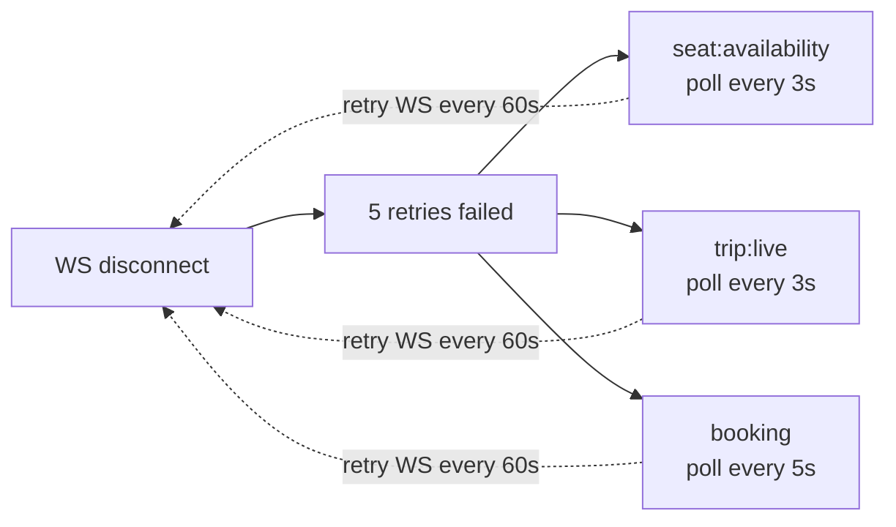

### 8.2 Fallback endpoint map

| Topic | Fallback endpoint | Interval | Source |
|---|---|---|---|
| `seat:availability:{scheduleId}` | `GET /schedules/:id/availability` | **3s** | `busverse/02` §15.1 |
| `trip:live:{tripId}` | `GET /trips/:id/live` | **3s** | `busverse/04` §11.4 |
| `booking:{bookingId}` | `GET /bookings/:id` (or `/payments/:id`) | **5s** | `busverse/04` §11.4 |
| `admin:notifications` | N/A — no Phase 1 client | — | — |

**Note on interval differences:** `seat:availability` and `trip:live` both poll at 3s because the data is highly volatile (lock state, GPS position). `booking` polls at 5s because booking state changes slowly. This aligns with the WS event frequencies: `bus:position` every 5s, `seat:locked` rarely, `booking:confirmed` once.

### 8.3 Fallback lifecycle

**Diagram: Polling lifecycle**
*Polling starts on WS failure, runs at canonical interval, stops on WS reconnect.*

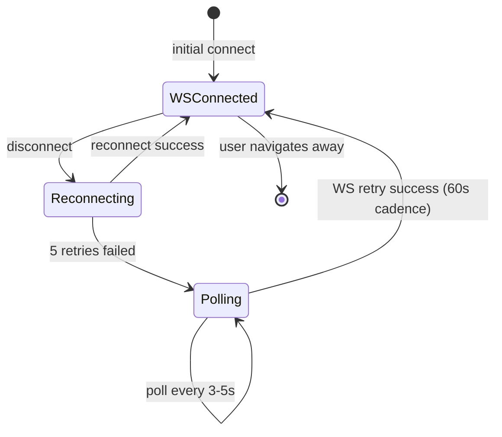

### 8.4 Fallback UX

| State | UI indicator |
|---|---|
| WS connected | No indicator (transparent) |
| Reconnecting (1-5 attempts) | Small "Reconnecting…" pill |
| Polling (> 5 attempts) | Amber "Live updates paused — polling" pill |
| WS reconnected | Pill disappears + brief "Live updates restored" toast |

**Reference:** `busverse/02` §15.3, `busverse/04` §11.4.

---

## 9. GPS Broadcast Throttle Resolution (resolves G1)

### 9.1 The contradiction

**Diagram: The current ambiguity**
*Three docs describe different rates. `02` says 5s client. `07` says 3s broadcast. Nothing says how they interact.*

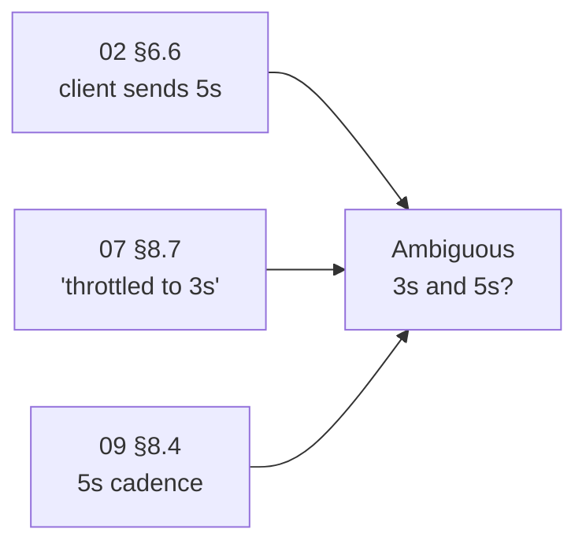

### 9.2 The resolution

**Rule:** The 3s value in `07` v1.2 §8.7 is a **defensive floor**, not the target rate.

| Layer | Rate | Purpose |
|---|---|---|
| Client sends | Every 5s | Per `02` §6.6 |
| Server stores (Redis) | Every 5s | Per FR-OP-010 |
| Server stores (Postgres) | Every 30s | Per FR-OP-010 |
| Server broadcasts | Every sample received **unless** two arrive <3s apart | Defensive floor against rogue clients |
| Client display | Interpolated between samples | Per `busverse/04` §10.4 |

### 9.3 When the 3s floor triggers

**Diagram: Throttle trigger**
*With normal 5s cadence, the floor never triggers. Only if a malicious client sends >3s frequency does the server discard.*

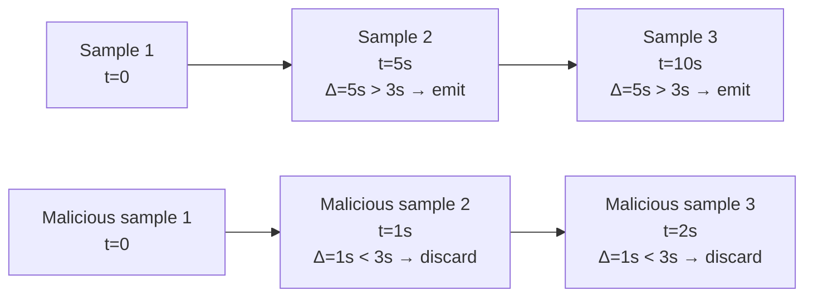

**Rules:**

| Scenario | Behavior |
|---|---|
| Normal client (5s cadence) | Every sample emitted |
| Slow client (>5s cadence) | Every sample emitted |
| Rogue client (<3s cadence) | Extra samples discarded; only first of each 3s window emitted |
| Burst from one client | Server applies floor per `trip_id` (not per connection) |

### 9.4 Why 3s floor

| Reason | Detail |
|---|---|
| **Passenger UX** | 3s updates are smooth enough; 1s is overkill |
| **Bandwidth** | Reduces broadcast fan-out to ~600 samples/hour per trip |
| **Abuse prevention** | Blocks malicious clients spamming 100s/sec |
| **No impact on normal use** | Normal 5s cadence is safely above the floor |

### 9.5 Amendment

**A2 (Medium, Wave 2):** `07` v1.3 §8.7 must clarify: "server broadcasts every sample unless two arrive <3s apart (defensive floor against rogue clients; normal 5s cadence never triggers this)".

---

## 10. Event Ordering

### 10.1 Ordering guarantees

**Diagram: Ordering per scope**
*Within one WS connection: per-entity ordering guaranteed. Across connections or entities: not guaranteed. Client must handle.*

```mermaid
flowchart TB
    ENT["Per-entity within connection<br/>✅ Guaranteed"]

    ENT --> OK1["seat:A1 events in order"]
    ENT --> OK2["trip:X events in order"]
    ENT --> OK3["booking:Y events in order"]

    CROSS["Cross-entity<br/>❌ Not guaranteed"]
    RECONN["Across reconnection<br/>❌ Not guaranteed"]

    CROSS --> BAD1["seat:A1 and seat:A2 events may interleave"]
    RECONN --> BAD2["Events missed during disconnect"]
```

### 10.2 Client-side ordering safety

| Rule | Detail |
|---|---|
| Compare `ts` field | Drop events with `ts` older than last-seen |
| Per-entity tracking | Maintain last-seen `ts` per entity ID |
| Reconnect refetch | After reconnect, refetch state (see §7.4) |

**Reference:** `busverse/04` §11.6.

### 10.3 Server-side ordering safety

| Rule | Detail |
|---|---|
| Emit after commit | Never emit before DB transaction commits |
| Same entity = same queue | Per-entity publish queue ensures order |
| Cross-entity = no order | Independent publish |

**Rule:** The server does not buffer or reorder events. If two events for the same entity arrive, the DB order determines the emit order.

---

## 11. Failure Modes

### 11.1 Failure matrix

**Diagram: Failure routing**
*Four failure types across the WS pipeline. Each has a defined recovery.*

```mermaid
flowchart TB
    F["Failure"]

    F --> WS["WS connection lost"]
    F --> AUTH["Auth expired"]
    F --> RATE["Rate limited"]
    F --> SERVER["Server error"]

    WS --> R1["Reconnect with backoff<br/>Fallback to polling"]
    AUTH --> R2["Refresh + re-auth<br/>else force logout"]
    RATE --> R3["Backoff per Retry-After"]
    SERVER --> R4["Reconnect with backoff"]
```

### 11.2 Failure behavior table

| Failure | Detection | Client behavior | Server behavior |
|---|---|---|---|
| WS connection lost | Socket close | Reconnect with backoff (§7.2) | Log; allow reconnect |
| Auth expired | 4001 close code | Refresh token; reconnect | Send `auth:expiring` at 60s before |
| Rate limited | 429 message | Backoff per Retry-After header | Enforce per `09` §12.5 |
| Server error (500) | Error message | Reconnect with backoff | Log + alert |
| Too many reconnects | 401 TOO_MANY_RECONNECTS | Wait 60s before retry | Enforce per §6.6 |
| Message size > 64KB | Error message | Log; don't retry | Enforce per §6.5 |
| Origin mismatch | 1008 close | Fail silently (misconfigured) | Log SECURITY event |
| Malformed message | 1008 close | Log error; don't retry | Log + count metric |

### 11.3 Redis pub/sub (Phase 2) failure

**Not Phase 1.** When Phase 2 adds multi-instance WS via Redis pub/sub:

| Failure | Behavior |
|---|---|
| Redis pub/sub down | WS connections continue; broadcast deferred; clients fall to polling |
| Partial Redis (some channels) | Depends on channel isolation |

**Phase 1:** Single WS instance — no Redis pub/sub needed (per `03` v1.2 §14.3).

### 11.4 Graceful degradation

**Diagram: Degradation ladder**
*WS → polling is the fallback. If polling fails, manual refresh. Three-tier degradation.*

```mermaid
flowchart LR
    L1["Tier 1<br/>WebSocket<br/>(best UX)"]
    L2["Tier 2<br/>Polling<br/>(slower, complete)"]
    L3["Tier 3<br/>Manual refresh<br/>(user-driven)"]

    L1 -->|"WS fails"| L2
    L2 -->|"polls fail"| L3
    L3 -.->|"network recovers"| L1
```

**Rule:** Never show a "stuck" state. The user can always manually refresh. Show clear status indicators per §8.4.

---

## 12. Test Vectors

### 12.1 Test coverage

**Diagram: Test vector categories**
*Three categories: payload schema validation, subscriber authorization, reconnection behavior. ~23 total.*

```mermaid
flowchart TB
    TV["23 test vectors"]

    TV --> P["16 payload schemas"]
    TV --> A["4 authorization"]
    TV --> R["3 reconnection"]
```

### 12.2 Payload schema validation (16 tests)

**Each test:** Given a canonical event payload, publish it through the WS system, assert the client receives the exact schema with `_v: 1`.

| # | Event | Test |
|:---:|---|---|
| TV-P-01 | `seat:locked` | Payload has `_v`, `seatId`, `lockedUntil`, `lockedByMe` |
| TV-P-02 | `seat:released` | Payload has `_v`, `seatId`, `reason` |
| TV-P-03 | `seat:booked` | Payload has `_v`, `seatId`, `bookingId` |
| TV-P-04 | `bus:position` | Payload has full field set (§4.2 Event 4) |
| TV-P-05 | `trip:started` | Payload has `_v`, `tripId`, `startedAt` |
| TV-P-06 | `trip:delayed` | Payload has `_v`, `tripId`, `reason`, `minutes` |
| TV-P-07 | `trip:ended` | Payload has `_v`, `tripId`, `endedAt`, `distanceKm` |
| TV-P-08 | `trip:cancelled` | Payload has `_v`, `tripId`, `reason` |
| TV-P-09 | `booking:confirmed` | Payload has `_v`, `bookingId`, `ticketId`, `totalFarePaise` |
| TV-P-10 | `booking:cancelled` | Payload has `_v`, `bookingId`, `reason`, `refundId` |
| TV-P-11 | `booking:expired` | Payload has `_v`, `bookingId` |
| TV-P-12 | `boarding:verified` | Payload has `_v`, `passengerCount`, `allSeatLabels[]` |
| TV-P-13 | `payment:succeeded` | Payload has `_v`, `paymentId`, `bookingId`, `method` |
| TV-P-14 | `operator:applied` | Payload has `_v`, `operatorId`, `companyName`, `submittedAt` |
| TV-P-15 | `refund:requested` | Payload has `_v`, `refundId`, `bookingId`, `amountPaise`, `reason` |
| TV-P-16 | `gps_anomaly` | Payload has `_v`, `tripId`, `driverId`, `failureCount`, `lastFailureType` |

### 12.3 Subscriber authorization (4 tests)

| # | Test | Expected |
|:---:|---|---|
| TV-A-01 | Non-booked user subscribes `trip:live:{tripId}` | Close 1008 (FORBIDDEN) |
| TV-A-02 | Non-owner subscribes `booking:{bookingId}` | Close 1008 (FORBIDDEN) |
| TV-A-03 | Non-admin subscribes `admin:notifications` | Close 1008 (FORBIDDEN) |
| TV-A-04 | Anonymous user subscribes `seat:availability:{scheduleId}` (valid schedule) | Subscribe OK (public topic) |

### 12.4 Reconnection behavior (3 tests)

| # | Test | Expected |
|:---:|---|---|
| TV-R-01 | Disconnect → 5 retries → polling | Client starts polling at 3s/5s |
| TV-R-02 | Disconnect → reconnect within 5s | Client reconnects without polling |
| TV-R-03 | Auth expires during WS | Client sends auth:refresh; continues |

### 12.5 Running the tests

**Command:** `pnpm test:ws-catalog`

**Reference:** `10-TESTING-STRATEGY.md` v1.2 §19 (WS security tests), §20 (contract tests).

### 12.6 CI gate

**Rule:** `pnpm test:ws-catalog` runs in CI on every PR touching:
- `apps/api/src/ws/**`
- `apps/api/src/events/**`
- `packages/shared/ws-schemas/**`
- Any product doc's WS consumer code

Any failure blocks merge.

---

## 13. Time Budgets and Metrics

### 13.1 Time budgets

| Operation | p95 | p99 |
|---|---:|---:|
| WS auth handshake | 100ms | 200ms |
| WS subscribe response | 50ms | 100ms |
| Event publish → client receive | **100ms** | **300ms** |
| Server-side publish (per event) | 5ms | 15ms |
| Reconnection (auth → connected) | 200ms | 500ms |
| Re-auth (`auth:expiring` → `auth:refreshed`) | 100ms | 300ms |

### 13.2 Metrics

| Metric | Type | Labels | Alert threshold |
|---|---|---|---|
| `ws_connection_total` | counter | `result` (connected/disconnected) | — |
| `ws_active_connections` | gauge | `topic` | >500 total → SEV3 |
| `ws_events_emitted_total` | counter | `topic`, `event` | — |
| `ws_events_delivered_total` | counter | `topic`, `event` | — |
| `ws_events_failed_total` | counter | `topic`, `event`, `reason` | >1% failure rate → SEV2 |
| `ws_publish_duration_ms` | histogram | `topic`, `event` | p95 > 100ms → SEV2 |
| `ws_reconnection_total` | counter | `result` (success/polling_fallback) | — |
| `ws_auth_expiring_sent_total` | counter | — | — |
| `ws_auth_refresh_total` | counter | `result` (success/fail) | — |

### 13.3 Alerts

| Alert | Condition | Severity |
|---|---|---|
| High WS publish latency | `ws_publish_duration_ms` p95 > 100ms over 5min | SEV2 |
| High event delivery failure | `ws_events_failed_total / ws_events_emitted_total` > 1% over 10min | SEV2 |
| High reconnection rate | `ws_reconnection_total` > 100/5min | SEV3 |
| Active connections > 500 | `ws_active_connections` > 500 | SEV3 |
| WS auth failures spike | `ws_auth_refresh_total{result="fail"}` > 10/5min | SEV2 |

**Reference:** `09` v1.2 §18.5 (alerting), `shared/02` §10.5 (telemetry pattern).

---

## 14. Cross-Doc References

### 14.1 Consolidation map

**Diagram: SH-04 consolidation**
*What SH-04 formalizes vs references. The four topics are referenced; the 16 payload schemas, `_v` versioning, throttle resolution, and test vectors are new.*

```mermaid
flowchart LR
    subgraph NEW["Consolidated (new in SH-04)"]
        N1["16 event schemas (§4)"]
        N2["_v versioning (§4.3)"]
        N3["Subscriber matrix (§2)"]
        N4["Idempotency per event (§5.3)"]
        N5["GPS throttle resolution (§9)"]
        N6["admin:notifications Phase 1 (§6.4)"]
        N7["gps_anomaly event (§3.4)"]
        N8["23 test vectors (§12)"]
    end

    subgraph REF["Referenced (existing)"]
        R1["4 topics (07 §8.1)"]
        R2["WS auth handshake (07 §8.2)"]
        R3["Reconnection state (07 §8.4)"]
        R4["WS rate limits (09 §12.5)"]
        R5["Client event handling (busverse/02, busverse/04)"]
        R6["Producer emission points (buscon/02, buscon/04, buscon/05)"]
    end

    NEW --> DOC["SH-04"]
    REF --> DOC
```

### 14.2 What SH-04 formalizes

| Aspect | Before | After |
|---|---|---|
| Full payload schemas | `07` §8.7 (partial) | §4 (complete) |
| Subscriber matrix | Scattered | §2 (single view) |
| Idempotency rules | Implicit | §5.3 (explicit) |
| Event versioning | ❌ None | §4.3 (`_v: 1`) |
| GPS throttle | Ambiguous 3s vs 5s | §9 (resolved) |
| `admin:notifications` subscriber | Assumed yes | §6.4 (Phase 2) |
| `gps_anomaly` event | Implicit in `buscon/04` §10.5 | §3.4 (formal) |
| Reconnection backoff | State machine only | §7.2 (backoff schedule) |
| Polling intervals | Differ by doc | §8 (canonical) |

### 14.3 Cross-doc references

| SH-04 section | Upstream source |
|---|---|
| §2 Subscriber matrix | `07` v1.2 §8.1, `shared/00` §12 |
| §3.1 Seat events | `shared/03` §12, `busverse/02` §12 |
| §3.2 Trip events | `buscon/02` §7-§12, `buscon/04` §8 |
| §3.3 Booking events | `busverse/04` §11-§12, `buscon/05` §13 |
| §3.4 Admin notifications | `07` v1.2 §8.7, `buscon/04` §10.5 |
| §4 Payload schemas | (new consolidation) |
| §5 Delivery guarantees | `03` v1.2 §13.3 (module-level) |
| §6 Authorization | `07` v1.2 §8.2, `09` v1.2 §12.5.2 |
| §7 Reconnection | `07` v1.2 §8.4, `09` v1.2 §12.5.6 |
| §8 Polling fallbacks | `busverse/02` §15, `busverse/04` §11.4 |
| §9 GPS throttle | `buscon/04` §4.2, `07` v1.2 §8.7 |
| §10 Event ordering | `busverse/04` §11.6 |
| §11 Failure modes | `07` v1.2 §8.4, `09` v1.2 §12.5 |
| §12 Test vectors | (new) |
| §13 Time budgets | `07` v1.2 §8.5 |

---

## 15. Cross-Doc Amendment Flags

### 15.1 Eight amendments

| # | Target doc | Amendment | Priority |
|:---:|---|---|---|
| **A1** | `07` v1.3 §8.7 | Full payload schemas with `_v: 1` for all 16 events; add `lockedByMe` to `seat:locked`; add `gps_anomaly` as 16th event | Medium (Wave 2) |
| **A2** | `07` v1.3 §8.7 | Clarify `bus:position` "throttled to 3s" is defensive floor, not target rate | Medium (Wave 2) |
| **A3** | `07` v1.3 §8.1 | Clarify `admin:notifications` has no Phase 1 subscriber | Low (Wave 3) |
| **A4** | `busverse/02` v1.1 §12.3 | Reference SH-04 §3.1 for canonical `seat:locked` payload | Low (Wave 3) |
| **A5** | `busverse/04` v1.1 §11.3, §12.2 | Reference SH-04 §3-§4 for event schemas | Low (Wave 3) |
| **A6** | `buscon/05` v1.1 §13.2 | Reference SH-04 §4 (Event 12) for `boarding:verified` schema | Low (Wave 3) |
| **A7** | `buscon/04` v1.1 §10.5 | Reference SH-04 §3.4 for `gps_anomaly` formalization | Low (Wave 3) |
| **A8** | `09` v1.3 §12.5 | Reference SH-04 §6 for WS auth per topic | Low (Wave 3) |

### 15.2 Amendment categories

| Category | Amendments | Breaking? |
|---|---|---|
| Additive schema | A1 | No — adds `_v` field, `lockedByMe` field, `gps_anomaly` event |
| Clarification | A2 | No |
| Reference updates | A3, A4, A5, A6, A7, A8 | No |

**All 8 amendments are non-breaking.** A1 is the largest — it adds `_v: 1` to all 16 payloads (additive), adds one missing field (`lockedByMe`), and adds one new event (`gps_anomaly`). None change existing field semantics.

**No High-priority amendments** — unlike SH-03 which had 5 High-priority bug fixes. SH-04 is pure consolidation + versioning.

---

## 16. Open Questions

| # | Question | Owner | Default |
|:---:|---|---|---|
| 1 | Subscriber matrix — Operator App producer-only confirmed? | Shaghaf | **Yes** (§1.5, §2.3) |
| 2 | Event payloads include `_v: 1` confirmed? | Shaghaf | **Yes** (§4.3) |
| 3 | `seat:locked` payload includes `lockedByMe`? | Shaghaf | **Yes** (§3.1) |
| 4 | 16 canonical events confirmed? | Shaghaf | **Yes** (§3, §4.2) |
| 5 | `gps_anomaly` added as 16th event? | Shaghaf | **Yes** (§3.4) |
| 6 | `admin:notifications` has no Phase 1 UI subscriber confirmed? | Shaghaf | **Yes** (§6.4) |
| 7 | GPS throttle is 3s defensive floor, not target rate confirmed? | Shaghaf | **Yes** (§9) |
| 8 | Polling intervals: 3s/3s/5s/N-A? | Shaghaf | **Yes** (§8.2) |
| 9 | Reconnection backoff 1s/2s/4s/8s/16s then polling? | Shaghaf | **Yes** (§7.2) |
| 10 | Max retries before polling = 5? | Shaghaf | **Yes** (§7.2) |
| 11 | Delivery at-most-once per WS connection? | Shaghaf | **Yes** (§5.2) |
| 12 | Event versioning — `_v: 1` for Phase 1? | Shaghaf | **Yes** (§4.3) |
| 13 | Unknown `_v` — client warns + ignores, doesn't crash? | Shaghaf | **Yes** (§4.3) |
| 14 | WS size limit 64KB, rate limit 60/min referenced from `09` §12.5? | Shaghaf | **Yes** (§6.5) |
| 15 | Topic authorization per §6.3 confirmed? | Shaghaf | **Yes** |

---

## 17. Checklist Against Master List

| Item | Included? | Section |
|---|:---:|---|
| Purpose and scope | ✅ | §1 |
| Doc hierarchy | ✅ | §1.2 |
| What this doc does NOT cover | ✅ | §1.3 |
| Scope boundary | ✅ | §1.4 |
| **Producer-only pattern** | ✅ | §1.5 |
| **4 topics** | ✅ | §2.1 |
| **Subscriber matrix (hero)** | ✅ | §2.2 |
| Subscriber matrix table | ✅ | §2.3 |
| Why Operator App doesn't subscribe | ✅ | §2.4 |
| Seat availability flow | ✅ | §3.1 |
| Trip live flow | ✅ | §3.2 |
| Booking status flow | ✅ | §3.3 |
| **`admin:notifications` Phase 1 reality** | ✅ | §3.4, §6.4 |
| Wire envelope | ✅ | §4.1 |
| **16 event schemas** | ✅ | §4.2 |
| **Event versioning (`_v`)** | ✅ | §4.3 |
| Field naming | ✅ | §4.4 |
| A1 amendment note | ✅ | §4.5 |
| Delivery guarantees | ✅ | §5.1, §5.2 |
| **Idempotency per event** | ✅ | §5.3 |
| Ordering guarantees | ✅ | §5.4 |
| Topic authorization matrix | ✅ | §6.1 |
| Authorization flow | ✅ | §6.2 |
| Authorization queries | ✅ | §6.3 |
| **Admin notifications Phase 1 (G2)** | ✅ | §6.4 |
| WS size/rate limits | ✅ | §6.5 |
| Rate-limited reconnection | ✅ | §6.6 |
| Reconnection state machine | ✅ | §7.1 |
| **Backoff schedule** | ✅ | §7.2 |
| Re-authentication | ✅ | §7.3 |
| Reconnect state recovery | ✅ | §7.4 |
| **Polling intervals (G3)** | ✅ | §8.1, §8.2 |
| Polling lifecycle | ✅ | §8.3 |
| Polling UX | ✅ | §8.4 |
| **GPS throttle contradiction (G1)** | ✅ | §9.1, §9.2 |
| Throttle trigger | ✅ | §9.3 |
| Why 3s floor | ✅ | §9.4 |
| A2 amendment | ✅ | §9.5 |
| Ordering per scope | ✅ | §10.1 |
| Client-side ordering safety | ✅ | §10.2 |
| Server-side ordering safety | ✅ | §10.3 |
| Failure matrix | ✅ | §11.1, §11.2 |
| Redis pub/sub Phase 2 | ✅ | §11.3 |
| Degradation ladder | ✅ | §11.4 |
| **23 test vectors** | ✅ | §12.1-§12.4 |
| CI gate | ✅ | §12.6 |
| Time budgets | ✅ | §13.1 |
| Metrics | ✅ | §13.2 |
| Alerts | ✅ | §13.3 |
| Consolidation map | ✅ | §14.1 |
| What SH-04 formalizes | ✅ | §14.2 |
| Cross-doc references | ✅ | §14.3 |
| **8 amendments** | ✅ | §15.1 |
| Amendment categories | ✅ | §15.2 |
| **15 open questions** | ✅ | §16 |

**All items covered. ~14 Mermaid diagrams. Every diagram described.**

---

## 18. Summary

**`shared/04-EVENT-AND-REALTIME-CATALOG.md` is the canonical catalog of every real-time event in the system — 4 WebSocket topics, 16 events, their payload schemas, subscriber matrix, authorization rules, delivery guarantees, reconnection behavior, and polling fallbacks. This is the fourth consolidation contract in the `shared/` folder** (after SH-00 portal, SH-02 QR payload, SH-03 seat lock lifecycle). It resolves three material findings: **(G1) the GPS broadcast throttle contradiction** — `07` v1.2 §8.7 says "throttled to 3s" but the actual cadence is 5s; the 3s value is a **defensive floor** against rogue clients, not the target rate; resolved in §9. **(G2) `admin:notifications` Phase 1 reality** — events are emitted to the topic but no Phase 1 client subscribes (no admin WS UI); events land in `audit_logs` for review via `buscon/01` §12; Phase 2 adds the UI without changing emission behavior; resolved in §6.4. **(G4) event versioning** — every `data` payload includes `_v: 1`; additive changes don't bump; removing/renaming/type-changing bumps to `_v: 2`; clients reject unknown `_v` with a warning, not a crash; resolved in §4.3.

**The subscriber matrix (§2.2) is the hero diagram**: `seat:availability:*` → BusVerse only; `trip:live:*` → BusVerse + BusCon web; `booking:*` → BusVerse only; `admin:notifications` → **Phase 2 UI** (Phase 1 no subscriber). **Operator App is producer-only** (§1.5) — it POSTs GPS samples, boarding scans, and trip lifecycle actions that trigger events, but never opens a WebSocket connection. This resolves an ambiguity in `07` v1.2 §8.1 which implied all surfaces subscribe.

**The 16 canonical events** span 4 topics — 3 seat events (`seat:locked`, `seat:released`, `seat:booked`), 5 trip events (`bus:position`, `trip:started`, `trip:delayed`, `trip:ended`, `trip:cancelled`), 5 booking events (`booking:confirmed`, `booking:cancelled`, `booking:expired`, `boarding:verified`, `payment:succeeded`), 3 admin events (`operator:applied`, `refund:requested`, `gps_anomaly`). Each has a full JSON payload schema with `_v: 1`. **Two events are new or repaired:** `seat:locked` gains `lockedByMe` (was in `busverse/02` §12.3 but missing from `07` §8.7), and `gps_anomaly` is formalized as the 16th event (was referenced in `buscon/04` §10.5 but never made canonical). **`bus:position`** has the full 11-field payload — `tripId, scheduleId, lat, lng, speedKmh, bearing (null Phase 1), accuracyM, recordedAt, receivedAt, nextStandId, etaMinutes` — which was only partial in `07` v1.2 §8.7. **`boarding:verified`** carries the multi-passenger extension `passengerCount` + `allSeatLabels[]` matching `buscon/05` §13.2's A3 amendment.

**Delivery guarantees (§5)** distinguish three layers: module event bus at-least-once (BullMQ retry), WebSocket at-most-once per connection (drop tolerated, client polls to recover), polling at-least-once per poll. **Idempotency per event (§5.3)** splits into naturally-idempotent events (SET-based state — `seat:locked`, `bus:position`, `trip:started`, etc.) and dedup-required events (append-based state — `booking:confirmed` dedup on `ticketId`, `boarding:verified` dedup on `boardedAt`, `payment:succeeded` dedup on `paymentId`). **Ordering guarantees (§5.4)**: per-entity within one connection guaranteed; per-entity across reconnection not guaranteed; cross-entity not guaranteed. Client compares `ts` to drop out-of-order events.

**Authorization (§6)** per topic: `seat:availability:*` is public (any user with a valid schedule ID); `trip:live:*` requires booking OR SUPER_ADMIN; `booking:*` requires ownership OR SUPER_ADMIN; `admin:notifications` requires SUPER_ADMIN. Failed subscription closes connection with code 1008. **Rate-limited reconnection** (§6.6) blocks >10 reconnect attempts in 60s to prevent connection storms. **Size/rate limits** (§6.5) reference `09` §12.5.3's 64KB message size, 60/min per session, 5 max connections per user.

**Reconnection (§7)** has a state machine + backoff schedule — 1s, 2s, 4s, 8s, 16s across 5 retries, then polling. **Re-authentication** (§7.3) uses the `auth:expiring` → `auth:refresh` → `auth:refreshed` handshake 60s before JWT expiry with a 30s response window. **State recovery** (§7.4) requires refetching state after reconnect — never rely on missed events alone.

**Polling fallbacks (§8)** have canonical intervals — 3s for `seat:availability:*` and `trip:live:*`, 5s for `booking:*`, N/A for `admin:notifications` (no Phase 1 client). This resolves the G3 gap where `busverse/02` §15.1 and `busverse/04` §11.4 differed. **Fallback lifecycle** (§8.3): starts only after 5 WS reconnect failures, retries WS every 60s in parallel with polling, stops on WS reconnect. **UX** (§8.4) has 4 states — no indicator when connected, small "Reconnecting…" pill during retries, amber "Live updates paused — polling" during fallback, toast "Live updates restored" on recovery.

**Failure modes (§11)** cover 8 scenarios with defined behavior. **Graceful degradation (§11.4)** is 3-tier: WS → polling → manual refresh. **Never stuck:** the user can always manually refresh, with clear status indicators per §8.4.

**23 test vectors (§12)**: 16 payload validations (each canonical event's schema), 4 authorization tests (non-booked user rejected from `trip:live`, non-owner from `booking:*`, non-admin from `admin:notifications`, anonymous allowed on `seat:availability:*`), 3 reconnection tests (backoff → polling transition, fast reconnect, auth refresh during WS). `pnpm test:ws-catalog` runs in CI on every PR touching WS code. **Metrics (§13)** track `ws_connection_total`, `ws_active_connections`, `ws_events_emitted_total`, `ws_events_delivered_total`, `ws_events_failed_total`, `ws_publish_duration_ms`, `ws_reconnection_total`, `ws_auth_expiring_sent_total`, `ws_auth_refresh_total` with 5 alerts (high publish latency > 100ms → SEV2, high delivery failure > 1% → SEV2, high reconnection > 100/5min → SEV3, active connections > 500 → SEV3, auth failures > 10/5min → SEV2).

**Eight cross-doc amendments (§15)** — all non-breaking, no High-priority. A1 (Medium, Wave 2) adds `_v: 1`, `lockedByMe`, and `gps_anomaly` to `07` v1.3 §8.7. A2 (Medium, Wave 2) clarifies the GPS throttle in `07` v1.3 §8.7. A3 (Low, Wave 3) clarifies `admin:notifications` Phase 1 in `07` v1.3 §8.1. A4-A8 (Low, Wave 3) add reference updates to `busverse/02`, `busverse/04`, `buscon/05`, `buscon/04`, and `09`. **Unlike SH-03 which had 5 High-priority bug fixes, SH-04 is pure consolidation + versioning — no critical fixes.**

**Fifteen open questions** all confirmed by defaults — no blockers.

**The contract's central contribution is making the event stream verifiable.** Before SH-04, 16 events were scattered across 8 docs with partial schemas, contradictory throttle rates, and no versioning. After SH-04, there is one canonical catalog: 4 topics, 16 events, every field specified, every subscriber authorized per topic, every failure mode defined, every test vector enumerated. **The second contribution is resolving 3 material contradictions** — the GPS throttle (3s floor vs 5s cadence), the `admin:notifications` Phase 1 subscriber (none vs implied), and event versioning (unspecified vs `_v: 1`). **The third contribution is formalizing what was implicit** — `gps_anomaly` becomes a real event, `lockedByMe` becomes required, polling intervals become canonical, backoff schedule becomes documented. **Any future event addition or change goes through SH-04 — no product doc can add an event, modify a payload, or change a subscription rule without amending this catalog.**

---

**End of Document `shared/04-EVENT-AND-REALTIME-CATALOG.md` v1.0.**

---
