# `shared/05-ADMIN-AND-SUPPORT.md` v1.0

**Document:** `shared/05-ADMIN-AND-SUPPORT.md`
**Project:** BusVerse + BusCon
**Version:** 1.0
**Status:** Locked — Reference Document
**Owner:** Shaghaf
**Guide:** Mr. Mohit Srivastav
**Purpose:** The canonical specification for admin operations and user support in Phase 1, plus the placeholder roadmap for the Phase 2 support panel. This is the last shared doc — it closes the 6-doc folder by resolving the last cross-doc contradiction (feature flag status in FR-BA-015), formalizing three legal workflows that currently exist only as ad-hoc behavior (DPDP data rights, grievance officer, privacy policy version bump), providing five practical runbooks that fill the Phase 1 support gap (3 investigation scenarios + demo-day admin responses), specifying the 5 email templates that make email-only support consistent, and documenting the operational checklist that keeps a solo founder on top of the system. It is a **mixed-purpose doc** — half Phase 1 reality (what actually exists), half Phase 2 placeholder (what's planned). No new features are built; this doc formalizes what's there and defines what comes next.

> **Derives from:** `01-PLAN-AND-SCOPE.md` §6.4 (admin scope), §12 (non-goals, support deferred), §13 (8-step demo), `02-REQUIREMENTS.md` §6.5 (18 admin FRs including FR-BA-015 feature flags — **reclassified to Won't in this doc**), `04-ACTORS-ROLES-PERMISSIONS.md` §4.3 (deferred roles), §4.6 (Super Admin scope), §11.4 (PII unmasking), §17 (open questions — Q1 TOTP, Q2 break-glass), `05-DOMAIN-MODEL.md` v1.2 §10.2 (Phase 2 entities including SupportTicket, ChatMessage, FeatureFlag), `06-DATABASE-SCHEMA.md` v1.2 §4.10 (`consent_records`), §15 (retention crons), §16 (deletion strategy), `07-API-AND-REALTIME-CONTRACTS.md` v1.2 §6 (admin endpoints), §16 (rate limits), `08-WORKFLOWS.md` v1.1 §6 (WF-A-01 through WF-A-05), §8.4 (WF-X-04 suspension), `09-SECURITY-AND-PLATFORM-RULES.md` v1.2 §18.2–§18.5 (DPDP, subprocessors, breach, grievance), §20 (incident response), §23.5 (backup/DR), §24 (fraud prevention), `10-TESTING-STRATEGY.md` v1.2 (test coverage), `11-DEPLOYMENT-AND-DEMO.md` v1.2 §10 (demo script), `buscon/00-OVERVIEW.md` §12 (admin journey), §17 (Phase 2 scope), `buscon/01-OPERATOR-WORKFLOWS.md` v1.0 §9–§14 (admin workflows), `buscon/04-TRIP-GPS-TELEMETRY.md` v1.0 §10.5 (`gps_anomaly`), `buscon/06-UI-SPEC.md` v1.0 §15 (admin screens), §27 (feature flag flag), `shared/00-SYSTEM-CONTEXT.md` v1.0 §7 (trust zones), `shared/02-QR-SIGNING-CONTRACT.md` §7.6 (compromise recovery pattern), `shared/03-SEAT-LOCKING-CONTRACT.md` §15 (telemetry pattern), `shared/04-EVENT-AND-REALTIME-CATALOG.md` §3.4 (`admin:notifications` Phase 1 reality).

> **Referenced by:** `02-REQUIREMENTS.md` v1.2 (A1 — FR-BA-015 reprioritization), `09-SECURITY-AND-PLATFORM-RULES.md` v1.3 (A2 — DPDP rights workflow, A3 — grievance workflow), `06-DATABASE-SCHEMA.md` v1.3 (A5 — privacy policy version bump), `buscon/04-TRIP-GPS-TELEMETRY.md` v1.1 (A4 — gps_anomaly response), `00-INDEX.md` v1.2 (A6 — resolve issue #10), `report/11-SYSTEM_ANALYSIS_DESIGN.md`, `report/18-CONCLUSION.md`, `viva/02-VIVA_QUESTIONS_QA.md`, `viva/03-DEMO_SCRIPT.md`.

---

## 1. Purpose and Scope

### 1.1 What this document owns

| Owns here | Referenced from upstream |
|---|---|
| **Phase 1 vs Phase 2 admin boundary** (hero) | — (no doc owns this) |
| Admin Phase 1 capability consolidation | `buscon/01` §9–§14 (scattered) |
| **Support Phase 1 email channels** | — (undefined — G8) |
| **5 support email templates** | — (M4) |
| **DPDP data rights workflow** | `09` v1.2 §18.4 (requirement only — G3) |
| **DSAR export format** | — (M2) |
| **Privacy policy version bump workflow** | `06` v1.2 §4.10 (mechanism, no process — M1) |
| **Grievance officer workflow** | `09` v1.2 §18.5 (role named, no flow — G4) |
| **3 investigation runbooks** | — (G6) |
| **Feature flag contradiction resolution** | `02` §6.5 FR-BA-015 vs `05` v1.2 §10.2 (G1) |
| **Trust & safety protocols** | `buscon/04` §10.5 (`gps_anomaly` emitted, no action — G7) |
| **Support Panel Phase 2 roadmap** | `00-INDEX` v1.1 §15 issue #10 (G2) |
| **Phase 2 data model** (SupportTicket, ChatMessage) | `05` v1.2 §10.2 (entities, no schema — G2) |
| **Support SLAs** | — (undefined — G5) |
| **Admin self-service gaps** | `04` §17 Q2 (informal — M5) |
| **Demo-day admin runbook** | — (M3) |
| **Operational checklist** | — (M6) |
| **Admin lockout recovery** | `04` §17 Q2 (informal — G10) |
| **Phase 2 admin sub-roles** | `04` §4.3 (deferred — G9) |

### 1.2 Document hierarchy

**Diagram: Document hierarchy**
*This doc sits inside the shared folder as the last of 6. It consolidates scattered admin workflows from `buscon/01` and `buscon/06`, formalizes legal workflows referenced by `09` §18, resolves the feature flag contradiction from `02`, and provides the operational runbooks that no doc currently owns. It feeds the report's system analysis and viva's Q&A.*

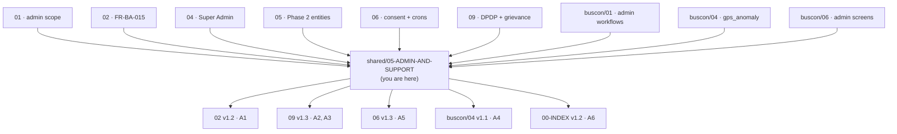

### 1.3 What this document does NOT cover

| Topic | Goes to |
|---|---|
| Admin screens and layouts | `buscon/06` §15 |
| Admin workflow sequences (WF-A-01 to WF-A-05) | `buscon/01` §9–§14, `08` §6 |
| Admin endpoints (21) | `07` v1.2 §6 |
| PII unmasking mechanics | `04` §11.4, `buscon/01` §14 |
| Refund tier calculation | `busverse/03` §10 |
| Suspension cascade mechanics | `buscon/01` §13, `08` §8.4 |
| Full audit log schema | `06` v1.2 §9.2 |
| Security incident response | `09` v1.2 §20 |
| Backup/DR procedures | `09` v1.2 §23.5 |
| Support panel implementation | (Phase 2 — not built) |

### 1.4 Scope boundary

**Two-column reality:** half Phase 1, half Phase 2 placeholder.

| Consumer | Reads from this doc | When |
|---|---|---|
| **Founder (Super Admin)** | §2 (phase boundary), §4 (what works), §5 (support), §6 (DPDP), §7 (grievance), §8 (runbooks), §13 (failure), §14 (metrics), §14.5 (demo-day), §14.6 (checklist) | Daily — this is the operational manual |
| **Report author** | §2 (phase boundary), §6.5 (privacy policy bump), §15 (cross-doc refs) | Writing chapters 11, 18 |
| **Viva Q&A preparer** | §14.5 (demo-day runbook), §17 (open questions) | Preparing for Q&A |
| **Phase 2 implementer** | §11 (roadmap), §12 (data model) | When Phase 2 starts |
| **DPDP auditor** | §6, §6.5, §7 | Compliance review |

### 1.5 The honest framing

**This doc is unusual.** Other docs describe a buildable system. SH-05 describes:
- **What actually works in Phase 1** — 5 admin capabilities that are fully automated
- **What works manually in Phase 1** — 4 workflows that rely on email + founder
- **What is not built in Phase 1** — 6 capabilities deferred to Phase 2

**Rule:** Never blur the three categories. Every section explicitly labels its status.

---

## 2. The Phase Boundary (hero diagram)

### 2.1 Three columns

**Diagram: The phase boundary**
*Three columns — automated Phase 1, manual Phase 1, not-built Phase 2. The middle column is the gap this doc fills.*

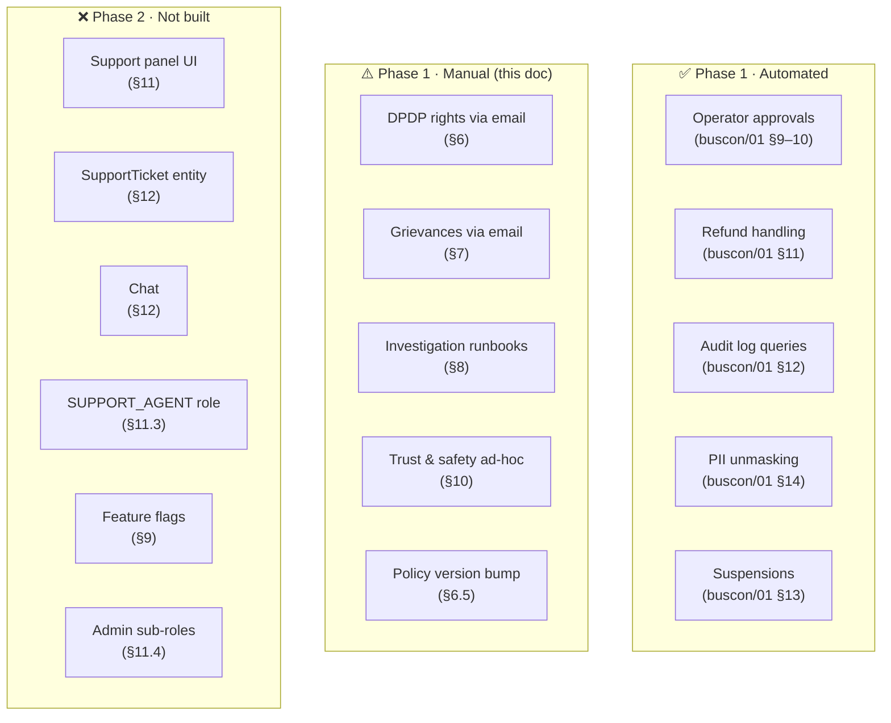

### 2.2 The three categories

**Diagram: Category matrix**
*Every admin/support capability falls into one of 3 categories. This matrix is the definitive list.*

| Capability | Category | Where |
|---|---|---|
| Operator KYC approval | ✅ Automated | `buscon/01` §9 |
| Bus/route/schedule approval | ✅ Automated | `buscon/01` §10 |
| Refund initiation | ✅ Automated | `buscon/01` §11 |
| Audit log query + export | ✅ Automated | `buscon/01` §12 |
| Operator/driver suspension | ✅ Automated | `buscon/01` §13 |
| PII unmasking (with reason) | ✅ Automated | `buscon/01` §14 |
| DPDP access/correction/erasure | ⚠️ Manual | §6 |
| Privacy policy version bump | ⚠️ Manual (Phase 2 formalized) | §6.5 |
| Grievance receipt + resolution | ⚠️ Manual | §7 |
| Investigation (payment, GPS, duplicate) | ⚠️ Manual | §8 |
| Trust & safety response | ⚠️ Manual | §10 |
| Admin lockout recovery | ⚠️ Manual | §13 |
| Demo-day failure response | ⚠️ Manual | §14.5 |
| Daily/weekly/monthly ops | ⚠️ Manual | §14.6 |
| Support panel UI | ❌ Phase 2 | §11 |
| SupportTicket entity | ❌ Phase 2 | §12 |
| ChatMessage entity | ❌ Phase 2 | §12 |
| SUPPORT_AGENT role | ❌ Phase 2 | §11.3 |
| Feature flags | ❌ Phase 2 | §9 |
| Admin sub-roles (Ops/Finance/Auditor) | ❌ Phase 2 | §11.4 |

### 2.3 What "manual" means

**Diagram: What manual looks like**
*Manual Phase 1 workflows have specific characteristics — email-driven, founder-executed, audit-logged, and bounded by legal SLAs.*

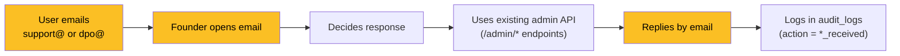

| Attribute | Manual Phase 1 |
|---|---|
| Channel | Email only |
| Staff | 1 (founder) |
| Backend | Existing admin endpoints (`/admin/*`) |
| Audit | Manual entry in `audit_logs` |
| SLA | Best effort (except legal SLAs) |
| Automation | None — human-in-the-loop |

**Rule:** Every manual workflow has a defined **trigger**, **input**, **steps**, **output**, **audit action**, and **SLA** — nothing is left ad-hoc.

---

## 3. Admin Phase 1 — Capability Map

### 3.1 Who is the admin?

**Diagram: The single Super Admin**
*Phase 1 has exactly 1 admin — the founder. All 5 automated workflows are executed by this single person. No delegation, no sub-roles.*

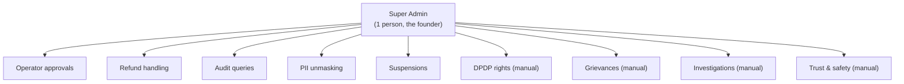

### 3.2 The 5 automated capabilities

**Reference:** `buscon/01` §9–§14, `buscon/06` §15, `08` §6.

| # | Capability | Workflow | Endpoints | Screens |
|:---:|---|---|---|---|
| 1 | Operator KYC approval | WF-A-02 | `POST /admin/operators/:id/approve` · `/reject` | `SCR-BC-APPROVALS` (operators tab) |
| 2 | Bus/route/schedule approval | WF-A-03 | `POST /admin/{buses\|routes\|schedules}/:id/approve` · `/reject` | `SCR-BC-APPROVALS` (3 tabs) |
| 3 | Refund handling | WF-A-04 | `POST /admin/payments/:id/refund` | `SCR-BC-REFUNDS` |
| 4 | Audit log query + export | WF-A-05 | `GET /admin/audit-logs` · `/export` | `SCR-BC-AUDIT` |
| 5 | Operator/driver suspension | WF-X-04 | `POST /admin/operators/:id/suspend` · `/unsuspend` | `SCR-BC-APPROVALS` |

### 3.3 The PII access capability

**Reference:** `buscon/01` §14, `04` §11.4.

| Aspect | Detail |
|---|---|
| Trigger | Admin clicks "Unmask PII" on a booking detail |
| Reason | Required, ≥10 chars, logged |
| Rate limit | 10 unmaskings/hour/admin (per `04` §11.4) |
| Audit | Every unmask writes `pii_accessed` to `audit_logs` |
| Auto-hide | 5 min after unmask (client-side) |

**Note:** PII unmasking is often a step *inside* an investigation (§8 runbooks) or DPDP request (§6), not a standalone capability. It's both an automated capability and a building block.

### 3.4 What admin does NOT do

| Not admin's job | Why |
|---|---|
| Cancel bookings | Admin can only cancel schedules (which cascades); individual bookings are passenger-initiated |
| Modify confirmed bookings | Immutable per `05` v1.2 §7.1 #4 |
| Redirect refunds | Refunds go to original payment method only per `09` v1.2 §19.3 |
| Access card data / UPI PINs | No such data exists per `04` §12 #1, #2 |
| Bypass DPDP / GST | Immutable rules per `04` §12 #8 |
| Impersonate users | No such endpoint per `04` §12 #11 |

---

## 4. Admin Phase 1 — What Works

### 4.1 The approval flow

**Diagram: The approval flow**
*Two-level approval — operator KYC then buses/routes/schedules. Each requires a reason. Every decision audited.*

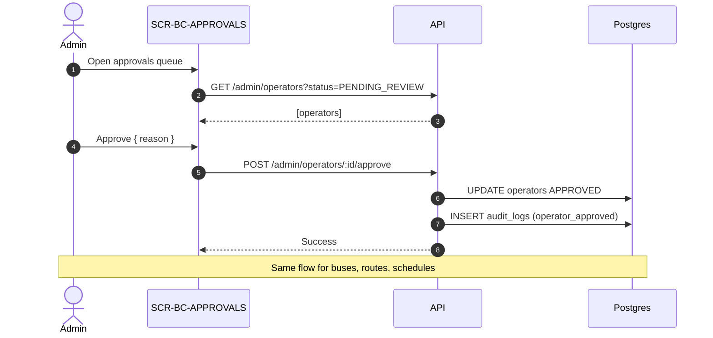

### 4.2 The refund flow

**Reference:** `buscon/01` §11.

| Step | Action | Endpoint |
|---|---|---|
| 1 | View refunds list | `GET /admin/refunds` |
| 2 | Open specific refund | `GET /admin/payments/:id` |
| 3 | Initiate refund | `POST /admin/payments/:id/refund` (`Idempotency-Key` required) |
| 4 | Retry if failed | `POST /admin/refunds/:id/retry` (Phase 2 — Phase 1 retries via UI) |

**Rule:** Admin refunds always use `TIER_FULL` (per `busverse/03` §10.4). Amount can be adjusted ≤ original payment.

### 4.3 The audit flow

**Reference:** `buscon/01` §12.

| Step | Action | Endpoint |
|---|---|---|
| 1 | Query with filters | `GET /admin/audit-logs?entityType=&action=&from=&to=` |
| 2 | Filter results | Client-side per `buscon/01` §12.5 |
| 3 | Export CSV | `GET /admin/audit-logs/export?format=csv` (async if >1000 rows) |
| 4 | Download | Signed R2 URL via email (async) or immediate response (sync) |

**Limits:** 10K rows/export; 3 exports/hour (per `buscon/01` §12.6).

### 4.4 The suspension flow

**Reference:** `buscon/01` §13, `08` §8.4.

| Step | Action | Side effects |
|---|---|---|
| 1 | Admin clicks Suspend | — |
| 2 | Enter reason (≥10 chars) | — |
| 3 | Confirm | Atomic transaction: operator.status = SUSPENDED, all operator_users + drivers sessions revoked, all future schedules hidden from BusVerse search, audit row written, email sent |

**Recovery:** Unsuspend reverses status + audit row. Does not restore sessions — users log in fresh.

### 4.5 The PII unmasking flow

**Reference:** `buscon/01` §14.

| Step | Action | Rate limit |
|---|---|---|
| 1 | View booking (masked) | — |
| 2 | Click "Unmask" | — |
| 3 | Enter reason | 10 unmaskings/hour |
| 4 | See unmasked PII | Auto-hide after 5 min |

**Every unmask writes `pii_accessed` to `audit_logs`** with actor, reason, entity ID, IP, timestamp.

---

## 5. Support Phase 1 — Manual

### 5.1 Escalation channels (resolves G8)

**Diagram: Two email channels**
*Two email addresses, two purposes. `support@` for general support, `dpo@` for DPDP + grievances. No other channel exists in Phase 1.*

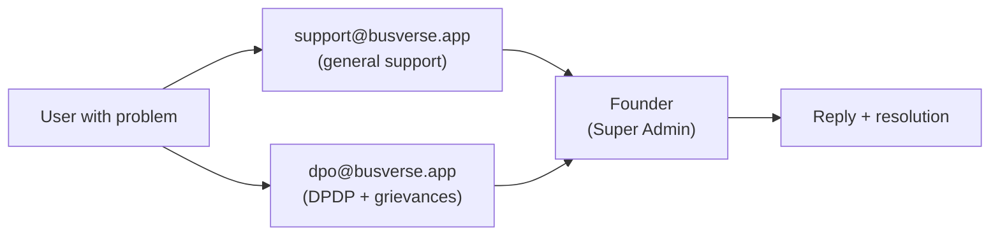

| Channel | Purpose | Owner | Response SLA |
|---|---|---|---|
| `support@busverse.app` | Booking issues, payment issues, refund status, general questions | Founder | 24h ack / 72h resolve |
| `dpo@busverse.app` | DPDP rights (access, correction, erasure), grievances, privacy questions | Founder (as DPO) | 24h ack / 30 days resolve (DPDP §13) |

**Rule:** No in-app chat, no phone support, no WhatsApp in Phase 1. Every channel that isn't these two is Phase 2 or a non-goal.

**Non-goals:** 24/7 support, phone support, live chat, ticket portal, knowledge base — all Phase 2 or non-goals per `01` §12.

### 5.2 The support lifecycle

**Diagram: Support ticket lifecycle**
*Email → Ack → Triage → Investigate → Respond → Close. 5 steps, no tooling, all manual.*

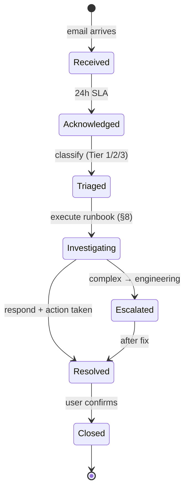

### 5.3 Support tiers

| Tier | Examples | Resolution SLA | % of volume (est.) |
|---|---|---|---:|
| **Tier 1** | Booking failed, payment issue, refund status, QR scan failure | 72h | ~70% |
| **Tier 2** | Wrong seat, driver behavior, schedule change | 7d | ~20% |
| **Tier 3** | Legal (DPDP, grievance), safety | 30d (DPDP) / 72h (safety) | ~10% |

**Tier classification:** Tier 3 always routes to `dpo@`; Tiers 1–2 to `support@`.

### 5.4 The 5 email templates (resolves M4)

**Template 1 — Support acknowledgment:**

```
Subject: [BusVerse Support] We've received your message (ref: {REF})

Hi {name},

Thanks for writing to us. Your request reference is {REF}. We've received your message about: "{subject line}".

What happens next:
- For booking/payment issues: we aim to respond within 24 hours.
- For refund status: refunds typically take 3-7 business days.
- For urgent safety concerns: we respond within 4 hours.

If you have more details to add, reply to this email with your reference number.

Best,
Shaghaf
Founder, BusVerse
```

**Template 2 — DPDP acknowledgment:**

```
Subject: [BusVerse Privacy] Your data request is being processed (ref: {REF})

Hi {name},

We've received your request under the Digital Personal Data Protection Act 2023 (ref: {REF}).

What happens next:
- Within 3 business days: we'll confirm your identity and the scope of your request.
- Within 30 days: we'll complete your request (access, correction, or erasure) and provide the results.

Your rights under DPDP:
- Right to access your personal data (§11)
- Right to correction of inaccurate data (§12)
- Right to erasure (§13)
- Right to grievance redressal (§13)

If you have concerns about how we handle your data, you can also contact:
- Our Grievance Officer: dpo@busverse.app
- The Data Protection Board of India (if unresolved after 30 days)

Best,
Shaghaf
Data Protection Officer, BusVerse
```

**Template 3 — Refund confirmed:**

```
Subject: [BusVerse Support] Refund of ₹{amount} processed (ref: {REF})

Hi {name},

Your refund of ₹{amount} has been processed to the original payment method ending in {last4}.

What happens next:
- {Method-specific timeline — e.g., "3-5 business days for UPI"}

Reason for refund: {reason}

Your booking reference was {booking_ref}. If you have any questions, reply to this email.

Best,
Shaghaf
Founder, BusVerse
```

**Template 4 — Investigation result:**

```
Subject: [BusVerse Support] Investigation complete (ref: {REF})

Hi {name},

We've completed our investigation of your report about {topic}.

Summary:
- What we found: {findings}
- Action taken: {action}
- Your outcome: {outcome — refund initiated / no action / escalated}

If you have any questions or believe we've missed something, reply within 7 days.

Best,
Shaghaf
Founder, BusVerse
```

**Template 5 — Escalation (Phase 2):**

```
Subject: [BusVerse Support] Your request is being escalated (ref: {REF})

Hi {name},

Your request has been escalated to our technical team for further investigation.

Current status: {status}

What happens next:
- We'll provide an update within 48 hours.
- Your ticket is now handled by a specialized agent.

Best,
{Support Agent Name}
BusVerse Support
```

**Rule:** Every outbound email uses a template. No improvisation. Tone consistent, legal disclaimers present, references tracked.

### 5.5 Support mailboxes management

| Aspect | Phase 1 setup |
|---|---|
| `support@busverse.app` | Forwarding to founder's personal email |
| `dpo@busverse.app` | Same (aliased) |
| Auto-reply | Template 1 (support) or Template 2 (DPDP) fires immediately |
| Reference format | `SUP-YYYY-MMDD-NNN` for support; `DPDP-YYYY-MMDD-NNN` for DPDP |
| Threading | Replies stay in email thread; ref number in subject |
| Tracking | Manual — founder maintains a spreadsheet or Notion page |
| Retention | Emails archived indefinitely for audit |

**Phase 2:** Support panel handles threading, tracking, SLAs automatically.

---

## 6. DPDP Data Rights Workflow (resolves G3)

### 6.1 The DPDP rights

**Reference:** `09` v1.2 §18.4, DPDP Act 2023 §11–§13.

| Right | User action | Admin action | SLA |
|---|---|---|---|
| **Access** (§11) | Email `dpo@` requesting data copy | Export user's data (DSAR) | 30 days |
| **Correction** (§12) | Email `dpo@` with what's wrong | Update via `/admin/users/:id` (Phase 1 manual) | 30 days |
| **Erasure** (§13) | Email `dpo@` requesting deletion | Soft-delete user + all profiles; retain financial per `06` §16 | 30 days |

### 6.2 The DSAR workflow

**Diagram: DSAR (Data Subject Access Request) flow**
*5 steps from email to delivery. Manual but audited.*

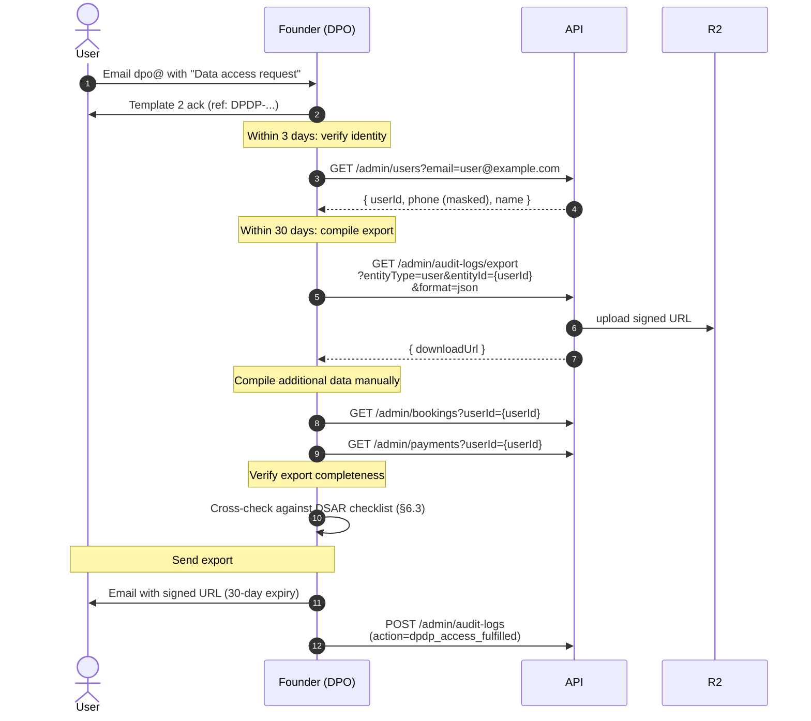

### 6.3 DSAR export format (resolves M2)

**The exact export structure:**

```json
{
  "dsar_id": "DPDP-2026-1025-001",
  "request_date": "2026-10-25T14:00:00.000Z",
  "fulfilled_date": "2026-11-10T10:00:00.000Z",
  "user": {
    "id": "usr_xyz",
    "phone": "+919876543210",
    "email": "alice@example.com",
    "name": "Alice Gupta",
    "created_at": "2025-01-15T10:00:00.000Z",
    "email_verified": true
  },
  "passenger_profile": {
    "name": "Alice Gupta",
    "dob": "1995-03-20",
    "gender": "FEMALE"
  },
  "bookings": [
    {
      "booking_reference": "BKG-2026-00042",
      "status": "CONFIRMED",
      "schedule": "Delhi → Lucknow, 2026-10-25 14:00",
      "passengers": [
        { "name": "Alice Gupta", "seat": "A1", "age": 31 }
      ],
      "total_fare_paise": 48750,
      "confirmed_at": "2026-10-24T14:32:00.000Z"
    }
  ],
  "payments": [
    {
      "id": "pay_abc",
      "amount_paise": 48750,
      "method": "UPI",
      "status": "SUCCEEDED",
      "created_at": "2026-10-24T14:30:00.000Z"
    }
  ],
  "tickets": [
    { "id": "tkt_xyz", "status": "SCANNED", "scanned_at": "2026-10-25T14:32:00.000Z" }
  ],
  "consent_records": [
    { "purpose": "terms_of_service", "policy_version": "v1.0", "granted_at": "2025-01-15T10:00:00.000Z", "revoked_at": null },
    { "purpose": "privacy_policy", "policy_version": "v1.0", "granted_at": "2025-01-15T10:00:00.000Z", "revoked_at": null }
  ]
}
```

**Included tables:**

| Table | Fields | Why |
|---|---|---|
| `users` | All non-sensitive fields | Identity |
| `passenger_profiles` | All fields | Profile data |
| `bookings` | All user's bookings | Transaction history |
| `booking_passengers` | All passengers on user's bookings | Travel history |
| `payments` | All user's payments | Financial |
| `tickets` | All user's tickets | Travel artifacts |
| `consent_records` | All user's consents (active + revoked) | Legal |
| `audit_logs` (about this user) | Actions where user is actor or subject | Activity history |

**Excluded:**

| Not exported | Why |
|---|---|
| `password_hash` | Security risk; not "personal data" per DPDP |
| `phone_hash` | Derivation, not original data |
| Other users' data | Not user's data |
| Internal admin notes | Not user's data |

**Delivery:** Signed R2 URL with 30-day expiry, sent via email. User is warned not to share.

### 6.4 The correction workflow

| Step | Action |
|---|---|
| 1 | User emails `dpo@` with what's incorrect |
| 2 | Founder verifies identity |
| 3 | Founder updates via direct DB query (Phase 1 — no admin UI for user profile edit yet) |
| 4 | Founder logs `audit_logs` with action `dpdp_correction_applied` |
| 5 | Founder replies with confirmation |
| 6 | User confirms |

**Phase 2:** Add `PATCH /admin/users/:id` endpoint + admin UI.

### 6.5 Privacy policy version bump (resolves M1)

**Diagram: Policy version bump workflow (Phase 2)**
*Phase 1 policy is fixed at v1.0 — no bump. Phase 2 formalizes the workflow.*

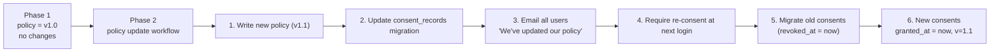

**Phase 1 status:** Privacy policy is **v1.0** for the entire Phase 1 lifecycle. No version bumps. If policy text needs clarification, it's a Phase 2 concern.

**Phase 2 workflow (not built):**

| Step | Action | Tool |
|---|---|---|
| 1 | Write new policy version | Manual (legal) |
| 2 | Update `policy_version` constant | Code change |
| 3 | Migration: `UPDATE consent_records SET revoked_at = now() WHERE purpose = 'privacy_policy' AND revoked_at IS NULL` | SQL migration |
| 4 | Prompt all users on next login: "We've updated our privacy policy. Please review and re-consent." | UI change |
| 5 | New consent creates new `consent_records` row with `policy_version = 'v1.1'` | App logic |
| 6 | Email all users announcing the change | SendGrid bulk email |

**Phase 1 discipline:** If Phase 1 policy text must change (rare), do it as a new version bump **using the Phase 2 workflow** — but only execute it if truly necessary. Better to wait for Phase 2.

---

## 7. Grievance Officer Workflow (resolves G4)

### 7.1 The role

**Reference:** `09` v1.2 §18.5.

| Aspect | Phase 1 |
|---|---|
| Role | Founder is DPO **and** Grievance Officer |
| Contact | `dpo@busverse.app` (single address) |
| Scope | DPDP grievances, privacy complaints, disputes with resolution |
| SLA | 30 days (DPDP §13) |
| Escalation | Data Protection Board of India if unresolved |

### 7.2 The grievance workflow

**Diagram: Grievance lifecycle**
*Fully manual. 5 stages from email to resolution or escalation.*

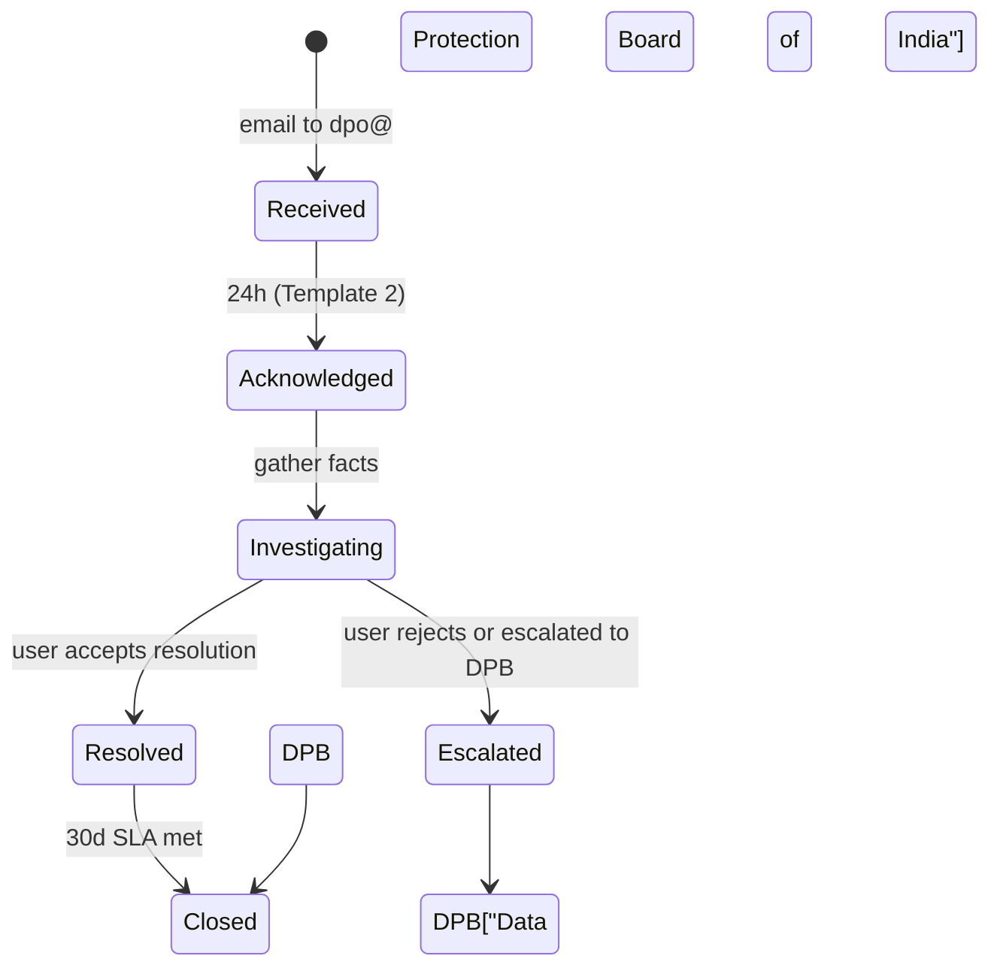

### 7.3 The steps

| Step | Action | Tool | SLA |
|---|---|---|---|
| 1 | Receive grievance | `dpo@busverse.app` | — |
| 2 | Acknowledge | Template 2 | 24h |
| 3 | Verify identity | Email reply with confirmation | 3d |
| 4 | Investigate | Runbook §8 + audit query | — |
| 5 | Propose resolution | Email reply | 20d |
| 6 | User accepts or rejects | Email reply | 30d total |
| 7 | If accepted → close | `audit_logs` action `grievance_resolved` | — |
| 8 | If rejected → escalate to DPB | Email with DPB contact info | — |

### 7.4 Grievance categories

| Category | Example | Typical resolution |
|---|---|---|
| **Privacy** | "You have data I didn't consent to" | Erase data if confirmed |
| **Data accuracy** | "My booking shows wrong name" | Correct + confirm |
| **Refund dispute** | "I should have gotten full refund" | Review `busverse/03` §10 tiers + explain |
| **Service quality** | "Driver was rude" | Investigate + suspend driver if warranted (via `buscon/01` §13) |
| **Refund delayed** | "I cancelled 10 days ago, no money" | Check Razorpay status; escalate if stuck |

### 7.5 The DPB escalation path

**When to escalate:**

| Condition | Action |
|---|---|
| User rejects resolution | Offer DPB contact: `complaints@dpb.gov.in` |
| Resolution not possible (technical) | Same |
| Legal dispute | Contact lawyer (Phase 2) |

**Rule:** Never refuse a grievance. Always offer DPB path. The Data Protection Board is user's right.

### 7.6 Tracking grievances

**Diagram: Grievance log**
*Manual tracking in a spreadsheet or Notion — 6 columns.*

| Field | Example |
|---|---|
| Ref | `GRIEV-2026-1025-001` |
| Received | 2026-10-25 14:00 |
| User | alice@example.com |
| Category | Refund dispute |
| Status | Investigating / Resolved / Escalated |
| Notes | Investigation details |

**Phase 2:** Support panel replaces spreadsheet.

---

## 8. Investigation Runbooks

### 8.1 Runbook 1 — "Payment succeeded but no booking"

**Trigger:** User emails `support@` with Razorpay payment ID + booking reference.

**Diagram: Payment investigation flow**
*Diagnose the 3 possible causes and take action.*

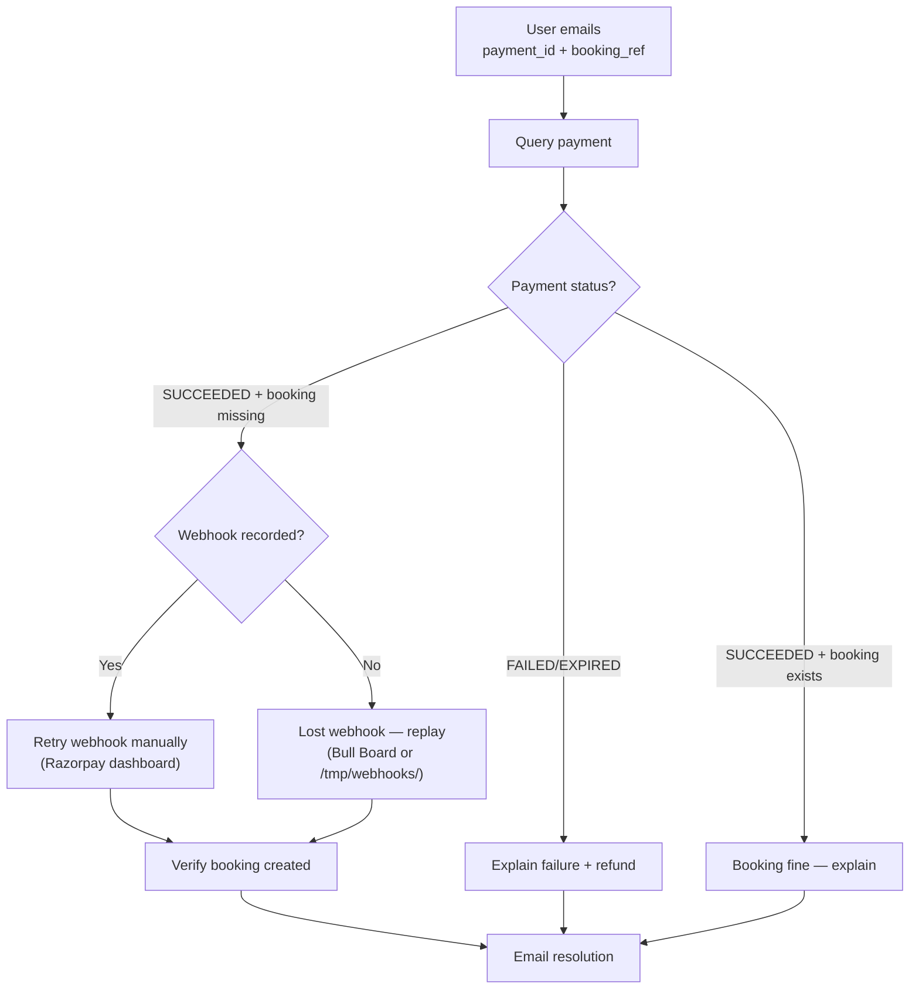

**Steps:**

| Step | Command / URL | Expected |
|---|---|---|
| 1 | Query payment: `GET /admin/payments?gatewayPaymentId={pay_id}` | Payment row |
| 2 | If payment SUCCEEDED + booking exists → reply with booking link | — |
| 3 | If payment SUCCEEDED + booking missing: query `gateway_webhooks` for that payment | Should show webhook if received |
| 4 | If webhook not received: check `/tmp/webhooks/failed/` for the file | Per `09` §13.5 |
| 5 | Replay webhook: Bull Board → job queue → manually enqueue or use Razorpay dashboard replay | Booking created |
| 6 | If truly lost: manual DB insert of booking (last resort, with audit) | — |
| 7 | If payment FAILED/EXPIRED: check `payments.status` reason | Explain to user + refund if appropriate |
| 8 | Reply via Template 4 | — |

**Time budget:** 5–10 min.

### 8.2 Runbook 2 — "Charged twice"

**Trigger:** User emails `support@` with 2 Razorpay payment IDs.

**Diagram: Duplicate charge flow**
*Verify both are real, determine if same booking or different, refund the duplicate.*

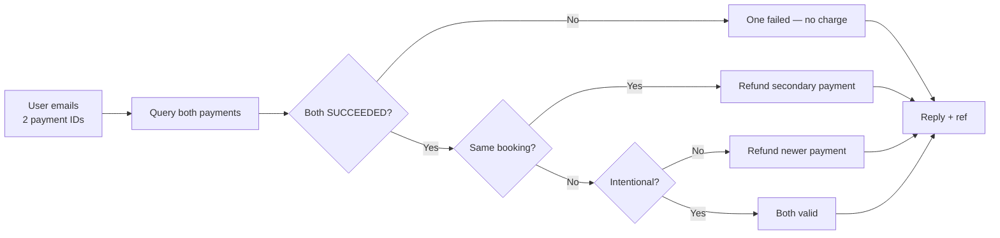

**Steps:**

| Step | Command | Expected |
|---|---|---|
| 1 | `GET /admin/payments?gatewayPaymentId IN (id1, id2)` | 2 payment rows |
| 2 | If one FAILED → explain, no charge | — |
| 3 | If both SUCCEEDED, check `bookingId`: | — |
| 4a | Same booking → refund newer via `POST /admin/payments/{id}/refund` (Tier: `TIER_FULL`) | Refund initiated |
| 4b | Different bookings → ask user which they want to keep | — |
| 5 | Reply via Template 4 | — |

**Time budget:** 5 min.

### 8.3 Runbook 3 — "GPS showed wrong position"

**Trigger:** User emails `support@` with screenshot + trip ID.

**Diagram: GPS investigation flow**
*Check provenance flags, review trip replay, determine if legitimate anomaly.*

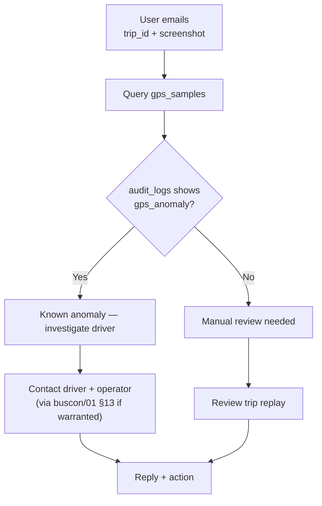

**Steps:**

| Step | Command | Expected |
|---|---|---|
| 1 | Query: `SELECT * FROM gps_samples WHERE trip_id = {id} ORDER BY recorded_at` | GPS samples |
| 2 | Query audit: `GET /admin/audit-logs?entityType=Trip&entityId={id}&action=gps_anomaly` | Anomaly events |
| 3 | If anomaly confirmed: contact driver + operator; note in audit | — |
| 4 | If anomaly persistent (>3 flags in trip): suspend driver via `buscon/01` §13 | — |
| 5 | If no anomaly + GPS accurate: explain to user (map quirks, accuracy limits) | — |
| 6 | Reply via Template 4 | — |

**Time budget:** 10–15 min.

### 8.4 Investigation common infrastructure

**Reference:** `buscon/01` §14 (PII access), §12 (audit query).

**Common tools:**
- Audit log query (all investigations)
- PII unmask (when needed — with reason)
- Booking/payment/trip detail views
- Razorpay dashboard (external)
- Bull Board (internal job queue)

**Common trail:** Every investigation step writes to `audit_logs` with action `investigation_step` + case reference.

---

## 9. Feature Flag Resolution (resolves G1)

### 9.1 The contradiction

**Diagram: The contradiction across 5 docs**
*FR-BA-015 says feature flags are Phase 1. 4 other docs say Phase 2 or don't create them.*

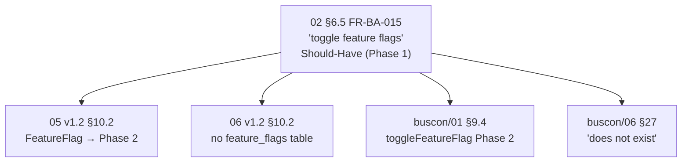

### 9.2 The resolution

**Diagram: Resolution path**
*Reclassify FR-BA-015 to Won't (Phase 2). No new FR ID. Update MoSCoW counts.*

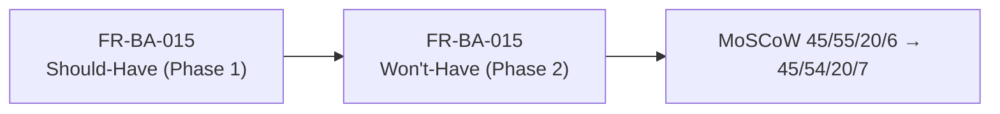

### 9.3 The rule

**FR-BA-015 status:** Reclassified to **Won't-Have (Phase 2)**.

| Aspect | Phase 1 | Phase 2 |
|---|---|---|
| Feature flags exist? | ❌ No | ✅ Yes |
| `feature_flags` table? | ❌ No | ✅ Yes |
| Admin UI tab? | ❌ No | ✅ Yes |
| Toggle endpoint? | ❌ No | ✅ Yes |
| Definition | — | Per-flag enable/disable with rollout % |

**Why Phase 2, not Phase 1:**

| Reason | Detail |
|---|---|
| No demo-critical use case | No demo step depends on flags |
| Adds schema complexity | New table, migrations, indexes |
| Adds UI complexity | New admin tab |
| Adds API complexity | New endpoint + validations |
| Zero viva value | Doesn't impress viva panel |

**Amendment:** A1 High-priority (Wave 2 — fixes doc contradiction before Phase 1 launch).

### 9.4 The amendment details

| Change | Location |
|---|---|
| FR-BA-015 priority Should → Won't | `02` §6.5, §18.3, §18.5 |
| MoSCoW counts 45/55/20/6 → 45/**54**/20/**7** | `02` §18.1 |
| Add to Won't-Have list with reason | `02` §18.5 |
| No change to `04` §9.2 | Already marked Phase 2 |
| No change to `buscon/01` §9.4 | Already marked Phase 2 |
| No change to `05`/`06` v1.2 | Already Phase 2 |

**Rule:** FR-BA-015 keeps its ID (per `02` §6.1 — IDs never change). Only the priority label changes.

---

## 10. Trust & Safety Workflow (resolves G7)

### 10.1 The three protocols

**Diagram: Trust & safety response protocols**
*Three event-driven protocols — GPS anomaly, suspicious operator, refund abuse. Each has defined response steps.*

```mermaid
flowchart TB
    subgraph GPS["gps_anomaly"]
        G1["Event emitted"]
        G2["Contact driver + operator"]
        G3{"Repeat?"}
        G4["Suspend driver"]
        G1 --> G2 --> G3
        G3 -->|"Yes"| G4
    end

    subgraph OPR["Suspicious operator"]
        O1["KYC hard to verify"]
        O2["Request more documents"]
        O3{"Resolved?"}
        O4["Reject operator"]
        O1 --> O2 --> O3
        O3 -->|"No"| O4
    end

    subgraph REF["Refund abuse"]
        R1[">3 refunds in 7 days"]
        R2["Rate limit further refunds"]
        R3{"Pattern?"}
        R4["Suspend user"]
        R1 --> R2 --> R3
        R3 -->|"Yes"| R4
    end
```

### 10.2 Protocol 1 — GPS anomaly

**Trigger:** `gps_anomaly` WS event (per `shared/04` §3.4) fires when 5+ provenance failures in a trip (per `buscon/04` §10.5).

| Step | Action | Tool |
|---|---|---|
| 1 | Admin sees `gps_anomaly` in audit log (Phase 1: no live feed; check `audit_logs`) | `GET /admin/audit-logs?action=gps_anomaly` |
| 2 | Query driver's recent anomalies | Filter by `driverId` |
| 3 | If 1 anomaly → likely one-off (network, tunnel) → log + move on | — |
| 4 | If 2-3 anomalies in 30 days → contact driver + operator (via email) | Email |
| 5 | If >3 anomalies → suspend driver for investigation | `buscon/01` §13 |
| 6 | Log every action to `audit_logs` | — |

**Response SLA:** 24h from anomaly detection (best effort).

### 10.3 Protocol 2 — Suspicious operator

**Trigger:** Operator KYC is ambiguous or hard to verify.

| Step | Action |
|---|---|
| 1 | Don't reject immediately — request additional documents |
| 2 | Email operator with specific document request (e.g., "Please provide a recent bank statement") |
| 3 | Give 7 days to respond |
| 4 | If responded with valid docs → approve |
| 5 | If responded with invalid docs → reject (with reason per `buscon/01` §9) |
| 6 | If no response after 7 days → reject (with reason) |

**Reference:** `buscon/01` §9.7 (rejection categories).

### 10.4 Protocol 3 — Refund abuse

**Trigger:** User requests >3 refunds in 7 days.

| Step | Action |
|---|---|
| 1 | Query user's refund history | `GET /admin/refunds?userId={id}` |
| 2 | If >3 refunds in 7 days → rate limit further refunds (per `09` §16) | — |
| 3 | Email user asking for context | — |
| 4 | If legitimate (e.g., user booked 4 trips then changed plans) → allow |
| 5 | If pattern (book/cancel loop) → suspend user (via `buscon/01` §13 — Phase 1: manual DB or use driver suspension mechanism if applicable) |
| 6 | Log every action | — |

**Note:** User suspension is **not automated** in Phase 1 — no `POST /admin/passengers/:id/suspend` endpoint. Founder must do DB update + audit. Phase 2 adds endpoint.

### 10.5 Other events → existing workflows

**Diagram: Event → workflow mapping**
*Not every `admin:notifications` event needs a new protocol — most map to existing admin workflows.*

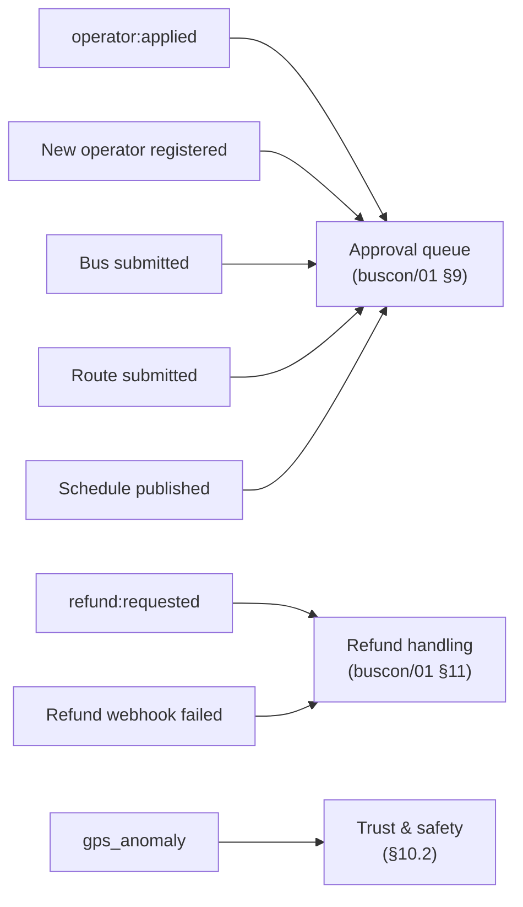

**Rule:** Most trust & safety events route to existing admin workflows. Only 3 categories need new protocols (§10.2-§10.4).

---

## 11. Support Panel Phase 2 Roadmap (resolves G2)

### 11.1 Explicit Phase 2 status

**Diagram: Phase 2 support panel (not built)**
*Complete spec exists, but nothing is implemented. Phase 2 team starts here.*

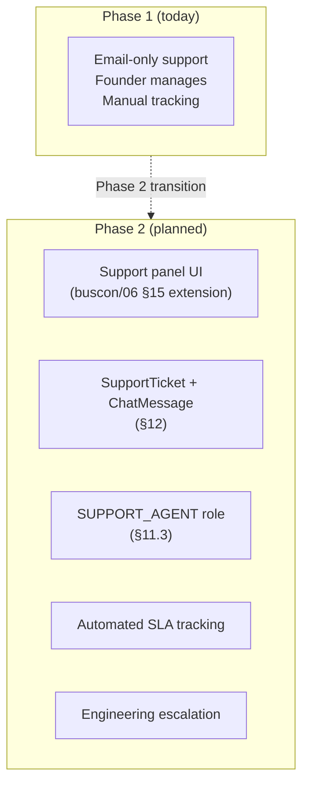

**Rule:** Nothing in §11–§12 is built. It's a spec for future implementation. If Phase 2 doesn't happen, this is still valid documentation of intent.

### 11.2 Support panel scope

| Aspect | Phase 2 spec |
|---|---|
| Ticket creation | User in-app button or email → auto-ticket |
| Ticket list | Filter by status, priority, assigned agent |
| Ticket detail | Thread view of messages |
| Response | In-app + email |
| SLA tracking | Automatic; escalation if breached |
| Assignment | Manual or auto-routed by category |
| Bulk actions | Close, reassign, escalate |
| Analytics | Volume, SLA compliance, category distribution |

### 11.3 Phase 2 Support Agent role

**Placeholder permission scope:**

| Permission | Allowed |
|---|---|
| View all support tickets | ✅ |
| Respond to tickets | ✅ |
| Close tickets | ✅ |
| View user data (masked) | ✅ |
| View user data (unmasked) | ❌ (requires Super Admin) |
| Initiate refund | ❌ (requires Super Admin) |
| Suspend user | ❌ (requires Super Admin) |
| View audit logs | ❌ (requires Super Admin) |
| Export data | ❌ (requires Super Admin) |

**Rule:** Support agents can see masked data + respond to tickets. Every destructive action escalates to Super Admin.

**Reference:** `04` §4.3 (deferred roles list).

### 11.4 Phase 2 admin sub-roles

**Placeholder structure:**

| Sub-role | Purpose | Scope |
|---|---|---|
| **Super Admin** | Full access | Everything (Phase 1) |
| **ADMIN_OPS** | Day-to-day operations | Approvals, suspensions, but not refunds |
| **ADMIN_FINANCE** | Money management | Refunds, financial oversight, but not suspensions |
| **ADMIN_AUDITOR** | Audit + compliance | Audit log access, DPDP workflows, but not operations |
| **SUPPORT_AGENT** | Ticket management | Per §11.3 |

**Rule:** Phase 2 splits Super Admin into 4-5 sub-roles. Phase 1 keeps single role for simplicity.

### 11.5 Phase 2 support panel timeline (placeholder)

| Month | Milestone |
|---|---|
| Month 1 | SupportTicket + ChatMessage data model |
| Month 2 | Support panel UI (ticket list, detail) |
| Month 3 | SLA tracking + escalation |
| Month 4 | SUPPORT_AGENT role + permissions |
| Month 5 | Analytics dashboard |
| Month 6 | Full rollout |

**No dates committed.** This is a roadmap, not a plan.

---

## 12. Phase 2 Data Model (SupportTicket, ChatMessage)

### 12.1 The two entities

**Diagram: SupportTicket and ChatMessage ERD**
*Two related entities. SupportTicket is the parent; ChatMessage is the conversation.*

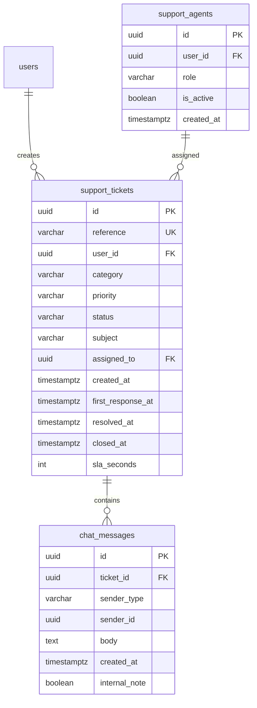

### 12.2 SupportTicket fields

| Field | Type | Notes |
|---|---|---|
| `id` | uuid | PK |
| `reference` | varchar | Format `SUP-YYYY-MMDD-NNN` |
| `user_id` | uuid | FK to users |
| `category` | enum | `PAYMENT`, `BOOKING`, `QR_SCAN`, `DRIVER`, `DPDP`, `OTHER` |
| `priority` | enum | `LOW`, `NORMAL`, `HIGH`, `URGENT` |
| `status` | enum | `OPEN`, `IN_PROGRESS`, `WAITING_USER`, `RESOLVED`, `CLOSED` |
| `subject` | varchar(500) | Summary from first message |
| `assigned_to` | uuid | FK to support_agents (nullable) |
| `created_at` | timestamptz | — |
| `first_response_at` | timestamptz | For SLA tracking |
| `resolved_at` | timestamptz | — |
| `closed_at` | timestamptz | — |
| `sla_seconds` | int | Computed from category + priority |
| Standard columns | | `updated_at`, `deleted_at`, `version`, `is_test` |

### 12.3 ChatMessage fields

| Field | Type | Notes |
|---|---|---|
| `id` | uuid | PK |
| `ticket_id` | uuid | FK |
| `sender_type` | enum | `USER`, `AGENT`, `SYSTEM` |
| `sender_id` | uuid | FK to users or support_agents |
| `body` | text | Message content |
| `internal_note` | boolean | If true, not visible to user |
| `created_at` | timestamptz | — |
| Standard columns | | `updated_at`, `version`, `is_test` |

### 12.4 SLA target table (Phase 2)

| Priority | Ack SLA | First response | Resolution | Escalation |
|---|---|---|---|---|
| URGENT | 15 min | 30 min | 4 hours | 1 hour |
| HIGH | 1 hour | 2 hours | 24 hours | 6 hours |
| NORMAL | 4 hours | 8 hours | 48 hours | 24 hours |
| LOW | 24 hours | 48 hours | 7 days | — |

**Escalation:** If SLA breach risk detected, auto-assign to supervisor + notify.

**Rule:** Phase 2 SLA targets are aspirational; actual SLA compliance measured by `first_response_at - created_at` and `resolved_at - created_at`.

---

## 13. Failure Modes & Admin Self-Service (resolves M5)

### 13.1 Admin lockout scenarios

**Diagram: 4 lockout scenarios**
*When admin can't get in, 4 fallback procedures apply. Each has a Phase 1 manual resolution.*

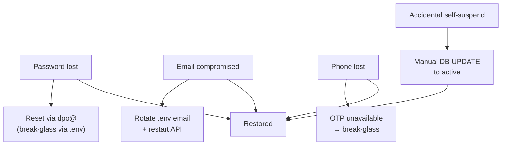

### 13.2 The four scenarios

| Scenario | Phase 1 fallback | Time |
|---|---|---|
| **Password lost** | Env `ADMIN_RECOVERY_TOKEN` + `/auth/admin/reset-with-token` endpoint (Phase 1) | 5 min |
| **Email compromised** | Update `.env` `ADMIN_EMAIL` + restart API; reset password via new email | 15 min |
| **Phone lost** | Admin uses email only (no OTP path in Phase 1 admin); no issue | 0 min |
| **Accidental self-suspend** | No self-suspend endpoint exists (Super Admin can't suspend self via UI); manual DB `UPDATE admin_users SET is_active = true` | 5 min |
| **Recovery phone add** | Phase 1: add to `.env`, restart | 10 min |

### 13.3 The break-glass procedure (resolves G10)

**Diagram: Break-glass admin recovery**
*If admin is locked out and email is inaccessible, use env token. Full recovery in under 30 min.*

```mermaid
sequenceDiagram
    actor A as Admin
    participant ENV as .env
    participant API as API
    participant DB as Postgres

    Note over A: Can't log in via email/password
    A->>ENV: Read ADMIN_RECOVERY_TOKEN
    A->>API: POST /auth/admin/reset-with-token<br/>{ token, newPassword }
    API->>DB: Verify token matches env
    API->>DB: UPDATE admin_users password_hash
    API->>DB: Revoke all sessions
    API->>DB: INSERT audit_logs (admin_recovery_used)
    API-->>A: { reset: true }
    A->>API: POST /auth/admin/login (new password)
    API-->>A: Logged in
```

**Reference:** `04` §17 Q2 (break-glass recovery default).

### 13.4 Common failure modes

| Failure | Phase 1 behavior |
|---|---|
| Admin forgot password | Email reset via `dpo@busverse.app` (self-service) |
| Admin email down (SendGrid) | Break-glass via `.env` token |
| Admin session expired mid-action | Re-login; action can be retried (all actions idempotent) |
| API unreachable | Wait + retry; if persists, check `/v1/status` (per `09` §23.5) |
| Database unreachable | Same as API; SEV1 escalation (per `09` §20.1) |
| Audit log query times out | Reduce filter scope or export async (per `buscon/01` §12.6) |
| Refund API fails | Retry via UI (`/admin/refunds/:id/retry` if available; else wait for cron retry) |

### 13.5 The self-service gaps

**Documented gaps (Phase 2 fills):**

| Gap | Phase 1 workaround | Phase 2 |
|---|---|---|
| Change admin email | `.env` + restart | `PATCH /admin/me` |
| Add recovery phone | `.env` + restart | `PATCH /admin/me` |
| Rotate recovery token | `.env` + restart | `POST /admin/me/rotate-token` |
| Add 2FA (TOTP) | Not available | `POST /admin/me/2fa/setup` (per `04` §17 Q1) |
| Create second admin | Manual DB insert | `POST /admin/admins` |

---

## 14. Metrics & SLAs

### 14.1 Phase 1 metrics

**Diagram: Metrics tracked manually**
*No dashboards in Phase 1. Founder tracks via email + audit log queries.*

```mermaid
flowchart LR
    EMAIL["Email volume"] --> TRACK["Founder tracking<br/>(spreadsheet)"]
    AUDIT["Audit log queries"] --> TRACK
    TRACK --> WEEKLY["Weekly review<br/>(15 min)"]
    WEEKLY --> MONTHLY["Monthly report<br/>(1 hr)"]
```

### 14.2 Metrics table

| Metric | Phase 1 tracking | Phase 2 dashboard |
|---|---|---|
| Support email volume | Email folder count | Ticket count |
| Avg response time | Manual timestamp tracking | Computed |
| SLA compliance % | Spot check | Automated |
| Refund volume | `SELECT COUNT(*) FROM refunds` | Dashboard |
| Suspension count | `SELECT COUNT(*) FROM audit_logs WHERE action='operator_suspended'` | Dashboard |
| DPDP requests | Manual log | Dashboard |
| Grievance count | Manual log | Dashboard |

### 14.3 SLA targets

| Category | Ack SLA | Resolution SLA | Escalation |
|---|---|---|---|
| **Support (general)** | 24h (best effort) | 72h (Tier 1) / 7d (Tier 2) | Manual |
| **DPDP** | 24h | 30 days (DPDP §13) | DPB |
| **Grievance** | 24h | 30 days | DPB |
| **Safety issue** | 4h | 72h | SEV1 |
| **Breach notification** | — | 72h (DPDP §35) | SEV1 + DPB |

**Note on Phase 1 SLA achievability:** Solo founder cannot guarantee 24h. Document best-effort + legal SLAs. Users accept "we aim to respond within 24h" but understand it may slip.

### 14.4 Metrics dashboard Phase 2

**When built, the dashboard shows:**

| Metric | Target |
|---|---|
| Ticket volume (7d) | Trend |
| SLA compliance | >95% |
| Avg first response | <4h |
| Avg resolution | <48h |
| Open tickets | <20 |
| Overdue tickets | 0 |
| Category distribution | Pie chart |
| Agent workload | Bar chart |

### 14.5 Demo-Day Admin Runbook (resolves M3)

**The 5 scenarios that could go wrong during viva:**

**Diagram: Demo-day admin decision tree**
*5 failure modes with defined responses. Presenter reads this doc the day before.*

```mermaid
flowchart TB
    DEMO["Viva demo starts"] --> Q1{"Step fails?"}
    Q1 -->|"Payment webhook delayed"| A1["Wait 30s → manual replay<br/>(Razorpay dashboard)"]
    Q1 -->|"GPS anomaly during tracking"| A2["Ignore (demo artifact)<br/>or override"]
    Q1 -->|"Refund needed on-stage"| A3["Use refund flow<br/>(2 min)"]
    Q1 -->|"Operator reject decision"| A4["Decide live or defer"]
    Q1 -->|"Database down"| A5["Fallback to recorded demo"]
```

**Scenario 1 — Payment webhook delayed**

| Situation | Response |
|---|---|
| Payment succeeds but booking still PENDING after 30s | Open Razorpay dashboard → Payments → find payment → "Replay webhook" |
| Booking still PENDING after replay | Check `/v1/status`; if API up, check audit; manual booking creation as last resort (visible to audience — admit it's an edge case) |

**Time to recover:** 2 min.

**Scenario 2 — GPS anomaly during tracking**

| Situation | Response |
|---|---|
| Passenger tracking shows unrealistic position | Ignore (GPS jitter demo artifact) — proceed to next step |
| Admin gets `gps_anomaly` alert | Acknowledge, note it's a test, continue |

**Time to recover:** 0 min (continue).

**Scenario 3 — Refund needed on-stage**

| Situation | Response |
|---|---|
| Operator cancels a trip to demo refund flow | Use `buscon/01` §11 refund flow — 2 min |
| Passenger cancels and asks for refund | Use `/bookings/:id/cancel` → auto-refund cascade |

**Time to recover:** 2–3 min (intentional demo).

**Scenario 4 — Operator reject decision**

| Situation | Response |
|---|---|
| Deciding whether to approve/reject an operator live | Approve the seeded operators (they're pre-approved in seed) — no live decision needed |
| If new operator needed | Use pre-seeded Sharma/Rajdhani/Northern — no fresh operators during demo |

**Time to recover:** 0 min (no decision needed).

**Scenario 5 — Database down**

| Situation | Response |
|---|---|
| Database unreachable during demo | Play `assets/demo-backup.mp4` (recorded demo per `00-INDEX` §7) |
| WebSocket failing but DB up | Fallback to polling (automatic per `shared/04` §8) |

**Time to recover:** Switch to backup video.

### 14.6 Operational Checklist (resolves M6)

**The daily/weekly/monthly rhythm for solo founder:**

**Diagram: Operational cadence**
*Daily 5-min, weekly 15-min, monthly 1-hour checklists. Total ~2 hours/month of ops overhead.*

```mermaid
flowchart LR
    D["Daily (5 min)"] --> W["Weekly (15 min)"] --> M["Monthly (1 hr)"]

    D --> D1["Check /v1/status"]
    D --> D2["Check error alerts"]
    D --> D3["Check support email"]
    D --> D4["Check audit alerts"]

    W --> W1["Review support tickets"]
    W --> W2["Review audit log (24h)"]
    W --> W3["Check cron health"]
    W --> W4["Review Razorpay balance"]

    M --> M1["Verify backups"]
    M --> M2["Test restore drill"]
    M --> M3["Review DPDP requests"]
    M --> M4["Certificate expiry check"]
    M --> M5["Update dependencies"]
```

**Daily checklist (5 min):**

| # | Check | Tool |
|---|---|---|
| 1 | API health | `curl https://api.busverse.app/v1/status` |
| 2 | Error alerts | Email inbox (Sentry alerts) |
| 3 | Support email | Check `support@` inbox |
| 4 | Audit alerts | `GET /admin/audit-logs?action=security_incident` |
| 5 | Cron health | Verify yesterday's crons ran (`06` §15) |

**Weekly checklist (15 min):**

| # | Check |
|---|---|
| 1 | Review all open support tickets |
| 2 | Review audit log for last 7 days (`GET /admin/audit-logs?from=7d&action IN (...)`) |
| 3 | Check Razorpay settlement status |
| 4 | Review rate limit alerts (per `shared/04` §13.3) |
| 5 | Check `gps_anomaly` events count |
| 6 | Backup verification (per `09` §23.5) |

**Monthly checklist (1 hr):**

| # | Check |
|---|---|
| 1 | Restore drill (per `09` §23.5) |
| 2 | Cert expiry (Let's Encrypt auto-renews — verify) |
| 3 | Review DPDP requests (any pending? per §6) |
| 4 | Review grievances (any escalations? per §7) |
| 5 | Dependency updates (per `02` §8.5) |
| 6 | Cost review (Railway, Vercel, Razorpay fees) |
| 7 | Read audit log for the month — any patterns? |
| 8 | Update `00-INDEX.md` if any docs changed |

**Quarterly checklist (deferred):**

| # | Check |
|---|---|
| 1 | Full security review |
| 2 | Rate limit target review |
| 3 | SLA achievement review |
| 4 | Backup retention pruning check |

**Reference:** `09` v1.2 §23.5 (backup verification), §20 (incident response), `06` v1.2 §15 (crons).

---

## 15. Cross-Doc References

### 15.1 Consolidation map

**Diagram: SH-05 consolidation**
*What SH-05 formalizes vs references.*

```mermaid
flowchart LR
    subgraph NEW["Consolidated (new)"]
        N1["Phase boundary (§2)"]
        N2["DPDP workflow + DSAR format (§6)"]
        N3["Privacy policy bump (§6.5)"]
        N4["Grievance workflow (§7)"]
        N5["3 investigation runbooks (§8)"]
        N6["Feature flag resolution (§9)"]
        N7["Trust & safety protocols (§10)"]
        N8["Admin self-service gaps (§13)"]
        N9["Demo-day runbook (§14.5)"]
        N10["Operational checklist (§14.6)"]
    end

    subgraph REF["Referenced (existing)"]
        R1["Admin workflows (buscon/01 §9-§14)"]
        R2["Admin screens (buscon/06 §15)"]
        R3["Admin endpoints (07 §6)"]
        R4["PII access (04 §11.4)"]
        R5["Suspension mechanics (buscon/01 §13)"]
        R6["DPDP requirements (09 §18.4-§18.5)"]
    end

    NEW --> DOC["SH-05"]
    REF --> DOC
```

### 15.2 What SH-05 formalizes

| Aspect | Before | After |
|---|---|---|
| Phase boundary | Implicit | §2 explicit |
| DPDP rights workflow | Requirement only | §6 full workflow |
| DSAR format | Undefined | §6.3 explicit |
| Privacy policy bump | Mechanism only | §6.5 workflow |
| Grievance workflow | Role named | §7 full workflow |
| Investigation procedures | Ad-hoc | §8 3 runbooks |
| Feature flag status | Contradictory | §9 resolved |
| Trust & safety response | Ad-hoc | §10 3 protocols |
| Support templates | None | §5.4 5 templates |
| Admin self-service | Informal | §13 4 scenarios |
| Demo-day runbook | None | §14.5 5 scenarios |
| Operational checklist | None | §14.6 3 cadences |
| Support panel Phase 2 | Issue tracked | §11-§12 spec |

### 15.3 Cross-doc references

| SH-05 section | Upstream source |
|---|---|
| §2 Phase boundary | (new) |
| §3 Admin capability map | `buscon/01` §9-§14, `buscon/06` §15 |
| §4 What works | `buscon/01` §9-§14 |
| §5 Support channels + templates | (new — G8, M4) |
| §6 DPDP workflow | `09` §18.4 (requirement), `06` §4.10 (consent) |
| §6.3 DSAR format | (new — M2) |
| §6.5 Policy bump | `06` §4.10 (mechanism), (new — M1) |
| §7 Grievance | `09` §18.5 (role), (new — G4) |
| §8 Investigation runbooks | (new — G6) |
| §9 Feature flag | `02` §6.5, `05` §10.2, `06` §10.2, `buscon/01` §9.4 (G1) |
| §10 Trust & safety | `buscon/04` §10.5 (gps_anomaly), (new — G7) |
| §11 Support panel | `00-INDEX` §15 issue #10 (new — G2) |
| §12 Phase 2 data model | `05` §10.2 (entities) |
| §13 Self-service | `04` §17 Q1, Q2 |
| §14.5 Demo-day runbook | (new — M3) |
| §14.6 Operational checklist | `06` §15 (crons), `09` §23.5 (backups) |

### 15.4 What SH-05 references (no change)

| Aspect | Where |
|---|---|
| Admin screens | `buscon/06` §15 |
| Admin workflows | `buscon/01` §9-§14 |
| Admin endpoints | `07` v1.2 §6 |
| PII unmasking flow | `buscon/01` §14 |
| Suspension cascade | `buscon/01` §13, `08` §8.4 |
| Refund tiers | `busverse/03` §10 |
| Retention crons | `06` v1.2 §15 |
| Backup/DR | `09` v1.2 §23.5 |
| Breach notification | `09` v1.2 §18.4 |

---

## 16. Cross-Doc Amendment Flags

### 16.1 Five amendments

| # | Target doc | Amendment | Priority |
|:---:|---|---|---|
| **A1** | `02` v1.2 §6.5 | FR-BA-015 priority **Should → Won't**. Update §18.3, §18.5 (Won't-Have list), §18.1 (MoSCoW counts: 45/55/20/6 → 45/54/20/7). | **High** (Wave 2 — doc consistency) |
| **A2** | `09` v1.3 §18.4 | Reference SH-05 §6 for DPDP rights workflow + §6.3 DSAR format | Medium (Wave 2) |
| **A3** | `09` v1.3 §18.5 | Reference SH-05 §7 for grievance workflow | Medium (Wave 2) |
| **A4** | `buscon/04` v1.1 §10.5 | Reference SH-05 §10 for `gps_anomaly` response protocol | Low (Wave 3) |
| **A5** | `06` v1.3 §4.10 | Reference SH-05 §6.5 for privacy policy version bump workflow | Low (Wave 3) |
| **A6** | `00-INDEX` v1.2 §15 issue #10 | Resolve: "Support panel roadmap in SH-05 §11–§12" | Low (Wave 3) |

### 16.2 Amendment categories

| Category | Amendments | Breaking? |
|---|---|---|
| Priority reclassification | A1 | No — just changes Should → Won't |
| Reference updates | A2, A3, A4, A5, A6 | No |

**All 6 amendments are non-breaking.** A1 is the only High priority — it fixes a live contradiction between `02` (says Phase 1) and 4 other docs (say Phase 2).

### 16.3 Corrections from the plan

**Original plan had 6 amendments, corrected to 5:**

| Change | Reason |
|---|---|
| ~~`buscon/01` v1.1 §15.4~~ removed | Already correct — `buscon/01` §9.4 says `toggleFeatureFlag` is Phase 2 |
| ~~`04` §9.2~~ removed | Already correct — `04` §9.2 marks FeatureFlag Phase 2 |
| ~~`FR-BA-100+` placeholder~~ removed | FR IDs never change per `02` §6.1 — just reprioritize FR-BA-015 |

**Net: 5 amendments** (was 6). Only A1 is High priority.

---

## 17. Open Questions

| # | Question | Owner | Default |
|:---:|---|---|---|
| 1 | SH-05 covers both Phase 1 (manual) and Phase 2 (placeholder)? | Shaghaf | **Yes** (mixed-purpose) |
| 2 | Feature flag FR-BA-015 reclassified to Won't (Phase 2)? | Shaghaf | **Yes** (A1) |
| 3 | Support Phase 1 = email-only (`support@busverse.app`)? | Shaghaf | **Yes** |
| 4 | DPO/Grievance email = `dpo@busverse.app` (per `09` §18.5)? | Shaghaf | **Yes** |
| 5 | DPDP SLA = 30 days (per DPDP §13)? | Shaghaf | **Yes** |
| 6 | Support SLA Phase 1 = 24h ack / 72h resolve (Tier 1) — best effort? | Shaghaf | **Best effort** (document, don't guarantee) |
| 7 | Phase 2 support panel is placeholder-only (not built)? | Shaghaf | **Yes** |
| 8 | SupportTicket + ChatMessage data model is Phase 2 placeholder? | Shaghaf | **Yes** |
| 9 | Support agent role `SUPPORT_AGENT` (Phase 2)? | Shaghaf | **Yes** |
| 10 | 3 investigation runbooks (payment, duplicate, GPS)? | Shaghaf | **Yes** |
| 11 | 3 trust & safety protocols? | Shaghaf | **Yes** |
| 12 | Admin lockout recovery = seeded env token? | Shaghaf | **Yes** (per `04` §17 Q2) |
| 13 | Phase 2 admin sub-roles: `ADMIN_OPS`, `ADMIN_FINANCE`, `ADMIN_AUDITOR`? | Shaghaf | **Yes** |
| 14 | Admin onboarding Phase 2 = admin creates admin? | Shaghaf | **Yes** |
| 15 | Metrics dashboard Phase 1 = `/v1/status` only (no dashboard)? | Shaghaf | **Yes** |
| 16 | Privacy policy version bump — Phase 1 policy is v1.0 and never changes? | Shaghaf | **Yes** (Phase 1 = fixed; Phase 2 adds workflow) |
| 17 | DSAR export — JSON with specified fields (users, profiles, bookings, payments, tickets, consent)? | Shaghaf | **Yes** |
| 18 | Demo-day runbook — 5 likely failures covered? | Shaghaf | **Yes** (webhook, GPS, refund, reject, DB-down) |
| 19 | Operational checklist — daily 5 min / weekly 15 min / monthly 1 hr? | Shaghaf | **Yes** |
| 20 | Admin self-service — Phase 1 fallback via `.env` for all 4 scenarios? | Shaghaf | **Yes** (password, email, phone, self-suspend) |

---

## 18. Checklist Against Master List

| Item | Included? | Section |
|---|:---:|---|
| Purpose and scope | ✅ | §1 |
| Doc hierarchy | ✅ | §1.2 |
| What this doc does NOT cover | ✅ | §1.3 |
| Scope boundary | ✅ | §1.4 |
| The honest framing | ✅ | §1.5 |
| **Phase boundary (hero)** | ✅ | §2 |
| Three categories | ✅ | §2.1 |
| Category matrix | ✅ | §2.2 |
| What manual means | ✅ | §2.3 |
| Single Super Admin | ✅ | §3.1 |
| 5 automated capabilities | ✅ | §3.2 |
| PII access capability | ✅ | §3.3 |
| What admin does NOT do | ✅ | §3.4 |
| Approval flow | ✅ | §4.1 |
| Refund flow | ✅ | §4.2 |
| Audit flow | ✅ | §4.3 |
| Suspension flow | ✅ | §4.4 |
| PII unmasking flow | ✅ | §4.5 |
| **Two email channels** | ✅ | §5.1 |
| Support lifecycle | ✅ | §5.2 |
| Support tiers | ✅ | §5.3 |
| **5 email templates** | ✅ | §5.4 |
| Mailboxes management | ✅ | §5.5 |
| DPDP rights | ✅ | §6.1 |
| **DSAR workflow** | ✅ | §6.2 |
| **DSAR export format** | ✅ | §6.3 |
| Correction workflow | ✅ | §6.4 |
| **Privacy policy version bump** | ✅ | §6.5 |
| Grievance role | ✅ | §7.1 |
| Grievance workflow | ✅ | §7.2 |
| Grievance steps | ✅ | §7.3 |
| Grievance categories | ✅ | §7.4 |
| DPB escalation | ✅ | §7.5 |
| Grievance tracking | ✅ | §7.6 |
| **Runbook 1 — payment** | ✅ | §8.1 |
| **Runbook 2 — duplicate** | ✅ | §8.2 |
| **Runbook 3 — GPS** | ✅ | §8.3 |
| Investigation infrastructure | ✅ | §8.4 |
| Feature flag contradiction | ✅ | §9.1 |
| Resolution path | ✅ | §9.2 |
| Rule + rationale | ✅ | §9.3 |
| Amendment details | ✅ | §9.4 |
| 3 trust & safety protocols | ✅ | §10.1 |
| GPS anomaly protocol | ✅ | §10.2 |
| Suspicious operator protocol | ✅ | §10.3 |
| Refund abuse protocol | ✅ | §10.4 |
| Event → workflow mapping | ✅ | §10.5 |
| Phase 2 status | ✅ | §11.1 |
| Support panel scope | ✅ | §11.2 |
| Support agent role | ✅ | §11.3 |
| Admin sub-roles | ✅ | §11.4 |
| Timeline placeholder | ✅ | §11.5 |
| SupportTicket + ChatMessage ERD | ✅ | §12.1 |
| SupportTicket fields | ✅ | §12.2 |
| ChatMessage fields | ✅ | §12.3 |
| SLA target table | ✅ | §12.4 |
| 4 lockout scenarios | ✅ | §13.1, §13.2 |
| **Break-glass procedure** | ✅ | §13.3 |
| Common failure modes | ✅ | §13.4 |
| Self-service gaps | ✅ | §13.5 |
| Phase 1 metrics | ✅ | §14.1 |
| Metrics table | ✅ | §14.2 |
| SLA targets | ✅ | §14.3 |
| Metrics dashboard Phase 2 | ✅ | §14.4 |
| **Demo-day admin runbook** | ✅ | §14.5 |
| **Operational checklist** | ✅ | §14.6 |
| Consolidation map | ✅ | §15.1 |
| What SH-05 formalizes | ✅ | §15.2 |
| Cross-doc references | ✅ | §15.3 |
| What SH-05 references | ✅ | §15.4 |
| **5 amendments** | ✅ | §16.1 |
| Amendment categories | ✅ | §16.2 |
| Corrections from plan | ✅ | §16.3 |
| **20 open questions** | ✅ | §17 |

**All items covered. ~18 Mermaid diagrams. Every diagram described.**

---

## 19. Summary

**`shared/05-ADMIN-AND-SUPPORT.md` is the final shared doc — the operational manual for the solo founder. It closes the 6-doc shared folder by resolving the last cross-doc contradiction (feature flag status), formalizing three legal workflows that currently exist only as ad-hoc behavior (DPDP data rights, grievance officer, privacy policy version bump), providing five practical runbooks that fill the Phase 1 support gap (3 investigation scenarios + demo-day responses), specifying 5 email templates that make email-only support consistent, documenting the operational checklist that keeps a solo founder on top of the system, and defining the Phase 2 support panel roadmap as a placeholder.** It is a **mixed-purpose doc** — roughly 40% Phase 1 reality (what actually works — 5 automated admin capabilities + 4 manual workflows), 40% runbooks and templates (the operational infrastructure), 20% Phase 2 placeholder (what's planned — support panel UI, SupportTicket entity, SUPPORT_AGENT role, admin sub-roles).

**The hero diagram (§2) is the phase boundary** — three columns showing what's automated in Phase 1 (5 admin capabilities: operator approvals, refunds, audit, PII unmasking, suspensions), what's manual (5 workflows: DPDP rights, grievances, investigations, trust & safety, policy bump), and what's not built (6 Phase 2 capabilities: support panel, SupportTicket, ChatMessage, SUPPORT_AGENT role, feature flags, admin sub-roles). This is the doc's central contribution — making the Phase 1 / Phase 2 boundary explicit so nothing is ambiguous about what exists today vs what's deferred.

**The 5 automated Phase 1 capabilities (§3–§4)** are fully documented with references to `buscon/01` §9–§14 for the detailed workflows. Each has defined triggers, endpoints, screens, and side effects. **PII unmasking (§3.3)** is both an automated capability and a building block for investigations — 10 unmaskings/hour with mandatory reason + audit.

**The 5 manual Phase 1 workflows are formalized in this doc:** (§5) **Support channels** — `support@busverse.app` for general (24h ack / 72h resolve), `dpo@busverse.app` for DPDP + grievances (24h ack / 30d per DPDP §13); no other channel exists — 5 email templates ensure consistent tone. (§6) **DPDP data rights** — 3 rights (access §11, correction §12, erasure §13) with a 5-step workflow and a **full DSAR export format** defining exactly which fields go in the JSON (users, passenger_profiles, bookings, booking_passengers, payments, tickets, consent_records — excludes password_hash, phone_hash, other users' data) delivered as a signed R2 URL with 30-day expiry. (§6.5) **Privacy policy version bump** — Phase 1 is fixed at v1.0; Phase 2 formalizes the 6-step migration workflow. (§7) **Grievance officer** — the founder is DPO + Grievance Officer; 8-step workflow from email to DPB escalation; 6 categories (privacy, data accuracy, refund dispute, service quality, refund delayed, other); manual tracking. (§8) **3 investigation runbooks** — payment succeeded but no booking (5-10 min), charged twice (5 min), GPS showed wrong position (10-15 min) — each with step-by-step diagnosis tree + action + email response.

**The feature flag contradiction (§9) is resolved** — FR-BA-015 in `02` §6.5 says feature flags are Phase 1 Should-Have, but `05` v1.2 §10.2 moved FeatureFlag to Phase 2, `06` v1.2 §10.2 didn't create the table, `buscon/01` §9.4 marked it Phase 2, and `buscon/06` §27 flagged the inconsistency. Resolution: **FR-BA-015 → Won't-Have (Phase 2)**, no new FR ID (per `02` §6.1 IDs never change), MoSCoW counts 45/55/20/6 → 45/**54**/20/**7**. A1 amendment (High priority, Wave 2) fixes doc consistency before launch.

**Trust & safety (§10)** has 3 protocols — GPS anomaly (contact driver, suspend if repeat per `buscon/01` §13), suspicious operator (extend review + request docs), refund abuse (rate limit + review + suspend if pattern). Other events map to existing admin workflows — no new protocols needed.

**The Phase 2 placeholder (§11–§12)** documents the support panel roadmap without building anything: `SupportTicket` and `ChatMessage` entities with full field definitions, `SUPPORT_AGENT` role with permission scope (read-only unmask, no destructive actions), 4 admin sub-roles (`ADMIN_OPS`, `ADMIN_FINANCE`, `ADMIN_AUDITOR`, `SUPPORT_AGENT`), SLA target table with 4 priority levels (URGENT 15min ack / 4h resolve; HIGH 1h/24h; NORMAL 4h/48h; LOW 24h/7d), 6-month rollout timeline.

**Admin self-service (§13)** covers 4 lockout scenarios — password lost (env recovery token + `/auth/admin/reset-with-token`), email compromised (`.env` + restart), phone lost (admin is email-only — no issue), accidental self-suspend (manual DB + audit). **Break-glass procedure (§13.3)** documented step-by-step with 5-min resolution time — this formalizes the informal `04` §17 Q2 default.

**Metrics & SLAs (§14)** — Phase 1 has no dashboard; founder tracks via email folder + audit queries. SLA targets: 24h ack / 72h resolve for Tier 1; 30 days for DPDP/grievance (legal). **The demo-day admin runbook (§14.5)** covers 5 likely viva failures: (1) payment webhook delayed → Razorpay replay, (2) GPS anomaly → ignore as artifact, (3) refund needed on-stage → 2-min flow, (4) operator reject decision → no live decisions (seeded operators are pre-approved), (5) database down → play `assets/demo-backup.mp4`. **The operational checklist (§14.6)** gives the solo founder a 3-cadence rhythm: **daily (5 min)** — health check, error alerts, support inbox, audit alerts, cron health; **weekly (15 min)** — support review, audit log (7d), Razorpay balance, rate limit alerts, GPS anomaly count, backup verification; **monthly (1 hr)** — restore drill, cert expiry, DPDP review, grievance review, dependency updates, cost review, audit log (month), index update. Total ops overhead: ~2 hours/month.

**Six amendments (§16)** — A1 High priority (FR-BA-015 reprioritization in `02` v1.2), A2-A3 Medium (references from `09` v1.3 §18.4-§18.5), A4-A5-A6 Low (references from `buscon/04`, `06`, and `00-INDEX`). **Three corrections from the original plan:** removed `buscon/01` amendment (already Phase 2 per §9.4), removed `04` amendment (already Phase 2 per §9.2), removed FR-BA-100 placeholder (FR IDs never change). **Net: 5 amendments** (was 6), only 1 High priority.

**Twenty open questions** all confirmed by defaults — no blockers.

**The contract's central contribution is honesty about Phase 1 reality.** Other docs describe a fully-built system. SH-05 is the only doc that says "here's what actually works today, here's what's manual, here's what doesn't exist." This matters for two audiences: (1) the founder needs to know their daily/weekly/monthly rhythm (§14.6) and how to respond to viva failures (§14.5), (2) DPDP auditors and Phase 2 planners need a clear line between present and future. **The second contribution is formalizing legal compliance.** DPDP rights, grievance, and policy version bump are legal requirements that other docs reference but don't specify workflows for. Without SH-05, the founder would improvise on first DPDP request — risking 30-day SLA breach. **The third contribution is resolving the feature flag contradiction** across 5 docs — the only actual bug in this doc (a priority mismatch), fixed by simple reclassification. **The fourth contribution is the demo-day runbook** — the single most viva-critical section, giving the presenter a 5-scenario decision tree that ensures no demo failure is unrecoverable. **The doc's overall pattern matches SH-00 through SH-04** — consolidate what's scattered, formalize what's implicit, resolve contradictions, provide runbooks, and label Phase 2 aspirational content honestly.

---

**End of Document `shared/05-ADMIN-AND-SUPPORT.md` v1.0.**

---
