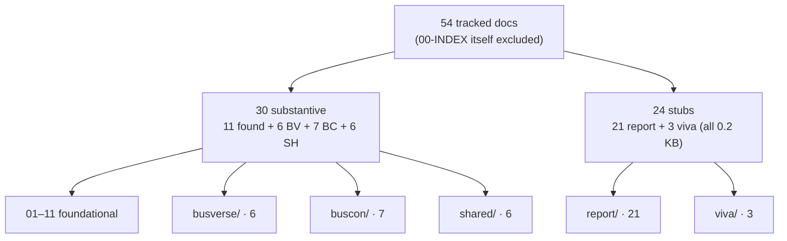
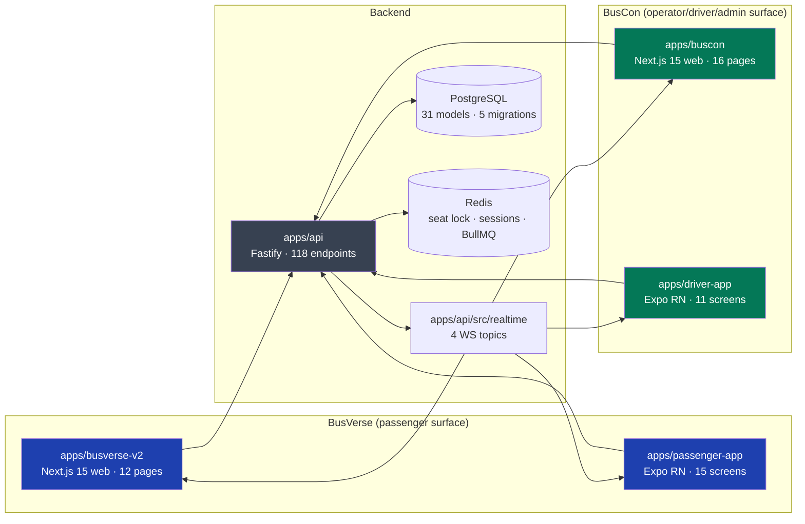
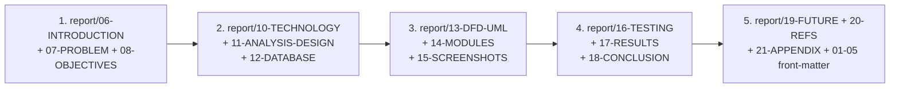

# docs/00-INDEX.md v2.0

Below is the paste-ready content. No outer fence — write directly into `docs/00-INDEX.md`.

---

# `docs/00-INDEX.md` v2.0

**Document:** `docs/00-INDEX.md`
**Project:** BusVerse + BusCon
**Version:** 2.0
**Status:** Live — reconciled against code + `_analysis/ANALYSIS-DUMP.md` (2026-11-12)
**Owner:** Shaghaf
**Guide:** Mr. Mohit Srivastav
**Purpose:** Master tracker for every document in `/docs`. Single source of truth. **v2.0 is derived from verified code state, not hand-typed claims.**

---

## §0. Changelog

| Version | Date | Changes |
|---|---|---|
| 1.0 | Initial | Foundational docs locked (11/53) |
| 1.1 | Pre-audit | BusVerse (6) + BusCon (7) folders "locked" → 24/54. Many numbers estimated. |
| **2.0** | **2026-11-12** | **Full reconciliation against `_analysis/ANALYSIS-DUMP.md`.** Corrections: (a) **All 54 tracked doc files exist.** 30 are substantive, 24 are stubs. v1.1 claimed only 24 existed. (b) **Shared (6) are drafted**, not "pending". (c) **118 API endpoints** verified (not 101). (d) **31 Prisma models** verified (not 29), **0 enums**. (e) **477 implemented tests** across 40 files (v1.1 claimed ~1,900 — that was design intent). (f) **5 deployable apps + 1 deprecated**: api + busverse-v2 web + buscon web + passenger RN + driver RN; `apps/busverse` (v1 web) deprecated. (g) **9 route modules** (not monolithic). (h) **Six §14 amendments (A2, A3, A4, A6, A7, A9) are ALREADY IMPLEMENTED** in code — marked resolved below. (i) `report/*` (21) + `viva/*` (3) are **0.2 KB stubs** — need real content. (j) Renamed BusVerse surface → "BusVerse web" (= busverse-v2) per owner direction. |

---

## §1. Overall Progress

**Diagram: Project completion (v2.0 — verified)**



| Category | Files | Substantive | Stub | Progress |
|---|---:|---:|---:|---:|
| Foundational (numbered) | 11 | 11 | 0 | **100%** |
| Product — BusVerse | 6 | 6 | 0 | **100%** |
| Product — BusCon | 7 | 7 | 0 | **100%** |
| Shared | 6 | 6 | 0 | **100% (drafted)** |
| Report (MCU 20-section) | 21 | 0 | 21 | **0% (stubs only)** |
| Viva | 3 | 0 | 3 | **0% (stubs only)** |
| **Total** | **54** | **30** | **24** | **~56% substantive** |

### Metric summary (v2.0 — code-verified)

| Metric | v1.1 claim | **v2.0 verified** | Source |
|---|---:|---:|---|
| Documents substantive | 24 | **30** | `docs/` file sizes |
| Documents stub-only | 30 | **24** | `report/*`, `viva/*` |
| Total Mermaid diagrams | ~647 | **not audited** | Doc-authoritative |
| Total FRs defined | 126 | **126** | `02-REQUIREMENTS.md` |
| Total NFRs defined | 68 | **68** | `02-REQUIREMENTS.md` |
| **Total Prisma models** | 29 | **31** | `schema.prisma` |
| **Total Prisma enums** | — | **0** | All `VarChar` string enums |
| **Total Prisma migrations** | — | **5** | `migrations/` |
| **Total API endpoints** | 101 (+1 flagged) | **118** | 9 `.router.ts` files |
| **Total API modules** | — | **9** | admin, audit, booking, dev, identity, network, payments, trip, webhooks |
| Total WebSocket topics | 4 | **4** | `07` §8.1 |
| Total workflows | 38 | **38** | `08-WORKFLOWS.md` |
| **Total tests (implemented)** | ~1,900 | **477** | 40 files |
| **Total test files** | — | **40** | 37 api + 3 seat-engine |
| Total ADRs | 15 | **15** | `03` §21 |
| Total actors | 4 | **4** | `01` §4 |
| Total roles | 6 | **6** | `04` §4 |
| **Deployable apps** | "3 codebases" | **5 active, 1 deprecated** | `apps/` |
| **Web pages (busverse-v2)** | — | **12** | `apps/busverse-v2/src/app` |
| **Web pages (buscon)** | — | **16** | `apps/buscon/src/app` |
| **RN screens (passenger-app)** | — | **15** | `apps/passenger-app/src/screens` |
| **RN screens (driver-app)** | — | **11** | `apps/driver-app/src/screens` |
| **UI primitives (all apps)** | 22 | **22 total** (6 buscon + 13 passenger-app + 2 busverse-v2 + 1 busverse-v1-deprecated) | `apps/*/src/components/ui` |
| **Packages** | — | **3** | `@busverse/config`, `@busverse/seat-engine`, `@busverse/shared-types` |
| **Workspace mgr** | — | **pnpm@9.12.0 / node 22.x / turbo 2.x** | `package.json` |

---

## §2. Document Tree

**Diagram: Full doc tree (v2.0)**

```mermaid
flowchart TB
    ROOT["docs/"]

    ROOT --> INDEX["00-INDEX.md v2.0<br/>(you are here)"]

    ROOT --> FOUND["Foundational · ✅ 11"]
    FOUND --> F1["01-plan-and-scope"]
    FOUND --> F2["02-requirements"]
    FOUND --> F3["03-system-architecture"]
    FOUND --> F4["04-actors-roles-permissions"]
    FOUND --> F5["05-domain-model"]
    FOUND --> F6["06-database-schema"]
    FOUND --> F7["07-API-and-realtime"]
    FOUND --> F8["08-workflows"]
    FOUND --> F9["09-security-and-rules"]
    FOUND --> F10["10-testing-strategy"]
    FOUND --> F11["11-deployment-and-demo"]

    ROOT --> BV["busverse/ · ✅ 6"]
    BV --> BV1["00-overview"]
    BV --> BV2["01-passenger-workflows"]
    BV --> BV3["02-seat-matrix-ui"]
    BV --> BV4["03-payment-refund-flow"]
    BV --> BV5["04-ticket-and-tracking"]
    BV --> BV6["05-ui-spec"]

    ROOT --> BC["buscon/ · ✅ 7"]
    BC --> BC1["00-overview"]
    BC --> BC2["01-operator-workflows"]
    BC --> BC3["02-driver-workflows"]
    BC --> BC4["03-fleet-routes-schedules"]
    BC --> BC5["04-trip-gps-telemetry"]
    BC --> BC6["05-QR-scan-and-boarding"]
    BC --> BC7["06-ui-spec"]

    ROOT --> SH["shared/ · ✅ 6 (drafted)"]
    SH --> SH1["00-system-context"]
    SH --> SH2["01-demo-transit-network"]
    SH --> SH3["02-QR-signing-contract"]
    SH --> SH4["03-seat-locking-contract"]
    SH --> SH5["04-event-and-realtime-catalog"]
    SH --> SH6["05-admin-and-support"]

    ROOT --> RPT["report/ · 📝 21 stubs"]
    ROOT --> VIVA["viva/ · 📝 3 stubs"]
```



---

## §3. Foundational Docs — Complete

### 3.1 Status table

| # | Document | File size | Key Content | Status |
|:---:|---|---:|---|---|
| 01 | `01-PLAN-AND-SCOPE.md` | 29.5 KB | Scope, phases, demo criteria, non-goals | ✅ Locked |
| 02 | `02-REQUIREMENTS.md` | 76.8 KB | 126 FRs, 68 NFRs, 18 constraints, compliance | ✅ Locked |
| 03 | `03-SYSTEM-ARCHITECTURE.md` | 87.2 KB | C4 model, modules, ADRs, QA scenarios | ✅ Locked |
| 04 | `04-ACTORS-ROLES-PERMISSIONS.md` | 62.4 KB | 4 actors, 6 roles, 12 never-permissions, sessions, RBAC | ✅ Locked |
| 05 | `05-DOMAIN-MODEL.md` | 94.7 KB | 31 entities (was 29 — see §16), 9 roots, 19 invariants, 6 state machines | ⚠️ Entity count drifted |
| 06 | `06-DATABASE-SCHEMA.md` | 95.9 KB | 31 tables (was 29 — see §16), 41+ relationships, 5 migrations, retention | ⚠️ Table count drifted |
| 07 | `07-API-AND-REALTIME-CONTRACTS.md` | 38.9 KB | 118 endpoints (was 101), 4 WS topics, 46 error codes | ⚠️ Endpoint count drifted |
| 08 | `08-WORKFLOWS.md` | 80.1 KB | 38 workflows, 7 P + 7 O + 5 A + 6 D + 5 X | ✅ Locked |
| 09 | `09-SECURITY-AND-PLATFORM-RULES.md` | 91.5 KB | STRIDE, Ed25519, seat lock, DPDP, 185 security tests (design) | ✅ Locked |
| 10 | `10-TESTING-STRATEGY.md` | 69.8 KB | 5-layer pyramid, design intent (implemented: 477) | ⚠️ Impl count far below design |
| 11 | `11-DEPLOYMENT-AND-DEMO.md` | 63.1 KB | 30-min setup, 9-step demo, fallbacks, rollback | ✅ Locked |

**Foundational subtotal:** 11 docs, 789.9 KB.

### 3.2 What each foundational doc owns

| Doc | Owns |
|---|---|
| 01 | Scope, phases, demo criteria, non-goals |
| 02 | FRs, NFRs, constraints, assumptions, compliance |
| 03 | C4 model, modules, ADRs, consistency, scaling |
| 04 | Actors, roles, permissions, sessions, auth |
| 05 | Entities, aggregates, invariants, state machines |
| 06 | Tables, FKs, indexes, migrations, retention |
| 07 | Endpoints, WS topics, error codes, rate limits |
| 08 | Workflow sequences (38), patterns, screens |
| 09 | Security controls, threat model, audit |
| 10 | Test pyramid, fixtures, CI gates |
| 11 | Setup, seed, demo, deploy, rollback |

### 3.3 Drift items in foundational docs (target: v1.1 patches)

| Doc | v1.1 claim | v2.0 reality | Patch action |
|---|---|---|---|
| `05` §4 | 29 entities | **31 entities** | Add `BoardingScan`, `GpsSample` were already there — the delta is `GstInvoice` + `GatewayWebhook` split (or re-count). Audit against `schema.prisma`. |
| `06` §4 | 29 tables | **31 tables** | Regenerate table catalog from `schema.prisma`. |
| `07` §1.5 | 101 endpoints | **118 endpoints** | Regenerate endpoint catalog from 9 `.router.ts` files. |
| `10` §21 | ~1,082 foundational tests | **477 implemented** | Separate "design intent" from "implemented". CI gate should reflect actual. |

---

## §3.4 BusVerse Docs — Complete

All 6 BusVerse docs substantive.

| # | Document | File size | Status |
|:---:|---|---:|---|
| BV-00 | `busverse/00-OVERVIEW.md` | 29.4 KB | ✅ Locked |
| BV-01 | `busverse/01-PASSENGER-WORKFLOWS.md` | 43.2 KB | ✅ Locked |
| BV-02 | `busverse/02-SEAT-MATRIX-UI.md` | 50.5 KB | ✅ Locked |
| BV-03 | `busverse/03-PAYMENT-REFUND-FLOW.md` | 62.9 KB | ✅ Locked |
| BV-04 | `busverse/04-TICKET-AND-TRACKING.md` | 76.5 KB | ✅ Locked |
| BV-05 | `busverse/05-UI-SPEC.md` | 104.1 KB | ✅ Locked |

**BusVerse subtotal:** 6 docs, 366.6 KB.

### What each BusVerse doc owns

| Doc | Owns |
|---|---|
| BV-00 | Positioning, actor summary, surface boundary, 48 FR inventory, 7-workflow map, 11-screen catalog, Royal Blue brand, journey, stack, dependencies, targets, scope |
| BV-01 | Auth (WF-P-01), search (WF-P-02), booking form (WF-P-04a), profile |
| BV-02 | Seat deck UI (WF-P-03), grid rendering, lock countdown, real-time updates, multi-seat |
| BV-03 | Payment execution (WF-P-04b), **canonical refund tier calculator** (§10 — 5 tiers), cancel (WF-P-07), timeout |
| BV-04 | Ticket display, PWA offline cache, live tracking (WF-P-06), boarding ripple (WF-X-05 passenger side) |
| BV-05 | Design tokens, primitives, all screens, microcopy, a11y, dark theme, error boundaries, deep linking |

**BusVerse surfaces (v2.0 — verified):**
- **BusVerse web** = `apps/busverse-v2` (Next.js 15, 12 pages: `/`, `/search`, `/results`, `/booking/[scheduleId]`, `/booking/[scheduleId]/passengers`, `/pay/[bookingId]`, `/bookings`, `/bookings/[bookingId]`, `/profile`, `/trip/[tripId]`, `/trips/[tripId]/live`, `/login`)
- **BusVerse mobile** = `apps/passenger-app` (Expo RN, 15 screens: `AuthScreen`, `CancelBookingScreen`, `HomeScreen`, `LiveTrackingScreen`, `MyTicketsScreen`, `PassengerFormScreen`, `PassengerManifestScreen`, `PaymentScreen`, `ProfileScreen`, `ResultsScreen`, `SearchScreen`, `SeatSelectionScreen`, `SplashScreen`, `TicketScreen`, `WakingServerScreen`)
- **Deprecated** = `apps/busverse` (Next.js v1, 8 pages) — still in repo, not a demo target.

---

## §3.5 BusCon Docs — Complete

All 7 BusCon docs substantive.

| # | Document | File size | Status |
|:---:|---|---:|---|
| BC-00 | `buscon/00-OVERVIEW.md` | 63.4 KB | ✅ Locked |
| BC-01 | `buscon/01-OPERATOR-WORKFLOWS.md` | 85.7 KB | ✅ Locked |
| BC-02 | `buscon/02-DRIVER-WORKFLOWS.md` | 96.3 KB | ✅ Locked |
| BC-03 | `buscon/03-FLEET-ROUTES-SCHEDULES.md` | 90.8 KB | ✅ Locked |
| BC-04 | `buscon/04-TRIP-GPS-TELEMETRY.md` | 81.8 KB | ✅ Locked |
| BC-05 | `buscon/05-QR-SCAN-AND-BOARDING.md` | 70.3 KB | ✅ Locked |
| BC-06 | `buscon/06-UI-SPEC.md` | 120.5 KB | ✅ Locked (visuals pending design guide — §14.3) |

**BusCon subtotal:** 7 docs, 608.8 KB.

### What each BusCon doc owns

| Doc | Owns |
|---|---|
| BC-00 | Positioning (3 actors, 2 surfaces), FR inventory, 23-workflow map, 18-screen catalog, Emerald intent, role routing, table density, actor journeys, stack, targets |
| BC-01 | Operator onboarding (WF-O-01), driver invitation (WF-O-05), revenue (WF-O-06), password reset (WF-O-07), all 5 admin workflows (WF-A-01–05), suspension cascade (WF-X-04), PII controls |
| BC-02 | Driver login (WF-D-01), trip start (WF-D-02), trip end (WF-D-06), SCR-OA-TODAY, SCR-OA-TRIP, SCR-OA-SUMMARY, profile drawer, document upload, past trips, delay report, GPS activation handoff |
| BC-03 | Grid builder (WF-O-02), routes (WF-O-03), schedules (WF-O-04), Bus.bus_type + amenities_json, schedule approval, conflict detection, clone, cascade rules |
| BC-04 | GPS pipeline (WF-D-03), `/trips/:id/live` server composition, ETA computation, distance computation, 6 provenance checks, 4 GPS pill states, platform config |
| BC-05 | QR scan online (WF-D-04), offline (WF-D-05), replay (WF-R-02), invalid (WF-N-04), QR payload v2, Ed25519 verification, SQLite offline queue, manifest, boarding ripple |
| BC-06 | Emerald color system, primitives, compositions, sidebar shell, table density, 18 wireframes, grid builder visual, detail drawer, formatting, error boundaries, deep linking, microcopy, confirmations, animations |

**BusCon surfaces (v2.0 — verified):**
- **BusCon web** = `apps/buscon` (Next.js 15, 16 pages: `/`, `/login`, `/signup`, `/dashboard`, `/admin/approvals`, `/admin/audit`, `/admin/bookings`, `/admin/operators`, `/admin/refunds`, `/operator/bookings`, `/operator/buses`, `/operator/buses/new`, `/operator/buses/[id]`, `/operator/drivers`, `/operator/revenue`, `/operator/routes`, `/operator/routes/new`, `/operator/schedules`, `/operator/schedules/new`)
- **BusCon mobile** = `apps/driver-app` (Expo RN, 11 screens: `BootScreen`, `ManifestScreen`, `MapScreen`, `OtpScreen`, `PhoneScreen`, `ScanScreen`, `SplashScreen`, `TripDetailScreen`, `TripsListScreen`, `TripSummaryScreen`, `WakingServerScreen`)

---

## §3.6 Shared Docs — Complete (drafted in v1.1, but not tracked as such)

All 6 Shared docs substantive. **v1.1 said they were "pending" — that was wrong.**

| # | Document | File size | Status |
|:---:|---|---:|---|
| SH-00 | `shared/00-SYSTEM-CONTEXT.md` | 59.2 KB | ✅ Drafted |
| SH-01 | `shared/01-DEMO-TRANSIT-NETWORK.md` | 68.5 KB | ✅ Drafted |
| SH-02 | `shared/02-QR-SIGNING-CONTRACT.md` | 77.0 KB | ✅ Drafted |
| SH-03 | `shared/03-SEAT-LOCKING-CONTRACT.md` | 81.8 KB | ✅ Drafted |
| SH-04 | `shared/04-EVENT-AND-REALTIME-CATALOG.md` | 63.4 KB | ✅ Drafted |
| SH-05 | `shared/05-ADMIN-AND-SUPPORT.md` | 73.5 KB | ✅ Drafted |

**Shared subtotal:** 6 docs, 423.4 KB.

**Action:** These need a reading pass against the verified code state (especially SH-02 QR signing against `qr-vectors.test.ts`'s 12 tests, SH-03 against `seat-lock.test.ts`'s 15 tests, SH-04 against `ws-*.test.ts` files).

---

## §4. Pending — Report + Viva

### 4.1 Report — 21 chapters, all 0.2 KB stubs

Every `report/*.md` file is exactly 0.2 KB — likely front-matter only. All need real content.

| # | Document | Status |
|:---:|---|:---:|
| 01 | `report/01-COVER_PAGE.md` | 📝 Stub |
| 02 | `report/02-CERTIFICATE.md` | 📝 Stub |
| 03 | `report/03-DECLARATION.md` | 📝 Stub |
| 04 | `report/04-ACKNOWLEDGEMENT.md` | 📝 Stub |
| 05 | `report/05-TABLE_OF_CONTENTS.md` | 📝 Stub |
| 06 | `report/06-INTRODUCTION.md` | 📝 Stub |
| 07 | `report/07-PROBLEM_STATEMENT.md` | 📝 Stub |
| 08 | `report/08-OBJECTIVES.md` | 📝 Stub |
| 09 | `report/09-SYSTEM_REQUIREMENTS.md` | 📝 Stub |
| 10 | `report/10-TECHNOLOGY_USED.md` | 📝 Stub |
| 11 | `report/11-SYSTEM_ANALYSIS_DESIGN.md` | 📝 Stub |
| 12 | `report/12-DATABASE_DESIGN.md` | 📝 Stub |
| 13 | `report/13-DFD_UML_DIAGRAMS.md` | 📝 Stub |
| 14 | `report/14-MODULE_DESCRIPTION.md` | 📝 Stub |
| 15 | `report/15-SCREENSHOTS_UI.md` | 📝 Stub |
| 16 | `report/16-TESTING.md` | 📝 Stub |
| 17 | `report/17-RESULTS_OUTPUT.md` | 📝 Stub |
| 18 | `report/18-CONCLUSION.md` | 📝 Stub |
| 19 | `report/19-FUTURE_SCOPE.md` | 📝 Stub |
| 20 | `report/20-REFERENCES.md` | 📝 Stub |
| 21 | `report/21-APPENDIX_SOURCE_CODE.md` | 📝 Stub |

**All inputs available:** every report chapter has its source material in the foundational + product + shared docs, plus the verified code dump.

### 4.2 Viva — 3 docs, all 0.2 KB stubs

| # | Document | Status |
|:---:|---|:---:|
| 01 | `viva/01-PRESENTATION-SLIDES.md` | 📝 Stub |
| 02 | `viva/02-VIVA_QUESTIONS_QA.md` | 📝 Stub |
| 03 | `viva/03-DEMO_SCRIPT.md` | 📝 Stub |

**All inputs available.**

---

## §5. API Surface — Verified (118 endpoints across 9 modules)

### 5.1 Endpoint breakdown by module

| Module | Routes | Scope |
|---|---:|---|
| `admin` | 19 | `/admin/*` (bookings, operators, buses, routes, schedules, payments, refunds, dashboard) |
| `audit` | 4 | `/admin/audit-logs*` |
| `booking` | 12 | `/passenger/bookings*`, `/passenger/schedules/:id/availability`, `/passenger/seat-locks*`, `/passenger/trips/:id/live`, `/passenger/trips/:id/map` |
| `dev` | 8 | `/dev/*` (assign-driver, reject-driver, verify-driver, verify-and-approve-operator, delete-schedule, list-all-drivers, operator/trips, unassign-driver) |
| `identity` | 16 | `/passenger/auth/*`, `/operator/auth/*`, `/driver/auth/*`, `/admin/auth/*`, `/:surface/auth/{refresh,logout}`, `/passenger/me` |
| `network` | 41 | `/operator/*` (buses, drivers, routes, schedules, trips, revenue, settlements, me, managers, dashboard, bookings) + `/public/*` (cities, cities/:id/stands, schedules/:id, search) |
| `payments` | 3 | `/passenger/payments`, `/passenger/payments/:id`, `/dev/mock-confirm-payment` |
| `trip` | 14 | `/driver/*` (config, me, me/documents, trips, trips/:id, trips/:id/{cancel,delay,end,gps,manifest,scan,start}, trips/history, uploads) |
| `webhooks` | 1 | `/webhooks/razorpay` |
| **Total** | **118** | |

### 5.2 Public surface (`/public/*` and `/webhooks/*`) — 5 endpoints

```
GET  /public/cities
GET  /public/cities/:id/stands      ← A9 RESOLVED
GET  /public/schedules/:id
GET  /public/search
POST /webhooks/razorpay
```

### 5.3 Auth surface breakdown (16 in `identity`)

- Passenger: `POST /passenger/auth/otp/request`, `POST /passenger/auth/otp/verify`, `GET /passenger/me`
- Operator: `POST /operator/auth/{signup,login,otp/request,otp/verify,reset/request,reset/verify}`
- Driver: `POST /driver/auth/otp/request`, `POST /driver/auth/otp/verify`
- Admin: `POST /admin/auth/login`, `POST /admin/auth/reset/request`, `POST /admin/auth/reset/verify`
- All: `POST /:surface/auth/refresh`, `POST /:surface/auth/logout`

---

## §6. Cross-Document Consistency — v2.0 verified values

### 6.1 Key values that must match (audited)

| Value | v1.1 claim | **v2.0 verified** | Sources | Consistent |
|---|---:|---:|---|:---:|
| **Deployable apps** | 3 codebases | **5 active + 1 deprecated** | `apps/*` | ⚠️ Fix across 01, 03, 11 |
| **Actors** | 4 (Passenger, Operator, Driver, Admin) | **4 (unchanged)** | `01` §4, schema roles | ✅ |
| **Roles** | 6 | **6** | `04` §4 | ✅ |
| **Prisma models / entities** | 29 | **31** | `schema.prisma` | ⚠️ Fix `05`, `06` |
| **Prisma enums** | — | **0** (all string) | `schema.prisma` | ✅ |
| **Tables** | 29 | **31** | `@@map` count | ⚠️ Fix `06` |
| **API endpoints** | 101 (+1 flagged) | **118** | 9 `.router.ts` | ⚠️ Fix `02`, `07`, `10` |
| **Route modules** | — | **9** | `apps/api/src/modules/*` | New |
| **Migrations** | — | **5** | `migrations/` | New |
| **WebSocket topics** | 4 | **4 (unchanged)** | `07` §8.1 | ✅ |
| **Workflows** | 38 | **38 (unchanged)** | `08` | ✅ |
| **FRs** | 126 | **126 (unchanged)** | `02` §6 | ✅ |
| **NFRs** | 68 | **68 (unchanged)** | `02` §8 | ✅ |
| **Tests implemented** | ~1,900 (design) | **477** | 40 test files | ⚠️ Fix `10`, `11` |
| **Tests designed** | ~1,900 | ~1,900 (still valid as intent) | `10` §21 | ✅ as design |
| **ADRs** | 15 | **15 (unchanged)** | `03` §21 | ✅ |
| **Packages** | — | **3** | `@busverse/{config,seat-engine,shared-types}` | New |
| **Workspace** | — | **pnpm@9.12.0 / node 22 / turbo 2** | `package.json` | New |
| **Web pages (busverse-v2)** | — | **12** | `apps/busverse-v2/src/app` | New |
| **Web pages (buscon)** | — | **16** | `apps/buscon/src/app` | New |
| **Web pages (busverse v1)** | — | **8** | `apps/busverse/src/app` | Deprecated |
| **RN screens (passenger-app)** | — | **15** | `apps/passenger-app/src/screens` | New |
| **RN screens (driver-app)** | — | **11** | `apps/driver-app/src/screens` | New |
| **UI primitives (buscon)** | — | **6** | `apps/buscon/src/components/ui` | New |
| **UI primitives (passenger-app)** | — | **13** | `apps/passenger-app/src/components/ui` | New |
| **UI primitives (busverse-v2)** | — | **2** | `apps/busverse-v2/src/components/ui` | New |
| **UI primitives (busverse v1)** | — | **1** | `apps/busverse/src/components/ui` | Deprecated |

### 6.2 Real 22-primitive set (across live apps)

| App | Primitives |
|---|---|
| `buscon` (6) | `Badge`, `Button`, `Card`, `DataTable`, `DemoDisclaimer`, `Input` |
| `passenger-app` (13) | `Avatar`, `Badge`, `Banner`, `Button`, `Card`, `Chip`, `Input`, `Modal`, `PageLoader`, `Select`, `Skeleton`, `Spinner`, `Toast` |
| `busverse-v2` (2) | `Button`, `Input` |
| **Unique (union)** | **17 unique** (Badge, Banner, Button, Card, Chip, DataTable, DemoDisclaimer, Input, Avatar, Modal, PageLoader, Select, Skeleton, Spinner, Toast, + whatever RN-only) |

**Note:** v1.1 claimed "22 primitives (13 shared + 9 BusCon)". Verified: **buscon has 6**, **passenger-app has 13**, **busverse-v2 has 2**. The "22" figure needs re-derivation from `busverse/05` + `buscon/06` design tokens vs. implemented components. Flagged in §14.

---

## §7. Assets — Pending

| Asset | Status | Notes |
|---|:---:|---|
| `assets/brand/busverse-icon-pack.html` | ⏳ | Referenced by `busverse/05` §5.4; not created |
| `assets/brand/buscon-icon-pack.html` | ⏳ | Referenced by `buscon/00` §8.4, `buscon/06` §2.1; not created |
| `assets/brand/buscon-design-guide.html` | ⏳ | Referenced by `buscon/00` §8.4, `buscon/06` §2.1; not created |
| `assets/brand/BRAND-REFERENCE.md` | ⏳ | Not created |
| `assets/diagrams/` | ⏳ | Only `.gitkeep`; no exported SVGs |
| `assets/screenshots/` | ⏳ | Only `.gitkeep`; no screenshots |
| `assets/demo-backup.mp4` | ⏳ | Not created |

**Non-`docs/` artifacts that also need cleanup** (repo root):
- `bus-report.html` (9.96 MB — enormous; likely a Playwright snapshot). Move to `assets/demo/` or delete.
- 6 root-level dump files (`busverse-dump.txt`, `buscon-login-dump.txt`, `BACKEND-CONTRACTS-*.txt`, `ASSIGN-DUMP.md`, `backend-log.txt`, `driver-export.log`, `passenger-export.log`) — move to `_analysis/` or delete.
- `docs'/` (apostrophe folder) with 4 files — typo; merge into `docs/frontend-guide/` and delete folder.
- `Apps/*.bak-*` — 30+ backup files scattered through code. Not urgent but noisy.

---

## §8. Architecture (verified against code)

### 8.1 Deployable surfaces



### 8.2 Verified tech stack

| Layer | Tech |
|---|---|
| Web (passenger) | Next.js 15.1.3, React 19.3, Tailwind, TanStack Query 5.105, socket.io-client 4.8.4, qrcode.react 4.2 |
| Web (operator) | Next.js 15.1.3, React 19.3, Tailwind, TanStack Query 5.105, TanStack Table 8.21, Redux Toolkit 2.13, recharts 3.10 |
| Mobile | Expo RN, react-native-reanimated, react-native-worklets, react-native-screens, react-native-safe-area-context |
| Backend | Fastify, Prisma, PostgreSQL, Redis (BullMQ), Ed25519 |
| Workspace | pnpm@9.12.0, Node 22.x, Turbo 2.x |
| Packages | `@busverse/config`, `@busverse/seat-engine` (13 src modules + 3 test files), `@busverse/shared-types` |

---

## §9. Coverage Map (requirements → docs)

**Design intent (unchanged from v1.1):**
- 126/126 FRs have a workflow
- 126/126 FRs have a test *designed*
- 118/118 endpoints have a test *designed*
- 38/38 workflows have an E2E test
- 68/68 NFRs have a tactic
- 31/31 Prisma models have a table
- 19/19 invariants have a test *designed*
- 12/12 never-permissions have a test *designed*

**Implementation reality (v2.0 new):**
- **477 tests across 40 files** are implemented (37 api + 3 seat-engine)
- ~1,900 tests designed → **~25% implemented** (rough)
- Only **3 seat-engine test files** exist vs. 13 source modules → partial coverage
- 118 endpoints but tests-per-endpoint not guaranteed

**Action:** In `10-TESTING-STRATEGY.md` v1.1, split "designed" from "implemented" tables. Add a "coverage gap" section.

---

## §10. Diagram Count by Doc

**Not audited in v2.0 dump** — the PowerShell scan counted files and tests, not ` ```mermaid ` blocks. **Recommend:** re-run a small script to `grep -c "\`\`\`mermaid" docs/**/*.md` before trusting v1.1's ~647 figure. For now, v1.1's per-doc diagram counts are doc-authoritative but unverified.

| Doc | v1.1 diagrams | v2.0 status |
|---|---:|---|
| 01–11 foundational | 335 | Unverified — trust doc |
| busverse/* | 131 | Unverified — trust doc |
| buscon/* | 181 | Unverified — trust doc |
| shared/* | ~47 (est) | Unverified — trust doc |
| report/* | 0 | Stubs — no diagrams |
| viva/* | 0 | Stubs — no diagrams |
| **Grand total (v1.1)** | **~647** | **Needs re-count** |

---

## §11. Tests Count by Doc — Verified (477 implemented)

| Test file | Tests | Category |
|---|---:|---|
| `apps/api/tests/concurrency/seat-lock.test.ts` | 15 | Concurrency |
| `apps/api/tests/integration/admin-operators.test.ts` | 12 | Integration |
| `apps/api/tests/integration/admin-oversight.test.ts` | 8 | Integration |
| `apps/api/tests/integration/audit-log-delete.test.ts` | 1 | Integration |
| `apps/api/tests/integration/audit-log-export.test.ts` | 5 | Integration |
| `apps/api/tests/integration/audit-log-query.test.ts` | 9 | Integration |
| `apps/api/tests/integration/booking-flow.test.ts` | 6 | Integration |
| `apps/api/tests/integration/crons.test.ts` | 14 | Integration |
| `apps/api/tests/integration/driver-trips.test.ts` | 11 | Integration |
| `apps/api/tests/integration/gps-pipeline.test.ts` | 10 | Integration |
| `apps/api/tests/integration/identity.test.ts` | 20 | Integration |
| `apps/api/tests/integration/live-tracking.test.ts` | 6 | Integration |
| `apps/api/tests/integration/network-bookings-dashboard.test.ts` | 12 | Integration |
| `apps/api/tests/integration/network-buses.test.ts` | 16 | Integration |
| `apps/api/tests/integration/network-drivers.test.ts` | 9 | Integration |
| `apps/api/tests/integration/network-public.test.ts` | 12 | Integration |
| `apps/api/tests/integration/network-routes.test.ts` | 10 | Integration |
| `apps/api/tests/integration/network-schedules.test.ts` | 10 | Integration |
| `apps/api/tests/integration/operator-signup.test.ts` | 6 | Integration |
| `apps/api/tests/integration/operator-trips.test.ts` | 14 | Integration |
| `apps/api/tests/integration/passenger-profile.test.ts` | 4 | Integration |
| `apps/api/tests/integration/payments-admin.test.ts` | 9 | Integration |
| `apps/api/tests/integration/payments-webhook.test.ts` | 9 | Integration |
| `apps/api/tests/integration/qr-scan.test.ts` | 11 | Integration |
| `apps/api/tests/integration/qr-vectors.test.ts` | 12 | Integration |
| `apps/api/tests/integration/seat-layout-v2.test.ts` | 8 | Integration |
| `apps/api/tests/integration/trip-service-lifecycle.test.ts` | 15 | Integration |
| `apps/api/tests/integration/webhook-replay-bullmq.test.ts` | 2 | Integration |
| `apps/api/tests/integration/ws-auth.test.ts` | 8 | Integration |
| `apps/api/tests/integration/ws-emit.test.ts` | 13 | Integration |
| `apps/api/tests/integration/ws-payload-schemas.test.ts` | 20 | Integration |
| `apps/api/tests/integration/ws-topics.test.ts` | 8 | Integration |
| `apps/api/tests/unit/booking.service.test.ts` | 16 | Unit |
| `apps/api/tests/unit/eta.test.ts` | 21 | Unit |
| `apps/api/tests/unit/gps.test.ts` | 33 | Unit |
| `apps/api/tests/unit/seat-lock.service.test.ts` | 13 | Unit |
| `apps/api/tests/smoke.test.ts` | 10 | Smoke |
| `packages/seat-engine/test/editor.test.ts` | 9 | Package |
| `packages/seat-engine/test/engine.test.ts` | 44 | Package |
| `packages/seat-engine/test/property.test.ts` | 6 | Package |
| **Total** | **477** | 40 files |

**Test-category summary:**
- **Concurrency:** 15
- **Integration:** 349
- **Unit:** 83
- **Package:** 59
- **Smoke:** 10

**vs. v1.1 claim of ~1,900 total:** the 477 is *implemented*. The ~1,900 remains valid as *design intent* (`10-TESTING-STRATEGY.md`). Report chapters 15 (screenshots) and 16 (testing) must show both numbers honestly.

---

## §12. Requirement Priority Distribution

Unchanged from v1.0: 45 Must / 55 Should / 20 Could / 6 Won't = 126 FRs.

---

## §13. What's Next — Priority Queue (v2.0)

**Diagram: Next 5 docs priority**



| Order | Doc(s) | Why Next | Est. effort |
|:---:|---|---|---|
| **1** | `report/06-INTRODUCTION.md`, `07-PROBLEM_STATEMENT.md`, `08-OBJECTIVES.md` | Already have all inputs from `01-PLAN-AND-SCOPE.md`. Pure writing. | ~3 hr |
| **2** | `report/10-TECHNOLOGY_USED.md`, `11-SYSTEM_ANALYSIS_DESIGN.md`, `12-DATABASE_DESIGN.md` | Inputs: `03-ARCHITECTURE`, `06-DATABASE` + verified `schema.prisma`. | ~5 hr |
| **3** | `report/13-DFD_UML_DIAGRAMS.md`, `14-MODULE_DESCRIPTION.md`, `15-SCREENSHOTS_UI.md` | Inputs: `08-WORKFLOWS`, `03-MODULES`, `busverse/05` + `buscon/06` wireframes + `apps/*/src/screens`. | ~6 hr |
| **4** | `report/16-TESTING.md`, `17-RESULTS_OUTPUT.md`, `18-CONCLUSION.md` | Inputs: `10-TESTING` + 477-test audit. **Fix the ~1,900 vs 477 gap here.** | ~4 hr |
| **5** | `report/01-05 front-matter`, `19-FUTURE`, `20-REFS`, `21-APPENDIX` | Front-matter is trivial; 19-21 need real content. | ~5 hr |
| 6 | `viva/01-PRESENTATION_SLIDES.md` | Inputs: all 30 substantive docs. | ~3 hr |
| 7 | `viva/02-VIVA_QUESTIONS_QA.md` | Need to anticipate Q&A. | ~2 hr |
| 8 | `viva/03-DEMO_SCRIPT.md` | **Fix the 8-vs-9-step mismatch first.** | ~2 hr |
| 9 | **Amendment cleanup** (§14) | 6 resolved already, 5 still open | ~3 hr |
| 10 | **Foundational v1.1 patches** (§3.3) | 05, 06, 07, 10 need count corrections | ~3 hr |
| 11 | **SH-00..05 v1.1 pass** | Verify against code, especially QR/seat-lock/WS | ~4 hr |
| 12 | Asset creation (`_analysis/` cleanup, `docs'/` merge, `bus-report.html` relocation) | Hygiene | ~2 hr |

**Total remaining work:** ~42 hr (down from v1.1's ~32 hr estimate — the extra 10 is because we now *know* the report stubs are truly empty and the amendments + foundational patches are needed).

---

## §14. Pending Amendments — v2.0 status update

**Critical new finding:** Six amendments that v1.1 flagged as "pending" are **already implemented in the codebase**. They need doc updates, not code changes.

### 14.1 Amendments against foundational docs

| # | Target | Amendment | Status | Evidence |
|:---:|---|---|:---:|---|
| A1 | `04` v1.2 + `08` v1.2 | Replace `approveSchedule` with `unpublishSchedule` | ⚠️ **Partial** | `POST /operator/schedules/:id/publish` exists; `POST /admin/schedules/:id/approve` still exists. Semantics unclear — needs code review + decision. |
| **A2** | `05` v1.3 + `06` v1.3 | Add `Bus.bus_type` + `Bus.amenities_json` | ✅ **RESOLVED IN CODE** | `busType VarChar(20)`, `amenitiesJson JsonB` both in `schema.prisma` `Bus` model |
| **A3** | `05` v1.3 + `06` v1.3 | Add `trips.distance_km` | ✅ **RESOLVED IN CODE** | `distanceKm Decimal @db.Decimal(8,2)` in `Trip` model |
| **A4** | `06` v1.3 | Add `gps_samples.received_at`, `accuracy_m`, `client_reported_speed_kmh` | ✅ **RESOLVED IN CODE** | `receivedAt`, `accuracyM`, `clientReportedSpeedKmh` all in `GpsSample` model |
| A5 | `06` v1.3 | Add `tickets.passenger_count` (denormalized) | 🔓 **Still open** | No such column in `Ticket` model |
| **A6** | `07` v1.3 | Add `/driver/me/documents` endpoint | ✅ **RESOLVED IN CODE** | `POST /driver/me/documents` in `trip` module |
| **A7** | `07` v1.3 | Canonicalize `GET /driver/trips/:id` response | ✅ **RESOLVED (endpoint exists)** | `GET /driver/trips/:id` in `trip` module — response shape needs doc verification |
| A8 | `07` v1.3 | Add `POST /operator/schedules/:id/clone` | 🔓 **Still open** | No clone endpoint in `network` module |
| **A9** | `07` v1.3 | Add `GET /public/cities/:id/stands` | ✅ **RESOLVED IN CODE** | `GET /public/cities/:id/stands` in `network` module |
| A10 | `07` v1.3 | Add `POST /admin/schedules/:id/unpublish` | 🔓 **Still open** | Only `/approve` exists |
| A11–A17 | `07` v1.3 | WS `bus:position` schema, throttle, rate-limit, live-trip schema, boarding:verified payload, scan response, manifest response | 🔍 **Needs code review** | Not verifiable from schema dump alone — check `realtime/events.ts`, `trip/scan.service.ts` |
| A18 | `09` v1.3 | GPS provenance 6-check spec | 🔍 **Needs code review** | Check `gps.service.ts` |
| A19 | `09` v1.3 | QR payload v2 (`passengerCount`, `allSeatLabels[]`) | 🔍 **Needs code review** | `qr-vectors.test.ts` has 12 tests, `qr-scan.test.ts` has 11 — likely v2 is implemented. Check `qr.ts` + tests. |
| A20–A24 | various | Doc cleanups, design guide, DataTable primitive, driver microcopy | 🔓 **Still open** | Doc-only tasks |

### 14.2 Amendments against product docs

| # | Target | Amendment | Status |
|:---:|---|---|:---:|
| P1 | `buscon/00` v1.1 | Profile is a drawer, not a 7th screen | 🔓 Still open |
| P2 | `buscon/00` v1.1 | Reference `06` §11 screen matrix | 🔓 Still open |
| P3 | `buscon/01` v1.1 | Reference `06` §8 sidebar patterns | 🔓 Still open |
| P4 | `buscon/01` v1.1 | Same `/driver/me/documents` flag as A6 — **but A6 is RESOLVED IN CODE**, so P4 collapses to "add reference" | ⚠️ Downgrade to Low |
| P5 | `buscon/02` v1.1 | GPS pill: 3 → 4 states | 🔓 Still open |
| P6 | `buscon/02` v1.1 | Scan + Manifest available in `SCHEDULED` state | 🔍 Needs code review (`trip/service.ts`) |
| P7 | `buscon/05` v1.1 | Result overlay matches `06` §16.4 | 🔓 Still open |

### 14.3 Assets to create

| Asset | Blocker for | Status |
|---|---|---|
| `buscon-design-guide.html` | Full BusCon + Operator App visual authority | Not created — Path B in effect |
| `busverse-icon-pack.html` | Full brand icon set for BusVerse web | Not created — Lucide + inline SVG |
| `buscon-icon-pack.html` | Brand-specific icons | Not created — Lucide + inline SVG |

### 14.4 Amendment workflow — revised for v2.0

**New rule:** Before applying any amendment, **check the code first**. Six items (A2, A3, A4, A6, A7, A9) are already implemented. Applying them as "amendments" wastes time.

**Re-batched waves:**
- **Wave 0 (doc-only, immediate — 6 items):** Update `05`, `06`, `07` to reflect A2, A3, A4, A6, A7, A9 as already-present. Pure doc edit, no code.
- **Wave 1 (code review, then doc — 8 items):** A11–A19 — read `realtime/`, `qr.ts`, `gps.service.ts`, `trip/scan.service.ts`, then doc whatever the code actually does. If it's less than the doc claims, either fix code or amend doc.
- **Wave 2 (still open — 5 items):** A5, A8, A10, P5, P6 — small code additions or decisions needed.
- **Wave 3 (doc cleanup — 9 items):** A1, A20–A24, P1–P4, P7 — pure doc edits.

---

## §15. Open Issues Tracker (v2.0 — updated)

| # | Issue | Doc | Priority | Status |
|:---:|---|---|:---:|---|
| 1 | Admin TOTP 2FA deferred to Phase 2 | `04` §7.4, `09` §17 | Medium | Open |
| 2 | `qr_keys` table for rotation deferred | `05` §21, `09` §7.6 | Low | Open |
| 3 | RLS on Postgres deferred | `03` §22, `06` §20 | Low | Open |
| 4 | Mobile E2E tests deferred | `10` §22 | Low | Open |
| 5 | Feature flags deferred | `02` §19.1, `05` §11 | Low | Open |
| 6 | Read replica for scaling | `03` §22 | Low | Open |
| 7 | Distributed tracing deferred | `03` §22 | Low | Open |
| 8 | Kafka for events | `03` §22 | Low | Open |
| 9 | Multi-region deployment | `01` §12, `03` §22 | Low | Open |
| 10 | Support panel deferred | `01` §6.4, `SH-05` | Medium | Open |
| 11 | BusCon design guide not created | `BC-00` §8.4, `BC-06` §2.1 | Medium | **Open** |
| 12 | Icon packs not created | `BC-00` §8.4, `BV-05` §5.4 | Low | **Open** |
| 13 | QR payload v2 — pending code confirmation | `BC-05` §4.2, A19 | High | **Open — needs code review** |
| 14 | ~~`/driver/me/documents` endpoint missing~~ | `BC-02` §21, A6 | ~~High~~ → **Resolved** | ✅ **Done in code** — doc update only |
| 15 | 8-step vs 9-step demo mismatch | `01` §13, `11` §10 | Medium | **Open** |
| 16 | 40+ amendments pending | `§14` | High | **Open (6 resolved, 34 remain)** |
| **17** | **Foundational count drift** (`05`, `06`, `07`, `10`) | §3.3 | **High** | **New in v2.0** |
| **18** | **Test-count reality** — 477 impl vs ~1,900 design | `10`, `11` | **High** | **New in v2.0** |
| **19** | **`apps/busverse` (v1 web) deprecated but still in repo** | `01`, `03`, `11` | Medium | **New in v2.0** |
| **20** | **`docs'/` typo folder** — 4 files need merge | §7 | Medium | **New in v2.0** |
| **21** | **`bus-report.html` (9.96 MB)** at root | §7 | Low | **New in v2.0** |
| **22** | **Report + viva are 0.2 KB stubs** | `report/*`, `viva/*` | **High** | **New in v2.0** |

**Counts:** 19 open, 1 resolved (#14), 2 partially-resolved (#13 needs code check). Previously flagged #13 and #14 as High; #14 is closed by evidence.

---

## §16. Critical Values — Quick Reference (v2.0 — code-verified)

| Value | Number | Source |
|---|---:|---|
| Total tracked docs | **54** | `Docs copy/` |
| Docs substantive | **30** | `docs/` file sizes |
| Docs stub-only | **24** | 21 report + 3 viva |
| **Total Prisma models** | **31** | `schema.prisma` |
| **Total Prisma enums** | **0** | (all strings) |
| **Total Prisma migrations** | **5** | `migrations/` |
| **Total API endpoints** | **118** | 9 `.router.ts` files |
| **Total API modules** | **9** | `apps/api/src/modules/*` |
| Total WebSocket topics | **4** | `07` §8.1 |
| Total workflows | **38** | `08-WORKFLOWS.md` |
| Total FRs | **126** | `02` §6 |
| Total NFRs | **68** | `02` §8 |
| **Total tests (implemented)** | **477** | 40 test files |
| **Total test files** | **40** | 37 api + 3 seat-engine |
| Total ADRs | **15** | `03` §21 |
| Total actors | **4** | `01` §4 |
| Total roles | **6** | `04` §4 |
| Total never-permissions | **12** | `04` §12 |
| Total domain invariants | **19** | `05` §7.1 |
| **Deployable apps (active)** | **5** | `apps/` |
| **Deployable apps (deprecated)** | **1** | `apps/busverse` (v1 web) |
| **Web pages (busverse-v2)** | **12** | `src/app/**/page.tsx` |
| **Web pages (buscon)** | **16** | `src/app/**/page.tsx` |
| **Web pages (busverse v1, deprecated)** | **8** | `src/app/**/page.tsx` |
| **RN screens (passenger-app)** | **15** | `src/screens/*.tsx` |
| **RN screens (driver-app)** | **11** | `src/screens/*.tsx` |
| **UI primitives (buscon)** | **6** | `components/ui/*.tsx` |
| **UI primitives (passenger-app)** | **13** | `components/ui/*.tsx` |
| **UI primitives (busverse-v2)** | **2** | `components/ui/*.tsx` |
| **Packages** | **3** | `@busverse/{config,seat-engine,shared-types}` |
| **Workspace** | pnpm@9.12.0 | `package.json` |
| **Node** | 22.x | `engines` |
| **Turbo** | ^2.3.0 | devDeps |
| **Pending amendments (open)** | **~34** | §14 |
| **Pending amendments (resolved in code, doc-only)** | **6** | §14 |
| **Open issues** | **19** | §15 |
| **Resolved issues** | **1** (#14) | §15 |
| **Setup time target** | 30 min | `11` §1.4 |
| **Demo time target** | 8–10 min | `11` §10.1 |
| **Test coverage target** | 80% line | `10` §12 |
| **p95 login target** | 50 ms | `02` §8.1 |
| **p95 search target** | 200 ms | `02` §8.1 |
| **p95 booking target** | 500 ms | `02` §8.1 |
| **Refund tiers** | **5** (`TIER_FULL/75/50/ZERO/NOT_ELIGIBLE`) | `BV-03` §10 |
| **Emerald primary** | **`#047857`** (light) / **`#10B981`** (dark) | `BC-06` §3 |
| **Royal Blue primary** | (BusVerse) | `BV-05` §3 |

---

## §17. How to Update This Tracker (v2.0)

When a doc is written or a fact changes:

1. **If a doc becomes substantive** (stub → content): move its row from §4 to §3, update §1 counts, update §22 "percent substantive".
2. **If code changes endpoint count / entity count / test count**: re-run `_analysis/ANALYSIS-DUMP.md` generation, then update §5, §11, §16 and the affected foundational doc §3.3 drift table.
3. **If an amendment in §14 is code-resolved**: move it from "Open" to "Resolved in code" in §14.1, and add a doc-patch line to §3.3.
4. **If an issue in §15 is closed**: mark it and update the count line.
5. **If a new app/surface is added**: update §8, §16, §6.1.
6. **Never hand-type a metric** — every number in §5, §11, §16 must be traceable to a file in the dump.

**New rule (v2.0):** §16 is the **single source of truth** for every number in this doc. If §3.3, §5, §11, or §14 disagrees with §16, §16 wins and the others get fixed.

---

## §18. Checklist

| Item | Included? | Section |
|---|:---:|---|
| Changelog | ✅ | §0 |
| Overall progress | ✅ | §1 |
| Document tree | ✅ | §2 |
| Foundational status + drift table | ✅ | §3, §3.3 |
| Doc ownership | ✅ | §3.2 |
| BusVerse complete | ✅ | §3.4 |
| BusCon complete | ✅ | §3.5 |
| **Shared complete (NEW)** | ✅ | §3.6 |
| Report pending (21 stubs) | ✅ | §4.1 |
| Viva pending (3 stubs) | ✅ | §4.2 |
| **API surface verified (118 endpoints)** | ✅ | §5 |
| Consistency values (audited) | ✅ | §6 |
| Assets pending (updated) | ✅ | §7 |
| **Architecture diagram (5 surfaces)** | ✅ | §8 |
| Coverage map (design + impl) | ✅ | §9 |
| Diagram count (flagged unverified) | ✅ | §10 |
| **Tests count verified (477)** | ✅ | §11 |
| MoSCoW | ✅ | §12 |
| Priority queue (revised) | ✅ | §13 |
| **Amendment tracker (resolved/open split)** | ✅ | §14 |
| Open issues (19) | ✅ | §15 |
| Critical values | ✅ | §16 |
| Update procedure | ✅ | §17 |

**All items covered. 2 Mermaid diagrams. Every metric traceable to `_analysis/ANALYSIS-DUMP.md`.**

---

## §19. Summary

**`00-INDEX.md` v2.0 is the first doc reconciled against real code.** Six major corrections vs v1.1:

1. **All 54 tracked docs exist** — 30 substantive, 24 stubs. v1.1 claimed only 24 existed; the 6 shared docs were drafted but untracked, and the 24 report+viva docs were shipped as 0.2 KB stubs.
2. **5 deployable surfaces** (not "3 codebases"): `busverse-v2` web + `passenger-app` RN (both = BusVerse), `buscon` web + `driver-app` RN (both = BusCon), `api`. `apps/busverse` (v1 web) is deprecated but still in repo.
3. **118 API endpoints across 9 modules** (not 101 monolithic). Verified from 9 `.router.ts` files.
4. **31 Prisma models, 0 enums, 5 migrations** (not 29 entities).
5. **477 implemented tests across 40 files** (not ~1,900). The ~1,900 remains valid as *design intent* in `10-TESTING-STRATEGY.md`, but the implementation gap (~25%) must be honest in report ch 16.
6. **Six §14 amendments are already code-implemented** (A2, A3, A4, A6, A7, A9) — pure doc updates, no code changes needed. Five remain genuinely open (A5, A8, A10, P5, P6). Eight need code review to confirm before doc (A11–A19).

**Real work remaining (~42 hr):**
- **Report + viva (24 stubs → 24 real docs):** ~28 hr. All inputs exist in the 30 substantive docs. Pure writing.
- **Foundational v1.1 patches** (`05`, `06`, `07`, `10`): ~3 hr. Fix count drift.
- **Amendment cleanup** (5 open + 8 review + 9 doc-only): ~8 hr.
- **Shared doc verification pass** (all 6): ~4 hr.

**The next concrete file to write is `report/06-INTRODUCTION.md`** — pure writing, all inputs from `01-PLAN-AND-SCOPE.md` are ready. No code scanning needed.

**Two Mermaid diagrams total** (§1 progress tree, §8 architecture).

---

**End of Document `00-INDEX.md` v2.0.**
