 `07-API-AND-REALTIME-CONTRACTS.md` v1.4
 
**Document:** `docs/07-API-AND-REALTIME-CONTRACTS.md`
**Project:** BusVerse + BusCon
**Version:** 1.4
**Status:** Draft for lock — 2 open items (§16 Q18, Q19) must close before this is locked
**Owner:** Shaghaf
**Guide:** Mr. Mohit Srivastav
**Purpose:** The complete REST + WebSocket + webhook contract for BusVerse + BusCon Phase 1. Defines every endpoint, who may call it, what it accepts, what it returns, which errors it can raise, which realtime events it emits, and how it is rate-limited, paginated, and made idempotent. Every screen in `busverse/` and `buscon/`, every workflow in `08-WORKFLOWS.md`, and every contract test in `10-TESTING-STRATEGY.md` traces back to a row in this document. If an endpoint is not in this document, it does not exist.
 
> **Derives from:** `05-DOMAIN-MODEL.md` v1.3 (entities, state machines, enums), `06-DATABASE-SCHEMA.md` v1.3 (columns, constraints, retention), `04-ACTORS-ROLES-PERMISSIONS.md` v1.1 (roles, PII masking), `09-SECURITY-AND-PLATFORM-RULES.md` v1.1 (webhook dedup, seat lock, QR signing), `03-SYSTEM-ARCHITECTURE.md` (module boundaries, event catalog), `02-REQUIREMENTS.md` (NFR targets).
>
> **Referenced by:** `08-WORKFLOWS.md`, `09-SECURITY-AND-PLATFORM-RULES.md`, `10-TESTING-STRATEGY.md`, `11-DEPLOYMENT-AND-DEMO.md`, `busverse/`, `buscon/`, `shared/04-EVENT-AND-REALTIME-CATALOG.md`, and `report/`.
 
> **v1.4 — full rewrite (this file).** The previous v1.4 was a *delta draft*: sections marked `[unchanged from v1.2]` were left out and were meant to be merged by hand. This file replaces it with one complete document. Every section is written out in full. Because the v1.2 body was not supplied for the rewrite, sections whose contracts could not be copied from the draft were **reconstructed** from `05`, `06`, `00-INDEX`, and the draft's own cross-references. Each reconstructed row or section carries the tag **⚠R** (see §1.6) and must be checked against the route table in code before this document is locked.
>
> **v1.4 content (from the delta draft):** `POST /v1/operator/auth/signup` (§3.10, P13). `POST /v1/operator/trips/:id/cancel` (§5.11, P12). `POST /v1/admin/audit-logs/export-async` and `GET …/export-async/:jobId` (§6.7, P12). Error codes `INVALID_GSTIN_FORMAT`, `INVALID_PAN_FORMAT`, `TRIP_NOT_CANCELLABLE`.
>
> **v1.4 corrections made during the rewrite:** (1) The category counts in the draft summed to **106**, not the stated 108 — §1.5 now shows 106 documented endpoints plus 2 unlocated ones. (2) `TRIP_NOT_CANCELLABLE` is labelled "v1.4" in the draft yet is left out of the draft's "50 → 52" arithmetic and described as already present in the v1.3 body; the catalog stays at **52** as the draft states, and the discrepancy is raised as Q23. (3) The draft added `ws_17` and `ws_18` tests but left `ws_*` at 16; now **18**. (4) The draft's test total (~348) did not equal the sum of its own rows (347); recomputed to **349** with `ws_*` corrected. (5) The draft summary says 13 suites; the matrix lists 12 — this file says 12. (6) The OTP `purpose` isolation fix (`06` v1.3 P2) is now specified in §3.5. (7) Stand `type` enum aligned with `06` v1.3 (`BUS_STAND`, `PICKUP_POINT`, `DROP_POINT`). (8) The draft said operator trip-cancel moves bookings to `CANCELLED`; `05` defines `OPERATOR_CANCELLED` — flagged as Q24.
>
> **v1.3 amendments (retained):** `GET /v1/public/cities/:id/stands` (§4.2). `SCHEDULE_CONFLICT` (§5.6). Phase 3c operator contracts (§5.7–§5.10). Bus registration carries `busType` and `amenities` (§5.3). Concrete PII mask table (§5.5).
>
> **v1.2 amendments (retained):** Refund-preview and tier table (§4.5). `expiresAt` on bookings and the 15-minute PENDING window (§4.5). `Idempotency-Key` on payment retry (§4.6, §11). Seat-lock pre-check (§4.4). `PAYMENT_NOT_ALLOWED` (§9.2). Webhook dedup and DB fallback (§13). `OPERATOR_CANCELLED` is always `TIER_FULL` (§4.5).
 
---
 
## 1. Purpose and Principles
 
### 1.1 What this document owns
 
| Topic | Owned here |
|---|---|
| Endpoint paths, methods, roles | ✅ §3–§7 |
| Request and response shapes | ✅ §3–§7 |
| WebSocket topics and events | ✅ §8 |
| Error codes and HTTP mapping | ✅ §9 |
| Rate limits, idempotency, pagination | ✅ §10–§12 |
| Webhook contract (Razorpay) | ✅ §13 |
| Contract-test matrix | ✅ §15 |
 
### 1.2 API position
 
**Diagram: Where the API sits**
*Three client surfaces call one Fastify API over HTTPS and one WebSocket gateway. BusVerse (passenger PWA) goes through the Vercel edge; the Operator App (driver) calls Railway directly (see `03` §5). The API owns all writes to Postgres; Redis holds locks, live GPS, and the WebSocket fan-out. Razorpay calls back through the single webhook endpoint.*
 
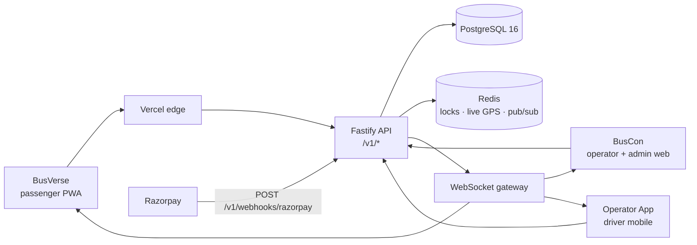
 
### 1.3 Ten API principles
 
| # | Principle | Consequence |
|:---:|---|---|
| 1 | **Versioned URLs** — everything lives under `/v1` | Breaking changes ship as `/v2` with a 6-month deprecation window (§14) |
| 2 | **One surface per role** — `/passenger`, `/operator`, `/admin`, `/driver`, `/public` | Role checks happen on the path prefix first, then on the JWT role |
| 3 | **Tenant isolation returns 404, not 403** | An operator asking for another operator's bus gets `404 NOT_FOUND`; existence is never leaked |
| 4 | **Money is integer paise** — never floats | `amountPaise`, `totalFarePaise`; currency is always `INR` |
| 5 | **Timestamps are UTC ISO-8601**; search dates are IST-anchored `YYYY-MM-DD` | Dashboards use IST day boundaries (§5.9) |
| 6 | **Emit AFTER commit** — WebSocket events and audit side effects fire only once the database transaction has committed | A rolled-back transaction never produces an event |
| 7 | **Idempotency on money** — payment creation and refunds require an `Idempotency-Key` | Retrying never double-charges (§11) |
| 8 | **PII is absent, not null** — masked fields are removed from the JSON entirely | Clients test `'phone' in obj` (§5.5) |
| 9 | **Cascade failures are non-fatal** — per-booking refund failures in a trip cancel do not abort the cancel | Failures are counted and retried by a worker (§5.11) |
| 10 | **Additive over destructive** — new behaviour is a new endpoint or field, old paths are preserved | The synchronous audit export survives next to the async one (§6.7) |
 
### 1.4 What this document does NOT cover
 
| Topic | Goes to |
|---|---|
| Table columns, constraints, indexes | `06-DATABASE-SCHEMA.md` |
| Entity rules, state machines, invariants | `05-DOMAIN-MODEL.md` |
| Step-by-step flows per actor | `08-WORKFLOWS.md` |
| Signing algorithms, lock internals, threat model | `09-SECURITY-AND-PLATFORM-RULES.md` |
| Screens and components | `busverse/05-UI-SPEC.md`, `buscon/06-UI-SPEC.md` |
| GPS pipeline, ETA computation, QR scan logic | `buscon/04`, `buscon/05` |
| Refund tier thresholds | `busverse/03-PAYMENT-REFUND-FLOW.md` §10 (canonical) |
 
### 1.5 Endpoint summary
 
#### 1.5.1 Endpoint tree
 
**Diagram: Endpoint surface tree (v1.4)**
*Eight endpoint categories under `/v1`. The counts are the endpoints individually documented in this file — 106 in total. Two further endpoints exist in code but are not yet located (§1.5.3), which brings the tracker total to 108.*
 
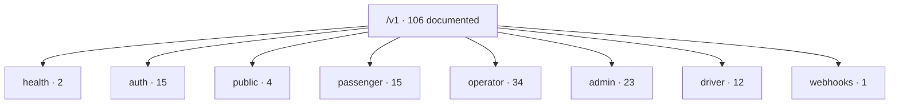
 
#### 1.5.2 Master endpoint list
 
| Category | Count | Auth required | Section |
|---|---:|---|---|
| Health | 2 | None | §2.6 |
| Auth | 15 | Public (except refresh/logout) | §3 |
| Public (passenger-facing) | 4 | None | §4.2 |
| Passenger | 15 | JWT (`REGISTERED_PASSENGER`) | §4.3–§4.8 |
| Operator | 34 | JWT (`OPERATOR_OWNER` / `OPERATOR_MANAGER`) | §5 |
| Admin | 23 | JWT (`SUPER_ADMIN`) | §6 |
| Driver | 12 | JWT (`DRIVER`) | §7 |
| Webhooks | 1 | Razorpay signature | §13 |
| **Documented total** | **106** | | |
| Unlocated (see §1.5.3) | 2 | — | — |
| **Tracker total** | **108** | | |
 
#### 1.5.3 Endpoint count reconciliation
 
The build tracker (`00-BUILD-PROGRESS` v2.8 §2.3) and this document must agree. This table records every step.
 
| Step | Running total | Documented here? |
|---|---:|---|
| v1.2 baseline | 101 | ✅ |
| v1.3 — `GET /public/cities/:id/stands` | 102 | ✅ §4.2 |
| v1.4 — `POST /operator/auth/signup` (P13) | 103 | ✅ §3.10 |
| v1.4 — `POST /operator/trips/:id/cancel` (P12) | 104 | ✅ §5.11 — path under verification |
| v1.4 — `POST /admin/audit-logs/export-async` (P12) | 105 | ✅ §6.7 |
| v1.4 — `GET /admin/audit-logs/export-async/:jobId` (P12) | 106 | ✅ §6.7 |
| P11 module delta not yet located | 108 | ❌ **2 endpoints** |
 
**The two unlocated endpoints.** The tracker shows 104 endpoints at the end of P11 against 101 in v1.2. Only one of the three (`city stands`) is documented, so two shipped endpoints are missing from this file. The P11 test set (`network-public.test.ts` +3, `trip-service-lifecycle.test.ts` 15 new) points to either two additional public endpoints (for example schedule-filter variants) or two trip-service action endpoints (for example delay-resume, seat-lock admin release). The pending amendments in §1.5.4 are separate and not yet shipped. **Resolve with a route-grep before lock (§16 Q19).**
 
**`POST /operator/trips/:id/cancel` path.** The tracker places this endpoint in the Trip module (15 → 16), not the Operator module. The path is either `POST /v1/operator/trips/:id/cancel` (assumed here, because the cascade refunds are an operator decision) or `POST /v1/driver/trips/:id/cancel`. If the grep shows the driver path, §5.11 moves to §7 and the Operator and Driver counts change to 33 and 13. Response shape is unaffected (§16 Q18).
 
#### 1.5.4 Pending amendment endpoints (not counted)
 
These come from `00-INDEX` §14. They are specified minimally so downstream docs can reference them. They are **not** in the 106 and not in the test matrix until confirmed against code.
 
| Amendment | Endpoint | Priority | Section |
|---|---|:---:|---|
| **A6** | `POST /v1/driver/me/documents` | **High — blocks Phase 1 launch** | §7.3 |
| A8 | `POST /v1/operator/schedules/:id/clone` | Medium | §5.12 |
| A10 | `POST /v1/admin/schedules/:id/unpublish` (replaces approve) | Medium | §6.8 |
| A9 | Satisfied by `GET /v1/public/cities/:id/stands` (§4.2) — no operator-prefixed variant added | — | §4.2 |
 
### 1.6 Provenance tags
 
This file mixes contracts copied from the v1.4 delta draft with sections rebuilt from other docs. Tags make the difference visible.
 
| Tag | Meaning |
|---|---|
| *(no tag)* | Contract carried from the v1.4 delta draft, or fixed by `05`/`06` — treat as authoritative |
| **⚠R** | **Reconstructed.** Built from `05`, `06`, `00-INDEX` and cross-references because the v1.2 body was not available. Verify path, role, and shape against code before locking |
| **🆕P** | Pending amendment from `00-INDEX` §14 — specified minimally, not yet counted |
 
---
 
## 2. URL and Response Conventions
 
### 2.1 URL structure
 
**Diagram: URL structure**
*Every URL is `/v1/{surface}/{resource}`. The surface is one of five. Path parameters are UUIDs. Actions that change state are `POST` sub-resources (`/publish`, `/cancel`), never `PUT` on a status field.*
 
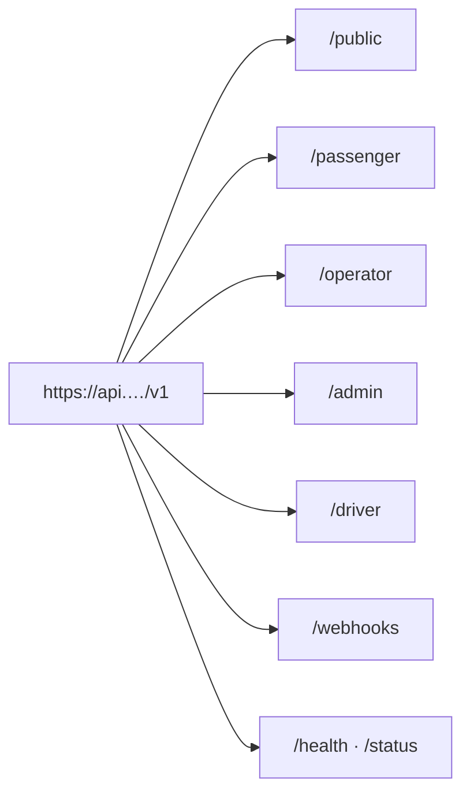
 
### 2.2 Conventions
 
| Convention | Rule |
|---|---|
| Case | URL segments `kebab-case`; JSON fields `camelCase`; DB columns stay `snake_case` (mappers translate) |
| IDs | UUIDv4 in the path; responses may add a prefixed display string (`bkg_…`) per `05` §12.3 |
| Body | `application/json`; request schemas are `.strict()` — unknown fields are `422 VALIDATION_ERROR` |
| Auth | `Authorization: Bearer <access JWT>`; refresh token travels only in an httpOnly cookie |
| Trace | Every request gets `requestId`, returned in `meta.requestId` and in every error |
| Dates | Timestamps UTC ISO-8601 with milliseconds. Query dates `YYYY-MM-DD`, anchored to `Asia/Kolkata` |
 
### 2.3 Response envelope
 
**Diagram: Response envelope**
*Success returns `data` plus `meta`. Errors return a single `error` object. Collections add `meta.nextCursor`. The envelope never changes shape per endpoint.*
 
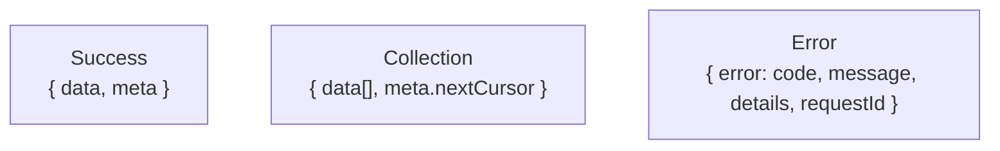
 
**Success:**
```json
{ "data": { "…": "…" }, "meta": { "requestId": "req_abc123" } }
```
 
**Error:**
```json
{
  "error": {
    "code": "SEAT_ALREADY_BOOKED",
    "message": "One or more seats are already booked",
    "details": {},
    "requestId": "req_abc123"
  }
}
```
 
### 2.4 Data type glossary
 
| Type | Format | Example |
|---|---|---|
| UUID | v4, lowercase | `3f2c…` |
| Phone | E.164 | `+919876543210` |
| Money | integer paise + `currency: "INR"` | `{ "amountPaise": 45000, "currency": "INR" }` |
| Timestamp | UTC ISO-8601 | `2026-11-01T08:00:00.000Z` |
| Date | `YYYY-MM-DD`, IST | `2026-11-01` |
| Booking reference | `BKG-YYYY-NNNNN` | `BKG-2026-00042` |
| Seat label | up to 4 chars, unique per layout | `A1` |
| Enum | `SCREAMING_SNAKE_CASE` string | `CONFIRMED` |
 
### 2.5 HTTP methods
 
| Method | Use |
|---|---|
| `GET` | Read; never changes state |
| `POST` | Create, or trigger a state transition (`/publish`, `/cancel`, `/approve`) |
| `PATCH` | Partial update of mutable fields |
| `PUT` | Replace a whole sub-resource (only `…/buses/:id/layout`) |
| `DELETE` | Soft delete or release (`204`) |
 
### 2.6 Health endpoints ⚠R
 
| Method | Path | Auth | Purpose |
|---|---|---|---|
| GET | `/v1/health` | None | Liveness — process is up |
| GET | `/v1/status` | None | Readiness — Postgres and Redis reachable; used by the deployment checklist in `11` |
 
---
 
## 3. Auth Endpoints
 
### 3.1 Auth endpoint map
 
**Diagram: Auth endpoint map (15)**
*Fifteen auth endpoints in six groups. Passengers and drivers sign in with OTP. Operators have three routes — password, OTP, and the new self-signup. Admins use password only. Password reset exists for operators and admins. Refresh and logout are shared across surfaces.*
 
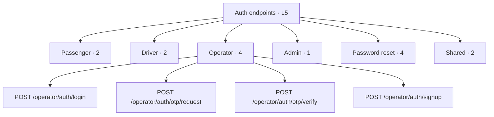
 
### 3.2 Endpoint catalog
 
| Method | Path | Auth | Purpose |
|---|---|---|---|
| POST | `/v1/passenger/auth/otp/request` | None | Send OTP to phone or email |
| POST | `/v1/passenger/auth/otp/verify` | None | Verify OTP → issue tokens |
| POST | `/v1/driver/auth/otp/request` | None | Send OTP to driver phone |
| POST | `/v1/driver/auth/otp/verify` | None | Verify OTP → issue tokens |
| POST | `/v1/operator/auth/login` | None | Email + password login |
| POST | `/v1/operator/auth/otp/request` | None | Send OTP to operator phone |
| POST | `/v1/operator/auth/otp/verify` | None | Verify OTP → issue tokens |
| **POST** | **`/v1/operator/auth/signup`** | None | **New operator self-signup (P13)** |
| POST | `/v1/admin/auth/login` | None | Email + password login |
| POST | `/v1/operator/auth/reset/request` | None | Request password reset |
| POST | `/v1/operator/auth/reset/verify` | None | Complete password reset |
| POST | `/v1/admin/auth/reset/request` | None | Request password reset |
| POST | `/v1/admin/auth/reset/verify` | None | Complete password reset |
| POST | `/v1/{surface}/auth/refresh` | Refresh cookie | Rotate access + refresh |
| POST | `/v1/{surface}/auth/logout` | JWT | Revoke session |
 
### 3.3 OTP sign-in (passenger, driver, operator) ⚠R
 
**Diagram: OTP sign-in sequence**
*The client requests an OTP, the API stores a hashed challenge with `purpose = LOGIN`, and sends the code. Verify checks the hash, the attempt count, expiry, and the purpose, then creates a `Session` and returns tokens. Pre-signup passengers have a challenge with no `user_id`; the user is created on first successful verify.*
 
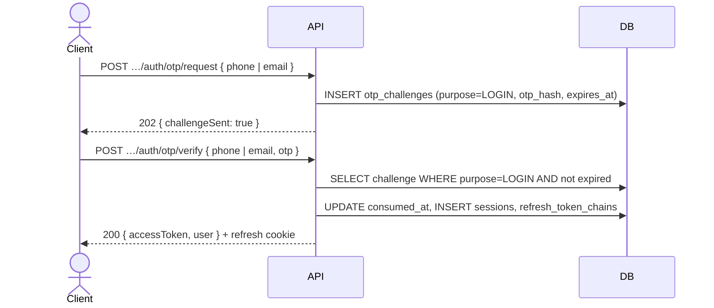
 
| Rule | Detail |
|---|---|
| OTP storage | Hashed with salt (`otp_hash`, `otp_salt`); the raw code is never stored |
| Attempts | Counted on the challenge; the challenge is dead after the limit (`OTP_ATTEMPTS_EXCEEDED`) |
| Rate limit | 3 requests / 10 min (§10) |
| First login | A passenger with no `User` row is created on first verify and must record DPDP consent (`terms_of_service`, `privacy_policy`) |
| Role in token | The session carries exactly one actor role (`04` §3.6) |
 
### 3.4 Operator and admin password login ⚠R
 
`POST /v1/operator/auth/login` and `POST /v1/admin/auth/login` take `{ email, password }`. Both need `email_verified = true`. A wrong password returns `401 INVALID_CREDENTIALS` without saying whether the email exists. Passwords are Argon2id-hashed (`09`). Admin has no OTP route in Phase 1 (TOTP 2FA deferred — `00-INDEX` §15 #1).
 
### 3.5 Password reset and OTP purpose isolation ⚠R
 
Operator and admin password reset works in two steps. `reset/request` creates either a one-time reset token (`password_reset_tokens`, stored hashed, valid 1 hour) or an OTP challenge with **`purpose = RESET`**; `reset/verify` consumes it, sets the new password hash, and revokes every active session of that user — all in one transaction (`05` §5.5).
 
**P2 security rule (v1.3).** An OTP challenge is bound to the endpoint family that created it:
 
| Challenge `purpose` | Created by | May only be consumed by |
|---|---|---|
| `LOGIN` | `…/auth/otp/request` | `…/auth/otp/verify` |
| `RESET` | `…/auth/reset/request` | `…/auth/reset/verify` |
 
Presenting a `LOGIN` OTP to `reset/verify` — or a `RESET` OTP to `otp/verify` — fails with `401 OTP_INVALID` and does **not** consume the challenge. Without this rule, anyone who could receive a login OTP could change the account password. The lookup uses `idx_otp_challenges_phone_purpose_expires` (`06` §4.8).
 
**Reset token rules:** single use (`used_at`), expires, raw token never stored, reuse returns `401 RESET_TOKEN_INVALID`.
 
### 3.6 Refresh and logout ⚠R
 
`POST /v1/{surface}/auth/refresh` reads the httpOnly refresh cookie, rotates it, and returns a new access token. Each refresh hash is appended to `refresh_token_chains.used_hashes`; **presenting an already-used refresh token revokes the whole session** (`REFRESH_REUSED`). `POST /v1/{surface}/auth/logout` revokes the session and adds `revoked:{session_id}` to Redis so existing access tokens die immediately.
 
### 3.7 Roles ⚠R
 
| Role (`sessions.role`) | Surface |
|---|---|
| `GUEST` | `/public` only |
| `REGISTERED_PASSENGER` | `/passenger` |
| `OPERATOR_OWNER`, `OPERATOR_MANAGER` | `/operator` |
| `DRIVER` | `/driver` |
| `SUPER_ADMIN` | `/admin` |
 
### 3.8 Auth error codes ⚠R
 
`INVALID_CREDENTIALS` (401), `OTP_INVALID` (401), `OTP_EXPIRED` (401), `OTP_ATTEMPTS_EXCEEDED` (429), `RESET_TOKEN_INVALID` (401), `REFRESH_REUSED` (401), `SESSION_REVOKED` (401), `FORBIDDEN` (403), `RATE_LIMITED` (429). Full list in §9.2.
 
### 3.9 Token and cookie summary ⚠R
 
| Item | Rule |
|---|---|
| Access token | Short-lived JWT in the `Authorization` header; carries `sub`, `role`, `sid` (session id) |
| Refresh token | Opaque, rotated on every use, stored only as a hash; sent as an httpOnly, secure, same-site cookie |
| Session | One row in `sessions` per device login (`device_fingerprint_hash`); revoked on logout, password reset, reuse detection |
| Revocation | `revoked:{session_id}` in Redis makes a live access token fail immediately |
 
### 3.10 Operator signup (P13)
 
Operator self-service signup. Creates `User` + `Operator` + `OperatorUser` + 2 consent records in **one transaction**. Emits `operator:applied` to `admin:notifications` **after** commit. Writes an audit row.
 
**Request:**
```
POST /v1/operator/auth/signup
Content-Type: application/json
 
{
  "companyName": "Sharma Travels Pvt Ltd",
  "gstin": "09AAACH7409R1ZZ",
  "pan": "AAACH7409R",
  "email": "founder@sharmatravels.com",
  "phone": "+919876543210",
  "password": "SecurePass123!"
}
```
 
**Request schema (`.strict()`):**
 
| Field | Type | Validation |
|---|---|---|
| `companyName` | string | 2–200 chars |
| `gstin` | string | 15-char regex `^[0-9]{2}[A-Z]{5}[0-9]{4}[A-Z]{1}[1-9A-Z]{1}Z[0-9A-Z]{1}$` |
| `pan` | string | 10-char regex `^[A-Z]{5}[0-9]{4}[A-Z]{1}$` |
| `email` | string | valid email, lowercased server-side |
| `phone` | string | E.164 (§2.4) |
| `password` | string | 12–128 chars, must include a letter and a digit (Argon2id-hashed) |
 
**Response (201):**
```json
{
  "data": {
    "operatorId": "uuid",
    "userId": "uuid",
    "status": "APPLIED",
    "message": "Application submitted. You will be notified when your account is approved."
  },
  "meta": { "requestId": "req_abc123" }
}
```
 
**Rules:**
 
- Pre-check in one query: duplicate GSTIN (`findOperatorByGstin`), duplicate email, duplicate phone.
- All writes (`User`, `Operator` with `status: 'APPLIED'`, `OperatorUser` with `role: 'OWNER'`, 2 `consent_records`) happen inside **one** `prisma.$transaction`.
- Password hashed with Argon2id before the `OperatorUser` insert.
- Audit row: `action: 'operator_signup'`, `reason: 'Self-signup via /operator/auth/signup'`, `actorUserId: <new user>`.
- WS emit: `emitToTopic('admin:notifications', events.operatorApplied(...))` fires **after** commit (principle 6).
- On any failure the whole transaction rolls back. The unique constraint on GSTIN at commit time is the final race guard.
**Errors:**
 
| Error | HTTP | When |
|---|---|---|
| `INVALID_GSTIN_FORMAT` | 400 | GSTIN fails regex — **new v1.4 code** |
| `INVALID_PAN_FORMAT` | 400 | PAN fails regex — **new v1.4 code** |
| `INVALID_PHONE_FORMAT` | 400 | Phone not E.164 |
| `INVALID_EMAIL_FORMAT` | 400 | Email malformed |
| `VALIDATION_ERROR` | 422 | Password too weak, `companyName` out of bounds, or extra field (`.strict()`) |
| `EMAIL_ALREADY_REGISTERED` | 409 | Email exists |
| `PHONE_ALREADY_REGISTERED` | 409 | Phone exists |
| `GSTIN_ALREADY_REGISTERED` | 409 | GSTIN exists |
| `RATE_LIMITED` | 429 | More than 3 requests / 10 min / IP |
 
**No `emailVerified` gate at signup.** The `users` row is created with `emailVerified: false`. The operator cannot sign in through `/operator/auth/login` until the admin approves and the email is verified — that is a separate flow. The signup response **does not issue tokens**.
 
---
## 4. BusVerse Endpoints (Passenger)
 
### 4.1 Passenger endpoint flow ⚠R
 
**Diagram: Passenger endpoint flow**
*The booking path is search → seat lock → booking (PENDING) → payment → webhook confirms (CONFIRMED + ticket). Public endpoints need no login; everything from the seat lock onward needs a passenger JWT. The webhook, not the client, is what confirms a booking.*
 
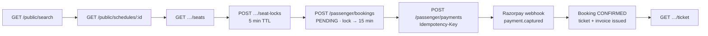
 
### 4.2 Public endpoints (expanded v1.3)
 
| Method | Path | Purpose |
|---|---|---|
| GET | `/v1/public/cities` | City autocomplete (`?q=del&limit=50`) |
| **GET** | **`/v1/public/cities/:id/stands`** | **v1.3 — List stands in a city** |
| GET | `/v1/public/search` | Search schedules by route + date |
| GET | `/v1/public/schedules/:id` | Schedule detail with stops + fare + bus |
 
**Cities request:** `GET /v1/public/cities?q=del&limit=50`
 
**Cities response:**
```json
{
  "data": [
    { "id": "uuid", "name": "Delhi", "state": "Delhi", "isActive": true }
  ]
}
```
 
**City stands request:** `GET /v1/public/cities/:id/stands`
 
**City stands response:**
```json
{
  "data": [
    {
      "id": "uuid",
      "cityId": "uuid",
      "name": "ISBT Kashmere Gate",
      "type": "BUS_STAND",
      "lat": 28.6675,
      "lng": 77.2284
    }
  ]
}
```
 
Errors: `404 NOT_FOUND` if the city id does not exist. Stand `type` ∈ `BUS_STAND` | `PICKUP_POINT` | `DROP_POINT` (`06` v1.3 §5.3).
 
**Search request:**
```
GET /v1/public/search?originCityId=uuid&destinationCityId=uuid&date=2026-11-01&sortBy=departureTime
```
 
Query params: `originCityId` (required), `destinationCityId` (required), `date` (`YYYY-MM-DD`, required, IST-anchored), `sortBy` (`departureTime` | `fare`, default `departureTime`).
 
**Search response:** array of schedules `{ scheduleId, busType, operatorName, departureTime, arrivalTime, durationMinutes, fare, availableSeats }`. Only `PUBLISHED` schedules appear. `availableSeats = capacity − booked − active locks` (R28).
 
> **Planned (Phase 3a):** a `busType` filter on search, backed by `idx_buses_bus_type` (`06` §5.5). Not yet part of the contract.
 
**Schedule detail request:** `GET /v1/public/schedules/:id`
 
**Schedule detail response:**
```json
{
  "data": {
    "scheduleId": "uuid",
    "status": "PUBLISHED",
    "busType": "AC_SEATER",
    "operatorName": "Sharma Travels",
    "departureTime": "2026-11-01T08:00:00.000Z",
    "arrivalTime": "2026-11-01T16:00:00.000Z",
    "durationMinutes": 480,
    "fare": { "amountPaise": 45000, "currency": "INR" },
    "availableSeats": 40,
    "bus": {
      "id": "uuid",
      "registrationNumber": "DL01AB1234",
      "model": "Volvo 9400",
      "capacity": 40,
      "busType": "AC_SEATER",
      "amenities": ["WiFi", "AC", "Water"]
    },
    "route": {
      "id": "uuid",
      "originCity": { "id": "uuid", "name": "Delhi", "state": "Delhi", "isActive": true },
      "destinationCity": { "id": "uuid", "name": "Lucknow", "state": "UP", "isActive": true },
      "stands": [
        {
          "stand": { "id": "uuid", "cityId": "uuid", "name": "ISBT Kashmere Gate", "type": "BUS_STAND", "lat": 28.6675, "lng": 77.2284 },
          "sequence": 1,
          "distanceFromPrevKm": 0,
          "durationFromPrevMin": 0
        }
      ]
    }
  }
}
```
 
Errors: `404 NOT_FOUND` if the schedule does not exist **or** `status != 'PUBLISHED'`.
 
**`amenities` mapping.** The database stores `amenities_json` as `{ "_v": 1, "items": [...] }` (`06` §5.5). The API flattens it to a plain string array. A row with a missing `items` key is returned as `[]`.
 
### 4.3 Passenger endpoint catalog ⚠R
 
| # | Method | Path | Purpose |
|:---:|---|---|---|
| 1 | GET | `/v1/passenger/me` | Profile + consents |
| 2 | PATCH | `/v1/passenger/me` | Update name, dob, gender, preferences |
| 3 | POST | `/v1/passenger/me/consents` | Grant or revoke a DPDP consent purpose |
| 4 | GET | `/v1/passenger/schedules/:id/seats` | Seat deck with live availability |
| 5 | POST | `/v1/passenger/schedules/:id/seat-locks` | Lock one or more seats |
| 6 | DELETE | `/v1/passenger/seat-locks/:id` | Release a lock |
| 7 | POST | `/v1/passenger/bookings` | Create a PENDING booking |
| 8 | GET | `/v1/passenger/bookings` | My bookings (paginated) |
| 9 | GET | `/v1/passenger/bookings/:id` | Booking detail |
| 10 | GET | `/v1/passenger/bookings/:id/refund-preview` | What a cancel would refund |
| 11 | POST | `/v1/passenger/bookings/:id/cancel` | Cancel a CONFIRMED booking |
| 12 | POST | `/v1/passenger/payments` | Start (or retry) payment — **`Idempotency-Key` required** |
| 13 | GET | `/v1/passenger/payments/:id` | Payment status |
| 14 | GET | `/v1/passenger/bookings/:id/ticket` | Signed QR ticket (CONFIRMED only) |
| 15 | GET | `/v1/passenger/trips/:id/live` | Live position + ETA for a booked trip |
 
### 4.4 Seat deck and seat locks ⚠R
 
**Diagram: Seat lock lifecycle**
*A lock request is checked against already-booked seats first (invariant #8 in `05`), then taken with an atomic Redis `SET NX`, with the Postgres unique index on `(schedule_id, seat_id)` as backup. The lock lives 5 minutes. Creating a booking extends it to 15 minutes. It is deleted when payment succeeds, when the payment window expires, or on release.*
 
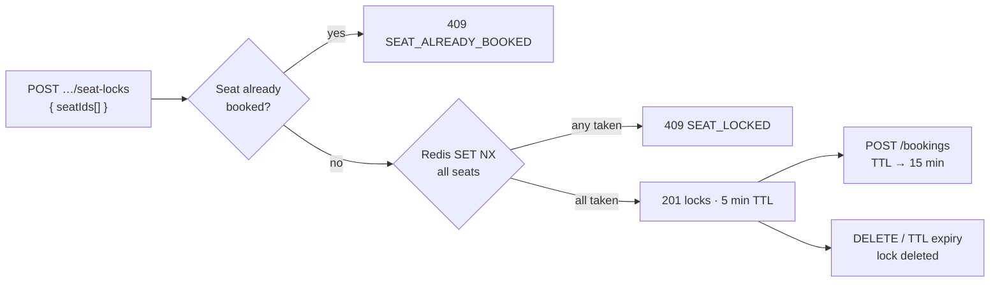
 
**Lock request:** `POST /v1/passenger/schedules/:id/seat-locks`
```json
{ "seatIds": ["uuid", "uuid"] }
```
 
**Lock response (201):**
```json
{
  "data": {
    "locks": [
      { "id": "uuid", "seatId": "uuid", "seatLabel": "A1", "expiresAt": "2026-11-01T07:35:00.000Z" }
    ]
  }
}
```
 
| Rule | Detail |
|---|---|
| Atomicity | All seats in the request are locked together or none are |
| Pre-check | Service queries `booking_passengers` before locking; a booked seat returns `409 SEAT_ALREADY_BOOKED` |
| TTL | 5 minutes at acquire; extended to 15 minutes when a booking is created (`05` §6.3) |
| Ownership | A lock belongs to its `user_id`; another user's lock id returns `404` |
| Schedule state | Only `PUBLISHED` schedules can be locked |
| Realtime | `seat:locked`, `seat:released`, `seat:booked` are published to `schedule:seats:{scheduleId}` (§8) |
 
### 4.5 Bookings and refunds ⚠R
 
**Create booking:** `POST /v1/passenger/bookings`
```json
{
  "scheduleId": "uuid",
  "boardingStandId": "uuid",
  "droppingStandId": "uuid",
  "passengers": [
    { "seatId": "uuid", "name": "Alice Gupta", "age": 28, "gender": "FEMALE" }
  ]
}
```
 
**Response (201):**
```json
{
  "data": {
    "bookingId": "uuid",
    "bookingReference": "BKG-2026-00042",
    "status": "PENDING",
    "expiresAt": "2026-11-01T07:40:00.000Z",
    "totalFare": { "amountPaise": 48750, "currency": "INR" },
    "fareBreakdown": { "baseFarePaise": 45000, "taxPaise": 2250, "convenienceFeePaise": 1500, "totalPaise": 48750 }
  }
}
```
 
| Rule | Detail |
|---|---|
| Locks required | Every `seatId` must be locked by this user; otherwise `409 SEAT_LOCK_REQUIRED` |
| Passenger count | Equals seat count (invariant #2) |
| Status | `PENDING` — **no ticket exists yet** (invariant #1); the lock is extended to 15 minutes |
| `expiresAt` | Start of the 15-minute payment window. After it, the `expire_pending_bookings` job sets the booking to `EXPIRED` and the lock is deleted |
| Realtime | `booking:expired` is sent to `user:{userId}` when the window closes |
 
**Refund tiers (names fixed by `05` §15; thresholds owned by `busverse/03` §10):**
 
| `refundTier` | Refund |
|---|---|
| `TIER_FULL` | 100% |
| `TIER_75` | 75% |
| `TIER_50` | 50% |
| `TIER_ZERO` | 0% (cancel allowed, nothing refunded) |
| `TIER_NOT_ELIGIBLE` | Cancel not allowed (e.g. already boarded) |
 
**Refund preview:** `GET /v1/passenger/bookings/:id/refund-preview`
```json
{
  "data": {
    "bookingId": "uuid",
    "refundTier": "TIER_75",
    "refundPercent": 75,
    "refundAmountPaise": 36562,
    "computedAt": "2026-10-30T10:00:00.000Z"
  }
}
```
 
**Cancel:** `POST /v1/passenger/bookings/:id/cancel` → `200`, booking `CANCELLED`, refund `INITIATED` with the previewed tier. Only `CONFIRMED` bookings can be cancelled. **`OPERATOR_CANCELLED` bookings always get `TIER_FULL`**, regardless of timing.
 
### 4.6 Payments ⚠R
 
**Create payment:** `POST /v1/passenger/payments` with header `Idempotency-Key: <uuid>`
```json
{ "bookingId": "uuid", "method": "UPI" }
```
 
**Response (201):**
```json
{
  "data": {
    "paymentId": "uuid",
    "status": "INITIATED",
    "gateway": "RAZORPAY",
    "gatewayOrderId": "order_Nxyz",
    "amount": { "amountPaise": 48750, "currency": "INR" }
  }
}
```
 
| Rule | Detail |
|---|---|
| Idempotency | Same key within 24 h returns the original response, creates no second payment |
| Retry after `FAILED` | A new call with a **new** `Idempotency-Key` creates a new `Payment` row for the same booking; the failed row stays for audit (`05` §8.2) |
| Not allowed | Booking not `PENDING`, expired, or already paid → `400 PAYMENT_NOT_ALLOWED` |
| Confirmation | The client never confirms. Only the webhook (§13) moves the booking to `CONFIRMED` |
 
### 4.7 Ticket and live tracking ⚠R
 
**Ticket:** `GET /v1/passenger/bookings/:id/ticket` returns `{ ticketId, status, qrPayload, qrSignature, issuedAt }` for a `CONFIRMED` booking. A `PENDING` booking has no ticket and returns `409 BOOKING_NOT_CONFIRMED`. The QR is Ed25519-signed; payload v2 (multi-passenger) is defined in `09` v1.3 and `buscon/05` §4.2. The client can show the ticket offline (PWA cache, `busverse/04`).
 
**Live tracking:** `GET /v1/passenger/trips/:id/live` returns the server-composed view of the trip — current position, GPS state, ETA, and delay. The canonical response schema is amendment **A14** (`buscon/04` §20); until that is merged, this endpoint returns the composition described in `buscon/04`. Realtime updates arrive on `trip:live:{tripId}` (§8).
 
### 4.8 Profile and consent ⚠R
 
`GET/PATCH /v1/passenger/me` read and update `PassengerProfile` fields. `POST /v1/passenger/me/consents` takes `{ purpose, granted }` where `purpose` ∈ `terms_of_service` | `privacy_policy` | `marketing` | `analytics`. A grant closes any active row for that purpose and inserts a new one with the current `policy_version`; a revoke sets `revoked_at` (`05` §7.4). Revoking is immediate — there is no grace period.
 
---
 
## 5. BusCon Operator Endpoints
 
### 5.1 Operator endpoint groups ⚠R
 
**Diagram: Operator endpoint groups**
*The 34 operator endpoints group by what they manage. Owner and Manager can do almost everything; Owner alone changes company profile, uploads company documents, and lists managers.*
 
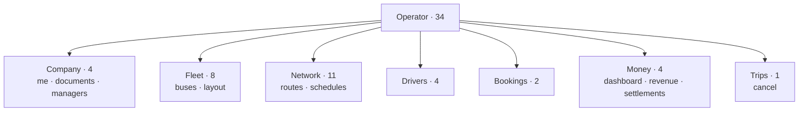
 
### 5.2 Endpoint catalog (34)
 
| Method | Path | Owner | Manager |
|---|---|:---:|:---:|
| GET | `/v1/operator/me` | ✅ | ✅ |
| PATCH | `/v1/operator/me` | ✅ | ❌ |
| POST | `/v1/operator/me/documents` | ✅ | ❌ |
| GET | `/v1/operator/buses` | ✅ | ✅ |
| POST | `/v1/operator/buses` | ✅ | ✅ |
| GET | `/v1/operator/buses/:id` | ✅ | ✅ |
| PATCH | `/v1/operator/buses/:id` | ✅ | ✅ |
| DELETE | `/v1/operator/buses/:id` | ✅ | ✅ |
| GET | `/v1/operator/buses/:id/layout` | ✅ | ✅ |
| PUT | `/v1/operator/buses/:id/layout` | ✅ | ✅ |
| GET | `/v1/operator/routes` | ✅ | ✅ |
| POST | `/v1/operator/routes` | ✅ | ✅ |
| GET | `/v1/operator/routes/:id` | ✅ | ✅ |
| PATCH | `/v1/operator/routes/:id` | ✅ | ✅ |
| POST | `/v1/operator/routes/:id/stands` | ✅ | ✅ |
| DELETE | `/v1/operator/routes/:id` | ✅ | ✅ |
| GET | `/v1/operator/schedules` | ✅ | ✅ |
| POST | `/v1/operator/schedules` | ✅ | ✅ |
| GET | `/v1/operator/schedules/:id` | ✅ | ✅ |
| PATCH | `/v1/operator/schedules/:id` | ✅ | ✅ |
| POST | `/v1/operator/schedules/:id/publish` | ✅ | ✅ |
| GET | `/v1/operator/drivers` | ✅ | ✅ |
| POST | `/v1/operator/drivers/invite` | ✅ | ✅ |
| GET | `/v1/operator/drivers/:id` | ✅ | ✅ |
| DELETE | `/v1/operator/drivers/:id` | ✅ | ✅ |
| GET | `/v1/operator/bookings` | ✅ | ✅ |
| GET | `/v1/operator/bookings/:id` | ✅ | ✅ |
| GET | `/v1/operator/dashboard` | ✅ | ✅ |
| GET | `/v1/operator/revenue` | ✅ | ✅ |
| GET | `/v1/operator/revenue/daily` | ✅ | ✅ |
| GET | `/v1/operator/settlements` | ✅ | ✅ |
| POST | `/v1/operator/uploads` | ✅ | ✅ |
| GET | `/v1/operator/me/managers` | ✅ | ❌ |
| **POST** | **`/v1/operator/trips/:id/cancel`** | ✅ | ✅ |
 
*(P13 signup is unauthenticated — counted under Auth in §1.5.2, not here.)*
 
### 5.3 Bus registration flow (expanded v1.3)
 
**Diagram: Bus registration sequence**
*Two phases — the operator registers the bus (PENDING) and builds its layout, then the admin approves. `busType` and `amenities` are set at registration and are required for search filtering.*
 
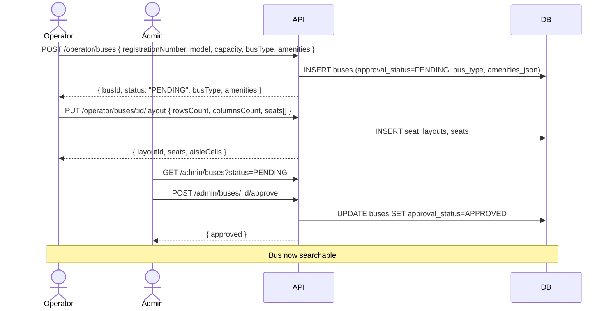
 
**Create bus request:**
```json
{
  "registrationNumber": "DL01AB1234",
  "model": "Volvo 9400",
  "capacity": 40,
  "busType": "AC_SEATER",
  "amenities": ["WiFi", "AC", "Water", "Charging"],
  "insuranceDocRef": "r2://uploads/insurance-xyz.pdf",
  "insuranceExpiresAt": "2027-06-30"
}
```
 
`busType` ∈ `SEATER` | `AC_SEATER` | `SLEEPER` | `AC_SLEEPER` | `SEMI_SLEEPER`. `amenities`: string array, max 20, each 1–50 chars. `capacity` is 1–60 (`06` §5.5).
 
**Create bus response (201):**
```json
{
  "data": {
    "id": "uuid",
    "operatorId": "uuid",
    "registrationNumber": "DL01AB1234",
    "model": "Volvo 9400",
    "capacity": 40,
    "busType": "AC_SEATER",
    "amenities": ["WiFi", "AC", "Water", "Charging"],
    "approvalStatus": "PENDING",
    "insuranceDocRef": "r2://uploads/insurance-xyz.pdf",
    "insuranceExpiresAt": "2027-06-30",
    "createdAt": "2026-10-27T19:00:00.000Z"
  }
}
```
 
**Create layout request:**
```json
{
  "rowsCount": 10,
  "columnsCount": 4,
  "seats": [
    { "seatRow": "A", "seatColumn": 1, "seatType": "SEATER", "isFemaleOnly": false }
  ]
}
```
 
**Create layout response:**
```json
{
  "data": {
    "id": "uuid",
    "busId": "uuid",
    "rowsCount": 10,
    "columnsCount": 4,
    "aisleCells": [{ "row": "A", "column": 3 }],
    "seats": [
      { "id": "uuid", "seatRow": "A", "seatColumn": 1, "seatLabel": "A1", "seatType": "SEATER", "isFemaleOnly": false }
    ]
  }
}
```
 
Rules: `seats.length == bus.capacity`; unique `(seatRow, seatColumn)`; the layout is locked once the bus has bookings; `aisleCells` are computed server-side. `seatLabel` is generated and is at most 4 characters.
 
### 5.4 Routes, schedules, uploads ⚠R
 
| Endpoint | Contract |
|---|---|
| `POST /operator/routes` | `{ originCityId, destinationCityId }`. Same city → `400 ROUTE_SAME_CITY`. Created `PENDING` |
| `POST /operator/routes/:id/stands` | `{ standId, sequence, distanceFromPrevKm, durationFromPrevMin }`. Stand must be in a city on the route, else `400 INVALID_REQUEST`. A route needs at least 2 stands |
| `DELETE /operator/routes/:id` | Soft delete. Referenced by a schedule → `409 ROUTE_IN_USE` |
| `POST /operator/schedules` | `{ busId, routeId, departureTime, arrivalTime, fareAmountPaise }`. Bus must be `APPROVED`. Arrival ≤ departure → `400 INVALID_SCHEDULE_TIMES`. Created `DRAFT` |
| `PATCH /operator/schedules/:id` | Fare is editable only until the first booking (`05` §21) |
| `POST /operator/schedules/:id/publish` | `DRAFT → PUBLISHED`. Checks the overlap rule in §5.6 → `409 SCHEDULE_CONFLICT` |
| `POST /operator/uploads` | Multipart file; returns `{ fileRef: "r2://uploads/…" }`. The ref is then passed to a bus, driver, or company document field |
| `POST /operator/me/documents` | Owner only. Attaches uploaded company documents (GST, PAN, KYC) |
 
Schedule statuses are `DRAFT`, `PUBLISHED`, `CANCELLED` (`05` §15); there is no approval state (see Q22).
 
### 5.5 Field masking (expanded v1.3)
 
Operator endpoints return **masked PII** per `04` §11.1. Concrete rules per endpoint family:
 
**`GET /v1/operator/bookings/:id` — masked PII fields:**
 
| Field | Operator sees |
|---|:---:|
| `passenger.name` | ✅ |
| `passenger.seatLabel` | ✅ |
| `passenger.age` | ✅ |
| `passenger.gender` | ✅ |
| `passenger.phone` | ❌ **Absent** |
| `passenger.email` | ❌ **Absent** |
| `passenger.idNumber` | ❌ **Absent** |
| `payment.method` | ❌ **Absent** |
| `payment.cardLast4` | ❌ **Absent** |
| `payment.amountPaise` | ✅ |
| `payment.status` | ✅ |
| `boardingScan.scannedAt` | ✅ |
| `trip.gpsPosition` | ✅ (own fleet) |
| `audit_trail` | ❌ **Absent** |
 
**`GET /v1/operator/drivers/:id` — masked PII fields:**
 
| Field | Operator sees |
|---|:---:|
| `driver.name` | ✅ |
| `driver.phone` | ✅ (own fleet dispatch) |
| `driver.licenseNumber` | ✅ |
| `driver.kycStatus` | ✅ |
| `driver.onDuty` | ✅ |
 
**Absent vs masked:** a field marked ❌ **Absent** is removed from the JSON entirely, not set to `null`. Clients use `'phone' in obj`, not `obj.phone === null`.
 
**Admin unmasking:** `GET /v1/admin/bookings/:id?includePii=true&reason=...` unmasks per `04` §11.4 and writes an audit row. Without `reason`, the response stays masked.
 
### 5.6 Operator error codes (expanded v1.3)
 
| Error | HTTP | When |
|---|---|---|
| `BUS_REGISTRATION_EXISTS` | 409 | Duplicate registration number |
| `LICENSE_ALREADY_REGISTERED` | 409 | Duplicate driver license |
| `SCHEDULE_HAS_BOOKINGS` | 409 | Cannot delete a schedule with bookings |
| `ROUTE_IN_USE` | 409 | Cannot delete a route referenced by schedules |
| `INVALID_SCHEDULE_TIMES` | 400 | Arrival ≤ departure |
| `ROUTE_SAME_CITY` | 400 | Origin = destination |
| **`SCHEDULE_CONFLICT`** | **409** | **v1.3 — publish-time bus overlap** |
| `INVALID_REQUEST` | 400 | Generic domain errors (duplicate seat coordinate, capacity mismatch, stand/city mismatch) |
| `TRIP_NOT_CANCELLABLE` | 400 | **v1.4** — cancel attempted on a COMPLETED or CANCELLED trip |
| `DRIVER_ON_DUTY` | 409 | Remove a driver who is on duty or on an `IN_PROGRESS` trip |
| `NOT_FOUND` | 404 | Cross-tenant access or missing resource |
 
**Schedule conflict response (v1.3):**
```json
{
  "error": {
    "code": "SCHEDULE_CONFLICT",
    "message": "Bus has an overlapping schedule",
    "details": {
      "conflictingScheduleId": "uuid",
      "departureTime": "2026-11-01T08:00:00.000Z",
      "arrivalTime": "2026-11-01T16:00:00.000Z"
    },
    "requestId": "req_abc123"
  }
}
```
 
Overlap rule: `existing.departure < new.arrival AND existing.arrival > new.departure`. Only `PUBLISHED` schedules count.
 
### 5.7 Drivers (Phase 3c)
 
**`GET /v1/operator/drivers`** — paginated list.
 
Response row:
```json
{
  "id": "uuid",
  "userId": "uuid",
  "name": "Rajesh Kumar",
  "phone": "+919876543210",
  "licenseNumber": "DL-0420110000123",
  "kycStatus": "VERIFIED",
  "onDuty": false,
  "verifiedAt": "2026-09-15T10:00:00.000Z",
  "createdAt": "2026-09-01T08:00:00.000Z"
}
```
 
`kycStatus` ∈ `INVITED` | `SIGNED_UP` | `KYC_PENDING` | `VERIFIED` | `KYC_FAILED` | `ACTIVE` | `BLOCKED` | `DEACTIVATED`. Only `VERIFIED` / `ACTIVE` drivers are assignable.
 
**`POST /v1/operator/drivers/invite`** — request:
```json
{ "phone": "+919876543210", "licenseNumber": "DL-0420110000123", "name": "Rajesh Kumar" }
```
Response (201): driver profile with `kycStatus: "INVITED"`. An existing user is linked; a new phone creates a user and sends an SMS invite (MSG91, mocked in dev). Duplicate license → `409 LICENSE_ALREADY_REGISTERED`. Same phone already invited → `409 INVALID_REQUEST`.
 
**`GET /v1/operator/drivers/:id`** — same shape, full PII for the operator's own fleet.
 
**`DELETE /v1/operator/drivers/:id`** — `204`. Blocked when `onDuty = true` or the driver is on an `IN_PROGRESS` trip → `409 DRIVER_ON_DUTY`. Cross-tenant → `404`.
 
### 5.8 Bookings view (Phase 3c)
 
**`GET /v1/operator/bookings`** — paginated. Query: `status`, `scheduleId`, `from`, `to`.
 
Response row:
```json
{
  "bookingId": "uuid",
  "bookingReference": "BKG-2026-00042",
  "status": "CONFIRMED",
  "scheduleId": "uuid",
  "departureTime": "2026-11-01T08:00:00.000Z",
  "routeSummary": { "originCity": "Delhi", "destinationCity": "Lucknow" },
  "passengerCount": 2,
  "passengers": [
    { "name": "Alice Gupta", "seatLabel": "A1", "age": 28, "gender": "FEMALE" }
  ],
  "totalFarePaise": 48750,
  "confirmedAt": "2026-11-01T07:30:00.000Z",
  "createdAt": "2026-11-01T07:25:00.000Z"
}
```
 
`passengers[].phone`, `email`, and `idNumber` are absent per §5.5.
 
**`GET /v1/operator/bookings/:id`** — full detail with `schedule`, `boardingStand`, `droppingStand`, `passengers`, `totalFarePaise`, `fareBreakdown`, `payment`, `boardingScans`, `confirmedAt`, `createdAt`. Cross-tenant → `404`.
 
### 5.9 Dashboard and revenue (Phase 3c)
 
**`GET /v1/operator/dashboard`** — today's KPIs on IST day boundaries:
```json
{
  "data": {
    "asOf": "2026-10-27T20:00:00.000Z",
    "today": {
      "date": "2026-10-27",
      "timezone": "Asia/Kolkata",
      "bookingsCount": 18,
      "passengerCount": 34,
      "revenuePaise": 1635000,
      "cancelledCount": 2,
      "refundedPaise": 45000
    },
    "activeTrips": 3,
    "upcomingTripsToday": 5,
    "pendingApprovals": { "buses": 2, "routes": 1, "schedules": 4 },
    "drivers": { "total": 8, "onDuty": 3, "kycPending": 1 }
  }
}
```
 
> `pendingApprovals.schedules` conflicts with amendment A1 (a schedule has no approval state). See Q22.
 
**`GET /v1/operator/revenue`** — `?from=YYYY-MM-DD&to=YYYY-MM-DD&groupBy=day|week|month`. Maximum 90-day range. Returns `totalRevenuePaise`, `totalRefundsPaise`, `netRevenuePaise`, and `buckets[]`.
 
**`GET /v1/operator/revenue/daily`** — always the last 7 IST days, ascending, chart-ready.
 
### 5.10 Settlements and managers (Phase 3c)
 
**`GET /v1/operator/settlements`** — Phase 1 stub: `{ "data": [], "meta": { "nextCursor": null, "note": "Settlements are processed in Phase 5 (Payments). This endpoint returns an empty array until then." } }`.
 
**`GET /v1/operator/me/managers`** — Owner only (`OPERATOR_MANAGER` → `403`). Rows: `operatorUserId, userId, name, email, phone, role, invitedAt, acceptedAt`. Includes the owner and all active managers.
 
### 5.11 Operator trip cancel (P12)
 
**`POST /v1/operator/trips/:id/cancel`**
 
Operator-initiated cancellation of an entire trip. Triggers cascade refunds for every `CONFIRMED` booking on the trip. A per-booking cascade failure is **non-fatal** — the trip is cancelled even if one or more refunds fail; failures are logged and retried by `webhook-replay.worker`.
 
**Request:**
```json
{
  "reason": "BUS_BREAKDOWN",
  "notes": "Engine failure before departure"
}
```
 
`reason` ∈ `BUS_BREAKDOWN` | `OPERATOR_ISSUE` | `WEATHER` | `GOVERNMENT_RESTRICTION` | `OTHER`. `notes` optional, 0–500 chars.
 
**Response (200):**
```json
{
  "data": {
    "tripId": "uuid",
    "status": "CANCELLED",
    "cancelledAt": "2026-10-27T21:00:00.000Z",
    "cancellationReason": "BUS_BREAKDOWN",
    "bookingsCancelled": 12,
    "refundsInitiated": 12,
    "refundFailures": 0,
    "totalRefundPaise": 585000
  }
}
```
 
**Rules:**
 
- Pre-condition: trip `status` ∈ `SCHEDULED` | `IN_PROGRESS`. `COMPLETED` or `CANCELLED` → `400 TRIP_NOT_CANCELLABLE`.
- All affected bookings transition to `OPERATOR_CANCELLED` (`05` §8.1) with `refund_tier: 'TIER_FULL'` — operator cancels are always full refunds (§4.5). *The v1.4 delta draft said `CANCELLED`; `05` defines a separate `OPERATOR_CANCELLED` state for operator action — confirm which the code writes (Q24).*
- Each booking's refund starts as `INITIATED`; actual processing goes through Razorpay per §13.
- The cascade per booking is wrapped in try/catch; one failure does not abort the rest. Failures are counted in `refundFailures` and retried asynchronously.
- Emits `trip:cancelled` to `trip:live:{tripId}`, and `booking:cancelled` + `refund:requested` per affected booking (§8).
- One audit row per booking plus one aggregate audit row for the trip cancel.
- Cross-tenant → `404`.
- WS events fire **after** commit (principle 6).
### 5.12 🆕P Clone schedule (A8)
 
`POST /v1/operator/schedules/:id/clone` — creates a new `DRAFT` schedule copying bus, route, and fare from the source; the request supplies the new departure and arrival times. The exact request/response shape is owned by `buscon/03` §23. Not counted in §1.5.2 until confirmed against code.
 
---
## 6. BusCon Admin Endpoints
 
### 6.1 Admin endpoint groups ⚠R
 
**Diagram: Admin endpoint groups**
*Twenty-three admin endpoints, all `SUPER_ADMIN` only. Most are approvals — the admin is the gate for operators, buses, routes, and driver KYC. Refunds, PII unmasking, and audit access are the other three groups.*
 
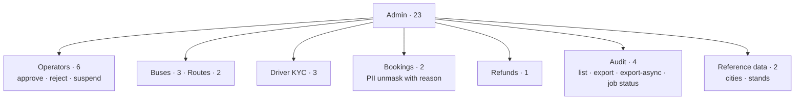
 
### 6.2 Endpoint catalog (23) ⚠R
 
| # | Method | Path | Purpose |
|:---:|---|---|---|
| 1 | GET | `/v1/admin/operators` | List operators (filter by status) |
| 2 | GET | `/v1/admin/operators/:id` | Operator detail |
| 3 | POST | `/v1/admin/operators/:id/approve` | `PENDING_REVIEW → APPROVED` |
| 4 | POST | `/v1/admin/operators/:id/reject` | `PENDING_REVIEW → REJECTED` (reason required) |
| 5 | POST | `/v1/admin/operators/:id/suspend` | `ACTIVE → SUSPENDED` — cascades to buses and schedules |
| 6 | POST | `/v1/admin/operators/:id/reactivate` | `SUSPENDED → ACTIVE` |
| 7 | GET | `/v1/admin/buses` | List buses (`?status=PENDING`) |
| 8 | POST | `/v1/admin/buses/:id/approve` | `PENDING → APPROVED` — bus becomes searchable |
| 9 | POST | `/v1/admin/buses/:id/reject` | `PENDING → REJECTED` (reason required) |
| 10 | GET | `/v1/admin/routes` | List routes (filter by status) |
| 11 | POST | `/v1/admin/routes/:id/approve` | `PENDING → APPROVED` |
| 12 | GET | `/v1/admin/drivers` | List drivers (filter by `kycStatus`) |
| 13 | POST | `/v1/admin/drivers/:id/approve-kyc` | `KYC_PENDING → VERIFIED` |
| 14 | POST | `/v1/admin/drivers/:id/reject-kyc` | `KYC_PENDING → KYC_FAILED` |
| 15 | GET | `/v1/admin/bookings` | Search bookings (masked) |
| 16 | GET | `/v1/admin/bookings/:id` | Booking detail; `?includePii=true&reason=…` unmasks |
| 17 | POST | `/v1/admin/payments/:id/refund` | Manual refund — **`Idempotency-Key` required** |
| 18 | GET | `/v1/admin/audit-logs` | Query the audit log (paginated) |
| 19 | GET | `/v1/admin/audit-logs/export` | Synchronous export (preserved) |
| 20 | POST | `/v1/admin/cities` | Create or activate a city |
| 21 | POST | `/v1/admin/stands` | Create a stand in a city |
| **22** | **POST** | **`/v1/admin/audit-logs/export-async`** | **Start an async export job (P12)** |
| **23** | **GET** | **`/v1/admin/audit-logs/export-async/:jobId`** | **Poll an export job (P12)** |
 
Rows 1–21 are the v1.2 baseline, rebuilt from `05` §8 lifecycles and `00-INDEX`; rows 22–23 are from the v1.4 draft (§6.7).
 
### 6.3 Approval flow ⚠R
 
**Diagram: Admin approval gates**
*Operators, buses, and drivers each move through an approval gate that only the admin can open. A rejection always needs a reason and writes an audit row. Approving a bus makes it searchable; approving a driver's KYC makes them assignable.*
 
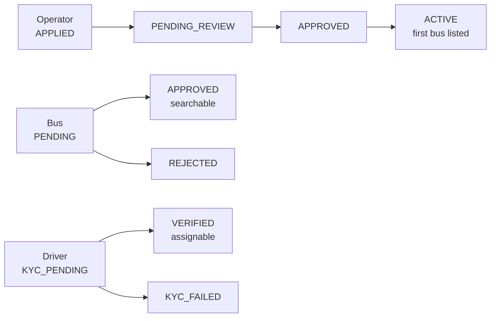
 
State names come from `05` §8.4–§8.5. Every approve/reject call writes an audit row with `actor_id`, `action`, and `reason`.
 
### 6.4 Refund flow ⚠R
 
`POST /v1/admin/payments/:id/refund` with `Idempotency-Key`:
```json
{ "amountPaise": 48750, "reason": "DUPLICATE_CHARGE" }
```
`reason` ∈ `PASSENGER_CANCELLED` | `OPERATOR_CANCELLED` | `TRIP_CANCELLED` | `DUPLICATE_CHARGE` | `DISPUTE` (`05` §15). Rules from `05`: the parent payment must be `SUCCEEDED`; the refund cannot exceed the payment amount (invariant #11) → `400 REFUND_EXCEEDS_PAYMENT`; a refund needs a cancelled booking (invariant #12) → `409 REFUND_NOT_ALLOWED`. The refund starts `INITIATED`; Razorpay's `refund.processed` or `refund.failed` webhook completes it.
 
### 6.5 Admin PII access ⚠R
 
Admin lists are masked by default. `?includePii=true` requires a `reason` of at least 10 characters; without it the response stays masked and the call is **not** an error. Each unmask writes an `AuditLog` row with the reason, and the response header `X-PII-Unmasked: true` is set. Governed by `04` §11.4.
 
### 6.6 Admin error codes ⚠R
 
`OPERATOR_NOT_PENDING_REVIEW` (409), `BUS_NOT_PENDING` (409), `DRIVER_NOT_KYC_PENDING` (409), `REASON_REQUIRED` (400), `REFUND_EXCEEDS_PAYMENT` (400), `REFUND_NOT_ALLOWED` (409), `PAYMENT_NOT_REFUNDABLE` (409), `FORBIDDEN` (403 — any non-`SUPER_ADMIN`), `NOT_FOUND` (404). Full list in §9.2.
 
### 6.7 Async audit export (P12)
 
Two endpoints for asynchronous CSV/JSON export of the audit log. They preserve the synchronous `GET /v1/admin/audit-logs/export` path (principle 10).
 
**`POST /v1/admin/audit-logs/export-async`** — start an export job.
 
**Request:**
```json
{
  "format": "CSV",
  "from": "2026-10-01T00:00:00.000Z",
  "to": "2026-10-27T23:59:59.999Z",
  "filters": {
    "action": "operator_approved",
    "actorUserId": "uuid"
  }
}
```
 
`format` ∈ `CSV` | `JSON`. `filters` optional, every field optional. Range maximum 366 days.
 
**Response (202):**
```json
{
  "data": {
    "jobId": "uuid",
    "status": "QUEUED",
    "createdAt": "2026-10-27T21:00:00.000Z",
    "estimatedRowCount": 4821
  },
  "meta": { "requestId": "req_abc123" }
}
```
 
**Rules:** the job is queued through BullMQ and picked up by a worker (`audit-export.worker.ts`). If the worker has not shipped, this endpoint returns `503 SERVICE_UNAVAILABLE` and the frontend falls back to the synchronous export (Q20). The file is streamed to R2 and the signed URL is valid for 1 hour.
 
**`GET /v1/admin/audit-logs/export-async/:jobId`** — poll job status.
 
**Response (200 — in progress):**
```json
{
  "data": {
    "jobId": "uuid",
    "status": "PROCESSING",
    "progressPct": 42,
    "createdAt": "2026-10-27T21:00:00.000Z",
    "startedAt": "2026-10-27T21:00:03.000Z"
  }
}
```
 
**Response (200 — complete):**
```json
{
  "data": {
    "jobId": "uuid",
    "status": "COMPLETED",
    "rowCount": 4821,
    "downloadUrl": "https://r2.example.com/audit-export/uuid.csv?sig=...",
    "downloadExpiresAt": "2026-10-27T22:00:00.000Z",
    "createdAt": "2026-10-27T21:00:00.000Z",
    "completedAt": "2026-10-27T21:00:18.000Z"
  }
}
```
 
**Response (200 — failed):**
```json
{
  "data": {
    "jobId": "uuid",
    "status": "FAILED",
    "error": "R2 upload failed after 3 retries",
    "createdAt": "2026-10-27T21:00:00.000Z"
  }
}
```
 
`status` ∈ `QUEUED` | `PROCESSING` | `COMPLETED` | `FAILED` | `EXPIRED`. Jobs are deleted after 24 hours (`EXPIRED`).
 
**Errors:** `404 NOT_FOUND` (unknown `jobId`, or a job owned by another admin), `403 FORBIDDEN` (not `SUPER_ADMIN`), `429 RATE_LIMITED` (more than 3 export jobs / hour / admin), `400 INVALID_REQUEST` (range over 366 days, malformed date).
 
### 6.8 🆕P Unpublish schedule (A10)
 
`POST /v1/admin/schedules/:id/unpublish` replaces the approve action: a schedule has no approval state (`05` §15), so the admin's lever is to move a `PUBLISHED` schedule back to `DRAFT`. What happens to a schedule that already has bookings is owned by `buscon/03` §1.7. This also retires `approveSchedule` in `04` and `08` (A1). Not counted in §1.5.2 until confirmed against code.
 
---
 
## 7. Operator App Endpoints (Driver)
 
### 7.1 Driver endpoint flow ⚠R
 
**Diagram: Driver trip flow**
*A driver's day: see today's trips, open one, start it (GPS starts streaming), scan passengers as they board, and end the trip. The trip detail call is the entry point for scan and manifest. Ending the trip computes the distance from the GPS samples.*
 
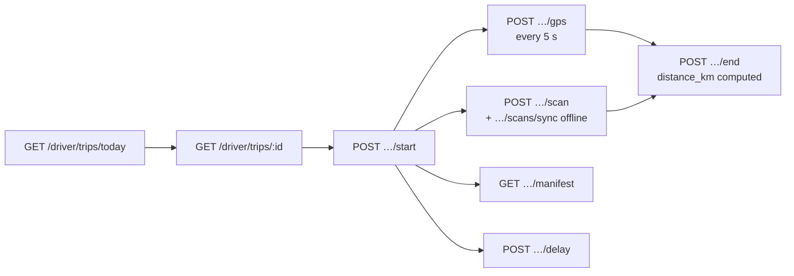
 
### 7.2 Endpoint catalog (12) ⚠R
 
| # | Method | Path | Purpose |
|:---:|---|---|---|
| 1 | GET | `/v1/driver/me` | Profile, KYC status, duty state |
| 2 | PATCH | `/v1/driver/me` | Update profile fields |
| 3 | GET | `/v1/driver/trips/today` | Today's assigned trips |
| 4 | GET | `/v1/driver/trips/history` | Past trips (paginated) |
| 5 | GET | `/v1/driver/trips/:id` | Trip detail (canonical shape pending — A7) |
| 6 | POST | `/v1/driver/trips/:id/start` | Start the trip |
| 7 | POST | `/v1/driver/trips/:id/gps` | Submit a GPS sample |
| 8 | POST | `/v1/driver/trips/:id/scan` | Scan one ticket online |
| 9 | POST | `/v1/driver/trips/:id/scans/sync` | Upload offline scans in a batch |
| 10 | GET | `/v1/driver/trips/:id/manifest` | Passenger manifest (shape pending — A17) |
| 11 | POST | `/v1/driver/trips/:id/delay` | Report a delay |
| 12 | POST | `/v1/driver/trips/:id/end` | End the trip |
 
Driver sign-in (OTP) is counted under Auth (§3). `POST /v1/driver/me/documents` is a pending amendment (§7.3).
 
**Start trip rules (invariants 13–16 in `05` §7.1):** the driver must be `VERIFIED` or `ACTIVE` (not `BLOCKED`), the bus must be `APPROVED` and match the schedule's bus, the schedule must be `PUBLISHED`, and the driver may have at most one active trip. Errors: `409 DRIVER_BLOCKED`, `409 BUS_NOT_APPROVED`, `409 TRIP_ALREADY_ACTIVE`. Starting sets the trip `IN_PROGRESS`, marks the driver on duty, and emits `trip:started`.
 
**GPS submit:** `POST /v1/driver/trips/:id/gps`
```json
{
  "lat": 26.449900,
  "lng": 80.331900,
  "recordedAt": "2026-11-01T09:15:05.000Z",
  "accuracyM": 8.5,
  "clientReportedSpeedKmh": 62.0
}
```
The server stamps `received_at`, computes `speed_kmh` from consecutive samples, and runs the provenance checks in `buscon/04`. Position is cached in Redis every 5 seconds (TTL 6 h) and persisted to Postgres every 30 seconds (`05` §6.5.1). The `bus:position` broadcast is throttled — sample sent every 5 s, broadcast capped at one per 3 s (A11). A per-driver rate limit of 20/min is proposed (A13, §10).
 
**Scan (online):** `POST /v1/driver/trips/:id/scan` with `{ "qrPayload": "…", "qrSignature": "…" }`. The result is one of the `boarding_scans.result` values: `VALID`, `DUPLICATE`, `INVALID_SIGNATURE`, `INVALID_BOOKING`, `INVALID_TRIP`. A valid scan moves the ticket `ACTIVE → SCANNED → USED`, the booking `CONFIRMED → CHECKED_IN`, and emits `boarding:verified`. The extended response with a manual-entry variant is amendment A16; the extended `boarding:verified` payload (`passengerCount`, `allSeatLabels[]`) is A15.
 
**Scan (offline sync):** `POST /v1/driver/trips/:id/scans/sync` accepts the queued scans recorded without network. Each is verified against the Ed25519 signature on the device and re-validated server-side; replays are rejected as `DUPLICATE`. Per-scan results are returned in order.
 
**Delay:** `POST /v1/driver/trips/:id/delay` with `{ "reason": "TRAFFIC", "minutes": 25 }` → sets `delay_reason` and `delay_minutes`, emits `trip:delayed`.
 
**End trip:** `POST /v1/driver/trips/:id/end` → trip `COMPLETED`, `distance_km` computed once from the ordered GPS samples (haversine summed — `06` §8.2), `CHECKED_IN` bookings become `COMPLETED`, driver off duty, `trip:ended` emitted.
 
> **Pending amendment P6 (`buscon/02`):** scan and manifest should also work while the trip is `SCHEDULED`, not only `IN_PROGRESS`. This depends on how trip rows are created — see `05` Q14.
 
### 7.3 🆕P Driver documents (A6) — blocks Phase 1 launch
 
`POST /v1/driver/me/documents` is the 13th driver endpoint. It mirrors `POST /v1/operator/me/documents`: the driver uploads KYC documents (licence and identity) through the upload flow and attaches the returned references to their profile. It stores the reference in `driver_profiles.kyc_documents_ref` (encrypted, ref only — `05` §18) and moves a `SIGNED_UP` driver to `KYC_PENDING` (`05` §8.5). The exact request shape is owned by `buscon/02` §21. Once confirmed, the Driver count becomes 13 and the documented total 107.
 
---
 
## 8. WebSocket Contract
 
### 8.1 Topics ⚠R
 
**Diagram: Four WebSocket topics**
*One gateway, four topics. A client subscribes only to topics its role allows. Seat topics are visible to anyone viewing a seat deck; trip topics to people on that trip; user topics to the owner only; the admin topic to `SUPER_ADMIN`.*
 
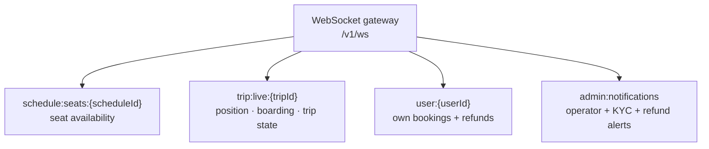
 
| Topic | Who may subscribe |
|---|---|
| `schedule:seats:{scheduleId}` | Any passenger or guest with the schedule open |
| `trip:live:{tripId}` | Passengers with a booking on the trip; the owning operator; the assigned driver |
| `user:{userId}` | That user only |
| `admin:notifications` | `SUPER_ADMIN` |
 
### 8.2 Auth handshake and reconnection ⚠R
 
**Diagram: Connection state machine**
*A client connects, authenticates with its access token, then subscribes. If the token expires the server asks for re-auth; if the connection drops the client backs off and retries; after repeated failures it falls back to polling the REST endpoints.*
 
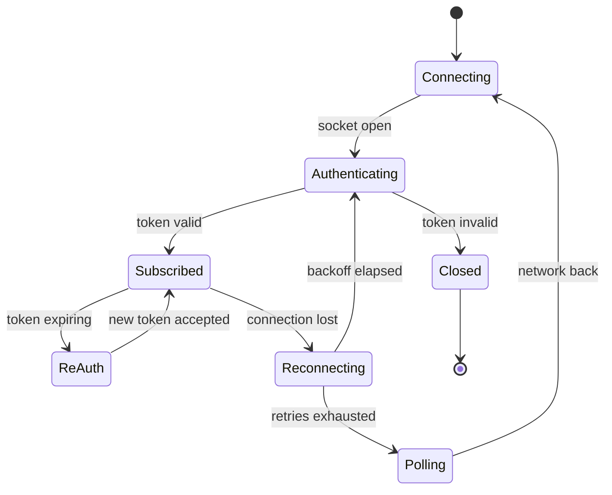
 
| Rule | Detail |
|---|---|
| Handshake | First message after open carries the access token; no subscription is accepted before auth |
| Re-auth | Before expiry the client sends a fresh token; if it does not, the server closes the socket |
| Reconnect | Exponential backoff; on reconnect the client re-subscribes and re-fetches state over REST |
| Fallback | Polling the matching REST endpoint (`…/seats`, `…/live`) when the socket cannot be re-established |
| Revoked session | A session in the Redis revoked list is disconnected immediately |
 
### 8.3 Event catalog (16) ⚠R
 
Events are `noun:verb`, lowercase. All fire after the database commit (principle 6). The delta draft states the total as 16 but does not list them, so this catalog is rebuilt from `05` §10.4 and the cross-references in §3.10 and §5.11.
 
| # | Event | Topic | Emitted when |
|:---:|---|---|---|
| 1 | `seat:locked` | `schedule:seats:{id}` | A seat lock is acquired |
| 2 | `seat:released` | `schedule:seats:{id}` | A lock is released or expires |
| 3 | `seat:booked` | `schedule:seats:{id}` | A booking is confirmed |
| 4 | `booking:confirmed` | `user:{id}` | Webhook confirms payment |
| 5 | `booking:cancelled` | `user:{id}` | Passenger or operator cancel |
| 6 | `booking:expired` | `user:{id}` | 15-minute payment window closes (added v1.2) |
| 7 | `refund:requested` | `user:{id}` | A refund is initiated |
| 8 | `refund:processed` | `user:{id}` | Razorpay `refund.processed` |
| 9 | `trip:started` | `trip:live:{id}` | Driver starts the trip |
| 10 | `trip:delayed` | `trip:live:{id}` | Driver reports a delay |
| 11 | `trip:ended` | `trip:live:{id}` | Driver ends the trip |
| 12 | `trip:cancelled` | `trip:live:{id}` | Operator cancels the trip (P12, §5.11) |
| 13 | `bus:position` | `trip:live:{id}` | GPS sample broadcast (throttled) |
| 14 | `boarding:verified` | `trip:live:{id}` + `user:{id}` | A scan is `VALID` |
| 15 | `operator:applied` | `admin:notifications` | New operator signup (P13, §3.10) |
| 16 | `refund:failed` | `admin:notifications` | A refund fails after retries |
 
`trip:cancelled` (#12) and `operator:applied` (#15) have emit tests `ws_18` and `ws_17` in §15.6.
 
**Payloads — what is fixed today:**
- `bus:position` currently carries a partial `{ lat, lng }`; the full payload schema is amendment **A12** (`buscon/04` §20).
- `boarding:verified` is extended with `passengerCount` and `allSeatLabels[]` by amendment **A15** to match QR payload v2.
- Every event carries `{ event, topic, occurredAt, requestId }` plus its data.
---
## 9. Error Model
 
### 9.1 Error taxonomy ⚠R
 
**Diagram: Error taxonomy**
*Every failure is one of three kinds. Request errors are the caller's to fix. Domain errors are valid requests the current state refuses. Platform errors are ours. The HTTP status follows the kind; the `code` string is what clients switch on.*
 
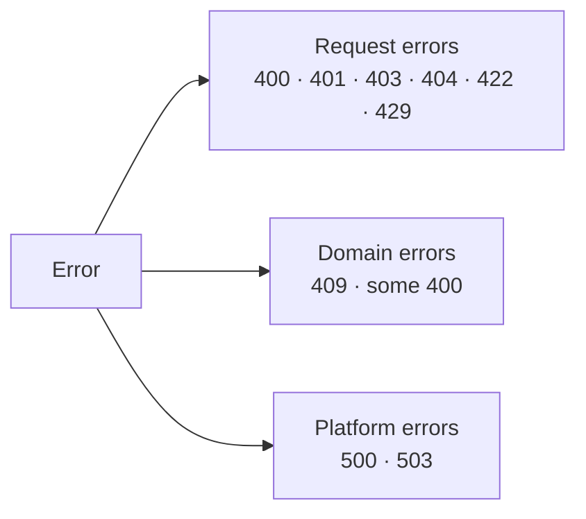
 
Clients switch on `error.code`, never on `message`. `details` carries structured context (for example `conflictingScheduleId`).
 
### 9.2 Full error code catalog (52 codes)
 
**Source column:** `draft` = listed in the v1.4 delta draft or its summary; `05/06` = implied by an invariant or test in those documents; `⚠R` = reconstructed — confirm the exact string in `*.errors.ts`.
 
| Code | HTTP | When | Source |
|---|:---:|---|---|
| `VALIDATION_ERROR` | 422 | Schema failure, weak password, extra field (`.strict()`) | draft |
| `INVALID_REQUEST` | 400 | Generic domain errors (duplicate seat coordinate, capacity mismatch, stand/city mismatch, duplicate invite) | draft |
| `UNAUTHORIZED` | 401 | Missing or invalid access token | ⚠R |
| `FORBIDDEN` | 403 | Role not allowed on this surface | draft |
| `NOT_FOUND` | 404 | Missing resource, or cross-tenant access | draft |
| `RATE_LIMITED` | 429 | Tier limit exceeded (§10) | draft |
| `INTERNAL_ERROR` | 500 | Unhandled server error | ⚠R |
| `SERVICE_UNAVAILABLE` | 503 | Dependency or worker unavailable (e.g. `audit-export.worker`) | draft |
| `IDEMPOTENCY_KEY_REQUIRED` | 400 | Missing `Idempotency-Key` on a money endpoint | ⚠R |
| `INVALID_CREDENTIALS` | 401 | Wrong email/password | ⚠R |
| `OTP_INVALID` | 401 | Wrong code, **or wrong `purpose`** (§3.5) | ⚠R |
| `OTP_EXPIRED` | 401 | Challenge past `expires_at` | ⚠R |
| `OTP_ATTEMPTS_EXCEEDED` | 429 | Attempt limit hit; challenge dead | ⚠R |
| `RESET_TOKEN_INVALID` | 401 | Reset token used, expired, or unknown | 05/06 |
| `REFRESH_REUSED` | 401 | Already-rotated refresh token presented; session revoked | ⚠R |
| `SESSION_REVOKED` | 401 | Session in the revoked list | ⚠R |
| `INVALID_GSTIN_FORMAT` | 400 | GSTIN fails regex at signup — **v1.4** | draft |
| `INVALID_PAN_FORMAT` | 400 | PAN fails regex at signup — **v1.4** | draft |
| `INVALID_PHONE_FORMAT` | 400 | Phone not E.164 | draft |
| `INVALID_EMAIL_FORMAT` | 400 | Email malformed | draft |
| `EMAIL_ALREADY_REGISTERED` | 409 | Email exists | draft |
| `PHONE_ALREADY_REGISTERED` | 409 | Phone exists | draft |
| `GSTIN_ALREADY_REGISTERED` | 409 | GSTIN exists | draft |
| `SEAT_ALREADY_BOOKED` | 409 | Seat has a confirmed booking | 05/06 |
| `SEAT_LOCKED` | 409 | Seat locked by another user | ⚠R |
| `SEAT_LOCK_REQUIRED` | 409 | Booking attempted without holding the lock | ⚠R |
| `SCHEDULE_NOT_PUBLISHED` | 409 | Lock or book on a non-`PUBLISHED` schedule | ⚠R |
| `BOOKING_NOT_CONFIRMED` | 409 | Ticket requested for a non-`CONFIRMED` booking | ⚠R |
| `BOOKING_NOT_CANCELLABLE` | 409 | Cancel on a booking that is not `CONFIRMED` | ⚠R |
| `PAYMENT_NOT_ALLOWED` | 400 | Booking not `PENDING`, expired, or already paid — **v1.2** | draft |
| `BUS_REGISTRATION_EXISTS` | 409 | Duplicate registration number | draft |
| `LICENSE_ALREADY_REGISTERED` | 409 | Duplicate driver licence | draft |
| `SCHEDULE_HAS_BOOKINGS` | 409 | Cannot delete a schedule with bookings | draft |
| `ROUTE_IN_USE` | 409 | Route referenced by schedules | draft |
| `INVALID_SCHEDULE_TIMES` | 400 | Arrival ≤ departure | draft |
| `ROUTE_SAME_CITY` | 400 | Origin = destination | draft |
| `SCHEDULE_CONFLICT` | 409 | Publish-time bus overlap — **v1.3** | draft |
| `TRIP_NOT_CANCELLABLE` | 400 | Cancel on a `COMPLETED` or `CANCELLED` trip | draft (see Q23) |
| `DRIVER_ON_DUTY` | 409 | Remove a driver who is on duty or on an `IN_PROGRESS` trip | draft |
| `OPERATOR_NOT_PENDING_REVIEW` | 409 | Approve/reject an operator in the wrong state | ⚠R |
| `BUS_NOT_PENDING` | 409 | Approve/reject a bus that is not `PENDING` | ⚠R |
| `DRIVER_NOT_KYC_PENDING` | 409 | Approve/reject KYC for a driver not in `KYC_PENDING` | ⚠R |
| `REASON_REQUIRED` | 400 | Reject or suspend without a reason | ⚠R |
| `REFUND_EXCEEDS_PAYMENT` | 400 | Refund amount above the payment (invariant #11) | 05/06 |
| `REFUND_NOT_ALLOWED` | 409 | Refund for a booking that is not cancelled (invariant #12) | 05/06 |
| `PAYMENT_NOT_REFUNDABLE` | 409 | Payment not `SUCCEEDED` | ⚠R |
| `DRIVER_BLOCKED` | 409 | Blocked or unverified driver starts a trip | 05/06 |
| `BUS_NOT_APPROVED` | 409 | Trip started with an unapproved bus | 05/06 |
| `TRIP_ALREADY_ACTIVE` | 409 | Driver already has an active trip | 05/06 |
| `TRIP_NOT_ACTIVE` | 409 | GPS, scan, or end on a trip that is not `IN_PROGRESS` | ⚠R |
| `WEBHOOK_SIGNATURE_INVALID` | 400 | Razorpay signature check failed (§13) | ⚠R |
| `IMMUTABLE_ENTITY` | 409 | Write to an immutable entity (`05` §21) | 05/06 |
 
**Change history:** v1.1 added `PAYMENT_NOT_ALLOWED` (48 → 49). v1.3 added `SCHEDULE_CONFLICT` (49 → 50). v1.4 added `INVALID_GSTIN_FORMAT` and `INVALID_PAN_FORMAT` (50 → **52**). `TRIP_NOT_CANCELLABLE` is described in the draft as already present in the v1.3 body — see Q23.
 
### 9.3 Error response structure
 
```json
{
  "error": {
    "code": "SCHEDULE_CONFLICT",
    "message": "Bus has an overlapping schedule",
    "details": { "conflictingScheduleId": "uuid" },
    "requestId": "req_abc123"
  }
}
```
 
`message` is for logs and developers; it is not localised and not shown to end users verbatim. Validation failures list each field under `details.fields[]`.
 
---
 
## 10. Rate Limits
 
**Diagram: Rate-limit tiers**
*Four tiers. Authentication endpoints are the tightest because they trigger SMS and email. Writes are limited per user, reads more loosely, and the Razorpay webhook is allow-listed by signature rather than throttled.*
 
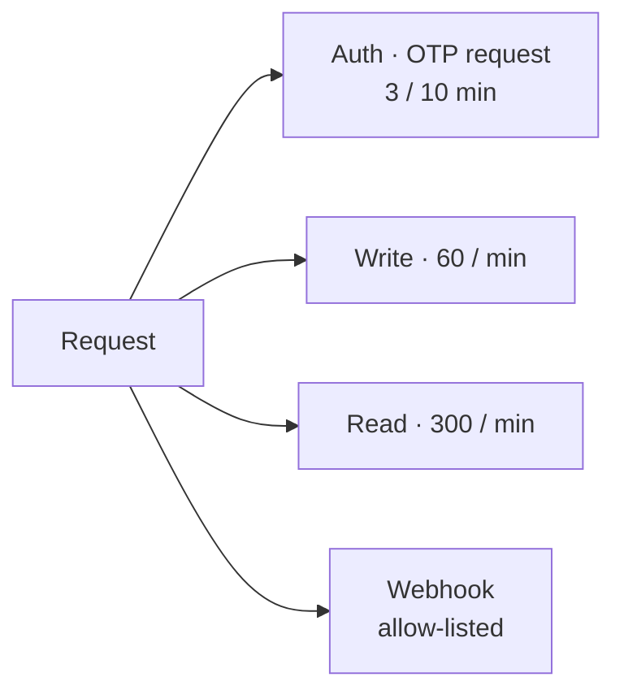
 
| Tier | Limit | Applies to |
|---|---|---|
| Auth | 3 requests / 10 min | OTP request endpoints; **`/operator/auth/signup` (per IP) — v1.4** |
| Write | 60 / min | `POST`, `PATCH`, `PUT`, `DELETE` |
| Read | 300 / min | `GET` |
| Webhook | Not throttled | `/v1/webhooks/razorpay` (signature-verified) |
| Audit export | Write tier **plus** 3 jobs / hour / admin — **v1.4** | `POST /admin/audit-logs/export-async` |
 
Exceeded limits return `429 RATE_LIMITED` with a `Retry-After` header ⚠R. **Proposed (A13):** a 20 / min per-driver limit on `POST /driver/trips/:id/gps`, to stop a runaway client; not yet in code.
 
---
 
## 11. Idempotency
 
| Endpoint | Key required | Behaviour |
|---|:---:|---|
| `POST /passenger/payments` | ✅ | Same key within 24 h returns the original response; **a payment retry after failure uses a new key** (§4.6) |
| `POST /admin/payments/:id/refund` | ✅ | Same key returns the original refund; no double refund |
| `POST /operator/trips/:id/cancel` | — | Idempotent by design: a second call on an already-`CANCELLED` trip returns `400 TRIP_NOT_CANCELLABLE` and refunds nothing twice |
| Everything else | — | Safe by state-machine guards (a repeat call fails with a 409), not by keys |
 
The key is a client-generated UUID in the `Idempotency-Key` header. It is scoped to user + route. Reusing a key with a different body is rejected as `422 VALIDATION_ERROR` ⚠R. A missing key on a required endpoint is `400 IDEMPOTENCY_KEY_REQUIRED`.
 
---
 
## 12. Pagination
 
Cursor-based. `?cursor=<opaque>&limit=<n>` (default 20, maximum 100 ⚠R). Responses carry `meta.nextCursor`; `null` means the last page. Cursors are opaque and must not be parsed or stored by clients.
 
| Paginated endpoint | Order |
|---|---|
| `GET /passenger/bookings` | newest first |
| `GET /driver/trips/history` | newest first |
| `GET /operator/drivers` · `/bookings` · `/settlements` | newest first |
| `GET /admin/operators` · `/buses` · `/routes` · `/drivers` · `/bookings` · `/audit-logs` | newest first |
 
**v1.4:** no new paginated endpoints. `GET /admin/audit-logs/export-async/:jobId` returns a single job, not a page. `GET /operator/revenue` returns bounded `buckets[]` (maximum 90 days), not cursors.
 
---
 
## 13. Webhooks
 
### 13.1 Razorpay webhook ⚠R
 
**Diagram: Webhook processing**
*Razorpay calls one endpoint. The signature is checked on the raw body before anything else. The payload is then deduplicated by its hash, and the matching payment or refund is moved through its state machine. A terminal state is a no-op, so a replay changes nothing. If the database write fails, the event is kept for the replay worker.*
 
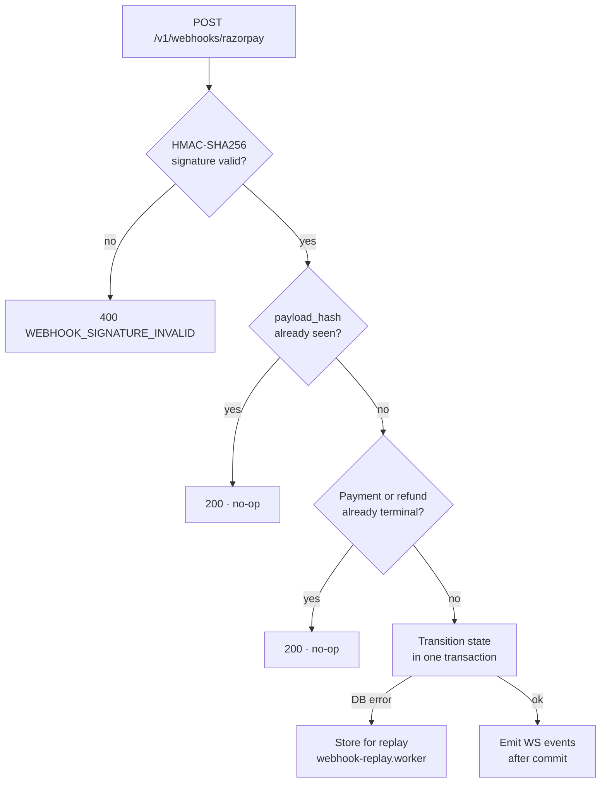
 
| Event | Effect |
|---|---|
| `payment.captured` | Payment `SUCCEEDED` → booking `CONFIRMED` → ticket issued → GST invoice recorded (`06` §7.4) → `seat:booked`, `booking:confirmed` |
| `payment.failed` | Payment `FAILED`; booking stays `PENDING` until its window ends |
| `refund.processed` | Refund `PROCESSED` → `refund:processed` |
| `refund.failed` | Refund `FAILED` → `refund:failed` to admin |
 
| Rule | Detail |
|---|---|
| Signature | HMAC-SHA256 of the **raw** body, header `X-Razorpay-Signature`, checked before parsing |
| Dedup layer 1 | `payload_hash` — a repeated payload is acknowledged and ignored |
| Dedup layer 2 | Terminal-state no-op — a late duplicate cannot move a finished payment |
| Dedup layer 3 | Event-to-transition mapping — only legal transitions apply (`05` §8.2) |
| DB fallback | If the database write fails, the raw event is persisted and retried by `webhook-replay.worker`; Razorpay still gets a response so it does not storm |
| Source | No JWT. Authenticity is the signature; not rate-limited |
 
---
 
## 14. OpenAPI and Versioning
 
Code-first Fastify schemas generate OpenAPI 3.1. `GET /v1/openapi.json` and `GET /v1/docs` are public. Breaking changes ship under a new prefix (`/v2`); the old version stays up for a 6-month deprecation window, announced with `Deprecation` and `Sunset` response headers ⚠R. Additive changes (new fields, new endpoints, new enum values clients must tolerate) do not bump the version. An unknown version prefix returns `404`.
 
---
 
## 15. Observability and Test Matrix
 
### 15.1 Log contract ⚠R
 
Every request writes one structured log line: `requestId`, `method`, `path`, `status`, `durationMs`, `role`, `userId` (when authenticated). Request and response bodies are never logged. PII fields are redacted.
 
### 15.2 Headers ⚠R
 
| Header | Direction | Purpose |
|---|---|---|
| `X-Request-Id` | Request (optional) / Response | Trace id; generated when absent and echoed in `meta.requestId` |
| `Idempotency-Key` | Request | Money endpoints (§11) |
| `Retry-After` | Response | On `429` |
| `X-PII-Unmasked: true` | Response | Admin unmask (§6.5) |
 
### 15.3 Health and status ⚠R
 
`GET /v1/health` is liveness. `GET /v1/status` checks Postgres and Redis and is used by the deploy checklist in `11`. Neither needs auth.
 
### 15.4 Correlation ⚠R
 
The `requestId` on a response is the same id in the log line, in any audit row written during the request, and in WebSocket events emitted after its commit.
 
### 15.5 Test matrix
 
| Suite | Count | Covers |
|---|---:|---|
| `contract_*` | **108** | One per endpoint (106 documented + the 2 unlocated in §1.5.3) |
| `auth_*` | 20 | Phone OTP (2), email OTP (3), driver OTP (2), operator password + OTP (3), admin password (1), reset email (3), reset OTP (3), refresh (2), logout (1) — signup coverage is counted under `contract_*` and `rbac_*` |
| `rbac_*` | **108** | Every endpoint rejects wrong roles |
| `error_*` | **52** | Every error code |
| `idempotency_*` | 4 | Payment create, retry with new key, retry with old key, refund |
| `pagination_*` | 6 | Each paginated endpoint family |
| `ws_*` | **18** | Topics, auth, reconnect, re-auth, fallback, `booking:expired`, **`ws_17`, `ws_18`** |
| `webhook_*` | 10 | Signature (2), `payload_hash` dedup (2), terminal-state no-op (2), event transition (2), DB error fallback (2) |
| `rate_limit_*` | 11 | Each tier, plus signup tier, plus audit-export tier |
| `upload_*` | 6 | 3 upload endpoints × 2 |
| `observability_*` | 4 | `requestId` propagation, log format |
| `versioning_*` | 2 | OpenAPI served, unknown version 404 |
| **Total** | **349** | 12 suites |
 
**Change from v1.1:** `error_*` 48 → 49; `idempotency_*` 3 → 4; `ws_*` 15 → 16; `webhook_*` 8 → 10; total 323 → 328.
**Change from v1.2:** `contract_*` / `rbac_*` 101 → 102; `error_*` 49 → 50; total 328 → 330.
**Change from v1.3:** `contract_*` / `rbac_*` 102 → 108; `error_*` 50 → 52; `rate_limit_*` 9 → 11; `ws_*` 16 → 18 (the delta draft added the two tests but did not update the count); total 330 → **349** (the delta draft stated ~348; its own rows summed to 347 before the `ws_*` fix).
 
### 15.6 New test assertions (v1.4)
 
| Test | Assertion |
|---|---|
| `contract_103_operator_signup` | `POST /operator/auth/signup` → 201 with `{ operatorId, userId, status: "APPLIED" }` |
| `contract_103_signup_dupe_email` | Duplicate email → 409 `EMAIL_ALREADY_REGISTERED` |
| `contract_103_signup_dupe_phone` | Duplicate phone → 409 `PHONE_ALREADY_REGISTERED` |
| `contract_103_signup_dupe_gstin` | Duplicate GSTIN → 409 `GSTIN_ALREADY_REGISTERED` |
| `contract_103_signup_bad_gstin` | Bad GSTIN format → 400 `INVALID_GSTIN_FORMAT` |
| `contract_103_signup_bad_pan` | Bad PAN format → 400 `INVALID_PAN_FORMAT` |
| `contract_104_trip_cancel` | `POST /operator/trips/:id/cancel` → 200 with `bookingsCancelled`, `refundsInitiated` |
| `contract_104_trip_cancel_completed` | Cancel `COMPLETED` trip → 400 `TRIP_NOT_CANCELLABLE` |
| `contract_105_audit_export_start` | `POST /admin/audit-logs/export-async` → 202 `{ jobId, status: "QUEUED" }` |
| `contract_106_audit_export_status` | `GET /admin/audit-logs/export-async/:jobId` → 200 with `status` enum |
| `ws_17_operator_applied_emit` | Signup → `operator:applied` delivered to `admin:notifications` |
| `ws_18_trip_cancelled_emit` | Trip cancel → `trip:cancelled` delivered to `trip:live:{tripId}` |
 
**Proposed (not in the 349):** two tests for the P2 rule in §3.5 — `auth_p2_login_otp_rejected_at_reset_verify` (a `LOGIN` challenge sent to `reset/verify` → 401 `OTP_INVALID`, challenge not consumed) and `auth_p2_reset_otp_rejected_at_login_verify` (the reverse).
 
**Note:** These tests ship in the backend (per `00-BUILD-PROGRESS` §2.5: "WS emit integration 13/13"). This matrix lists the *contract tests* the frontend can rely on.
 
---
 
## 16. Open Questions
 
**Q1–Q15** are carried from v1.2 and are **not reproduced here** — the v1.2 text was not available for this rewrite. Restore them from the v1.2 file before lock.
 
| # | Question | Owner | Decision / default |
|:---:|---|---|---|
| 16 | Should `SCHEDULE_CONFLICT` be added to the code in Phase 3c? (Currently emits `INVALID_REQUEST` with 409 + details) | Shaghaf | **Yes** — Phase 3c updates `network.errors.ts` + `network.router.ts`. Tests check `details.conflictingScheduleId`, not the code string, so no test changes needed |
| 17 | `GET /operator/settlements` returns an empty array until Phase 5 — acceptable for viva? | Shaghaf | **Yes** — `meta.note` explains it; frontend renders the empty state |
| 18 | **v1.4** — `POST /operator/trips/:id/cancel`: operator or driver surface? | Shaghaf | **Operator**, per cascade semantics. If recon shows the driver surface, move §5.11 → §7; no response-shape impact (counts become Operator 33, Driver 13) |
| 19 | **v1.4** — 2 undocumented P11 endpoints (§1.5.3): what are they? | Shaghaf | **Route-grep pending.** Candidates (from the P11 test set): two additional public endpoints, or two trip-service action endpoints (delay-resume, seat-lock admin release). **Must close before lock** |
| 20 | **v1.4** — does `audit-export.worker.ts` exist yet? | Shaghaf | If not, `POST /admin/audit-logs/export-async` returns 503 `SERVICE_UNAVAILABLE`; the frontend treats 503 as "use the sync export" |
| 21 | **v1.4 rewrite** — `SCHEDULE_HAS_BOOKINGS` ("cannot delete a schedule") exists, but the 34-row operator catalog has no schedule `DELETE`. Which endpoint raises it? | Shaghaf | Unresolved — likely `PATCH` to `CANCELLED`, or a DELETE missing from the catalog |
| 22 | **v1.4 rewrite** — `dashboard.pendingApprovals.schedules` implies a schedule approval queue; A1 says schedules have none | Shaghaf | Remove the field or redefine it (e.g. drafts awaiting publish) when A1 lands |
| 23 | **v1.4 rewrite** — is `TRIP_NOT_CANCELLABLE` one of the 52, or the 53rd? The draft labels it v1.4 but excludes it from the "+2" | Shaghaf | Check `network.errors.ts`; if it is new, `error_*` and the catalog become 53 and the total 350 |
| 24 | **v1.4 rewrite** — operator trip cancel: bookings become `CANCELLED` (draft) or `OPERATOR_CANCELLED` (`05` §8.1)? | Shaghaf | `05` is the domain authority → `OPERATOR_CANCELLED`; confirm the code writes it |
 
---
 
## 17. Checklist Against Master List
 
| Item | Included? | Section |
|---|:---:|---|
| Complete file — no `[unchanged]` placeholders | ✅ | whole document |
| 8 endpoint categories with counts | ✅ | §1.5.2 |
| Endpoint count reconciliation | ✅ | §1.5.3 |
| Pending amendment endpoints (A6, A8, A10) | ✅ | §1.5.4, §5.12, §6.8, §7.3 |
| Provenance tags (⚠R, 🆕P) | ✅ | §1.6 |
| Response envelope + data types | ✅ | §2 |
| OTP `purpose` isolation (P2) | ✅ | §3.5 |
| `POST /operator/auth/signup` | ✅ | §3.10 |
| `GET /public/cities/:id/stands` | ✅ | §4.2 |
| `amenities` mapping from `{ _v, items }` | ✅ | §4.2 |
| Refund tiers + `OPERATOR_CANCELLED` → `TIER_FULL` | ✅ | §4.5 |
| Payment `Idempotency-Key` + retry rule | ✅ | §4.6, §11 |
| Bus registration `busType` + `amenities` | ✅ | §5.3 |
| PII mask table per endpoint family | ✅ | §5.5 |
| `SCHEDULE_CONFLICT` error + response | ✅ | §5.6, §9.2 |
| §5.7–5.10 Phase 3c contracts | ✅ | §5.7–§5.10 |
| `POST /operator/trips/:id/cancel` | ✅ | §5.11 |
| `POST /admin/audit-logs/export-async` + job status | ✅ | §6.7 |
| Driver endpoints incl. GPS provenance columns | ✅ | §7.2 |
| WebSocket topics, handshake, 16 events | ✅ | §8 |
| 52-code error catalog with source column | ✅ | §9.2 |
| Rate-limit tiers incl. signup + export | ✅ | §10 |
| Webhook flow with 3 dedup layers + fallback | ✅ | §13 |
| Test matrix recomputed (349) | ✅ | §15.5 |
| **2 unlocated P11 endpoints** | ❌ | §1.5.3, Q19 |
| **Q1–Q15 from v1.2** | ❌ | §16 — to be restored |
 
---
 
## 18. One-Paragraph Summary
 
**BusVerse + BusCon Phase 1 exposes 108 REST endpoints across eight categories (health 2, auth 15, public 4, passenger 15, operator 34, admin 23, driver 12, webhooks 1)** — of which **106 are individually documented** in this file and **2 are flagged unlocated in §1.5.3** pending a route-grep. Plus **4 WebSocket topics**, **16 event types**, and **1 Razorpay webhook** with three layers of dedup and a database fallback. All conventions from v1.2 are retained and written out in full. **v1.2 additions:** `expiresAt` on bookings and the 15-minute `PENDING` window, `PAYMENT_NOT_ALLOWED`, the refund-preview tier table (`OPERATOR_CANCELLED` → `TIER_FULL` always), `Idempotency-Key` on payment retry, the seat-lock pre-check, `booking:expired`, and the webhook DB fallback. **v1.3 additions:** `GET /public/cities/:id/stands`, `SCHEDULE_CONFLICT` with its details shape, the Phase 3c operator contracts, bus registration `busType` + `amenities`, and the PII mask table. **v1.4 additions:** operator self-signup with GSTIN/PAN validation and an atomic four-row transaction, operator trip cancel with cascade refunds, async audit export, `INVALID_GSTIN_FORMAT` and `INVALID_PAN_FORMAT` (50 → **52**), and the OTP `purpose` isolation fix from `06` v1.3. **Pending amendments** (A6 driver documents — launch-blocking, A8 clone schedule, A10 unpublish schedule) are specified minimally and not yet counted. **Sections marked ⚠R were reconstructed** during the full rewrite and must be verified against the route table before this document is locked. **Open questions:** Q16–Q24 listed here, plus Q1–Q15 to be restored from v1.2; two block lock (Q18, Q19). **349 tests across 12 suites** enforce this document (`contract_*` / `rbac_*` → 108, `error_*` → 52, `ws_*` → 18, `rate_limit_*` → 11).
 
---
 
**End of Document `07-API-AND-REALTIME-CONTRACTS.md` v1.4.**
 
